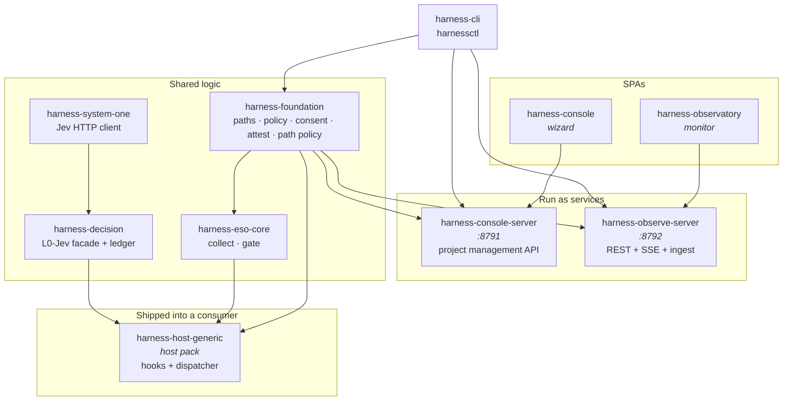
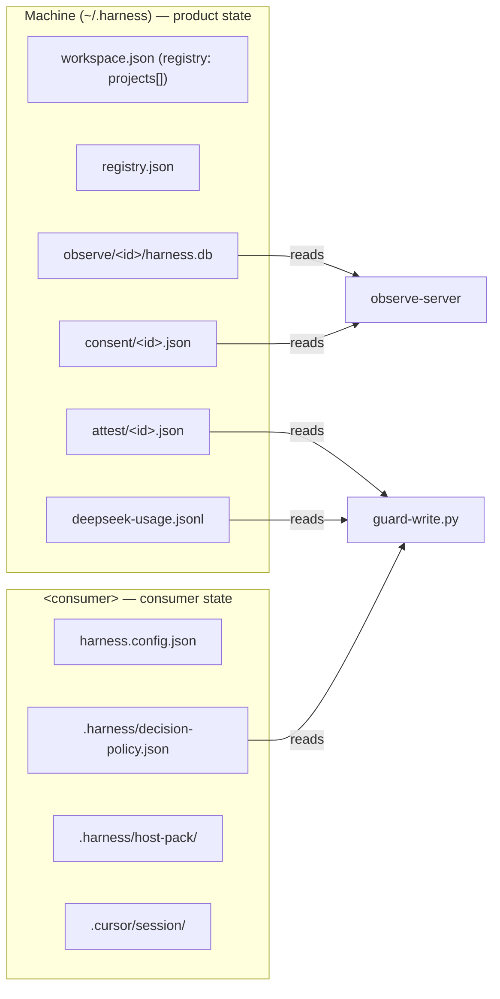
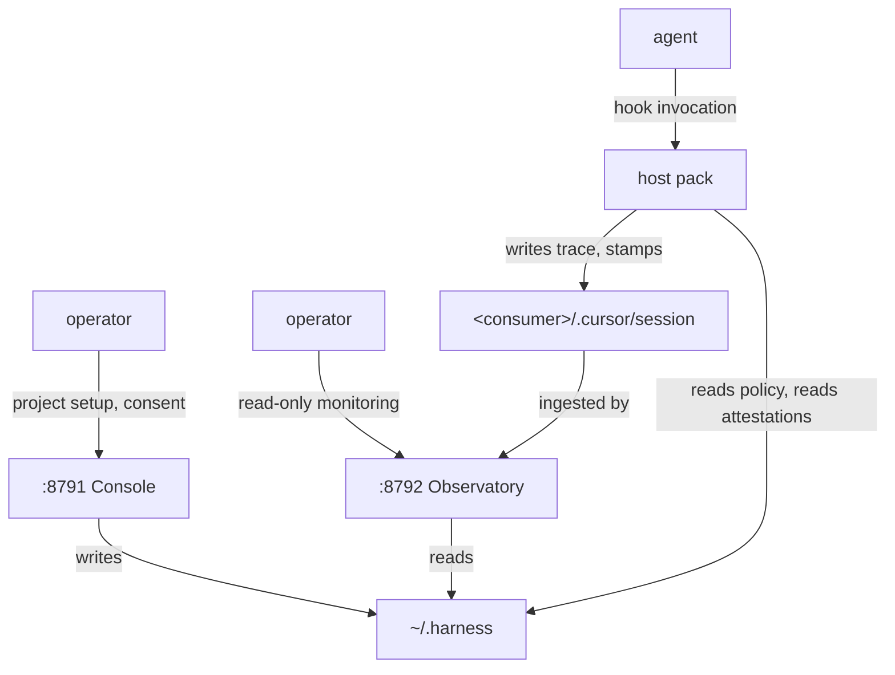
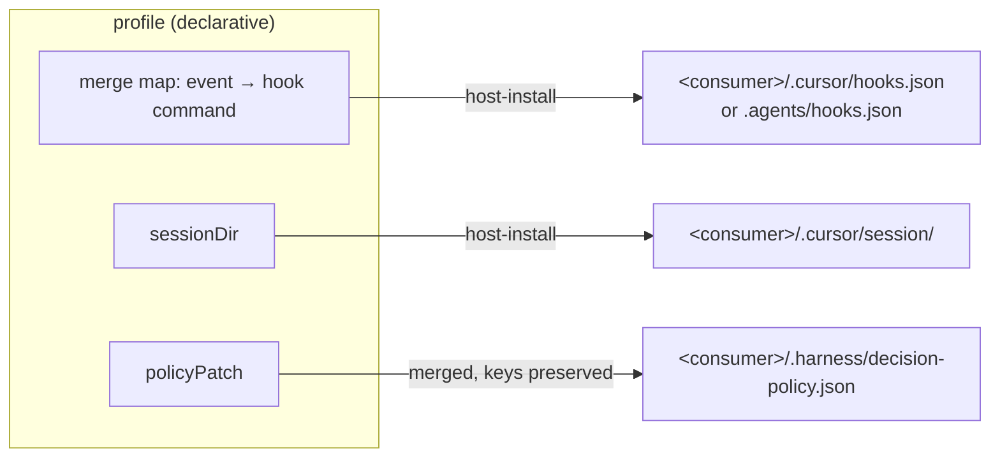
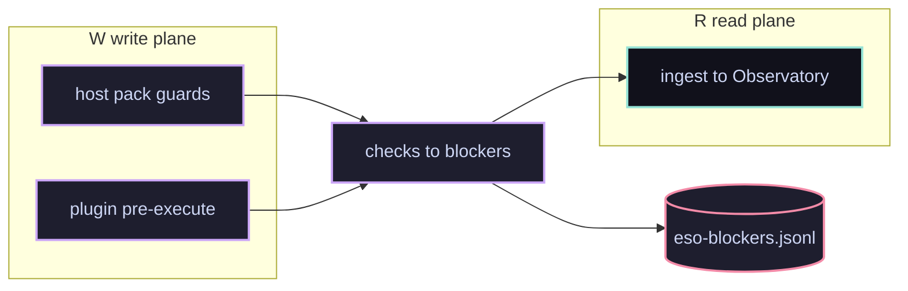

# Architecture

## The one-sentence shape

A **monorepo that builds a host pack** (injected into consumers), **two servers** (Console writes,
Observatory reads), and a **shared foundation** the three of them agree on.

## Package map

Read the arrows as **imports**, not data flow. Data flow is in
[`../02.runtime/01.prompt-lifecycle.md`](../02.runtime/01.prompt-lifecycle.md).

## The layers, and why the boundaries are where they are

### `harness-foundation` — the shared vocabulary

Everything that two other packages must agree on:

| Concern | File |
|---|---|
| repo anchor, config discovery | `repo-root.mjs` |
| `.harness` paths, session dirs | `paths.mjs` |
| decision policy load + merge | `policy-load.mjs` |
| **which paths are protected, and why** | `path-policy.mjs` |
| human consent records | `consent.mjs` |
| attestations a gate trusts | `attest.mjs` |
| shell write detection | `shell-writes.mjs` |
| product state / project registry | `workspace-store.mjs` |
| SQLite port | `db-open.mjs` |

Two entry points matter, and the distinction is **load-bearing**:

| entry | contains | who imports it |
|---|---|---|
| `@mu/harness-foundation/pure` | no database, no child process, no filesystem write | the **host pack**, which must run on a consumer with no install |
| `@mu/harness-foundation` (root) | everything, including the SQLite port | servers on the machine that runs the product |

Importing the root from a hook would drag a database driver into every guarded tool call, and with it
a conditional `bun:sqlite` import that no consumer can resolve under plain `node`. `pure.mjs` states
this at the top; keep new hook-facing code out of the root.

### `harness-host-generic` — the injected half

The **only** package that runs inside a consumer, and it does so as a bundled artifact rather than as
an installed dependency.

| File | Role |
|---|---|
| `dispatch.mjs` | the hook registry: id → implementation, and each hook's error posture |
| `dispatcher.mjs` | CLI entry — arg parsing, shape selection, error → posture |
| `hook-io.mjs` | stdin, tree, session dir, dialect, `allow`/`deny` emitters |
| `guard-shell-hook.mjs` | `beforeShellExecution` guard |
| `guard-brain-hook.mjs` | `preToolUse` guard for model-call attempts |
| `preflight-hook.mjs` | the ESO preflight run |
| `route-hook.mjs` | trace writer |
| `gap-tracker-hook.mjs` | closes evidence gaps as tools run |
| `post-tool-hint.mjs` | injected hints |
| `pre-compact-cost-hook.mjs` | cost checkpoint before context compaction |
| `shell-targets-hook.mjs` | **query** (not a guard) — which paths a shell command writes |
| `eso-gap-io.mjs` | preflight/gap/stamp file I/O, plus the ESO attestation write |

Build: `scripts/build-host-pack.mjs` bundles the dispatcher with `bun build` and then **asserts the
output has no import outside `node:*`**. That assertion is the load-bearing invariant of the whole
approach — a bundle that still imports `@mu/…` fails on a consumer.

### `harness-observe-server` — the ingest + read half

The largest package (51 source files). Three responsibilities in one process:

1. **Ingest** — poll transcripts and hook trace files, derive rows, in a **child worker process** so
   SQLite writes never block the HTTP server (`F11`/`F12`).
2. **REST + SSE** — per-request detail, request lists, aggregates, live feed.
3. **Static** — serves the Observatory SPA build.

Pipeline detail: [`../02.runtime/04.ingest-pipeline.md`](../02.runtime/04.ingest-pipeline.md).

### `harness-console-server` — the write half

Small by design: project registry CRUD, provision, host-config reload, consent. Every mutation the
operator can make lives here, and nothing in the Observatory can mutate.

### `harness-eso-core` and `harness-decision` — the reasoning

`eso-core` is collect/score/gate, pure enough to run inside a hook. `harness-decision` is the L0→L3
facade plus ledger persistence, used by the pack and by the ingest backfill. `harness-system-one` is
the Jev HTTP client, and is a dependency of `harness-decision` only.

## Where state lives, and why not in the repo

The split is a deliberate correction of an earlier design, and it is worth understanding because it
explains several constraints:

- **Product state is not in the product checkout.** It used to be, which made `git clean` destroy the
  project registry, and made the running stack depend on where the source tree sat.
- **Product state holds the records gates trust.** Consent and attestations live here precisely
  because it is a directory the agent's write gates can deny — the session dir cannot serve that
  purpose, since the agent must be able to write there.
- **The consumer owns its own policy and guards.** `<consumer>/.harness/decision-policy.json` and
  `<consumer>/.cursor/hooks/*.py` are consumer files. The product reads them; it does not ship
  replacements. This is why a product upgrade never changes a consumer's enforcement posture by
  accident.

Details, including the session-dir contents and Docker mount mapping:
[`../03.state-and-contracts/01.state-layout.md`](../03.state-and-contracts/01.state-layout.md).

## Two entry points, one product

A practical consequence: **`./harness up` gives you both**, and the Console's Projects tab is how a
consumer is added. Provisioning is not done by hand and not by `configure add` (removed).

## Profiles: how one pack serves two IDEs

`profiles/host/cursor-superset.json` and `agents-superset.json` declare, per IDE, which hooks to wire
and in which dialect. The hook *implementations* are shared; only the wiring differs.

Merging is **three-way**, not overwrite: consumer-authored hook entries survive, the product's own
entries are updated in place by `id`, and entries the profile no longer declares are pruned without
duplicating. `hook-merge.mjs` implements it; `F10`, `F22` and `F29` in `docs/04` are the defects that
shaped it.

`decision-policy.json` is **merged, never force-written**: the plan's keys are re-applied (wizard
choices win), while operator keys the plan does not define survive.

## Scale and cost notes

- One SQLite database **per project**, at `~/.harness/observe/<projectId>/harness.db`.
- Ingest runs on a poll (default 15s from the CLI, 2s from the bare server) and does **tail reads** of
  transcripts, plus a bounded history walk for backfills.
- Derived work is skipped when nothing changed; a correction or a migration forces a full recompute
  (see the `forceFull` gate in `ingest.mjs` — and note `link.corrected` participates, which `F49`
  added).

## Cập nhật 2026-10 — DSH plugin và gate theo finding

Trang này mô tả kiến trúc gốc (host pack + hai server). Từ 2026-10, hệ thống có thêm **một hình thức
triển khai thứ ba** — plugin chạy trong tiến trình DSH — và gate chuyển từ score sang **finding có tên**.
Bản đầy đủ (landscape · workflows · pipelines, 21 sơ đồ đã parse-verify) nằm ở
[`../07.how-it-works/00.index.md`](../07.how-it-works/00.index.md).

Điều thay đổi so với mô tả cũ:

| Trước | Sau |
|---|---|
| Gate chỉ có score + tier của path | Thêm **hard blocker** (`contract`/`project`/`migration`) — chặn write, reject step khi cần |
| Chỉ có hook (tiến trình con) | Thêm plugin in-process cho DSH; host pack vẫn phủ Cursor/Antigravity/Claude |
| Quyết định không để lại dấu vết | Mọi reject/deny ghi `eso-blockers.jsonl` (product state) **trước** khi trả quyết định |
| Conformance H0–H4 | **H5**: gate không nằm trong editable surface (B2) |
| Không có kiểm tra sức khoẻ host | `harnessctl doctor dsh` chặn dual-instance (`Symbol()` identity) |
