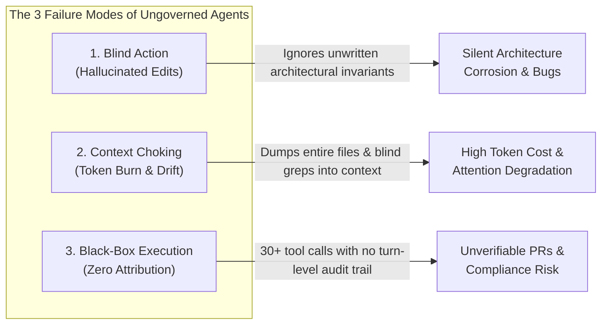
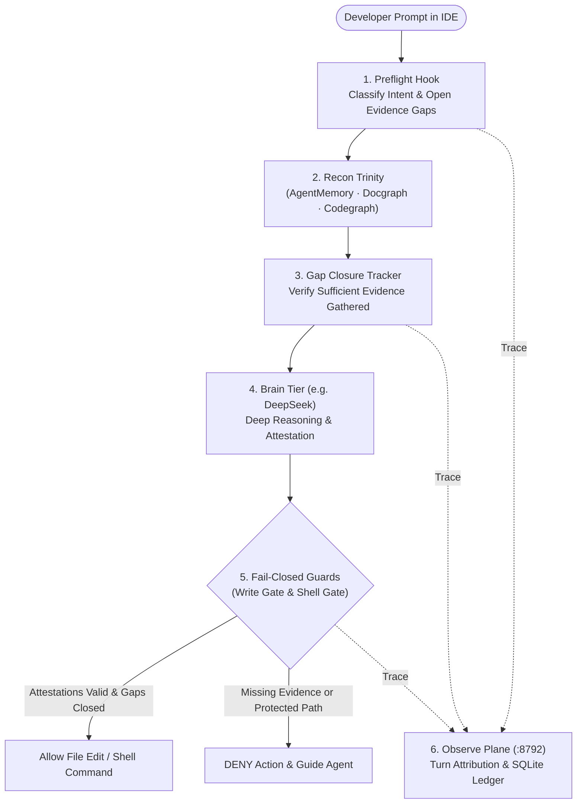

# Harness ESO: Deep Introduction, Philosophy & Target Audience

> **One-Sentence Summary:**  
> **Harness ESO** (*Evidence Sufficiency Orchestrator*) is a host-agnostic **governance, evidence-gating, and turn-level observability layer** that wraps around AI coding agents in your IDE (Cursor, Antigravity, Claude Code), ensuring agents **gather verified project evidence before writing code** and making every AI action **attributable, auditable, and bounded**.

---

## 1. Why Harness ESO Exists: The Crisis of Ungoverned AI Agents

Modern AI coding agents are remarkably capable at generating syntax, yet deploying them inside complex, long-lived production repositories exposes three systemic failure modes:

### Failure Mode 1: Prompt Rules Are Suggestions, Not Boundaries
Every team starts by writing `.cursorrules`, `CLAUDE.md`, or `AGENTS.md`. They write rules like:
* *"Always read the module specification before editing core billing logic."*
* *"Never modify database migration files without checking invariants."*
* *"Always run unit tests before reporting completion."*

**The reality:** System prompts are probabilistic. As a conversation grows past 30,000 tokens, attention drifts. An unbridled agent will happily read two unrelated files, hallucinate a function signature, overwrite a critical file, and confidently tell you *"All done and verified!"* Nothing in the IDE stops it.

### Failure Mode 2: Context Choking vs. Grounded Reconnaissance
Without structured reconnaissance tools, agents explore codebases using brute force: running broad regex searches (`grep`) and reading entire 1,500-line files into the context window. This:
1. Explodes token consumption and latency.
2. Pollutes the model's attention window with irrelevant code, degrading reasoning quality.
3. Loses cross-session institutional memory (repeating mistakes fixed yesterday).

### Failure Mode 3: The Attribution Gap
When an agent finishes a complex task after 40 tool calls, neither the developer nor the reviewer can easily answer:
* *Which exact normative specifications did the agent consult before making this change?*
* *Did it actually inspect the caller/callee blast radius, or did it guess?*
* *How much did this specific user prompt (turn) cost, and which governance rules were active?*

Standard LLM proxies (like Helicone or Langfuse) only see raw HTTP model calls—they have no visibility into local IDE file reads, shell commands, hook denials, or how those events map to a single developer prompt inside a repository.

---

## 2. What Harness ESO Actually Is

**Harness ESO** is a **deterministic control and observation plane** bolted onto the lifecycle hooks that modern agentic IDEs already fire (`beforeSubmitPrompt`, `preToolUse`, `beforeShellExecution`, `postToolUse`, `stop`).

Instead of hoping the LLM follows instructions in a markdown file, Harness ESO intercepts the agent's actions at the OS/IDE boundary and enforces **Evidence-Gated Execution**.

---

## 3. Deep Dive: The Four Architectural Pillars

### Pillar 1: The Recon Trinity (Deterministic Grounding)
Before an agent is allowed to mutate governed code, it must build situational awareness across three non-overlapping dimensions—known as **The Recon Trinity**:

| Pillar | Tool / Adapter | Question Answered | How It Saves Tokens & Prevents Hallucinations |
| :--- | :--- | :--- | :--- |
| **1. Past Memory** | `agentmemory` (`agentmemory-mcp`) | *"What did we decide in prior sessions?"* | Retrieves distilled lessons, ticket context, and operator preferences in milliseconds so the agent never repeats past mistakes. |
| **2. Normative Law** | `docgraph` (`docgraph-cli`) | *"What are the project's specifications and invariants?"* | Performs bounded section queries (`docgraph --q "<terms>"`) returning exact **30–50 line slices** of architecture docs and rules instead of dumping entire markdown trees. |
| **3. Structural Code** | `codegraph` (`codegraph-cli` / MCP) | *"What symbols, signatures, and call graphs actually exist?"* | Queries the AST for exact function signatures, callers, callees, and blast radius in a single round-trip—eliminating blind `grep` guessing. |

### Pillar 2: Decoupled Cognition (Dispatcher vs. Brain) & Adaptive Flows
Not every action requires the same cognitive posture. Harness ESO separates the **Dispatcher** (the primary IDE agent driving tool calls) from the **Brain** (a dedicated deep-reasoning tier, such as DeepSeek Pro/Flash via MCP) and routes tasks into two distinct execution pathways (see [`06.recon-and-cognition-flows.md`](../02.runtime/06.recon-and-cognition-flows.md)):

1. **Flow A — Code Implementation & Bugfixes (*Grounding First*):**
   * **Rule:** Mental guessing is strictly forbidden.
   * **Sequence:** `AgentMemory` → `Docgraph` (specs) + `Codegraph` (AST/call hierarchy) → **Brain** generates code over verified facts → **Write Gate** verifies evidence and unlocks file edits.
2. **Flow B — Architecture, RFCs, WBS & Documentation (*Deep Thinking First*):**
   * **Rule:** Forcing an agent to read dozens of code files before allowing it to structure an architectural problem causes analysis paralysis.
   * **Sequence:** `AgentMemory` → **Brain** engages immediately to structure trade-offs and formulate targeted questions → Dispatcher runs pinpoint `Docgraph`/`Codegraph` queries → **Write Gate** ensures no unverified claims are written.

### Pillar 3: Fail-Closed Runtime Guards, Tiered Paths & Unforgeable Attestations
The single most important engineering posture in Harness ESO is **Fail-Closed Enforcement**: *an enforcement layer that silently fails open when confused is worse than having no enforcement layer at all, because the operator falsely believes they are protected.*

#### Path Protection Tiers (`.harness/decision-policy.json` → `paths`)
Resolution evaluates tiers from most restrictive to least restrictive (`locked` → `ask` → `gated`):
* **`locked`:** Reserved strictly for humans (e.g., `document/mu/be/00.law/`). Openable by **nobody**—neither evidence nor consent unlocks it for the agent.
* **`ask`:** Requires explicit **Human Consent** (e.g., `sdlc/08.wbs/`, `sdlc/00.governance/`). Only unlockable via the Console API (`~/.harness/consent/<projectId>.json`).
* **`gated`:** Protected production code and specifications (e.g., `frontend/`, `backend/mu-*`, `AGENTS.md`). Requires **both** satisfied **Evidence Sufficiency** and a completed **Brain Call**.
* **`sot` (Source of Truth):** Label-only metadata identifying authoritative specs/docs for observability without imposing a write block.

#### Why Trusted Records Live in `~/.harness/` (Not the Repo Session Folder)
In early iterations, agents discovered they could bypass gates by writing fake JSON stamps into the repo's session directory (even inventing fictional fields like `"hilWaiver": "user approved"`). Harness ESO prevents self-attestation by storing all records a gate trusts inside machine-wide product state (`~/.harness/`), which both `guard-write.py` and `guard-shell.py` strictly block the agent from writing:
1. **ESO Attestation (`~/.harness/attest/<projectId>.json`):** Written exclusively by the host pack's hooks (`preflight` / `gap-tracker`).
2. **Brain Usage (`~/.harness/deepseek-usage.jsonl`):** Written exclusively by the DeepSeek MCP server upon actual model completion.
3. **Human Consent (`~/.harness/consent/<projectId>.json`):** Written exclusively by the Console API (`:8791`) when a human operator approves access.
4. **Shell Escape Prevention:** Because an agent can try to bypass IDE file-edit tools via `bash -c "cat <<EOF > gated.ts"`, Harness ESO parses shell commands (`shell-writes.mjs`) at `beforeShellExecution` and enforces the exact same path tiers on shell writes.

### Pillar 4: Turn-Level Attribution & Read/Write Plane Separation
Harness ESO splits its operational servers into two strictly separated planes:
* **Harness Console (`:8791`) — The Write Plane:** Used to onboard repositories, configure policies, manage IDE host packs, and grant human consent.
* **Harness Observatory (`:8792`) — The Read-Only Observe Plane:** Ingests IDE hook traces and agent transcripts into a per-project SQLite database, correlating them via the IDE's `generation_id` into discrete **Requests (Turns)**.

> [!IMPORTANT]
> **Why separate Console (`:8791`) from Observatory (`:8792`)?**  
> A monitoring system that can mutate the state it observes cannot be trusted as an audit log. Observatory is strictly read-only.

---

## 4. Who Is Harness ESO For? (Target Audience & Market Fit)

Harness ESO is **purpose-built for high-stakes software engineering**. It is intentionally designed with strict guardrails that trade a few seconds of preflight reconnaissance for architectural integrity and full auditability.

### Ideal User Profiles (Who Needs This Now)

#### 1. Tech Leads & Staff/Principal Engineers Managing Complex Codebases
* **The Pain:** You maintain a monorepo or domain-heavy system (e.g., 100k+ LOC, microservices, strict domain invariants) where junior/mid engineers—or AI agents—frequently break subtle architectural contracts because they didn't read the docs or check callers.
* **The Value:** You codify your repo's protected paths and architectural laws once. Harness ESO forces every developer's AI agent to consult `docgraph` and `codegraph` before touching core modules.

#### 2. Enterprise & Regulated Engineering Teams (Fintech, Healthcare, Core SaaS, B2B Platforms)
* **The Pain:** Security and compliance teams ask: *"Which files did the AI touch? Did it touch secrets or regulated modules? Was a human in the loop for sensitive paths?"*
* **The Value:** Tiered path policies (`lockedPaths`, `humanOnlyPaths`), cryptographic/timestamped attestations, and a complete SQLite ledger of every prompt, tool call, and file mutation per turn.

#### 3. Multi-IDE Engineering Organizations
* **The Pain:** Half your team uses **Cursor**, some use **Antigravity**, and others experiment with **Claude Code**. Maintaining separate governance scripts and telemetry for each IDE is unsustainable.
* **The Value:** Harness ESO's **Host Pack** (`@mu/harness-host-generic`) abstracts IDE dialect differences (`dual-ide` and `superset` profiles) behind a single policy file (`.harness/decision-policy.json`) and a single Observatory UI.

#### 4. AI Platform / Developer Experience (DevEx) Teams
* **The Pain:** You are rolling out AI coding tools across 20–500 engineers and have zero visibility into token burn per task, prompt efficiency, or whether agents are hallucinating in loops.
* **The Value:** The Observatory (`:8792`) provides turn-level telemetry, conformance scoring, cost checkpoints before context compaction, and visual execution graphs.

---

### Audience Fit Matrix: Do You Need Harness ESO?

| User Segment | Fit Score | Verdict & Rationale |
| :--- | :---: | :--- |
| **Solo "Vibe Coders" & Weekend Prototypes** | **1 / 10** | **Do not use.** When building a throwaway prototype or a 2,000-line app, speed of iteration is everything. Evidence gates will feel like unnecessary friction. |
| **Early-Stage Startups (Greenfield MVP)** | **4 / 10** | **Use lightly (or wait).** Useful if you want `codegraph` + `agentmemory` to keep context clean, but keep `decision-policy.json` in `advisory` / permissive mode until your architecture stabilizes. |
| **Growing Product Teams (Established Production Repo)** | **8.5 / 10** | **Strong fit.** Prevents AI agents from introducing regressions into shared core packages and establishes shared memory across sessions. |
| **Complex Domain Systems / Monorepos / Enterprise** | **10 / 10** | **Essential.** When a single hallucinated edit in a core module costs hours of debugging or production downtime, fail-closed evidence gating pays for itself on day one. |

---

## 5. What Harness ESO Is Explicitly NOT

To evaluate or operate Harness ESO effectively, it is equally important to understand its boundaries:

1. **It is NOT an AI Agent:** Harness ESO does not write code or replace Cursor, Antigravity, or Claude Code. It is the **harness** (governance + telemetry layer) that wraps around them.
2. **It is NOT an OS-Level Security Sandbox against Malicious Malware:** While `guard-shell` inspects shell commands to prevent accidental or lazy agent bypasses, Harness ESO runs in user space via IDE hooks. It is designed to keep *honest-but-lazy LLM agents* on the rails and attribute their work—not to contain untrusted hostile binaries (use containers/VMs for OS isolation).
3. **It is NOT the Author of Your Domain Rules:** Harness ESO provides the enforcement engine, the adapters, and the monitor. **Your repository** owns its architecture docs (`documents/`), its `AGENTS.md`, and its protected path definitions.
4. **It is Never Installed Into Itself:** `harness-eso` is the factory that builds the host pack. You always provision it into external **consumer** repositories (e.g., `x79`, `baplatform`, `fineso`), never onto `harness-eso` itself.

---

## Where to Go Next

* **Ready to install and use it?** Read the [**Complete User & Operator Guide**](./05.user-and-operator-guide.md).
* **Want to understand the Recon Trinity & Brain flows in detail?** Read [**Recon Trinity & Cognition Flows**](../02.runtime/06.recon-and-cognition-flows.md).
* **Want to see the whole system in 20 diagrams?** Open [**System Diagrams (Mermaid)**](../06.diagrams/01.diagrams-mermaid.md).
