# Harness ESO: Complete User & Operator Guide

This guide walks you through the complete lifecycle of **Harness ESO**—from installing the control plane on your machine, to provisioning a target repository (**consumer**), configuring path protection policies, working daily with your AI coding agent inside Cursor or Antigravity, and auditing turns in the **Observatory**.

> [!TIP]
> **New to Harness ESO?**  
> If you want to understand *why* Harness ESO exists, its architectural philosophy, and whether it fits your team, read [**Deep Introduction, Philosophy & Target Audience**](./04.introduction-and-audience.md) first.

---

## End-to-End Workflow at a Glance

```mermaid
flowchart TD
    subgraph Step1["Phase 1: Machine Setup (Once)"]
        Clone["Clone harness-eso & run ./install.sh"] --> Up["Start Services: ./harness up (:8792) & ./harness console (:8791)"]
    end

    subgraph Step2["Phase 2: Onboard a Consumer Repo"]
        Plan["Dry-Run: harnessctl init profile /path/to/repo --plan"] --> Apply["Apply: harnessctl init profile /path/to/repo --id my-app --host-mode dual-ide"]
        Apply --> Reload["Reload IDE Window (Loads hooks.json)"]
    end

    subgraph Step3["Phase 3: Daily Agentic Development in IDE"]
        Prompt["Developer Submits Prompt"] --> Preflight["Preflight Hook Computes Sufficiency & Opens Gaps"]
        Preflight --> Recon["Agent Runs Recon Trinity (AgentMemory, Docgraph, Codegraph)"]
        Recon --> Brain["Agent Calls Brain Tier (DeepSeek MCP)"]
        Brain --> Gate["Write/Shell Guards Verify ~/.harness/ Attestations"]
    end

    subgraph Step4["Phase 4: Observe & Audit"]
        Gate --> Observatory["Inspect Turn Cost, Evidence & Graphs at http://127.0.0.1:8792"]
    end

    Step1 --> Step2 --> Step3 --> Step4
```



---

## Part 1: Installing & Starting Harness ESO (Once Per Machine)

### 1.1 Prerequisites
* **Bun** (`>= 1.1`) and **Node.js** (`>= 20`) installed on the host machine.
* **Python 3** (`>= 3.9`) for consumer-side guard scripts (`guard-write.py`, `guard-shell.py`).
* **Docker & Docker Compose** *(Optional but recommended)* for running the containerized Observe Plane.
* **Recon & Cognition Ecosystem** *(configured in your IDE's `.cursor/mcp.json` or global CLI)*:
  * `docgraph` CLI (for specification/normative law slices)
  * `codegraph` MCP/CLI (for AST and call hierarchy lookup)
  * `agentmemory` MCP (for cross-session institutional memory)
  * `deepseek-direct` MCP (Brain tier for deep reasoning)

### 1.2 Clone and Install the Product
Clone `harness-eso` into your workspace directory and run the installer:

```bash
git clone https://github.com/thangs2/harness-eso.git
cd harness-eso
./install.sh
```

**What `./install.sh` does:**
* Runs `bun install` across all workspace packages (`@mu/harness-*`).
* Makes `./harness`, `./console.sh`, `./deploy.sh` executable.
* Does **not** modify any files outside the `harness-eso` checkout.

### 1.3 Start the Servers
Harness ESO operates two distinct web services:

| Service | Default Port | Role | How to Start |
| :--- | :---: | :--- | :--- |
| **Observatory** (*Observe Plane*) | **`:8792`** | **Read-only** monitor, turn attribution, SQLite ingest worker, REST/SSE API | `./harness up` |
| **Console** (*Management Plane*) | **`:8791`** | **Write-side** wizard to onboard projects, manage policies, and grant human consent | `./harness console` |

```bash
# Start the Observatory container/service (:8792)
./harness up

# Check service health
./harness status
./harness health
```

### 1.4 Where State Lives on Your Machine
Harness ESO strictly separates **machine-wide product state** from **consumer repository files**:

```text
~/.harness/                                # Machine-wide Product State (Trusted by Gates)
  ├── workspace.json                       # Active default project pointer
  ├── projects/<projectId>.json            # Registered consumer project metadata
  ├── attest/<projectId>.json              # ESO evidence attestations (written by preflight hook)
  ├── consent/<projectId>.json             # Human consent grants (written by Console :8791)
  ├── deepseek-usage.jsonl                 # Brain completion ledger (written by DeepSeek MCP)
  └── observe/<projectId>/harness.db       # Per-project SQLite database (requests, tool calls, turns)
```

> [!CAUTION]
> **Golden Rule: Never Provision `harness-eso` Into Itself**  
> `harness-eso` is the repository that *builds* the product. Never run `init profile` targeting the `harness-eso` directory (`buildProvisionPlan` will explicitly reject it with exit code `2`). Always provision external **consumer** repositories.

---

## Part 2: Provisioning a Consumer Repository

A **consumer** is any codebase where you want your AI agent governed and observed (for example, `~/Workspaces/x79` or `~/Workspaces/my-service`).

You can onboard a consumer via the **Web Console Wizard** or the **CLI**.

### Option A: Provision via the CLI (Recommended for Engineers)

#### Step 1 — Preview the Provisioning Plan (Dry Run)
Always run with `--plan` first. It writes nothing to disk and prints every file that will be created, merged, or skipped:

```bash
./harness init profile /path/to/consumer --plan
```

#### Step 2 — Apply Provisioning
Run `init profile` with a unique `--id` and your desired `--host-mode`:

```bash
./harness init profile /path/to/consumer \
  --id my-service \
  --name "My Core Service" \
  --host-mode dual-ide
```

* **`--host-mode dual-ide`:** Wires hooks for both **Cursor** (`.cursor/hooks.json`) and **Antigravity** (`.agents/hooks.json`).
* **`--host-mode superset`:** Wires the full superset hook profile.

#### Step 3 — Verify Host Pack Integrity
Confirm that the bundled host pack was injected cleanly and all hooks are verified:

```bash
./harness host-pack status /path/to/consumer
```
You should see `integrity: ok` and `verification: ok`.

#### Step 4 — Reload Your IDE Window
> [!IMPORTANT]
> **Always reload your IDE window after provisioning or refreshing hooks!**  
> Cursor and Antigravity cache `hooks.json` when the workspace window opens. Run `Developer: Reload Window` in your IDE command palette so the newly wired hooks take effect immediately.

---

### Option B: Provision via the Web UI
1. Open the **Observatory** at **http://127.0.0.1:8792** (or start the **Console** via `./harness console` at **http://127.0.0.1:8791**).
2. Navigate to the **Projects** tab and click **Create New Project**.
3. Follow the 4-step wizard:
   * **Step 1:** Enter project name (generates an immutable slug ID, e.g., `x79`).
   * **Step 2:** Set the repository root path and observe port.
   * **Step 3:** Select evidence integrations (`docgraph-cli`, `codegraph-cli`, `agentmemory-mcp`, `deepseek-mcp`).
   * **Step 4:** Preview the diff plan and click **Initialize**.

---

### What Provisioning Writes Into Your Consumer Repo

| File / Directory | Purpose | Merge Behavior on Re-Run |
| :--- | :--- | :--- |
| `harness.config.json` | Root anchor (project ID, tenancy, storage pointers) | **Create-if-missing** (use `--force` to overwrite a stale anchor) |
| `.harness/decision-policy.json` | Path protection tiers, ESO scoring thresholds, enabled adapters | **Three-way merged** (operator customizations survive upgrades) |
| `.harness/host-pack/` | Dependency-free bundled JS hook dispatcher | **Overwritten** with current product version |
| `.harness/sidecar.env` | Observe server URLs for hooks | **Regenerated** |
| `.cursor/hooks.json` / `.agents/hooks.json` | IDE lifecycle hook registrations | **Three-way merged** (preserves non-harness hooks) |

---

## Part 3: Configuring Governance & Path Policy

Your repository's governance rules live in `<consumer>/.harness/decision-policy.json`.

### 3.1 Configuring Path Protection Tiers (`paths`)
You control where the agent can write freely and where it must prove sufficiency or ask a human:

```json
{
  "paths": {
    "locked": [
      "document/00.law/",
      ".env"
    ],
    "ask": [
      "sdlc/08.wbs/",
      "sdlc/00.governance/"
    ],
    "gated": [
      "frontend/",
      "backend/mu-*",
      "document/spec/",
      "AGENTS.md",
      "scripts/ci/"
    ],
    "sot": [
      "document/spec/",
      "sdlc/08.wbs/"
    ]
  }
}
```

#### Understanding Path Matching Shapes
Harness ESO's `pathMatches()` engine distinguishes three entry patterns automatically:
1. **Trailing slash (`frontend/`):** Matches the directory and **everything recursively inside it**.
2. **Wildcard suffix (`backend/mu-*`):** Matches any directory or file starting with that prefix (e.g., `backend/mu-auth/src/index.ts`).
3. **Exact filename (`AGENTS.md`):** Matches **only** that exact file path (allowing temporary backup files like `AGENTS.md.bak` to be cleaned up without triggering a lock).

#### How Tiers Are Enforced (Evaluated Most-Restrictive First: `locked` → `ask` → `gated`)

| Tier | Agent Write Allowed? | How to Unlock | Typical Use Cases |
| :--- | :---: | :--- | :--- |
| **`locked`** | **Never** | Cannot be unlocked by the agent, evidence, or consent. Human must edit directly in editor. | Core immutable laws, secrets, security certificates |
| **`ask`** | **Blocked by default** | Requires **Human Consent** granted via Console (`:8791`). | Governance rosters, WBS baselines, release manifests |
| **`gated`** | **Conditionally allowed** | Requires **both** closed **ESO Evidence Gaps** (`~/.harness/attest/<id>.json`) AND a completed **Brain Call** (`~/.harness/deepseek-usage.jsonl`). | Production `src/`, core packages, CI scripts, `AGENTS.md` |
| **`sot`** | **Allowed** *(Label only)* | Never blocks writes; tags files as *Source of Truth* in Observatory analytics. | Living documentation, architectural decision records |
| *(Unlisted)* | **Freely writable** | No gate restriction. | Scratch files, `tmp/`, unguarded test fixtures |

---

## Part 4: Daily Developer Workflow in the IDE

Once a consumer repo is provisioned and opened in Cursor or Antigravity, Harness ESO runs automatically in the background on every turn. Here is how you and your AI agent interact with it effectively.

### 4.1 What Happens When You Send a Prompt
1. **`beforeSubmitPrompt` (`preflight-hook.mjs`):**
   * Evaluates your prompt's intent (`code` implementation vs. `docs`/architecture vs. simple Q&A).
   * Calculates an initial **Evidence Sufficiency Score** and opens required **Evidence Gaps** (e.g., `memory`, `law`, `code`, `symbol`).
   * Writes the initial ESO attestation to `~/.harness/attest/<projectId>.json`.

### 4.2 Following the Two Execution Flows

#### Scenario A: Writing Code, Fixing Bugs, or Refactoring (*Grounding First*)
When you ask the agent to implement a feature or fix a bug in a `gated` directory:
1. **Step 1 — Memory Check:** The agent calls `memory_smart_search` (`agentmemory` MCP) to load prior session context and ticket history.
2. **Step 2 — Normative Law Check:** The agent runs `docgraph --q "<feature terms>"` to read the relevant 30–50 line specification slice.
3. **Step 3 — Structural Code Check:** The agent calls `codegraph_explore` (`codegraph` MCP) to retrieve exact AST symbols, function signatures, and callers.
   * *Behind the scenes:* As each tool runs, `gap-tracker-hook.mjs` automatically marks the corresponding gaps (`memory`, `law`, `code`) as **CLOSED** and updates `~/.harness/attest/<projectId>.json` with `allowWrite: true`.
4. **Step 4 — Brain Reasoning:** For complex logic or gated paths, the agent delegates reasoning to the Brain (`ask_deepseek_flash` or `ask_deepseek_pro`), which records completion in `~/.harness/deepseek-usage.jsonl`.
5. **Step 5 — Guarded Write & Test:** The agent edits the code and runs bounded verification tests (e.g., `bun test 2>&1 | tail -n 25`). `guard-write.py` sees valid ESO + Brain attestations and **allows** the edit.

#### Scenario B: Drafting Architecture, RFCs, or WBS (*Deep Thinking First*)
When you ask the agent to design an RFC, analyze trade-offs, or draft a WBS:
1. The preflight hook classifies the turn into the **`docs` bucket**—it **does not block** the Brain from thinking before code files are read.
2. The agent checks `agentmemory`, then immediately invokes **DeepSeek (Brain)** to structure the architectural problem and identify specific questions.
3. The agent runs pinpoint `docgraph` or `codegraph` queries to verify facts cited in the document.
4. `guard-write.py` verifies that claims are grounded before writing to specification files.

---

### 4.3 How to Handle Gate Denials ("Why Was My Agent Blocked?")

When `guard-write.py`, `guard-shell.py`, or `guard-brain-hook.mjs` denies a tool call, the hook returns a structured denial message directly to the agent explaining **what is missing**.

| Denial Reason | Why It Happened | How to Resolve |
| :--- | :--- | :--- |
| **`ESO_INSUFFICIENT` / Open Gaps** | The agent tried to edit a `gated` file before querying `docgraph` (law) or `codegraph` (AST). | Let the agent run the missing `docgraph --q "..."` or `codegraph_explore` call. The gap closes automatically on the next tool call. |
| **`BRAIN_REQUIRED`** | The agent tried to modify a `gated` path without consulting the configured Brain model in the current turn. | The agent calls `ask_deepseek_flash` or `ask_deepseek_pro` to validate its implementation plan, then retries the edit. |
| **`CONSENT_REQUIRED` (`ask` tier)** | The target file is in `paths.ask` (e.g., `sdlc/08.wbs/`). The agent cannot unlock this on its own. | Open the **Console (`:8791`)** or **Observatory (`:8792`)** and grant Human Consent for the project/turn, or instruct the agent not to touch that path. |
| **`PATH_LOCKED` (`locked` tier)** | The target file is in `paths.locked` (or inside `~/.harness/`). | By design, no agent can ever write here. Edit the file manually in your IDE if a change is truly intended. |
| **`SHELL_WRITE_DENIED`** | The agent tried to write to a protected path using shell redirection (`>`, `tee`, `sed -i`, `cp`, `mv`). | The agent must satisfy the same evidence/consent requirements and use standard IDE file-edit tools instead of shell workarounds. |

---

## Part 5: Monitoring & Auditing with the Observatory (`:8792`)

Open **http://127.0.0.1:8792** in your browser to inspect your agent's work in real time.

### What You Can Inspect in Observatory:
1. **Request (Turn) Timeline:** Every user prompt is listed as an individual **Request** (`<conversationId>:<boundaryIndex>`), linked via the IDE's `generation_id`.
2. **Evidence & Sufficiency Score:** See the exact score computed at preflight, which gaps were opened (`code`, `symbol`, `law`, `memory`), and which tool calls closed them.
3. **Tool Call & File Mutation Ledger:** View every file read, file written, and shell command executed during that specific turn—along with any gate denials.
4. **Brain Frames & Token Cost:** Inspect the reasoning frames delegated to DeepSeek and the token/cost footprint of each turn.
5. **Conformance Checks:** Automated post-turn verification showing whether the agent followed repository laws or attempted ungrounded actions.

---

## Part 6: Day-2 Operations & CLI Cheat Sheet

### Common Operator Commands

```bash
# --- Service Lifecycle ---
./harness up                                         # Build & start Observatory on :8792
./harness down                                       # Stop containers
./harness restart                                    # Restart containers (e.g., after switching default project)
./harness status                                     # Check container & server status
./harness health                                     # Hit /api/health endpoint
./harness logs                                       # Tail Observe Server logs
./harness console                                    # Start Console wizard UI on :8791

# --- Consumer Provisioning & Host Pack Maintenance ---
./harness init profile /path/to/repo --plan          # Dry-run provisioning plan
./harness init profile /path/to/repo --id <id>       # Provision or update a consumer repo
./harness init profile /path/to/repo --id <id> --force # Repair a stale harness.config.json
./harness host-pack status /path/to/repo             # Check host-pack version & hook integrity
./harness host-pack refresh /path/to/repo            # Upgrade host-pack & re-merge hooks after updating harness-eso

# --- Multi-Project Switching ---
bun run harnessctl configure list                    # List all registered consumer projects
bun run harnessctl configure use <id>                # Switch the active default project
./harness restart                                    # Restart Observe Server to pick up the new default project

# --- Verification & Smoke Testing ---
bun run harnessctl observatory smoke --project <id>  # Run end-to-end health + ingest + API sanity check
```

### Quick Troubleshooting Checklist

1. **Agent edits are not showing up in Observatory (`:8792`) or hooks aren't firing:**
   * Run `./harness host-pack status /path/to/consumer` to verify hook wiring.
   * **Reload your IDE window** (`Developer: Reload Window`)—IDEs only read `hooks.json` on startup.
2. **Upgraded `harness-eso` via `git pull` and want consumers to use the new hooks:**
   * Run `./harness host-pack refresh /path/to/consumer` (or `--project <id>`), then reload the IDE window.
   * Run `bun run build:observatory && ./harness up` so the Observatory UI serves the latest frontend bundle.
3. **Need to temporarily disable or roll back Harness ESO hooks on a consumer:**
   * See the step-by-step rollback procedure in [`07.rollback-host-pack.md`](../04.operations/07.rollback-host-pack.md) or run `harnessctl host-pack remove-ide /path/to/consumer`.

---

## Further Reading in This Documentation Pack

* [**Deep Introduction, Philosophy & Target Audience**](./04.introduction-and-audience.md)
* [**Recon Trinity & Cognition Flows (When to Ground vs. Think)**](../02.runtime/06.recon-and-cognition-flows.md)
* [**Guards and Path Policy Specification**](../02.runtime/02.guards-and-paths.md)
* [**Consent and Attestations (The Trust Model)**](../02.runtime/03.consent-and-attestations.md)
* [**Troubleshooting & Diagnostic Tree**](../04.operations/04.troubleshooting.md)
