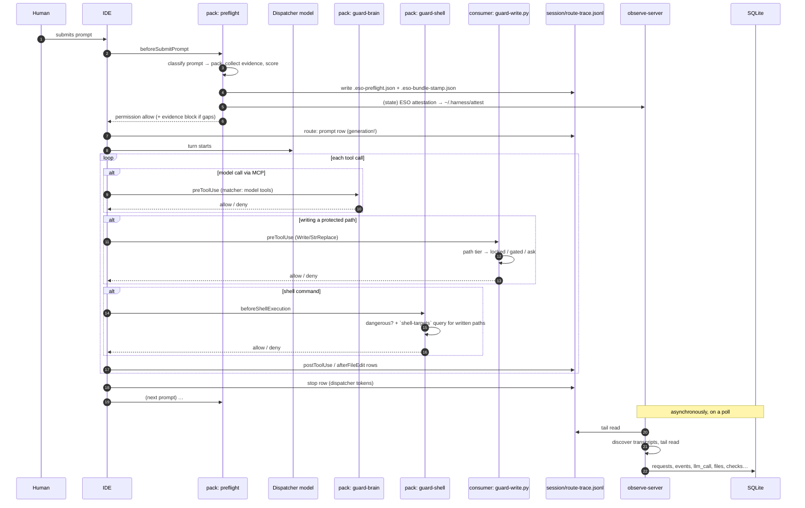
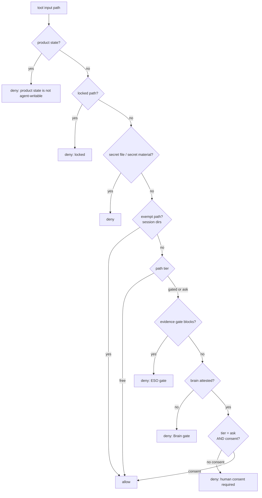
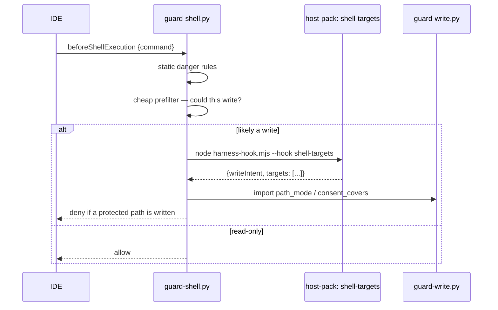

# Prompt lifecycle

What actually happens, in order, from the human hitting enter to rows appearing in the monitor.

This is the document to read before changing anything in `harness-host-generic` or the ingest
pipeline, because almost every defect in this project has been an ordering or identity problem
somewhere on this path.

## The wiring

Each IDE event maps to one or more hook invocations. From
`profiles/host/cursor-superset.json` (Cursor) — the Antigravity profile is in
`agents-superset.json` and uses the IDE's own event names:

| IDE event | hook id | kind | can deny? |
|---|---|---|---|
| `beforeSubmitPrompt` | `preflight` | telemetry + evidence verdict | yes, if `enforceWrites=fail_closed` and insufficient |
| `beforeSubmitPrompt` | `route` | telemetry | no |
| `beforeShellExecution` | `guard-shell` | **guard** | **yes** |
| `afterFileEdit` | `route` | telemetry | no |
| `preToolUse` | `guard-brain` | **guard** (matched to model calls) | **yes** |
| `preCompact` | `pre-compact` | telemetry | no |
| `postToolUse` | `gap-tracker`, `post-tool-hint`, `route` | telemetry | no |
| `stop` | `route` | telemetry | no |

Two things to internalise:

1. **Guards fail closed; telemetry fails open.** A guard that cannot decide denies. A trace hook that
   cannot write a line lets the turn proceed. `dispatch.mjs`'s registry carries the posture per hook,
   and `errorPosture()` resolves it against the consumer's `guards.unavailable`.
2. **`afterFileEdit` is the only write signal the harness gets from the IDE.** It is not optional
   trivia — three conformance checks depend on it, and not wiring it (`F43`) made them report "no
   edits in this request" for every turn while the code silently read `touchedPaths` from a different
   source. If you add a write-related check, confirm this event is wired in the profile you are
   targeting.

## The happy path

Note the last block: **ingest is asynchronous and lags**. That lag is the root of the hardest defects
here, and is covered in [`04.ingest-pipeline.md`](./04.ingest-pipeline.md).

## Stage 1 — the prompt is gated and measured (`beforeSubmitPrompt`)

The hook that runs first is `preflight`. It:

1. **Classifies** the prompt into a class (`dev-runtime`, `qc-runtime`, `docs-only`, `question`, …)
   and an ESO **pack** / bucket.
2. **Collects** evidence for that pack's requirements, through configured adapters (docgraph,
   codegraph, memory).
3. **Scores** sufficiency `0…1` and derives a level with the gaps that explain it.
4. **Writes two records**: the consumer-visible `.eso-preflight.json` + `.eso-bundle-stamp.json` in
   the session dir, and the **ESO attestation** in product state.
5. **Decides**: if the posture is `fail_closed` and the level is insufficient, it denies the prompt
   with guidance. Otherwise it allows, injecting an evidence block into the turn's context when gaps
   exist.

The two records exist because they serve different readers and have different trust:

| record | reader | trust |
|---|---|---|
| session stamp | the pack's own gap tracker, and legacy guards | **agent-writable** — agent must write nearby files |
| product-state attestation | `guard-write.py` | not reachable by the agent's ordinary write path |

`guard-write.py` prefers the attestation and falls back to the stamp, so a consumer whose pack is not
yet refreshed keeps working (`F47`).

**Time and effort are bounded** by policy (`eso.preflight.maxMs`), because this runs before every
prompt.

## Stage 2 — the turn runs, and guards intercept

### Write gate (`guard-write.py`, consumer-owned)

Fires on `preToolUse` for Write/StrReplace/Delete. The decision order, and the order matters:

Reading it top to bottom is worth doing once, because the tiers are **not** independent filters — they
are gates in series, and the interesting cases are the interactions:

- A `locked` path is never opened by evidence or consent.
- A `gated` path needs evidence **and** a Brain call. Proceeding is possible, unlike `locked`.
- An `ask` path needs consent, on top of whatever the first two tiers required.
- Session dirs are exempt so that the stamps the gate itself reads remain writable.

### Shell gate (`guard-shell.py`, consumer-owned)

Fires on `beforeShellExecution`. It has two jobs:

1. **Static danger rules** — database drops, non-local datastores, secret-file writes.
2. **Protected-path writes via shell.** This is the second write channel, and it was completely open
   until `F42`/`F45`: `guard-write.py` only sees Write/StrReplace, so a `cat > protected/file.md`
   walked past every gate. One observed turn wrote seven protected files that way while the harness
   recorded them as **reads**.

For (2) the guard does **not** re-implement the parser. It runs a cheap prefilter (only to decide
whether a spawn is worth it, so read-only commands cost nothing), then invokes the pack's
`shell-targets` hook and applies its own path policy to the answer:

One parser, in the pack, shared with the observer. The guard owns the **policy** (which paths are
protected) and the pack owns the **detection** (what does this command write). That split is what
`F45` was shaped by: porting the parser into Python would have left two heuristics to drift.

### Brain gate (`guard-brain`, pack)

Matched to model-call tools. Its job is not to evaluate the model's answer — it is to make the
delegation step explicit, so that "the agent reasoned about this" is a recordable fact rather than an
assumption. Whether a Brain call is **required** for a given path comes from the path tier, enforced
by the write gate.

## Stage 3 — the turn ends (`stop`)

The IDE's `stop` hook carries **the dispatcher model's** token usage. This is the single most
misleading fact in the token story:

| you might think | actually |
|---|---|
| the turn's tokens | the **dispatcher's** tokens only |
| includes the Brain's reasoning | **no** — the Brain runs in a separate process entirely |

Brain tokens come from a different source, and are reconciled later — see
[`03.consent-and-attestations.md`](./03.consent-and-attestations.md) and `F32` in `docs/04`.

## Stage 4 — ingest catches up

Asynchronously, the observe plane:

1. Tails the hook trace (`session/route-trace.jsonl`) and the IDE transcripts.
2. Builds requests from transcript `<user_query>` boundaries.
3. Links events to requests — **the hard part**.
4. Derives files, tools, rules, checks.
5. Reads the model usage ledger and attributes Brain spend.

Full detail, including the race that has caused the most defects:
[`04.ingest-pipeline.md`](./04.ingest-pipeline.md).

## What an operator can observe of all this

| Question | Where |
|---|---|
| What did this turn do? | Observatory request detail |
| Why was a write denied? | the deny message names the gate; the check panel shows the verdict |
| Is the pipeline healthy? | `/health`, `/api/ingest`, ingest report counters |
| Did my Brain call actually run? | `~/.harness/deepseek-usage.jsonl` and `deepseek-frames.jsonl` |
| What is currently approved? | Console consent API |

Diagnostics for when one of these is wrong: [`../04.operations/04.troubleshooting.md`](../04.operations/04.troubleshooting.md).
