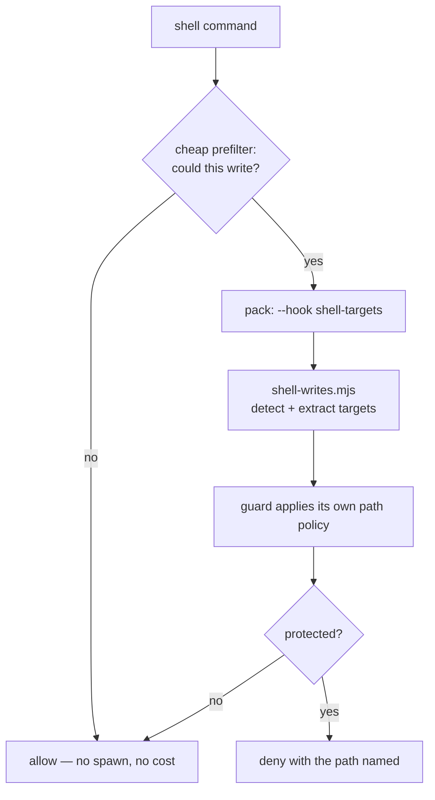

# Guards and paths

The enforcement half of the product. Read this with
[`03.consent-and-attestations.md`](./03.consent-and-attestations.md), which covers *what a gate is
allowed to believe*.

## Ownership: who ships what

Established the hard way and worth stating before anything else:

| Artifact | Owner | Why |
|---|---|---|
| `guard-write.py` | **consumer** | it knows the consumer's protected paths and its evidence thresholds |
| `guard-shell.py` | **consumer** | same |
| path **policy** (`decision-policy.json` → `paths`) | **consumer** | `sdlc/` means nothing in a repo that has no `sdlc/` |
| path **matching** (what does an entry match) | **product** (`path-policy.mjs`) | so both guards and the observer agree |
| shell **write detection** | **product** (host pack, `shell-targets`) | one parser, five consumers |

The pack deliberately ships **no** write gate. `dispatch.mjs` records the reasoning in full, and it is
worth reading once: a pack copy checked evidence but not paths, so with sufficient evidence it allowed
edits to the consumer's most protected files, while with insufficient evidence it blocked ordinary
`src/` edits. Both directions wrong, so it was removed rather than fixed.

## The path policy

Declared in the consumer's `.harness/decision-policy.json` under `paths`:

```json
{
  "paths": {
    "locked": ["document/mu/be/00.law/"],
    "gated":  ["frontend/", "backend/mu-*", "document/mu/", "AGENTS.md", "scripts/ci/"],
    "ask":    ["sdlc/08.wbs/", "sdlc/00.governance/"],
    "sot":    ["document/mu/", "sdlc/08.wbs/"]
  }
}
```

### Three entry shapes, distinguished by the entry itself

| entry | means | matches |
|---|---|---|
| `frontend/` | a directory | the directory itself, and everything under it |
| `backend/mu-*` | a **name prefix** | `backend/mu-fusion`, `backend/mu-infra-lib`, … |
| `AGENTS.md` | **one file** | exactly that path — never `AGENTS.md.bak` |

The third shape is why the rule cannot simply be "starts with": the root playbook files are exact on
purpose, so drafts and `.bak` copies stay writable for a cleanup script to remove.

The second shape exists because of a real regression (`F48`): the original code had **two** lists —
`PROTECTED_PREFIXES` matched with `startswith`, `PROTECTED_EXACT` with equality — and collapsing them
into one list silently made `backend/mu-` match nothing, leaving **all backend code ungated**.

One implementation, `pathMatches()` in `packages/harness-foundation/src/path-policy.mjs`, used by
`guard-write.py`'s `entry_matches()`, by the consent store, and by the observer's checks. Three
callers, one rule.

### Tiers, most restrictive first

Resolution checks `locked` → `ask` → `gated`, so a path accidentally listed twice cannot be loosened
by the second entry.

| tier | meaning | openable by |
|---|---|---|
| `locked` | the human reserves this path | **nobody** — not evidence, not consent |
| `ask` | a human must approve | **consent only** |
| `gated` | requires evidence and a Brain call | satisfying both |
| *(absent)* | freely writable | — |
| `sot` | **label only** | n/a — never denies |

`sot` is not an enforcement tier, and it must not become one. See the next section.

### Protection and source-of-truth are independent

This is the concept the current design is built around (`F46`), and it is easy to get wrong:

|  | source of truth | not source of truth |
|---|---|---|
| **gated** | `document/mu/` — the law | `scripts/ci/` — the **verifier** |
| **writable** | `sdlc/08.wbs/` — the WBS, which the agent must maintain | `tmp/` — scratch |

`<consumer>/sdlc/08.wbs/` **is** a source of truth and the agent must be able to write it, which is why
it is `ask` (human approval) and not `gated`-with-no-escape. `scripts/ci/` is **not** a source of truth
and is protected anyway, because editing the yardstick is how it comes to read PASS. One axis cannot
express both, so `sot` is a registry and the tiers are a separate question.

### Absent vs empty

- **`paths` absent** → the product's **default** policy applies. This is fail-safe: a consumer that has
  not migrated keeps the historical protection. *Shipping the feature must not silently remove every
  gate.*
- **a tier empty** → that tier protects nothing. Explicit, and deliberately distinguishable from
  "unconfigured".

A declared list **replaces** the default rather than merging. Merging would resurrect a default the
consumer deliberately removed — `sdlc/` being exactly that case.

### The product's default is mechanism-generic

`DEFAULT_PATH_POLICY` protects things every consumer has: the playbook files, the rules/skills/agents
trees of both IDEs, MCP configs, the guard scripts themselves, `scripts/ci/`, `installation/docgraph/`.

It does **not** contain `frontend/`, `backend/mu-`, `document/mu/` or `sdlc/`. The product cannot know
a consumer's architecture, and hardcoding one consumer's directories is the bug the policy replaced.

`profiles/generic-eso.json` seeds new consumers with the mechanism-generic list. The Python guards get
the same defaults via `path-policy.default.json`, generated into the pack at build time from
`path-policy.mjs` — one hand-maintained list, not two.

## What the guards actually protect beyond paths

Ordered as the evaluate them; each is a hard deny.

| Rule | Rationale |
|---|---|
| **product state** (`~/.harness`) | holds the project registry, the databases, and the records gates trust (consent, attestations). An agent that could write here could grant itself permission. |
| **locked paths** | human-reserved. |
| **secret files** | by name (`.env*`, `credentials.json`, keys) and by suffix (`.pem`, `.pfx`, `.key`). |
| **secret material** | private-key blocks, AWS key patterns — scanning the *content*, not the path. |
| **evidence** | on `gated`/`ask` paths, per policy posture. |
| **Brain** | on `gated`/`ask` paths. |
| **consent** | on `ask` paths. |
| **protected path written via shell** | the second write channel; uses the pack's `shell-targets`. |

The session dirs (`<consumer>/.cursor/session/`, `.agents/session/`) are **exempt** from the evidence
and Brain gates, because the stamps those gates read are written there. That exemption is the reason
product state exists as a separate trust location — the exemption cannot be removed without breaking
the flow, so the trusted records had to move somewhere else.

## The shell channel

A shell command can write a file, and for a long time this was a completely open second channel
(`F42`). The design now:



Detection is a **deliberate heuristic**, conservative in one direction: it looks for constructs that can
only mean writing — redirection, `tee`, a `cp`/`mv` destination, `sed -i`, `touch`, a Python write call.
A missed write is a gap in a report; a **spurious** one would accuse a read-only command of editing a
protected file, which is worse.

Three traps are encoded in the parser, each with a test:

1. **A quoted `>` is not redirection.** `rg -n "x > y" src` was read as a write to a file named `y`.
   Quoted regions are masked — with a **letter**, not a space, or `cat > "my file.md"` loses its target.
2. **A heredoc body is data.** A generated shell script containing `sed -i` was read as an edit of a file
   named `=`. Bodies are stripped before operator scanning — but the body **is** scanned for Python write
   calls, because there the body *is* the code.
3. **A Python heredoc holds its path in a variable.** `p = Path("…/x.md")` then `p.write_text(…)` names no
   target for an operator to find, and the IDE reports no path for a heredoc. Absolute string literals
   are extracted, gated on the command already having write intent.

Cost: a node spawn (~46 ms measured) per shell command that could plausibly write. The prefilter keeps
read-only commands at zero.

## Guards are not a sandbox

Stated plainly because it changes what you should build:

- An agent with unrestricted shell access can `cat` any file a guard reads, and could write one if a
  guard were bypassed.
- The enforcement applies to the operations the **IDE routes through hooks**. There is no process
  confinement.
- The goal is therefore narrower and achievable: *the honest path must not require the agent to grant
  itself permission*, and a deviation must be **attributable**. See
  [`03.consent-and-attestations.md`](./03.consent-and-attestations.md).

## Failure posture

| hook kind | cannot decide → | overridable |
|---|---|---|
| guard | **deny** | `guards.unavailable: "warn"` in the consumer policy |
| telemetry | allow, with a visible note where the dialect supports it | — |

The reasoning: a guard that silently stops enforcing is worse than no guard, because the operator
believes they are protected. But breaking a developer's turn because a *trace line* failed is a worse
bug than the missing line.

One trap this closes, which is worth knowing when reading old code: the consumer's
`guard-shell.py` used to fail **open** unless `jev.mode == "active"`. Any bug in any rule above
silently disabled the whole guard — which is exactly how a `NameError` in the protected-path check went
unnoticed while every command was permitted.
