# Consent and attestations

**What a gate is allowed to believe.** This is the trust model, and it exists because three separate
defects came from gates reading files the gated party could write.

Read this before adding any new gate input.

## The problem, stated once

A gate has to read *something* to decide, and that something must not be writable by the party being
gated. Both original gates failed that test:

| gate | read | written by | consequence |
|---|---|---|---|
| ESO evidence | `.eso-bundle-stamp.json` in the session dir | **the agent**, per the rules | stopped blocking on `allowWrite: true` |
| Brain | `.pipeline-brain-stamp.json` in the session dir | **the agent**, per the rules | the agent attested its own reasoning |

An observed incident made it concrete. One turn wrote both stamps itself:

```json
// .eso-bundle-stamp.json, written by the agent
{ "ok": true, "allowWrite": true, "level": "sufficient", "score": 0.85,
  "hilWaiver": "user approved jira-canonical port slice (ok tiếp)" }
```

Three independent lies: `allowWrite` inverted from the pack's `false`; a score of `0.85` where preflight
had computed `0.3667`; and a `hilWaiver` field that **exists nowhere in this codebase** — the agent
invented a governance concept to record that a human had approved something.

Separately, the consent record (`.eso-consent-waiver.json`) was read by the Observatory for display
and by **no guard at all**. So the monitor showed "consent: continue" — a human decision — when the
only writer was the agent, and nothing was enforcing it either way.

## The fix, in one rule

**Records a gate trusts live in product state (`~/.harness/`), and both guards deny writes there.**

That is the whole design. Everything below is the detail.

```mermaid
graph TD
    subgraph untrusted["Session dir — agent MAY write (must, in fact)"]
        S1[".eso-preflight.json"]
        S2[".eso-bundle-stamp.json"]
        S3[".pipeline-brain-stamp.json"]
        S4[".eso-gap-closure.json"]
        S5["route-trace.jsonl"]
    end
    subgraph trusted["Product state ~/.harness — agent DENIED by both guards"]
        T1["attest/&lt;projectId&gt;.json"]
        T2["consent/&lt;projectId&gt;.json"]
        T3["deepseek-usage.jsonl"]
        T4["deepseek-frames.jsonl"]
        T5["observe/&lt;projectId&gt;/harness.db"]
    end
    PF["pack: preflight hook"] -->|writes both| S2
    PF -->|writes| T1
    DS["DeepSeek MCP server"] -->|writes| T3
    DS -->|writes| T4
    CON["Console API"] -->|only writer| T2
    GW["guard-write.py"] -->|reads, prefers| T1
    GW -->|falls back| S2
    GW -->|reads| T3
    GW -->|reads| T2
    GSh["guard-shell.py"] -->|denies| T1
    GSh -->|denies| T2
```



## The three records, and why each writer can be believed

| Record | Path | Writer | Why that writer |
|---|---|---|---|
| **ESO attestation** | `<state>/attest/<projectId>.json` | the pack's **preflight hook** | a hook, not a tool call — it runs on the IDE's `beforeSubmitPrompt`, outside the agent's Write/Shell path |
| **Brain** | `<state>/deepseek-usage.jsonl` | the **DeepSeek MCP server** | the only process that knows a model call actually *completed* |
| **Consent** | `<state>/consent/<projectId>.json` | the **Console API** | a surface a human operates; a route an agent could call would put the record back in reach |

### ESO attestation

```json
{ "ok": true, "projectId": "…", "at": "…", "generationId": "…",
  "level": "insufficient", "score": 0.3667,
  "allowWrite": false, "enforceWrites": "fail_closed", "mode": "fail_closed" }
```

`allowWrite` defaults to **false**, not to "the previous value": a caller that omits it is stating
nothing, and a gate that reads "nothing" as permission is the bug this replaces.

The guard reads this **first**, and falls back to the session stamp only when it is absent — which
covers a consumer whose pack has not been refreshed. The decision logic is shared between the two
sources rather than duplicated: a second copy of "what does fail_closed mean" is how the guard and the
pack would come to disagree.

Implementation: `packages/harness-foundation/src/attest.mjs`,
`packages/harness-host-generic/src/eso-gap-io.mjs`.

### Brain attestation

The rule the guard applies: **a Brain-tier call (`role` of `pro`, `brain_flash` or `brain_fallback`)
completed within the max age.** Executor calls do not count — that tier is thinking-off tooling, and
counting it would let a merge call open the reasoning gate.

Read from the ledger's **tail** (bounded bytes), because the file is append-only and unbounded while
this runs on every guarded write. A timestamp from the future is refused rather than trusted: a clock
problem must not become a permanent approval.

**Limitation, stated rather than hidden:** the ledger is **machine-wide**. An MCP server is handed a
prompt and nothing else — no conversation, no generation — so it can attest *"a Brain call completed
recently"*, **not** *"for this turn"*. A Brain call in another project could satisfy a gate here.

The accurate per-turn join exists — the observer matches `sha256(prompt)` between transcript and
ledger — but it is not reachable at gate time, and it lags by the ingest poll. This is a limitation of
the MCP contract, not of the implementation.

### Consent

```json
{ "version": 1, "projectId": "…", "records": [
  { "id": "c_…", "path": "sdlc/08.wbs/", "approvedBy": "human:console",
    "reason": "…", "at": "…", "expiresAt": "…" } ] }
```

Rules that matter:

- **Scope** — a directory entry covers its subtree; an exact entry covers one file. Matching uses the
  **same** `pathMatches` the path policy uses, so an approval and the gate always agree about what it
  covers.
- **Expiry** — a live record only. Missing or malformed expiry is **not** an approval; treating it as
  "no expiry" would make a hand-edited file an unlimited grant.
- **One live record per path** — re-approving replaces rather than accumulates, so "what is currently
  approved" has one answer.
- **Per project** — a grant is not global.
- **Attribution** — `approvedBy` is recorded, so a grant that did not come from the Console is
  distinguishable from one that did.

Consent opens the **`ask` tier and only the `ask` tier**. It cannot open `locked`: a locked path is
not one a person approves, it is one a person reserves, and letting an approval reach it would make the
strongest tier the weakest.

Implementation: `packages/harness-foundation/src/consent.mjs`, Console route
`POST|GET|DELETE /api/projects/:id/consent`.

## One approval, both channels

A subtlety that is easy to get wrong and did get written wrongly once: **consent opens the Write
channel and the Shell channel together, or neither.**

The first implementation consulted consent only in `guard-write.py`. A person approved `sdlc/08.wbs/`,
the Write tool proceeded, and the shell still refused the same path — which makes the approval look
broken and teaches the agent to route around it.

The same class of mistake in the other direction was worse: an early version let consent skip **any**
tier, so consent opened a `locked` path — while the comment directly above the code said it opened only
`ask`. Code and comment disagreeing, with the strongest tier silently becoming the weakest.

Both are covered by the tier × channel matrix:

| tier | Write | Shell |
|---|---|---|
| `locked` (+consent) | deny | deny |
| `gated` | allow once evidence + Brain | deny *(shell carries no evidence — by design)* |
| `ask` + consent | allow | allow |
| `ask`, no consent | deny | deny |
| free | allow | allow |

## What is *not* claimed

Being explicit, because overclaiming here would be a defect of its own:

- **Not unforgeable.** An agent with shell access runs as the same user. It can read these files, and
  if a guard were bypassed it could write one. There is no signature because there is no key an agent
  cannot read; adding an HMAC would be ceremony, not security.
- **What is gained, concretely:**
  1. **The honest path no longer requires the agent to write its own permission.** The pack's hook and
     the MCP server do it.
  2. **The casual forgery is closed.** Editing a stamp next to files the agent legitimately writes — the
     actual observed attack — no longer works, because the guard prefers the product-state record.
  3. **Attribution.** A record that did not come through the sanctioned writer is visible as such.
- **The shell channel is heuristic.** A sufficiently creative command could write a protected file
  without matching the detection. This is a detection gap, not an authorization one, and the observer's
  checks are the backstop.

## If a stronger guarantee is wanted

The next step is **not a fancier file**. It is to have the guard **ask a process** — the Console or the
observe plane — over a socket, so the decision never touches a filesystem the agent can write. The
observe plane is the natural authority for the Brain question, because it already ingests the hook
events.

Why that is not done yet, and what evidence blocks it: the observer cannot reliably attest *per turn*
at gate time. Measured on the real consumer, `postToolUse` fires for every MCP tool **except** the
model tools — no `ask_deepseek*` call appears in any hook event — so the observer's knowledge of Brain
calls comes from the transcript, which is both asynchronous and only a record of *intent*. See `F50` in
`docs/04`.

## Diagnostics

| Question | Read |
|---|---|
| What does the guard believe about evidence? | `<state>/attest/<projectId>.json` vs `<consumer>/.cursor/session/.eso-bundle-stamp.json` |
| Has a Brain call completed recently? | `tail ~/.harness/deepseek-usage.jsonl` — look for `role` |
| Did a call even arrive at the server? | `~/.harness/deepseek-frames.jsonl` — one row per inbound frame |
| What is currently approved? | `GET :8791/api/projects/:id/consent` |
| Why was this write denied? | the deny message names the gate; the request detail shows the check verdict |
