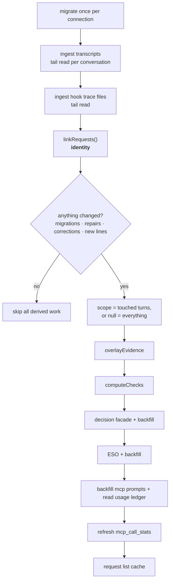
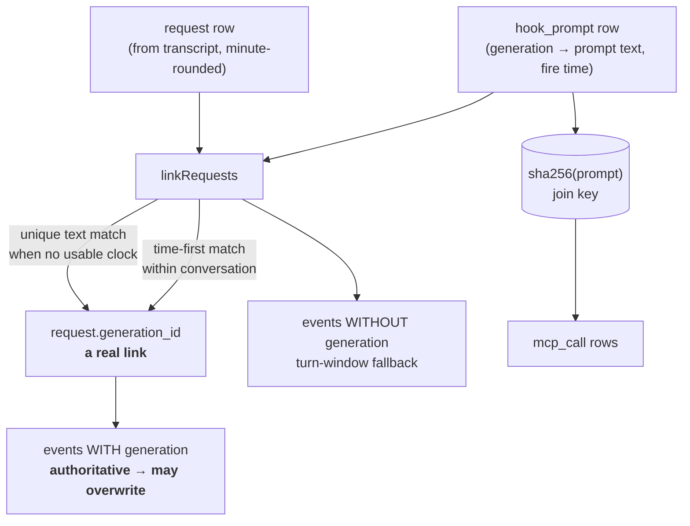
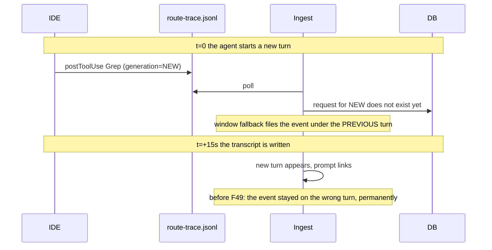

# Ingest pipeline

How raw IDE output becomes rows the monitor can show. **This is the most defect-dense area of the
project** — read the "identity" section before changing anything here.

## What it ingests

| Input | Produced by | Contains |
|---|---|---|
| **transcripts** | the IDE, one JSONL per conversation | user prompts (turn boundaries), assistant messages, tool calls |
| **hook trace** | the consumer's `route-hook.py` | one row per hook event, per session |
| **model usage ledger** | the DeepSeek MCP server | one row per completed model call |

The three have different clocks, different lifetimes, and **no shared identifier** — which is the
whole difficulty.

## The cycle

Ingest is not a request handler. It runs as a loop, and inside a **separate worker process** so that
synchronous SQLite writes never block the HTTP server (`F11`/`F12`).

The `E` gate is not an optimisation you can remove. On a large database the derived stages are the most
expensive part of a cycle, and recomputing them when nothing changed was the visible cause of the
monitor stalling. The documented consequence: **anything that changes derived meaning must set a flag
that participates in that gate.** `F49` added `link.corrected` to it for exactly that reason — a
re-attribution changes a turn's files, tools and verdicts, none of which would be revisited under a
narrow scope.

### Backfills have their own cadence

Three history walks converge over time rather than in one pass: the decision facade, ESO, and the MCP
prompt/mc-call attribution. Each is bounded per cycle and gated on either "something changed" or a
counter, so an idle poll does not pay for a walk it already completed.

## Identity: the hard part

Everything downstream depends on answering *"which turn did this belong to?"* correctly. Each input
answers it differently:

| Input | Carries | Reliable? |
|---|---|---|
| transcript assistant message | conversation + ordinal position | yes, within its own file |
| hook event | `generation_id` **when the IDE stamps one** | yes, when present |
| hook event, no generation | timestamp + conversation | **a guess** |
| model usage ledger | prompt hash; **no identity at all** | no — must be joined |

### The rules, in force order

1. **Prompts are a project-wide list.** Each is matched to a request **inside its own conversation**.
2. **Time first.** The hook fires when the human submitted; the prompt belongs to the last request in
   that conversation that had already started. Matching on text alone once put a `"continue"` prompt on
   the *earliest* `"continue"` turn of a conversation — and 10.7M input tokens on the wrong date.
3. **Text only as a fallback**, and only when it is **unique**. An ambiguous match is refused rather
   than guessed.
4. **One generation, one request.** Enforced by a used-set, plus a repair pass that clears any
   generation held by more than one request (which also clears the tokens credited from that link, since
   tokens from a wrong link are not evidence).
5. **An event's own generation is authoritative** and may **overwrite** a previous assignment. See below.
6. **Events with no generation** are placed by the turn window they fired in — explicitly *not* dumped
   on the conversation's first request, which once credited one turn with every tool call in the
   conversation.
7. **The placeholder is stamped last.** `request.generation_id = id` is written only for turns that got
   no real link, so the spine still has a join key — and writing it first once silently disabled every
   prompt match in the project (`F36`).

### The race that causes most of the defects

**Hooks are written by the IDE as calls happen; requests come from the transcript on a poll.** So a
tool event routinely exists *before* the turn it belongs to has a row. The window fallback then files
it under the previous turn — and because the generation rule originally only *filled* missing values
(`request_id IS NULL`), nothing ever revisited it.

Measured on the real consumer: **3,438** events whose `generation_id` disagreed with the generation of
the request they were filed under, across 7 conversations. A turn that made 19 tool calls showed 2.

The fix, and the reasoning for why overwriting is safe: `linkRequests` guarantees exactly one request
holds any real generation, so the resolution is one row or none — meaning a **time guess must yield to
the event's own record**. Guarded by a "values differ" check so the update is a no-op once converged,
which matters because a non-no-op would force a full recompute every cycle.

**Residual, not a bug:** after the fix, ~3,400 disagreements remain, and **all** are events whose
generation has no request and no captured prompt — a turn the harness never saw. For those, time is the
only signal available. This is missing *data*, not a logic error.

### Transcript ownership

The transcript *is* the turn boundary, and its own identity is the filename's conversation id — not a
path check. An early filter tested whether a transcript path contained the project's root as a
substring, which mis-claimed across projects when an agent `cd`-ed into another repo: one window
reported 5 conversations / 26 requests belonging to a *different* project. Ownership is now resolved
from the transcript's own recorded working directory (`F30`).

## The cursor: tail reads

Transcripts are read from a **byte offset**, not from the top. Two things make that safe, and both were
learned from a defect:

1. **A shrinking file** means truncation → rebuild the conversation.
2. **A seam hash.** `size < last_offset` is not enough: a transcript rewritten **in place** to the same
   or greater length leaves the offset pointing into the middle of unrelated text, so the prompt line —
   which is *before* the cursor — is never seen, nothing is created, and the cursor advances anyway.
   That is a permanently lost turn (`F35`). `sha256` of the 64 bytes ending at the cursor proves the
   bytes before it are the ones already consumed; a mismatch rebuilds. A cursor predating this column
   gets a newline check plus the repair command (`ingest.mjs --rebuild=<id>`).

## Derived rows: what each answers

| Table | Answers |
|---|---|
| `request` | one turn; status, timings, tokens from `stop`, denormalised list columns |
| `llm_call` | one assistant message = one model call; resolved tool names |
| `event` | one hook event, with its generation and (ideally) its request |
| `request_file` | per path: reads, **edits**, actions |
| `request_tool` | per tool: count |
| `request_rule` | rules attached at prompt time |
| `check_result` | the five conformance verdicts |
| `decision_ledger` | L0/Jev decisions **and** ESO verdicts |
| `mcp_prompt` / `mcp_call` / `mcp_call_stats` | model spend, and its attribution |
| `hook_prompt` | the captured prompt per generation — the join key for linking |
| `request_stop` | the `stop` payload, linked by generation or by window |

Two of these have a **shared column** that has caused a false reading, and it is worth knowing the two
places before writing a query:

- `request_file.edits` counts only tools whose name classifies as an edit. A **shell** write to a path
  is not an edit by that rule, so it is resolved from the command instead (`F42`). Without that, a turn
  that wrote seven protected files showed `edits = 0` — as **reads**.
- `decision_ledger.jev_response_json` holds the **ESO bundle** for `evidence_sufficiency` rows, because
  the ESO ledger writer parks it there for the ESO view. Counting it as evidence of a Jev call is wrong
  (`F38`); latency is the honest signal.

## Checks

Five verdicts per turn, derived from the same events. They are **heuristic** and their `heuristic`
flag says so; a check that cannot judge reports `skip` with the reason.

| Check | Asks | Can fail? |
|---|---|---|
| `rules-attached` | were rules in force at prompt time | yes |
| `edits-covered-by-attached-rules` | were edits made under attached rules | yes |
| `read-before-edit` | was an existing file read before it was modified | warn |
| `verify-after-edit` | did a verify command run after the last edit | warn |
| `brain-before-protected-write` | was a Brain call made before a protected write | **yes** |

Wording matters as much as the verdict here. "No protected path was edited" is a claim about the
filesystem; when the harness cannot see edits at all, the honest statement is **"cannot determine"**,
and the check reports `skip` with `heuristic = 1` so it is not read as a clean result. Both were wrong
in that direction (`F43`).

## Cost and liveness guardrails

| Guardrail | Why |
|---|---|
| worker process for writes | a synchronous SQLite write on the HTTP thread froze the monitor |
| connection pooling, migrate once per connection | opening and migrating every 2s was pure overhead |
| tail reads, never full-file reads | reading whole transcripts each poll was hundreds of MB/cycle |
| derived stages skipped when nothing changed | the biggest single cost, and the cause of the stall |
| bounded backfills with their own cadence | a history walk in every hot cycle |
| SQLite pragmas per connection (WAL, synchronous) | the default `FULL` fsync per commit dominated |
