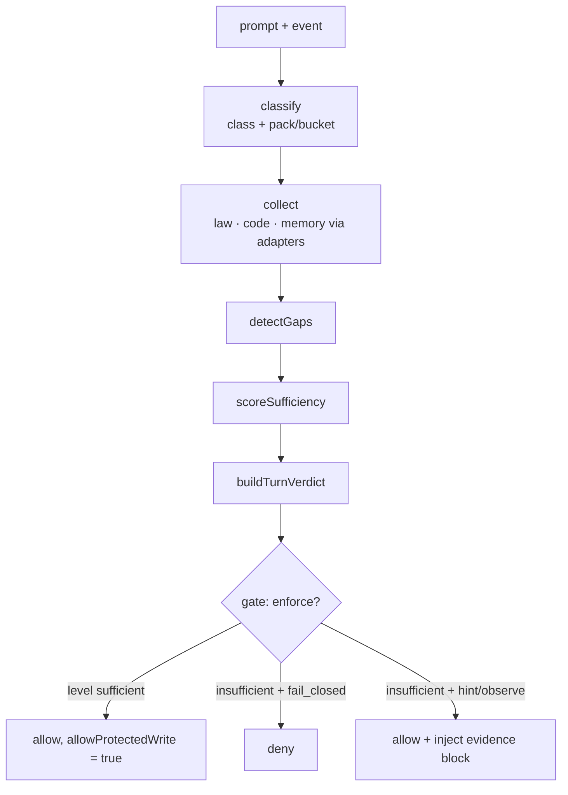
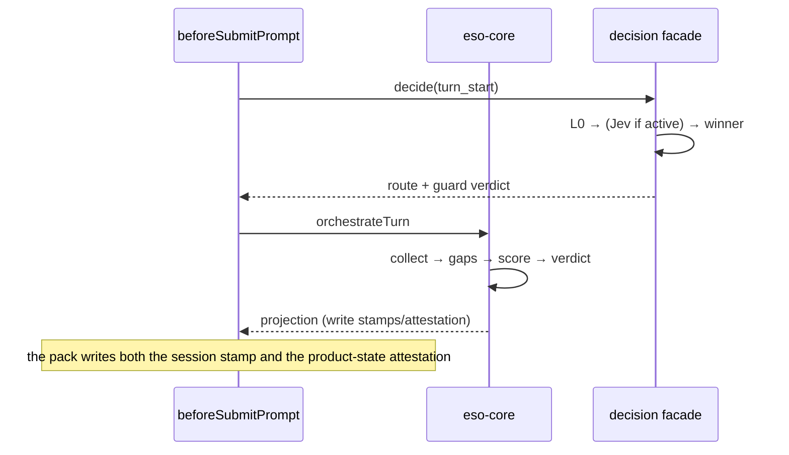

# Decision facade and ESO orchestration

Two subsystems that answer "what should happen" — one about **routing and ambiguity**, one about
**evidence**. They are adjacent and are often confused.

| | answers | disabled by default? |
|---|---|---|
| **decision facade** (`harness-decision`) | which path/route/verdict does policy imply for this turn | partly — L0 always runs, Jev only if `jev.mode` is not `off` |
| **ESO** (`harness-eso-core`) | does the agent have enough evidence to act | no — it runs every prompt |

## The decision facade

### L0 → L3

`decide(event, ctx)` walks a ladder. Each level is more expensive and less certain than the last, and
the result records **which level won** so a decision is never anonymous about its own provenance.

| Level | Resolver | Cost |
|---|---|---|
| **L0** | deterministic rules — bucket inference, route resolution from policy | free |
| **L1/L2** | ambiguity handling, optionally delegating to **Jev** | HTTP round trip |
| **L3** | model fallback (`l3_flash`, off by default) | a model call |

Entry point: `packages/harness-decision/src/decide.mjs`.

### What a decision records

Every decision can be persisted to `decision_ledger`, with:

- `event_type` — what kind of decision this was
- `jev_mode` — the mode in force (`off` / `active` / `hint`)
- `resolver_winner` — e.g. `l0_resolver`, `eso_partial`, `jev_guard_deny`
- `enforced_verdict` — what was actually enforced
- `ambiguous_policy` — `hil_only` by default, i.e. ambiguity escalates to a human rather than guessing
- `top_probability`, latency per level, whether a flash fallback was used
- `jev_request_hash` — the dedupe key, also used to count distinct Jev requests

### Jev

`harness-system-one` is an **HTTP** client for System One (`api.typesafe.ai`). Two things to keep
straight, because both have caused defects:

1. **A Jev call is not an MCP call.** It is an HTTP request the facade makes. It appears in the UI's
   model-call card only as a separate, clearly labelled line.
2. **`decision_ledger` holds rows from two producers.** `decide.mjs` writes facade decisions; the ESO
   ledger writer (`eso-ledger.mjs`) writes `evidence_sufficiency` rows — and parks the **ESO bundle** in
   the `jev_response_json` column so the ESO view can read it back. Counting that column as evidence of
   a Jev call reports a Jev call on **every** turn, forever (`F38`).

   The honest signal for "Jev ran" is `latency_ms_jev > 0`: both writers set it around a real call and
   leave it at zero otherwise.

## ESO orchestration

### The turn, end to end



Entry: `orchestrateTurn()`. The projection it produces is what the preflight hook writes to disk and
what the observer displays.

### Scoring, precisely

```
score = lawRatio * 0.55 + readRatio * 0.45
level = sufficient   if score ≥ T_high AND gaps.length === 0
        partial      if score ≥ T_low
        insufficient otherwise
```

Both ratios read the **same** pack fields that `detectGaps` reads. That is not tidiness — when they
disagreed, the score penalised a turn for not doing something its own pack said was unnecessary
(`F44`): a `Math.max(…, 1)` made `minReadPaths: 0` unreachable, so packs that require no file read were
scored as though they required one, and a docs turn that read nothing lost 45% of its score.

The rule to keep: **the score must be explainable from the reported gaps.** If a pack declares a
requirement, the gap list says so; if the score penalises something, there is a gap for it.

### Packs

Declared in `skill-pack.mjs` and selected by prompt class. A pack carries `minReadPaths`,
`requiredDocTerms`, `codeQueries`, and a bucket (`tools`, `backend`, `frontend`, `docs`, `general`,
`root`).

### Adapters

Evidence is fetched through a **registry**, so a consumer can replace a source without touching the
orchestrator: `docgraph-cli`, `codegraph-cli`, `agentmemory-mcp` (and `noop-memory` when memory is
off). Adapter ids appear in the consumer's policy, so which sources are consulted is inspectable.

### Policy inputs

| Key | Effect |
|---|---|
| `eso.enabled` | turn the subsystem off entirely |
| `eso.mode` | `observe` / `hint` / `fail_closed` — how hard the verdict is applied at prompt time |
| `eso.enforceWrites` | `fail_closed` / `off` — whether the write gate uses the verdict. **Two values only.** |
| `eso.thresholds.T_low` / `T_high` | the score bands |
| `eso.preflight.maxMs` | budget before every prompt |
| `eso.cognition.enforceBrain` | Brain gate posture |
| `eso.cognition.insufficientPromptGate` | `consent` / `none` — whether an insufficient prompt needs consent |

**`enforceWrites` is not a three-value setting.** `"observe"` looks plausible — it *is* a valid
`eso.mode` — but it never was valid here, and treating it as valid coerced the **most permissive**
setting into the **most restrictive** one, silently (`F24`). `resolveEnforceWrites()` is the single
resolver; anything else reading the raw key is a bug.

## How the two subsystems relate at runtime



Both write to `decision_ledger`, which is why the ledger has two distinct row shapes and why any query
over it must filter by `event_type`.
