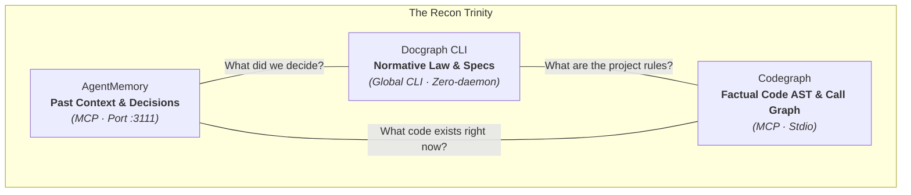
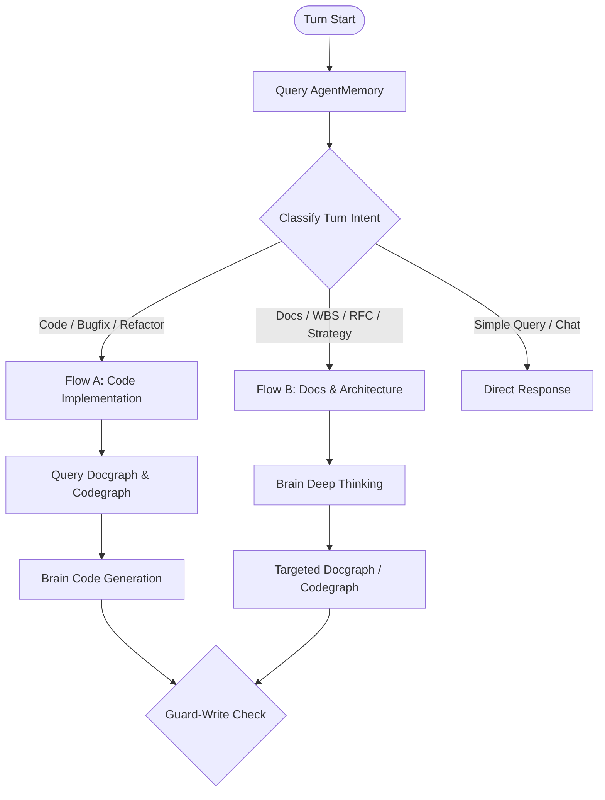

# Recon Trinity & Cognition Flows: When to Ground, When to Think

*Public Architecture Guide — Harness ESO*

---

## Executive Summary

When AI coding agents operate inside an enterprise repository, they often fail in two opposite extremes:
1. **Blind Action (Hallucination):** Jumping directly into code generation without knowing existing symbols, interfaces, or project-specific laws.
2. **Analysis Paralysis (Context Choking):** Forcing the agent to read dozens of large files or indiscriminately query every tool before it is allowed to think.

**Harness ESO (Evidence Sufficiency Orchestrator)** solves this by decoupling **Information Grounding (The Recon Trinity)** from **Cognition (The Brain Tier)**, and establishing two distinct execution pathways based on the nature of the task:

* **For Code & Implementation:** Grounding is strictly enforced *before* the Brain generates code to eliminate hallucinations.
* **For Docs & Architecture:** The Brain is encouraged to engage in *Deep Thinking immediately* to structure the problem, directing targeted inquiry rather than suffering preflight blockades.

---

## 1. The Recon Trinity

Before modifying code or drafting architecture, an agent must construct its situational awareness. Harness ESO organizes this into three specialized, non-overlapping reconnaissance pillars:



### The Three Pillars Explained:

| Tool | Core Responsibility | Input Query | Output Context | Architectural Rationale |
|---|---|---|---|---|
| **`agentmemory`** | **Historical Context & Memory** | Natural query, ticket ID, keywords | Past decisions, operator preferences, previous bug resolutions | Prevents repeating mistakes or asking questions answered in previous sessions. |
| **`docgraph`** (CLI) | **Normative Law & Specifications** | Keywords (`--q "<terms>"`) | Exact 30–50 line sections from Markdown specs, SDLC rules, and policies | Bounded AST search over documentation. Runs as a lightweight global CLI rather than a heavy daemon. |
| **`codegraph`** (MCP) | **Structural Code Intelligence** | Symbol name, function, file path | Exact AST node, caller/callee hierarchy, blast radius | Replaces unguided global grep. Provides deterministic ground truth of classes, functions, and types. |

---

## 2. Recon Decision Matrix: When to Query What

An effective agent does **not** blindly query all three tools on every turn. Invocations are targeted according to task intent:



| Task Category | `agentmemory` | `docgraph` (CLI) | `codegraph` (MCP) | Pre-Brain Requirement |
|---|:---:|:---:|:---:|---|
| **Code Implementation / Bugfix** | **Mandatory** | **Mandatory** (if rules/specs apply) | **Mandatory** (AST / symbol grounding) | **Strict:** All code facts must be loaded before Brain code generation. |
| **Docs / WBS / Analysis / RFC** | **Recommended** (session facts) | On-demand (as directed by Brain) | Optional (only if referencing existing code) | **Flexible:** Brain thinks first, directs targeted recon. |
| **Architecture Review / Audit** | **Mandatory** (historical standards) | **Mandatory** (spec baselines) | **Mandatory** (code inspection) | Brain evaluates code against normative law. |
| **Q&A / General Guidance** | Optional | Optional | Optional | No mandatory pre-recon; direct response allowed. |

---

## 3. The Two Execution Pathways (Flow A vs. Flow B)

### Flow A: Code Implementation (Grounding First)

When writing or changing code, mental guessing is strictly forbidden (**Zero Hallucination Gate**). The model must possess the exact signatures and contracts before generating code:

```text
[User Request: Implement Feature / Fix Bug]
       │
       ▼
[1. Preflight Hook] ─────────────► Checks intent & flags Gaps (code, symbol, law)
       │
       ▼
[2. Dispatcher Recon] ───────────► Calls AgentMemory (past context)
                                   Calls Docgraph (specs / coding law)
                                   Calls Codegraph (AST / call hierarchy)
       │
       ▼
[3. Ground Truth Loaded] ────────► Exact function signatures and types available
       │
       ▼
[4. Brain Tier (DeepSeek)] ──────► Reasons over verified facts & produces diff
       │
       ▼
[5. Executor Tier] ──────────────► Applies diff to files & runs local tests (bun test)
       │
       ▼
[6. Write Gate (guard-write.py)] ─► Verifies Brain Attestation & unlocks protected paths
```

---

### Flow B: Docs & Architecture (Deep Thinking First)

When designing a Work Breakdown Structure (WBS), conducting an AS-IS architectural assessment, or writing an RFC, the cognitive demand is **synthesis, trade-off analysis, and strategic reasoning**.

Forcing an agent to read code files before allowing it to reason creates artificial roadblocks. In Flow B, the Brain is engaged immediately:

```text
[User Request: Draft Architecture RFC / WBS / Migration Plan]
       │
       ▼
[1. Preflight Hook] ─────────────► Identifies 'docs' bucket; does NOT block Brain
       │
       ▼
[2. Dispatcher Orientation] ─────► Fetches previous decisions via AgentMemory
       │
       ▼
[3. Brain Deep Thinking] ────────► DeepSeek Pro/Flash analyzes problem space
                                   Structures architectural options & outline
                                   Formulates specific inquiries: "Verify DB schema for Module X"
       │
       ▼
[4. Targeted Reconnaissance] ────► Dispatcher executes pinpoint Codegraph / Docgraph queries
       │
       ▼
[5. Brain Synthesis] ────────────► Finalizes documentation with concrete citations
       │
       ▼
[6. Write Gate (guard-write.py)] ─► Ensures every factual claim is grounded (No Evidence → No Claim)
```

---

## 4. How Harness ESO Automatically Enforces This

The coordination between grounding and cognition is maintained by three automated runtime components:

```
┌────────────────────────────────────────────────────────────────────────┐
│                        HARNESS ESO RUNTIME                             │
├────────────────────────┬───────────────────────────────────────────────┤
│ 1. Preflight Hook      │ Evaluates prompt intent before execution.     │
│    (preflight-hook.mjs)│ Computes sufficiency score & identifies gaps. │
├────────────────────────┼───────────────────────────────────────────────┤
│ 2. Gap Closure Tracker │ Monitors IDE tool calls in real time.         │
│    (eso-gap-io.mjs)    │ Automatically marks gaps as CLOSED when       │
│                        │ codegraph, docgraph, or memory are queried.   │
├────────────────────────┼───────────────────────────────────────────────┤
│ 3. Fail-Closed Write   │ Intercepts file write tools at OS/IDE level.  │
│    Gate                │ Denies edits to protected files unless all    │
│    (guard-write.py)    │ required gaps have fresh Brain attestations.  │
└────────────────────────┴───────────────────────────────────────────────┘
```

### The Invariant Rule (STD-ESO-INV-B7):
> **Cognition and Write are different gates.**  
> Preflight identifies missing evidence, but it never blocks Brain deep-thinking on analytical and architectural tasks. The ultimate enforcement boundary is `guard-write.py` at the exact moment a file write is attempted.

---

## 5. Summary for Developers & Operators

1. **Always start with `agentmemory`:** It costs negligible tokens and prevents conversational amnesia.
2. **Use `docgraph` CLI for specifications:** Never ingest entire documentation folders; query 30–50 line slices.
3. **Use `codegraph` MCP for code symbols:** Eliminate grep guessing; load the exact AST node and call path.
4. **Code requires Recon before Brain:** Never let the Brain hallucinate code without ground truth.
5. **Docs require Brain before deep Recon:** Let the Brain think first to formulate what evidence is actually needed.
