# State layout

Where every file lives, who owns it, and which parts are machine state versus committed consumer
config. Getting this wrong has broken the product twice, so read the "why" notes.

## The three roots

```mermaid
graph TD
    M["~/.harness<br/><b>product state</b><br/>machine-wide, not in any repo"]
    C["&lt;consumer&gt;/.harness<br/><b>consumer config</b><br/>allowlist: team contract only"]
    S["&lt;consumer&gt;/.cursor/session<br/>&lt;consumer&gt;/.agents/session<br/><b>hook session</b><br/>gitignored"]
    M --> M1["workspace.json · tenants.json"]
    M --> M2["projects/&lt;id&gt;.json"]
    M --> M3["observe/&lt;id&gt;/harness.db"]
    M --> M4["consent/&lt;id&gt;.json"]
    M --> M5["attest/&lt;id&gt;.json"]
    M --> M6["deepseek-usage.jsonl · deepseek-frames.jsonl"]
    C --> C1["harness.config.json (at repo root)"]
    C --> C2["decision-policy.json"]
    C --> C3["host-pack/"]
    C --> C4["sidecar.env · host-bootstrap.json · integrations.json"]
    C --> C5["host-install-state.json"]
    S --> S1[".eso-preflight.json · .eso-bundle-stamp.json"]
    S --> S2[".pipeline-brain-stamp.json · .eso-gap-closure.json"]
    S --> S3["route-trace.jsonl"]
    S --> S4[".direct-mode"]
```



## `~/.harness` — product state

Machine-wide. The product owns it; **no consumer repo contains it**. Both guards deny an agent write
here, which is why the records a gate trusts live here
([`../02.runtime/03.consent-and-attestations.md`](../02.runtime/03.consent-and-attestations.md)).

| Path | Holds |
|---|---|
| `workspace.json` | the **one** project registry: `projects[]` holds each project's full document (id, root, port, profile, status, `plugins`, `hostMode`, `observe`). A leftover `projects/` folder from v1 is folded in on first load and removed |
| `tenants.json` | tenant anchors |
| `projects/<id>.json` | a project's Console-side record |
| `observe/<id>/harness.db` | **the database for that project** (+ `-wal`, `-shm`) |
| `consent/<id>.json` | human approvals for `ask`-tier paths |
| `attest/<id>.json` | the ESO evidence verdict, written by the pack's preflight hook |
| `deepseek-usage.jsonl` | one row per **completed** model call, written by the MCP server |
| `deepseek-frames.jsonl` | one row per **inbound MCP frame**, written by the MCP server |

Override the root with `HARNESS_PRODUCT_STATE_DIR`. Docker mounts it at `/data/product-state`.

### Why it is not in the checkout

Two independent reasons, each from a defect:

1. **`git clean` destroyed the registry.** The registry, tenant list and workspace index used to live
   inside the product checkout, so a branch switch or a clean silently changed which projects the
   Console could see.
2. **The product runs as containers.** A container cannot depend on where the source tree sits, and a
   container started from a deleted directory could not boot.

## `<consumer>` — committed config

At the consumer's repo root:

| Path | Committed? | Holds |
|---|---|---|
| `harness.config.json` (repo root) | yes | the anchor: `project.id`, ports, ingest settings, integrations, tenancy |
| `.harness/README.md`, `.harness/.gitignore` | yes | orientation, and the allowlist itself — the only two files under `.harness/` a clone carries |
| `.harness/decision-policy.json` | **no (gitignored)** | policy: `paths`, `eso`, `jev`, `guards`, `ledger` |
| `.harness/integrations.json` | **no (gitignored)** | which adapter serves each evidence source |
| `.harness/WORKFLOW_GUIDE.md`, `.harness/ONBOARDING.md`, `.harness/diagnostics.sh` | **no (gitignored)** | provisioned operator docs; `diagnostics.sh` is rewritten each provision |
| `.harness/sidecar.env.example` | **no (gitignored)** | sidecar env template, provisioned |
| `.harness/host-pack/` | **no (gitignored)** | pack cài cho hooks — build output của release hiện tại, mỗi provision ghi lại; clone chưa provision thì hook fail closed, sửa bằng `./provision.sh <consumer>` |
| `.harness/sidecar.env` | **no (gitignored)** | generated local URLs and environment (kèm `HARNESS_TOKEN` theo máy) |
| `.harness/host-bootstrap.json` | **no (gitignored)** | local machine bootstrap stamp |
| `.harness/host-install-state.json` | **no (gitignored)** | local machine hook state |
| `.harness/cache/`, `.harness/cost/` | **no** | local caches |

The `.gitignore` is an **allowlist** (`*` then `!` exemptions) rather than a denylist: `.harness/` is
regrown by every provision, so a new file is machine state until somebody deliberately promotes it.
The allowlist now admits **only** `.gitignore` and `README.md`.

That is a deliberate reversal from "commit the team contract". Nothing enforced that contract: the
host pack, the bootstrap stamp and our hook ledger were admitted next to the policy, every provision
rewrote them, and a clone came back dirty. A consumer that *does* want a file versioned appends its own
`!` rule — `ensureHarnessGitignore` never removes an operator rule.

The cost is explicit: `harness.config.json` is the only committed artifact that describes the setup, and
a fresh clone must run `./provision.sh <consumer>` before its hooks work. The host pack is why — `hooks.json`
points at `.harness/host-pack/harness-hook.mjs`, which the clone does not have, so every hook fails
closed until the provision reinstalls it.

Git does not re-check the ignore rules for a path that is already in the index, so a consumer that
committed any of these before the rules existed stays tracked. Provisioning releases them
(`git rm --cached`, or strips the index entry when the file is gone) and leaves the files on disk for
the operator to review.

`decision-policy.json` is **committed on purpose** — the operator asked for it, and it is the reviewable
record of what the consumer's guards enforce.

## `<consumer>/.cursor/session` (and `.agents/session`)

Hook session state. **Agent-writable by necessity** — the hooks write here while the agent works.

| File | Holds |
|---|---|
| `.eso-preflight.json` | the preflight projection (evidence, gaps, budget) |
| `.eso-bundle-stamp.json` | the ESO verdict the write gate reads **as a fallback** |
| `.pipeline-brain-stamp.json` | the Brain stamp **the agent writes itself**, per the consumer's rules |
| `.eso-gap-closure.json` | which gaps the turn's tool calls closed |
| `.eso-hint-sent.json` | dedupes injected hints |
| `route-trace.jsonl` | **the hook trace** — the observer's primary input |
| `.direct-mode` | sentinel: allow the IDE's own model to serve as Brain |

Two facts that together shape the trust model:

- The session dir **must** be exempt from the evidence/Brain gates, because the stamps those gates read
  are written here. So it cannot hold anything trustworthy.
- The Brain stamp is written by **the agent** (`AGENTS.md`-style rules instruct it). That is why the
  guard now reads the MCP server's ledger first.

## Where the database actually goes

The resolution order is worth stating precisely, because `harness.config.json` **declares** a path that
is often not the one used:

```
1. HARNESS_SQLITE_PATH            — exact file, highest precedence
2. an ABSOLUTE storage.sqlite.path — explicit operator choice
3. HARNESS_DATA_ROOT               — Docker sets /data/observe
4. ~/.harness/observe              — the host default (per project: <root>/<projectId>/harness.db)
```

**A relative `storage.sqlite.path` is ignored.** The real consumer config still says
`".harness/harness.db"`, and it is deliberately **not** honoured: joining it onto the repo root is what
put a 38 MB database plus its `-wal`/`-shm` siblings inside a git working tree, gave one project two
divergent databases, and made machine state show up in `git status`. An operator who genuinely wants it
in the repo must say so with an **absolute** path.

Implementation: `resolveObserveStoragePaths()` in `observe-config.mjs`.

## Docker mapping

| Host | Container | Mode | Purpose |
|---|---|---|---|
| `HARNESS_REPO_ROOT` | `/data/repo` | **ro** | the consumer: config, hooks, policy |
| volume `observe-data` | `/data/observe` | rw | the per-project databases |
| `HARNESS_PRODUCT_STATE_HOST` (default `~/.harness`) | `/data/product-state` | rw | registry, consent, attestations, **and the MCP usage ledger** |
| `~/.cursor` | `/host-cursor` | ro | transcripts |

The consumer is read-only because a bind-mounted SQLite database written from a macOS host into a Linux
container is what corrupted it.

The product-state mount carries the MCP usage ledger, and that is **deliberate**: both the host-side MCP
server and the containerised reader resolve it through product state, so neither needs to know the
other's layout. Putting it under `HARNESS_DATA_ROOT` would have worked locally and failed in Docker,
because that root is a **named volume** there — a container-only filesystem the host server cannot see.

## Growth and cleanup

- Databases are per project and grow with history. `storage-gc.mjs` prunes, and the retention policy is
  the consumer's.
- The MCP ledgers are **append-only and unbounded**. Readers take tail slices rather than reading them
  whole — the gate does this on every guarded write, so it is a hard requirement, not a nicety.
- `route-trace.jsonl` grows with every hook event. It is read from a byte offset, so growth costs
  nothing per poll; it is the operator's to rotate.
