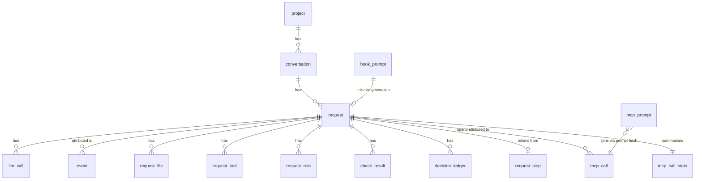

# Data model

One SQLite database **per project**, at `<product state>/observe/<projectId>/harness.db`. Schema is
created and evolved by numbered migrations in `packages/harness-observe-server/db/migrations/`.

This document is organised by **what question a table answers**, because that is how you find the right
table when writing a query — and it lists the traps that have produced wrong readings.

## The spine



| Table | One row is | Key facts |
|---|---|---|
| `project` | a consumer linked to this database | `id`, `root_path`, `storage_target` |
| `conversation` | one transcript file | `transcript_path`, `byte_size`, `request_count` |
| `request` | **one turn** | id `<conversationId>:<boundaryIndex>`; 28 columns, many denormalised for the list view |
| `llm_call` | one assistant message = one model call | `tool_names` (resolved), `tool_count`, `emit_chars` |
| `event` | one hook event | `event_type`, `tool`, `path`, `generation_id`, `request_id`, `raw_json` |
| `request_file` | one path a turn touched | `reads`, **`edits`**, `actions` |
| `request_tool` | one tool, aggregated | `tool`, `count` |
| `request_rule` | one rule attached at prompt time | `rule_id`, `attached_at` |
| `check_result` | one conformance verdict | `check_id`, `status`, `heuristic`, `detail` |
| `decision_ledger` | one decision **or** one ESO verdict | see the trap below |
| `hook_prompt` | the captured prompt for one generation | `prompt_text`, `rules_json`, `hook_at` |
| `request_stop` | one `stop` payload | the **dispatcher's** tokens |
| `mcp_call` | one completed model call | token usage, `prompt_sha256` |
| `mcp_prompt` | one model prompt sent by a turn | the join key for the above |
| `mcp_call_stats` | a per-turn model-call summary | the raw counts and Brain token totals |
| `ingest_state` | a read cursor per source file | `last_offset`, `seam_hash` |
| `schema_migrations` | one applied migration | `version`, `name` |

## Question → table

| I want to know | Read |
|---|---|
| what did this turn do | `request`, then `llm_call` / `event` / `request_file` / `request_tool` |
| are the rules satisfied | `check_result` |
| what was the agent allowed to do, and why | `decision_ledger` |
| what did the turn cost | `request_stop` (dispatcher) + `mcp_call` (Brain) |
| which files changed | `request_file` where `edits > 0` |
| which prompts were captured | `hook_prompt` |
| is ingest healthy | `ingest_state`, plus the ingest report counters |

## Traps

Each of these has produced a wrong reading in the field. Nothing here is hypothetical.

### `request.generation_id` may be a **placeholder**

When no real generation was captured, the row is stamped `generation_id = id` so the spine still has a
join key. It is **not** a link. Any query asking "is this turn linked to a prompt" must exclude it:

```sql
-- WRONG: counts every request, because the placeholder is non-null
WHERE generation_id IS NOT NULL

-- RIGHT
WHERE generation_id IS NOT NULL AND generation_id != id
```

`hasRealGenerationLink()` in `ag-request-enrich.mjs` is the canonical form.

### `event` has **two** attribution columns and they can disagree

`generation_id` is the IDE's own stamp; `request_id` is the harness's conclusion. Historically they
disagreed on **3,438** rows (7 conversations) because a time-based guess was never revisited — see
`F49` and [`../02.runtime/04.ingest-pipeline.md`](../02.runtime/04.ingest-pipeline.md).

If you are asking "did this turn do X", **prefer the generation** and treat `request_id` as derived.
After the `F49` fix both agree for every event whose generation resolves to a real request; the
remainder are events for turns that were never captured.

### `request_file.edits` does not count shell writes

`edits` increments only for tools whose **name** classifies as an edit (`Write`, `StrReplace`, …). A
shell command writing the same path is classified separately and resolved from the command text. Before
that existed, a turn that wrote seven protected files through `cat >` showed `edits = 0` — as **reads**
(`F42`).

So a `edits = 0` on a path is not proof it was untouched. Cross-check `event` with
`event_type = 'postToolUse' AND tool LIKE 'Shell%'`.

### `decision_ledger` holds two row shapes

| `event_type` | Producer | What the columns mean |
|---|---|---|
| `turn_start`, `pre_guard_shell`, … | `decide.mjs` (facade) | a routing/guard decision; `jev_response_json` is a **Jev API response** when Jev ran |
| `evidence_sufficiency` | `eso-ledger.mjs` | an ESO verdict; `jev_response_json` holds the **ESO bundle** — a payload reuse, not a Jev call |

Consequences:
- **`jev_response_json IS NOT NULL` is not evidence Jev ran.** Counting it reported a Jev call on every
  turn forever (`F38`). Use `latency_ms_jev > 0`.
- Counting rows double-counts a request, because one decision can appear as both a `turn_start` and an
  `evidence_sufficiency` row. Count **distinct `jev_request_hash`**.

### Token columns have two owners

| Column | Owner | Meaning |
|---|---|---|
| `request.input_tokens` / `output_tokens` / `cache_read_tokens` | the `stop` hook | the **dispatcher's** usage |
| `mcp_call.*_tokens` | the MCP server's ledger | **Brain** usage, joined by `prompt_sha256` |

They are **not additive into a single "turn cost"** unless you say which is which — and the UI
deliberately does not merge them. When no Brain usage was reported, the honest display is "not
reported", not zero (`F32`/`F33`).

### `mcp_call_stats` is derived, and two of its columns are honest only by convention

- `brain_*_tokens` are **NULL** when nothing reported, and a non-null count in `brain_usage_calls` says
  how many calls contributed. Zero and "unknown" are different facts.
- `smart_route_count` exists separately because the smart router picks its tier from complexity
  keywords at call time; re-deriving that in the observer would be a second source of truth for routing.
- `brain_*` counts **only** Brain tiers. The executor tier is excluded — it is thinking-off tooling, and
  counting it would present merges as reasoning.

### `ingest_state.seam_hash` is what makes a cursor trustworthy

`last_offset` alone is not enough: `size < last_offset` catches truncation, but not an in-place rewrite
to the same-or-greater length, which permanently loses a turn (`F35`). `seam_hash` is the sha256 of the
64 bytes ending at the cursor. A cursor with a NULL `seam_hash` predates the column; the fallback is a
newline check, plus the repair command `ingest.mjs --rebuild=<id>`.

## Migration discipline

| Rule | Why |
|---|---|
| Migrations are **append-only**, numbered, and never edited once applied | a changed migration silently diverges between machines |
| A migration that changes **derived** meaning should **clear** the derived tables | the corrected code rebuilds them on the next pass, and the pass is full because `migrations.length > 0` participates in the `changed` flag |
| Never `ALTER` a table's meaning; add a column | readers of the old shape keep working |

Examples in this repo of the second rule: clearing `mcp_call` when the id scheme changed (`009`),
clearing `mcp_call_stats` when `jev_count` was corrected (`011`), clearing `request_file` +
`check_result` when shell writes became visible (`012`).

The current head is **012**. `schema_migrations` is the authority at runtime; do not infer it from the
directory listing.
