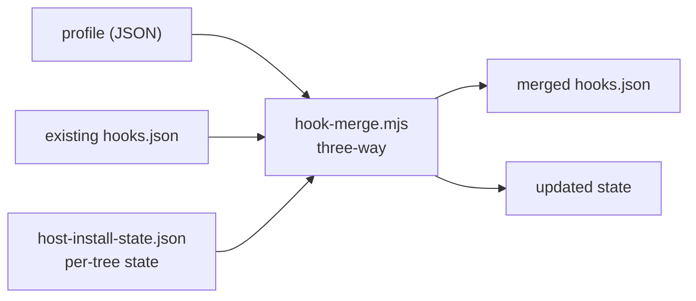

# Host pack contract

The pack is the **only** part of the product that runs inside a consumer, and it runs as an *artifact*
rather than an installed dependency. Its contract is therefore worth stating exactly: the IDE config
names a file and a hook id, and nothing else may be assumed.

## What is installed, and where

```
<consumer>/.harness/host-pack/
  harness-hook.mjs            # the dispatcher — all hook implementations, bundled
  route-hook.py               # trace writer (also speaks the Antigravity dialect)
  path-policy.default.json    # generated default path policy, for the Python guards
  host-pack.json              # version + per-file sha256
```

`host-pack.json`:

```json
{ "version": "0.1.0", "entry": "harness-hook.mjs", "routeHelper": "route-hook.py",
  "files": { "harness-hook.mjs": "<sha256>", "route-hook.py": "<sha256>" },
  "builtAt": "…" }
```

It carries **no checksum of itself** — it is the thing being verified. `host-pack status` reports
`integrity` and `verification`; a partial or corrupt install is detectable rather than silently
half-working.

## The invocation contract

```
node .harness/host-pack/harness-hook.mjs --hook <id> --tree <cursor|agents> [--event <Name>]
```

| Argument | Meaning |
|---|---|
| `--hook` | **required.** Unknown or missing → the dispatcher **denies**, with the list of known ids |
| `--tree` | selects the session directory and the response dialect; also exported as `HARNESS_TREE` |
| `--event` | needed only where the IDE event name cannot be inferred (Antigravity) |
| stdin | the IDE's hook payload, as JSON |

Two failure behaviours that are deliberate:

- **No `--hook` is treated as a broken install**, not a developer error: it denies and says to re-run
  the pack refresh. Guessing which guard the host meant to run would be worse than refusing.
- **A hook that throws** is resolved through `errorPosture(hook)`: guards **deny**, telemetry **allow**
  (with a visible note where the dialect carries one). The consumer can override with
  `guards.unavailable: "deny" | "warn"`. An unreadable policy does **not** loosen this — it falls back
  to the hook's own default rather than to `warn`.

## The hook ids

| id | kind | on error | Purpose |
|---|---|---|---|
| `guard-shell` | guard | deny | `beforeShellExecution` |
| `guard-brain` | guard | deny | `preToolUse` for model-call tools |
| `preflight` | telemetry | allow | ESO run before the prompt |
| `route` | telemetry | allow | write a trace row |
| `gap-tracker` | telemetry | allow | record which gaps the turn closed |
| `post-tool-hint` | telemetry | allow | inject hints |
| `pre-compact` | telemetry | allow | cost checkpoint before context compaction |
| `shell-targets` | guard | deny | **a query, not a guard** — see below |

### `shell-targets` is not wired to any IDE event

It prints JSON instead of a permission payload:

```json
{ "ok": true, "writeIntent": true, "targets": ["sdlc/x.md"] }
```

It is invoked **by the consumer's `guard-shell.py`**, which runs it to learn which files a command
writes and then applies its own path policy. Two rules, and both matter:

- **Do not wire it into a profile.** An IDE event calling it would replace a real guard's decision with
  this JSON. There is a test asserting no profile references it.
- **It is on the consumer's hot path.** A shell command that might write costs one node spawn
  (~46 ms measured). That is the price of having one detector instead of two; the guard's prefilter
  keeps read-only commands at zero.

## The response dialects

Selected by tree, but the *input* shape is detected from the payload, not from the tree, so a payload
from either IDE is handled correctly.

| Tree | Dialect | Allow | Deny |
|---|---|---|---|
| `cursor` | flat `{hooks: {<event>: [...]}}` | `{"permission":"allow"}` | `{"permission":"deny","user_message":…,"agent_message":…}` |
| `agents` | named blocks `{<block>: {<Event>: [{matcher, hooks:[{type,command}]}]}}` | `{"decision":"allow"}` | `{"decision":"deny","reason":…}` |

**Cursor accepts only `allow` and `deny`.** Verified from the shipped bundle, which warns
`'ask' permission … is not yet implemented. Use 'allow' or 'deny' instead.` So a hook physically
**cannot** prompt a human; anything that looks like an "ask a human" behaviour is a deny whose message
names what the human must do.

This is why the `ask` path tier does not rely on hooks: consent is granted on the Console and read
from product state.

## Why it is bundled at all

The first design shipped one script per hook plus a shim that spawned the implementation out of the
**product checkout**. That made the checkout a runtime dependency of the consumer:

- `git clean` in the product repo broke consumer guards.
- `.harness/sidecar.env` had to carry an absolute path back to the product repo.
- A consumer pointed at a deleted directory could not run its guards.

The pack replaced all of it. The build asserts the bundle has **no import outside `node:*`**:

```js
const external = externalImports(source);
if (external.length) throw new Error(`host pack bundle has non-builtin imports (${external.join(', ')}) — it would fail on a consumer`);
```

That assertion is the load-bearing invariant of the approach. It has already caught a real mistake: a
new export was added to the shared foundation but not to its `pure` entry, and the build failed with
the exact missing symbol instead of shipping a bundle that would die on a consumer.

## What the pack may import

Only `@mu/harness-foundation/pure` from the product. The distinction is enforced by the bundle check and
documented at the top of `pure.mjs`:

| entry | may a hook import it? |
|---|---|
| `@mu/harness-foundation/pure` | **yes** — no database, no child process, no filesystem write |
| `@mu/harness-foundation` (root) | **no** — pulls the SQLite port and a conditional `bun:sqlite` import |

If you add hook-facing code to the shared foundation, export it through `pure.mjs`. The build will tell
you if you forget.

## What the pack reads and writes

**Reads** (all local, no network, no server):

- `<consumer>/.harness/decision-policy.json` — policy, including `paths` for the Python guards
- `<consumer>/.harness/host-pack/path-policy.default.json` — the generated default
- `<product state>/attest/<projectId>.json` — when asked (the guards read this, not the pack)
- `<consumer>/.cursor/session/.eso-preflight.json` — its own prior output

**Writes**:

| Path | Content |
|---|---|
| `<consumer>/.cursor/session/.eso-preflight.json` | the projection |
| `<consumer>/.cursor/session/.eso-bundle-stamp.json` | the verdict, for legacy readers |
| `<consumer>/.cursor/session/.eso-gap-closure.json` | gap closure state |
| `<product state>/attest/<projectId>.json` | **the attestation a gate prefers** |
| the trace file (via `route-hook.py`) | one row per event |

The attestation write is attempted and **never allowed to break preflight**: the consumer root may have
no `harness.config.json`, and product state may be read-only in a container. On failure the guard falls
back to the session stamp, which is the behaviour that existed before.

## Provisioning: how the wiring is applied



Three-way rather than overwrite, because the consumer may have authored its own hook entries (a
`guard-write.py`, for instance) which must survive:

- entries the product owns are updated **in place by `id`**,
- entries the consumer added are left alone,
- entries the profile **no longer declares** are pruned — without leaving duplicates.

Each of those three was a defect first (`F10`, `F22`, `F29`).

`decision-policy.json` is **merged, never force-written**: the plan's keys are re-applied so wizard
choices win, while operator keys the plan does not define survive.

## Repairs

| Symptom | Action |
|---|---|
| `host-pack status` reports integrity or verification failure | `harnessctl host-pack refresh <consumer>` |
| a consumer with no pack at all | same — refresh installs it |
| hooks present but stale shapes | refresh, then reload the IDE window |

`refresh` is idempotent: running it twice leaves exactly one entry per hook per event.
