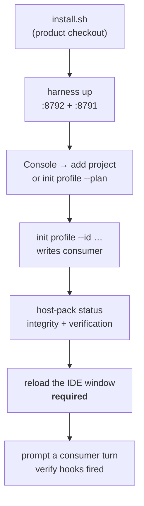

# Install and provision

Two different operations, and confusing them is the easiest way to break a consumer:

| | what it does | where |
|---|---|---|
| **install** | downloads dependencies and makes the operator entry point executable | in the product checkout |
| **provision** | writes hooks, policy and host pack **into a consumer** | in the consumer |

**Never provision the product repo.** `buildProvisionPlan` refuses a root inside `harness-eso`, because
provisioning it would write agent hooks into the repo that ships them.

## 1. Install the product (once per machine)

```bash
git clone https://github.com/thangs2/harness-eso.git
cd harness-eso
./install.sh
```

`install.sh` runs `bun install`, makes `./harness`, `./console.sh`, `./deploy.sh` executable, and prints what to do
next. It writes nothing outside the checkout.

Requires **Bun** on the host for development commands. Docker is only needed for the containerised
deployment ([`02.docker-deploy.md`](./02.docker-deploy.md)).

## 2. Start the product

```bash
./harness up          # image build + compose up; Observatory on :8792
```

Then open **http://127.0.0.1:8792** and use the **Projects** tab — that is the supported way to add a
consumer. There is no hand-editing of consumer config and no `configure add` (removed).

Alternatively, from the CLI:

```bash
./harness console                       # Console on :8791, in the foreground
harnessctl observatory up|down|restart|status|health|logs|build|smoke
harnessctl console up|down|restart|status|health|logs|build
```

## 3. Provision a consumer

### Always preview first

```bash
harnessctl init profile /path/to/consumer --plan
```

`--plan` writes nothing. It prints what would be created, merged or skipped. Do this before the first
provision of any consumer, and after any product upgrade that changes profiles — the plan is the only
place a surprising diff is visible before it lands.

### Apply

```bash
harnessctl init profile /path/to/consumer --id <id> --host-mode dual-ide
```

| Flag | Effect |
|---|---|
| `--id <id>` | the project id; also the database directory name under `~/.harness/observe/` |
| `--name <name>` | display name |
| `--port <port>` | the project's observe port |
| `--host-mode dual-ide \| superset` | which IDE trees to wire |
| `--host-profile <id>` | pin a specific host profile instead of the mode's default |
| `--force` | **rewrite** `harness.config.json` from the plan — the supported repair for a stale anchor |
| `--plan` | dry run |

`./harness init profile …` is the same thing.

### What provisioning writes into the consumer

| Path | Note |
|---|---|
| `.harness/host-pack/` | the bundled pack |
| `.harness/sidecar.env` | generated URLs; contains **no** path back to the product checkout |
| `.harness/host-bootstrap.json` | which profiles were applied, and the pack integrity result |
| `.harness/integrations.json` | adapter ids per evidence source |
| `.harness/host-install-state.json` | per-tree hook state, for the three-way merge |
| `.harness/decision-policy.json` | **merged** — see below |
| `.harness/README.md`, `.harness/.gitignore` | orientation, and the commit allowlist |
| `harness.config.json` at the repo root | **create-if-missing** |
| `<ide>/hooks.json` per tree | merged, three-way |

### Two merge rules worth knowing before you run it twice

**`decision-policy.json` is merged, never force-written.** The plan's keys are re-applied (wizard
choices win), while operator keys the plan does not define **survive**. A forced rewrite would drop
them.

**`harness.config.json` is create-if-missing.** Its consequence is the opposite one, and it catches
people out: a stale anchor **can never be repaired** by a plain run. A schema change or a wrong
`tenancy.registry` would be permanent. The repair is explicit:

```bash
harnessctl init profile /path/to/consumer --id <id> --force
# or, over HTTP:
curl -X POST http://127.0.0.1:8791/api/projects/<id>/reload -d '{"tenant":true}'
```

## 4. Reload host config (without re-provisioning)

After changing a profile, or to repair hook wiring:

```bash
harnessctl host-pack refresh /path/to/consumer
# or
curl -X POST http://127.0.0.1:8791/api/projects/<id>/reload
```

This rewrites hook bins, merges `hooks.json` (de-duplicated), refreshes `sidecar.env`, and updates
`host-bootstrap.json`. It is **idempotent**: each hook command appears exactly once per event.

**A window reload is required afterwards** for the IDE to read the new `hooks.json`. The IDE caches
hook config at window open — a running window keeps the old wiring, and this has masked a fix more than
once in this project. Confirming technique: compare the `hooks.json` mtime against the IDE process
start time; if the process is older, it has not reloaded.

## 5. Verify a provision

```bash
harnessctl host-pack status /path/to/consumer
```

Expect:

```
version      0.1.0
integrity    ok
verification ok
IDE tree     cursor: N hook entries
IDE tree     agents: M hook entries
```

`integrity ok` means the installed pack files match `host-pack.json`'s hashes. `verification ok` means
the hook wiring matches what the profiles declare — i.e. nothing was dropped by a merge.

Then confirm behaviour, not just configuration: the guards should be executable and reachable.

```bash
# the guard denies a protected write even with no server, no Docker and no network
printf '{"hook_event_name":"preToolUse","tool_name":"Write","tool_input":{"file_path":"<a protected path>","contents":"x"}}' \
  | python3 <consumer>/.cursor/hooks/guard-write.py
```

This is the check that proves the pack is standalone. If it fails because the product checkout is
unreachable, the isolation has been broken.

## Order of operations, and why it matters



Step F is not optional and is the most commonly skipped. Steps A–B are machine-level; D onward is
per consumer; a consumer can be provisioned for two IDEs from the same pack.

## Common mistakes

| Mistake | Symptom | Fix |
|---|---|---|
| provisioning the product repo | refused by the planner | provision a real consumer |
| expecting a plain re-run to repair `harness.config.json` | no change | `--force` |
| forgetting the IDE window reload | hooks behave as before; a fix looks ineffective | reload |
| hand-editing `harness.config.json` | works until the next provision | the spec forbids it; use `--force` |
| hand-editing tenant JSON | not supported | same |
| running `dev-observe.sh` while Docker Observatory is up | port conflict on `:8792` | one or the other |
| expecting the consumer's DB to be inside it | it is under `~/.harness/observe/<id>/` | see `../03.state-and-contracts/01.state-layout.md` |
