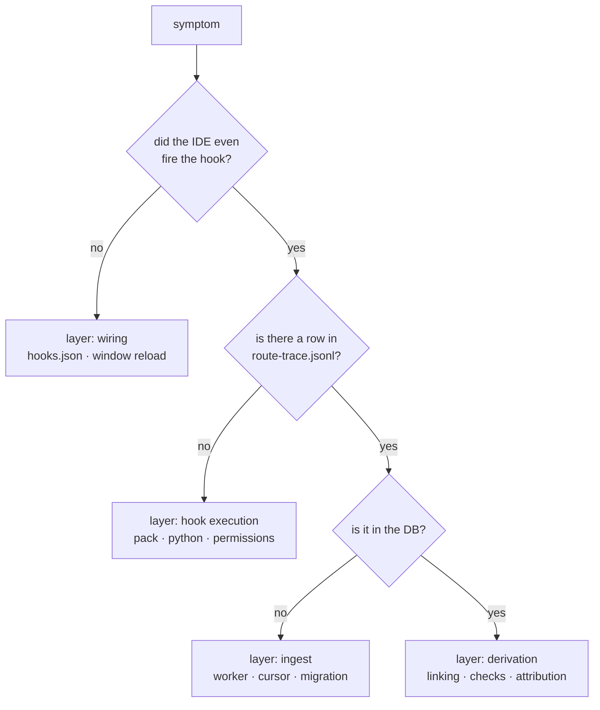

# Troubleshooting

Organised by **symptom**. Each entry gives the discriminating diagnostic, not just a guess — the point
is to get from "something is wrong" to "which layer" in one step.

## Start here: the layer map



Work down. Most reports arrive as "the monitor is wrong", which is layer 4 — but the actual fault is
often layer 1, and fixing layer 4 would not help.

## "I prompted, and nothing new appeared"

```bash
# 1. Is the trace moving? (the consumer's own file, not the DB)
tail -3 <consumer>/.cursor/session/route-trace.jsonl

# 2. Is the plane up and ingesting?
curl -s localhost:8792/health
curl -s localhost:8792/api/ingest/status

# 3. Force one cycle and read the report
curl -s -X POST localhost:8792/api/ingest/run
# or from a checkout:
node packages/harness-observe-server/src/ingest.mjs --json
```

| Finding | Cause | Fix |
|---|---|---|
| the trace file has **no** new row | the IDE is not running the hooks | reload the window; then `host-pack status` |
| the trace has a row, `--json` reports `newLines: 0` | the cursor is past it | inspect `ingest_state` for that file |
| the cycle reports `changed: false` and `checked: 0` | nothing changed, so derived work was skipped — correct | if you *expect* change, the input is the problem |
| request missing while the transcript clearly has `<user_query>` | either the cursor is skewed or the boundary was not recognised | see the next section |
| request missing and the conversation shows `request_count: 0` | the turn was never ingested | see the next section |

### A prompt that exists in the transcript but produced no request

Two distinct causes, and the repair differs.

**Cursor skew — the transcript was rewritten in place.** Symptom: `ingest_state.last_offset` is at
end-of-file, `request_count: 0`, and the file **does** contain `<user_query>`. Cause: the cursor is a
byte offset and a rewrite to an equal-or-longer file leaves it pointing into unrelated text, so the
prompt line — which is *before* the cursor — is never seen, and the cursor advances anyway.

```bash
# the honest check: is the offset still at a line boundary whose bytes are unchanged?
node -e "
const fs=require('fs');
const p='<transcript>';const b=fs.readFileSync(p);
for (const off of [b.length]) console.log(off, b[off-1]===0x0a ? 'ends on newline' : 'MID-LINE');
"
```

Repair:

```bash
node packages/harness-observe-server/src/ingest.mjs --rebuild=<conversationId>
```

**The boundary was not recognised.** `classifyUserLine` needs `<user_query>` in a `user` line.
Injected context (`<external_links>`, `<uploaded_documents>`) is deliberately *not* a boundary.
Inspect the line:

```bash
node -e "
const fs=require('fs');
const l=fs.readFileSync('<transcript>','utf8').split('\n')[0];
const t=JSON.parse(l).message.content.map(b=>b.text||'').join('');
console.log({hasUserQuery:t.includes('<user_query>'), hasTimestamp:t.includes('<timestamp>')});
"
```

## "The turn shows 2 tool calls, but it made 20"

**Layer 4, identity.** The turn's events were filed under a *different* turn. Diagnostic:

```sql
-- events whose own generation disagrees with the generation of the request they are filed under
SELECT COUNT(*) FROM event e JOIN request r ON r.id = e.request_id
WHERE e.generation_id IS NOT NULL AND r.generation_id IS NOT NULL
  AND e.generation_id != r.generation_id;
```

Two outcomes:

- **The disagreeing events resolve to a real request** → a genuine mis-attribution bug. It is fixed as of
  `F49`; if you see it again, check that the corrective step is still present in `linkRequests` and that
  `link.corrected` participates in the `forceFull` gate.
- **They resolve to no request at all** → the turn was never captured. Nothing to fix; time is the only
  signal available. Count them to confirm it is the whole remainder:

```sql
SELECT COUNT(*) FROM event e WHERE e.generation_id IS NOT NULL
  AND NOT EXISTS (SELECT 1 FROM request r WHERE r.project_id = e.project_id AND r.generation_id = e.generation_id);
```

## "A write to a protected path was allowed"

**Layer 1/2, and it is the most serious class.** Discriminate by channel first:

```bash
# Write channel
printf '{"hook_event_name":"preToolUse","tool_name":"Write","tool_input":{"file_path":"<path>","contents":"x"}}' \
  | python3 <consumer>/.cursor/hooks/guard-write.py

# Shell channel — pass the command, exactly as you ran it
printf '{"hook_event_name":"beforeShellExecution","command":"echo 1 > <path>"}' \
  | python3 <consumer>/.cursor/hooks/guard-shell.py

# What does the policy think this path is?
node -e "
const m=await import('./packages/harness-foundation/src/pure.mjs');
const {policy}=m.loadDecisionPolicy({root:'<consumer>'});
console.log(m.pathMode('<path>', m.resolvePathPolicy(policy), '<consumer>'));
"
```

| Finding | Cause |
|---|---|
| the guard allows when run by hand | the path is genuinely not protected for that consumer — check `paths` in `decision-policy.json` |
| the guard denies by hand but the IDE allowed | **the hook did not run** — wiring, or the window was not reloaded |
| shell allowed, Write denied | expected for `gated` (shell carries no evidence) — but **not** for `ask` with consent, where both must allow |
| a path you expect to be protected reports `free` | check the entry **shape**: `backend/mu-` matches exactly one path; a prefix needs `backend/mu-*` |
| the guard crashed | since the fail-closed change it denies, so nothing is silently allowed; read the error |

If the guard is not running at all, check the pack executable path is reachable and that
`hooks.json` has the entry (see `host-pack status` → `verification`).

## "The Brain gate blocks, but my agent did call the Brain"

Three separate questions, in order:

```bash
# 1. Did a Brain-tier call COMPLETE? (role must be pro / brain_flash / brain_fallback)
tail -3 ~/.harness/deepseek-usage.jsonl

# 2. Did the call even REACH the server?
tail -3 ~/.harness/deepseek-frames.jsonl

# 3. Are there live processes, and which build?
pgrep -fl deepseek_direct
rg -o 'version: "[0-9.]+"' ~/.gemini/antigravity/deepseek_direct.js
```

| (1) ledger | (2) frames | Meaning | Where to look |
|---|---|---|---|
| has a Brain row | has a row | working | if the gate still blocks, the record is older than the max age |
| no row | **has a row** | the frame arrived but the call did not complete | server: API error, credentials, network |
| no row | **no row** | the frame never arrived | **the IDE did not deliver it** — a client-side loss |
| has a row | — | working | remember the ledger is machine-wide; it may be another project's call |

The `finally` in `callDeepSeek` writes the ledger **unconditionally**, so an absent record is proof the
handler never ran. That is what makes the (2)-column discrimination conclusive rather than a guess — it
was added precisely because three occurrences of "dispatched but vanished" could not otherwise be
localised.

The frame log is `<product state>/deepseek-frames.jsonl`, written by the MCP server, and it records
`tool`, `promptChars`, `brainPrefix` and `progressToken` — deliberately **not** the prompt text.

**Known open issue** (see `05.development/03.open-issues.md`): Cursor has rendered a model-call bubble
for `deepseek-direct` and delivered no frame. If you reproduce it, the frame log is the evidence to
attach to a Cursor bug report, and it should also reveal whether `progressToken` was sent — if it was
not, the server's keep-alive is a no-op and a long call can be cut by the IDE's idle clock.

## "Brain tokens show as not reported"

By design, when the MCP server reported nothing. Confirm which case:

```sql
SELECT brain_prompt_tokens, brain_usage_calls FROM mcp_call_stats WHERE request_id = '<id>';
```

- `brain_usage_calls = 0` with Pro/Brain tiles at 0, but the tools list still shows
  `mcp:ask_deepseek_pro` → transcript recorded a `tool_use` that never reached the MCP server
  (check `route-trace.jsonl` for `postToolUse MCP:ask_deepseek_*` and `~/.harness/deepseek-frames.jsonl`).
  Call *counts* on the Tokens card come from `mcp_call`, not from transcript `tool_use`.
- `brain_usage_calls = 0` and the count of Brain calls > 0 → a ledger row failed to join. Common
  causes: MCP server older than the ledger writer; or (fixed) `mcp_prompt` hashed the raw transcript
  prompt including `[BRAIN FLASH]` while the ledger hashed the stripped body — see `usageHashPrompt`.
- a non-null `brain_prompt_tokens` → reported. Compare against `SUM(prompt_tokens)` in `mcp_call` for
  that request.

Do **not** "fix" this by merging the dispatcher's tokens into the Brain's. They have different owners
and the display separates them on purpose.

Also check the second join: a ledger row is attributed through `mcp_prompt.prompt_sha256`, so an
unattributed ledger row means the prompt was never recorded for that turn (or was hashed under the
wrong rule before backfill v3):

```sql
SELECT COUNT(*) , request_id FROM mcp_call GROUP BY request_id;  -- NULL request_id = unattributed
```

Rows kept with a null `request_id` are **intentional** — spend the observer cannot place is still
evidence that spend happened.

## "Every turn reports a Jev call, but Jev is off"

`F38`, if it has regressed. The counter must use latency, not the JSON column:

```sql
-- honest
SELECT COUNT(DISTINCT jev_request_hash) FROM decision_ledger
WHERE request_id = ? AND latency_ms_jev > 0;

-- wrong: jev_response_json holds the ESO bundle on evidence_sufficiency rows
SELECT COUNT(*) FROM decision_ledger WHERE jev_response_json IS NOT NULL;
```

## "The monitor is slow, or freezes while working"

The observe server must never block on SQLite. Check:

```bash
pgrep -fl ingest-worker          # the worker process must exist
curl -s localhost:8792/health
```

| Finding | Cause |
|---|---|
| no `ingest-worker` process | the server is doing writes on its own thread — a regression |
| `health` times out during a turn | synchronous I/O on the HTTP thread, or the derived rebuild running every cycle |
| the UI is fast but data lags | normal: ingest is a poll |

The performance invariants are listed in `05.development/02.invariants.md`; a change that breaks one of
them will look like "the monitor got slow" rather than like a logic error.

## "Docker shows different (empty) data"

Expected if the container's `observe-data` volume is fresh: it is a **separate database** from the host
one. It re-ingests from the transcripts/hooks it can see. Check that all three inputs are mounted:

| If missing | Symptom |
|---|---|
| consumer at `/data/repo` | no project, nothing ingests |
| `~/.cursor` at `/host-cursor` | no requests (transcripts are the request source) |
| product state at `/data/product-state` | Brain tokens never reported; consent and attestations unreadable |

## "A check says `cannot determine`"

That is the honest answer, not a failure. It appears when the harness has no edit signal at all for the
turn. Diagnose:

```bash
rg -c "afterFileEdit" <consumer>/.cursor/hooks.json   # must be >= 1
```

If the entry is absent the profile is not wired for that event, and three checks cannot judge — the fix
is a `host-pack refresh`. Otherwise the cause is per-turn: the turn genuinely made no edit.

Do not change the wording to "no edits" to make it look cleaner. That was the defect (`F43`): a claim
about the filesystem drawn from data that says nothing about it.

## Escalation checklist

Before reporting a defect, capture:

1. The **layer** from the map at the top of this file, with the command that showed it.
2. `host-pack status` output (integrity + verification).
3. For a Brain problem: the last ledger row **and** the last frame row.
4. For an attribution problem: the disagreement count from the SQL above, and whether those events
   resolve to a request.
5. Whether the IDE window was reloaded after the last wiring change, and the `hooks.json` mtime versus
   the IDE process start time.
