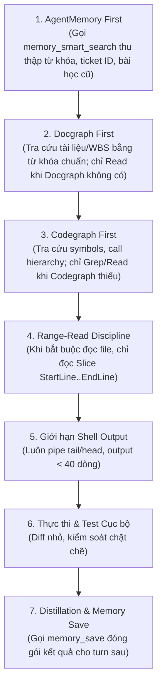

# Tiêu chuẩn Tối ưu Hóa Token & Quản trị Ngữ cảnh (Token Performance & Context Hygiene Standard)

> **Mã chuẩn hóa:** `STD-ESO-PERF-01`  
> **Trạng thái:** Active / Normative Baseline  
> **Phạm vi áp dụng:** Harness ESO monorepo, các consumer repos (`x79`, `baplatform`, v.v.) trên cả Cursor (`.cursor`) và Google Antigravity (`.agents`).

---

## 1. Bối cảnh & Vấn đề Cốt lõi (The Context Bloat Trap)

Qua phân tích các request thực chiến trên Observatory (`be5b71fc-57a4-4877-8ec0-815660b928b3:1` và `:2`), chúng ta phát hiện một hiện tượng nguy hiểm:

1. **Hiện tượng Lũy kế Tool Output (Cumulative History Drift):**
   - Khi Agent gọi `Read <file_lon>` (ví dụ `01.scenarios.md` 2.000 dòng hay `01.master-matrix.md` 3.000 dòng), toàn bộ nội dung file bị nhồi vào context history.
   - Ở các bước tiếp theo trong cùng turn (ví dụ turn có 78 steps), **toàn bộ nội dung của các file đã đọc ở bước đầu tiên liên tục bị gửi lại cho LLM ở mọi round-trip**.
   - Dẫn đến việc token input tích lũy vọt lên **> 2.58 triệu tokens** trong một turn duy nhất!
2. **Hệ quả tiêu cực:**
   - **Loãng độ chú ý (Attention Drift / Needle in a Haystack):** Context quá dài khiến LLM dễ bỏ sót các rule quan trọng, tăng nguy cơ hallucination.
   - **Độ trễ cao (High Latency):** Phản hồi bị chậm rõ rệt do model phải xử lý hàng triệu tokens.
   - **Chi phí Token Burn:** Dù có Prompt Cache, chi phí vẫn tăng theo cấp số nhân khi số lượng turn kéo dài.

---

## 2. Quy trình Thực thi Chuẩn hóa (The Sacred Pipeline Sequence)

Để tối ưu hóa chi phí token mà **vẫn giữ trọn vẹn chất lượng (Quality & Precision)**, mọi Agent làm việc trong hệ sinh thái Harness ESO bắt buộc phải tuân thủ thứ tự sau:



---

## 3. Bốn Trụ Cột Kỹ Thuật

### Trụ cột 1: `Docgraph First` — Sàng lọc Tài liệu theo Section AST
- **Quy tắc:** Bắt buộc dùng `docgraph --q "<terms>"` (hoặc MCP `docgraph_query`) để lấy đúng đoạn văn 30–50 dòng.
- **Fallback:** Chỉ dùng `view_file` / `Read` khi:
  1. Docgraph chưa được lập chỉ mục (chưa chạy `docgraph init -i`).
  2. Docgraph không tìm thấy nội dung cần thiết.
  3. Bắt buộc phải kiểm tra cú pháp nguyên bản của toàn văn file.

### Trụ cột 2: Tối ưu hóa Rules & Skills thành "Micro-Rules" (Cursor & Antigravity)
- **Vấn đề cũ:** Nạp cứng cả 7–10 rules toàn phần vào mọi prompt (ngay cả khi agent chỉ đang sửa code backend thì vẫn bị nạp rule WBS/Jira).
- **Quy chuẩn mới:**
  1. **Core Invariant Rules (Luôn bật - `alwaysApply: true`):**
     - Cực kỳ ngắn gọn (< 40 dòng).
     - Chỉ chứa: Pipeline Gate, Phân cấp Brain Tier, Cấm sửa trực tiếp protected files.
  2. **Contextual Rules / Skills (Nạp động - `alwaysApply: false`):**
     - **Cấu hình Cursor (`.cursor/rules/*.mdc`):** Khai báo trường `globs:` hoặc `description:` rõ ràng để IDE chỉ nạp khi file target khớp đường dẫn.
       *Ví dụ:* `delivery.wbs-atomic.mdc` chỉ áp dụng cho `globs: sdlc/08.wbs/**`.
     - **Cấu hình Antigravity (`.agents/rules/*.md` & `*.mdc`):** Khai báo layer và metadata tương tự, đảm bảo Agent chỉ nạp rule khi ngữ cảnh kích hoạt.
  3. **Quy tắc Đơn nhiệm (Single Responsibility):** Mỗi file rule/skill chỉ làm đúng 1 nhiệm vụ, trình bày dạng checklist súc tích, loại bỏ văn phong lý thuyết dài dòng.

### Trụ cột 3: `Codegraph First` — Dò tìm Kiến trúc Code theo AST
- **Quy tắc:** Dùng `codegraph_explore` (projectPath = repo root) để lấy AST, call hierarchy, caller/callee và blast radius trong **1 round-trip duy nhất**.
- **Fallback:** Chỉ dùng `Grep` + `Read` khi:
  1. Repo chưa có index codegraph.
  2. Cần tìm chuỗi text tự do, regex đặc biệt, hoặc file cấu hình không thuộc AST language (như `.env`, `.txt`, `.json`).

### Trụ cột 4: Kỷ luật Range-Read (Slice Reading) & Đóng gói Tri thức
- **Kỷ luật Range-Read:**
  - Tuyệt đối cấm đọc toàn bộ file nếu file > 100 dòng.
  - Phải dùng tham số `StartLine` và `EndLine` (hoặc lệnh shell `sed -n '120,180p'`) để chỉ kéo đúng 50–60 dòng code cần sửa vào context.
- **Đóng gói Tri thức (Distillation qua AgentMemory):**
  - Tại sao Turn 2 của `be5b71fc-57a4-4877-8ec0-815660b928b3` phải đọc lại 24 files? Vì tri thức từ Turn 1 chưa được tóm tắt triệt để.
  - Khi kết thúc Turn 1, Agent gọi `memory_save`: *"Đã verify X79-83, pod cần test là mu-sts-0 với script qc:kind:r1"*.
  - Ở Turn 2, Agent chỉ cần gọi `memory_smart_search` lấy câu kết luận này ra là có thể tiến hành chạy pod ngay, tiết kiệm hơn 80% số lượt Read file WBS!

---

## 4. Hướng dẫn Refactor cho các Dự án Consumer (`x79`, `baplatform`)

Khi bảo trì hoặc refactor consumer repo để giảm Token Burn:

1. **Rà soát `.cursor/rules/*.mdc` và `.agents/rules/*.mdc`:**
   - Chuyển các rule chuyên biệt (WBS, naming, operating model, tech stack) từ `alwaysApply: true` sang `alwaysApply: false` kèm `globs:`.
2. **Kích hoạt Docgraph & Codegraph MCP:**
   - Chạy `docgraph init -i` và `codegraph init -i` trên consumer repo.
   - Khai báo MCP trong `.cursor/mcp.json` và `.agents/mcp_config.json`.
3. **Giám sát qua Observatory (`:8792`):**
   - Vào mục **Drill Blocks → Call Timeline** và **Token Summary** của từng request.
   - Kiểm tra ô Conformance Check **`eager-prefix-budget`**: Nếu xuất hiện cảnh báo `warn`, số lượng rule eager đang vượt mức trần cho phép.
   - Mục tiêu: Giữ token input trung bình mỗi turn dưới **300.000 tokens** (giảm 85% so với mức 2.5 triệu tokens trước đây).

---

## 5. Bộ Công cụ Kiểm định & Provisioning trong Harness ESO

Hệ thống Harness ESO cung cấp giải pháp trọn gói 3 lớp để đảm bảo Token-Diet:

### 1. Công cụ Linter CLI (`./harness token-diet`)
Nhà phát triển và CI có thể audit trực tiếp workspace trước khi khởi chạy agent:
```bash
# Kiểm tra tổng thể dual-IDE
./harness token-diet <path-to-consumer>

# Kiểm tra riêng cho Cursor hoặc Antigravity
./harness token-diet <path-to-consumer> --tree cursor
./harness token-diet <path-to-consumer> --tree agents

# Xuất dữ liệu JSON cho automated pipeline
./harness token-diet <path-to-consumer> --json
```

**Các tiêu chí kiểm định (Assertions):**
- **Rule Budget:** Số lượng eager rules không được vượt quá `maxEagerRules` (mặc định $\le 7$).
- **Token Budget:** Tổng tokens prefix (eager rules + harness root files) không vượt quá `maxEagerTokens` (mặc định $\le 5.000$ tokens).
- **Frontmatter Integrity:** Không được phép vừa khai báo `alwaysApply: true` vừa khai báo `globs:`.
- **Lazy Globs:** Mọi rule `alwaysApply: false` đều phải có mẫu đường dẫn `globs:`.

### 2. Giám sát Runtime liên tục trên Observatory (`:8792`)
- Conformance Check `eager-prefix-budget` tự động đánh giá từng prompt của Agent:
  - `pass`: $\le 7$ eager rules attached.
  - `warn`: $> 7$ eager rules attached (kèm chi tiết số lượng vi phạm).
  - `skip`: Khi policy tắt tính năng `tokenDiet.enabled: false`.

### 3. Tự động Khởi tạo Chuẩn hóa (`./harness init profile`)
Khi khởi tạo hoặc re-provision bất kỳ dự án nào (`x79`, `baplatform`, v.v.):
- Tự động gán cấu hình `tokenDiet` vào `.harness/decision-policy.json`.
- Tự động gieo 3 micro-rules mẫu nếu chưa có:
  1. `core.conversation-hygiene.mdc`: Quy trình 8 bước, AgentMemory & Graph First, Range-Read, Shell limit.
  2. `core.pipeline-gate.mdc`: Phân cấp ranh giới Dispatcher - Brain Tier - Executor.
  3. `core.scope-fallback.mdc`: Cô lập workspace và bảo vệ các file cốt lõi.
- Trả về audit report `tokenDiet` ngay sau khi provision hoàn tất.
