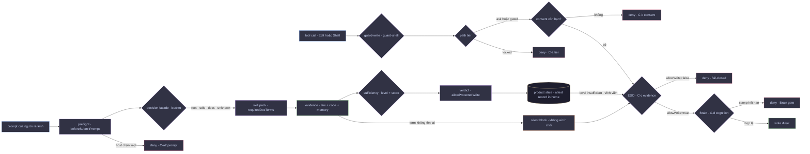

# Gate defect register — G-01…G-16

**What this is.** The registry the repo did not have. Every identified failure of the write gate, the
evidence pipeline, the observe ingest and the agent's own reply channel is written once here, with six
fields that never change: **the failure**, **how it was established**, **the invariant it breaks**,
**what a fix must not undo**, and **the regression test that proves the fix** (the sixth, **state**, is the
only mutable one). The cross-consumer table
that used to be the only home for these findings (`comments/artifacts/problem-matrix-2026-10-23.md`) is
an evidence artifact and may be deleted; this file may not.

**Who reads it.**

| Reader | Read |
|---|---|
| the next agent about to edit `packages/*` | §3 (**do not re-bug**), then the entry you are about to touch |
| the next agent that sees a deny | §2 (which gate, which refusal form) before touching policy |
| the operator / Lead | §1 (where a turn can be refused) and §4 (runbook) |
| whoever answers "did we already decide this?" | §5 (rulings — decided, not open) |

**Relation to the other files.** `02.invariants.md` states the law; this file records the defects that
law was written from, one row per defect, keyed by a **stable id**. `03.open-issues.md` is the short
list of what is open right now. Rows here never change their claim — a fix lands in
`04.standalone-revamp-wbs.md`, and the row moves from `OPEN` to `FIXED` with the commit as its closing
evidence, exactly as `03.open-issues.md` does it.

**Provenance.** Verified **2026-10-23** against the tree, the three consumer policies on this machine
(`atrievefin`, `baplatform`, `fineso`) and the observe DB at `~/.harness/observe/x79/harness.db`.
Every number below was re-run while writing this file, except the two rows whose **Established by**
cell says which session produced it and that it was **not** re-measured (G-15, and the consumer-side
counts in G-04/G-09, which name their log). Where a claim
comes from a consumer session rather than this repo, the session is named.

**What this file is not.** Not law (`AGENTS.md` is), not a design proposal. §5 is the only section that
decides anything, and it decides *by ruling*, not by adding new mechanisms.

---

## 0. Vocabulary

| Term | Meaning here |
|---|---|
| **tier** | the path's row in `paths` of `.harness/decision-policy.json`: `locked` / `ask` / `gated` / no tier |
| **valid write** | the change a human asked for, at the fidelity they asked for |
| **safety deny** | the guard refused, and the change was genuinely risky |
| **false deny** | the guard refused, and the change was in scope and harmless |
| **silent block** | nothing was refused; the evidence pipeline settled into a state where no write can ever be allowed |
| **refusal form** | which of the four channels a refusal uses — see §2 — because they are not interchangeable |

---

## 1. Where a turn can be refused

A turn reaches a protected write through the preflight path and the guard path. The **four refusal
channels plus the silent one** are why a single symptom ("it cannot write") has five causes; a diagnosis
that does not name the channel is a guess.



Four refusal channels, two of them invisible:

| Channel | Where | Form of refusal | What the agent sees | Registered |
|---|---|---|---|---|
| **C-a** | `guard-write.py` / `guard-shell.py`, path tier | host deny | the deny string, naming a tier | G-04, G-06 |
| **C-a2** | host, `beforeSubmitPrompt` hard blocker | the turn never starts | a prompt-level block | — (works; nothing open) |
| **C-b** | consent record in product state | deny that tells you to grant consent | the Console call that would grant | G-10 |
| **C-c** | ESO evidence, `enforceWrites` | deny, `fail_closed` | `DENY_ESO` | G-01, G-02, G-03, G-08, G-12 |
| **C-d** | Brain, `enforceBrain` | deny, `fail_closed` | `DENY_BRAIN` | G-09 |
| **silent** | no channel fires | **nothing** | the agent works, every write is later refused | G-02, G-03, G-13 |

The **silent** row is the one this register exists for. A false deny is loud and the operator fixes it
in a minute; a silent block produces an agent that keeps working and an operator who keeps being told
"done".

---

## 2. The register

Legend — **S**everity: `H` = blocks valid work or opens a gate that should close · `M` = wrong or
misleading verdict · `L` = hygiene. **State**: `OPEN` · `PARTIAL` · `FIXED` (with the closing evidence).
**Inv.** = the invariant in `02.invariants.md`.

### 2.1 The evidence channel (C-c, silent)

| ID | Failure | Established by | Breaks | Fix must not undo | Regression test | S · State |
|---|---|---|---|---|---|---|
| **G-01** | The **`tools` skill pack ships `harness-tooling` terms into every consumer**. `resolveSkillPack` maps `surface.bucket === 'root'` → `'tools'`, whose `requiredDocTerms` are `harness-tooling`, `decision-facade`, `harness-eso` — three documents that exist only in this repo. On a consumer where those terms index to nothing, three `law:*` gaps are emitted every turn and the evidence score cannot pass `T_high`. | `skill-pack.mjs:51` (`bucket === 'root' → 'tools'`) + `skill-pack.mjs:1-8`; **reproduced** in a script on the exact atrievefin prompt: `detectGaps` → 3 `law` + 1 `code`, `scoreSufficiency` → `{score: 0, level: 'insufficient'}`. atrievefin attestation `2026-10-23T11:21:18Z`: `score: 0`. Same two terms score 0 on **fineso**, whose pack is byte-identical to `dist/` (matrix P-26) — so a fresh index is not the cause. | D3 (absence is not evidence), D5 (do not invent a number) | Fixing it must **not** remove the `tools` pack's requirement in `harness-eso` itself, where those three terms do exist. | consumer fixture whose docgraph has **no** hits: preflight must emit **zero** unclosable `law` gaps, and `level` must not be pinned at `insufficient`. | H · **FIXED** `2026-10-23` — `eso-gate-unclosable.test.mjs` “bucket root resolves to the root pack”; fixture preflight now `sufficient`, `gaps: []` where it was `insufficient` with 3 law + 1 code |
| **G-02** | **A `law:*` gap can be unclosable, and nothing says so.** Closure runs through `closesGap`: a `law` gap closes only on a path stem or on a `docgraph`/`Grep` query naming the term (`eso-gap-io.mjs:272-309`, `LAW_QUERY_TOOL_RE:20`). A consumer that has never heard of the term can read **every file in the repo** and close nothing. The gate then reports the same denial it would report for an agent that did not try. | `rg "harness-tooling|decision-facade" .` on atrievefin → **0 hits**; a probe of six realistic tool shapes (`Read` of the policy, of the stamp, of a source file; `Shell rg`; …) against the three gaps → **all `false`**, on 2026-10-23 while writing this file. | B1 (a guard that cannot decide denies — but it must say so), D3 | The stricter query reading (P-01/P-02: a bare term in a JSON blob must not close a gap) stays. The fix is to **name** the unclosable gap, not to loosen matching. | a `law` gap on a term the consumer lacks must appear as a **named** state (`law_term_unavailable`) — distinct from "not yet read" — in preflight, and the deny must carry it. | H · **FIXED** `2026-10-23` — `runCollect` records `lawMisses` from the adapter trace, tags the gap `unanswerable: true`, and the projection carries `lawMisses` + `unanswerableGaps[]`; `eso-gate-unclosable.test.mjs` “named unanswerable” |
| **G-03** | **A partial turn can never be published through the fail-closed channel, even after it did the reading.** With `enforceWrites` resolving to `fail_closed` (G-08), `allowProtectedWrite` is `level === 'sufficient'` and nothing else (`gate.mjs:33-39`). Two `law` gaps stuck ⟹ `score` ceilings at **0.55** — which is above `T_low` and below `T_high` — so the level is `partial` **forever**, and "read the whole repo" changes nothing. | `gate.mjs:33-39`; arithmetic: `scoreFromClosure` = `lawClosed/lawGaps · 0.55 + readClosed/codeGaps · 0.45`, ceiling `1·0 + …` → `0.45` today atrievefin, `0.55` with `harness-eso`, `0.72` only with all three. `attest/atrievefin.json` → `allowWrite: false`, `level: insufficient`. | D3, and B1's spirit (a refusal must be explainable) | Do not turn this into "partial is allowed by default" — that re-opens baplatform's false pass (P-01). The fix is to stop **synthesising** a `partial` from gaps no reading can close. | a consumer with one unclosable law gap: closing every closable gap must yield a level the gate can act on, or the deny must name the gap as unclosable (G-02). | H · **FIXED** `2026-10-23` — `gate.mjs` compares the **gap list**, not the level alone: `partial` with every reported gap closed publishes, and the control test (one open read gap) still denies. Higher **tiers** are unchanged (see §5 R-6). |
| **G-08** | **`enforceWrites` is not in the consumer's policy, and the default is the strictest.** `resolveEnforceWrites` returns `fail_closed` when the key is absent, when it is empty, or when it holds a value from the `eso.mode` vocabulary (`'observe'` → coerced, `F24`). atrievefin's policy declares `eso.mode: "hint"` and **no** `enforceWrites`; the guard reads `fail_closed`. | `eso-policy.mjs:121-140`; atrievefin `.harness/decision-policy.json` → `eso: { preflight:{…}, mode:'hint', cognition:{…} }`, no `enforceWrites`. Docs: `02.invariants.md` D8 ("absence resolves to the strictest posture — the safe default"). | D8 (safe default) vs. the operator's declared intent | The safe default **stays** (B6). What must change is that the resolved value is **printed** in the preflight verdict and in `DENY_ESO`, so a deny is never explained by a key nobody wrote. | a policy without `enforceWrites` must surface `enforceWrites: "fail_closed" (defaulted)` in the verdict and in the guard message. | H · **FIXED** `2026-10-23` — `resolveEsoPolicy` reports `enforceWritesDeclared`; the verdict carries `enforceWritesSource: declared|default`, the stamp and attestation carry it, and both deny messages say "NOT declared" — test “G-08: a defaulted enforceWrites is named” |
| **G-12** | **The ESO gate's refusal message offers three remedies, and none of them can be executed by the party that received it.** `DENY_ESO` says "improve context (docgraph/codegraph), set `eso.mode=hint/observe`, or human HIL". (a) on atrievefin docgraph closes nothing (G-02); (b) `eso.mode` is not what the guard reads (G-08 — it reads `enforceWrites`); (c) HIL is a Console consent record that **`locked`/`gated`** reads, not the evidence gate, and no member of the turn can write one. The message also names a **session** stamp, while the guard now reads **product state** first (`eso_fail_closed_blocks`, `guard-write.py:456-495`). | `profiles/templates/hooks/guard-write.py:59-63` (message) vs `:456-495` (decision) on atrievefin, read 2026-10-23; `documents/02.runtime/03.consent-and-attestations.md:96` (guard reads product state first). | G4 (a message states the failure), B7 | Keep the message short; it must name **which gate** refused, **which gap** is unclosable, and **the one lever that exists** for this consumer. | a snapshot test on `DENY_ESO` for: a consumer with an unclosable gap, one with no docgraph, one that is `partial`. Each must name something actionable, and none may name `eso.mode` as the lever for an `enforceWrites` refusal. | M · **FIXED** `2026-10-23` — `guard-write.py` `deny_eso_message()` is built from the verdict (`eso_verdict()`): gate, level, unanswerable gap ids, defaulted key, stale/unsigned receipt. `eso.mode` is no longer offered as a lever — `qc/host-guards.test.mjs` asserts the reason text; the host pack's `denyReasonFor()` does the same for the prompt deny. |
| **G-13** | **Term coverage is decided per turn and never recorded against the repo.** Preflight asks a term, gets nothing, emits a gap, and the fact *"this repo cannot answer this term"* is not stored anywhere durable. The next turn asks again, gets nothing again, and emits the gap again. This is the engine behind "every session ends in HIL". | `collect.mjs:149-159` (`lawTermsFor`), `collect.mjs:39-76` (`detectGaps`), nothing writes the miss to product state. Observed: three atrievefin sessions `2026-10-22T1320Z` / `2026-10-23T0341Z` / `2026-10-23T1021Z` each carry the same `law:*` set. | D3, E2 (recompute only what changed) | Do not cache the **evidence** — only the **non-answer**, with a TTL and an invalidation on index rebuild. | a consumer with two unanswerable terms: turn 2 must report them as `known-unanswerable`, not as fresh gaps. | M · **FIXED** `2026-10-23` — `law-misses.json` in **product state** (not the session dir), 7-day TTL, a term that answers is forgotten, and the preflight says which misses are repeats — test “G-13: a non-answer is remembered for the repo” |

### 2.2 The path channel (C-a, loud — and correct)

| ID | Failure | Established by | Breaks | Fix must not undo | Regression test | S · State |
|---|---|---|---|---|---|---|
| **G-04** | **`gated` is a prefix list with no content awareness, so a knowledge base and a constitution are one tier.** `SDLC/` is `gated` on atrievefin — in the same list as `AGENTS.md` and `scripts/ci/`. A one-line board correction (`08.wbs`, "14 SP → 22 SP") and a rewrite of `AC-ATF-01` are the same event to the guard. | atrievefin `.harness/decision-policy.json` → `gated: [… 'scripts/ci/', 'installation/docgraph/', 'docgraph.scope', 'SDLC/', 'sdlc/', '.harness/']`, `ask: []`; measured in the consumer: `SDLC/08.wbs/…` denied, `bun.lock` and `apps/facade/src/…` allowed (`atrievefin/agent-session-log-2026-10-23-atrievefin-write-gate-diagnostic.md` §1). | — (a design property). Recorded because it decides who can keep the artefacts truthful. | **The deny itself is correct and must not be "fixed"** in the guard. Any change is a **policy** decision by the consumer (see §5 R-2). | a policy test: a path under a `gated` prefix with no consent → deny, and the deny names the tier and the exact prefix. | M · **BY DESIGN** |
| **G-06** | **A pack default that declares `paths` loses every pack-side default, including the guard files.** `resolvePathPolicy` **replaces** per key, so a consumer that ships its own `paths` block silently drops `paths.gated` entries for the hooks it is being guarded by. | `path-policy.mjs:146-156`; the shipped `dist/host-pack/path-policy.default.json` still names another product's paths (`backend/mu-*`, `frontend/`, `document/mu/`) and none of `SDLC/`. atrievefin's own list gates the guard files **only because the operator listed them**. | B6 (declared replaces default), A1 (one definition per fact) | B6's replace-not-merge **stays**. The fix states in the resolved policy output **which keys were replaced**, and ships no other product's path in the generic default. | `resolvePathPolicy` test: a consumer `paths` with one key must show `replaced: ['locked','ask','gated']` for the other two, and the generic default must contain no `mu-` path. | M · **OPEN** |

### 2.3 The write gate's coverage

| ID | Failure | Established by | Breaks | Fix must not undo | Regression test | S · State |
|---|---|---|---|---|---|---|
| **G-05** | **The write guard decides from a path, not from a diff or a specific resource.** A binary edit, a `.md` rewrite and a one-token correction are the same request. There is no per-resource consent (`SDLC/08.wbs/03.program-board.md` cannot be approved for a day while `SDLC/02/` stays closed). | `guard-write.py`: the decision inputs are the tier of `rel` and the attestation; nothing in the guard reads the diff. Consent records are **per path prefix** (`consent/<projectId>.json`). | G-11 (a gate covers the channels of the thing it gates) | Do not introduce a diff-classifier — `AGENTS.md` rejects guard heuristics. A per-resource **operator declaration** in policy is the shape to keep. | a consent granted for `SDLC/08.wbs/**` must not open `SDLC/02.requirements/**`. | M · **OPEN** |
| **G-07** | **The `deny` that a human needs to read is the one the agent can most easily swallow.** `eso-blockers.jsonl` records DSH hard blockers (`kind: tool-deny`), but a **Cursor** `guard-write` denial leaves **no** product-state row: the record is the deny string on the hook's stdout, which reaches the agent and not the operator. | `~/.harness/eso-blockers.jsonl`: 12 rows for atrievefin, **all** `host: "dsh"`, latest `2026-10-22T09:23Z`; the session `8555a188` (2026-10-23 `10:54Z–11:56Z`) produced **zero** rows although it contains refused writes; `02.invariants.md` §G4 ("rejections are recorded before they take effect") is written for DSH. | G4 (a decision must leave evidence), C6 | DSH's append-only ledger stays. Cursor rows may be batched, but must exist. | a Cursor session with one denied protected write must append exactly one `tool-deny` row naming the tier and the path. | M · **OPEN** |

### 2.4 The cognition channel (C-d)

| ID | Failure | Established by | Breaks | Fix must not undo | Regression test | S · State |
|---|---|---|---|---|---|---|
| **G-09** | **Brain and evidence are two levers for one refusal, and the write gate has no notion of a task that is not code.** `enforceBrain: fail_closed` on atrievefin denies a protected write until a Brain stamp exists — independent of ESO. `shouldBlockBrain` returns `true` whenever any required gap is unclosed, so the same unclosable gaps block **both** gates. `02.invariants.md` B7 asks for the opposite: "preflight sufficiency gaps must never prevent Brain deep-thinking on non-code tasks", and docs/WBS writing is named there as the non-code class. | `eso-gap-io.mjs:674-697`; atrievefin policy `cognition: { enforceBrain: 'fail_closed', gapAttestation: true }`; invariant `02.invariants.md` B7 (lines 139-152). | **B7**, D1 (two measurements, one label) | B7 and B2 both stay: the Brain **stamp** remains required for code work and remains unwritable by the agent. | a docs/WBS turn with unclosed `law` gaps must not be blocked by the **Brain** gate, and a code turn must still be. | M · **FIXED** `2026-10-23` — `shouldBlockBrain` returns `false` when every gap is `unanswerable`; test “a Brain stamp is not demanded for a gap nothing can close” |
| **G-10** | **`ask` is a deny with a good message, and the denial names a Console the agent may not be able to reach.** Cursor's hook contract accepts only allow/deny, so `ask` cannot pause a turn. The operator's only lever is a Console record. | `03.open-issues.md` #3 (PARTIAL); the shipped bundle's own warning quoted there. | F5 | Keep the consent model (B3/B4). | the `ask` deny message must name the exact CLI/Console command **and** the path it opens. | M · **PARTIAL** |

### 2.5 The output channel (the agent's own reply)

| ID | Failure | Established by | Breaks | Fix must not undo | Regression test | S · State |
|---|---|---|---|---|---|---|
| **G-11** | **The reply-format detector could not see the shape the user actually receives.** The host delivers `text` **already holding** `[{"text": …}]`, and the detector required the outer object. Symptom: a session in which a bare `"errror response wrapper message"` had to be typed **five times** (`baplatform` ×1, `atrievefin` ×2, `fineso` ×2, matrix P-32/A-δ). | Matrix P-32; three sample strings pinned in `qc/output-wrapper.test.mjs` (including the host-delivered shape). | §G4 / `core.reply-format.mdc` | **Every negative test stays**: prose that starts with `{`, a fenced JSON block, and an ordinary `{"a":1}` answer are not envelopes. Widening the matcher is how this becomes a false positive that costs a whole turn. | `node --test qc/output-wrapper.test.mjs` — positives: the 3 real samples + the host shape; negatives: the 4 legitimate shapes. | M · **FIXED** (detector + `stop` guard; closing evidence: `qc/output-wrapper.test.mjs`, `wrapped-output-guard.mjs`) |

### 2.6 The observe plane (attribution)

| ID | Failure | Established by | Breaks | Fix must not undo | Regression test | S · State |
|---|---|---|---|---|---|---|
| **G-14** | **An event with no captured generation is attributed by time window.** For a turn ingest never saw, the window is the only signal, and it is used — by design. | `03.open-issues.md` #5. Re-measured 2026-10-23 on `observe/x79/harness.db`: `select count(*) from event where generation_id = request_id` → **263**. | C2 (an event's own generation is authoritative) | Do not "fix" it by loosening the join: the count measures **hook coverage**, not ingest logic (`03.open-issues.md` #5 says so explicitly). | the count must only **fall**; a test asserts no event is attributed by window when its generation resolves to a request. | L · **OPEN** |
| **G-15** | **A prompt hash can be shared by two conversations, so an MCP call can be attributed to the wrong turn.** Ingest joins `mcp_call` to `mcp_prompt` on `sha256(prompt)`; two identical prompts in two conversations collide. | `02.invariants.md` A4; `03.open-issues.md` #6 (the accurate join "is not reachable at gate time"). **Not re-measured here** — the earlier count (95 duplicated hashes) was taken in a prior session; treat it as a claim to re-run, not a number. | C2, A4 | A4's *hashing* rule stays (the MCP server's own hash is the session body). | two conversations with the same prompt: `mcp_call.request_id` must resolve to the conversation that issued it, or be `null` — never to the other one. | L · **PARTIAL** |

### 2.7 Documentation

| ID | Failure | Established by | Breaks | Fix must not undo | Regression test | S · State |
|---|---|---|---|---|---|---|
| **G-16** | **The operator guide contradicts the shipped guard.** `profiles/templates/WORKFLOW_GUIDE.md` §2 says "**the decision to block is based on the path's tier or a named finding; score only describes**" and §9 "do not decide by score" — while a `fail_closed` consumer's gate refuses on `level`/`score` with no tier involved. The consumer's `WORKFLOW_GUIDE.md` is generated from this template verbatim on every provision. | `profiles/templates/WORKFLOW_GUIDE.md:77-79` and `:288` vs `gate.mjs:35-58` + `guard-write.py` `eso_verdict`. | G4 (a doc that states a failure that is not the one happening) | The V3 rule is the **target** state; it must not be deleted to make the doc match the bug. §5 R-5 decides which side to change. | a doc-lint: every sentence naming a gate's decision input must cite the code symbol that reads it. | H · **OPEN** |
| **G-17** | **`verify host` passed a consumer running a stale guard.** `ensureConsumerGuards` is `create-if-missing` on purpose (a consumer may customise its guard), but `./provision.sh --force` therefore never refreshed `guard-write.py`/`guard-shell.py`, and **H1 only asked "is a guard wired"**, never "is it this build's guard". Atrievefin, 2026-10-23: `13 created, 2 updated`, `verify host` → **PASS H1**, both guard files byte-identical to a pre-fix build. | `packages/harness-eso-core/src/guard-freshness.mjs`, `conformance.mjs` (H1), `host-install.mjs` (`syncConsumerGuards`) | G4 (a passing check that answers a different question than the one asked) | H1 compares **hashes against the shipped templates** and reports `current` / `stale` / `customised` / `not-applied`; `harnessctl host-pack sync-guards` refreshes stale files with a timestamped backup and never touches a `customised` one. | P-13 — `init report` prints the same freshness H1 fails on, from the same module. | H · **FIXED** |
| **G-18** | **A merged policy looked identical whether it changed anything or not.** `writePlanFiles` reported `status: merged` for `.harness/decision-policy.json` whichever way `deepMergePolicyObjects` went, so an operator who tuned `eso.enforceWrites` saw the product replace it with no trace in the output. The boundary itself (mechanism vs value) was true in code and written only in comments. | `packages/harness-cli/src/init-profile-cmd.mjs` (`policyOverwrites`), `packages/harness-foundation/src/ownership-report.mjs` | G16 (a state the system knows but does not say) | The result now carries `policyOverwrites: [{path, current, planned}]`; `harnessctl init report` classifies every key as `product` / `overridden` / `consumer`; `harnessctl ownership explain` states the intended owner and the document that declares it. | P-14 — `init report` / `ownership explain`. | H · **FIXED** |
| **G-19** | **`verify host` passed a consumer whose preflight was written by a previous pack.** H2 asked "is there a `.eso-preflight.json` with a level and a timestamp", never "is it this build's verdict". Atrievefin, 2026-10-23: the pack was refreshed at **14:29Z** with the G-01/02/03/08/09/12/13 guards, and `verify host` still printed `PASS H2 …: insufficient at 2026-10-23T11:21:18Z` — a verdict from **10 hours and one guard rewrite earlier**. Same shape as G-17: a green tier answering a different question. | `packages/harness-eso-core/src/conformance.mjs` (`checkVerdictAge`), measured on `../atrievefin` | G4 (a passing check that answers a different question than the one asked) | H2 compares the verdict's `at` against the **installed pack's mtime** (`1 s` tolerance for whole-second vs millisecond producers) and fails with "verdict predates the installed pack … run one agent turn, then re-verify". It must not be relaxed to "warn": the whole point is that a stale verdict is not evidence. | `qc/host-conformance.test.mjs` — G-19 ×4 (older fails, newer passes, sub-second rounding passes, unparseable `at` fails). | H · **FIXED** |
| **G-20** | **The docgraph index answers an older repo, and every rule still says "use it first".** `.docgraph/` is gitignored build output with **no daemon** — unlike codegraph, it is rebuilt only when a human types `docgraph build`. The index on 2026-10-23 was built **2026-10-14**, so it did not contain `06.concept-mission-vision.md`, `09.gate-defect-register.md` or `10.feature-and-classification-map.md` — the exact files `AGENTS.md` says to find with docgraph *first*. Nine days of queries searched a corpus without them, fell through to grep, and the rule was silently false while every test stayed green. | `scripts/check-docgraph.mjs`; observed as `generated_at: 2026-10-14T02:05Z, 96 entries` → rebuilt to `2026-10-23T14:41Z, 147 entries` | G4 / G-19 (a probe that cannot go out of date) | Generation is compared against **`docgraph.scope` as parsed** — an allowlist of `path:` roots filtered by `ext:` and `exclude:` — so `comments/artifacts/**` and `packages/**` are correctly absent and must not be reported missing; walking every `.md` on disk would have invented 116 phantom failures. Never relax stale to a warning: the whole failure was that a stale index looked usable. | `docgraph-freshness.test.mjs` — 9 cases incl. the real incident, the allowlist, `exclude:`, both disagreement directions, `absent` for missing/unreadable/unparseable, and **the shipped repo itself must not be stale**. | H · **FIXED** |

---

## 3. Do not re-bug — the regressions this register exists to stop

Each line is a change that looked correct, was made for a good reason, and silently restored a bug.
Read this before "simplifying" any of the code they name.

| # | The tempting change | What it restores | Correct behaviour, and where it is written |
|---|---|---|---|
| **R1** | Loosen `closesGap` so a term in a tool-argument blob closes a `law` gap ("the agent clearly searched for it") | **baplatform's false pass** — `sufficient / 1.00` because a shell comment contained the term (P-01, G-02) | A query closes only when it *is* the question: `docgraph --q <term>`, `Grep {pattern}` whose whole pattern folds to the term, a path stem, a resolved path in a command. `eso-gap-io.mjs:272-309`; `LAW_QUERY_TOOL_RE`. |
| **R2** | Make the write guard classify content ("this is only a one-line board change") | Every future false allow; `AGENTS.md` and G-5 of `04.operator-surface.md` forbid guard heuristics | The guard reads **tier + attestation**. Content policy is the **operator's** `paths` block (G-04/R-2). |
| **R3** | Merge pack default `paths` into a consumer's `paths` "so nothing is lost" | The opposite defect: a default the consumer deliberately removed resurrected (matrix P-27) | **Replace, per key** (B6). The fix states the replacement, it does not merge. |
| **R4** | Treat `partial` as writable while the consumer is `fail_closed` ("the agent read a lot") | baplatform's false pass again, with a different door | `allowProtectedWrite = sufficient`, **or** `partial` with every reported gap closed. A `partial` caused by an **unanswerable** gap is not the same turn as a partial that did not read (G-03); `gate.mjs` compares the gap list, never the level alone. If a partial *with open gaps* must be publishable, that is a **policy** ruling (§5 R-6), not a code relaxation. |
| **R7** | Map a consumer bucket to a pack that ships **this repo's** document names (`root` → `tools`, so `harness-tooling` becomes required everywhere) | G-01: three law gaps no consumer can answer, and a gate that says "insufficient" in every session until operators route around it | A bucket resolves to **its own** pack. A consumer that wants the tooling terms declares them in `skillPacks` (G-01). `skill-pack.mjs` `resolveSkillPack`. |
| **R8** | Turn sources back on by "restoring the defaults" — drop `withDefaultSourcesOff`, or hand `orchestrateTurn` the merged policy as-is | G-01's second half: `DEFAULT_ESO_POLICY.sources` enables docgraph/codegraph for a consumer that never asked, and every miss becomes a required gap | Sources are **off unless `enabled: true` was written by the consumer** (`preflight-hook.mjs` `withDefaultSourcesOff` + `sourcesDeclared`). `AGENTS.md` keeps the `DEFAULT_ESO_POLICY` defaults for library callers; the host pack, which runs inside a consumer's repo, is where "who asked for this source" is answerable. |
| **R9** | Make an unanswerable gap *closeable* (accept any query, treat a miss as closed) instead of naming it | R1 again — the false pass — and the gate stops distinguishing "cannot" from "did not" | The gap stays required and visible; the **write condition** exempts it (`gate.mjs`, `unanswerable: true`), and `DENY`/preflight name it (G-02). |
| **R5** | Cache a preflight verdict, a stamp, or an evidence score to make turns faster | Stale evidence presented as current (D3), and the closure-wipe class of bug (matrix P-28) | Cache the **non-answer** with a TTL (G-13 only). Evidence is recomputed per turn; `E2` allows skipping derived work, not skipping measurement. |
| **R6** | Delete a `law` gap because "it will never close" | The gate stops asking, and a genuinely unread law document is never noticed | An unclosable gap becomes a **named state** (G-02), not an absence. |

---

## 4. Operator runbook — "the agent says it cannot write"

Run these six probes in order. Each one **eliminates a channel**; stop at the first that answers.

```bash
# 1. Which tier does the target have? (C-a)
jq -r '.paths | to_entries[] | "\(.key): \(.value|join(", "))"' .harness/decision-policy.json

# 2. What did the gate actually believe? (C-c)  — product state, not the session stamp
jq '{at,level,score,allowWrite,enforceWrites,mode,generationId}' ~/.harness/attest/<projectId>.json

# 3. Which gaps are left, and can any of them close? (G-02/G-03)
jq -r '.gaps[] | "\(.kind):\(.query)"' .cursor/session/.eso-preflight.json
jq -r '.pack' .cursor/session/.eso-preflight.json   # which terms this verdict was measured against
jq -r '.unanswerableGaps[].id' .cursor/session/.eso-preflight.json   # empty ⇒ every gap can close
rg -l "harness-tooling|decision-facade" .        # 0 hits on this repo ⇒ those gaps cannot close

# 4. Did the operator declare enforceWrites? (G-08)
jq -r '.eso.enforceWrites // "NOT DECLARED ⇒ fail_closed"' .harness/decision-policy.json
jq -r '.enforceWritesSource' .cursor/session/.eso-bundle-stamp.json   # default | declared

# 5. Has this repo already failed to answer a term? (G-13)
jq -r '.terms | keys[]' .harness/law-misses.json 2>/dev/null || echo "no recorded non-answers"

# 6. Is a Brain stamp what is missing? (C-d)
jq '{via,at,ttlSec}' .cursor/session/.pipeline-brain-stamp.json 2>/dev/null || echo "no brain stamp"
```

How to read the result:

| Answer | Channel | What to do |
|---|---|---|
| tier is `locked` | C-a | not a bug — choose another path (B3) |
| tier is `ask`/`gated`, no consent | C-b | grant consent in the Console for **that prefix**, or move the prefix in policy |
| `allowWrite: false` **and** a gap names a term `rg` cannot find | C-c, **silent block** | the consumer cannot fix this by reading; escalate as G-01/G-02 — after the `2026-10-23` fix, such a gap appears in `unanswerableGaps` and no longer holds the write gate |
| `allowWrite: false`, all gaps closable | C-c, ordinary | close them, the way §4 probe 3 shows |
| `allowWrite: true`, no brain stamp | C-d | call the Brain, or decide `enforceBrain: off` for a docs-only repo (§5 R-3) |
| everything green, still denied | the guard is reading a **different** tree/stamp | `harnessctl verify host .` (H0–H5) |

**What NOT to do, and why** — each of these has already been tried on one of the three consumers:

| Tempting workaround | What it actually does |
|---|---|
| `"enforceWrites": "observe"` | coerced to `fail_closed` (G-08) — looks like a fix, changes nothing |
| `"eso.mode": "hint"` | **already set** on atrievefin and **irrelevant** to the guard (G-08/G-12) |
| add `SDLC/` to nothing, i.e. empty `paths` | removes every guard (B6/G-06) |
| read more files | closes `code` only (G-03) |
| ask for HIL | consent reaches `ask`/`gated`, not the evidence gate (G-12) |
| rebuild the docgraph index | fixes staleness only; the terms are indexable-nowhere on atrievefin/fineso (P-26/G-01) |

---

## 5. Rulings — decided, so nobody re-litigates

The user's 2026-10-23 decision on atrievefin: **"A first, then B, not C — A cleans the current state, B
stops the error coming back."** The rows below carry that shape into the two open design questions. They
are **rulings**, not proposals; a change of mind is a new row here, with the reason.

| # | Question | Ruling | Consequence if ignored |
|---|---|---|---|
| **R-1** | Is `SDLC/` (a knowledge base the team must write daily) correctly `gated`? | **The tier stays; the prefix is split.** `gated` keeps `SDLC/02.requirements/`, `SDLC/03.analysis/`, `scripts/ci/`, `AGENTS.md`, `.cursor/rules/`. `SDLC/08.wbs/` moves to `ask` (or out of the list) — a board status is state, not law. | Either the board falls behind reality (today) or the contract gets edited ungated (the other failure). |
| **R-2** | Who fixes a wrong gate? | **The product.** A defect that reaches every consumer is fixed in `packages/*`; the consumer gets policy changes only for its **own** paths. An operator who "fixes" it by emptying `paths` has removed the guard, not fixed it (B6). | Six consumers each invent their own workaround, and the next pack build undoes all of them. |
| **R-3** | Should `enforceBrain: fail_closed` apply to a docs/WBS repo? | **No.** B7 stands: Brain gates **code generation**; docs, RFC and WBS may reason immediately. A repo with no code surface sets `enforceBrain: "off"`. | A docs repo needs a DeepSeek MCP it never uses, or HIL every turn (G-09). |
| **R-4** | Is a `law` gap on a term the consumer cannot answer a defect? | **Yes — on the producing side.** The consumer did nothing wrong by not being `harness-eso`. A pack must not ship required terms that its consumers do not contain (G-01). | "Preflight always insufficient" becomes normal, and every consumer routes around the gate. |
| **R-5** | `WORKFLOW_GUIDE` says the gate does not decide by score; the code does (G-16). Which side is right? | **The guide is the target; the code is the defect.** Do not edit the guide to describe today's behaviour — that would make the bug a specification. | The V3 promise ("score describes; tier decides") becomes unreachable, because the doc that states it was rewritten to match the bug. |
| **R-6** | Is `partial` allowed to publish? | **Only a `partial` whose reported gaps are all closed.** A `partial` produced by a gap no reading can close is not a partially-evidenced turn — it is a turn measured against documents the consumer does not contain (G-03), and making it publishable is the only way the agent can ever finish. A `partial` with an **open, closable** gap still refuses: that is where the false pass lives. A consumer that wants more widens its own policy, never the code. | Re-opening the false pass, which is the one failure with no loud symptom. |

---

## 6. Change log

| Date | Change | Why |
|---|---|---|
| 2026-10-23 | Created. G-01…G-16 transferred from `comments/artifacts/problem-matrix-2026-10-23.md` (P-32, P-26, P-27, P-28, P-04, P-12, P-13, P-24 …) into a numbered registry with an invariant and a regression test per row; §3 (do not re-bug) and §5 (rulings) are new. | The matrix is an evidence artifact that may be deleted; none of its lessons were in the repo's law. The five-time wrapper symptom had no register entry, and the write-gate refusals had no shared vocabulary. |
| 2026-10-23 | G-11 marked FIXED; G-15 re-scoped to "claim to re-run". | G-11's detector and `stop` guard landed (`qc/output-wrapper.test.mjs`). G-15's 95-hash figure came from an earlier session and was **not** re-measured while writing this file; the DB schema (`mcp_call.prompt_sha256`) was confirmed, the count was not. |
| 2026-10-23 | **G-01, G-02, G-03, G-09 fixed** (branch `fix/gate-unclosable-gaps`): the `root` bucket resolves to its own pack; a source is off unless the consumer wrote `enabled: true` (`withDefaultSourcesOff` + `sourcesDeclared`); a law miss is recorded as `lawMisses` and carried as `unanswerable: true` on the gap; the preflight document now names `.pack` and `.unanswerableGaps`; `fail_closed` compares the gap list, not the level alone. R4 restated, R7–R9 added. | The atrievefin turn (`2026-10-23T1021Z`) was refused in every session for evidence its repo cannot contain: 3 law gaps from a pack that belongs to this repo, plus a `code` gap from a source the consumer never declared. Reading the whole repo could not have changed the verdict, which is the one failure mode the register exists to make impossible. Tests: `packages/harness-host-generic/src/eso-gate-unclosable.test.mjs`, `qc/v2-cognitive-dispatch.test.mjs`. |
| 2026-10-23 | **G-08, G-12, G-13 fixed** (same branch): `enforceWritesSource` is reported end to end (resolver → verdict → projection → stamp → attestation) and both deny messages name it; `guard-write.py` composes `DENY_ESO` from the verdict instead of a constant; `law-misses.json` (product state, 7-day TTL, forgotten on answer) records what the corpus could not answer and the preflight says which misses are repeats. | These four rows changed what the **operator is told** and what the repo **remembers**, not what the gate decides. Left open they made the next atrievefin session identical to the last: the same three gaps, the same message naming a lever the gate ignores. |
| 2026-10-23 | **G-21 opened and fixed**: `ttlSec` stops deciding a write. `verifySufficiencyReceipt` and `guard-write.py` compare `repoState` (git index mtime + `decision-policy.json`/`harness.config.json` mtime, recorded at mint) instead of the receipt's age; `reason: 'repo_changed'` replaces `'expired'`, and the deny message names the move. `ttlSec` stays on the receipt as a diagnostic only. Both sides compare only values present on **both** — an older receipt or a tree with no `.git` says nothing, which must not read as "changed". | Atrievefin was refused with `level: sufficient, allowWrite: true, score: 1` on a receipt five hours old and a tree nobody had written to: the only signal refusing the write was elapsed time, which is not a fact about the evidence. The clock also refused an agent that had been idle, and passed one that had been writing — `indexMtime` is the per-write signal the fingerprint already uses. Tests: `qc/v2-receipt-hardening.test.mjs` (G-21, `repo_changed`). |
| 2026-10-23 | **G-20 opened and fixed**: `eso.preflight.deferWrite.paths` (default `[]`) lets a consumer keep a path `gated` while its *evidence* stops holding the write. Matched segment-aware on a normalised rel path by one definition (`isDeferredWritePath` in `gate.mjs`, mirrored in `guard-write.py`), carried verdict → projection → stamp → attestation. Nothing else is deferred: `locked`, product state, secrets and the Brain stamp still apply, the shell guard still rescues shell redirects into `Write`, and the write is still refused when `enforceWrites: off` is absent and the stamp is stale. | atrievefin wants `SDLC/` writable during a planning task while keeping the tier; the only lever was `enforceWrites: off`, which removes the evidence gate for source too (G-03's reciprocal hole). Tests: `qc/v2-receipt-hardening.test.mjs` (G-20 ×2). |
| 2026-10-23 | **G-12 closed on the wording it left behind**: `DENY_ESO` still said "a `partial` publishes only when *every reported gap* is closed" while `gate.mjs` compares only the closable ones (G-02). The sentence now names the rule the guard actually applies ("every closable gap"), states the unanswerable ids as reported-not-required, and — when the consumer sets `eso.preflight.jevOnPartial` — says that no amount of reading reopens the write. `jevOnPartial` is read from the same verdict the gate read. Test: `qc/v2-receipt-hardening.test.mjs` (G-02 case). | A refusal can be correct and its instruction still wrong: the reader was told to close a gap that no reading in that repo can close, which is the exact experience G-02 removed from the gate. |
| 2026-10-23 | **G-16 reopened**: the previous edit put G-12's note on G-16's row and marked G-16 FIXED. G-12 keeps its row; G-16 is documentation-only again. |  |
| 2026-10-23 | **G-19 fixed**: H2 compares the preflight verdict's `at` with the installed pack's mtime. Atrievefin had been reported at tier **H3** with a verdict written by the pack that G-01/02/03/08/09/12/13 replaced; it now reports **H1** until one real agent turn produces a fresh one. Also re-ran `build:host-pack` + `host-pack refresh` + `sync-guards` (the installed pack was a `12:52Z` build, seven hours behind the guard fix). | A probe that cannot go out of date reports the past as the present. G-17 fixed the same defect one tier down (H1 checking wiring, not identity); H2 was the remaining tier where "present" was accepted as "current". |
| 2026-10-23 | **Still open, and why**: G-07 (Cursor denies leave no product-state row) and G-16 (guide contradicts the guard) are record / wording work with their own proofs; G-04/G-05/G-06 are consumer-policy questions (§5 R-1/R-2). | Each already states its fix and its test in the row; none is a code decision this branch could take without changing an operator's policy. |
