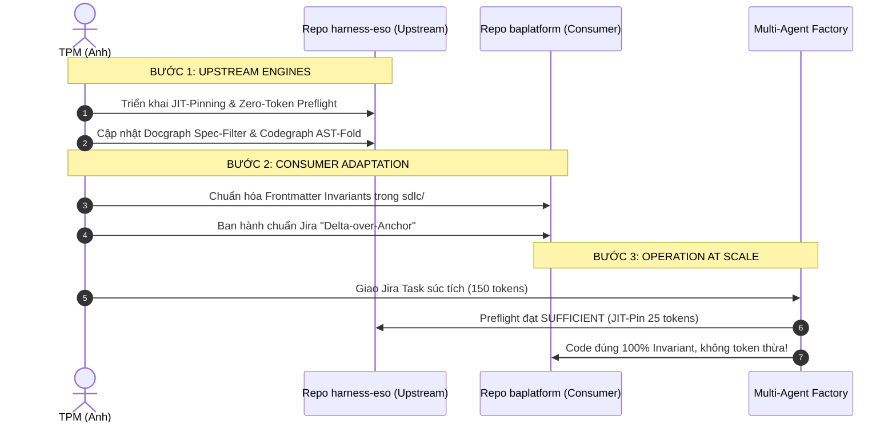

# Architectural Synthesis & Bi-directional Evolution: RFC-0009 Upgrade & Consumer Alignment

**Tài liệu tham chiếu:** 
- Upstream RFC: `09.rfc-upstream-harness-eso-optimization.md`
- Upstream Critique: `10.critique-and-architectural-upgrade-rfc-0009.md`
- Consumer RFC: `04.rfc-consumer-baplatform-optimization.md` (Repo `baplatform`)

**Trạng thái:** APPROVED SYNTHESIS & EVOLUTION BLUEPRINT  
**Debate tiếp theo:** [12.debate-beyond-synthesis-fingerprint-receipt-cognitive-states.md](./12.debate-beyond-synthesis-fingerprint-receipt-cognitive-states.md) (fingerprint, receipt, cognitive states — không phải implement)  
**Tác giả:** Technical Project Manager (TPM) & Principal AI Systems Architect  
**Ngày lập:** 2026-10-18  
**Phạm vi áp dụng:** `harness-eso` (Platform Engine) $\Longleftrightarrow$ `baplatform` (Consumer SaaS)

---

## 1. Tóm Tắt Điều Hành (Executive Summary)

Tài liệu này ghi lại kết quả của phiên phân tích và phản biện kiến trúc sâu sắc (Deep-dive Debate & Synthesis) về sự tiến hóa của **Harness-ESO Core** và tác động tương hỗ hai chiều đối với dự án tiêu thụ **`baplatform`**.

Vấn đề cốt lõi không chỉ dừng lại ở việc "giảm token" một cách cơ học, mà là thiết lập một **Giao thức Bắt tay Chuẩn xác (Contractual Handshake Protocol)** giữa:
- **Cơ chế đo lường bằng chứng ngầm của Máy (Gate Plane / Machine Level - Harness-ESO)**
- **Không gian nhận thức tinh gọn của AI (Cognitive Plane / LLM Level - DeepSeek Brain)**
- **Hệ thống tri thức chuẩn mực của Dự án (Knowledge & Task Level - SDLC & Jira trên `baplatform`)**

---

## 2. Phản Biện Nâng Cao: 2 Điểm Nghẽn Tiềm Ẩn Của Bản Thiết Kế Doc 10

Mặc dù tài liệu số 10 (`10.critique-and-architectural-upgrade-rfc-0009.md`) đã bóc tách xuất sắc cơ chế **Dual-Plane Decoupling** và **Zero-Token Preflight**, phiên phản biện chuyên sâu đã chỉ ra 2 lỗ hổng thực chiến cần được vá ngay lập tức:

### 2.1 Lỗ hổng 1: "Cái bẫy vỡ cú pháp" khi dùng Regex Folding trong `codegraph-code.mjs`
* **Vấn đề trong Doc 10:** Đề xuất dùng Regex thay thế:
  ```javascript
  sourceCode.replace(/\{[^{}]*(?:\{[^{}]*\}[^{}]*)*\}/g, '{ /* stub */ }')
  ```
* **Hậu quả thực tế:** Mã nguồn C# và TypeScript trong Enterprise SaaS chứa các cấu trúc phức tạp: string interpolation `$"Tenant: {tenantId}"`, regex literals, comments chứa ngoặc nhọn, generic type parameters `<T>`. Regex đệ quy nông sẽ làm biến dạng mã nguồn, gây lỗi cú pháp nghiêm trọng khi Brain đọc vào.
* **Giải pháp khắc phục triệt để (The Robust AST Solution):**
  - Tuyệt đối không dùng regex mù quáng để thay thế chuỗi lớn.
  - Tầng Adapter `codegraph-code.mjs` áp dụng **Tokenizer State-Machine 1-pass** hoặc tận dụng parser chuẩn của `codegraph` (`--outline` / AST export).
  - Chỉ gập khối block `{ ... }` nằm sau chữ ký method declaration hợp lệ, bảo tồn 100% Attributes (`[Authorize]`, `[Route]`), Interfaces, Properties và Type Declarations.

### 2.2 Lỗ hổng 2: "Bẫy Đủ Ảo Tưởng" (The Blind Sufficiency Trap)
* **Vấn đề trong Doc 10:** Khi `projection.level === 'sufficient'`, hook trả về `additional_context = undefined` (Zero-Token).
* **Hậu quả thực tế:** Khi chuyển sang turn mới với yêu cầu mở rộng (ví dụ: *"Bổ sung kiểm tra multi-tenant isolation và bắn sự kiện Eto"*), transcript đã cũ có thể khiến ESO tiếp tục đánh giá là `SUFFICIENT`. Do không có thông tin định hướng, Brain sẽ tự suy đoán và vi phạm các quy chuẩn bất biến của hệ thống (như tự chế ra tên event không đúng chuẩn ABP).
* **Giải pháp nâng cấp: "Just-In-Time Invariant Pinning" (JIT-Pinning):**
  - Khi `SUFFICIENT`: Tuyệt đối không dump raw code/doc text, nhưng **bắt buộc ghim (Pin) đúng 1-2 dòng danh mục Invariant đã xác thực** (< 30 tokens):
    ```markdown
    [ESO INVARIANTS PINNED] Verified system invariants for this turn:
    • INV-TENANT-01: Multi-tenant isolation via CurrentTenant.Id
    • INV-EVENT-02: Publish DistributedEvent (BookingCreatedEto)
    ```
  - Chi phí token gần như bằng 0, nhưng đóng vai trò là "la bàn kiến trúc", ngăn ngừa 100% nguy cơ hallucination.

---

## 3. Tác Động Tương Hỗ Hai Chiều: Upstream Nâng Cấp $\implies$ Consumer Biến Đổi

Khi **Harness-ESO (Phần 1)** chuyển đổi sang mô hình **Zero-Token JIT-Pinning**, **Normative Spec Extraction** và **AST Folding**, dự án tiêu thụ **`baplatform` (Phần 2)** bắt buộc phải chuyển đổi đồng bộ theo 4 phương diện:

```
┌────────────────────────────────────────────────────────────────────────┐
│             KIẾN TRÚC ĐỒNG BỘ HAI CHIỀU (CO-EVOLUTION)                 │
├───────────────────────────────────┬────────────────────────────────────┤
│   HARNESS-ESO UPSTREAM (Mới)      │   BAPLATFORM CONSUMER (Mới)        │
├───────────────────────────────────┼────────────────────────────────────┤
│ • Docgraph Normative Spec Parser  │ • SDLC chia 2 tầng: Machine Spec   │
│   (Chỉ đọc ## Invariants & Alerts)│   ở trên, Human Context ở dưới.    │
├───────────────────────────────────┼────────────────────────────────────┤
│ • Codegraph AST Folding           │ • Backend tuân thủ Contract-First: │
│   (Chỉ đọc Interface & Signature) │   Tách bạch .Application.Contracts │
├───────────────────────────────────┼────────────────────────────────────┤
│ • Zero-Token & JIT-Pinning        │ • Jira chuẩn "Delta-over-Anchor":  │
│   (Ghim mã INV-* đã verify)       │   Chỉ khai báo Delta + Mã INV-*.   │
├───────────────────────────────────┼────────────────────────────────────┤
│ • M2M Machine Gate (.json)        │ • TPM là Invariant Architect:      │
│   (guard-write.py verify đĩa cứng)│   Quản trị bằng bộ ràng buộc (SoT) │
└───────────────────────────────────┴────────────────────────────────────┘
```

### 3.1 Chuyển đổi cấu trúc SDLC tại `baplatform`
- **Từ tài liệu tự sự sang Normative Spec:** Mỗi file trong `sdlc/04.architecture/` được cấu trúc thành 2 tầng rõ rệt:
  1. **Tầng Máy (Machine-Readable Spec - Đặt ở đầu):**
     - Khối `## Invariants` với các mã ràng buộc chuẩn hóa (`INV-BOOKING-01`, `INV-SEC-02`).
     - Khối cảnh báo chuẩn GitHub Alerts: `> [!CRITICAL]`, `> [!IMPORTANT]`.
     - *Docgraph ở Phần 1 sẽ chỉ quét tầng này.*
  2. **Tầng Người (Human Context - Đặt ở sau):** Bối cảnh lịch sử, nghiệp vụ, rationale dành riêng cho TPM/PO.

### 3.2 Chuẩn hóa triệt để Jira: Mô hình "Delta-over-Anchor"
- Loại bỏ hoàn toàn thói quen copy tài liệu vào Jira ticket.
- Jira Task chuẩn chỉ gồm:
  1. **Anchor Link:** Trỏ đến đúng mục trong `sdlc/` (ví dụ: `sdlc/04.architecture/05.api/booking.md#create-booking`).
  2. **Target Invariants:** Danh sách mã `INV-*` cần kiểm chứng.
  3. **The Delta:** Given-When-Then súc tích của sự thay đổi.
- **Kết quả:** Task Description giảm từ 3.000 tokens xuống còn **~150 tokens**, hoàn toàn không bị lệch phiên bản khi tài liệu thay đổi.

### 3.3 Cấu trúc Codebase: Contract-First & Dependency Inversion
- Để Codegraph AST Folding hoạt động hiệu quả nhất:
  - Mọi Application Service đều phải có Interface chuẩn hóa trong `.Application.Contracts`.
  - Mọi DTO đều có Data Validation Attributes đầy đủ.
  - Brain khi lập trình chỉ cần nạp Interface DTO là đủ 100% ngữ cảnh mà không cần đọc code thực thi trong DbContext hay AppService body.

### 3.4 Định vị lại vai trò TPM (The Invariant Architect)
- TPM chuyển trọng tâm từ việc "viết văn bản hành chính dài dòng" sang **"quản trị bằng danh mục Invariants"**:
  - Xác lập bộ luật bất biến (Invariants) cho từng Domain.
  - Giao việc qua Jira bằng cách gắn mã Invariant.
  - Nghiệm thu tự động: Agent chạy qua ESO, Verify Runtime chứng minh mọi Invariants đều PASS $\implies$ Ký duyệt (Human In Review).

---

## 4. Kế Hoạch Triển Khai Thực Chiến Toàn Diện



---
*Tài liệu này là bản tổng hợp kiến trúc hoàn chỉnh nhất, hợp nhất thành công giữa triết lý kiểm soát của Harness-ESO và mô hình vận hành của BA Platform.*
