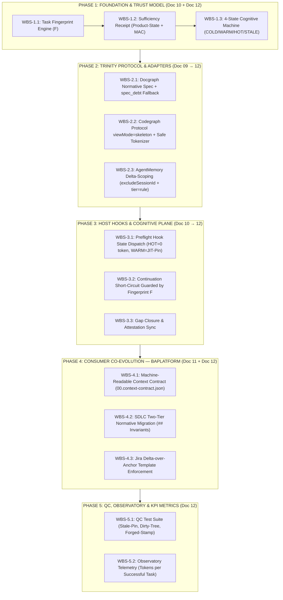

# Master WBS: Harness-ESO & Consumer Evolution (Synthesized from Docs 09 → 10 → 11 → 12)

**Tài liệu nguồn theo tuần tự tiến hóa:**
1. **[Doc 09](./09.rfc-upstream-harness-eso-optimization.md):** Chẩn đoán Context Bloat & Đề xuất 4 trụ cột tối ưu (ESO Digest, Codegraph Skeleton, Docgraph Spec, AgentMemory Domain Scope).
2. **[Doc 10](./10.critique-and-architectural-upgrade-rfc-0009.md):** Phản biện M2M vs M2LLM; Xác lập **Dual-Plane Decoupling**, **Zero-Token Preflight**, Normative Spec Slicing & CFIF.
3. **[Doc 11](./11.synthesis-and-bi-directional-evolution.md):** Vá lỗi Regex bằng AST/Tokenizer; Bổ sung **JIT-Pinning** chống Blind Sufficiency; Đồng bộ hóa 2 chiều với Consumer (`baplatform` SDLC 2 tầng & Jira Delta-over-Anchor).
4. **[Doc 12](./12.debate-beyond-synthesis-fingerprint-receipt-cognitive-states.md):** Khép kín mô hình tin cậy (Trust & Capability Model): **Task Fingerprint ($F$)**, **Sufficiency Receipt (HMAC/Product-State)**, **4-State Cognitive Machine (`COLD` / `WARM` / `HOT` / `STALE`)**, **Protocol-First Skeleton**, và **Machine-Enforced Context Contract**.

**Trạng thái:** READY FOR EXECUTION  
**Ngày lập:** 2026-10-18  

---

## 1. Sơ Đồ Kiến Trúc Thực Thi Tổng Thể (Evolutionary Sequence)

---

## 2. Chi Tiết Work Breakdown Structure (WBS) Theo Từng Phase

### PHASE 1: Nền Tảng Tin Cậy & Máy Trạng Thái Nhận Thức (Repo `harness-eso` — `@mu/harness-foundation` & `@mu/harness-eso-core`)
> **Mục tiêu:** Thay thế cờ tĩnh `level: sufficient` bằng cơ chế định danh tác vụ (`Task Fingerprint`) và biên lai chứng thực (`Sufficiency Receipt`) lưu tại Product State (`~/.harness/attest/`), đồng thời thiết lập máy trạng thái 4 pha (`COLD`, `WARM`, `HOT`, `STALE`).

| WBS ID | Tên Task | Tệp đích (Real Paths) | Mô tả kỹ thuật chi tiết | Nguồn | Tiêu chí nghiệm thu (AC) |
|---|---|---|---|---|---|
| **WBS-1.1** | **Task Fingerprint Calculator ($F$)** | `packages/harness-foundation/src/fingerprint.mjs` *(new)* `packages/harness-foundation/src/pure.mjs` | Tính toán hàm băm định danh phiên tác vụ: $F = \text{SHA256}(\text{normalizedStem}, \text{gitHeadRev}, \text{dirtyFilesHash}, \text{contractHash})$. - Tự động phát hiện thay đổi file trên working tree (`git status --porcelain`). | Doc 12 (§4.1) | - Trả về cùng mã $F$ nếu stem và working tree không đổi. - Đổi mã $F$ ngay lập tức khi sửa 1 file code hoặc khi user đổi chủ đề prompt. |
| **WBS-1.2** | **Sufficiency Receipt & Product-State Attestation** | `packages/harness-foundation/src/attest.mjs` | Mở rộng `writeEsoAttestation(projectId, payload)` và `readEsoAttestation(projectId)`: - Bổ sung các trường: `fingerprint`, `invIds` (mảng mã `INV-*`), `codegraphRev`, `docgraphRev`, `contractHash`, `ttlSec` (mặc định 600s), `mac` (HMAC-SHA256 với machine/project secret). - Hàm `verifySufficiencyReceipt(projectId, currentFingerprint)` trả về `{ valid, reason, receipt }`. | Doc 10 (§3.1) Doc 12 (§2.3, §4.2) | - Agent sửa `.eso-bundle-stamp.json` trong session dir không thể đánh lừa guard vì `attest.mjs` kiểm tra MAC trong `productStateDir()`. - Hết hạn TTL hoặc lệch `fingerprint` $\rightarrow$ `valid: false`. |
| **WBS-1.3** | **4-State Cognitive Machine Resolver** | `packages/harness-eso-core/src/cognitive-state.mjs` *(new)* `packages/harness-eso-core/src/preflight-projection.mjs` | Xây dựng bộ chuyển đổi trạng thái nhận thức: - **`COLD`**: Chưa có receipt hoặc task mới hoàn toàn. - **`WARM`**: Đạt `sufficient` ở lần đo hiện tại (hoặc vừa đóng xong gap) $\rightarrow$ Cần ghim JIT-Pin. - **`HOT`**: Có Receipt hợp lệ + `fingerprint` khớp với turn trước $\rightarrow$ Zero-Token. - **`STALE`**: Có Receipt cũ nhưng `fingerprint` lệch (do dirty tree hoặc đổi stem) $\rightarrow$ Cấm dùng pin cũ, buộc hạ cấp đo lại. | Doc 11 (§2.2) Doc 12 (§4.3) | - `buildPreflightProjection` xuất thêm trường `cognitiveState: 'COLD' \| 'WARM' \| 'HOT' \| 'STALE'` và `pinnedInvariants: string[]`. |

---

### PHASE 2: Nâng Cấp Reconnaissance Trinity & Context Contract (Repo `harness-eso` — `@mu/harness-eso-core`)
> **Mục tiêu:** Chuyển từ "cắt chuỗi mù quáng" (Doc 09) sang trích xuất có cấu trúc: Normative Spec kèm cảnh báo `spec_debt` (Docgraph), Protocol-first Skeleton (Codegraph), và Delta Memory (AgentMemory).

| WBS ID | Tên Task | Tệp đích (Real Paths) | Mô tả kỹ thuật chi tiết | Nguồn | Tiêu chí nghiệm thu (AC) |
|---|---|---|---|---|---|
| **WBS-2.1** | **Context Contract Loader & Intersection Compiler** | `packages/harness-eso-core/src/context-contract.mjs` *(new)* `packages/harness-eso-core/src/collect.mjs` | Đọc tệp hợp đồng ngữ cảnh của dự án tiêu thụ (`sdlc/00.governance/00.context-contract.json` hoặc trong `.harness/`): - Xác định tập `requiredInvariants` theo `surface.bucket`. - Tính phép giao: $\text{Pinned INV} = \text{INV}_{\text{required}}(\text{stem}, \text{surface}) \cap \text{INV}_{\text{attested}}$. | Doc 12 (§3.1, §4.5) | - Không bao giờ ghim Invariant của module cũ sang module mới. - Băm của file contract (`contractHash`) được đưa vào Fingerprint $F$. |
| **WBS-2.2** | **Docgraph Normative Slicing & `spec_debt` Signal** | `packages/harness-eso-core/adapters/docgraph-law.mjs` | Nâng cấp `fetchDocgraph`: - Trích xuất ưu tiên các khối `## Invariants`, `## Rules`, `## Constraints`, `> [!IMPORTANT\|CRITICAL\|WARNING]`, và các dòng `- **INV-*`. - **Cơ chế Fail-Visible (Doc 12):** Nếu tài liệu tìm thấy không có khối Normative chuẩn, trả về đoạn fallback đã giới hạn dung lượng **kèm cờ `meta: { specDebt: true }`** thay vì trả rỗng im lặng. | Doc 09 (§2.3) Doc 10 (§3.3) Doc 12 (§3.5, §4.5) | - Giảm 60–75% lượng chữ văn xuôi trên các tài liệu đã chuẩn hóa. - Trên tài liệu cũ chưa chuẩn hóa, không bị lỗi "silent empty" mà ghi nhận rõ `specDebt: true` vào trace. |
| **WBS-2.3** | **Codegraph Protocol `viewMode` & Safe Signature Fallback** | `packages/harness-eso-core/adapters/codegraph-code.mjs` | - **Ưu tiên Protocol-First (Doc 12):** Truyền tham số `--view-mode skeleton` (hoặc `--signatures`) xuống CLI `codegraph` nếu phiên bản CLI hỗ trợ. - **Safe Tokenizer Fallback (Doc 11):** Nếu CLI trả về full source, sử dụng bộ đếm ngoặc 1-pass (state-machine bỏ qua string/comment) để gập thân method của dependencies mà không làm vỡ cú pháp C#/TS. - Bảo toàn 100% `[Authorize]`, `[Route]`, public interface và chữ ký hàm. | Doc 09 (§2.2) Doc 10 (§3.2) Doc 11 (§2.1) Doc 12 (§3.4, §4.4) | - Vượt qua bộ test fuzzing C# (string interpolation `$"..."`, generics `<T>`, lambda `=>`) và TypeScript mà không làm hỏng cú pháp. |
| **WBS-2.4** | **AgentMemory Delta-Scoping & Session Exclusion** | `packages/harness-eso-core/adapters/agentmemory-memory.mjs` | Nâng cấp payload gọi `/agentmemory/recall`: - Truyền `domain: ctx.surface?.bucket || 'general'`. - Truyền `excludeSessionId: ctx.conversationId` để không bơm ngược ký ức của chính phiên hiện tại. - Lọc `tier: 'rule'` (chỉ lấy quy tắc/bài học đã cô đọng, bỏ qua hội thoại thô). | Doc 09 (§2.4) Doc 10 (§3.4) | - Memory recall không trả về bất kỳ message nào sinh ra từ cùng `conversationId`. |

---

### PHASE 3: Điều Phối Host Hooks & Giao Thức Mặt Phẳng Nhận Thức (Repo `harness-eso` — `@mu/harness-host-generic`)
> **Mục tiêu:** Thực thi cơ chế Dual-Plane trên `preflight-hook.mjs` và `eso-gap-io.mjs`: khi `HOT` thì bơm 0 token; khi `WARM` thì ghim JIT-Pin; khi `STALE` hoặc `COLD` thì đưa chỉ thị đóng Gap; khóa chặt Continuation Short-Circuit bằng Fingerprint $F$.

| WBS ID | Tên Task | Tệp đích (Real Paths) | Mô tả kỹ thuật chi tiết | Nguồn | Tiêu chí nghiệm thu (AC) |
|---|---|---|---|---|---|
| **WBS-3.1** | **Fingerprint-Guarded Continuation Short-Circuit** | `packages/harness-host-generic/src/preflight-hook.mjs` | Sửa nhánh `if (shape === 'antigravity' && data.invocationNum > 0)` (dòng 81): - Không tự động trả về `existingPre` chỉ dựa trên `conversationId`. - Tính nhanh `currentFingerprint = computeFingerprint(...)`. - Chỉ short-circuit (`HOT`) nếu `verifySufficiencyReceipt(projectId, currentFingerprint).valid === true`. - Nếu không khớp (user đổi ý hoặc sửa file), chuyển sang `STALE` và chạy lại `orchestrateTurn`. | Doc 10 (§3.5) Doc 12 (§2.1, §3.1, §4.1) | - Khi user đổi câu hỏi ở turn tiếp theo trong cùng đoạn chat, preflight phát hiện lệch $F$, tự động hủy short-circuit và đo lại evidence. |
| **WBS-3.2** | **Cognitive State Dispatch (Zero-Token vs JIT-Pin vs Gap)** | `packages/harness-host-generic/src/preflight-hook.mjs` | Điều phối `out.additional_context` theo 4 trạng thái: - **`HOT`**: `out.additional_context = undefined` (**0 token**). - **`WARM`**: Ghim đúng các dòng `pinnedInvariants` từ Receipt ($\le 30$ tokens):   `[ESO WARM PIN] Active invariants: INV-...` - **`COLD` / `STALE`**: Xuất danh sách lệnh đóng gap cụ thể ($\le 50$ tokens), kèm cảnh báo nếu chuyển từ `STALE`. | Doc 10 (§4.1) Doc 11 (§2.2) Doc 12 (§4.3) | - Turn `HOT` không sinh bất kỳ chuỗi `additional_context` nào. - Turn `WARM` chỉ sinh đúng danh sách `INV-*` giao giữa prompt và contract. |
| **WBS-3.3** | **Gap Closure To Receipt Promotion** | `packages/harness-host-generic/src/eso-gap-io.mjs` | Khi `recordGapToolUse` đóng hết các gap (`doc.allClosed === true`, dòng 180): - Thay vì chỉ ghi `allowWrite: true` vào `.eso-bundle-stamp.json`, gọi `writeEsoAttestation` để cấp phát **Sufficiency Receipt** mới kèm `fingerprint` hiện tại và trạng thái `WARM`. | Doc 12 (§2.3, §4.2) | - Sau khi Agent chạy đủ lệnh `docgraph` / `codegraph` để đóng gap, Receipt hợp lệ được ghi vào Product State và mở khóa `guard-write.py`. |

---

### PHASE 4: Tái Cấu Trúc Đồng Bộ Tại Dự Án Tiêu Thụ (Repo `baplatform` — Consumer Alignment)
> **Mục tiêu:** Chuyển đổi `baplatform` từ quy ước văn hóa mềm (Soft Culture) sang hợp đồng máy đọc được (Machine-Enforced Context Contract), chuẩn hóa SDLC 2 tầng và Jira Delta-over-Anchor.

| WBS ID | Tên Task | Tệp đích (Real Paths tại `baplatform`) | Mô tả kỹ thuật chi tiết | Nguồn | Tiêu chí nghiệm thu (AC) |
|---|---|---|---|---|---|
| **WBS-4.1** | **Khởi tạo Machine-Readable Context Contract** | `sdlc/00.governance/00.context-contract.json` *(new)* `.harness/decision-policy.json` | Định nghĩa bảng ánh xạ giữa `surface/domain` của `baplatform` và danh sách `mandatoryInvariants`, `maxCognitiveTokens`, `allowedSkeletonView`: - Ví dụ: domain `bookings`, `billing`, `authorization`, `multitenancy`. | Doc 12 (§3.5, §4.5) | - ESO Preflight đọc được file contract và kiểm tra tự động các mã `INV-*` bắt buộc cho từng module. |
| **WBS-4.2** | **Chuẩn hóa SDLC 2 Tầng (Two-Tier Normative Markdown)** | `sdlc/04.architecture/**/*.md` `sdlc/00.governance/03.quality-gate/` | Cập nhật quy chuẩn tài liệu trong `sdlc/`: - **Tầng 1 (Đầu file — Machine Layer):** YAML Frontmatter + mục `## Invariants` chứa các dòng `- **INV-<DOMAIN>-<NN>:** <mệnh đề bắt buộc>` + khối `> [!CRITICAL]`. - **Tầng 2 (Cuối file — Human Layer):** Bối cảnh, sơ đồ giải thích nghiệp vụ. | Doc 10 (§2.1) Doc 11 (§3.1) | - Khi chạy `docgraph --q`, adapter trích xuất chính xác 100% khối `## Invariants` và loại bỏ phần văn xuôi bên dưới, cờ `specDebt` = `false`. |
| **WBS-4.3** | **Áp dụng Chuẩn Jira "Delta-over-Anchor" & Skill Cập Nhật** | `.agents/skills/jira-canonical-template/SKILL.md` `sdlc/08.wbs/00.jira/` | Cập nhật template tạo/sửa Jira ticket: - Cấm sao chép lại toàn bộ tài liệu kiến trúc từ `sdlc/` vào Jira. - Bắt buộc 4 mục gọn: `1. SDLC Anchor Link`, `2. Target Invariant IDs (INV-*)`, `3. The Execution Delta`, `4. Target Files/Symbols`. | Doc 10 (§2.2) Doc 11 (§3.2) | - Dung lượng trung bình của Jira Task Description giảm từ ~3.000 tokens xuống $\le 250$ tokens. |
| **WBS-4.4** | **Đồng bộ Host Pack từ `harness-eso` sang `baplatform`** | `.harness/host-pack/harness-hook.mjs` `scripts/ci/harness-selfcheck.sh` | Build gói `host-pack` mới từ `harness-eso` (`bun run build:host-pack` / `provision.sh`) và cập nhật vào `baplatform/.harness/host-pack/`. | Doc 09 → 12 | - Chạy `bash scripts/ci/harness-selfcheck.sh` trên `baplatform` đạt 100% PASS. |

---

### PHASE 5: Kiểm Thử Chất Lượng (QC), Chống Gian Lận & Đo Lường KPI Thực Chất (Repo `harness-eso`)
> **Mục tiêu:** Đảm bảo không rơi vào "Bẫy KPI 0 Token" — đo lường chất lượng thực sự qua tỷ lệ thành công của tác vụ và khả năng chống lại các kịch bản Stale Pin / Forged Stamp.

| WBS ID | Tên Task | Tệp đích (Real Paths) | Mô tả kỹ thuật chi tiết | Nguồn | Tiêu chí nghiệm thu (AC) |
|---|---|---|---|---|---|
| **WBS-5.1** | **Bộ Kiểm Thử Tự Động 5 Lỗ Hổng Doc 12** | `qc/v2-cognitive-state-and-receipt.test.mjs` *(new)* `packages/harness-foundation/src/attest.test.mjs` | Viết kịch bản unit/integration test cho 5 ca biên: 1. *Intent Drift:* Đổi prompt stem trong cùng session $\rightarrow$ Hạ cấp về `STALE`, xóa pin cũ. 2. *Dirty Tree:* Sửa file code giữa chừng $\rightarrow$ Đổi $F$, hủy `HOT`. 3. *Forged Session Stamp:* Sửa tay `.eso-bundle-stamp.json` $\rightarrow$ Bị chặn bởi MAC Receipt trong Product State. 4. *Syntax Preservation:* Gập hàm C#/TS phức tạp không lỗi cú pháp. 5. *Spec Debt:* Doc thiếu `## Invariants` phát tín hiệu `specDebt: true`. | Doc 12 (§3.1–§3.5, §4.6) | - Tất cả 5 bộ test chạy xanh (`PASS`) trong CI của `harness-eso`. |
| **WBS-5.2** | **Bảng Đo Lường KPI Mới trên Harness Observatory** | `packages/harness-eso-core/src/eso-ledger.mjs` `packages/harness-observatory/src/` | Ghi nhận và hiển thị bộ 5 chỉ số KPI của Doc 12 (§4.6) thay vì chỉ đếm token mỗi turn: 1. **Tokens per Successful Task** 2. **False-Sufficient Rate** (Pass preflight nhưng fail verify/review) 3. **Stale-Continuation Catch Rate** 4. **Cognitive State Distribution (`COLD`/`WARM`/`HOT`/`STALE`)** 5. **Spec Debt Surface Coverage** | Doc 12 (§4.6) | - Giao diện Observatory hiển thị biểu đồ phân bổ 4 trạng thái nhận thức và lượng token trung bình trên mỗi task hoàn thành. |

---

## 3. Thứ Tự Ưu Tiên Triển Khai (Critical Path cho TPM)

1. **Tuần 1 — Khóa Lõi Tin Cậy (Phase 1: `WBS-1.1` → `WBS-1.3`):** Hoàn thành `fingerprint.mjs`, nâng cấp `attest.mjs` lên Sufficiency Receipt có MAC, và dựng máy trạng thái 4 pha `COLD/WARM/HOT/STALE`.
2. **Tuần 2 — Nâng Cấp Hooks & Adapters (Phase 2 & Phase 3: `WBS-2.1` → `WBS-3.3`):** Đưa Normative Slicing, Safe Skeletonizer, Delta Memory và bộ điều phối 4 trạng thái vào `preflight-hook.mjs`.
3. **Tuần 3 — Đồng Bộ Consumer `baplatform` & Kiểm Thử (Phase 4 & Phase 5: `WBS-4.1` → `WBS-5.2`):** Thêm `00.context-contract.json` vào `baplatform`, áp dụng mẫu Jira Delta-over-Anchor, provision `host-pack` mới và theo dõi KPI trên Observatory.
