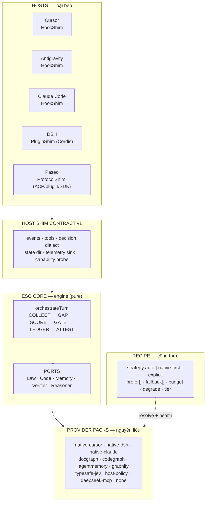

# 18 — RFC: ESO Capability Fabric (ports · packs · shims · recipes)

> **Trạng thái:** working RFC — *không phải law*. Chân lý vẫn là code + gói
> [`03.state-and-contracts/`](../03.state-and-contracts/). Tài liệu này dùng để chốt mô hình
> trước khi thêm host thứ 4 (DSH) và thứ 5 (Paseo), và trước khi cho phép thay nguyên liệu
> (docgraph / codegraph / agentmemory / JEV / brain).
>
> Ngày: 2026-10-21 · Phạm vi: `harness-eso-core`, `harness-host-generic`, `harness-foundation`,
> `harness-decision`, `harness-observe-server`, `profiles/*`.

## 0. TL;DR (EN, for future agents)

Harness ESO couples three axes: **host** (cursor/agents/claude hardcoded), **provider**
(4 builtin adapters with self-gating `enabled(policy)`), and **evidence shape** (score hardcodes
`law*0.55 + read*0.45`). The proposal is a hexagonal split: a pure **core** that reasons over
*evidence obligations*, **ports** (5, one per capability family), **provider packs** described by a
**manifest** (`ceiling`, `cost`, `trust`, `health`, `requires`), **host shims** with a conformance
ladder H0–H4, and **recipes** that bind ports to packs. JEV (TypeSafe) is modeled as a
**VerifierPort** (a decision oracle with `shadow`/`active` modes and a paid-call budget), *not* as
an evidence source. Substitution is safe only if the engine reports **`attainable`** sufficiency:
different ingredients must not silently change what "sufficient" means.

---

## 1. Bài toán

### 1.1 Ba coupling (verified)

| Chiều | Bằng chứng | Hệ quả |
|---|---|---|
| **Host** | `hook-io.mjs` chỉ biết `cursor\|agents\|claude`; `host-install.mjs` switch theo `treeKey`; ingest đọc transcript Cursor/Claude | Thêm host = sửa foundation + host-generic + observe-server + CLI (4 package) |
| **Provider** | `adapter-registry.mjs` có `BUILTINS = [docgraphLaw, codegraphCode, noopMemory, agentmemoryMemory]`; mỗi adapter tự khai `enabled(policy)` | Không fallback, không health, không "native của host", không đổi runtime được |
| **Evidence shape** | `scoreSufficiency()`: `lawRatio*0.55 + readRatio*0.45` | Đổi nguyên liệu = đổi ngữ nghĩa gate. Thiếu code graph thì điểm vẫn "trông" như cũ |

Nguồn: [`adapter-registry.mjs`](../../packages/harness-eso-core/src/adapter-registry.mjs),
[`collect.mjs`](../../packages/harness-eso-core/src/collect.mjs),
[`hook-io.mjs`](../../packages/harness-host-generic/src/hook-io.mjs),
[`ingest-transcript.mjs`](../../packages/harness-observe-server/src/ingest-transcript.mjs).

### 1.2 Năm đối tượng **không đồng dạng**

Đây là gốc của mọi lúng túng khi thiết kế "adapter chung":

| Đối tượng | Bản chất | Vòng đời | Trả tiền? | Có được **lật** quyết định? |
|---|---|---|---|---|
| docgraph | **Retrieval** (đọc tài liệu) | idempotent, cache được | không | không |
| codegraph | **Retrieval** (graph symbol/call) | idempotent | không | không |
| agentmemory | **State** (đọc + ghi, scoped) | có ghi, có privacy | không | không |
| **JEV (TypeSafe)** | **Verification / decision oracle** | theo turn, có budget | **có** (HTTP paid) | **có** (`guard.shell`, `route.tie_break`) |
| brain (DeepSeek) | **Execution** (sinh nội dung/quyết định) | sau gate, tốn token | **có** | không trực tiếp, nhưng tạo ra evidence |

Ép 5 thứ này vào một interface `fetch()` (như hiện tại) là sai. `fetch()` đúng cho 2 thứ đầu,
gượng cho memory, **sai** cho JEV và brain.

### 1.3 Phát biểu bài toán

> Làm cho **kết luận sufficiency** và **kết luận guard** bất biến dưới việc thay host và thay
> nguyên liệu — cùng một gate, nguyên liệu khác, nhưng **mức đủ được báo cáo trung thực** và
> **không âm thầm mạnh hơn/yếu đi**.

Kèm 3 ràng buộc:

1. Không fork core theo host.
2. Không để "provider yếu hơn" làm gate pass ảo.
3. Không để provider đắt tiền (JEV, brain) tự mua điểm sufficiency.

---

## 2. Mô hình



### 2.1 Sáu artifact

| # | Artifact | Metaphor | Nơi sống | Ai sở hữu |
|---|---|---|---|---|
| 1 | **Core** (obligations + gate) | món ăn | `packages/harness-eso-core` | harness-eso |
| 2 | **Port** (5 contract) | phiếu yêu cầu | `eso-core/ports/` (mới) | harness-eso |
| 3 | **Provider pack** + manifest | nguyên liệu | `providers/<id>/` (mới) | harness-eso + third-party |
| 4 | **Host shim** | loại bếp | `packages/harness-host-<host>` | harness-eso |
| 5 | **Recipe** | công thức | `profiles/recipes/*.json` (mới) | operator / Console |
| 6 | **Conformance + maturity** | chứng nhận | `profiles/standards/*.v1.json` | harness-eso |

Lưu ý: **consumer maturity T0–T5 đã có** ([05.consumer-maturity-standard.md](../03.state-and-contracts/05.consumer-maturity-standard.md)).
Tài liệu này chỉ thêm 2 tầng còn thiếu: **host conformance H0–H4** và **provider manifest**.

---

## 3. Contract

### 3.1 Hai loại "cần" — đừng trộn

**(a) Evidence obligations** — cái engine cần để *kết luận đủ*:

| Obligation | Nghĩa | Ai có thể thoả |
|---|---|---|
| `LAW_NORM` | quy tắc/invariant áp dụng cho domain | docgraph, native rules/skills, host docs |
| `CODE_TOUCH` | đã chạm đúng file/symbol chưa | codegraph, native index, fs reads |
| `MEMORY_PRIOR` | quyết định/bài học trước | agentmemory, native session/projection |
| `HUMAN_INTENT` | ý người dùng đã rõ chưa | prompt + L0 route (không thay được bằng tool) |
| `VERIFY` | đã có bằng chứng kiểm chứng | test/CI log, observe trace, native tool result |

**(b) Decision claims** — cái engine cần *xác nhận trước khi hành động*:

| Claim | Nguồn xác nhận | Hiện tại |
|---|---|---|
| `ROUTE` | L0 rules → JEV `route.tie_break` → L3 flash | `decide.mjs` |
| `GUARD` | L1 shell heuristic → JEV `guard.shell` | `decide.mjs` + `jev-l2.mjs` |
| `WRITE` | verdict ESO + attest/consent | `gate.mjs` |

**Quy tắc:** evidence obligation **không bao giờ** được xác nhận bởi decision claim, và ngược lại.
Brain không được dùng để "nâng" evidence score.

### 3.2 Năm port

| Port | Input | Output | Failure mode | Deterministic | Cost |
|---|---|---|---|---|---|
| `LawPort` | `{text, domain, budgetMs}` | `Evidence[]` (`LAW_NORM`) | miss → gap | không (retrieval) | thấp |
| `CodePort` | `{query, paths, symbol}` | `Evidence[]` (`CODE_TOUCH`) | miss → gap | không | thấp |
| `MemoryPort` | `recall(query, scope)` / `remember(item)` | `Evidence[]` / `{ok}` | miss → gap | không | thấp |
| `VerifierPort` | `verify(claim, mode)` | `{verdict: allow\|deny\|ask, confidence, reason}` | **fail-closed** ở `active` | gần đúng | **cao** (paid) |
| `ReasonerPort` | `delegate(task, budget)` | `{text, decision?}` | fail → turn fail | không | **cao** (tokens) |

`Evidence` v2 (đề xuất):

```js
{
  id, obligation: 'LAW_NORM',
  text,
  provenance: { kind: 'file|doc|session|tool', file, line, docId, sessionSeq },
  confidence: 0.0..1.0,
  provider: 'docgraph-cli',
  cost: { latencyMs, moneyUsd }
}
```

> **Nguyên tắc P2:** evidence không có `provenance` thì **không phải evidence** — nó là hint.
> Hiện `docgraph-law.mjs` trả `{text, query, meta}`; đây là điểm phải nâng.

### 3.3 Provider manifest

```json
{
  "id": "typesafe-jev",
  "port": "verifier",
  "impl": { "kind": "http", "baseUrl": "https://api.typesafe.ai" },
  "satisfies": { "ROUTE": 0.9, "GUARD": 0.8 },
  "modes": ["shadow", "active"],
  "cost": { "latencyMs": 1200, "moneyUsdPerCall": 0.001, "paid": true },
  "budget": { "maxCallsPerTurn": 1 },
  "trust": "external",
  "privacy": { "leavesMachine": true, "fields": ["prompt", "shellCommand"] },
  "requires": ["env:TYPESAFE_API_KEY", "network"],
  "health": { "probe": "http:HEAD /health", "ttlMs": 60000 },
  "fallback": ["host-policy", "none"]
}
```

Năm loại `impl` tương ứng 5 nguồn mày cần:

| `impl.kind` | Ví dụ | Chạy ở đâu | Latency |
|---|---|---|---|
| `host-native` | memory DSH, index Cursor, model host | trong process host | ~0 |
| `cli` | `docgraph --q`, `codegraph` | spawn | ~50ms |
| `mcp` | agentmemory, graphify | MCP client của host | ~10ms |
| `http` | JEV, observe-server | network | 100ms–2s |
| `none` | tắt hẳn | — | 0 |

`host-native` là **first-class**, ngang hàng `cli` — đây chính là yêu cầu "dùng native của DSH".

### 3.4 Resolver

```js
resolve(port, ctx) -> { provider, reason, ceiling, degraded }
```

Thứ tự:

1. `strategy: "explicit"` → đúng id, nếu unhealthy thì **fail visible** (không fallback ngầm).
2. `strategy: "native-first"` → probe host → native provider nếu healthy **và** `ceiling >= required`.
3. `strategy: "auto"` → thử `prefer[]` theo thứ tự (native trước), rồi `fallback[]`.
4. Hết chain → `none` + `degraded: true` + `missingObligations`.

Bắt buộc:
- Health có TTL, cache trong turn (không probe mỗi query).
- Mọi quyết định resolve ghi vào trace/ledger: `provider`, `reason`, `ceiling`.
- `none` là **hợp lệ**, không phải lỗi.

### 3.5 Attainable — cơ chế trung thực

```
ceiling(o)   = max over providers of min(provider.satisfies[o], provider.confidence)
attainable   = Σ_o weight(o) * ceiling(o)
score        = Σ_o weight(o) * observed_conf(o)
```

Gate so **cả hai**:

| Điều kiện | Kết luận |
|---|---|
| `score >= T_high` | `sufficient` |
| `score >= T_low` và `attainable >= T_high` | `partial` (có thể đủ nếu làm thêm) |
| `score >= T_low` và `attainable < T_high` | `partial_capped` — **không thể đủ** với bộ nguyên liệu này |
| còn lại | `insufficient` |

`partial_capped` là trạng thái mới, quan trọng: nó nói "đừng đòi agent làm thêm — thiếu nguyên
liệu". Policy có thể map nó sang `hint` thay vì `fail_closed`, hoặc yêu cầu consent.

Ví dụ: DSH không có code graph. `CODE_TOUCH.ceiling = 0.5` (fs reads). `attainable ≈ 0.62 < T_high 0.72`
→ mọi turn dev của DSH sẽ là `partial_capped` cho tới khi bind `codegraph-cli`.
Đó là **sự thật cần hiển thị**, không phải lỗi cần che.

### 3.6 Host shim + conformance

Shim = 5 map + 1 probe:

```
events(map)      lifecycle → hook ids
tools(map)       host tool name → canonical name (bash/Bash, edit/Write…)
decision(dialect) allow/deny/ask → host envelope
state(dir)       session dir, trace, stamps
telemetry(sink)  nơi đẩy evidence
probe()          host cung cấp native capability gì, version nào
```

Conformance ladder (máy đọc được, không phải lời):

| Tier | Pass khi |
|---|---|
| **H0** | hook bắn đúng lúc (prompt / tool / stop) |
| **H1** | guard **thực sự chặn** (deny → host từ chối, không chỉ log) |
| **H2** | COLLECT ra `Evidence` có provenance |
| **H3** | observe nhận đủ request / llm_call / tool cho 1 turn |
| **H4** | native provider bind được và `ceiling` đúng |

Một host chỉ được gọi là "supported" ở tier tương ứng — bảng này thay cho câu "100% parity".

### 3.7 Recipe

```json
{
  "id": "dsh-native",
  "extends": "pro",
  "sources": {
    "law":    { "strategy": "native-first", "prefer": ["native:dsh-skills"], "fallback": ["docgraph-cli", "none"] },
    "code":   { "strategy": "explicit", "adapter": "codegraph-cli" },
    "memory": { "strategy": "native-first", "prefer": ["native:dsh-session"], "fallback": ["agentmemory-mcp", "none"] }
  },
  "verify": { "strategy": "auto", "prefer": ["typesafe-jev"], "mode": "shadow", "fallback": ["host-policy"] },
  "reasoner": { "strategy": "native-first", "prefer": ["native:dsh-subagent"], "fallback": ["deepseek-mcp", "none"] }
}
```

Recipe mẫu: `lite` (không graph, memory native, brain off) · `pro` · `airgapped` (không network) ·
`dsh-native` · `paseo-multi`.

---

## 4. JEV (TypeSafe) trong mô hình

### 4.1 Hiện trạng (verified)

| Sự thật | Bằng chứng |
|---|---|
| JEV là **HTTP call**, không phải MCP | [`jev-client.mjs`](../../packages/harness-system-one/src/jev-client.mjs); docs [05.decision-facade.md](../02.runtime/05.decision-facade.md) |
| 3 mode: `off` / `shadow` / `active` | [`policy-load.mjs`](../../packages/harness-foundation/src/policy-load.mjs#L38-L41); `jev-l2.mjs` chỉ enforce khi `active` |
| 2 question pack: `route.tie_break`, `guard.shell` | [`jev-question-packs.mjs`](../../packages/harness-system-one/src/jev-question-packs.mjs) |
| Chỉ gọi khi ambiguity hoặc guard `ask` | [`jev-resolver.mjs`](../../packages/harness-system-one/src/jev-resolver.mjs#L17-L35) |
| Budget: `budget.maxS1PaidCallsPerTurn`, default 1 | cùng file, `budgetAllows()` |
| Verdict JEV **thay** L0 (`route_jev`, `jev_guard_deny/allow/ask`) | [`jev-l2.mjs`](../../packages/harness-decision/src/jev-l2.mjs#L3-L64) |
| `jevOnPartial` làm gate ESO phụ thuộc JEV | [`gate.mjs`](../../packages/harness-eso-core/src/gate.mjs#L35-L46) |
| Ledger có 2 producer, `jev_response_json` bị dùng chung → `F38` | [05.decision-facade.md](../02.runtime/05.decision-facade.md#L43-L52) |

### 4.2 Vai trò: `VerifierPort`

JEV không trả evidence — nó trả **verdict trên một claim**. Vì vậy:

- Port: `VerifierPort.verify(claim, mode)`.
- `claim` thuộc `ROUTE` / `GUARD` (mở rộng sau: `WRITE`).
- Output: `{verdict, confidence, reason, evidenceRefs?}`.
- Provider mặc định luôn tồn tại: `host-policy` (= L0/L1 rules hiện tại). JEV là **provider nâng cấp**.
- `mode` là thuộc tính **của binding**, không của provider: cùng pack `typesafe-jev` có thể chạy
  `shadow` trên repo nhỏ và `active` trên repo lớn.

Điều này sửa một bất đối xứng hiện tại: `jev.mode` là global, không theo domain/tier.

### 4.3 `shadow` là capability first-class

Manifest khai `modes: ["shadow","active"]`. Resolver phải:
- `shadow` → **luôn** gọi provider (nếu budget) nhưng **không** áp verdict; ghi `wouldApply` để so sánh với L0.
- `active` → áp verdict; nếu provider unhealthy → theo `fallback` (mặc định `host-policy`), **không** im lặng cho qua.
- `off` → không resolve.

Shadow hiện đã có logic (`applyJev*` chỉ chạy khi `active`) nhưng **không có báo cáo so sánh**.
Đề xuất: ledger thêm `shadow_diff { l0, jev, agree }` để đo giá trị thật của JEV trước khi bật `active`.

### 4.4 Budget thuộc về fabric, không thuộc về JEV

Hiện `budget.maxS1PaidCallsPerTurn` nằm trong policy chung. Trong fabric, budget phải là
**per-port, per-turn, dùng chung** cho mọi provider trả tiền (JEV + Reasoner), nếu không tổng chi
phí mỗi turn không kiểm soát được khi thêm brain.

```json
"budget": { "perTurn": { "paidCalls": 1, "usd": 0.02 }, "onExhausted": "degrade | ask | deny" }
```

### 4.5 Vấn đề cần chốt (open)

1. **`jevOnPartial` là coupling chéo subsystem**: ESO gate đọc cờ của JEV. Trong fabric nên đổi
   thành `gate.onPartialCapped: "allow|consent|deny"` — ESO không cần biết JEV tồn tại.
2. **Doc/code lệch**: [05.decision-facade.md](../02.runtime/05.decision-facade.md#L31) ghi mode
   `off / active / hint`; code chỉ có `off|shadow|active`. Cần sửa doc hoặc thêm `hint`.
3. **JEV không có trong `documents/03.state-and-contracts/`** dưới dạng contract (chỉ có ở runtime doc).
   Nếu JEV thành provider, contract của nó phải nằm cạnh các port khác.
4. **`typesafe.env` + API key**: secret thuộc consumer, không thuộc product state — đã đúng
   ([plugin-catalog.json](../../profiles/plugin-catalog.json#L96-L101)), giữ nguyên khi manifest hoá.

### 4.6 Provider thay thế JEV

| Provider | Khi nào dùng | Rủi ro |
|---|---|---|
| `host-policy` (L0/L1) | luôn có, default | yếu hơn, không xử lý ambiguity |
| `typesafe-jev` | cần tie-break/guard chính xác | paid, network, external trust |
| `llm-verifier` (brain làm judge) | fallback khi offline | **đắt**, không deterministic, dễ "mua điểm" → phải tách khỏi evidence |
| `none` + `hil_only` | an toàn nhất khi nghi ngờ | chậm cho user |

---

## 5. Ma trận host × capability

| Host | Class | Shim | Native cho ESO | Thiếu / phải bù |
|---|---|---|---|---|
| Cursor | hook | HookShim | index (CODE), @Docs + rules (LAW), memories (MEM), model picker | không có guard ask (chỉ allow/deny) |
| Antigravity | hook | HookShim | conversation (MEM), MCP, knowledge | dialect protobuf, `injectSteps` |
| Claude Code | hook | HookShim | hooks, transcript (MEM), CLAUDE.md (LAW), Task (REASONER) | không code graph |
| **DSH** | **plugin** (Cordis) | PluginShim | session events/projections (MEM), skills+instructions (LAW), subagent (REASONER), session telemetry (VERIFY) | **không code graph** → `CODE_TOUCH` ceiling thấp; tool name khác |
| **Paseo** | **orchestrator** (ACP + plugin + SDK) | ProtocolShim | worktree/diff (CODE ngữ cảnh), agent profiles + skills (LAW), MCP (all), providers (REASONER) | **multi-agent, multi-worktree**; không có hook per-tool |

### 5.1 Paseo là forcing function cho identity

Paseo chạy nhiều agent song song trên nhiều worktree, mỗi agent có thể là Claude Code / DSH /
Codex ([providers](https://paseo.sh/docs/supported-providers),
[parallel](https://paseo.sh/docs/parallel-development)). Vì vậy:

```
identity = (host, workspace/worktree, agent, session, turn)
```

Model hiện tại `observe/<projectId>/harness.db` gộp tất cả vào 1 project → sai ngay khi có 2 agent.
Đây là **thay đổi schema**, không phải thay đổi shim. Cần chốt trước Paseo.

Lưu ý: `paseo-deepseek-harness` chạy DSH qua ACP → **DSH shim vẫn là nền**; Paseo thêm tầng trên,
không thay thế.

---

## 6. Mapping code hiện tại → đích

| File hiện tại | Đổi gì | Compat |
|---|---|---|
| `eso-core/src/adapter-registry.mjs` | `BUILTINS` → load từ manifest; thêm `resolve()` có strategy/health | `adapter: "<id>"` vẫn chạy |
| `eso-core/adapters/*.mjs` | giữ `fetch()`, bọc thành pack; bỏ `enabled()` tự gate | adapter cũ vẫn export được |
| `eso-core/src/collect.mjs` | `scoreSufficiency` → obligations; thêm `attainable` | cờ `eso.scoring: legacy\|obligations-v1` |
| `eso-core/src/gate.mjs` | thêm `partial_capped`; bỏ đọc `jevOnPartial` (đổi thành `gate.onPartialCapped`) | policy cũ map mặc định |
| `eso-core/src/context-contract.mjs` | `Evidence` v2 (provenance, confidence) | wrapper cho snippet cũ |
| `host-generic/src/hook-io.mjs` | tree → shim registry, không switch | profile cũ giữ nguyên |
| `foundation/src/host-install.mjs` | `treeKey` → shim descriptor | merge 3 chiều không đổi |
| `decision/src/decide.mjs` | L0/L2 → `VerifierPort` | `decide()` API giữ nguyên |
| `decision/src/jev-l2.mjs` | thành provider `typesafe-jev` | — |
| `foundation/src/policy-load.mjs` | `sources.*` → binding; thêm `recipes` | normalize policy cũ |
| `observe-server/src/ingest-*` | thêm ingest provider (DSH session log / telemetry) | source cũ giữ |
| `profiles/plugin-catalog.json` | slot → port; `custom-*` → provider registry | UI cũ đọc được |
| `profiles/recipes/*.json` | **mới** | — |

---

## 7. Lộ trình

| Phase | Việc | Exit criteria | Ước lượng |
|---|---|---|---|
| **P0** | Chốt contract: `ports.md`, `provider-manifest.schema.json`, `host-shim.md` | 3 file được review; không code | 1–2 ngày |
| **P1** | Manifest hoá 4 adapter + resolver có fallback/health | `adapter` cũ vẫn pass toàn bộ test; thêm test resolve/fallback | 2–3 ngày |
| **P2** | `Evidence` v2 + obligation scoring + `attainable` | legacy vs obligations chạy song song, so sánh trên 3 consumer | 3–5 ngày |
| **P3** | Host shim contract + conformance H0–H4; port Cursor/Claude | `harnessctl verify host --target cursor` ra H3 | 3–5 ngày |
| **P4** | DSH PluginShim (Cordis bundle) + hooks bridge | H3 trên DSH với recipe `dsh-native` | 5–7 ngày |
| **P5** | `VerifierPort` (JEV provider + shadow diff) + budget per-turn | shadow báo `agree/disagree`; `active` không hồi quy | 3–4 ngày |
| **P6** | Recipes + `harness capability probe` + Console hiển thị binding/attainable | operator thấy "vì sao sufficient" | 3–4 ngày |
| **P7** | Paseo ProtocolShim + multi-agent identity | 2 agent song song không lẫn dữ liệu | 5–8 ngày |

Nguyên tắc thứ tự: **P1–P2 trước DSH**. Nếu làm DSH trước bằng `treeKey === 'dsh'`, ta tạo đúng
món nợ mà RFC này xoá, và Paseo sẽ buộc làm lại.

---

## 8. Nguyên tắc & non-goals

**Nguyên tắc**

1. **Gate semantics bất biến**, nguyên liệu thương lượng được.
2. **Không provenance → không phải evidence.**
3. **Native first, external fallback, `none` hợp lệ.**
4. **Degrade phải visible** (`attainable`, `degraded`, `missingObligations`).
5. **Guard là ngữ nghĩa host** — không abstract vào core (Cursor không `ask`, DSH có approval thật).
6. **Paid calls có budget + ledger dùng chung** (JEV, brain).
7. **Không "supported" nếu chưa qua conformance tier.**

**Non-goals**

- Không viết lại hook implementation theo host (đã đúng: 1 bundle, nhiều profile).
- Không tự động suy ra recipe tối ưu (để operator chọn, Console gợi ý).
- Không cho provider tự bật/tắt quyền ghi protected paths.
- Không đồng bộ memory hai chiều giữa các provider (chỉ `recall` hợp nhất, `remember` một đích).

---

## 9. Câu hỏi mở (deep dive tiếp)

1. `Evidence` v2: `confidence` do provider tự khai hay do engine chấm? (Nếu provider tự khai → gian lận được.)
2. Obligation weights lấy từ đâu: pack hiện tại (`skill-pack.mjs`) hay recipe? Hai nguồn sẽ lệch.
3. Khi `attainable < T_low` (nguyên liệu quá yếu), nên `deny` hay chỉ `hint`? Ai quyết: recipe hay consumer tier?
4. Memory `remember()` ghi vào đâu khi có 2 provider (native DSH + agentmemory) — một đích hay fan-out?
5. JEV `active` + provider unhealthy: `fail_closed` hay fallback `host-policy`? Khác nhau giữa repo dev và prod?
6. JEV có nên verify cả `WRITE` claim (không chỉ `GUARD`/`ROUTE`)?
7. Paseo multi-agent: `turn` của 2 agent có chia sẻ evidence budget không?
8. Host shim có cần versioned ABI (H0–H4 theo host version) hay chỉ semver của product?
9. `plugin-catalog.json` (Console) có trở thành UI của recipe không, hay giữ 2 tầng?
10. Khi DSH đổi `session.v4` → `v5`, ingest provider chịu trách nhiệm migrate hay từ chối?

---

## 10. Phụ lục: thuật ngữ

| Thuật ngữ | Nghĩa trong tài liệu này |
|---|---|
| **Port** | hợp đồng capability thuần, core gọi |
| **Pack / Provider** | implementation của port, có manifest |
| **Shim** | lớp chuyển host ↔ core (anti-corruption layer) |
| **Recipe** | binding policy + budget + degrade rules |
| **Obligation** | nghĩa vụ bằng chứng mà engine cần thoả |
| **Claim** | phát biểu cần xác nhận trước khi hành động (route/guard/write) |
| **Ceiling** | mức tối đa một provider có thể đóng góp cho 1 obligation |
| **Attainable** | trần điểm sufficiency của bộ nguyên liệu hiện tại |
| **Conformance H0–H4** | mức độ host shim đã được chứng nhận |
