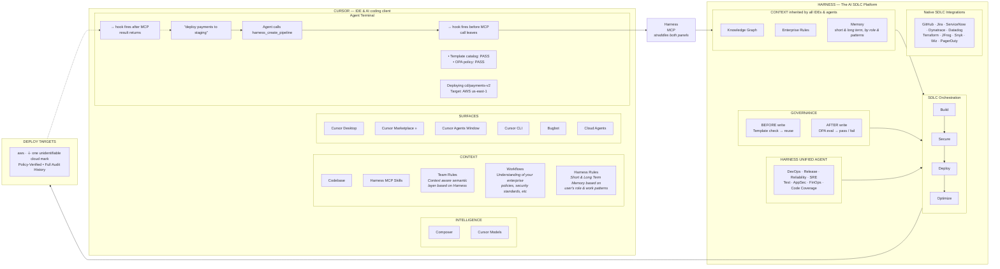

# Study note — the "Cursor + Harness – The Complete AI SDLC Story" diagram

**Source:** Gemini share `https://share.gemini.google/Slo9pzexvwY5` →
`https://gemini.google.com/share/8cef9c565ca4` (published 2026-10-24 00:10 Asia/Saigon).
**The artifact under discussion:** `~/Desktop/harness-cursor.webp` (2048×1153), cited by the
conversation as source `harness-cursor.webp`.
**Status:** external reference material. **Not** an authoritative description of this repo — see §4,
which is the point of this note.

> Gemini's conversation is in Vietnamese and contains **no new facts about this codebase**. It is a
> description of a marketing/infographic rendering of "Harness", not of `@mu/harness-*` as built.
> What is worth keeping is the gap between the two, recorded in §4.
>
> **Reading provenance matters here.** §§2–3 were first written from Gemini's *prose*, which is
> lossy; they were then corrected against a direct OCR transcription of the image itself (§1.1).
> Where the two disagreed, **the image wins**, and §2 is now the image's version. Keep that
> distinction: Gemini's conversation is a *description of* the diagram, not the diagram.

---

## 1. How the content was obtained (so it can be re-done)

The share page is a **client-rendered shell**: a plain HTTP fetch returns only ~830 KB of CSS/JS with
the title "Gemini – direct access to Google AI" and no conversation. The turns are fetched by the SPA
after load. Working method:

```bash
CHROME='/Applications/Google Chrome.app/Contents/MacOS/Google Chrome'
"$CHROME" --headless=new --disable-gpu --no-sandbox \
  --user-data-dir=/tmp/chrprof --virtual-time-budget=25000 \
  --dump-dom 'https://gemini.google.com/share/8cef9c565ca4' > rendered.html
# then strip <script>/<style> and tags, unescape entities → ~10.8k chars, 3 turns
```

`--user-data-dir` is required; without it Chrome exits with
`Failed to create a unique user data directory for headless`.
The sibling share `share.gemini.google/6CRKMTr9rqcM` resolves to the **same conversation**; its inner
link `share.gemini.google/0Dy1fvWG2vS8` is **dead** ("Link doesn't exist").

Note: the conversation's own text is unreliable as a description of any real system — it repeatedly
emits `WEBP` where an inline citation chip to the source image sits, and its Mermaid block was
hand-transcribed by the model (see §3 for a corrected one).

### 1.1 How the *image* was transcribed

A first pass written from Gemini's prose was wrong in several places, so the image itself was read
directly. **No vision model was available** (`read_image` is rejected: no image input on the current
model), so it was done programmatically and the limits are real:

- **Decode:** Pillow → 2048×1153 RGBA, file intact.
- **Text:** macOS Vision OCR via `swift`, `.accurate`, language correction **OFF**, run on the full
  image plus ~20 upscaled crops; each string read more than once with matching results.
- **Geometry / color:** pixel sampling, border-line and fill detection, ASCII rendering of small
  regions to recover box edges and arrow direction.
- **Not confirmed:** iconography and pictograms — none detected beyond the wordmarks; anything
  icon-like is marked uncertain rather than guessed.

Practical notes: `swift` needs a writable module cache (`-module-cache-path /tmp/swiftcache`) because
the default location is blocked under the workspace sandbox.

## 2. What the diagram actually shows (corrected from the image)

Title: **"Cursor + Harness – The Complete AI SDLC Story"** (en-dash; top-left).

**Layout:** two large panels side by side, **plus a third box to the right of the right panel, and one
small box straddling the gap between the two panels**. No arrows are drawn between panels — the
straddle box is the *only* element that crosses, so the connection is spatial, not drawn.

**Left — CURSOR** (plain `#0d0d0d` panel, rounded outline, **no accent border**; the cube logo +
wordmark sit above it). Four color-coded sections:

- `INTELLIGENCE` (red-tint header): **Composer**, **Cursor Models**. *(Gemini's prose invented a
  standalone "AI Models (Claude/OpenAI/Anthropic)" box — there is no such tile.)*
- `CONTEXT` (olive header): **Codebase**, **Harness MCP Skills**, then three sub-panels with body
  text — **Team Rules** ("Context aware semantic layer based on Harness"), **Workflows**
  ("Understanding of your enterprise policies, security standards, etc"), **Harness Rules** ("Short &
  Long Term Memory based on user's role & work patterns").
- `SURFACES` (teal header): Cursor Desktop · Cursor Marketplace » · **MCP** · Cursor Agents Window ·
  Cursor CLI · Cloud Agents · Bugbot.
- `Agent Terminal` (indigo header, dark-green body): the execution log, verbatim in §2.1.

**Right — HARNESS** (cyan `#00aee4` border), headed *The AI SDLC Platform*, with five tinted groups:

- `HARNESS UNIFIED AGENT` (cyan): 8 tiles — DevOps, Release, Reliability, SRE / Test, AppSec, FinOps,
  Code Coverage.
- `CONTEXT inherited by all IDEs & agents` (green `#3ed58d`): **Knowledge Graph**, **Enterprise
  Rules**, **Memory** (body: "Short & Long Term Memory based on user's role & work patterns").
- `SDLC Orchestration` (cyan): the **only solid-filled elements in the whole image** — four cyan tiles
  butted into one bar: **Build → Secure → Deploy → Optimize**. Displayed as one contiguous strip; there
  are **no arrowheads** between tiles.
- `GOVERNANCE` (magenta `#9901fe`): **BEFORE write** = "Template check → reuse"; **AFTER write** =
  "OPA eval → pass / fail". Purple watermark/marker shapes sit between the two boxes.
- `Native SDLC Integrations` (amber `#e8a022`): 10 tiles — GitHub, Jira, ServiceNow, Dynatrace,
  Datadog / Terraform, JFrog, Snyk, Wiz, PagerDuty.

**Straddle box — `Harness` / `MCP`** (cyan outline, navy `#001a2a`), overlapping both panels. "MCP"
appears three times at the same height — in SURFACES, in this box, and near Harness Rules — forming
one visual MCP column between the panels.

**Far right — `DEPLOY TARGETS`** (`#091a26`), *outside* the harness border: two marks only — an
**aws** wordmark and one unidentified cloud mark. Gemini's prose listed "AWS, Google Cloud, Azure,
On-Prem"; **the image shows two targets, one of them unidentifiable**. Caption:
"Policy-Verified • Full Audit History".

### 2.1 Terminal log, verbatim

```text
Agent Terminal
"deploy payments to staging"
Agent calls harness_create_pipeline
→ hook fires before MCP call leaves
• Template catalog: PASS
• OPA policy: PASS
Deploying cd/payments-v2
Target: AWS us-east-1
→ hook fires after MCP result returns
```

The `→` is an inline glyph in the text, **not** a connector line. Together with the two `→` inside the
GOVERNANCE lines ("Template check → reuse", "OPA eval → pass / fail"), these are the *only* arrows in
the image.

### 2.2 Where the image and Gemini's description disagree

Recorded so nobody re-derives this by trusting the prose:

| Gemini's prose | The image |
|---|---|
| a standalone "AI Models (Claude/OpenAI/Anthropic)" tile | absent — INTELLIGENCE has **Composer + Cursor Models** only |
| arrows / connector lines between panels (`SURFACES --> MCP`, `MCP --> HARNESS_CONTEXT`, …) | **no connector lines at all**; one straddle box orders the relationship |
| "Optimize **feedback loop** back to orchestration" | not drawn — the four tiles are one flat bar; the feedback loop is prose only |
| Deploy targets: AWS, Google Cloud, Azure, On-Prem | **two** marks: `aws` + one unidentifiable cloud |
| `Knowledge Graph` described as semantic layer over "Harness & MCP Data" | label is just "Knowledge Graph"; the gloss is the prose's, not the image's |
| Mermaid block with `INTEGRATIONS --- HARNESS` etc. | the Mermaid was authored by the model, not extracted; it over-states structure |

### 2.3 The flow the image implies (not drawn)

Because there are no connectors, the flow is read off **position and the terminal log**, and should be
stated as an inference, not as something the diagram draws:

> developer types a request in Cursor → the agent calls a Harness capability
> (`harness_create_pipeline`) → a **pre-call hook** fires before the MCP call leaves → a template check
> and an **OPA policy** check both PASS in the log → the work deploys to a target → a **post-call hook**
> fires when the MCP result returns.

Note the shape this describes: the two hooks bracket an **outbound MCP call**, and the validation
happens *inside* the platform, with its verdict echoed back into the developer's terminal as log text.
That is materially different from a gate that denies a local tool call — see §4/§5.

## 3. The diagram, reconstructed as Mermaid

Rewritten from the OCR transcription, not from Gemini's Mermaid (which invented tiles, arrows and a
feedback loop). Solid arrows here are *inferences from layout*; the only things the image actually
renders as arrows are the `→` glyphs inside the terminal text and the governance captions.



The block above is **validated**, not eyeballed: it was extracted and rendered with mermaid-cli
before being committed, which caught a real parse error (`T1['"deploy...` — a quoted terminal line
breaks Mermaid's lexer; the quotes must be `&quot;`). Recipe:

```bash
# mermaid-cli needs a browser; reuse Playwright's instead of downloading one
cat > /tmp/pptr.json <<EOF
{"executablePath":"$HOME/Library/Caches/ms-playwright/chromium_headless_shell-1243/chrome-headless-shell-mac-arm64/chrome-headless-shell","args":["--no-sandbox"]}
EOF
npm_config_cache=/tmp/npmcache npx --yes @mermaid-js/mermaid-cli@latest \
  -p /tmp/pptr.json -i /tmp/d.mmd -o /tmp/d.svg
```

(`npm_config_cache` is needed because `~/.npm` is not writable here.)

Differences from Gemini's rendering, deliberate: no invented `AI Models` tile; no invented
`feedback loop` edge (the four stage tiles are drawn as one flat bar); `INTEGRATIONS` is not wired to
anything; deploy targets are two marks, not four.

## 4. The part that matters: this is **not** what `harness-eso` is

The diagram describes a **commercial AI-SDLC platform** (HashiCorp-style "Harness" positioning):
unified DevOps/Release/SRE agents, a knowledge graph, OPA policy governance on *writes*, template
catalogs, and native connectors to ten enterprise tools, deploying to four clouds.

`harness-eso` is a **different product with a coincidental name collision** in the framing. Per
[`01.what-is-harness-eso.md`](../01.overview/01.what-is-harness-eso.md), ours is:

> "a **control and observation layer** bolted onto an agent that was not built for any of it… it does
> not write code. It constrains and records an agent that does."

Confronted item by item:

| Diagram claims | Reality here |
|---|---|
| `harness_create_pipeline` — agent calls a Harness **MCP tool** to trigger work | **No `harness_create_pipeline`.** There is no Harness MCP server in the product: `grep` for an MCP server/transport in `packages/*/src` finds nothing. MCP appears only as *adapter ids* the product drives (`agentmemory-mcp` for memory, and the Brain's `deepseek-mcp`) — i.e. **we are the MCP client**, not the platform the agent calls. |
| Hooks fire "before MCP call leaves" / "after MCP result returns" | Real hooks are IDE lifecycle events: `beforeSubmitPrompt`, `preToolUse`, `beforeShellExecution`, `postToolUse`, `preCompact`, `stop`. Nothing wraps an MCP round-trip. |
| **OPA eval** governs writes | There is **no OPA anywhere** in the repo. Our "AFTER write" equivalent is evidence sufficiency + guard decisions recorded in a decision ledger. |
| Template catalog → reuse before write | **No template catalog.** Our "BEFORE write" equivalent is static deny (locked paths, secrets, tier) + ESO evidence gate + consent. |
| Unified agents: DevOps, Release, SRE, AppSec, FinOps, Code Coverage | **We have no agents.** We gate *someone else's* agent. The nearest analogue is the **Brain**: a delegated reasoning model the agent must consult for a gated path — enforced by `guard-brain`, and deliberately **not** an evaluator of the answer. |
| Knowledge Graph over Harness + external MCP data | Docgraph / codegraph are **consumer-owned read-only adapters** used to *collect evidence about the consumer's own repo*, not a semantic graph of the platform. |
| Enterprise Rules / Memory inherited by all IDEs | The consumer owns its rules; the product only **reads** them. `.harness/decision-policy.json` is the consumer's single source of thresholds. Memory lives with the consumer's adapters. |
| Build → Secure → Deploy → Optimize orchestration | **Not our job.** Our pipeline is COLLECT → GATE → (allow/deny) → attribute → observe. The one "orchestration" we own is `orchestrateTurn` inside a single turn, not a multi-stage release pipeline. |
| Deploy targets AWS/GCP/Azure/On-Prem, Policy-Verified, Full Audit History | No deployment capability at all. The genuinely comparable idea is **audit history**, and there we *do* deliver: per-project SQLite, decision ledger, per-request attribution. |
| Two-plane picture (IDE ↔ MCP ↔ platform) | Ours is a **three-surface** picture: host pack (decides, offline) · observe plane (records, `:8792`) · Console (manages, `:8791`). See [`05.standalone-vs-observe-plane.md`](./05.standalone-vs-observe-plane.md). |

### What is nevertheless worth keeping from the diagram

Two ideas are legitimately good and are *already* native here in a different form:

1. **Governance split into BEFORE / AFTER a write.** We do have this split — just not with OPA:
   `preToolUse` static rules + evidence gate *before*, and the recorded decision + conformance checks
   *after*. Naming it before/after is a clearer presentation than our current hook-event framing.
2. **"Policy-verified + full audit history" as the product promise.** That is a fair one-line pitch
   for us, provided it is stated as *evidence sufficiency and attribution*, not as *policy
   enforcement over a deploy pipeline*.

And one honest weakness the diagram exposes in **our** framing: we never had a single promotional
artifact of the whole system, so an outside observer (Gemini, here) reconstructed "Harness" from the
name and produced something that governs deploys with OPA. **The name collision is a real
communication risk**, and the fix is a diagram of *our* pipeline in the same register — not a rebuttal.

## 5. Transferable observation for the tini study

Read carefully, the image's hook pair is **weaker than it looks**, and the weakness is the interesting
part. The hooks bracket an **outbound** MCP call; the `Template catalog: PASS` / `OPA policy: PASS`
verdicts are printed **into the developer's terminal as log text**. So:

- the gate lives **inside the platform**, on the far side of the call it governs; and
- what the client sees is an **echo**, not an enforced decision it can trust locally.

That is the opposite of the posture this repo takes. Three positions on one axis:

| | tini (`../tini-agent-eso`) | the diagram's "Harness" | `harness-eso` |
|---|---|---|---|
| Where the gate runs | nowhere — `ToolRegistry.execute` runs any call the model asks for | remote, inside the platform | **local, in the IDE's own hook, before the call** |
| Can it deny? | no; exceptions become text | presumably, but the client only sees a log line | **yes** — a decision, recorded |
| On failure | fails **open**, silently | unknown | fails **closed** by posture |

Tini's gap is the one worth recording for our discussion: it has an *observer* for tool events but no
*gate*. Its fail-open-everywhere posture ([`32.study-tini-agent-eso.md`](./32.study-tini-agent-eso.md)
§3.1/§3.6) and a "deny before the call leaves" posture are the two ends of the same axis — and the
diagram is a useful reminder that even the end that *does* gate can get it wrong, by putting the
decision out of the client's reach.
