# Diagrams — harness-eso

**Đọc kèm:** [`../01.overview/03.architecture.md`](../01.overview/03.architecture.md) (bản văn) ·
[`../02.runtime/01.prompt-lifecycle.md`](../02.runtime/01.prompt-lifecycle.md) ·
[`../05.development/02.invariants.md`](../05.development/02.invariants.md).

**Quy ước:** không HTML trong label; `classDef` theo **vai trò** không theo package; subgraph title ngắn;
**W** = write plane (guard, có thể deny), **R** = read plane (observe, không bao giờ deny). Hai plane này
là **hai hệ tọa độ độc lập** — một request không chạy qua cả hai cùng lúc, và không có đường nào từ R về W.

Render check: mọi fence dưới đây đã qua `mmdc` (mermaid-cli), không phải viết tay rồi hy vọng.

> **Bộ sơ đồ thời DSH-plugin (2026-10) nằm ở [`../07.how-it-works/`](../07.how-it-works/00.index.md)**
> — 21 diagram cho landscape, workflows và pipelines của hệ thống hiện tại, gồm plugin in-process,
> hard blocker, trail và `doctor dsh`. Chúng được parse-verify bằng `mermaid@12` (headless), không phải
> `mmdc`; giữ hai bộ tách nhau để không lặp lại cùng một sự thật ở hai nơi.

---

## 0. Bản đồ khái niệm (đọc trước diagram)

| Khái niệm | Plane | Câu hỏi | Nơi implement |
|-----------|-------|---------|---------------|
| **preflight** | W | Lượt này có đủ evidence để hành động? | `harness-host-generic/src/preflight-hook.mjs` |
| **path tier** | W | Path này thuộc tầng nào? | `harness-foundation/src/path-policy.mjs` |
| **guard-write** | W | Cho ghi hay không? | `<consumer>/.cursor/hooks/guard-write.py` |
| **guard-shell** | W | Lệnh shell này ghi path bảo vệ? | `<consumer>/.cursor/hooks/guard-shell.py` |
| **shell-targets** | W | Lệnh này ghi file nào? (**query**, không phải guard) | `harness-host-generic/src/shell-targets-hook.mjs` |
| **attestation** | W | Gate được tin cái gì? | `harness-foundation/src/attest.mjs` |
| **consent** | W | Người đã duyệt path `ask`? | `harness-foundation/src/consent.mjs` |
| **ingest** | R | Trace + transcript thành row thế nào? | `harness-observe-server/src/ingest.mjs` |
| **attribution** | R | Event thuộc turn nào? | `harness-observe-server/src/ingest-hooks.mjs` |
| **checks** | R | Lượt này có tuân thủ luật? | `harness-observe-server/src/checks.mjs` |
| **host pack** | W+R | Hook chạy ở consumer — cái gì được cài? | `harness-host-generic` (bundle) |
| **Console** | W | Ai được ghi state? | `harness-console-server` |
| **Observatory** | R | Ai được đọc? | `harness-observe-server` + `harness-observatory` |

| Plane | Định nghĩa |
|-------|-----------|
| **W — write** | Quyết định có cho agent hành động. Chạy **trong** consumer, **không cần server**. Fail-closed. |
| **R — read** | Ghi lại và hiển thị những gì đã xảy ra. Chạy **ngoài** consumer, cần Docker/bun. Không bao giờ deny. |

---

## §V1 — Hai plane trên một turn

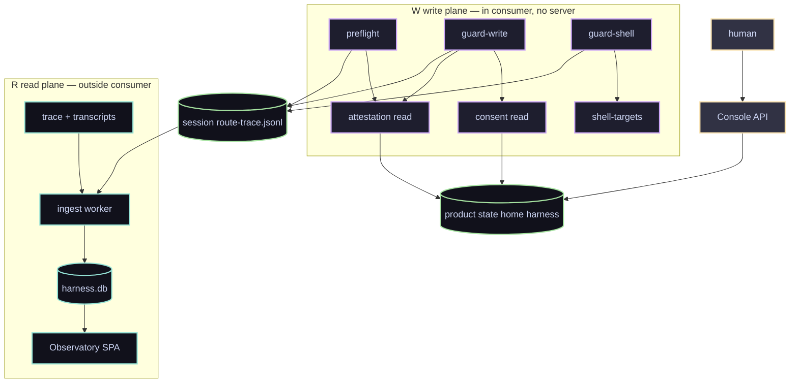

Đọc điểm mấu chốt: **W ghi ra `route-trace.jsonl`, R đọc nó.** Không có mũi tên nào từ R về W — observe
plane sập thì guard vẫn chạy, và đó là lý do host pack tồn tại.

---

## §V2 — Repo topology

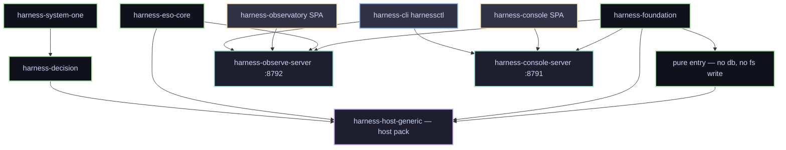

Mũi tên là **import**, không phải data flow. `PURE` là ranh giới cứng: hook chỉ được import nó, và build
pack **fail** nếu vi phạm.

---

## §V3 — Ba root trạng thái, và ai được ghi

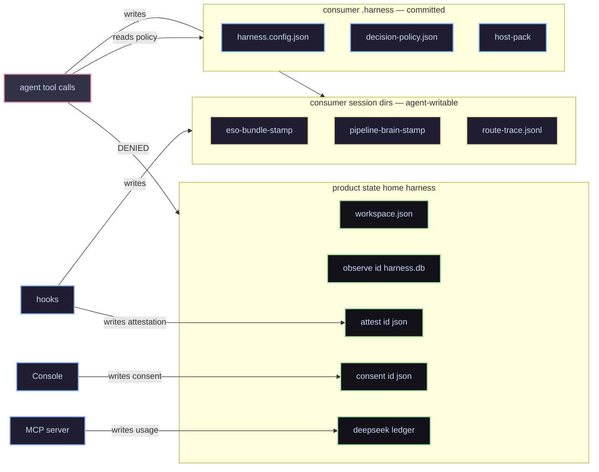

Đây là **toàn bộ trust model trong một hình**: `AGENT` bị chặn khỏi `product state`, còn session dir thì nó
**buộc phải** ghi được. Nên session dir không thể chứa thứ gì gate tin.

---

## §V4 — Sequence: một turn, cả hai plane

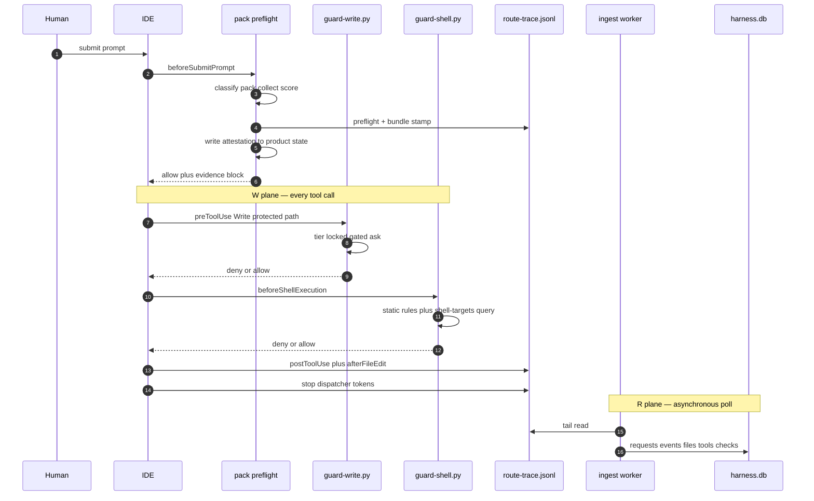

Hai nửa của hình này chạy **không đồng bộ với nhau**. `IN` có thể chậm 15 giây; đó là gốc của hầu hết
defect về attribution.

---

## §V5 — Guard-write: cây quyết định

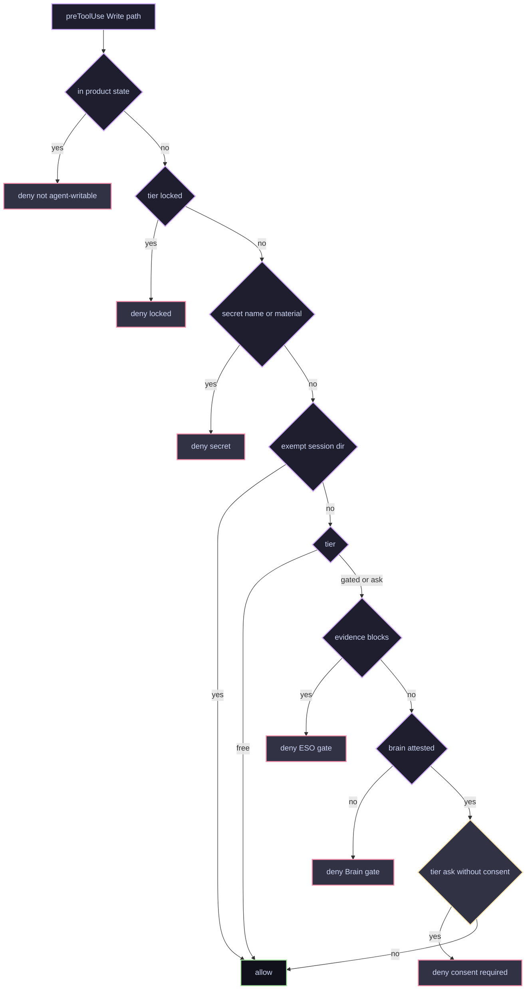

Thứ tự **có nghĩa**: `locked` không đi tiếp xuống gate, vì không gate nào mở được nó. Và `exempt` nằm
**sau** secret nhưng **trước** tier — nên stamp trong session dir ghi được mà không cần evidence.

---

## §V6 — Kênh thứ hai: shell

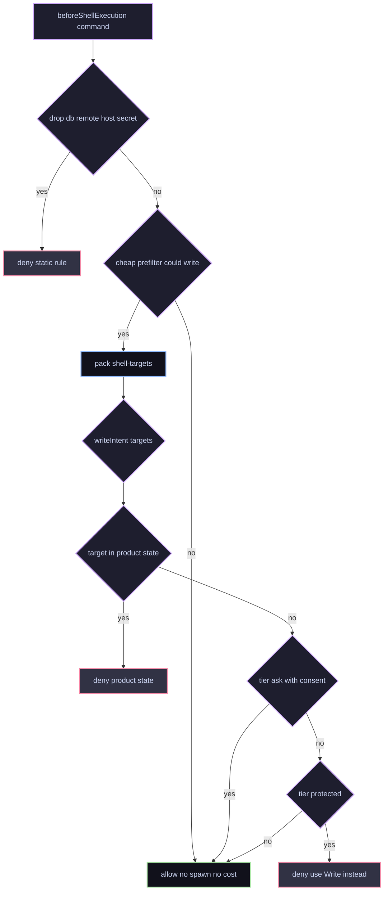

Vì sao là **một query gọi pack** chứ không phải parser thứ hai trong Python: xem
[`../02.runtime/02.guards-and-paths.md`](../02.runtime/02.guards-and-paths.md). Prefilter chỉ để quyết định
**có spawn hay không** — lệnh read-only không trả 46ms.

---

## §V7 — Trust model: gate được tin cái gì

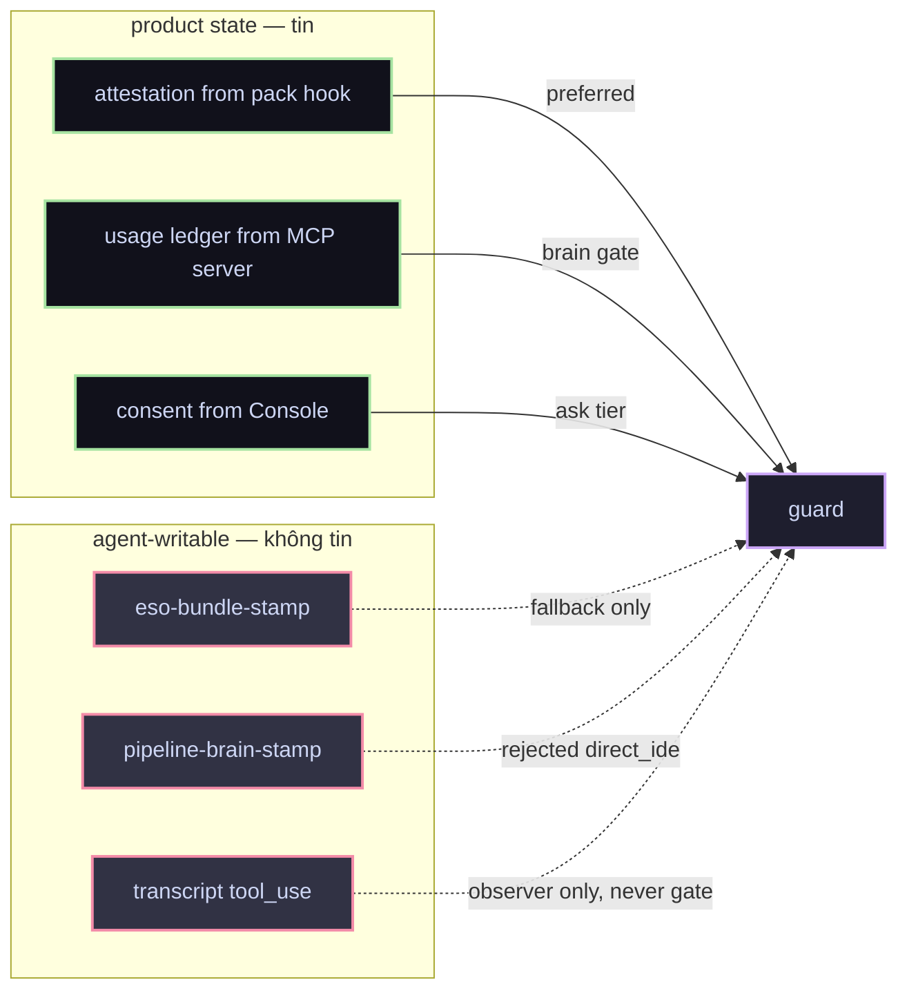

Nét liền = đường tin; nét chấm = đường bị hạ cấp hoặc bị bác. `transcript tool_use` chỉ ghi **ý định**, không
ghi hoàn tất, nên không bao giờ được dùng làm bằng chứng cho gate.

---

## §V8 — Path tier: thứ tự phân giải

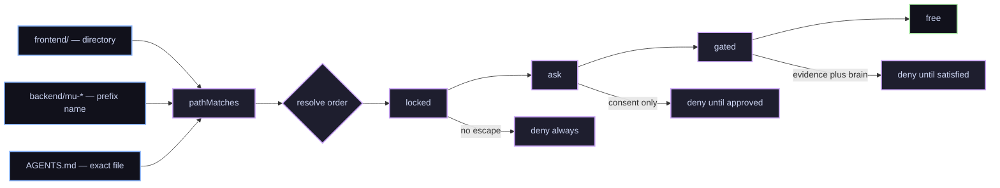

Ba dạng entry, phân biệt **bởi chính entry**: hậu tố `/` là directory, `*` là prefix tên, còn lại là exact.
Thứ tự `locked → ask → gated` để một path lỡ nằm hai tầng không bị nới bởi tầng sau.

---

## §V9 — Consent: vòng đời

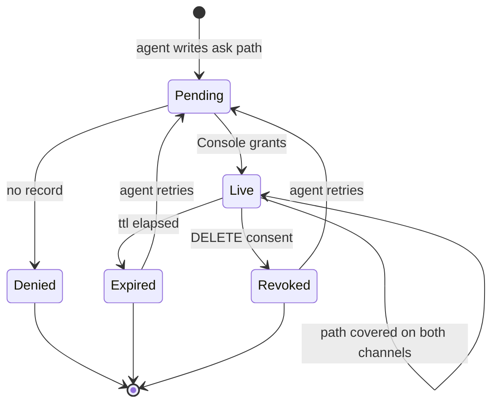

Record chỉ có **một người viết**: Console API. Không hook nào grant được, và đó là toàn bộ lý do tier `ask`
có nghĩa.

---

## §V10 — Ingest: đường chạy bất đồng bộ

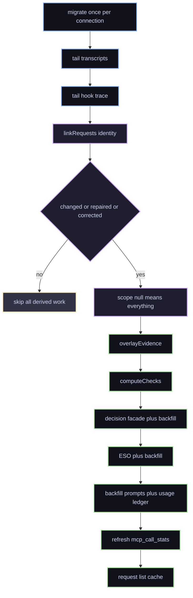

`CH` không phải tối ưu bỏ được: nó là thứ khiến một poll và hàng nghìn turn lịch sử cùng tồn tại. Và nó là
**bẫy**: thứ gì đổi nghĩa dữ liệu dẫn xuất thì phải tham gia vào đó — `link.corrected` được thêm vào vì lý do
này.

---

## §V11 — Identity: event tìm turn của nó thế nào

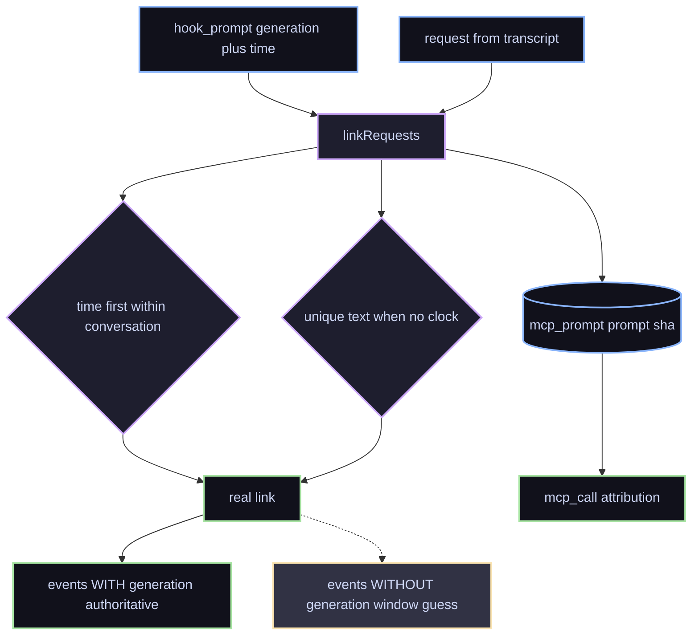

Ba input, ba cách trả lời **khác nhau**, và không có identifier chung nào giữa chúng — đó là toàn bộ độ khó
của ingest. `generation` là bằng chứng trực tiếp; time window là **suy đoán**, và suy đoán phải nhường.

---

## §V12 — Data model

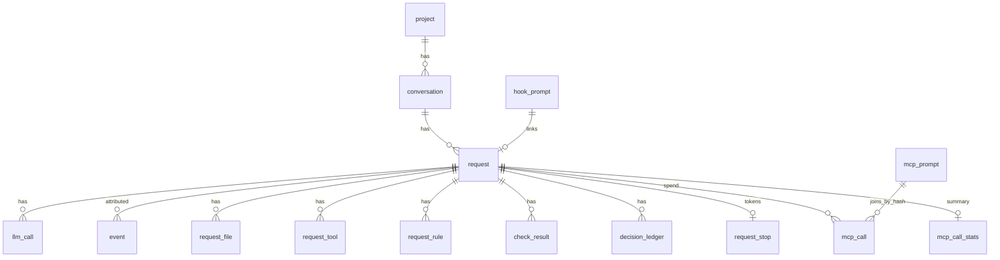

Hai chỗ dễ đọc sai, cả hai đều đã gây defect: `request.generation_id` có thể là **placeholder** bằng chính
`request.id`; và `event` có **hai** cột attribution (`generation_id` của IDE, `request_id` do harness suy ra)
mà lịch sử đã từng lệch nhau trên 3.438 row.

---

## §V13 — Hai chủ sở hữu token, không gộp

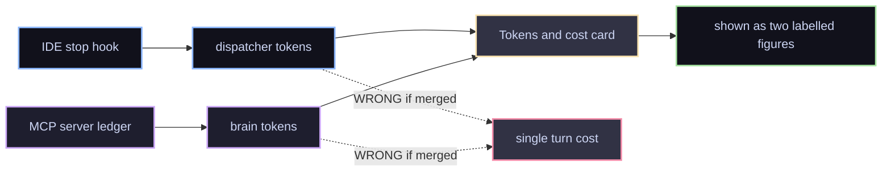

Một lượt Cursor tiêu phần lớn chi phí ở **Brain**, và không channel nào báo cả hai. Gộp lại tạo ra một con số
không ai đo.

---

## §V14 — Checks: dẫn xuất từ đâu

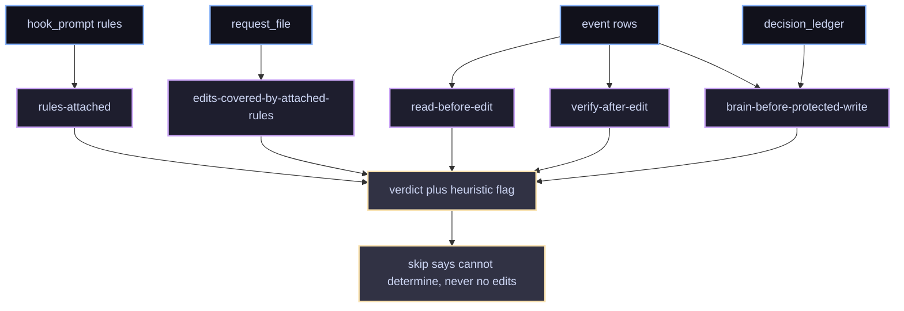

`afterFileEdit` là **tín hiệu ghi duy nhất** từ IDE, và ba check phụ thuộc nó. Không wire event đó thì chúng
không phán được gì — và câu trả lời trung thực là **cannot determine**, không phải "không có gì bị sửa".

---

## §V15 — Provisioning và merge ba chiều

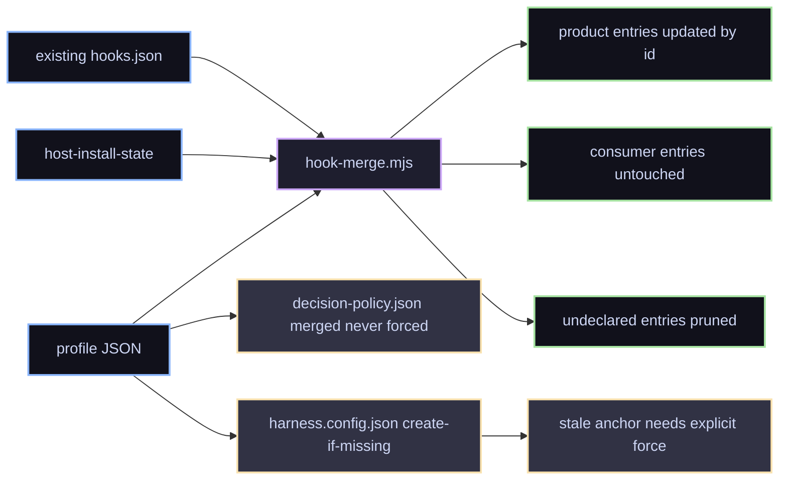

Ba quy tắc merge, mỗi cái từng là một defect: cập nhật **theo `id`**, giữ entry của consumer, và **prune**
entry không còn được khai — không để lại bản trùng. Và `harness.config.json` là
`create-if-missing`, nên một giá trị sai trong đó **vĩnh viễn** cho tới khi `--force`.

---

## §V16 — Bất biến của pack build

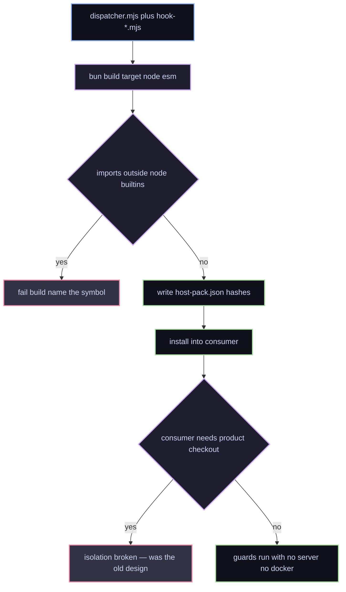

Đây là bất biến chịu lực của cả cách tiếp cận. Nó **đã** bắt một lỗi thật: một export thêm vào foundation
nhưng chưa qua `pure`, build chết với đúng symbol thiếu, thay vì ship một bundle sẽ chết ở consumer.

---

## §V17 — Docker topology

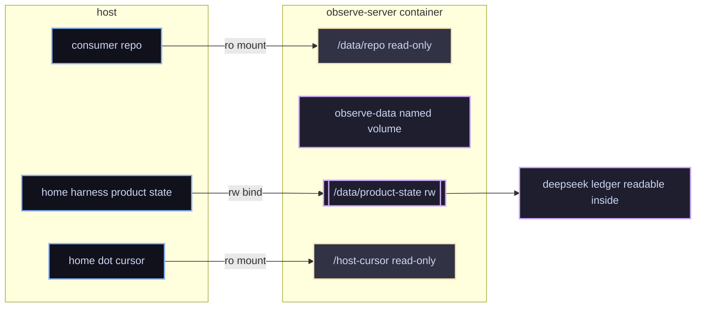

Consumer là `ro` vì một SQLite DB bind-mount từ macOS host vào Linux container là thứ đã làm hỏng nó.
Và ledger đi theo product state — **cố ý** — vì cả MCP server trên host lẫn reader trong container đều phân
giải nó qua đó.

---

## §V18 — Posture khi thất bại

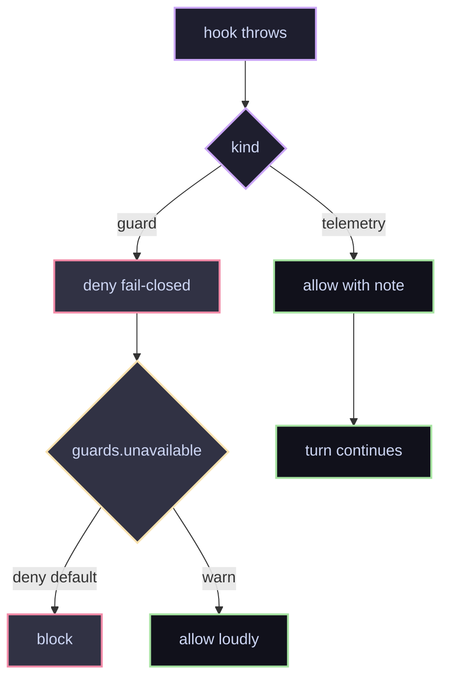

Guard không quyết được thì **deny**; telemetry không ghi được thì **không được** làm gãy lượt. Code cũ của
consumer guard là fail-open, nên một `NameError` tắt im lặng toàn bộ guard — đó là lý do quy tắc này tồn tại.

---

## §V19 — Cây chẩn đoán: "monitor sai"

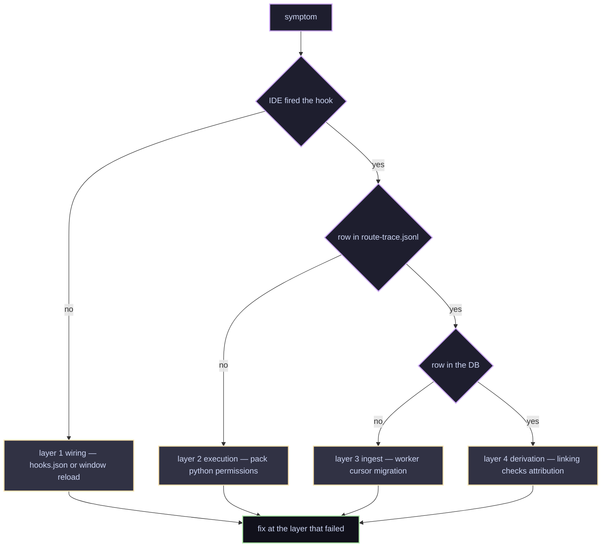

Đi xuống từng tầng. Phần lớn báo cáo đến dưới dạng "monitor sai" — tức layer 4 — nhưng lỗi thật thường ở
layer 1, và sửa layer 4 sẽ không giúp gì.

---

## §V20 — Thứ tự đọc tài liệu


`05.02 invariants` và `05.03 open issues` là hai file **bắt buộc** trước khi sửa luồng dữ liệu. Phần còn lại
là tra cứu.

---

## §V21 — Sufficiency → verdict (state machine thật)

```mermaid
stateDiagram-v2
    [*] --> Collected: preflight hoặc ingest full
    Collected --> Sufficient: score gte T_high và gaps rỗng
    Collected --> Partial: T_low lte score lt T_high
    Collected --> Insufficient: score lt T_low

    Sufficient --> AllowWrite: allowProtectedWrite true
    Partial --> DenyWrite: enforceWrites fail_closed
    Partial --> AllowWrite: enforceWrites off và jevOnPartial false
    Partial --> DenyWrite2: jevOnPartial true

    Insufficient --> ConsentPending: dev-runtime và gate consent
    Insufficient --> DenyWriteOnly: không phải dev-runtime
    ConsentPending --> PromptBlocked: allowPromptSubmit false
    PromptBlocked --> AllowWrite: waiver ok
    DenyWriteOnly --> AllowWrite: chỉ sau khi bổ sung evidence

    AllowWrite --> [*]
```

Dựng trực tiếp từ `gate.mjs` — **không phải** một lượt lặp. Đọc kỹ ba điều dễ vẽ sai:

- `sufficient` **đòi `gaps` rỗng**, không chỉ score cao. Một score 0.9 kèm một gap vẫn là `partial`.
- `ConsentPending` chỉ xảy ra khi **cả ba** đúng: gate là `consent`, level `insufficient`, và stem phân loại
  là `dev-runtime`. Câu hỏi thường không bị chặn.
- `allowPromptSubmit` và `allowProtectedWrite` là **hai** cờ độc lập. Chặn prompt mạnh hơn chặn ghi.

---

## §V22 — Escalation: cái gì thật, cái gì **chưa** có

```mermaid
flowchart TD
    classDef free fill:#11111b,stroke:#a6e3a1,stroke-width:2px,color:#cdd6f4
    classDef paid fill:#0f766e,stroke:#14b8a6,stroke-width:2px,color:#cdd6f4
    classDef human fill:#313244,stroke:#f9e2af,stroke-width:2px,color:#cdd6f4
    classDef absent fill:#313244,stroke:#f38ba8,stroke-width:2px,color:#cdd6f4

    M[measure]:::free
    M --> L0[L0 route rules deterministic]:::free
    L0 --> Q{ambiguous}:::free
    Q -->|no| OUT[verdict]:::free
    Q -->|yes| J{jev mode active}:::paid
    J -->|no| OUT
    J -->|yes| JV[Jev L2 one paid call max]:::paid
    JV --> OUT
    OUT --> H{insufficient dev-runtime}:::human
    H -->|yes| CONSENT[human consent]:::human
    H -->|no| DONE[allow write or deny write]:::free
    CONSENT --> DONE

    EXP["expand rounds 0 1 2 — KHÔNG TỒN TẠI trong code; maxExpandRounds không ai đọc"]:::absent
```

**Đây là chỗ tôi phải nói thẳng.** Diagram escalation của shard thiết kế vẽ "Round 0 → Round 1 → Round 2 →
paid → human". Trong `harness-eso`:

| | |
|---|---|
| `runCollect` | **một lượt**, không có vòng lặp |
| `maxExpandRounds` | có trong `decision-policy.json` của consumer — **không code nào đọc nó** |
| `budget.maxS1PaidCallsPerTurn` | được `jev-resolver.mjs` đọc thật, giới hạn **1** call/turn |

Nên escalation thật là **hai trục ngắn** ở trên, không phải một thang nhiều vòng. Vẽ các round vào tài liệu
sản phẩm sẽ là mô tả hành vi không tồn tại — đúng loại lỗi mà
[`../05.development/02.invariants.md`](../05.development/02.invariants.md) §D5 cấm.

---

## §V23 — Preflight sync vs ingest async (hai đường, một kernel)

```mermaid
flowchart TB
    classDef sync fill:#89b4fa,stroke:#1e1e2e,stroke-width:2px,color:#11111b
    classDef async fill:#a6e3a1,stroke:#11111b,stroke-width:2px,color:#11111b
    classDef shared fill:#1e1e2e,stroke:#cba6f7,stroke-width:2px,color:#cdd6f4

    PROMPT[prompt boundary]:::sync

    subgraph pre ["SYNC — trong consumer, budget maxMs"]
        PF[orchestrateTurn phase preflight]:::sync
        STAMP[eso-preflight plus bundle stamp]:::sync
        ATT[attestation to product state]:::sync
        INJ[additional_context evidence block]:::sync
        PF --> STAMP --> ATT
        STAMP --> INJ
    end

    subgraph ing ["ASYNC — ngoài consumer, theo poll"]
        ORC[orchestrateTurn phase full]:::async
        LK[linkRequests]:::async
        DER[files tools rules checks]:::async
        DB[(harness.db)]:::async
        ORC --> LK --> DER --> DB
    end

    PROMPT --> PF
    INJ --> AGENT[agent turn]:::sync
    AGENT --> ORC
    ATT --> GW[guard-write reads attestation]:::shared
    DB --> MON[Observatory]:::async
```

Cùng một `orchestrateTurn`, hai `phase`. Điểm mấu chốt về mặt thiết kế: nhánh **sync** ghi ra thứ guard đọc,
còn nhánh **async** ghi ra thứ người đọc. Nên một observe plane sập **không** ảnh hưởng gì tới quyết định gate
— đó là lý do hai nhánh tách hẳn.

---

## §V24 — Scenario map (operator)

| ID | Kịch bản | Tầng / điều kiện | Kết quả mong đợi |
|----|----------|------------------|------------------|
| **SC-1** | implement `backend/mu-*`, evidence đủ, có brain call | gated | **allow** cả hai kênh |
| **SC-2** | question / docs, không sửa gì | free | allow, ghi `not_required` |
| **SC-3** | implement thiếu law, `dev-runtime` | insufficient + consent | **blocked** — prompt không submit được |
| **SC-4** | partial + `enforceWrites fail_closed` | gated | allow prompt, **deny** ghi |
| **SC-5** | gated path, chưa gọi Brain | gated | **deny Brain gate** |
| **SC-6** | `sdlc/08.wbs/`, chưa duyệt | ask | **deny consent required** |
| **SC-7** | `document/mu/be/00.law/` | locked | **deny** — không gì mở được |
| **SC-8** | `cat >` vào path bảo vệ | shell | **deny** — bảo dùng Write |
| **SC-9** | ghi vào `~/.harness` | product state | **deny** trên cả hai kênh |
| **SC-10** | brain call dispatch nhưng transport mất | gated | **deny vĩnh viễn** — xem open issue #2 |

```mermaid
flowchart TB
    classDef ok fill:#11111b,stroke:#a6e3a1,stroke-width:2px,color:#cdd6f4
    classDef warn fill:#313244,stroke:#f9e2af,stroke-width:2px,color:#cdd6f4
    classDef deny fill:#313244,stroke:#f38ba8,stroke-width:2px,color:#cdd6f4

    S([prompt]):::ok
    S --> Q{phân loại}:::ok
    Q -->|question| SC2[SC-2 cho qua]:::ok
    Q -->|implement| PF[preflight]:::ok
    PF --> LEV{level}:::ok
    LEV -->|sufficient| T{tier path}:::ok
    LEV -->|partial| W4[SC-4 deny ghi]:::warn
    LEV -->|insufficient| SC3[SC-3 prompt blocked]:::warn

    T -->|free| OK[SC-1 allow]:::ok
    T -->|gated| B{brain attested}:::ok
    T -->|ask| C{consent}:::ok
    T -->|locked| SC7[SC-7 deny always]:::deny
    B -->|no| SC5[SC-5 deny Brain]:::deny
    B -->|yes| OK
    C -->|no| SC6[SC-6 deny consent]:::deny
    C -->|yes| OK
    SC3 -->|waiver| T
```

SC-10 là kịch bản **không** có đường thoát hôm nay: agent gọi Brain, IDE render call, frame không tới server
⇒ không có ledger record ⇒ Brain gate không thoả ⇒ path `gated` **không bao giờ** ghi được. Instrument đã lắp
để lần sau xác định phía nào chịu trách nhiệm.

---

## §V25 — Cognition keys: cái nào code **thật** đọc

```mermaid
flowchart LR
    classDef real fill:#11111b,stroke:#a6e3a1,stroke-width:2px,color:#cdd6f4
    classDef dead fill:#313244,stroke:#f38ba8,stroke-width:2px,color:#cdd6f4
    classDef pol fill:#1e1e2e,stroke:#89b4fa,stroke-width:2px,color:#cdd6f4

    POL[decision-policy.json]:::pol
    POL --> R1[cognition.enforceBrain]:::real
    POL --> R2[cognition.insufficientPromptGate]:::real
    POL --> R3[cognition.gapAttestation]:::real
    POL --> D1[maxExpandRounds]:::dead
    POL --> D2[injectPreflightContext]:::dead

    R1 --> G1[guard-brain posture]:::real
    R2 --> G2[consent requirement in gate.mjs]:::real
    R3 --> G3[gap closure attestation]:::real
```

Đối chiếu bằng `rg` trên `packages/*/src`: ba key đầu được đọc, hai key sau **không** ai đọc. Một key trong
policy mà không code nào đọc là **bẫy** — nó trông như đang điều khiển hành vi, và người vận hành sẽ chỉnh nó
rồi tin rằng đã đổi được gì.

## §V26 — `v1-coordinates` — Phase A–D và L0–L4 trên một turn

<!-- product-diagram: v1-coordinates -->

```mermaid
flowchart TB
    classDef phase fill:#11111b,stroke:#a6e3a1,stroke-width:2px,color:#cdd6f4
    classDef layer fill:#1e1e2e,stroke:#cba6f7,stroke-width:2px,color:#cdd6f4
    classDef s2 fill:#313244,stroke:#f9e2af,stroke-width:2px,color:#cdd6f4
    subgraph phaseA [Phase A Surface WHERE]
        A[decide turn_start]:::phase
        L0[L0 route graph]:::layer
        L1[L1 heuristic tie]:::layer
        L2r[L2 Jev route optional]:::layer
        A --> L0 --> L1 --> L2r
    end
    subgraph phaseBCD [Phases B C D System 1 ESO]
        B[Phase B Collect]:::phase
        C[Phase C Measure]:::phase
        D[Phase D Escalate]:::phase
        B --> C --> D
    end
    subgraph act [ACT System 2 L4]
        L4[Brain plus executor verify]:::s2
    end
    phaseA --> phaseBCD
    phaseBCD -->|gate open| act
    phaseBCD -->|insufficient consent| HIL[Human stop or continue]:::s2
```

Hai hệ tọa độ trên cùng một lượt: **Phase A–D** là *việc gì đang được làm*, **L0–L4** là *ai đang trả tiền cho
việc đó*. Chúng không phải hai tên của một thứ, và không được gọi L0 là "phase".

---

## §V27 — `v2-abcd` — Phase A → B → C → D (một turn)

<!-- product-diagram: v2-abcd -->

```mermaid
flowchart TB
    classDef free fill:#11111b,stroke:#a6e3a1,stroke-width:2px,color:#cdd6f4
    classDef paid fill:#0f766e,stroke:#14b8a6,stroke-width:2px,color:#cdd6f4
    classDef brain fill:#1e1e2e,stroke:#cba6f7,stroke-width:2px,color:#cdd6f4
    classDef human fill:#313244,stroke:#f9e2af,stroke-width:2px,color:#cdd6f4
    T[Turn boundary prompt submit]:::free
    T --> A[Phase A Surface bucket SkillPack]:::free
    A --> B[Phase B Collect adapters]:::free
    B --> C[Phase C Measure T_low T_high]:::free
    C -->|sufficient| G[Stitch EvidenceBundle TurnVerdict]:::free
    C -->|partial| B2[Expand rounds deterministic]:::free
    B2 --> C
    C -->|still partial| D[Phase D Jev or L3 per boundary]:::paid
    D --> B
    C -->|insufficient| H[Consent gate or HIL]:::human
    H --> B
    G --> S2[System 2 L4 Brain pipeline]:::brain
```

Lưu ý về **"Expand rounds deterministic"**: đây là *ý định thiết kế* được vẽ trong sản phẩm, **chưa** được
implement. `runCollect` chạy một lượt và `maxExpandRounds` không code nào đọc — xem
§V22 để biết hành vi thật.

---

## §V28 — `v3-layers` — Thang L0 → L4 (Facade vs Brain)

<!-- product-diagram: v3-layers -->

```mermaid
flowchart LR
    classDef l0 fill:#11111b,stroke:#a6e3a1,stroke-width:2px,color:#cdd6f4
    classDef l1 fill:#11111b,stroke:#89b4fa,stroke-width:2px,color:#cdd6f4
    classDef paid fill:#0f766e,stroke:#14b8a6,stroke-width:2px,color:#cdd6f4
    classDef s2 fill:#1e1e2e,stroke:#cba6f7,stroke-width:2px,color:#cdd6f4
    L0[L0 tools route graph]:::l0
    L1[L1 heuristic guard]:::l1
    L2[L2 Jev System1]:::paid
    L3[L3 Flash JSON route]:::paid
    L4[L4 Brain System2]:::s2
    L0 --> L1 --> L2 --> L3
    L3 -.->|after GATE| L4
    L2 -.->|evidence Phase D| L0
```

Đường **nét liền** là thang leo theo độ mơ hồ; đường **nét chấm** là đường quay lại. L0–L3 là System 1 (không
hoặc có trả tiền, nhưng không generative Brain); L4 mới là System 2.

---

## §V29 — `taxonomy-bridge` — Phase A → B C D → ACT

<!-- product-diagram: taxonomy-bridge -->

```mermaid
flowchart LR
    subgraph phaseA [Phase A Surface]
        L0[L0]
        L1[L1]
        L2r[L2 route Jev]
        L0 --> L1 --> L2r
    end
    subgraph phasesBCD [Phase B C D]
        B[B Collect]
        C[C Measure]
        D[D Escalate]
        B --> C --> D
    end
    subgraph act [ACT System 2]
        L4[L4 Brain]
    end
    phaseA --> phasesBCD
    phasesBCD -->|gate open| act
```

Bản rút gọn — dùng khi cần thấy phác thảo luồng mà không cần chi tiết của §V26/§V27.

---

### Bốn diagram này là **copy**, không phải nguồn

Nguồn thật: `packages/harness-console/src/diagrams/pipeline-diagrams.ts`, do `PipelineIntro` ·
`DiagramHint` · `PluginsPage` render cho wizard. Chúng nằm trong file này để **một chỗ có đủ diagram**, theo
yêu cầu tổng hợp — nhưng copy thì có thể lệch.

Nên có một test chặn điều đó: [`qc/diagram-parity.test.mjs`](../../qc/diagram-parity.test.mjs) so từng block
trên (tìm theo anchor `<!-- product-diagram: <id> -->`) với nguồn trong file `.ts`, và **fail** nếu lệch. Sửa
một bên mà quên bên kia thì `bun run test` đỏ, kèm tên diagram.

Sửa diagram thì sửa **nguồn `.ts`** trước (đó là thứ người dùng nhìn thấy), rồi chạy:

```bash
bun run sync:diagrams   # chép lại 4 block ở trên từ nguồn
```

---

## Index — diagram trong file này

| § | Chủ đề | File bản văn |
|---|---|---|
| §V1 | hai plane | [`01.overview/03`](../01.overview/03.architecture.md) |
| §V2 | topology package | [`01.overview/03`](../01.overview/03.architecture.md) |
| §V3 | ba root trạng thái | [`03.state-and-contracts/01`](../03.state-and-contracts/01.state-layout.md) |
| §V4 | turn lifecycle | [`02.runtime/01`](../02.runtime/01.prompt-lifecycle.md) |
| §V5 | guard-write | [`02.runtime/02`](../02.runtime/02.guards-and-paths.md) |
| §V6 | shell channel | [`02.runtime/02`](../02.runtime/02.guards-and-paths.md) |
| §V7 | trust model | [`02.runtime/03`](../02.runtime/03.consent-and-attestations.md) |
| §V8 | path tier | [`02.runtime/02`](../02.runtime/02.guards-and-paths.md) |
| §V9 | consent | [`02.runtime/03`](../02.runtime/03.consent-and-attestations.md) |
| §V10 | ingest pipeline | [`02.runtime/04`](../02.runtime/04.ingest-pipeline.md) |
| §V11 | identity | [`02.runtime/04`](../02.runtime/04.ingest-pipeline.md) |
| §V12 | data model | [`03.state-and-contracts/02`](../03.state-and-contracts/02.data-model.md) |
| §V13 | token ownership | [`03.state-and-contracts/02`](../03.state-and-contracts/02.data-model.md) |
| §V14 | checks | [`02.runtime/04`](../02.runtime/04.ingest-pipeline.md) |
| §V15 | provisioning | [`03.state-and-contracts/04`](../03.state-and-contracts/04.host-pack-contract.md) |
| §V16 | pack invariant | [`03.state-and-contracts/04`](../03.state-and-contracts/04.host-pack-contract.md) |
| §V17 | Docker | [`04.operations/02`](../04.operations/02.docker-deploy.md) |
| §V18 | failure posture | [`05.development/02`](../05.development/02.invariants.md) |
| §V19 | chẩn đoán | [`04.operations/04`](../04.operations/04.troubleshooting.md) |
| §V20 | thứ tự đọc | [`00.README`](../00.README.md) |
| §V21 | sufficiency → verdict | [`02.runtime/05`](../02.runtime/05.decision-facade.md) · `eso-core/src/gate.mjs` |
| §V22 | escalation (thật vs chưa có) | [`02.runtime/05`](../02.runtime/05.decision-facade.md) |
| §V23 | preflight sync vs ingest async | [`02.runtime/01`](../02.runtime/01.prompt-lifecycle.md) |
| §V24 | scenario map | [`02.runtime/02`](../02.runtime/02.guards-and-paths.md) · [`04.operations/04`](../04.operations/04.troubleshooting.md) |
| §V25 | cognition keys | [`03.state-and-contracts/01`](../03.state-and-contracts/01.state-layout.md) |
| §V26 | `v1-coordinates` (product) | `packages/harness-console/src/diagrams/pipeline-diagrams.ts` |
| §V27 | `v2-abcd` (product) | sđd |
| §V28 | `v3-layers` (product) | sđd |
| §V29 | `taxonomy-bridge` (product) | sđd |

---

## Mapping: shard thiết kế → file này

Shard thiết kế (`19.diagrams-mermaid.md` trong repo consumer) có **21 mục** ở trục khác: nó mô tả **vocabulary
thiết kế** (Phase A–D, L0–L4, DPEF, System 1/2). File này mô tả **hành vi runtime**. Nên trùng số `§V` **không**
nghĩa là trùng nội dung — `§V1` ở đây là hai plane, `§V1` bên đó là hai hệ tọa độ.

**Cách đọc bảng:** tìm mục shard bên trái, xem nó ở đâu bên phải. `—` nghĩa là **không có ở đây**, và cột cuối
nói vì sao.

### A. Bốn diagram đã có trong **sản phẩm** (giờ copy vào §V26–§V29)

Nguồn thật: `packages/harness-console/src/diagrams/pipeline-diagrams.ts`, render bởi `PipelineIntro` ·
`DiagramHint` · `PluginsPage` cho wizard. Copy được kiểm tự động — xem mục cuối **§V29**.

| Shard | Nội dung shard | Ở đây |
|---|---|---|
| §V2 | Phase A → B → C → D (plan ABCD) | **§V27** `v2-abcd` |
| §V1 | Hai hệ tọa độ trên một turn | **§V26** `v1-coordinates` |
| §V3 | Thang L0 → L4 (chi phí / mơ hồ) | **§V28** `v3-layers` |
| §V4 | DPEF v2 Collect · Gate · Act trên timeline | **§V29** `taxonomy-bridge` |

### B. Mục shard đã được vẽ lại, **trung thực hơn**

Không copy — vẽ từ code thật, và nói rõ chỗ shard khác code.

| Shard | Nội dung shard | Ở đây | Khác gì |
|---|---|---|---|
| §V8 | Sufficiency state machine (Phase C → D) | **§V21** | Dựng từ `gate.mjs`; gồm **hai** cờ độc lập `allowPromptSubmit` / `allowProtectedWrite` mà shard không tách |
| §V9 | Escalation ladder (0 USD → paid → human) | **§V22** | Shard vẽ **Round 0 → 1 → 2**. `runCollect` chạy **một lượt**; `maxExpandRounds` **không ai đọc**. Nên vẽ thang thật và đánh dấu phần chưa có |
| §V10 | Scenario map (operator) | **§V24** | 10 scenario có kết quả mong đợi, kèm **SC-10** là ca không có đường thoát (transport) |
| §V11 | Preflight sync vs ingest async (dual path) | **§V23** | Nói rõ hai nhánh ghi cho **hai người đọc khác nhau** (guard vs người) |
| §V12 | Cognition tiers 1–3 (promax semantics) | **§V25** | Kèm phát hiện: **2 key trong policy không code nào đọc** |
| §V15 | Decide plane vs Observe plane | **§V1** | `W`/`R`: nhấn **không có mũi tên nào từ R về W** |
| §V7 | Sequence: ingest spine + System 2 | **§V4** | Sequence thật của cả hai plane, có ghi chú chúng chạy lệch nhịp |
| §V17 | Storage hot path and GC | **§V10** + [`03.state-and-contracts/01`](../03.state-and-contracts/01.state-layout.md) | Tăng trưởng/GC ở file state layout; §V10 vẽ change gate |

### C. Mục shard **không** có ở đây, và vì sao

| Shard | Nội dung shard | Vì sao không vẽ lại |
|---|---|---|
| §V5 | System 1 + System 2 (full turn, packages) | Trùng [`01.overview/03`](../01.overview/03.architecture.md) và **§V2** — thêm nữa là bản sao thứ ba |
| §V6 | ESO data plane (Phase B–D only) | Là **tập con** của `v2-abcd` (§V27). Vẽ riêng không thêm thông tin |
| §V13 | Platform four layers (Host / Kernel / Provider / Observe) | Trùng **§V2**; `W`/`R` của §V1 là cách gọi chính xác hơn cho cùng ý |
| §V14 | Sidecar HTTP (generic host) | **Đã gỡ trong revamp.** Preflight chạy **local trong host pack**, không cần HTTP. Route `POST /v1/preflight` vẫn còn như tiện ích cho script, nhưng **không hook nào gọi** — xem [`03.state-and-contracts/03`](../03.state-and-contracts/03.observe-api.md) |
| §V16 | CI verify loop (W8) | Quy trình CI của consumer, không phải cơ chế sản phẩm |
| §V18 | Agent factory roles (ROLE pipeline) | Vai trò quy trình của consumer. `rg 'ROLE' packages/*/src` → không có |
| §V19 | Stakeholders + Observatory (STAKE) | Như trên: `rg 'STAKE' packages/*/src` → **0 file**. Trộn quy trình consumer vào tài liệu sản phẩm là lỗi F46 |
| §V20 | Doc reading order (onboarding) | Đã có: **§V20** + [`00.README`](../00.README.md) |
| §V21 | Mode B consumer (Decide host + Observe Docker) | Đã có: **§V17** + [`04.operations/02`](../04.operations/02.docker-deploy.md) |

### D. Mục **chỉ có ở đây** — không có trong shard

Vẽ từ code, không từ thiết kế:

| § | Nội dung |
|---|---|
| **§V3** | ba root trạng thái + **ai được ghi** (trust model) |
| **§V5** / **§V6** | cây quyết định của guard, và kênh shell |
| **§V7** | gate được tin cái gì (nét liền vs nét chấm) |
| **§V8** / **§V9** | path tier + consent lifecycle |
| **§V11** | identity/attribution — nguồn của nhiều defect nhất |
| **§V12** / **§V13** | data model + hai chủ sở hữu token |
| **§V14** | checks dẫn xuất từ đâu |
| **§V16** / **§V18** | bất biến pack + posture thất bại |
| **§V19** | cây chẩn đoán 4 layer |


