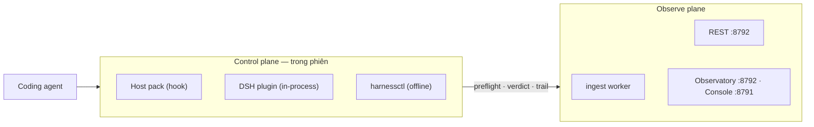

# 00 — harness-eso: how it works (index)

> Bộ tài liệu này mô tả **hệ thống đang chạy**, không phải ý định. Mỗi sơ đồ đều truy được về một
> module trong `packages/` hoặc một file state cụ thể. Nếu sơ đồ và code lệch nhau, **code đúng** và
> tài liệu phải sửa.
>
> Đọc theo thứ tự: `01` (bức tranh) → `02` (các luồng) → `03` (pipeline dữ liệu).

## 1. Một câu

harness-eso là **lớp guard + evidence + quan sát** gắn quanh một coding agent: nó quyết định một hành
động có được đi tiếp hay không, ghi lại vì sao, và cho operator xem lại — **mà không sửa agent hay host**.

## 2. Ba cách harness-eso có mặt trong một phiên

| Hình thức | Chạy ở đâu | Ai gọi | Trạng thái |
|---|---|---|---|
| **Host pack** (hook) | Tiến trình con của IDE/host | `.claude/settings.json`, `.cursor/hooks.json`, `.agents/hooks.json` | Ổn định |
| **DSH plugin** | Trong tiến trình DSH (Cordis) | `agent/pre-step`, `tools/pre-execute`, `tools/post-execute` | Mới, đang hoàn thiện |
| **CLI** | Terminal / CI | `harnessctl …` | Ổn định |

## 3. Hai plane

Control plane quyết định **ngay lúc chạy** (được/không, vì sao). Observe plane trả lời **về sau**
(phiên này đã làm gì, tốn bao nhiêu, gap nào còn). Hai plane chia sẻ đúng một nguồn: **file state trên
đĩa** — không có kênh ngầm nào khác.

## 4. Bản đồ tài liệu

| File | Trả lời câu hỏi |
|---|---|
| [01.landscape.md](./01.landscape.md) | Hệ thống gồm những gì, nằm ở đâu, ai nói với ai? |
| [02.workflows.md](./02.workflows.md) | Một phiên chạy qua những bước nào? Cài/gỡ/kiểm ra sao? |
| [03.pipelines.md](./03.pipelines.md) | Dữ liệu đi qua những pipeline nào, quyết định ở đâu? |

## 5. Từ điển tối thiểu

| Thuật ngữ | Nghĩa chính xác trong repo này |
|---|---|
| **consumer** | Repo khai `harness.config.json` (hoặc `.harness/decision-policy.json`) — nơi ESO có ý kiến |
| **host pack** | Bundle `harness-hook.mjs` (1 file, 0 import ngoài `node:*`) + `route-hook.py` |
| **verdict** | `TurnVerdict`: `allowPromptSubmit`, `allowProtectedWrite`, `hardBlockers`, sufficiency |
| **hard blocker** | Finding có tên + `ref` mở được (không phải score) từ `contract`/`tenant`/`migration` |
| **trail** | `~/.harness/eso-blockers.jsonl` — append-only, ghi **trước** khi chặn |
| **product state** | `~/.harness/` — thứ agent không ghi được (B2) |
| **session state** | `<consumer>/.<tree>/session/` — agent ghi được, chỉ là dấu vết |
| **native provider** | Nguồn do host cung cấp (DSH session/skills), capability `native` |
| **recipe** | Bộ chọn provider dạng dữ liệu (`lite`/`pro`/`dsh-native`) |
| **conformance** | H0–H5: bằng chứng host được nối đúng và gate không nằm trong vùng sửa được |

## 6. Nguyên tắc chi phối mọi sơ đồ

1. **Không quyết định bằng score.** Score chỉ mô tả; gate dựa trên finding có tên hoặc tier của path.
2. **Không đoán host.** Cái gì host không cấp thì ghi `skip`, không suy diễn.
3. **Record trước, chặn sau.** Mọi reject/deny ghi trail trước khi trả quyết định.
4. **Fail-closed ở kênh ghi, không ở hội thoại.** Guard không quyết được thì deny **write/tool**; không
   tự kết thúc turn trừ khi có hard blocker.
5. **Một định nghĩa, nhiều nơi dùng.** `shell-writes`, `path-policy`, `blocker-log` là module chung cho
   host pack, plugin và CLI.
