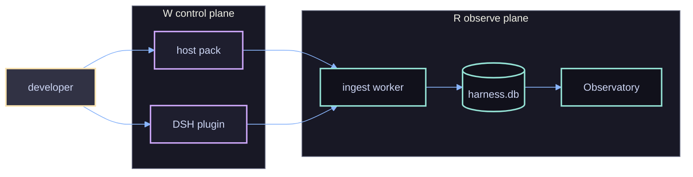

# 00 — harness-eso: how it works (index)

> Bộ tài liệu này mô tả **hệ thống đang chạy**, không phải ý định. Mỗi sơ đồ truy được về một module
> trong `packages/` hoặc một file state cụ thể. Nếu sơ đồ và code lệch nhau, **code đúng**.
>
> Chuẩn vẽ theo [`06.diagrams`](../06.diagrams/01.diagrams-mermaid.md) và rule
> `.cursor/rules/core.doc.mermaid.mdc`: single-line label, không HTML, `classDef` theo vai trò
> (write · read · shared · human · stop), palette Catppuccin, theme `init` đầu mỗi fence. Toàn bộ
> 21 fence render sạch bằng `mmdc` 12.0.0 (headless Chrome) ngày 2026-10-22 — render lại sau khi sửa.

## 1. Một câu

harness-eso là **lớp guard + evidence + quan sát** gắn quanh một coding agent: quyết định một hành động
có được đi tiếp hay không, ghi lại vì sao, và cho operator xem lại — **mà không sửa agent hay host**.

## 2. Ba cách harness-eso có mặt

| Hình thức | Chạy ở đâu | Ai gọi | Trạng thái |
|---|---|---|---|
| **Host pack** (hook) | Tiến trình con của IDE | `.claude/settings.json`, `.cursor/hooks.json`, `.agents/hooks.json` | Ổn định |
| **DSH plugin** | Trong tiến trình DSH | `agent/pre-step`, `tools/pre-execute`, `tools/post-execute` | Mới (0.2.x) |
| **CLI** | Terminal / CI | `harnessctl …` | Ổn định |

## 3. Hai plane

Control plane quyết định **ngay lúc chạy**. Observe plane trả lời **về sau**. Hai plane không có kênh
ngầm nào khác ngoài file state trên đĩa.

## 4. Bản đồ tài liệu

| File | Trả lời |
|---|---|
| [01.landscape.md](./01.landscape.md) | Hệ thống gồm gì, ở đâu, ai nói với ai |
| [02.workflows.md](./02.workflows.md) | Một phiên qua những bước nào; cài/gỡ/kiểm ra sao |
| [03.pipelines.md](./03.pipelines.md) | Dữ liệu qua những pipeline nào, quyết định ở đâu |

## 5. Từ điển tối thiểu

| Thuật ngữ | Nghĩa trong repo này |
|---|---|
| **consumer** | Repo khai `harness.config.json` hoặc `.harness/decision-policy.json` |
| **host pack** | Bundle `harness-hook.mjs` (1 file, 0 import ngoài `node:*`) + `route-hook.py` |
| **verdict** | `TurnVerdict`: `allowPromptSubmit`, `allowProtectedWrite`, `hardBlockers` |
| **hard blocker** | Finding có tên + `ref` mở được, không phải score |
| **trail** | `~/.harness/eso-blockers.jsonl` — append-only, ghi trước khi chặn |
| **product state** | `~/.harness/` — thứ agent không ghi được |
| **session state** | `<consumer>/.<tree>/session/` — agent ghi được, chỉ để replay |
| **native provider** | Nguồn do host cấp (DSH session/skills) |
| **recipe** | Bộ chọn provider dạng dữ liệu (`lite`, `pro`, `dsh-native`) |
| **conformance** | H0–H5: host nối đúng và gate không nằm trong vùng sửa được |

## 6. Năm nguyên tắc chi phối mọi sơ đồ

1. **Không quyết định bằng score** — gate dựa trên finding có tên hoặc tier của path.
2. **Không đoán host** — host không cấp thì ghi `skip`, không suy diễn.
3. **Record trước, chặn sau** — mọi reject/deny ghi trail trước khi trả quyết định.
4. **Fail-closed ở kênh ghi** — không tự kết thúc hội thoại trừ khi có hard blocker.
5. **Một định nghĩa, nhiều nơi dùng** — `shell-writes`, `path-policy`, `blocker-log` là module chung.
