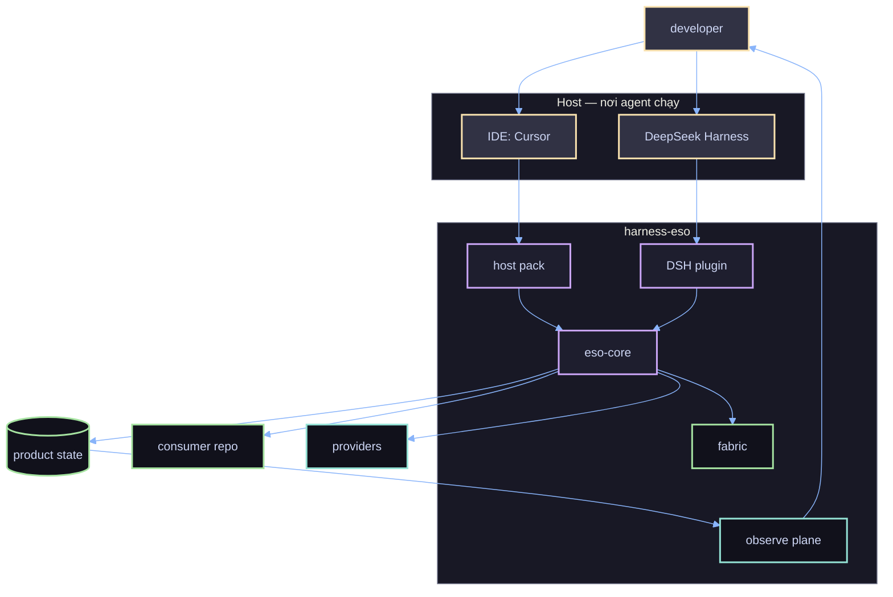
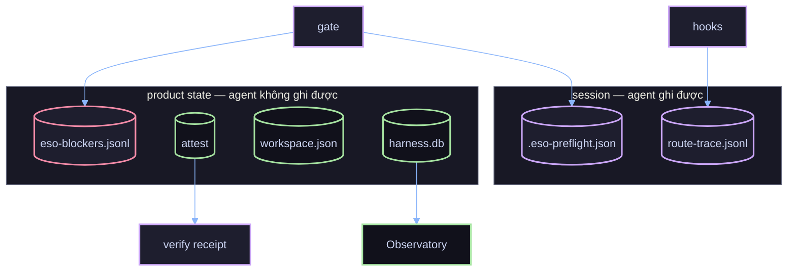
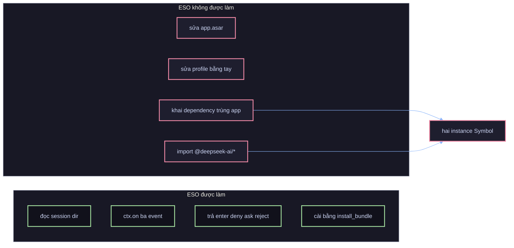

# 01 — Landscape: hệ thống gồm những gì

## 1. Bối cảnh (C4 mức 1)

Điểm cốt lõi: **DSH là hộp đen**. ESO không sửa nó; nó là một plugin được host nạp, dùng đúng API công
khai (`ctx.on`, service `workingDirectory`).

## 2. Ba hình thức triển khai

| | Host pack | DSH plugin | CLI |
|---|---|---|---|
| Đơn vị cài | `harness-hook.mjs` trong `.harness/host-pack/` | package `@mu/harness-eso-dsh` | `harnessctl` |
| Ai chạy | Host, mỗi hook một tiến trình | Trong tiến trình DSH | Người / CI |
| Giao tiếp | stdin/stdout JSON | `ctx.on(event, handler)` | argv + file |
| Cưỡng chế | `permissionDecision: deny` | `{kind:'deny'}` hoặc `{kind:'reject'}` | exit code / report |
| Khi lỗi | `onError: deny` cho guard | handler `catch`, giữ decision của host | throw + exit khác 0 |
| Trạng thái | Ổn định | Mới (0.2.x) | Ổn định |

Chúng **không thay nhau**: host pack phủ Cursor/Antigravity/Claude Code; plugin phủ DSH. Cả hai gọi
chung `eso-core` và đọc chung policy của consumer.

## 3. Thành phần theo package

```mermaid
%%{init: {"theme": "base", "themeVariables": {"background": "#1e1e2e", "primaryColor": "#313244", "primaryTextColor": "#cdd6f4", "primaryBorderColor": "#cba6f7", "lineColor": "#89b4fa", "secondaryColor": "#181825", "tertiaryColor": "#11111b", "clusterBkg": "#181825", "clusterBorder": "#6c7086", "edgeLabelBackground": "#1e1e2e", "fontSize": "14px", "actorBkg": "#313244", "actorBorder": "#cba6f7", "actorTextColor": "#cdd6f4", "signalColor": "#89b4fa", "signalTextColor": "#cdd6f4", "noteBkgColor": "#313244", "noteTextColor": "#cdd6f4", "noteBorderColor": "#f9e2af"}}}%%
flowchart LR

    classDef w fill:#1e1e2e,stroke:#cba6f7,stroke-width:2px,color:#cdd6f4
    classDef r fill:#11111b,stroke:#94e2d5,stroke-width:2px,color:#cdd6f4
    classDef shared fill:#11111b,stroke:#a6e3a1,stroke-width:2px,color:#cdd6f4

    subgraph FOUND ["foundation — không phụ thuộc gì"]
        PP[path-policy]:::shared
        SW[shell-writes]:::shared
        CS[consent]:::shared
        AT[attest]:::shared
        HI[host-install]:::shared
    end
    subgraph CORE ["eso-core"]
        AR[registry]:::w
        CO[collect]:::w
        GA[gate]:::w
        CH[checks]:::w
        HB[hard-blockers]:::w
        BL[blocker-log]:::shared
        CF[conformance]:::shared
        RC[recipe]:::shared
    end
    PACK2[host-generic]:::w
    DSH2[host-dsh]:::w
    CLI2[harness-cli]:::shared
    OBS2[observe-server]:::r

    FOUND --> CORE
    CORE --> PACK2
    CORE --> DSH2
    CORE --> CLI2
    FOUND --> OBS2
```

| Package | Trách nhiệm | Không được làm |
|---|---|---|
| `harness-foundation` | policy, path tier, shell-writes, consent, attestation, product state, host-install | gọi model, quyết định verdict |
| `harness-eso-core` | registry/provider, collect, gate, checks, blockers, conformance, recipe | tự định nghĩa lại policy |
| `harness-decision` | facade L0 + JEV (routing, scoring) | cưỡng chế |
| `harness-host-generic` | dispatcher + hooks, pack build | tự định nghĩa lại path policy |
| `harness-host-dsh` | plugin Cordis, native providers, doctor, bridge bundle | sửa hoặc đọc nội bộ DSH |
| `harness-cli` | `harnessctl` (probe, verify, check, doctor, bridge) | chạy nền |
| `harness-observe-server` | ingest, REST, phục vụ Observatory | quyết định gate |
| `harness-console`, `harness-observatory` | UI | truy cập file trực tiếp |

## 4. Nơi quyết định và nơi ghi

Đường phân biệt: **bằng chứng** (session, agent sửa được, chỉ để replay) so với **record** (product
state, gate tin). Một quyết định không bao giờ đọc record từ session.

## 5. Ranh giới với DSH

Bài học ATF-OPS-001 nằm ở `F3`/`F4`; `harnessctl doctor dsh` chặn nó trước khi app boot.

## 6. Ai đọc cái gì

| Câu hỏi | Đọc ở đâu |
|---|---|
| Gate cho phép hay không, vì sao | `TurnVerdict` trong bộ nhớ, rồi `.eso-preflight.json` |
| Vì sao bị chặn | `~/.harness/eso-blockers.jsonl` |
| Provider nào đang phục vụ | `harnessctl capability probe` |
| Host đã nối đúng chưa | `harnessctl verify host` (H0–H5) |
| DSH có nguy cơ hỏng module graph | `harnessctl doctor dsh` |
| Phiên này tốn gì, gap nào | Observatory `:8792`, `route-trace.jsonl` |
