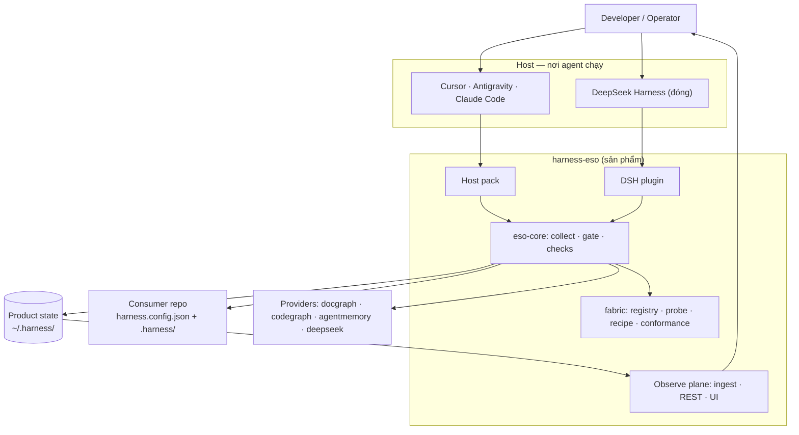
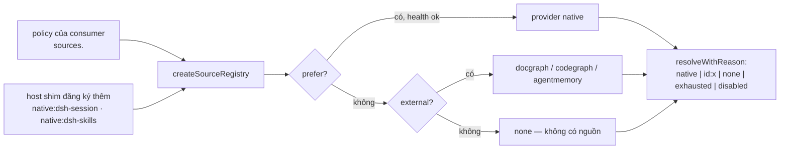
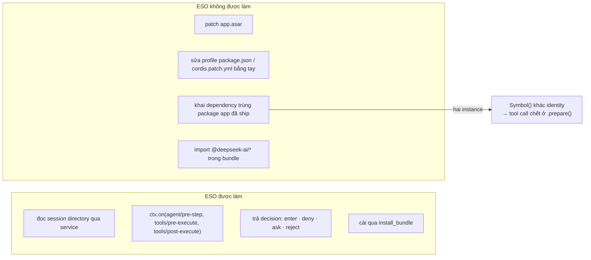

# 01 — Landscape: hệ thống gồm những gì

## 1. Bối cảnh (C4 mức 1)

Điểm cốt lõi: **DSH là hộp đen**. ESO không sửa nó; nó chỉ là một plugin được host nạp, dùng đúng API
công khai (`ctx.on`, service `workingDirectory`).

## 2. Ba hình thức triển khai

| | Host pack | DSH plugin | CLI |
|---|---|---|---|
| Đơn vị cài | `harness-hook.mjs` trong `.harness/host-pack/` | package `@mu/harness-eso-dsh` | `harnessctl` |
| Ai chạy | Host, mỗi hook một tiến trình | Trong tiến trình DSH | Người/CI |
| Giao tiếp | stdin/stdout JSON | `ctx.on(event, handler)` | argv + file |
| Cưỡng chế | `permissionDecision: deny` | `{kind:'deny'}` / `{kind:'reject'}` | exit code / report |
| Khi lỗi | `onError: deny` cho guard | handler `catch` → giữ decision của host | throw + exit ≠ 0 |
| Trạng thái | Ổn định | Mới (0.2.x) | Ổn định |

Chúng **không thay nhau**: host pack phủ Cursor/Antigravity/Claude Code; plugin phủ DSH. Cả hai gọi
chung `eso-core` và đọc chung policy của consumer.

## 3. Thành phần theo package

```mermaid
flowchart LR
  subgraph FOUND["harness-foundation (không phụ thuộc gì)"]
    PP["path-policy"]
    SW["shell-writes"]
    CS["consent"]
    AT["attest"]
    PD["policy-load"]
    HI["host-install"]
    TD["token-diet / token-estimate"]
    PS["product state (workspace-store)"]
  end
  subgraph CORE["harness-eso-core"]
    AR["adapter-registry"]
    CP["capability-probe"]
    CO["collect"]
    GA["gate (TurnVerdict)"]
    CC["contract / tenant / migration"]
    HB["hard-blockers"]
    BL["blocker-log"]
    SC["surface-check"]
    CF["conformance H0–H5"]
    RC["recipe"]
    RT["host-runtime"]
    VF["verifier · reasoner"]
  end
  PACK2["host-generic: dispatcher + 6 hook"]
  DSH2["host-dsh: plugin + doctor + bridge"]
  CLI2["harness-cli"]
  OBS2["observe-server + observatory + console"]

  FOUND --> CORE
  CORE --> PACK2
  CORE --> DSH2
  CORE --> CLI2
  FOUND --> OBS2
```

| Package | Trách nhiệm | Không được làm |
|---|---|---|
| `harness-foundation` | policy, path tier, shell-writes, consent, attestation, product state, host-install | gọi model, quyết định verdict |
| `harness-eso-core` | registry/provider, collect, gate, checks, blockers, conformance, recipe | đọc/ghi file của host theo cách riêng |
| `harness-decision` | facade L0 + JEV (routing, scoring) | cưỡng chế |
| `harness-host-generic` | dispatcher + hooks, pack build | tự định nghĩa lại path policy |
| `harness-host-dsh` | plugin Cordis, native providers, doctor, bridge bundle | sửa/đọc nội bộ DSH |
| `harness-cli` | `harnessctl` (probe, verify, check, doctor, bridge) | chạy nền |
| `harness-observe-server` | ingest, REST, phục vụ Observatory | quyết định gate |
| `harness-console`, `harness-observatory` | UI | truy cập file trực tiếp |

## 4. Capability fabric (RFC 18)

Provider không phải if/else trong adapter; nó là **dữ liệu** trong registry.

Mỗi provider khai `capability` (`native|external|noop`), `ceiling`, `healthCheck`. `capability probe`
in ra **ai được chọn và vì sao**; `recipe` (lite/pro/dsh-native) chỉ là dữ liệu thay `prefer`/`fallback`.

## 5. Nơi quyết định và nơi ghi

| Loại | Đường dẫn | Agent ghi được? | Dùng cho |
|---|---|---|---|
| Product state | `~/.harness/` (`workspace.json`, `tenants.json`, `attest/`, `eso-blockers.jsonl`, `observe/`) | **Không** | record mà gate tin (B2) |
| Consumer config | `<consumer>/harness.config.json`, `.harness/decision-policy.json` | Không (operator) | policy, checks, path tier |
| Consumer pack | `<consumer>/.harness/host-pack/` | Không (cài bởi operator) | hook bundle + manifest |
| Session state | `<consumer>/.<tree>/session/` | **Có** | `.eso-preflight.json`, `route-trace.jsonl`, gap/hint — bằng chứng replay, không phải record tin cậy |
| DSH profile | `~/.dsh/profiles/<id>/` | Do DSH quản lý | plugin row, dependencies |

## 6. Ranh giới với DSH (điều không được vượt)

Bài học ATF-OPS-001 nằm ở `F3`/`F4`; `harnessctl doctor dsh` là thứ chặn nó trước khi app boot.

## 7. Ai đọc cái gì (một bảng để tra)

| Câu hỏi | Đọc ở đâu |
|---|---|
| Gate cho phép hay không, vì sao? | `TurnVerdict` (in-memory) → `.eso-preflight.json` (session) |
| Vì sao bị chặn? | `~/.harness/eso-blockers.jsonl` (trail) |
| Provider nào đang phục vụ? | `harnessctl capability probe` |
| Host đã nối đúng chưa? | `harnessctl verify host` (H0–H5) |
| DSH có nguy cơ hỏng module graph? | `harnessctl doctor dsh` |
| Phiên này tốn gì, gap nào? | Observatory (`:8792`) / `route-trace.jsonl` |
