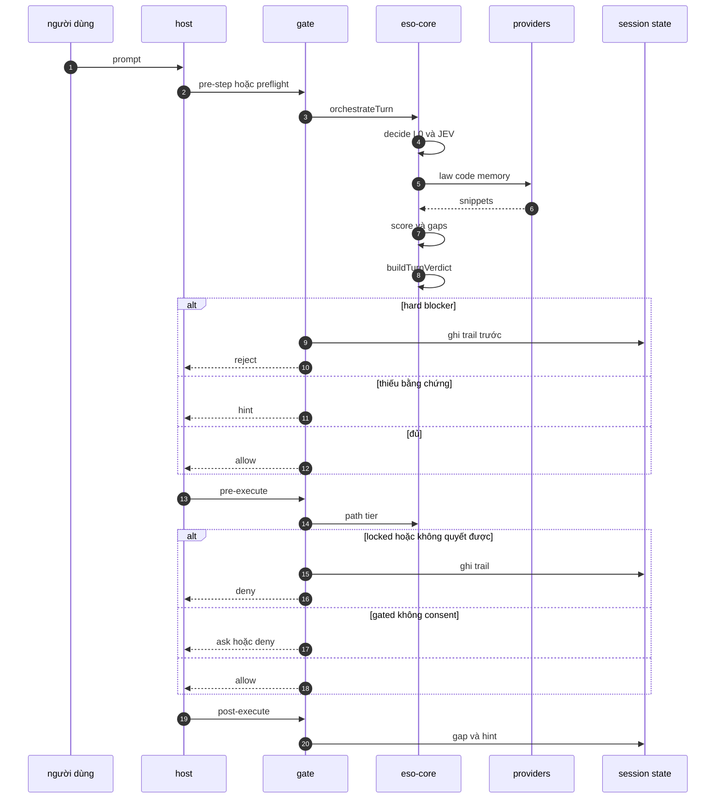
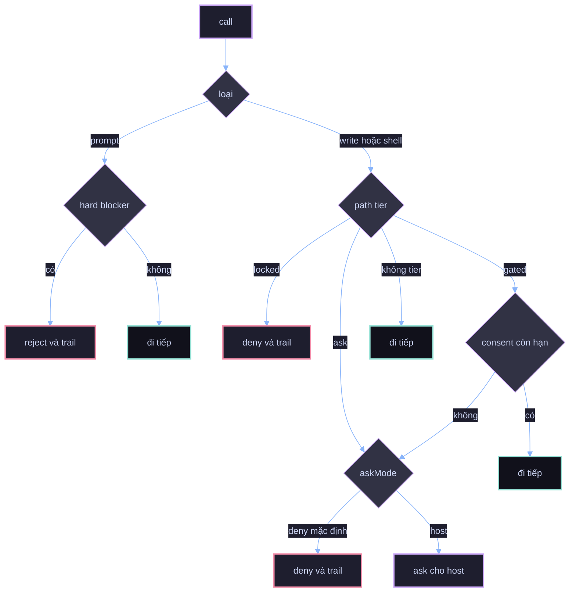
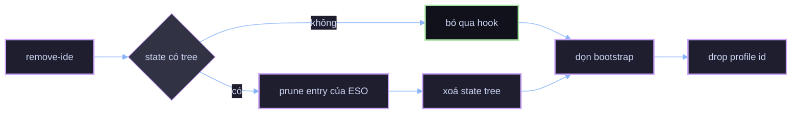
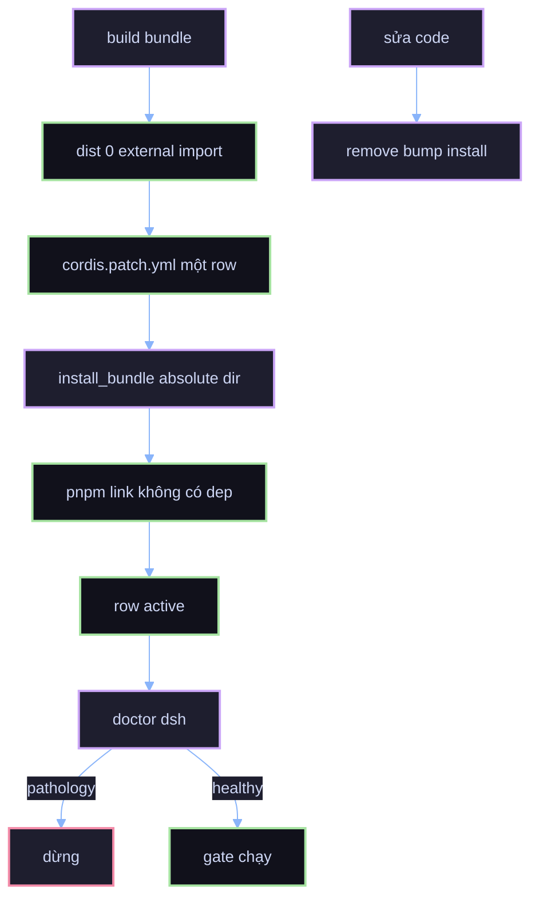
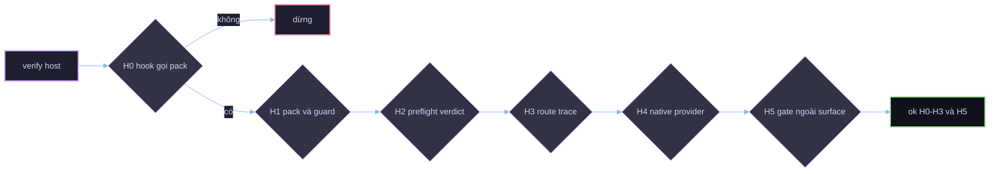
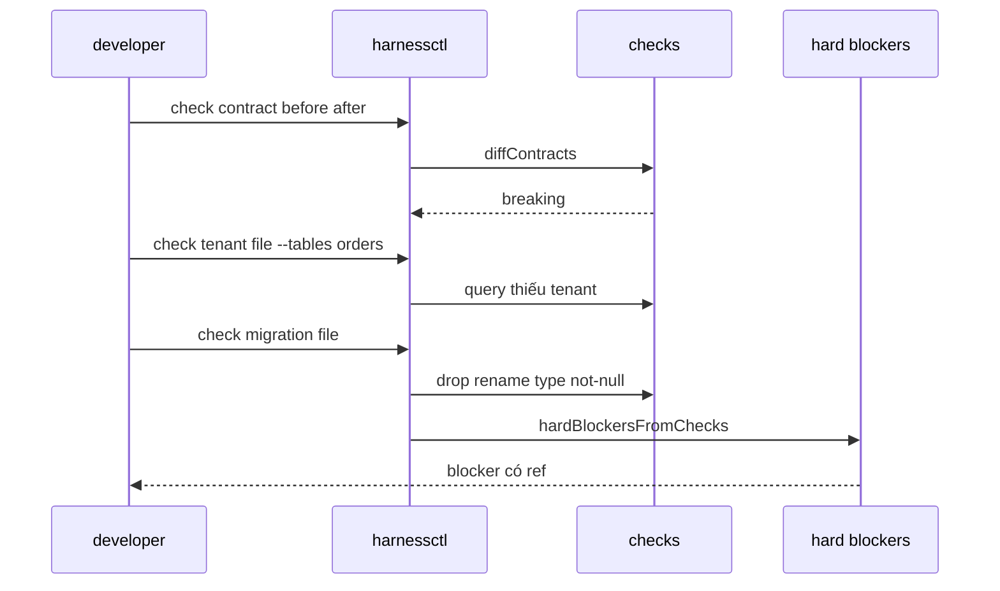
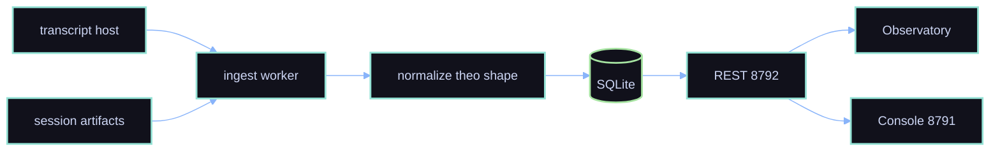

# 02 — Workflows: một phiên chạy qua những bước nào

## 1. Vòng đời một turn

Hai bất biến: preflight **không** chặn hội thoại (trừ hard blocker), và mọi quyết định chặn **ghi trail
trước** khi trả về.

## 2. Cây quyết định của gate

`askMode: "host"` là lựa chọn có ý thức: trên DSH, `ask` **không phải** gate (đã đo — write lọt), nên
mặc định ESO deny.

## 3. Cài đặt consumer mới (host pack)

```mermaid
%%{init: {"theme": "base", "themeVariables": {"background": "#1e1e2e", "primaryColor": "#313244", "primaryTextColor": "#cdd6f4", "primaryBorderColor": "#cba6f7", "lineColor": "#89b4fa", "secondaryColor": "#181825", "tertiaryColor": "#11111b", "clusterBkg": "#181825", "clusterBorder": "#6c7086", "edgeLabelBackground": "#1e1e2e", "fontSize": "14px", "actorBkg": "#313244", "actorBorder": "#cba6f7", "actorTextColor": "#cdd6f4", "signalColor": "#89b4fa", "signalTextColor": "#cdd6f4", "noteBkgColor": "#313244", "noteTextColor": "#cdd6f4", "noteBorderColor": "#f9e2af"}}}%%
flowchart LR

    classDef w fill:#1e1e2e,stroke:#cba6f7,stroke-width:2px,color:#cdd6f4
    classDef shared fill:#11111b,stroke:#a6e3a1,stroke-width:2px,color:#cdd6f4
    classDef stop fill:#1e1e2e,stroke:#f38ba8,stroke-width:2px,color:#cdd6f4

    A[consumer repo]:::shared --> B[init profile]:::w
    B --> C[installHostPack]:::w
    C --> D[applyHostTree]:::w
    D --> E[mergeHooksDocument]:::w
    E --> F[ghi state và bootstrap]:::w
    F --> G[verifyHostPack]:::w
    G -->|fail| X[dừng và báo lỗi]:::stop
    G -->|ok| H[verify host H0-H5]:::w
    H --> I[observatory up]:::shared
```

Consumer đã có pack thì **không chạy lại toàn bộ**: thêm một IDE bằng
`harnessctl host-pack add-ide <consumer> --profile claude-superset`.

## 4. Gỡ một tree (giữ hook của consumer)

## 5. Cài và nâng cấp DSH plugin

## 6. Kiểm chứng một host (conformance H0–H5)

H4 và H5 **không chặn mặc định**: H4 `skip` khi không có shim; H5 `skip` khi consumer không khai
`harnessSurface`. Consumer không dùng optimizer vẫn đạt H3.

## 7. Chạy check thủ công

Trong phiên chạy, cùng hàm `hardBlockersFromChecks` nuôi reject và ghi trail.

## 8. Quan sát sau phiên

Ingest không quyết định gì, và dashboard không phải nguồn của verdict. Số trên UI là replay.

## 9. Việc gì chạy ở đâu

| Việc | Host pack | DSH plugin | CLI |
|---|---|---|---|
| Preflight và verdict | có, hook `preflight` | không, chỉ checks | có, `capability probe` |
| Chặn write theo path tier | có, `guard-shell` + `guard-write.py` của consumer | có, `tools/pre-execute` | — |
| Chặn prompt vì hard blocker | không | có, `agent/pre-step` | — |
| Hint sau tool | có, `post-tool-hint` | chưa | — |
| Chi phí context trước compact | có, `pre-compact` | không, bridge không hỗ trợ | — |
| Trail quyết định | session artifacts | `~/.harness/eso-blockers.jsonl` | — |
| Conformance và doctor | — | — | có |
