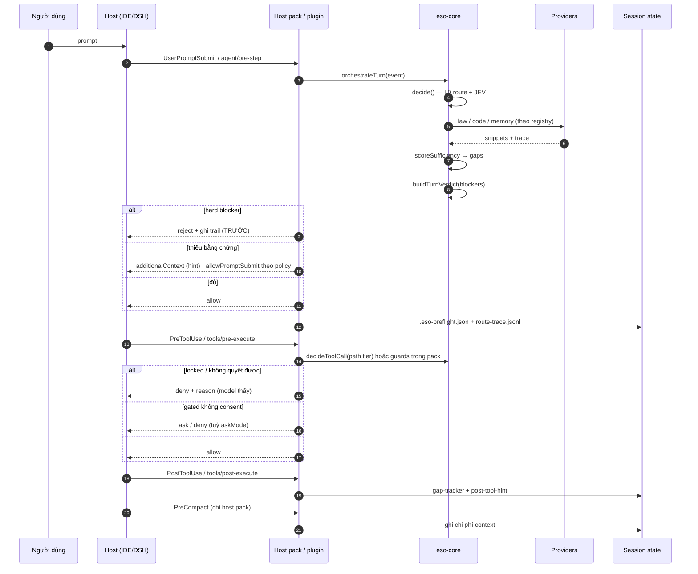
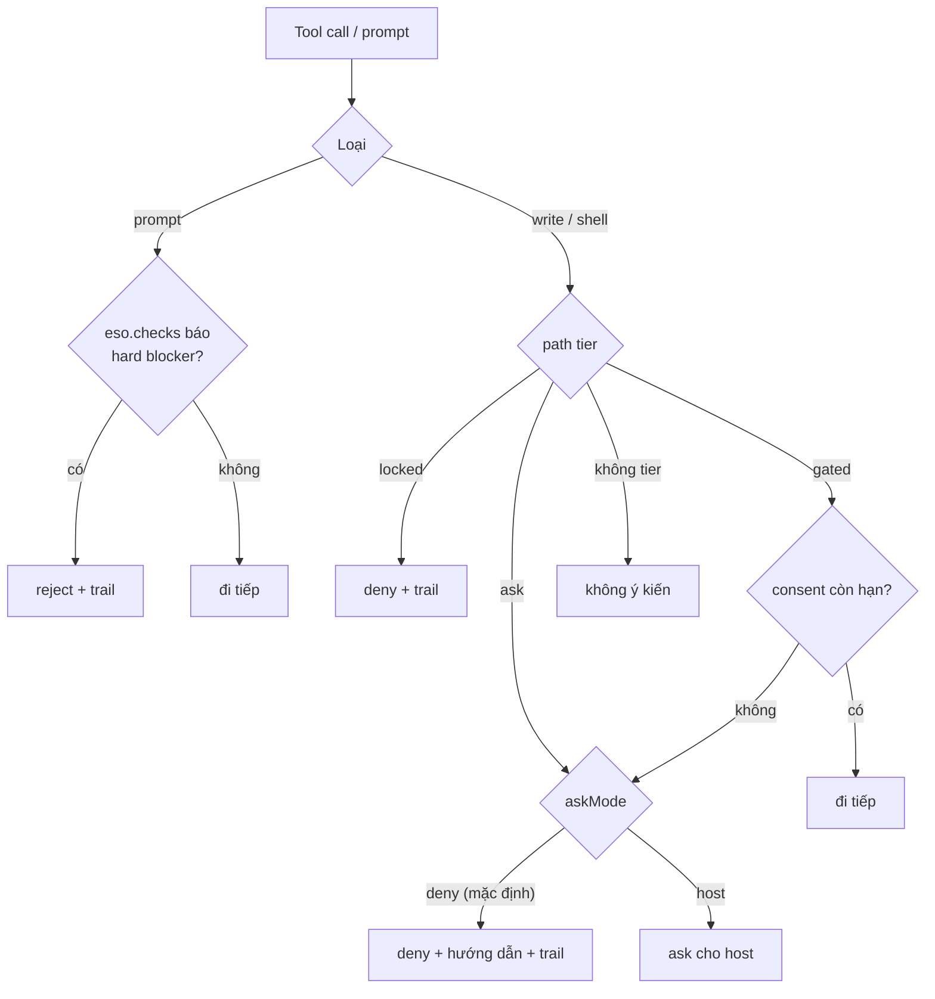
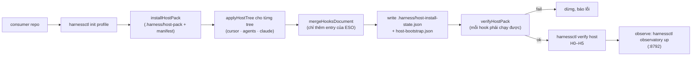
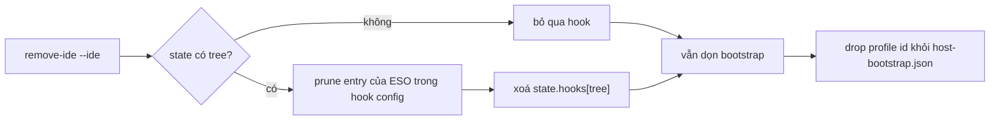
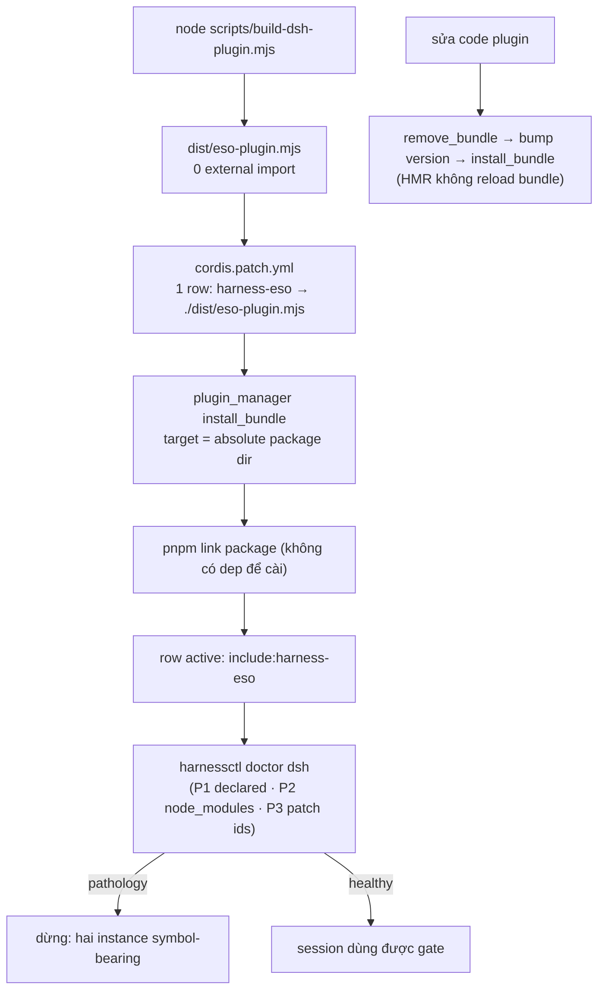
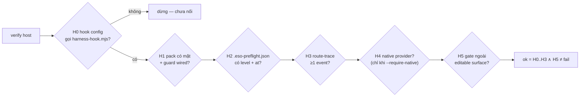
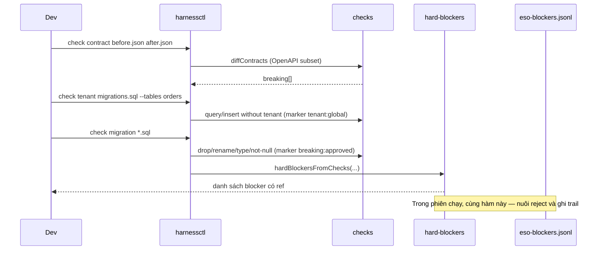
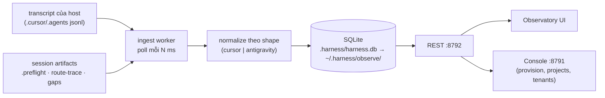

# 02 — Workflows: một phiên chạy qua những bước nào

## 1. Vòng đời một turn (host pack)

Hai điểm bất biến: **preflight không chặn hội thoại** (trừ hard blocker), và **mọi quyết định chặn ghi
trail trước khi trả về**.

## 2. Rẽ nhánh của gate (một hình để tra nhanh)

`askMode: "host"` là lựa chọn có ý thức: trên DSH, `ask` **không phải** gate (đã đo — write lọt), nên
mặc định ESO deny.

## 3. Cài đặt consumer mới (host pack)

Consumer đã có pack thì **không chạy lại toàn bộ**: thêm một IDE bằng
`harnessctl host-pack add-ide <consumer> --profile claude-superset`.

Gỡ một tree (giữ hook của consumer):

## 4. Cài / nâng cấp DSH plugin

## 5. Kiểm chứng một host (conformance H0–H5)

H4/H5 **không chặn mặc định**: H4 `skip` khi không có shim; H5 `skip` khi consumer không khai
`harnessSurface`. Một consumer không dùng optimizer vẫn đạt H3.

## 6. Chạy check thủ công (CI hoặc trước khi merge)

## 7. Quan sát sau phiên (observe plane)

Điều **không** xảy ra: ingest không quyết định gì, và dashboard không phải nguồn của verdict. Số trên
UI là replay; muốn kết luận phải đọc `reads`/event gốc.

## 8. Bảng: việc gì chạy ở đâu

| Việc | Host pack | DSH plugin | CLI |
|---|---|---|---|
| Preflight + verdict | ✅ `preflight` hook | ⛔ (chỉ checks) | ✅ `capability probe` |
| Chặn write theo path tier | ✅ `guard-shell` + consumer `guard-write.py` | ✅ `tools/pre-execute` | — |
| Chặn prompt vì hard blocker | ⛔ | ✅ `agent/pre-step` | — |
| Hint sau tool | ✅ `post-tool-hint` | ⛔ (chưa) | — |
| Chi phí context trước compact | ✅ `pre-compact` | ⛔ (bridge không hỗ trợ) | — |
| Trail quyết định | session artifacts | `~/.harness/eso-blockers.jsonl` | — |
| Conformance / doctor | — | — | ✅ |
