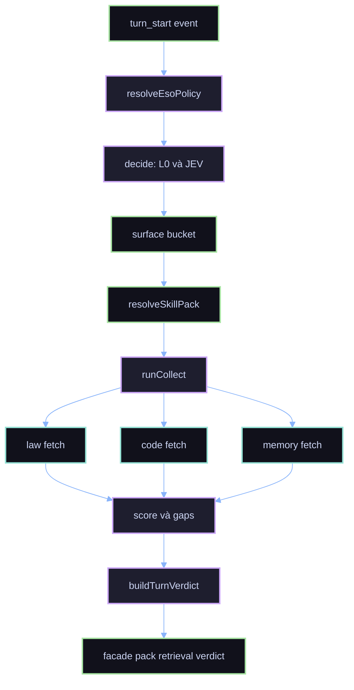
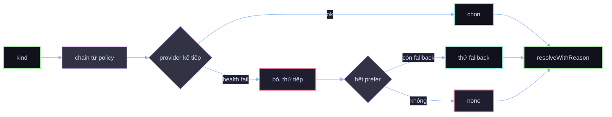
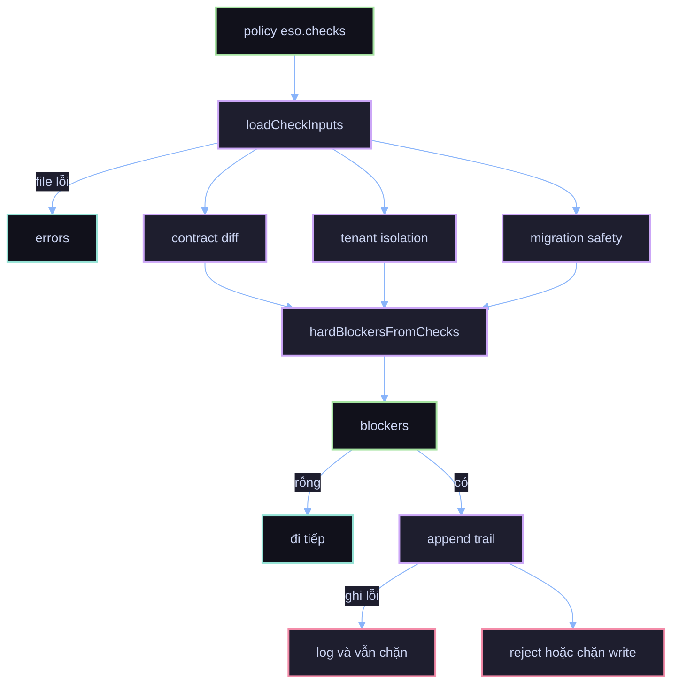
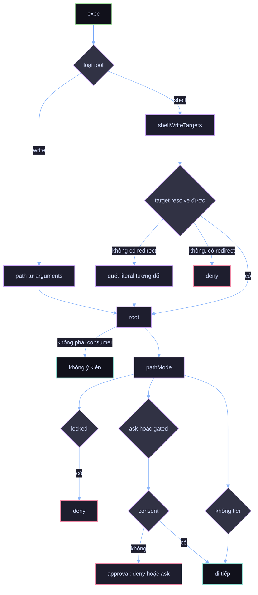
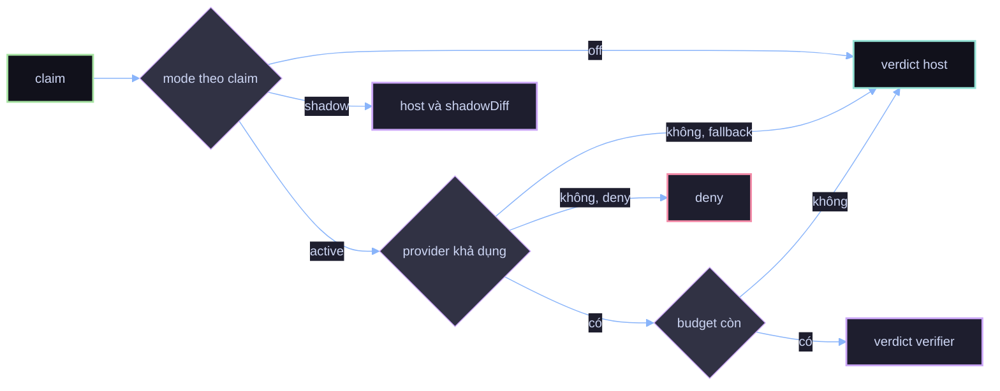
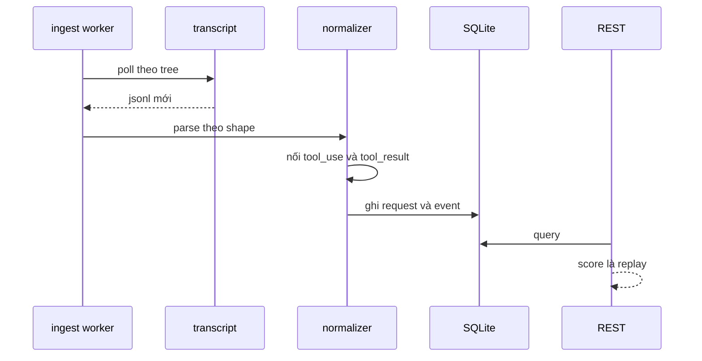
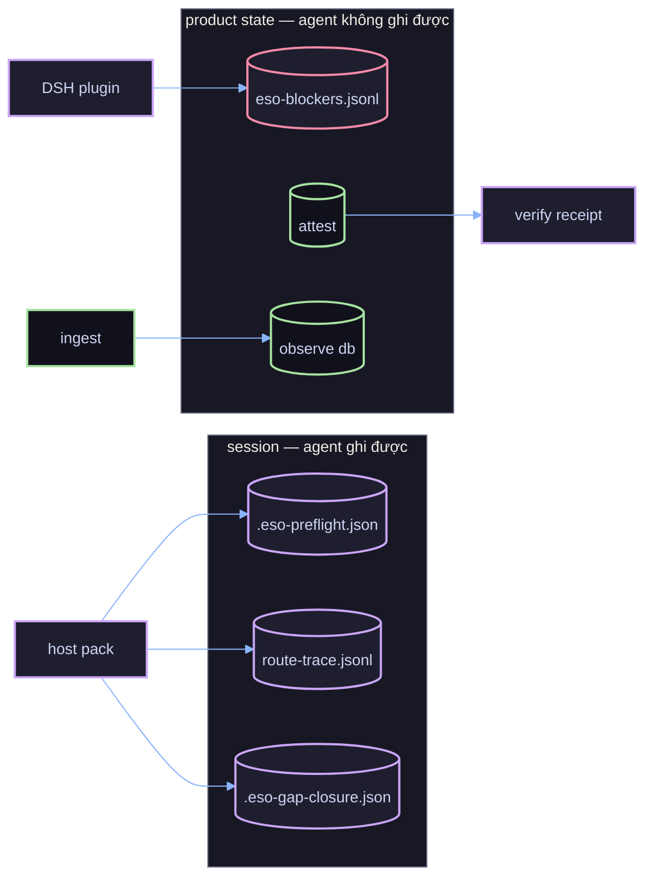
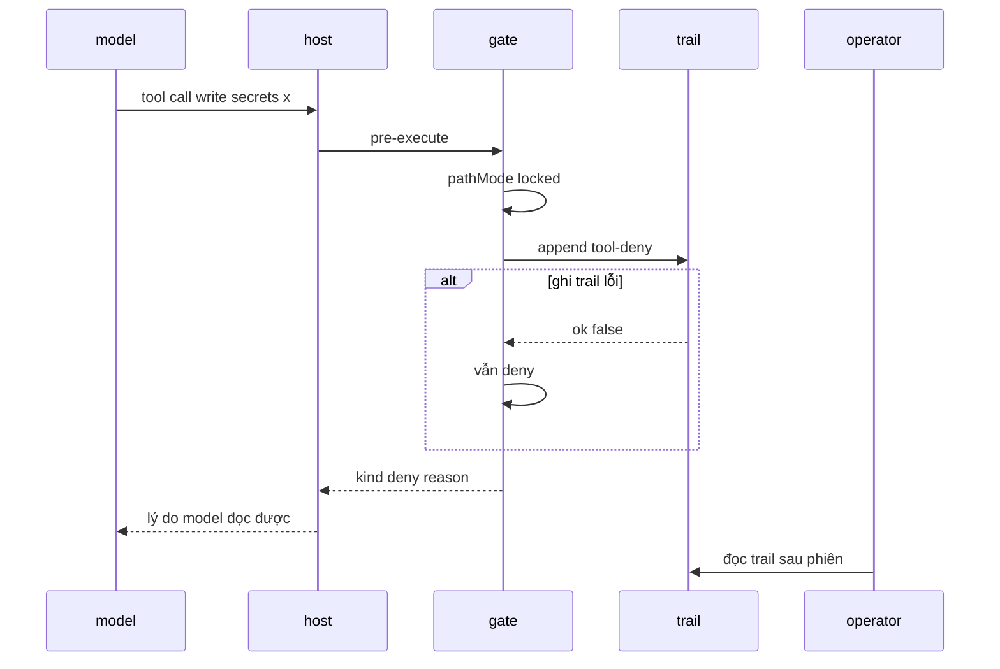

# 03 — Pipelines: dữ liệu đi đâu, quyết định ở đâu

## 1. Preflight pipeline

Module: `orchestrate-turn` gọi `collect` rồi `gate`. `hardBlockers` do host truyền vào — engine **không**
đọc file mỗi turn.

## 2. Provider resolution

`ceiling` không phải điểm chặn: nó nói provider giỏi nhất tới đâu (skills 0.5, session 0.65).

## 3. Checks thành blocker rồi quyết định

Marker là **quyết định của người**, không phải finding: `tenant:global` và `breaking:approved` loại
statement ở tầng check.

## 4. Tool gate

Ba nguồn target theo thứ tự tin cậy: path tuyệt đối trong `arguments`, `shellWriteTargets`, literal
tương đối trong heredoc. `session dir` là thứ khiến đường dẫn tương đối gác được.

## 5. Verifier

Verifier không bao giờ tự bịa verdict: thiếu provider thì fallback host hoặc deny theo policy.

## 6. Ingest

### 6.1 Hai nguồn không phải transcript của IDE

Observe plane đọc thêm hai spine, cả hai đều nằm ngoài consumer:

| Spine | Nguồn | Bảng đích |
|---|---|---|
| `dsh` | `~/.dsh/sessions/<workspace-slug>/<session>/session.v4.jsonl.zstd` (nhiều zstd frame nối tiếp, đọc bằng `zstd -dc`) | `conversation` · `request` (mỗi turn) · `llm_call` (mỗi step) · `event` (`tool/call`, `tool/result`, `turn/end`) |
| `gate` | `~/.harness/eso-blockers.jsonl` (record trước mỗi lần chặn) | `gate_event` |

Cả hai lọc theo consumer: session DSH chỉ nhận đúng slug workspace, trail chỉ nhận record có
`projectId` khớp. Idempotent theo `source_path` + `source_line_no`.

Đọc trên UI: tab **Gate** (`/gate`) và API `/api/gate/events`, `/api/gate/summary`.

## 7. Ai ghi file gì

**Bằng chứng** là session, có thể bị agent sửa, chỉ để replay. **Record** là product state, gate tin.
Một quyết định không bao giờ đọc record từ session.

## 8. Đường đi của một lần deny

Đây là lý do tồn tại của `~/.harness/eso-blockers.jsonl`: host không ghi lại việc nó chặn, nên nếu ESO
không ghi thì không ai trả lời được vì sao lệnh đó bị chặn.
