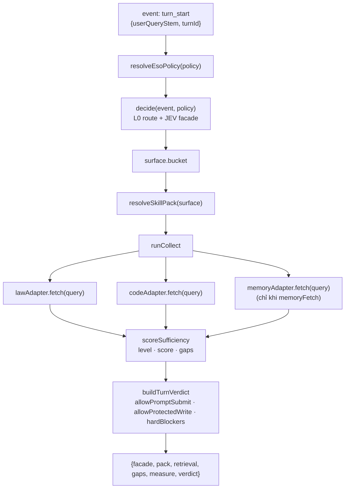
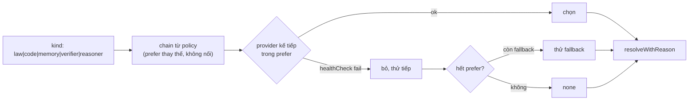
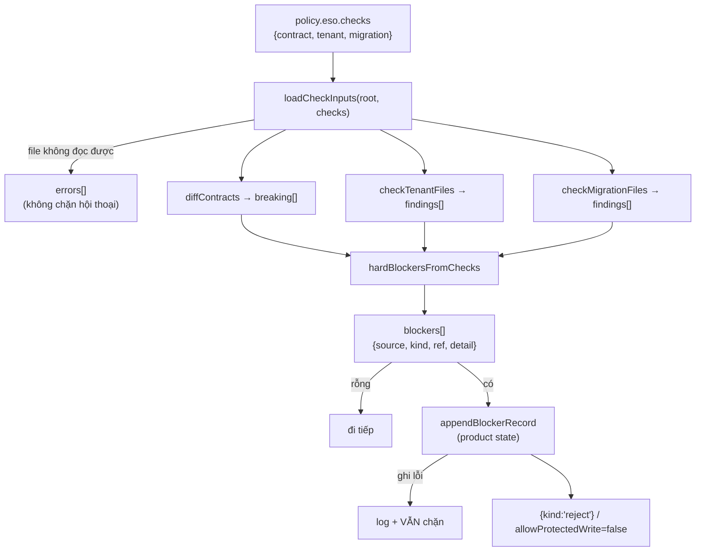
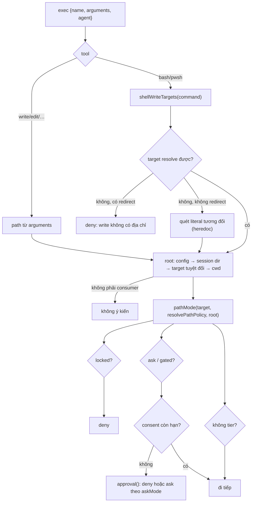
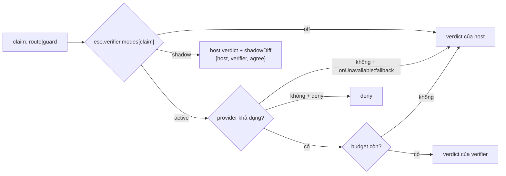
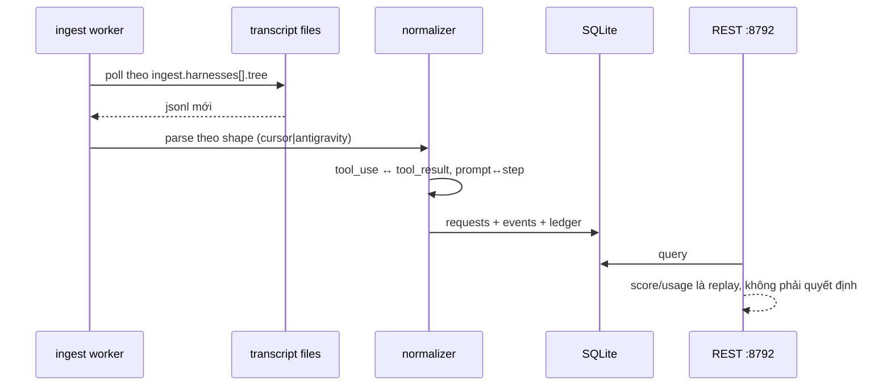
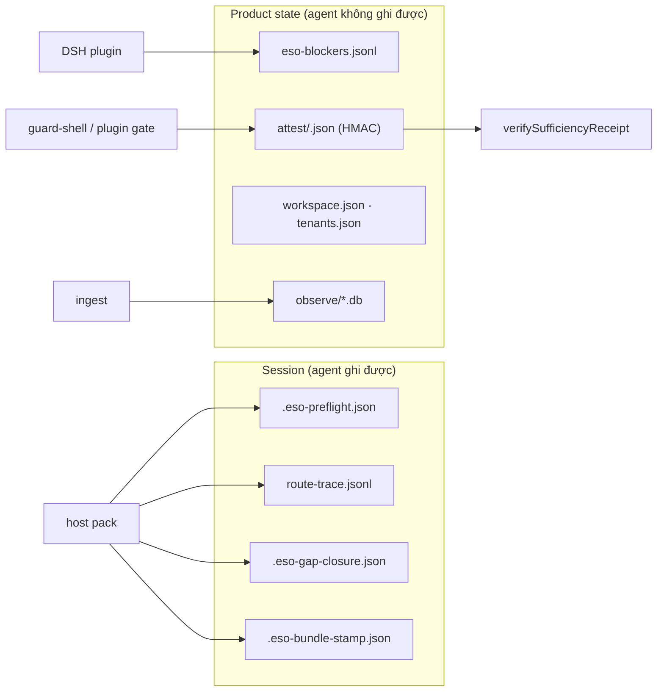
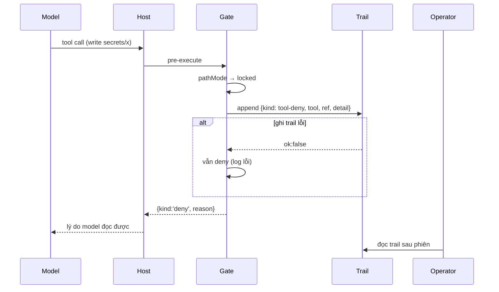

# 03 — Pipelines: dữ liệu đi đâu, quyết định ở đâu

## 1. Preflight pipeline (collect → gate)

Module: `orchestrate-turn.mjs` → `collect.mjs` → `gate.mjs`. `hardBlockers` đến từ host (plugin chạy
`eso.checks` trước khi gọi verdict) — engine **không** tự đọc file mỗi turn.

## 2. Provider resolution pipeline

`ceiling` không phải điểm chặn: nó nói provider này **giỏi nhất tới đâu** (skills 0.5, session 0.65),
để quyết định có cần bind thêm nguồn chuẩn tắc hay không.

## 3. Check → blocker → quyết định

Marker là **quyết định của người**, không phải finding: `/* tenant:global */`, `/* breaking:approved */`
loại statement khỏi kết quả ở tầng check, không phải ở tầng gate.

## 4. Tool gate pipeline (write + shell, một đường)

Ba nguồn "target" theo thứ tự tin cậy: path tuyệt đối trong `arguments` → `shellWriteTargets` →
literal tương đối trong heredoc. `session dir` (service `workingDirectory`) là thứ khiến đường dẫn
tương đối gác được.

## 5. Verifier pipeline (M4)

Verifier **không bao giờ tự bịa verdict**: thiếu provider thì fallback host hoặc deny theo policy.

## 6. Ingest pipeline (observe)

## 7. Bản đồ "ai ghi file gì"

Đường phân biệt: **bằng chứng** (session, có thể bị agent sửa — chỉ để replay/đọc) vs **record**
(product state, gate tin). Một quyết định không bao giờ đọc record từ session.

## 8. Đường đi của một lần "deny"

Đây là lý do tồn tại của `~/.harness/eso-blockers.jsonl`: host không ghi lại việc nó chặn, nên nếu ESO
không ghi thì không ai trả lời được "vì sao lệnh đó bị chặn".
