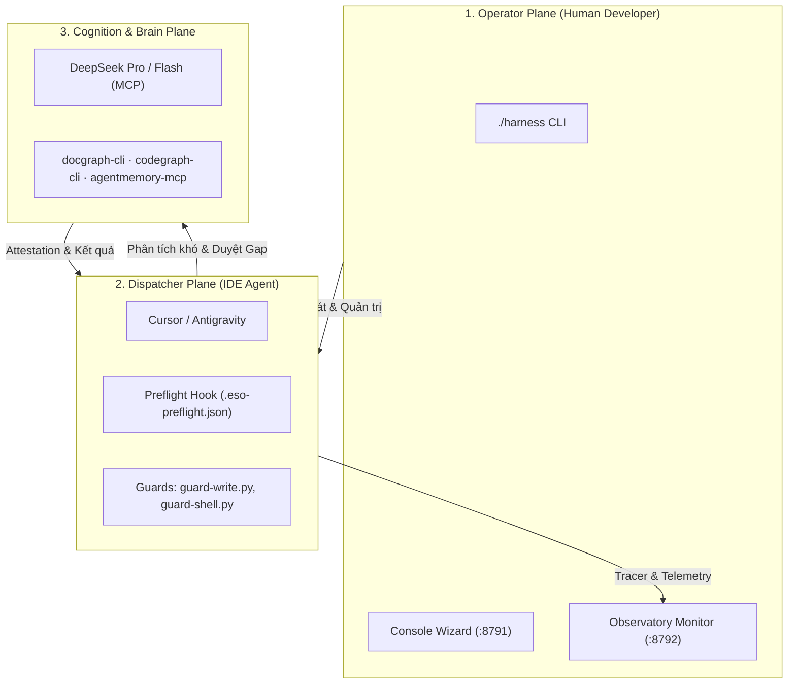

# Sổ Tay Vận Hành & Quy Trình Harness ESO (Consumer Workflow Guide)

> **Mã tài liệu:** `HARNESS-ESO-CONSUMER-GUIDE`  
> **Áp dụng cho:** Tất cả các repository consumer được tích hợp Harness ESO (`x79`, `baplatform`, v.v.).  
> **Mục tiêu:** Hướng dẫn toàn diện cho cả Operator (nhà phát triển) và AI Agent (Cursor / Google Antigravity) hiểu rõ cơ chế vận hành của ESO, quy trình kiểm soát chất lượng, và kỷ luật tối ưu hóa Token.

---

## 1. Kiến Trúc Cốt Lõi: Mô Hình 3 Mặt Phẳng (3-Plane Architecture)

Harness ESO vận hành theo mô hình phân tách trách nhiệm chặt chẽ:



1. **Operator Plane (Nhà phát triển con người):**
   - Điều khiển hệ thống qua `./harness` và giao diện giám sát Observatory (`http://127.0.0.1:8792`).
   - Giữ quyền quyết định tối cao, cấu hình `decision-policy.json`, gán ngân sách token và duyệt các ngoại lệ (HIL).
2. **Dispatcher Plane (IDE Agent - Cursor / Antigravity):**
   - Đóng vai trò điều phối viên (Orchestrator/Forwarder).
   - Chạy cục bộ trong IDE, tương tác với codebase thông qua các công cụ chuyên biệt.
   - Bị giám sát bởi các hooks tự động: Preflight, Guard-Write, Guard-Shell, Route Tracer.
3. **Brain & Recon Plane (Trí tuệ nhân tạo & Công cụ Ngữ cảnh):**
   - **Brain Tier:** DeepSeek MCP (Flash cho tác vụ nhanh, Pro cho kiến trúc phức tạp).
   - **Recon Tools:** `docgraph` (tra cứu luật/spec), `codegraph` (tra cứu symbol/AST), `agentmemory` (tri thức phiên).

---

## 2. Quy Trình Vận Hành ESO: Preflight, Gap Closure & Guard Rails

### A. Giai đoạn Preflight (Trước khi gửi prompt)
Mỗi khi người dùng gửi một prompt, hook `preflight` sẽ chạy trước để đánh giá:
- Phân tích yêu cầu xem có cần thay đổi các file được bảo vệ (`gated paths`) hay không.
- Kiểm tra mức độ đầy đủ của ngữ cảnh và ghi nhận trạng thái vào `.cursor/session/.eso-preflight.json` (hoặc `.agents/session/`).
- Đưa ra verdict: `level: full` (được phép thực thi) hoặc `level: partial` (phát hiện gap ngữ cảnh).

### B. Quy trình Đóng Gap (Gap Closure)
Khi Preflight báo `level: partial`:
1. Agent **không được phép** trực tiếp sửa đổi các file nhạy cảm.
2. Agent phải gọi các công cụ trinh sát (Recon):
   - `memory_smart_search`: Tìm kiếm ngữ cảnh phiên trước và quyết định liên quan.
   - `docgraph --q "<từ_khóa>"`: Truy xuất đoạn tài liệu/luật liên quan.
   - `codegraph_explore`: Trích xuất symbol AST, caller/callee hierarchy.
3. Khi đủ thông tin, Gap được đóng lại và Brain Attestation được ghi nhận, mở khóa quyền ghi file.

### C. Các Rào Chắn Bảo Vệ (Guard Rails)
- **`guard-write.py`:** Chặn đứng các thao tác tự ý ghi đè vào các đường dẫn nhạy cảm: `AGENTS.md`, `.cursor/rules/`, `.agents/rules/`, tài liệu SDLC baselines, scripts CI. Chỉ cho phép sửa khi có fresh attestation từ Brain hoặc yêu cầu rõ ràng từ người dùng.
- **`guard-shell.py`:** Giám sát các câu lệnh terminal nguy hiểm, bắt buộc kiểm thử cục bộ (`bun test` hoặc runner dự án) trước khi hoàn tất turn.

---

## 3. Kỷ Luật Ngữ Cảnh & Chuẩn Token-Diet (STD-ESO-PERF-01)

Để loại bỏ hoàn toàn hiện tượng **Token Burn** (từng làm vọt lên hàng triệu tokens do nhồi nhét cả file lớn vào lịch sử hội thoại), mọi Agent bắt buộc phải tuân thủ **Quy trình 8 bước**:

```text
[1. AgentMemory First]  --> Tra cứu từ khóa, ticket facts, quyết định cũ
          │
[2. Docgraph First]     --> Đọc chính xác đoạn luật/spec (30-50 dòng). Cấm đọc cả file!
          │
[3. Codegraph First]    --> Khảo sát symbol/AST trong 1 round-trip. Hạn chế Grep mò mẫm
          │
[4. Range-Read]         --> Chỉ đọc phân đoạn (StartLine..EndLine) nếu bắt buộc mở file
          │
[5. Shell Bounded]      --> Giới hạn output shell <= 40 dòng (luôn pipe tail/head)
          │
[6. Micro-Rules]        --> Ngân sách eager rules <= 6, rules chuyên biệt nạp bằng globs:
          │
[7. Local Test]         --> Chạy test cục bộ kiểm chứng diff nhỏ
          │
[8. Memory Save]        --> Gọi memory_save đóng gói tri thức cho turn tiếp theo
```

### Ngân Sách Trần Token-Diet:
- **Eager Rules Budget:** Tối đa **6 rules** có `alwaysApply: true`.
- **Eager Prefix Token Budget:** Tổng tokens khởi điểm $\le$ **5.000 tokens** (bao gồm eager rules + `AGENTS.md` + file hướng dẫn gốc).
- **Quy tắc Single Responsibility:** Mọi rule chuyên môn (backend, frontend, database, Jira, WBS) phải đặt `alwaysApply: false` kèm trường `globs:`.

---

## 4. Bộ Công Cụ CLI & Giám Sát Thực Tế

### A. Kiểm định Ngân sách Token với Linter CLI
Chạy lệnh kiểm tra Token-Diet tại thư mục dự án:
```bash
# Kiểm tra tổng quan toàn bộ IDE
./harness token-diet <path-to-consumer>

# Kiểm tra riêng cho Cursor
./harness token-diet <path-to-consumer> --tree cursor

# Kiểm tra riêng cho Google Antigravity
./harness token-diet <path-to-consumer> --tree agents

# Xuất kết quả JSON
./harness token-diet <path-to-consumer> --json
```

### B. Giám sát Runtime trên Observatory (`http://127.0.0.1:8792`)
- Mở trình duyệt tại cổng `:8792` để theo dõi tiến trình thực thi của Agent theo thời gian thực.
- Kiểm tra ô **`eager-prefix-budget`** trong mục **Conformance Checks**:
  - `PASS`: Số lượng eager rules nằm trong giới hạn an toàn.
  - `WARN`: Eager prefix bị phình to, vượt quá ngân sách cho phép.
- Xem sơ đồ luồng **Drill Blocks → Flow Graph** để biết Agent đã chạy qua những rule nào và gọi những công cụ nào theo trình tự.

### C. Quản lý Host Pack Hooks
```bash
# Kiểm tra trạng thái hooks đã cài đặt
./harness host-pack status <path-to-consumer>

# Nâng cấp / làm mới hooks khi harness-eso có cập nhật
./harness host-pack refresh <path-to-consumer>
```

---

## 5. Hướng Dẫn Xử Lý Tình Huống Thường Gặp (Troubleshooting)

| Hiện tượng | Nguyên nhân | Cách xử lý chuẩn |
|---|---|---|
| **Lệnh ghi file bị `guard-write` từ chối** | File thuộc nhóm `gated` (ví dụ `AGENTS.md`, `.cursor/rules/`) và chưa có attestation. | Gọi `docgraph` hoặc `codegraph` tra cứu thông tin cần thiết để đóng Gap, sau đó Brain sẽ cấp attestation. Không cố tình bypass guard. |
| **Observatory báo `eager-prefix-budget` = WARN** | Có quá nhiều file rule đang để `alwaysApply: true`. | Chạy `./harness token-diet` để tìm các rule vi phạm. Thêm `globs:` và đổi thành `alwaysApply: false`. |
| **Token input tăng vọt qua các turn** | Đã gọi lệnh `Read` nạp toàn bộ nội dung file lớn vào context history. | Tuân thủ Range-Read (`StartLine` / `EndLine`). Tận dụng `AgentMemory` để ghi nhớ kết quả thay vì liên tục đọc lại file ở turn sau. |
