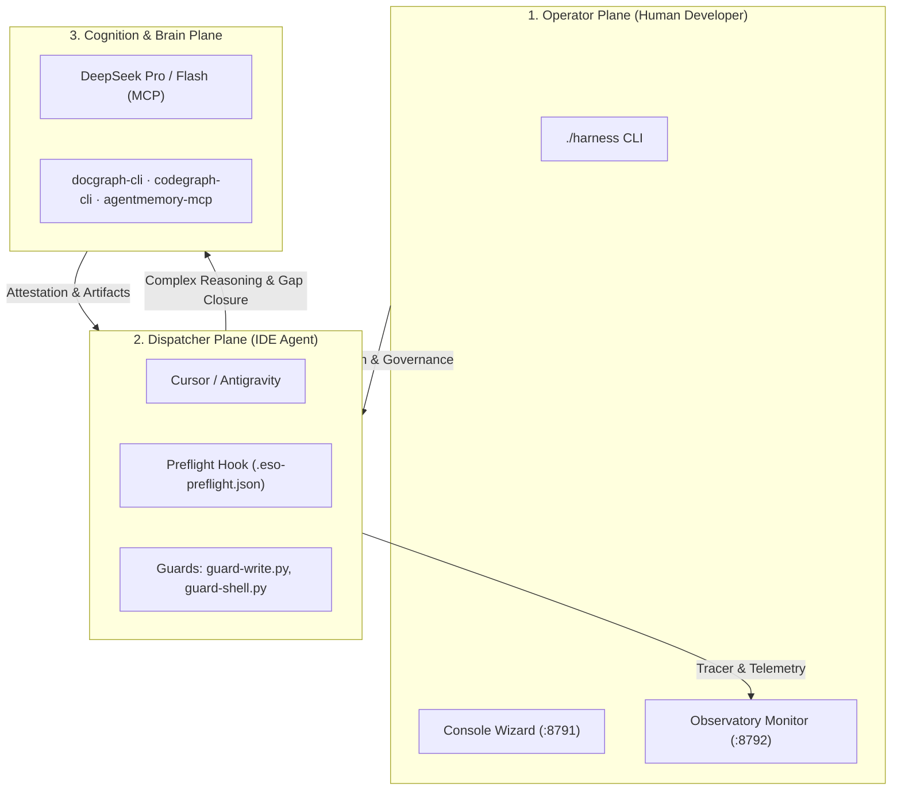

# Harness ESO Operational Manual & Workflow Guide (Consumer Workflow Guide)

> **Document Code:** `HARNESS-ESO-CONSUMER-GUIDE`  
> **Applies to:** All consumer repositories integrated with Harness ESO (`x79`, `baplatform`, `FinESO`, etc.).  
> **Objective:** Comprehensive guide for both Operators (human developers) and AI Agents (Cursor / Google Antigravity) detailing ESO operational mechanics, quality control gates, and token optimization discipline.

---

## 1. Core Architecture: The 3-Plane Model

Harness ESO operates under a strict separation of concerns across three distinct planes:



1. **Operator Plane (Human Developer):**
   - Controls the system via `./harness` and the Observatory monitor dashboard (`http://127.0.0.1:8792`).
   - Retains supreme authority, configures `decision-policy.json`, assigns token budgets, and approves human-in-the-loop (HIL) exceptions.
2. **Dispatcher Plane (IDE Agent - Cursor / Antigravity):**
   - Serves as the turn orchestrator and forwarder.
   - Runs locally inside the IDE, interacting with the codebase through specialized tools.
   - Constrained by automated runtime hooks: Preflight, Guard-Write, Guard-Shell, and Route Tracer.
3. **Brain & Recon Plane (Cognition & Context Tools):**
   - **Brain Tier:** DeepSeek MCP (Flash for rapid reasoning, Pro for complex architecture and design).
   - **Recon Tools:** `docgraph` (law/spec lookup via CLI), `codegraph` (symbol/AST lookup via MCP), `agentmemory` (cross-session memory via MCP).

---

## 2. ESO Runtime Workflow: Preflight, Gap Closure & Guard Rails

### A. Preflight Phase (Before Prompt Execution)
Whenever the user submits a prompt, the `preflight` hook evaluates the turn intent:
- Determines whether the request targets protected files (`gated paths`).
- Measures context sufficiency and records state into `.cursor/session/.eso-preflight.json` (or `.agents/session/`).
- Computes verdict: `level: full` (execution allowed) or `level: partial` / `insufficient` (context gaps identified).

### B. Gap Closure Protocol
When Preflight flags `level: partial` or `insufficient`:
1. **Differentiate Task Nature:**
   - **Code / Bugfix / Implementation Tasks:** Dispatcher must run Recon (`codegraph`, `docgraph`, `memory`) to load factual ground truth before calling Brain for code generation, preventing hallucination.
   - **Docs / WBS / Analysis / RFC Tasks:** Brain is **encouraged to engage in Deep Thinking immediately** to structure solutions, analyze requirements, or direct targeted inquiry. Preflight does not block Brain reasoning.
2. **Protected Write Enforcement (`guard-write.py`):** For both Code and Docs, writing to sensitive files is unlocked only when backed by verified evidence and a fresh Brain attestation (No Evidence → No Claim).
3. **Recon Lookup Order:**
   - `memory_smart_search`: Retrieve previous session context, ticket facts, and decisions.
   - `docgraph --q "<terms>"`: Extract relevant specifications, guidelines, or business rules.
   - `codegraph_explore`: Extract AST symbols, caller/callee graphs, and interface definitions.

### C. Guard Rails
- **`guard-write.py`:** Blocks unauthorized modifications to protected files: `AGENTS.md`, `.cursor/rules/`, `.agents/rules/`, SDLC baselines, and CI scripts. Edits require fresh Brain attestation or explicit user direction.
- **`guard-shell.py`:** Monitors dangerous terminal commands and enforces local test validation (`bun test` or project runner) before turn completion.

---

## 3. Context Discipline & Token-Diet Standard (STD-ESO-PERF-01)

To eliminate **Token Burn** (runaway context inflation caused by dumping full files into conversation histories), all Agents must adhere to the **8-Step Discipline**:

```text
[1. AgentMemory First]  --> Search keywords, ticket facts, previous decisions
          │
[2. Docgraph First]     --> Retrieve precise spec sections (30-50 lines). Never read whole files!
          │
[3. Codegraph First]    --> Explore AST/symbols in 1 round-trip. Avoid unbounded greps
          │
[4. Range-Read]         --> Read specific slices (StartLine..EndLine) if opening a file is necessary
          │
[5. Bounded Shell]      --> Limit terminal output <= 40 lines (always pipe head/tail)
          │
[6. Micro-Rules]        --> Maintain eager rules budget <= 6; scope specialized rules with globs
          │
[7. Local Test]         --> Verify small diffs locally with automated test runners
          │
[8. Memory Save]        --> Call memory_save to distill key takeaways for subsequent turns
```

### Token-Diet Ceilings:
- **Eager Rules Budget:** Maximum **6–7 rules** declared with `alwaysApply: true`.
- **Eager Prefix Token Budget:** Initial session tokens $\le$ **5,000 tokens** (including eager rules + `AGENTS.md` + root instruction files).
- **Single Responsibility Rule:** All specialized rules (backend, frontend, database, Jira, WBS) must declare `alwaysApply: false` paired with explicit `globs:`.

---

## 4. CLI Tooling & Runtime Monitoring

### A. Token Budget Validation with the Linter CLI
Run the Token-Diet auditor from the project root:
```bash
# Global audit across all IDE configurations
./harness token-diet <path-to-consumer>

# Audit Cursor configuration exclusively
./harness token-diet <path-to-consumer> --tree cursor

# Audit Google Antigravity configuration exclusively
./harness token-diet <path-to-consumer> --tree agents

# Export audit findings as JSON
./harness token-diet <path-to-consumer> --json
```

### B. Runtime Monitoring via Observatory (`http://127.0.0.1:8792`)
- Access `:8792` in a browser to monitor Agent turn execution in real time.
- Check the **`eager-prefix-budget`** indicator under **Conformance Checks**:
  - `PASS`: Eager rules count and tokens remain within safety limits.
  - `WARN`: Eager prefix exceeded budget, risking context pollution.
- Inspect the **Drill Blocks → Flow Graph** to trace which rules fired and which tools were invoked sequentially.

### C. Host Pack Hook Management
```bash
# Verify installed hook status
./harness host-pack status <path-to-consumer>

# Refresh/update hooks when harness-eso updates
./harness host-pack refresh <path-to-consumer>
```

---

## 5. Troubleshooting Guide

| Symptom | Root Cause | Standard Resolution |
|---|---|---|
| **Write command rejected by `guard-write`** | Target file is `gated` (e.g. `AGENTS.md`, `.cursor/rules/`) and lacks valid attestation. | Query `docgraph` or `codegraph` to close identified gaps; obtain Brain attestation before retrying. Do not attempt to bypass guards. |
| **Observatory displays `eager-prefix-budget` = WARN** | Too many rule files configured with `alwaysApply: true`. | Execute `./harness token-diet` to identify offending rules. Assign proper `globs:` and switch to `alwaysApply: false`. |
| **Input tokens spike dramatically across turns** | Unbounded `Read` loaded entire large files into conversation history. | Enforce Slice Reading (`StartLine` / `EndLine`). Persist facts to `AgentMemory` rather than re-reading files in subsequent turns. |
