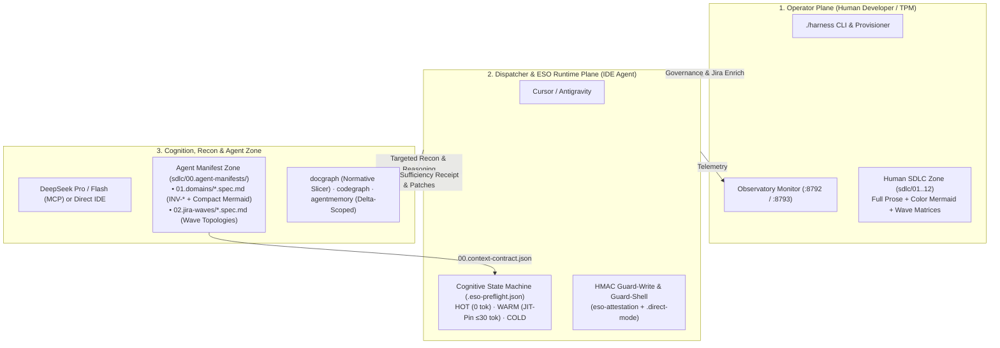

# Harness ESO Operational Manual & Workflow Guide (V2.0 — Consumer Workflow Guide)

> **Document Code:** `HARNESS-ESO-CONSUMER-GUIDE-V2`  
> **Applies to:** All consumer repositories integrated with Harness ESO (`x79`, `baplatform`, `FinESO`, etc.).  
> **Objective:** Comprehensive guide for both Operators (human developers / TPMs) and AI Agents (Cursor / Google Antigravity) detailing the **V2.0 ESO Cognitive State Machine (`HOT / WARM / COLD`)**, **Dual-Zone SDLC (`00.agent-manifests` vs Human Zone)**, **Two-Lane Jira Execution (`Enrich` vs `Zero-SDLC-Crawl`)**, **Cryptographic HMAC Sufficiency Receipts**, and token optimization discipline.

---

## 1. Core Architecture: The 3-Plane Model & Dual-Zone SDLC

Harness ESO V2.0 operates under a strict separation of concerns across three runtime planes and two SDLC knowledge zones:



1. **Operator Plane (Human Developer / TPM):**
   - Supervises execution via `./harness` and the Observatory dashboard (`:8792` for `x79`, `:8793` for `baplatform`, `:8794` for `FinESO`).
   - Maintains the **Human SDLC Zone (`sdlc/01..12`)** containing full business rationale, rich color-coded Mermaid diagrams, and comprehensive Jira wave matrices.
2. **Dispatcher & ESO Runtime Plane (Cursor / Antigravity):**
   - Evaluates turn state (`HOT / WARM / COLD`), enforces **Context Contract (`00.context-contract.json`)** domain invariants, and gates protected writes via **HMAC Sufficiency Receipts (`eso-attestation.mjs`)** and `guard-write.py`.
3. **Brain, Recon & Agent Manifest Plane:**
   - **Agent Manifest Zone (`sdlc/00.agent-manifests/`):** Ultra-compact (`< 300 tokens/file`) specs divided into `01.domains/*.spec.md` (`INV-*` invariants + unstyled compact state machines) and `02.jira-waves/*.spec.md` (incremental wave ticket topologies).
   - **Recon Trinity V2.0:** `agentmemory` (with `excludeSessionId` delta-scoping), `docgraph` (normative slicing of `## Invariants` and `> [!CRITICAL]`), and `codegraph` (AST exploration).

---

## 2. End-to-End Pipeline Data Flow & Decision Orchestration (V2.0)

```text
[USER SUBMITS PROMPT / JIRA ISSUE KEY]
  │
  ▼
[STEP 1: COGNITIVE PREFLIGHT & CONTEXT CONTRACT (HOT / WARM / COLD)]
  │   - Load `sdlc/00.governance/00.context-contract.json` -> Resolve active `domain_slug` & `pinnedInvariants` (`INV-*`)
  │   - Evaluate Git Index Fingerprint (`git status --porcelain`) & Intent Drift Gates (`G1`: stem ≥ 6 chars, `G2`: valid disk fingerprint):
  │
  ├── 1.1 STATE = HOT (Continuation turn, matching intent stem, clean git index):
  │     └──► SHORT-CIRCUIT (`0ms`, `0 additional_context` injected) -> Jump directly to Step 5/6!
  │
  ├── 1.2 STATE = WARM (Sufficient evidence already attested in session):
  │     └──► JIT-PIN ONLY (Inject ≤ 30-token reminder of active `INV-*` codes, no raw doc dump) -> Jump to Step 5!
  │
  └── 1.3 STATE = COLD (Initial turn, intent drift detected, or dirty git index):
        └──► Proceed to Step 2 & Step 3 for targeted Reconnaissance
  │
  ▼
[STEP 2: CLASSIFICATION & TWO-LANE WORKFLOW ROUTING (L0 vs Jev)]
  │   - Evaluate shell safety & route bucket (`frontend` / `backend` / `docs` / `tools`) via L0 regex (`0ms`) or Jev L1/L2
  │   - Route by Operational Lane:
  │
  ├── LANE A — `dev-runtime` on ENRICHED JIRA TICKET (Zero-SDLC-Crawl Fast Path):
  │     ├── Run `scripts/jira-impl.sh [--start] <KEY>` (or `get_issue` via MCP)
  │     ├── Treat Enriched Jira Ticket (15 sections, 8-col AC matrix, Code evidence, Verify cmd) as Compiled SoT
  │     └──► FORBIDDEN to crawl `sdlc/01..12` or `docs/releases/`! Read ONLY Jira ticket + target code files
  │
  ├── LANE B — `dev-runtime` on UNENRICHED / PARTIAL TICKET (Targeted Fallback):
  │     ├── Run `scripts/jira-impl-full.sh [--start] <KEY>`
  │     └──► Auto-fetch Parent Story + `02.jira-waves/*.spec.md` + `01.domains/*.spec.md` + exact cited `sdlc/` anchors
  │
  └── LANE C — `delivery-intake` / JIRA ENRICHMENT (Human Zone Synthesis):
        ├── Read full `sdlc/01..12` (including Mermaid diagrams) + `jira-canonical-template` (Slice-Cut Edition)
        └──► Push via `scripts/jira-enrich-desc.sh [--lean] <KEY> <FILE>` (100% preserves `subtasks` & `issuelinks`)
  │
  ▼
[STEP 3: RECONNAISSANCE VIA V2.0 ADAPTERS (When STATE = COLD)]
  │
  ├── 3.1 `agentmemory-mcp` (Delta-Scoped Episodic Memory):
  │     └── Call `memory_smart_search` with `excludeSessionId = currentSessionId` (prevents same-session echo)
  │
  ├── 3.2 `docgraph-cli` (Normative Slicing on Agent Zone First):
  │     └── Query `sdlc/00.agent-manifests/01.domains/*.spec.md` -> Extract ONLY `## Invariants`, `INV-*`, `> [!CRITICAL]`,
  │         and compact state machines (`specDebt = false`). Drops long human prose.
  │
  └── 3.3 `codegraph-cli` (Code Graph & Symbol AST):
        └── Call `codegraph_explore` -> Extract AST symbols, Call Hierarchies, and Blast Radius in 1 round-trip
  │
  ▼
[STEP 4: EVIDENCE SUFFICIENCY GATE & CRYPTOGRAPHIC HMAC RECEIPT]
  │
  ├── 4.1 SCORE & GAP CHECK:
  │     └── `score = (lawRatio * 0.55) + (readRatio * 0.45)` against required domain terms & `minReadPaths`
  │
  ├── 4.2 POST-TOOL-USE GAP CLOSURE (`recordGapToolUse`):
  │     └── As Dispatcher reads missing law/code paths, `postToolUse` closes open gaps in real time.
  │         When `allClosed === true`, ESO automatically promotes verdict to `SUFFICIENT`.
  │
  └── 4.3 HMAC SUFFICIENCY RECEIPT (`eso-attestation.mjs` & `guard-write.py`):
        ├── Mint signed HMAC-SHA256 receipt in `.eso-bundle-stamp.json` (`fingerprint`, `invIds`, `ttlSec`)
        └── `guard-write.py` verifies both HMAC Sufficiency Receipt AND Brain Stamp (or `.direct-mode` sentinel)
            before unlocking writes to protected paths (`backend/`, `apps/web/`, `sdlc/`, rules/skills).
  │
  ▼
[STEP 5: BRAIN TIER ROUTING OR DIRECT IDE MODE]
  │
  ├── 5.1 DIRECT IDE MODE (`.agents/session/.direct-mode` -> `"enabled": true`):
  │     └──► IDE native model reasons & edits directly with `.pipeline-brain-stamp.json` (`via: "direct_ide"`)
  │
  ├── 5.2 BRAIN FLASH (`ask_deepseek_flash` + `[BRAIN FLASH]`):
  │     └──► Default workhorse for implementation, bugfixes, TDD, WBS slices with AC, and Jira enrichment
  │
  └── 5.3 BRAIN PRO (`ask_deepseek_pro`):
        └──► Exception tier for greenfield bounded contexts, cross-module money/tenant redesign, or law conflicts
  │
  ▼
[STEP 6: SAFE EXECUTION, VERIFICATION & JIRA LIFECYCLE]
  │   - Apply minimal surgical edits (`replace_file_content`), preserving existing comments
  │   - Run deterministic verification (`dotnet test`, `pnpm --dir apps/web test`, `harness-selfcheck.sh`)
  │   - Mandatory Jira Rollup: Transition Subtask `In Progress` (21) -> `Human In Review` (31) + rollup Parent Story.
  │     (Do NOT manually edit 800-line `01.ticket-map.md` tables per subtask; use `scripts/jira-sync-wave-map.sh` in batch)
  │
  ▼
[STEP 7 & 8: KNOWLEDGE DISTILLATION (`memory_save`) & USER HANDOFF]
      - Persist verified architectural lessons and touched symbols via `memory_save`
      - Report concise verification evidence with clickable `file:///...` links (`READY_FOR_HUMAN_REVIEW`)
```

---

## 3. ESO V2.0 Runtime Safeguards & Dual-Zone Discipline

### A. Dual-Zone SDLC Architecture (`Human Zone` vs `Agent Zone`)
To give human project members rich documentation while keeping AI token consumption minimal:
1. **Human Zone (`sdlc/01..12`):** Full BRD/FRD/SRS/Architecture documents, rich color-coded Mermaid diagrams, and 800-line `01.ticket-map.md` matrices. Read by humans and by Agents **only during the `delivery-intake` / `jira-enrich` phase**.
2. **Agent Zone (`sdlc/00.agent-manifests/`):**
   - `01.domains/01.smart-ui.spec.md` .. `17.platform.spec.md`: Concise (`< 300 tokens`) domain manifests containing `## Invariants` (`INV-*`), `> [!CRITICAL]` alerts, and unstyled compact `stateDiagram-v2` / `flowchart LR` state machines.
   - `02.jira-waves/00.index.md` + `01.wave-1.topology.spec.md` .. `04.wave-4.topology.spec.md`: Incremental wave topology maps (`Epic -> Story -> TDD Quartet`) so agents resolve ticket hierarchy in `< 200 tokens`.

### B. Zero-SDLC-Crawl & The 4 Jira CLI Scripts (`scripts/jira-*.sh`)
| Script | Purpose | Token Impact |
|---|---|---|
| `scripts/jira-enrich-desc.sh [--lean] <KEY> <FILE>` | Updates Jira Description via REST API v2, auto-converts Markdown GFM tables to Jira Wiki, verifies `ac_id` table, and **preserves 100% of `subtasks` & `issuelinks`**. | Saves ~60% MCP payload tokens |
| `scripts/jira-impl.sh [--start] <KEY>` | **Fast Path (`Zero-SDLC-Crawl`)** for Enriched tickets: prints self-contained Execution Pack (AC matrix, Code evidence, Verify cmd, Native links). Forbids crawling `sdlc/01..12`. | Saves 15,000–25,000 tokens/ticket |
| `scripts/jira-impl-full.sh [--start] <KEY>` | **Targeted Fallback** for unenriched/partial tickets: fetches Ticket + Parent Story + `02.jira-waves/` + `01.domains/*.spec.md` + exact cited `sdlc/` paths. | Saves ~80% vs blind repo crawl |
| `scripts/jira-sync-wave-map.sh [--apply] [W1..W4\|ALL]` | Batch-syncs live Jira statuses (`TD / IP / HIL / Done`) back into human `01.ticket-map.md` Mermaid diagrams at sprint/wave boundaries. | **0 AI Tokens** |

### C. Cryptographic Guard Rails (`guard-write.py` & `guard-shell.py`)
- **`guard-write.py`:** Enforces both the **HMAC Sufficiency Receipt** (`.eso-bundle-stamp.json`) and the **Brain Stamp** (`.pipeline-brain-stamp.json`, supporting both DeepSeek MCP and `.direct-mode` sentinel).
- **`guard-shell.py`:** Blocks destructive shell commands and prevents bypassing `guard-write.py` via shell redirection into protected paths.

---

## 4. Context Discipline & Token-Diet Standard (`STD-ESO-PERF-02`)

```text
[1. Preflight State]    --> Leverage HOT (0 tok) & WARM (≤30 tok JIT-Pin) continuation states
          │
[2. Zero-SDLC-Crawl]    --> If Jira ticket is Enriched, run `scripts/jira-impl.sh` & code directly
          │
[3. Agent Zone First]   --> Query `sdlc/00.agent-manifests/` (`01.domains` & `02.jira-waves`) before `sdlc/01..12`
          │
[4. Delta Memory]       --> `memory_smart_search` auto-excludes current session echo (`excludeSessionId`)
          │
[5. Codegraph First]    --> Explore AST/symbols in 1 round-trip (`codegraph_explore`)
          │
[6. Slice-Cut Skills]   --> Load compact `SKILL.md` routers first; open `references/*` only for active mode
          │
[7. Bounded Shell]      --> Limit terminal output (pipe `head`/`tail`) and use `scripts/jira-*.sh` helpers
          │
[8. Memory Save]        --> Call `memory_save` to distill verified lessons for future sessions
```

---

## 5. CLI Tooling & Runtime Monitoring

### A. Self-Check, Docgraph & Token-Diet Validation
```bash
# 1. Verify Dual-IDE hooks, HMAC guards, and Observe Server health
bash scripts/ci/harness-selfcheck.sh

# 2. Rebuild Docgraph index after updating sdlc/00.agent-manifests/ and verify 0 drift
bun installation/docgraph/lib/build-index.ts
bash scripts/ci/docgraph-drift.sh

# 3. Audit Token-Diet ceilings (from harness-eso root)
./harness token-diet ../baplatform --tree cursor
./harness token-diet ../baplatform --tree agents
```

### B. Runtime Monitoring via Observatory (`:8792` / `:8793`)
- Inspect real-time cognitive state transitions (`COLD -> WARM -> HOT`), pinned domain invariants (`INV-*`), and token-diet conformance at `http://127.0.0.1:8793` (for `baplatform`) or `http://127.0.0.1:8792` (for `x79`).
