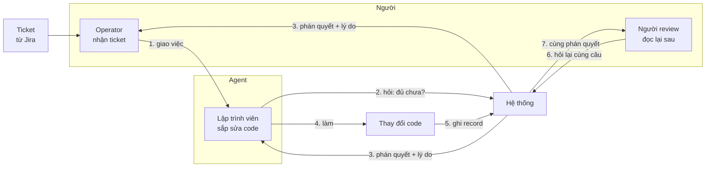
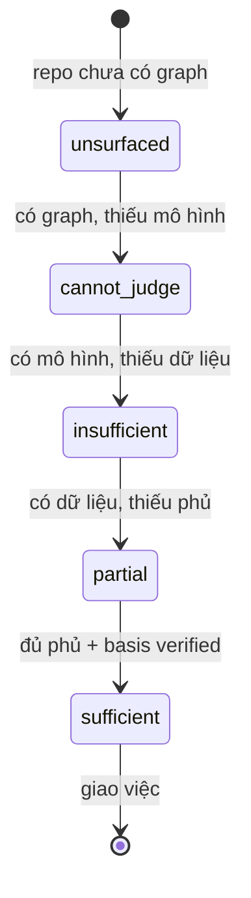
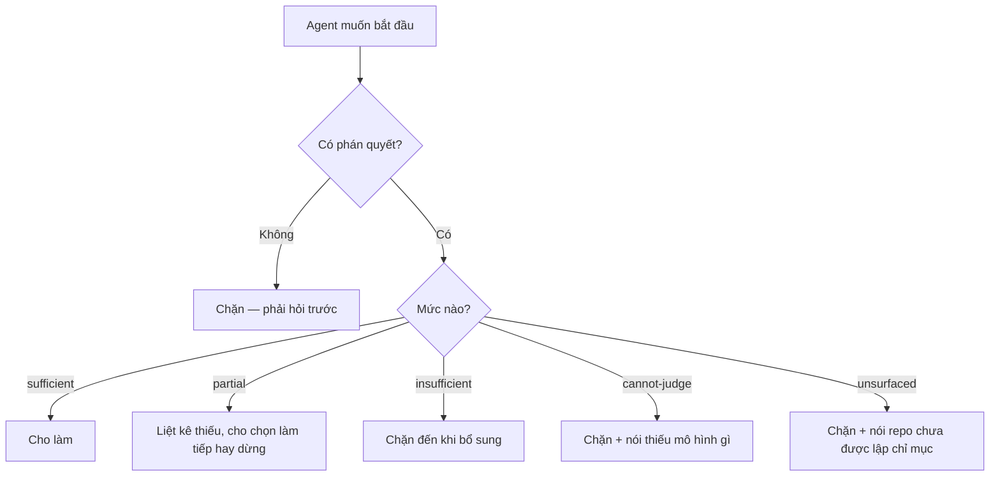

# BRD — Từ một ticket đến một việc đã được phép làm

> **Đây là tài liệu nghiệp vụ, không phải spec kỹ thuật.** Nó trả lời *vì sao* một agent không được bắt đầu làm trước khi có người nói
> *"đủ rồi"*, và *vì sao* câu trả lời đó phải giống nhau cho hai người hỏi khác nhau.

## 1. Bối cảnh

Có một ticket: *"thêm trường `tenant_id` vào API danh sách đơn"*. Một agent mở repo và bắt đầu sửa.

Ba ngày sau người ta phát hiện: API đó **không** phải cửa vào duy nhất, `tenant_id` **đã** có ở ba nơi khác, và cách làm đã chọn **phá** một ràng buộc
mà không ai nói ra.

**Không ai sai.** Agent đọc những gì nó thấy, làm những gì ticket nói. Cái thiếu là một câu hỏi chưa từng được hỏi: **"đã đủ chưa, và ai xác nhận?"**

Ba thứ làm câu hỏi đó khó:

**Thứ nhất — "đủ" không phải một thuộc tính của repo.** Nó là quan hệ giữa **việc phải làm** và **thứ đang biết**. Cùng một repo, ticket sửa một typo thì
đủ; ticket đổi hợp đồng dữ liệu thì không.

**Thứ hai — người hỏi không giống nhau.** Agent hỏi trước khi làm; người review hỏi sau khi làm; người vận hành hỏi ba tháng sau khi sự cố. Cùng repo, ba
câu trả lời phải **giống nhau** — nếu không, có **hai hệ** đang chạy trên một repo.

**Thứ ba — "không biết" khác "không có".** Thiếu chỗ đọc và chắc chắn là không có là **hai** chuyện, và hệ thống hay gộp chúng thành một chữ "chưa đủ".

### 1.1 Sơ đồ tổng quan



> **Đọc sơ đồ:** bước 2 và bước 6 là **cùng một câu hỏi**, hỏi bởi **hai** người ở **hai** thời điểm. Toàn bộ tài liệu này tồn tại để bảo đảm chúng ra
> **cùng** câu trả lời.

## 2. Những người trong câu chuyện

| Ai | Vai trong hệ thống | Họ thật sự cần gì |
|---|---|---|
| **Hùng**, 34 tuổi, operator | `A-01` | Biết ticket này **có làm được** không **trước khi** giao cho agent — để không phải giải thích lại sau |
| **Agent** (Cursor/DSH) | `A-02` | Một câu trả lời **máy đọc được** kèm **thiếu gì cụ thể** — không phải "cần thêm context" |
| **Lan**, 41 tuổi, review | `A-01` | Ba tháng sau mở lại và **không cần hỏi ai** vì sao việc đó được duyệt |
| **Khánh**, 29 tuổi, vận hành | `A-08` | Sự cố xảy ra lúc 2 giờ sáng: biết **ai đã cho phép** việc này, dựa trên **cái gì** |

> **Điểm dễ bỏ sót:** Khánh **không** hỏi *"code làm gì"* — cô ấy hỏi *"lúc đó hệ thống biết gì"*. Hai câu khác nhau, và câu thứ hai chỉ trả lời được nếu
> **thứ đã biết** được ghi lại, không chỉ **quyết định** được ghi lại.

## 3. Chuyện xảy ra hôm nay (khi chưa có hệ thống)

**Thứ Hai, 09:00** — Hùng đọc ticket *"thêm `tenant_id`"*. Anh thấy nó rõ ràng. Anh giao cho agent.

**Thứ Hai, 09:05** — Agent grep `tenant_id`, thấy ba chỗ. Nó chọn chỗ **đầu tiên** vì đó là chỗ duy nhất có test.

**Thứ Ba** — Agent mở PR. Lan review, thấy hợp lý, approve.

**Thứ Tư** — Deploy. Hai ngày sau, một truy vấn báo cáo sai số. Không ai biết vì sao: PR đúng, test xanh, review đủ.

**Điều đã xảy ra:** `tenant_id` phải thêm ở **cả bốn** chỗ, và chỗ thứ tư **không có test** — nên grep không thấy nó là "chỗ cần sửa", chỉ thấy nó là một
**chỗ đã có**.

**Không ai sai.** Agent làm điều đúng với **hiểu biết của nó**. Nhưng hiểu biết đó **không được kiểm** với **mô hình của repo**, và mô hình đó **không tồn
tại** ở đâu cả.

## 4. Hệ thống phải làm gì

### 4.1 Trước khi làm, phải có phán quyết — và nó phải có **lý do**

Một việc chỉ bắt đầu khi hệ thống trả về một trong **năm** mức (`REQ-JUDGE-01`): `insufficient` · `partial` · `sufficient` · `cannot-judge` · `unsurfaced`.

**Năm, không phải hai.** Ba mức đầu nói *"biết bao nhiêu"*. Hai mức sau nói **hệ thống không nói được** — và đó là câu trả lời **hợp lệ**, không phải lỗi.

Vì sao phải tách `cannot-judge` khỏi `insufficient`: **`insufficient` là một khẳng định** (*"thiếu, và đây là chỗ thiếu"*). `cannot-judge` là **từ chối khẳng
định** (*"không có mô hình để nói"*). Gộp chúng thì hệ thống **tự tin đúng chỗ nó đang mù** — đó là lỗi tệ nhất có thể.

### 4.2 "Thiếu gì" phải **cụ thể**, và phải **sắp được**

`insufficient` trả về danh sách thiếu, mỗi mục có: **loại thiếu** (theo `P`), **cái gì** (file · symbol · luật · người), và **vì sao nó quan trọng**
(`UC-02`).

Không phải *"cần thêm context"*. Một danh sách không hành động được **không phải** là câu trả lời — nó là **lời từ chối viết dài**.

Và danh sách phải **sắp được**: thiếu một luật bắt buộc nặng hơn thiếu một symbol không ai gọi. Nếu không sắp được, người dùng đọc mục đầu tiên và dừng.

### 4.3 Hai người hỏi, **một** câu trả lời

`BR-01`: cùng câu hỏi ⇒ cùng phán quyết, **bất kể ai hỏi**. Chỉ phần **phụ thuộc người hỏi** được khác — và chỉ có **ba** thứ đó: quyền, tenant, phạm vi.

Đây không phải "nice to have". Nếu agent thấy `sufficient` và người review thấy `partial`, thì **một trong hai đang làm việc trên một hệ khác** — và không
ai biết là cái nào.

### 4.4 "Không biết" không được thành "không có"

`BR-05`. Ba chỗ dễ sập:

| | Đọc sai | Đọc đúng |
|---|---|---|
| Chưa nạp xong mô hình | `absent` | `unknown` |
| Host không có công cụ tra | `absent` | `cannot-judge` + nói **thiếu năng lực gì** |
| Tệp không đọc được | `absent` | `unknown` + tên lỗi |

> Cả ba đều **trông giống** một câu trả lời. Chỉ cái thứ ba là **sự thật**, và nó là cái duy nhất **hành động được**.

### 4.5 Record là **đầu ra**, không phải nhật ký

`D-46`. Hệ thống ghi lại **cái nó đã biết** và **cái nó đã quyết** — không phải "log cho vui". Đọc lại record phải dựng lại được phán quyết **mà không
tính lại** (`UC-03`).

Vì sao: nếu record chỉ là log, thì câu hỏi của Khánh lúc 2 giờ sáng **không trả lời được**, vì log ghi *"đã gọi hàm X"*, không ghi *"lúc đó biết Y, nên
quyết Z"*.

## 5. Một ngày thật, có số

Repo `baplatform`, ticket `BAP-4412` — *"thêm `tenant_id` vào API danh sách đơn"*.

**09:02** — Hùng giao ticket. Hệ thống trả:

```
level: partial
basis: verified
mode: ask
thiếu 2:
  · work    — luật     BR-12 (cô lập tenant) chưa có trong graph
  · blast   — symbol   ListOrdersQuery ↔ 4 caller, 0 có test
```

**09:03** — Hùng thấy mục thứ hai. Anh **chưa biết** có 4 caller. Anh mở rộng ticket *"và sửa 4 caller"*.

**09:10** — Chạy lại: 4 caller → 3 có test, 1 không. `partial`, thiếu **1**.

**09:40** — Hùng thêm test cho caller thứ tư. Chạy lại: `sufficient`, `basis: verified`. Anh giao.

**14:00** — Agent làm. Record ghi: **lúc 09:40**, repo có **luật BR-12**, **5 symbol**, **5 test**. Không phải *"agent đã sửa 4 file"* — mà là **cái nó dựa
vào**.

**Ba tháng sau** — Lan mở record, thấy `basis: verified` và **đúng 5 symbol**. Cô không phải hỏi ai.

**2 giờ sáng, sự cố** — Khánh lọc theo `symbol = ListOrdersQuery`, thấy **record của lần 09:40** nói rõ: *"biết 5 symbol, 5 test, luật BR-12"*. Cô thấy ngay
cái **không** có: **luật BR-12 mới được thêm 09:35 hôm đó** — ba tuần sau khi API được thiết kế lần đầu.

### 5.1 Năm mức đi qua



**Không có đường tắt.** `unsurfaced → sufficient` không tồn tại — phải đi qua **cả bốn** mức kia, và mỗi bước **để lại dấu** trong record.

## 6. Ngoại lệ — và hệ thống làm gì

| Tình huống thật | Hệ thống xử lý |
|---|---|
| Ticket sửa một typo | `sufficient` — typo không cần luật |
| Ticket đổi hợp đồng dữ liệu, graph chỉ phủ 60% | `partial` + **nêu chính xác** 40% kia là gì |
| Host **không có** công cụ graph (DSH) | `cannot-judge` + `missing_capability: graph` — **không** `insufficient` |
| Graph chưa build | `unsurfaced` — **không** `sufficient` |
| Agent và người review hỏi cùng lúc, khác kết quả | **Lỗi hệ thống**, không phải "hai góc nhìn" |
| Người hỏi không có quyền xem một phần | `partial` + phần bị che **gộp vào `unknowns`**, không lộ là **có gì** |
| Record bị sửa sau khi ghi | **Không thể** — append-only (`BR-06`) |
| Repo đổi lớn giữa lúc hỏi và lúc làm | Record giữ **thời điểm**, không phải **trạng thái hiện tại** |

### 6.1 Sơ đồ nhánh lỗi



## 7. Điều ngoài phạm vi

| Không thuộc BRD này | Thuộc |
|---|---|
| Chọn **skill/luật nào áp** cho việc này | `02.p02-knowledge-resolution.md` |
| Nâng một skill dùng chung | `04.p04-shared-upgrade-revert.md` |
| Ghi lại **vì sao** một quyết định ra như vậy, đọc lại | `03.p03-evidence-record.md` |
| Cảnh báo **dù không hỏi** | `05.p05-unprompted-warning.md` |
| Duyệt ticket đã xong (`Done`) | `08.p08-delivery-to-ticket.md` |
| Chọn nguồn năng lực khi host thiếu | `06.p06-capability-source.md` |
| Ai có quyền gì | `sdlc/07.technical/01.architecture/08.actor-domain-tenant.md` |
| Ca kiểm thử | `sdlc/06.analysis/03.acceptance-criteria/39.us-suf-05-gaps.md` |

## 8. Câu chưa có trả lời trong release

| # | Câu hỏi | Mã |
|---|---|---|
| 1 | **`level` có `CHECK` đóng chưa?** Đã chốt có (`D-59`), nhưng `unsurfaced` **có** tính là "đã hỏi" không? | `OPEN-SUF-01` |
| 2 | **Ngưỡng `floor`/`threshold`** cho `completeness` là **bao nhiêu** — `D-11` nói là dữ liệu, **không** nói giá trị mặc định | `OPEN-SUF-02` |
| 3 | **`basis` của một phán quyết `cannot-judge`** là gì khi không có `reqs` nào? | `OPEN-SUF-03` |
| 4 | **`work` (tên việc) lấy từ đâu** — `evidence_turn.payload` **không** có trường này | `OPEN-SUF-04` (chặn `AC-UI-01-07`) |
| 5 | **"Đủ" có phải là điều kiện để *bắt đầu*, hay chỉ để *kết thúc*?** Cây nói bắt đầu, chưa nói lúc kết thúc | `OPEN-SUF-05` |

## 9. Truy vết

| Yêu cầu | Điều khoản | Mục trong BRD |
|---|---|---|
| `REQ-JUDGE-01` — năm mức | `BR-01` | §4.1 · §5.1 |
| `REQ-JUDGE-02` — thiếu gì, cụ thể | `BR-05` | §4.2 |
| `REQ-EVID-01` — record dựng lại được | `BR-06` · `D-46` | §4.5 · §5 |
| `BR-12` — cô lập project | — | §4.3 · §6 |

| Use case | Mục |
|---|---|
| `UC-01` hỏi đã đủ chưa | §4.1 · §5 |
| `UC-02` nói thiếu gì | §4.2 |
| `UC-12` hiểu project trước khi sửa | §3 · §4.2 |

## Revision rule

Sai khi: `REQ-JUDGE-01` đổi số mức, hoặc `BR-05` đổi định nghĩa `unknown`, hoặc năm mức ở §5.1 khác `sdlc/07.technical/01.architecture/07.sufficiency.md` §3.
Nguồn kiểm: `grep -c 'cannot-judge' sdlc/07.technical/01.architecture/07.sufficiency.md`
