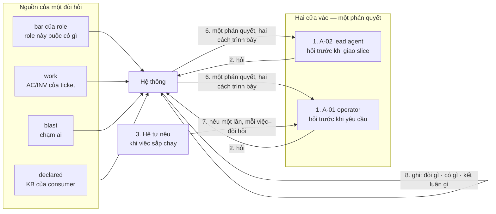
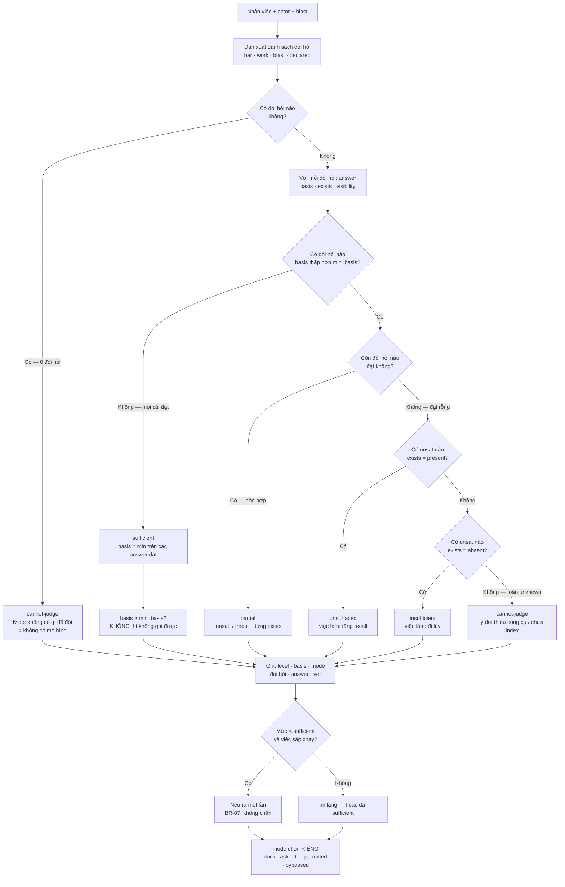
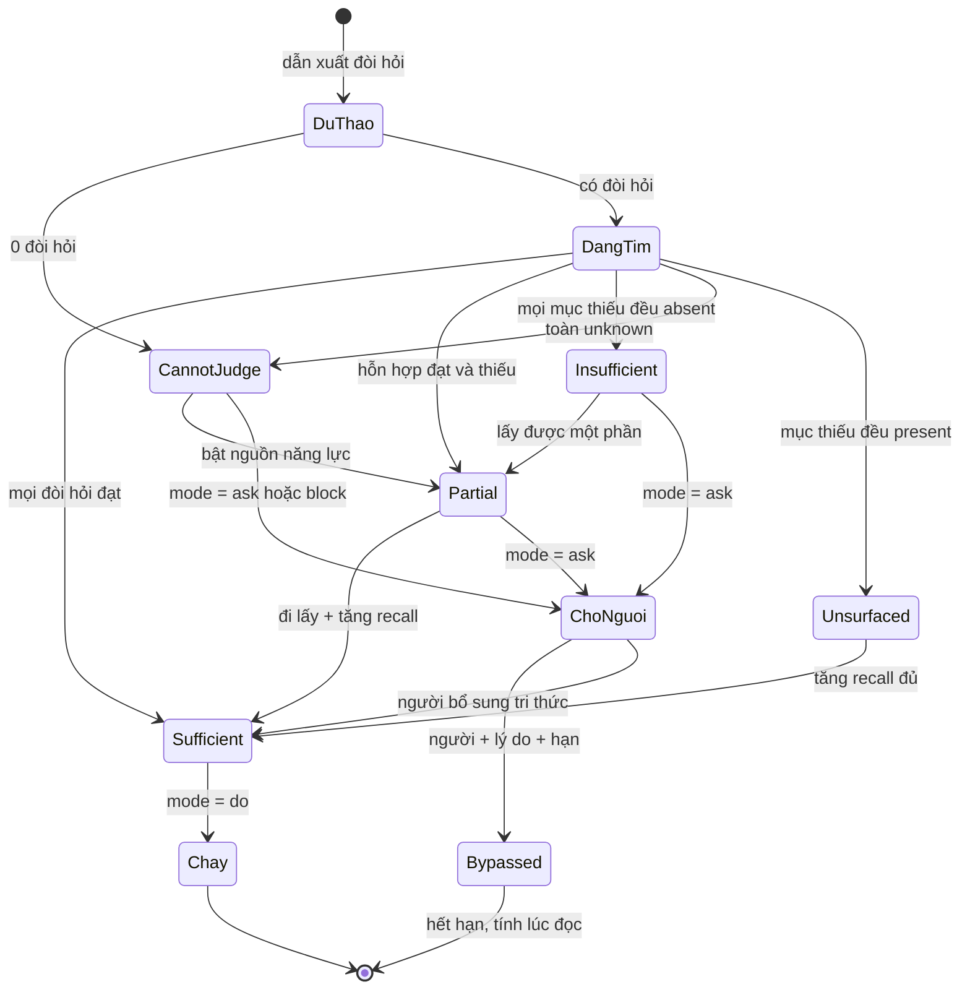
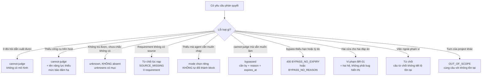

# BRD — Hỏi đã đủ chưa: năm mức, hai người hỏi, một phán quyết

> **Đây là tài liệu nghiệp vụ, không phải spec kỹ thuật.** Nó trả lời *vì sao* "đã đủ chưa" không có hai đáp án, *vì sao*
> `cannot-judge` không phải cách nói lịch sự của `insufficient`, và *vì sao* hai người hỏi cùng một việc phải nhận **một** câu trả
> lời. Hàm tính mức nằm ở `sdlc/07.technical/01.architecture/07.sufficiency.md` §3 — ở đây chỉ giải thích **vì sao hàm phải thế**.

## 1. Bối cảnh

Mọi hệ agent đều gặp một câu hỏi nghe rất đơn giản: *"đủ chưa?"* — đủ để giao việc, đủ để chạy, đủ để ghi vào repo của người
khác. Con người trả lời câu này bằng cảm giác; hệ thì không được, vì *"cảm thấy đủ"* của một mô hình không phải bằng chứng. P4 là
nỗi đau **mạnh nhất** trong cây tài liệu — [`00.pain-point-trace`](../../00.pain-point-trace.md) §1 ghi `4 REQ · 4 UC · 2 US ·
9 AC`, kèm một dòng tự thú: P4 đi trước **vì tôi làm nó trước**, không vì nó dễ. Bốn điều làm câu hỏi này khó:

**Thứ nhất — đáp án là một đòi hỏi, không phải một nhãn.** *"Đủ"* chỉ có nghĩa khi biết **đủ để làm gì** và **cho ai làm**: agent
viết test không cần hợp đồng consumer; agent sửa producer **phải** biết, vì đoán sai ở đó làm gãy người khác
([`07`](../../../07.technical/01.architecture/07.sufficiency.md) §2). Không có đáp án cho "một việc", chỉ có cho **(việc, đòi hỏi)**.

**Thứ hai — "thiếu" ≠ "không biết".** `absent` là *đã tìm đủ, không có*; `unknown` là *chưa tìm đủ, hoặc không có cách tìm*. Gộp
hai cái là lỗi **tệ nhất** hệ này có thể mắc, vì nó **sai một cách tự tin** (`BR-05`). **Thứ ba — hai người hỏi ở hai chỗ khác
nhau:** A-02 hỏi *"trước khi tôi giao việc cho peer?"*, A-01 hỏi *"trước khi tôi yêu cầu?"*; hai cửa cho hai đáp án không phải
hai cách hiển thị mà là **hai hệ** ([`D-44`](../../../03.inception/02.decision-log/00.index.md)).

**Thứ tư — có thể không ai hỏi.** Hai cửa trên đều là **kéo**. Ca đã xảy ra thật: agent không biết mình thiếu vì host không có
công cụ ⇒ không ai hỏi ⇒ im lặng ⇒ agent đoán. Mức cho trạng thái đó là `unsurfaced` — một **khuyết điểm**, không phải trạng
thái bình thường; UC-13 và `REQ-JUDGE-03` tồn tại để giảm nó.

### 1.1 Sơ đồ tổng quan

> **Đọc sơ đồ:** bốn nguồn bên trái là chỗ **đòi hỏi** sinh ra, không phải chỗ **bằng chứng** nằm. Bước 2 có hai mũi tên vào
> nhưng bước 6 ra **cùng nội dung**, khác đúng ở phần phụ thuộc người hỏi. Bước 7 là *đẩy*, dùng lại phán quyết của bước 6
> chứ không tính lần hai. Bước 8 không phải "ghi log": nó là **output** của UC-01 và **đầu vào duy nhất** của UC-03.

## 2. Những người trong câu chuyện

| Ai | Tuổi | Mã vai | Họ thật sự cần gì |
|---|---:|---|---|
| **Anh Dũng**, trưởng nhóm kỹ thuật `baplatform` | 38 | `A-01` | Một câu trả lời **trước khi** anh tiêu một turn: agent có đủ hay anh phải đi lấy thêm — đọc được **không cần** thuật ngữ của hệ |
| **Agent `lead-04`**, agent điều phối slice trong `baplatform` | — | `A-02` | Danh sách **việc phải làm tiếp** trước khi giao slice: không phải "thiếu context", mà "thiếu đúng ba thứ này, ở ba chỗ kia" |
| **Chị Hằng**, 41 tuổi, người duyệt nợ (`S4`) | 41 | `A-01` (vai duyệt) | Biết `partial` là **do thiếu thật** hay **do hệ không tra được** — hai hành động khác nhau, và chị là người ký `accept` |
| **Em Vy**, 26 tuổi, người đọc record 4 tháng sau | 26 | `A-08` | Dựng lại **lúc đó hệ biết gì** — đòi hỏi nào, bằng chứng nào, cái gì chưa biết — không cần biết hệ kết luận gì |
| **Anh Khôi**, 33 tuổi, dựng host mới `FinESO` | 33 | `A-01` (vai cấu hình host) | Biết `cannot-judge` là **vì host thiếu công cụ**, không phải vì dự án nghèo tri thức — hai cái đó là hai việc khác nhau |

> **Điểm dễ bỏ sót:** bốn trong năm người trên **không phải** là executor. Executor hành động ngay trên phán quyết; bốn người
> còn lại **trả giá** cho phán quyết đó — tiền turn, chữ ký duyệt, và sự thật bị dựng lại sai. Một tài liệu viết "agent cần biết
> đủ" sẽ tối ưu cho người duy nhất không gánh hậu quả.

## 3. Chuyện xảy ra hôm nay (khi chưa có hệ thống)

Hôm nay không có phán quyết nào cả — chỉ có cảm giác của agent, trí nhớ của người, và một dải banner không thuộc turn nào. Ngày
**13/10/2026**, việc `BAP-1188` — *"thêm audit log vào `OrderService`"* — trong `baplatform`:

| Giờ | Chuyện | Ai | Ai có lỗi |
|---|---|---|---|
| 09:12 | `lead-04` nhận slice, agent tự quyết *"đủ rồi"* vì prompt có nhắc `OrderService` | agent | **không ai** |
| 09:15 | Agent không biết hợp đồng consumer `Ledger`; host thiếu MCP codegraph nên **không có đường nào biết** | host | **không ai** — host thật sự thiếu công cụ |
| 10:03 | Agent ghi audit log **thiếu `ledger_ref`**; nó tự tin vì không có dấu hiệu nào nói ngược lại | agent | **không ai** |
| 14:40 | Anh Dũng mở S1, cột `level` hiện `sufficient` do banner cũ từ một turn khác còn sót | hệ (cũ) | **không ai** — banner không thuộc về turn nào |
| 14:47 | Anh Hùng (`Ledger` team, 47 tuổi) bắt đầu fail test consumer, không hiểu vì sao | — | **không ai** |
| 16:20 | Anh Dũng và agent cùng nói về `BAP-1188`: anh nói *"rõ ràng thiếu hợp đồng"*, agent nói *"đủ"* | cả hai | **không ai** |
| 21:30 | Không ai xác định được vì sao hai bên lệch — không có bản ghi nào nói lúc đó **đã đòi gì** | — | **không ai** |

**Không ai có lỗi, và đó chính là điểm.** Agent không đoán bừa — nó không có công cụ để biết mình đang thiếu. Anh Dũng không cẩu
thả — anh tin một dải banner không thuộc turn nào. Banner không nói dối — nó chỉ là **kết quả của một turn khác**, bị đặt cạnh turn
này vì không ai gắn phán quyết với turn.

**Cái thiếu không phải "một màn hình tốt hơn".** Ba tuần sau vẫn không ai trả lời được hai câu: *lúc 09:15, hệ biết gì?* (không
có record, nên không biết agent đã đòi gì và đã có gì) và *vì sao agent nói "đủ" còn anh Dũng nói "thiếu"?* (hai bên trả lời từ
hai nguồn khác nhau, và **không nguồn nào là phán quyết**). **Chi phí thật của tuần đó:** 1 PR phải revert · 1 lần hỏi lại anh
Hùng mất 40 phút · 3 ngày scan lại test consumer · 2 cuộc tranh luận *"ai nói đúng"* không kết luận được · và một dải banner
`sufficient` mà **không ai dám tin, cũng không ai dám bỏ**.

## 4. Hệ thống phải làm gì

### 4.1 Năm mức, không phải hai — và mức nào cũng có việc để làm

Cách làm hiển nhiên: một boolean, `đủ` / `chưa đủ`. Nó hỏng ngay ở ca đầu tiên, vì **"chưa đủ"** gộp ba tình huống có hành động
ngược nhau: đọc thêm · tìm lại trong thứ đã có · không có gì để tìm và phải hỏi người.

| Mức | Nghĩa chính xác | Việc phải làm tiếp |
|---|---|---|
| `sufficient` | mọi đòi hỏi có bằng chứng ≥ `min_basis` | làm việc |
| `partial` | hỗn hợp: một phần `present`, một phần `absent` | **hai** việc: tăng recall **và** đi lấy |
| `insufficient` | mọi mục thiếu đều `absent` — đã tìm đủ, không có | đi **lấy** tri thức |
| `cannot-judge` | 0 đòi hỏi dẫn xuất được, **hoặc** toàn `unknown` | **không có gì để lấy** — sửa mô hình hoặc bật nguồn |
| `unsurfaced` | bằng chứng **có** (`present`) nhưng phán quyết chưa được nêu | mở rộng recall / nêu ra |

Gộp `insufficient` với `unsurfaced` là một trong hai việc sẽ **không bao giờ được làm**; và `cannot-judge` **không có** việc
đọc thêm nào để làm, nên `REQ-JUDGE-01` cần **năm** mức. Chúng cũng không phải năm bậc của một thang: `unsurfaced` là bằng
chứng **có**.

### 4.2 `cannot-judge` ≠ `insufficient` — vì sao gộp lại là đổi sự thật thành phòng thủ

Cách sửa *hiển nhiên* là *"không biết thì coi như thiếu, cho an toàn"*: nó an toàn theo nghĩa **không bao giờ cho qua khi chưa
chắc** — và đó chính là chỗ nó sai, *an toàn cho ai*. Nó đổi một câu đúng (*"tôi mù"*) thành một câu sai (*"ở đây không có"*).
Host `FinESO` ngày 22/10 không có MCP codegraph ⇒ không đọc được `blast` ⇒ nếu gộp, hệ nói *"thiếu hợp đồng consumer"* trong khi
hợp đồng **có**, chỉ không đọc được. Người dùng đi tìm 40 phút hoặc
**viết lại** hợp đồng đã có; ba tuần sau record ghi `absent`, nên người đọc sau tin *"hợp đồng không tồn tại"*, trong khi sự
thật là **hệ đã mù lúc đó**.

Ba luật đã có, kiểm ở hai chiều: `BR-05` (`unknown` ≠ `absent`) · `BR-02`/`INV-ESO-01` (`sufficient` **phải** có `basis`, thiếu
thì throw chứ không mặc định `retrieved`) · `BR-03`/`INV-ESO-02` (`cannot-judge` **không bao giờ** tự thành `permitted`; đi tiếp
phải `bypassed` với người + lý do + hạn).

### 4.3 Đòi hỏi phải có nguồn — nếu không, requirement bị bịa

Cách làm hiển nhiên là để hệ tự nghĩ ra *"cần biết X"* cho từng việc — linh hoạt, không cần khai báo gì, và không ai kiểm được.
Nó hỏng theo hai chiều: đòi **quá ít** thì `sufficient` trên một việc thật ra đang thiếu; đòi **quá nhiều** thì mọi turn là
`partial` và người ta học cách bỏ qua phán quyết. Cả hai chiều đều không có triệu chứng rõ — và cả hai đều thành **sự thật khác
nhau ở mỗi lần chạy**. `BR-04` · `INV-ESO-03` chốt: **mọi requirement nêu nguồn**, một trong bốn.

| Nguồn | Sinh đòi hỏi gì | Ai viết | Nếu nguồn này thiếu |
|---|---|---|---|
| `bar` | loại bằng chứng role này buộc phải có | consumer, khai **một lần** cho role | chưa ai khai `bar` ⇒ P4 không đóng được (§8 câu 1) |
| `work` | AC/INV cụ thể của ticket | consumer, trong ticket | đòi hỏi mất chỗ dựa — không biết vì sao nó bị đòi |
| `blast` | chạm ai ⇒ biết hợp đồng của ai | **suy ra** từ mô hình kiến trúc | blast thiếu ⇒ đòi hỏi thiếu ⇒ `sufficient` sai **hệ thống** |
| `declared` | invariant, phạm vi, điều cấm | consumer, trong KB | đòi hỏi bịa; `SOURCE_MISSING` phải chặn lúc nạp |

`AC-SUF-01-08`: `source` thiếu hoặc lạ ⇒ **từ chối** kèm tên trường; danh sách rỗng trông như *"không có gì phải đòi"*. Và vì
`blast` là nguồn duy nhất **suy ra** chứ không được khai, nó là chỗ một mô hình kiến trúc thiếu neighbour biến thành một
`sufficient` sai **hệ thống** — không sai ở một turn, mà sai ở mọi turn chạm cùng service.

### 4.4 Mỗi đòi hỏi có `min_basis` riêng — "đủ" không cùng nghĩa ở mọi chỗ

Cách đơn giản là một ngưỡng chung: *"có bằng chứng là đủ"*. Nó biến `sufficient` thành **độ phủ** — đếm term của v1 dưới tên
khác — và che đúng chỗ mù nhất: chỗ mà sai một lần là gãy người khác. `basis` nói **cách biết**, không nói **khi nào biết**:
chạm producer phải `verified` (đoán sai ở đây làm gãy người khác, không gãy mình); đọc tài liệu về service mình sửa thì
`retrieved` (tự chịu hậu quả); chọn dạng từ catalogue theo `applies_when` thì `inferred` (không có "đúng tuyệt đối"); invariant
mà vi phạm sẽ rò tenant phải `verified`.

`basis` của **cả phán quyết** = **min** trên các answer đã đạt: lấy max hay trung bình thì một `verified` cộng bốn `inferred` sẽ
được trình bày như `verified`. `AC-SUF-01-06` chốt biên: `basis` **đúng bằng** `min_basis` là **đạt** — làm tròn lên là mọi
ngưỡng trôi mỗi lần ai đó sửa phép so sánh.

### 4.5 Hai người hỏi, một phán quyết — và ca hỏng khi không có luật này

`D-44` chốt *"cả hai"*: A-02 hỏi trước khi giao slice, A-01 trước khi yêu cầu. `BR-01` cho khác ở phần **phụ thuộc người hỏi**
(quyền · tenant · phạm vi thấy · cách trình bày), và **không** cho khác ở `level` · `basis` · đòi hỏi nào không đạt.

Ca hỏng cụ thể, cùng việc `BAP-1188`, nếu `BR-01` không có: anh Dũng mở S1 lúc **14:40** thấy `sufficient` (dòng mới nhất là
turn `audit`, không phải `BAP-1188`), trong khi `lead-04` ở **14:41** thấy `partial 2/5` trên đúng slice đó; **14:50** chị Hằng
mở S4 ký duyệt, thấy nợ `partial` trong khi S1 nói đủ. Đến **21:30** thì **không ai nói được "hệ nào" đang chạy** — cả hai
đường đều là sản phẩm, không đường nào tự khai mình là đường.

**Điều hỏng không phải con số lệch mà là không ai xác định được tin cái nào.** Hai đường cho hai đáp án thì người ta không chọn
đáp án đúng — họ chọn đường **dễ chịu hơn**. Nên `BR-01` là **luật** xuyên mọi UC, kiểm bằng một test **so hai cửa** chứ không
bằng AC của US-SUF-01 hay US-SUF-02 (`AC-SUF-01` §4 ghi rõ điều này).

Nhưng "một phán quyết" không có nghĩa "một câu chữ": A-02 hỏi về **slice đã chia** và cần *"việc phải làm tiếp"*; A-01 hỏi về
**việc còn đang mô tả**, không có ngữ cảnh agent, và cần câu trả lời bằng ngôn ngữ **không cần** thuật ngữ của hệ. Đó chính là
`US-SUF-02`, không phải ngoại lệ của `BR-01`: cùng kết luận, khác **câu**.

### 4.6 `unsurfaced` — mức của ca không ai hỏi, và ba luật chống nhiễu

Bốn mức đầu giả định **có người hỏi**; `unsurfaced` là mức cho ca **không ai hỏi** — một **khuyết điểm** (`UC-01.0a`).
`REQ-JUDGE-03` thêm **đẩy**, với ba luật chống nhiễu (`D-44`): chỉ nêu khi `< sufficient` **và** việc sắp chạy (nêu mọi lúc thì
bỏ qua **cả** cảnh báo thật); nêu **một lần** mỗi (việc, đòi hỏi) (lặp lại là làm phiền, không phải nhắc); và nêu cả khi **agent
không biết** mình thiếu (chỉ nêu khi được hỏi thì UC-13 vô dụng).

`BR-07`: cảnh báo **không chặn** — chặn là `mode`, quyết định của người. Cái cấu hình được là công tắc **chặn**; việc **phát**
cảnh báo thì không, vì tắt được thì *"cảnh báo dù không hỏi"* thành *"…trừ khi ai đó tắt"*.

### 4.7 `partial` phải đếm được — nếu không nó là nhãn mơ hồ

Cách dễ là để `partial` là một nhãn: *"có gì đó chưa ổn"*. Người đọc hiểu ngay, và không làm được gì với nó — một nhãn không nói
còn bao nhiêu, thiếu cái gì, bắt đầu từ đâu. `partial` là `|unsat| / |reqs|`, và **mỗi** `unsat` mang `exists` riêng (`07` §3.1):
bỏ con số thì không ai biết còn bao nhiêu; bỏ `exists` từng mục thì không biết mục nào cần **tìm lại** (`present`) mục nào cần
**đi lấy** (`absent`); gộp vào `insufficient` thì mất việc "tăng recall" và mất luôn khả năng phân biệt `unsurfaced`.

`AC-SUF-01-01` buộc **mỗi** đòi hỏi có `level` **và** `basis`, *"không có một mức tổng thay cho chúng"*; `AC-SUF-01-03` buộc danh
sách thiếu **hữu hạn, đếm được**, mỗi mục nêu **cái gì** + **có thể có ở đâu**, và mục không rõ nguồn được ghi *"không rõ nguồn"*
chứ không bị bỏ. Hai AC đó là chỗ phân biệt UC-01 với một lời cảm thán.

### 4.8 Sơ đồ quyết định: hàm gán mức

| Nút | Điều kiện | Nguồn |
|---|---|---|
| **Có đòi hỏi nào không?** | `reqs = ∅` ⇒ `cannot-judge` | `07` §3 |
| **Đạt** | `ans[r].basis ≥ r.min_basis` | `07` §3 · `AC-SUF-01-06` |
| **Hỗn hợp** | `sat ≠ ∅ ∧ unsat ≠ ∅` ⇒ `partial` | `07` §3.2 |
| **`present` trong unsat** | ⇒ `unsurfaced`, hành động là **tăng recall** | `05` §2 luật 3 |
| **Toàn `unknown`** | ⇒ `cannot-judge`, **không** `insufficient` | `BR-05` · `05` §2 luật 2 |
| **basis của phán quyết** | `min` trên các answer **đã đạt** | `07` §3 |
| **Nêu ra** | `< sufficient` ∧ việc sắp chạy; một lần mỗi (việc, đòi hỏi) | `REQ-JUDGE-03` · `D-44` |
| **Chặn** | **không** thuộc hàm này; là `mode`, người quyết | `BR-07` · `BR-03` |

## 5. Một ngày thật, có số

Ngày **27/10/2026** trong `baplatform`. Một ngày có **14 turn phán quyết** trên **4 việc**; con số dưới lấy từ record, không lấy
từ trí nhớ.

**Việc `BAP-1190`** — thêm cột `shipped_at` vào `OrderService` — vai `build@7`, `bar` = `[slice-table (retrieved), AC-in-scope
(retrieved), verify-command (verified)]`:

| Mốc | Chuyện | `level` | `basis` | Đòi hỏi đạt / tổng | Chết ở đâu |
|---|---|---|---|---:|---|
| 08:55 | A-02 hỏi trước khi giao | `partial` | `retrieved` | 3/5 | 2 thiếu: hợp đồng consumer, migration note |
| 09:02 | A-02 giao slice dù `partial` | `partial` | `retrieved` | 3/5 | `mode` = `ask` ⇒ phải có người |
| 09:40 | A-01 trả lời "cứ làm, tôi chịu" | `partial` | `retrieved` | 3/5 | `bypassed` + `expires_at` 2026-11-03 |
| 11:10 | A-02 hỏi lại sau khi đọc `Ledger` contract | `sufficient` | `verified` | 5/5 | — |
| 11:11 | Turn chạy, ghi evidence | `sufficient` | `verified` | 5/5 | — |

**Việc `BAP-1191` — "sửa spec của agent `verify`"**, host `FinESO` **không có** MCP codegraph:

| Mốc | Chuyện | `level` | `basis` | Đòi hỏi đạt / tổng | Chết ở đâu |
|---|---|---|---|---:|---|
| 13:20 | Hệ tự nêu (không ai hỏi) | `cannot-judge` | `inferred` | 1/4 | `blast` không đọc được |
| 13:21 | Anh Khôi mở S2 | `cannot-judge` | `inferred` | 1/4 | *"thiếu công cụ: codegraph"* |
| 13:35 | Anh Khôi quyết định bật nguồn ngoài | — | — | — | `election` = `external`, ghi lại |
| 13:58 | Hỏi lại sau khi đổi nguồn | `partial` | `verified` | 3/4 | còn 1 `absent` |

**Việc `BAP-1192` — "thêm test cho `Ledger`"**: `sufficient` ngay lần đầu, 2/2 đòi hỏi, 09:15.

**Việc `BAP-1193` — "refactor `ReportService`"** (ticket trống harness):

| Mốc | Chuyện | `level` | `basis` | Đòi hỏi đạt / tổng | Chết ở đâu |
|---|---|---|---|---:|---|
| 15:30 | A-02 hỏi | `cannot-judge` | `inferred` | 0/0 | 0 đòi hỏi dẫn xuất được |

### 5.1 Sơ đồ trạng thái một phán quyết đi qua

| Trạng thái | Ai đưa vào | Dữ liệu phải có | Ai được đưa ra |
|---|---|---|---|
| `DuThao` → `DangTim` | hệ | ≥1 nguồn đòi hỏi (`bar`/`work`/`blast`/`declared`) | hệ |
| `DangTim` → `Sufficient` | hệ | mọi `basis ≥ min_basis` (`INV-ESO-01`) | hệ |
| `DangTim` → `Partial` | hệ | `sat ≠ ∅ ∧ unsat ≠ ∅` + `exists` từng mục | hệ |
| `DangTim` → `Insufficient` / `Unsurfaced` | hệ | mọi unsat `absent` / mọi unsat `present` | hệ |
| `DangTim` → `CannotJudge` | hệ | 0 đòi hỏi **hoặc** toàn `unknown` | hệ |
| `→ ChoNguoi` · `→ Bypassed` | hệ · **A-01** | `mode` = `ask`/`block` · `by` + `reason` + `expires_at` (`API-22`) | người · **không ai** |

> **Ba cạnh là suy luận, không phải nguồn:** (1) `Unsurfaced → Sufficient` cần "tăng recall" nhưng `07` §3.2 không đặt biên —
> **ai** tăng và **khi nào dừng** là `NEW-OPEN-BRD-uc01-2`. (2) `Bypassed → [*]`: `API-22` nói `API-21` trả `mode` **nguyên bản** cộng
> `expired{by, expires_at}`, nên **không** có cạnh trạng thái — record đứng yên, chỉ quan sát đổi; vẽ `[*]` để khỏi mint một cạnh
> không có trong tài liệu. (3) `Partial → Sufficient` khi chỉ đi lấy phần `absent`: `07` §3.1 đưa **hành động**, không đưa cạnh.

### 5.2 Bảng số của ngày 27/10 — trích 9 trong 14 turn; dòng tổng lấy từ record

| Mốc | Việc | Mức | Đạt / tổng | Mục `absent` | Mục `unknown` | Mục `present` | Giây |
|---|---|---|---:|---:|---:|---:|---:|
| 08:55 | `BAP-1190` | `partial` | 3/5 | 1 | 0 | 1 | 0,8 |
| 09:02 | `BAP-1190` giao | — | — | — | — | — | — |
| 09:15 | `BAP-1192` | `sufficient` | 2/2 | 0 | 0 | 0 | 0,4 |
| 09:40 | `BAP-1190` bypass | `partial` | 3/5 | 1 | 0 | 1 | 0,1 |
| 11:10 | `BAP-1190` hỏi lại | `sufficient` | 5/5 | 0 | 0 | 0 | 1,1 |
| 13:20 | `BAP-1191` | `cannot-judge` | 1/4 | 0 | 3 | 0 | 0,6 |
| 13:35 | `BAP-1191` đổi nguồn | — | — | — | — | — | — |
| 13:58 | `BAP-1191` hỏi lại | `partial` | 3/4 | 1 | 0 | 0 | 0,9 |
| 15:30 | `BAP-1193` | `cannot-judge` | 0/0 | 0 | 0 | 0 | 0,2 |
| 23:00 | Tổng ngày (14 turn, từ record) | 6 `sufficient` · 5 `partial` · 2 `cannot-judge` · 1 `bypassed` | 41/56 | 9 | 5 | 3 | 9,4 |

**Ba con số để nhớ:** **5** mức (không phải 2) · **0** lần ai đó phải nói *"để tôi hỏi lại agent"* · **1** lần `cannot-judge` đổi
thành việc cụ thể (*"bật codegraph"*). Con số thứ tư đáng chú ý hơn — **3** mục có `exists = present` trong các turn `partial`:
ba lần hệ **đã có** bằng chứng nhưng **chưa nêu ra**, tức `unsurfaced` đang bị đếm lẫn trong `partial` (§8 câu 2).

## 6. Ngoại lệ — và hệ thống làm gì

| Tình huống thật | Hệ thống xử lý |
|---|---|
| Không dẫn xuất được đòi hỏi nào (`bar` rỗng, ticket trống) | `cannot-judge` + *"không có gì để đòi"* — **không** `sufficient` (`AC-SUF-01-07`) |
| Host thiếu công cụ để kiểm một đòi hỏi | `cannot-judge` cho đòi hỏi đó + **tên năng lực thiếu**; mức bảo đảm **bị hạ** (`AC-SUF-01-04`, `REQ-HOST-02`) |
| Không tìm thấy nhưng chưa chắc là không có | `unknown`, **không** `absent`; `unknowns[]` có mục (`BR-05`, `UC-01.2a`) |
| Requirement không nêu `source` | **Từ chối** lúc nạp, kèm tên trường; **0** requirement được nạp (`BR-04`, `AC-SUF-01-08`, `SOURCE_MISSING`) |
| `basis` đúng bằng `min_basis` | **Đạt** — không làm tròn lên (`AC-SUF-01-06`) |
| Phán quyết `insufficient` mà agent vẫn chạy | `mode` **không** tự đổi; `mode` chọn riêng và ghi lại (`BR-07`, `AC-SUF-01-05`) |
| `cannot-judge` mà người muốn làm tiếp | Chỉ `bypassed`, cần `by` + `reason` + `expires_at`; thiếu trường nào ⇒ `400` riêng trường đó (`BR-03`, `API-22`) |
| Hai cửa vào cho cùng một việc | **Một** `level`, **một** `basis`; chỉ phần phụ thuộc người hỏi được khác (`BR-01`, `D-44`) |
| 500 đòi hỏi, phần lớn dưới `sufficient` | Nêu **số mục thiếu đếm được** + cái chặn trước; **không** cắt bớt mà không nói (`AC-SUF-02-05`) |
| Một đòi hỏi trỏ tới nguồn đã bị xoá | Vẫn nêu đòi hỏi đó, ghi *"nguồn đã mất"*; **không** bỏ mục, **không** đoán nguồn khác (`AC-SUF-02-06`) |
| Người hỏi về một việc chưa thuộc project nào | `cannot-judge`, nói **vì sao** — không trả điểm, không trả phần trăm (`AC-SUF-02-03`) |
| Đổi ngưỡng trong profile | **Cùng** `level` — hàm **không** đọc ngưỡng (`AC-SUF-02-07`) |
| Việc ngoài phạm vi được hỏi phán quyết | Từ chối; câu từ chối **không** tiết lộ việc đó có tồn tại (`AC-AGENT-01-03`, `BR-13`) |

### 6.1 Sơ đồ nhánh lỗi

## 7. Điều ngoài phạm vi

| Không thuộc tài liệu này | Thuộc |
|---|---|
| Danh sách thiếu **nhìn được và hành động được**: kiểu · cái gì · vì sao quan trọng, và **thứ tự** | `02.uc-02-what-is-missing.md` |
| Record của một turn: `requirements[]` · `answers[]` · `unknowns[]` · `files_used[]` | `03.uc-03-why-this-decision.md` |
| Khai đội agent: ai · vai · quyền — và vì sao cùng việc khác vai thì khác `level` | `04.uc-04-agent-team.md` |
| Đưa một project vào: tri thức riêng, cô lập giữa hai project | `05.uc-05-project-onboarding.md` |
| Chọn skill/luật nào áp cho việc này, và vì sao áp / vì sao không | `06.uc-06-which-rule-applies.md` |
| Nâng một skill dùng chung cho mọi project | `07.uc-07-promote-shared.md` |
| Rút lại một skill đã nâng vì nó hỏng | `08.uc-08-revert-broken.md` |
| Hỏi *"vì sao bị chặn"* như một bề mặt trả lời | `09.uc-09-why-blocked.md` |
| Đề xuất tự sửa cách làm sau khi sai | `10.uc-10-self-proposal.md` |
| Duyệt một ticket đã làm xong (`Done` chỉ khi người nói) | `11.uc-11-ticket-done.md` |
| Hiểu một project gồm những gì trước khi sửa | `12.uc-12-what-is-in-project.md` |
| Được cảnh báo **dù không hỏi** — luật chống nhiễu, vòng đời | `13.uc-13-unprompted-warning.md` |
| Chọn **nguồn năng lực** khi host thiếu — bốn nhánh, `none` là hợp lệ | `14.uc-14-capability-source.md` |
| Hàm sufficiency chi tiết, `partial` là `|unsat|/|reqs|`, `basis = min` | `sdlc/07.technical/01.architecture/07.sufficiency.md` §3 |
| Trường của một turn, `cites[]`, `unknowns[]` dựng lại thế nào; `mode`/escalation chọn ra sao | `sdlc/07.technical/03.api/01.contracts.md` `API-21` · `05.turn-execution.md` ⑦⑧ |

## 8. Câu chưa có trả lời trong release

Năm câu dưới là chỗ **không nguồn nào trong cây trả lời**. Câu 1 **chặn P4 đóng**; bốn câu còn lại chặn phần *hành động tiếp* của
phán quyết, không chặn chính phán quyết.

| # | Câu hỏi | Mã | Vì sao cây không trả lời được |
|---|---|---|---|
| 1 | **`bar` là gì, cụ thể, cho từng vai?** `07` §1 nói requirement đến từ `bar` = *"loại bằng chứng mà role này buộc phải có"*, nhưng `role.bar` mới có **hình dạng** `[{evidence_kind, min_basis}]` (`02.schema` §3.1) — **giá trị** thì chưa ai khai; preset 7 vai ở `US-IAM-02` mô tả `bar` bằng **lời**, không phải `evidence_kind` | `NEW-OPEN-BRD-uc01-1` | Không có tài liệu nào **chốt danh sách `evidence_kind`**. `AC-IAM-02-01` chỉ đòi *"mỗi mục `bar` có loại bằng chứng + `min_basis`"*, không đặt tập giá trị. `00.pain-point-trace` §2 P4 nói thẳng: *"`bar` thì chưa ai khai"* → P4 phụ thuộc P6/IAM. Đây là câu **chặn**, không phải câu treo |
| 2 | **Ai tăng recall, và ở đâu dừng?** `07` §3.2 nói khi mọi unsat đều `present` thì *"việc duy nhất là tăng recall"*, nhưng không nói ai làm, bằng cách nào, và khi nào từ `unsurfaced` **dừng** (không còn gì để mở rộng) thì mức là gì | `NEW-OPEN-BRD-uc01-2` | `05` §2 chặng ⑤ mô tả **cơ chế** (`L1 · synonym · scope rộng hơn · bỏ filter`), nhưng không có biên. Không tài liệu nào định nghĩa "đã mở rộng hết". Và `REQ-JUDGE-01` chỉ liệt kê mức, không giao việc |
| 3 | **`unknown` có hạn không?** `05` §2.1 đề xuất `unknown` sinh RISK `unresolved-existence` với `review_by`, và quá hạn thì **tự thành `ask`** — nhưng mục đó tự ghi *"đề xuất — chưa chốt"* | `NEW-OPEN-BRD-uc01-3` | Đề xuất là **văn bản trong tài liệu kiến trúc**, không phải `D-nn`. Decision log không có mục nào chốt nó. Nếu treo, `unknown` là chỗ trốn hợp pháp: mọi gap kết thúc ở `unknown`, không bao giờ `ask` |
| 4 | **Cách trình bày nào là "cách trình bày"?** `BR-01` cho phép khác ở *"phần phụ thuộc người hỏi"* và AC-SUF-02 đòi câu trả lời cho người *"đọc được không cần thuật ngữ của hệ"*. Nhưng **test so hai cửa** so cái gì — so `level` thô, hay so nội dung đã diễn đạt? Nếu so nội dung, `BR-01` không test được bằng chuỗi | `NEW-OPEN-BRD-uc01-4` | `03.business-rules` §BR-01 nói *"kiểm bằng một test so hai cửa vào của cùng một phán quyết"* — nhưng không nói **phép so** là gì. `AC-SUF-02` §5 nói phần khớp là `BR-01`, và dừng ở đó. Thiếu định nghĩa phép so, luật này không cưỡng chế được ở đâu |
| 5 | **`unsurfaced` có phải một lần ghi không?** Nếu phán quyết `unsurfaced` bị nêu ra (bước 7) thì nó **thành** gì — vẫn `unsurfaced` với cờ "đã nêu", hay là một mức khác? `evidence_turn.level` là **một** cột, không có cột "đã nêu" | `NEW-OPEN-BRD-uc01-5` | `schema` §2 có `level` đóng năm giá trị và **không** có trường nào nói "đã surface". `REQ-JUDGE-03` nói *"nêu một lần"* nhưng không nói nêu rồi thì trạng thái đổi thế nào. Đây là chỗ mà "một lần" không kiểm được nếu không có dấu |

## 9. Truy vết

| Yêu cầu (REQ) | Điều khoản | Mục trong BRD |
|---|---|---|
| `REQ-JUDGE-01` | Phán quyết **theo từng yêu cầu**, năm mức, kèm `basis` | §4.1 · §4.4 · §4.8 · §5.1 |
| `REQ-JUDGE-02` | Dưới `sufficient`, danh sách **đóng** cái còn thiếu | §4.7 · §6 |
| `REQ-JUDGE-03` | Nêu khi việc sắp chạy, kể cả khi không ai hỏi; một lần; không chặn | §4.6 · §4.8 |
| `REQ-JUDGE-04` | Giải thích lại được từ record, gồm `unknowns[]` | §1 · §5.1 |
| `REQ-HOST-02` | Host thiếu ⇒ nói ra + hạ mức bảo đảm | §4.2 · §6 |
| `UC-01` | Hỏi "đã đủ chưa" — hai người hỏi, một phán quyết | Toàn bộ |

| Luật (BR) | Điều khoản | Mục trong BRD |
|---|---|---|
| `BR-01` | Cùng câu hỏi ⇒ cùng phán quyết | §4.5 · §6 |
| `BR-02` | Không `sufficient` khi thiếu `basis` | §4.2 |
| `BR-03` | `cannot-judge` không tự thành `permitted` | §4.2 · §6 |
| `BR-04` | Mọi requirement phải nêu nguồn | §4.3 · §6 |
| `BR-05` | `unknown` ≠ `absent` | §4.2 · §4.6 · §6 |
| `BR-07` | Cảnh báo không chặn việc | §4.6 · §6 |
| `BR-13` | `visibility` trực giao với `exists` | §6 |

| Quyết định (D) | Điều khoản | Mục trong BRD |
|---|---|---|
| `D-44` | Hai người hỏi, một phán quyết; và đẩy khi không ai hỏi | §1 · §4.5 · §4.6 |
| `D-09` | Thực thi dưới rủi ro là trạng thái hạng nhất; bypass cần người + hạn | §4.2 · §5.1 |
| `D-11` | Ngưỡng là dữ liệu, có sàn; hàm không đọc ngưỡng | §6 |
| `D-45` | Record nói thật, answer không rò | §6 |
| `D-46` | Phán quyết dùng hiện trạng cục bộ; record là đầu ra | §1 · §4.3 |

## Revision rule

Sai khi: `07` §3 **không còn** năm mức, hoặc `partial` **không còn** là `|unsat| / |reqs|`, hoặc requirement **không còn**
`min_basis` riêng, hoặc `BR-01`/`D-44` bị thay bằng một quyết định cho phép hai cửa trả lời khác nhau, hoặc `level` trong
`evidence_turn` đổi tập giá trị → cập nhật §4.1 · §4.4 · §4.8 · §5.1 và bảng §9.

Nguồn kiểm: `grep -cE "cannot-judge|unsurfaced|sufficient|partial" sdlc/07.technical/01.architecture/07.sufficiency.md` — phải còn **cả
bốn** mức; và `grep -n "^| \*\*BR-01\*\*" sdlc/06.analysis/01.business-analysis/03.business-rules.md` — phải còn luật *cùng câu hỏi,
cùng phán quyết*.
