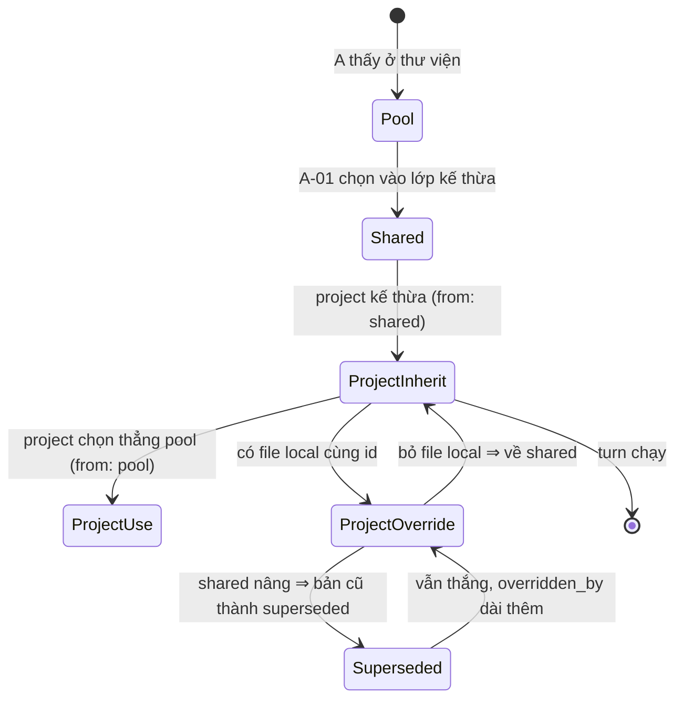
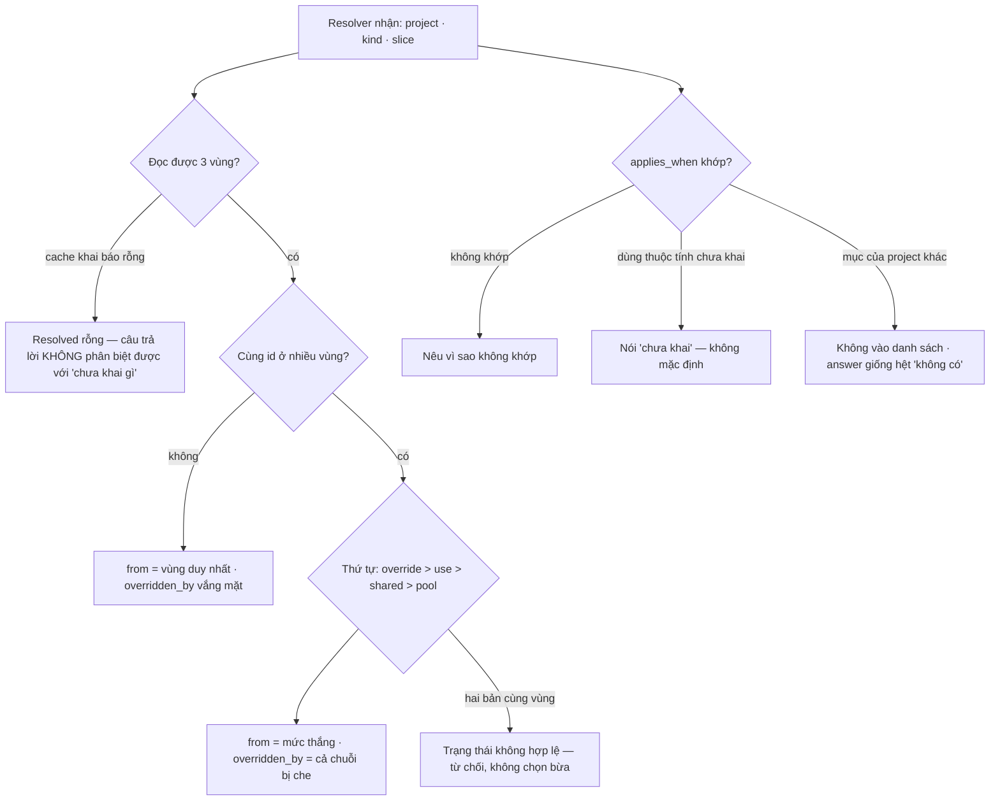

# BRD — Ba vùng tri thức, và một người thắng phải nói tên mình

> **Đây là tài liệu nghiệp vụ, không phải spec kỹ thuật.** Nó trả lời *vì sao* một turn phải chạy bằng **đúng một** bộ
> skill/luật, *vì sao* bộ đó **không được chọn ngầm**, và *vì sao* câu "skill nào đang chạy" phải trả lời được **mà không
> cần đọc file**.

## 1. Bối cảnh

`haison-ops` có **ba** project: `baplatform` (12 microservice), `haison-crm` (4), `haison-portal` (1) — và **ba** cách xử lý tenant
khác nhau (cột · schema · chưa có). Họ có một **thư viện** `pool/` 12 skill, và một **lớp kế thừa** `shared/` 5 skill, trong đó
`jira-flow@1.2` và `tenant-isolation@1.0`.

Ba tập này **không rời nhau**: `jira-flow` có ở **cả ba** vùng (`pool@1.1` · `shared@1.2` · bản local trong `baplatform`), còn
`haison-crm` không đè gì. Cùng một câu hỏi — *"turn này theo luật nào"* — có câu trả lời **phụ thuộc chỗ đứng**, nhưng **không**
được phụ thuộc **người hỏi**. Agent hỏi một đường, người review hỏi đường khác, và **không ai biết** hai đường có ra cùng đáp
án hay chưa.

Ba thứ làm bài toán này khó:

**Thứ nhất — project thắng mà không cần xin phép.** Một file local có **cùng `id`** với `shared` là đủ để thắng. Không có
dòng khai báo nào bắt buộc, không có lần duyệt nào. Đây là **thiết kế đúng** (`D-31` hệ quả 2: override là van xả áp duy
nhất, nên nó phải **dễ**), nhưng nó đẻ ra một ca xấu: người dùng thấy hành vi khác đi mà **không biết mình đã đè gì**.

**Thứ hai — người dùng không phân biệt được "shared" với "bản cũ của tôi".** Hai file trông giống nhau, cùng tên, cùng
frontmatter. Một cái là bản tổ chức vừa nâng lên 1.2; một cái là bản local viết từ tháng 9 mà không ai nhớ. **Chữ trên đĩa
không nói cái nào là cái nào.**

**Thứ ba — "không khớp" và "không có" trông giống nhau.** Skill không áp vì `applies_when` sai, và skill không áp vì **không
tồn tại**, ra cùng một kết quả: im lặng (`BR-05`).

### 1.1 Sơ đồ tổng quan

```mermaid
flowchart LR
    subgraph Thu_vien["Thư viện (A-01 quản)"]
        P[pool/<br/>12 skill · A B C D E F G]
        S[shared/<br/>5 skill kế thừa]
    end
    subgraph Du_an["Tập hiệu lực (từng project)"]
        B1[baplatform<br/>12 skill]
        B2[haison-crm<br/>12 skill]
        B3[haison-portal<br/>11 skill]
    end
    P -->|A-01 chọn, nâng là nâng cho tất cả| S
    S -->|kế thừa| B1
    S -->|kế thừa| B2
    S -->|kế thừa| B3
    B1 -->|đè jira-flow, tenant-isolation| B1
    R[Resolver<br/>C1.3] -->|đọc 3 vùng, trả Resolved[]| B1
    R --> EV[record: from + overridden_by]
```

> **Đọc sơ đồ:** mũi tên `shared → project` là **kế thừa**, không phải chép ([`D-31`](../../../03.inception/02.decision-log/00.index.md)):
> nâng `shared` thì cả ba project đổi ở turn sau. Mũi tên tự-trỏ `baplatform → baplatform` là **override**, và nó là mũi tên
> duy nhất mà **không ai phải xin phép** — nên nó là mũi tên duy nhất phải **hiện ra** trong record.

## 2. Những người trong câu chuyện

| Ai | Vai trong hệ thống | Họ thật sự cần gì |
|---|---|---|
| **Mai**, 38 tuổi, lead `baplatform` | `A-02` | Biết turn của mình đang theo **bản nào** của `jira-flow` — và biết nếu nó là bản local, **ai** viết |
| **Hùng**, 34 tuổi, operator | `A-01` | Thấy được **project nào đã đè** trước khi nâng `shared` — để không nâng mù |
| **Agent** (Cursor/DSH) | `A-02` | Không phải tự grep tìm skill; nhận một danh sách **đóng**, có `from` |
| **Khánh**, 29 tuổi, vận hành | `A-08` | Sự cố lúc 2 giờ sáng: biết artifact này chạy theo skill **vùng nào**, bản nào |

> **Điểm dễ bỏ sót:** Mai **không** hỏi *"skill nội dung gì"* — cô ấy đọc file được. Cô hỏi *"skill này **từ đâu tới**"*.
> Câu đó chỉ trả lời được nếu kết quả phân giải **nêu vùng**, chứ không chỉ nêu đường dẫn.

## 3. Chuyện xảy ra hôm nay (khi chưa có hệ thống)

**Thứ Ba, 10:12** — Mai nhờ agent sửa `ORDER-312`: thêm audit log cho luồng đơn. Agent mở `baplatform`.

**Thứ Ba, 10:40** — Nó tìm skill theo tên file: `skills/jira-flow.md`. Tìm thấy **một** — bản local, tháng 9. Nó đọc, làm theo.

**Thứ Tư** — PR lên. Lan review: *"sao không theo quy ước transition mới?"*. Mai: *"quy ước mới là gì?"*.

**Điều đã xảy ra:** `shared/jira-flow` đã lên `1.2` từ tháng 10, và `1.2` **đổi** cách ghi transition. Nhưng `baplatform` có
`skills/jira-flow.md` — bản local từ tháng 9, viết để **thử** một ý tưởng, **chưa ai xoá**. Vì nó tồn tại, nó thắng.

****Không ai sai.** Agent chọn file đúng. Mai không nhớ có bản local — nó tạo ba tháng trước, trong một buổi thử, bởi chính cô.
Nhưng **thứ tự ưu tiên có thật** trong hệ chưa từng **được nói ra** ở đâu. Ba tháng sau, Khánh đi tìm vì sao một service xử lý
tenant sai: `haison-crm` kế thừa `shared/tenant-isolation@1.0`, `baplatform` chạy bản local — **hai project cùng luật, hai hành
vi**, không tài liệu nào nói vì sao.

## 4. Hệ thống phải làm gì

### 4.1 Ba vùng, ba vai — không phải ba namespace của một thứ

`D-30` chốt ba vùng, và chúng **khác nhau về vai**, không chỉ khác về chỗ để file:

| Vùng | Là gì | Sở hữu | Chạy trực tiếp? |
|---|---|---|---|
| **`pool`** | Tàng Kinh Các — **thư viện đầy đủ** 12 skill | tổ chức | ❌ **nguồn**, không tự áp |
| **`shared`** | **lớp kế thừa** — 5 skill tổ chức chọn | tổ chức | ✅ mọi project kế thừa |
| **`project`** | tập hiệu lực: 5 kế thừa + bản local | project | ✅ dùng để chạy |

**Vì sao phải là ba:** gộp `shared` vào `pool` thì **mọi** project thấy cả 12 skill — đó không phải kế thừa, mà là **phơi bày
toàn bộ** ([`D-30`](../../../03.inception/02.decision-log/00.index.md) đã **loại** đúng ca này). Còn gộp `project` vào `shared`
thì mỗi project không còn chỗ nào để **khác** — mà mỗi dự án khác nhau là **toàn bộ** nỗi đau P3.

### 4.2 Một người thắng, và thứ tự **không** phụ thuộc thứ tự file

Thứ tự hiệu lực: `project override` > `project use` > `shared inheritance` > `pool`. Bốn mức, và **không** mức thứ năm
(`19.declaration-resolved` §4.1: *"slice này không được bịa thêm mức thứ tư, và cũng không được rút còn ba"*).

Phần khó không phải thứ tự — mà là **thứ tự phải là kết quả của một phép tính, không phải của một lần `readdir`**. Cùng một
máy chạy hai lần, hai **máy** chạy cùng input, phải ra cùng danh sách. Nếu không, `replay` hai lần trên cùng một turn ra khác
nhau, và lúc đó **không** cái nào là sự thật.

### 4.3 `Resolved.from` **luôn** phải nêu vùng thắng — kể cả khi không ai hỏi

Đây là luật trung tâm của tài liệu này. Kết quả phân giải là `Resolved{id, version, from, overridden_by?}`, và `from` là
trường **không** được thiếu — kiểu dữ liệu chặn ở mức serialize, không phải một `if` ai đó có thể xoá (`19.declaration-resolved` §6).

Vì sao `from` phải **có mặt**, không được **suy từ đường dẫn**: suy vùng từ tiền tố `path` là một **hợp đồng ngầm** — đúng hôm
nay, sai ngày mai, khi một file được chuyển từ `project/` sang `shared/`. Còn `from` phải nêu vùng **cả khi không ai hỏi**:
câu phản đối hay gặp là *"path đã có tên file rồi"* — nhưng **path không nói được cái nào là bản tổ chức**, và đó đúng là thứ
Mai cần ở §2.

### 4.4 Project thắng **không cần khai** — và đó là chỗ phải bù

Một file local cùng `id` là đủ để thắng. Không có dòng `overrides:` bắt buộc ở đâu cả — và **không nên** có: nếu đè phải khai
thì người ta sẽ không đè, mà đi sửa `shared`; mỗi lần một project cần khác thì cả tổ chức đổi theo. Đó là **lý do** van xả
áp này phải rẻ.

Nhưng cái giá của "rẻ" là "im lặng". Nên hệ bù ở **ba** chỗ, và không chỗ nào là bước duyệt:

| Bù ở đâu | Bằng cách nào |
|---|---|
| **Record** | mỗi turn ghi `from: project` + `overridden_by` liệt kê bản bị che |
| **Trước khi nâng `shared`** | danh sách ảnh hưởng nêu **project nào đã đè** ⇒ miễn nhiễm (`AC-KB-03-02`) |
| **Khi hỏi "vì sao"** | câu trả lời nêu **cả** vùng thắng **và** cái bị che |

> **Nguyên tắc rút ra:** override không cần **xin phép**, nhưng **không** được **vô hình**. Hai thứ đó khác nhau, và làm
> lẫn là hoặc chặn việc thật (bắt khai), hoặc để hai nguồn im lặng (`D-29` đã loại: *"override không cần khai — hai nguồn
> im lặng"*).

### 4.5 "Không khớp" phải khác "không có"

`BR-05`: không tìm thấy **không** phải không tồn tại. Trong phân giải, luật này có một hình dạng riêng, khó hơn ở chỗ khác:

| Ca thật | Trả lời đúng |
|---|---|
| declaration có, `applies_when` **không** khớp `baplatform` | *"không khớp — vì `tenant_model = column`"* (`AC-KB-02-02`) |
| declaration **không tồn tại** ở đâu cả | *"không có"* |
| tồn tại, nhưng thuộc **project khác** | **giống hệt** *"không có"* — từng ký tự (`AC-KB-01-02`) |
| `applies_when` dùng thuộc tính **người chưa khai** | *"chưa khai"* — **không** mặc định (`SCN-KB-05` §4) |

Ca 3 **ngược** ca 1: ca 1 phải **nói nhiều** (vì sao không khớp), ca 3 phải **nói ít** (nói nhiều là rò sự tồn tại). Cùng một
chữ "không", hai luật — gộp chúng là hoặc rò dữ liệu, hoặc để người dùng đi tìm ngẫu nhiên.

### 4.6 Chọn **kiểm được** — kể cả khi không chọn gì

`Resolved: []` là câu trả lời **hợp lệ** (`AC-KB-01-04`, `AC-KB-02-05`): project mới, 0 declaration. Nhưng *"rỗng vì chưa khai
báo nào"* và *"rỗng vì cache chưa đồng bộ được"* là **hai** chuyện, ra **cùng** một danh sách rỗng — `BR-05` vi phạm ở đúng
chỗ contract định nghĩa. `OPEN-1` giữ câu này **mở** vì cây chưa nói nói ra **ở trường nào** (§8).

## 5. Một ngày thật, có số

`baplatform` · turn `T-4471` · 2026-10-20 · 14:02 — agent thêm audit log cho `OrderService`.

**14:02:10** — Resolver chạy. Nó đọc **ba** vùng, và trả **12** phần tử. Trong đó, ba dòng đáng chú ý:

```
Resolved[03]  jira-flow@1.0         from: project   overridden_by: [shared/skills/jira-flow@1.2,
                                                             pool/skills/jira-flow@1.1]
Resolved[07]  tenant-isolation@1.1  from: project   overridden_by: [shared/skills/tenant-isolation@1.0]
Resolved[11]  test-ladder@1.2       from: shared    —  (không bị đè)
```

**14:02:11** — Record ghi: **12** skill, `from: project` cho **2** cái, `from: shared` cho **9**, `from: pool` cho **1**
(`rest-convention`, project chọn thẳng), và `resolved: []` **không** xảy ra.

**Ba con số đó là toàn bộ câu chuyện:** người ta nghĩ `baplatform` "theo tổ chức". Thật ra nó theo tổ chức ở **9/12**, đè ở
**2/12**, chọn thẳng thư viện ở **1/12**. Không con số nào đọc được từ file — chỉ từ một phép **đếm trên `Resolved[]`**.

**19:40** — Khánh nhận báo: audit log ghi `transition` sai định dạng. Cô lọc `jira-flow`, thấy `from: project`, `version: 1.0`,
`overridden_by` nêu **hai** bản bị che — không phải mở file nào để biết mình đang nhìn bản tháng 9.

**Hôm sau** — Mai xoá `baplatform/skills/jira-flow.md`. Turn sau: `jira-flow@1.2 from: shared`, `overridden_by` **vắng mặt**.
Không ai phải "nâng" gì — bỏ bản đè là đủ, vì `shared` **vốn đã** là 1.2.

### 5.1 Một `id`, ba vùng — đi qua bốn mức



**Không có đường tắt.** `Pool → ProjectOverride` không tồn tại — muốn đè, phải **đi qua** `shared` trước, và chính vì thế
`overridden_by` của `jira-flow` có **hai** phần tử chứ không một (pool bị che **vì** nó là cha của shared).

## 6. Ngoại lệ — và hệ thống làm gì

| Tình huống thật | Hệ thống xử lý |
|---|---|
| Project mới, chưa khai gì | `Resolved: []`, **0 lỗi** (`AC-KB-01-04`) — nhưng xem §8 câu 1 |
| Hai declaration cùng `id` **cùng** vùng | **không hợp lệ** — không được "sắp cho hết" bằng `path`, vì làm thế là **tự chọn** một bên |
| File declaration ngoài zone đã khai | **bỏ qua** + nêu đường dẫn lạ, `OUT_OF_ZONE` (`AC-KB-01-05`) — không phải lỗi chặn |
| `shared` nâng 1.2 → 1.3 giữa hai turn | không đè: **1.3 ngay** turn sau; đã đè: **không đổi**, và hiện là đã đè |
| Project đã đè, rồi bản đè bị xoá | `from` **trở về** `shared`, `overridden_by` **vắng mặt**, `version` = bản đang `current` |
| 10 000 declaration | kết quả **tất định**: cùng input ⇒ cùng thứ tự (`AC-KB-02-06`) |
| Agent sửa `applies_when` | **từ chối** + ghi, `RULE_CHANGE_FORBIDDEN` (`AC-KB-02-04`) — đổi luật là quyền của A-01 |
| Mục thuộc **project khác** | không vào `Resolved[]`; record `exists=present` + `visibility=not-visible`; **answer giống hệt** ca không tồn tại |

### 6.1 Sơ đồ nhánh lỗi



## 7. Điều ngoài phạm vi

| Không thuộc BRD này | Thuộc |
|---|---|
| `shared` nâng lên bản mới, và revert | `04.p04-shared-upgrade-revert.md` |
| Record ghi `from` / `version` rồi đọc lại | `03.p03-evidence-record.md` |
| Đánh giá **đủ/thiếu** cho một việc | `01.p01-ticket-to-verdict.md` |
| Nội dung một skill viết gì, định dạng frontmatter | `sdlc/07.technical/02.data-design/03.declaration-format.md` |
| Cô lập giữa **hai project** (project này không thấy project kia) | `sdlc/07.technical/02.data-design/02.schema.md` §4 · `AC-KB-01-*` |
| Ba **lớp cấu hình** (PRODUCT · CONSUMER · ROLE OVERLAY) | `sdlc/07.technical/01.architecture/12.configuration-and-store.md` §1 |
| Camera quan sát / màn hình hiện "skill nào đang chạy" | `sdlc/08.ui-design/01.surfaces.md` |

## 8. Câu chưa có trả lời trong release

| # | Câu hỏi | Mã |
|---|---|---|
| 1 | **`Resolved[]` rỗng vì cache rỗng đọc ra giống hệt "project không khai gì".** `D-46` nói mức bảo đảm bị hạ và **phải nói ra**, nhưng `Resolved{id, version, from, overridden_by?}` **không có trường nào** để nói điều đó | `OPEN-1` (của `19.declaration-resolved` §8) |
| 2 | **`declaration.project` với `zone ∈ {pool, shared}` mang nghĩa gì?** Khoá `(project, kind, path, version)` cần `project`, nhưng `pool` không thuộc project nào. Nhân bản một dòng mỗi project thì `from: pool` mất nghĩa "ai khai nó" | `OPEN-4` (của `19.declaration-resolved` §8) |
| 3 | **Hai bản `current` cùng `(kind, zone, id)` — chặn hay chọn?** `03.declaration-format` §4 gọi là "không xác định" nhưng **không** nói hệ từ chối hay chọn | `OPEN-3` — **đang mở** ở packet, dù `19` §8 đã đánh dấu ✅ |
| 4 | **Chưa có scenario cho `DoD` của phân giải.** `DoD` đòi *"ba vùng cùng `id` ⇒ `from` đúng"* và *"`overridden_by` liệt kê"*; hai câu đó là AC của `5.2`, không phải của `5.1` | `OPEN-5` (của `19.declaration-resolved` §8) |

> **Một câu KHÔNG đưa vào:** *"`overridden_by` là danh sách hay cờ"* — cây **đã** trả lời: `02.schema` §2 chốt `overridden_by[]`
> là danh sách vì một override có thể che **cả** `shared` **và** `pool`. Không phải `OPEN`.

## 9. Truy vết

| Yêu cầu | Điều khoản | Mục trong BRD |
|---|---|---|
| `REQ-KB-02` — chọn kiểm được, nói được vì sao | `D-30` · `BR-01` | §4.1 · §4.2 · §5 |
| `AC-KB-02-01` — `from` = `project / shared / pool` | `D-30` | §4.3 · §5.1 |
| `AC-KB-02-02` — nói được **vì sao không** | `BR-05` | §4.5 · §6.1 |
| `AC-KB-02-03` — override thắng, ghi `overridden_by` | `D-30` §4.2 | §4.4 · §5.1 · §6 |
| `AC-KB-01-02` — hai ca, một câu trả lời | `BR-12` · `D-45` | §4.5 · §6 |
| `BR-01` — cùng câu hỏi ⇒ cùng phán quyết | `D-44` | §4.2 · §4.3 |
| `BR-05` — `unknown` ≠ `absent` | — | §4.5 · §6.1 · §8 |

| Use case | Mục |
|---|---|
| `UC-06` chọn skill/luật nào áp, **kiểm được** | §4.1 · §4.2 · §4.3 |
| `UC-12` hiểu project gồm những gì trước khi sửa | §2 · §5 (12 skill, 2 đè) |
| `UC-07` nâng một skill dùng chung | §4.4 bù lại ở record và danh sách ảnh hưởng |

## Revision rule

Sai khi: `D-30` đổi thứ tự hiệu lực, hoặc `Resolved` mất trường `from`, hoặc `overridden_by` bị mô tả thành cờ, hoặc §4.2 khác
`19.declaration-resolved` §4.1 về **số mức** (4, không 3, không 5).
Nguồn kiểm: `grep -c 'overridden_by' sdlc/07.technical/02.data-design/02.schema.md`
