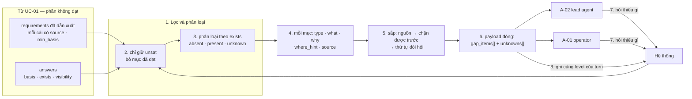
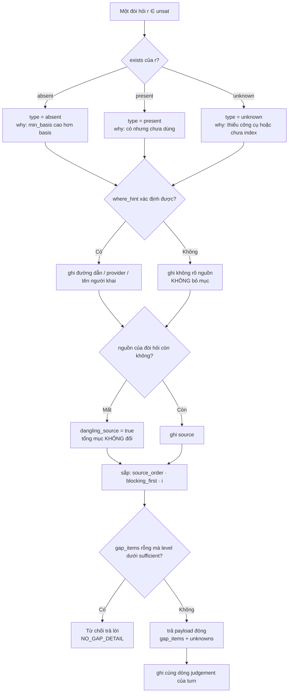
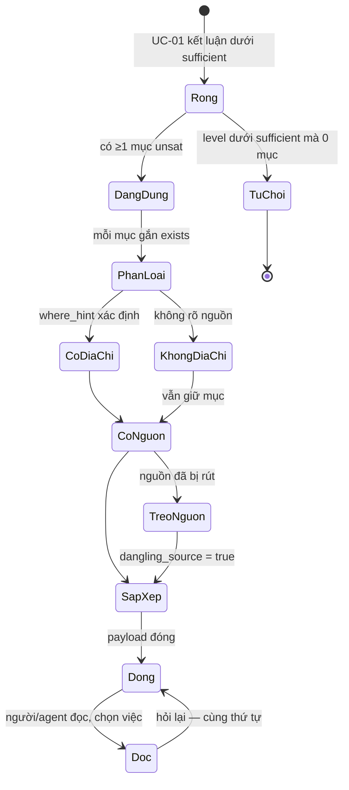
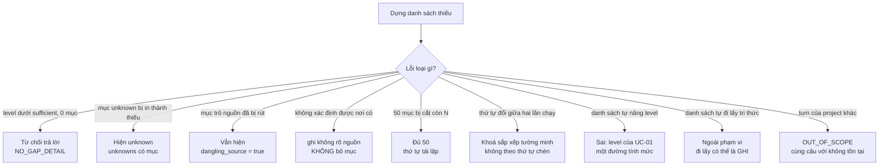

# BRD — Nói thiếu gì: danh sách đóng, hành động được, và có thứ tự

> **Đây là tài liệu nghiệp vụ, không phải spec kỹ thuật.** Nó trả lời *vì sao* "chưa đủ" mà không nói thiếu gì thì **tệ hơn**
> im lặng, *vì sao* mỗi mục phải có **loại · cái gì · vì sao quan trọng**, và *vì sao* danh sách phải **sắp được** — không phải
> để đẹp, mà để người nhận biết **bắt đầu từ đâu**. Bảng `gap_items[]` và khoá sắp xếp nằm ở
> `sdlc/09.wbs/01.packets/01.bip/15.cannot-judge.md` §5–§6.

## 1. Bối cảnh

UC-01 trả một **phán quyết**; UC-02 trả phần **giải thích** của nó — một use case riêng, không phải một nhánh, vì lý do đã ghi
ở [`02.use-cases`](../02.use-cases.md) §2: *"chưa đủ"* mà không nói **thiếu gì** thì **tệ hơn im lặng** — người dùng sẽ đi tìm
**ngẫu nhiên**.

Ba điều làm câu "thiếu gì" khó hơn nó trông:

**Thứ nhất — danh sách không phải một cuộc dạo.** *"Thiếu ngữ cảnh về `OrderService`"* nghe như đã trả lời, nhưng người nhận
không làm được gì: thiếu **cái gì cụ thể**, và **có thể có ở đâu**. `REQ-JUDGE-02` chốt hai trường đó cho **mỗi** mục — một
**danh sách đóng**: hữu hạn, đếm được, không mở thêm.

**Thứ hai — "chưa đủ" gộp hai chuyện phải tách.** Có mục cần **đi tìm** (`absent`), có mục cần **tìm lại trong thứ đã có**
(`present`), và có mục **không ai biết** (`unknown`). Ba loại, ba hành động; in chúng thành một cột "thiếu" là làm người nhận
làm sai việc (`BR-05`).

**Thứ ba — thứ tự là một phần của câu trả lời.** Với 50 mục, danh sách **không sắp** buộc người nhận đọc hết mới biết cái nào
chặn trước; `AC-SUF-05-04` và `-05` đòi thứ tự **tái lập được** giữa hai lần chạy. Và UC-02 **có US nhưng không có bề mặt
riêng** — nó là phần thân của S2/S1, tức danh sách này là thứ **duy nhất** người dùng đọc khi phán quyết dưới `sufficient`.

### 1.1 Sơ đồ tổng quan

> **Đọc sơ đồ:** UC-02 **không** tính lại gì — nó đọc `unsat` của UC-01 (bước 2), phân loại (bước 3), rồi thêm ba thứ UC-01
> không có: `why`, `where_hint`, **thứ tự** (bước 5). Bước 8 ghi cùng dòng `judgement` của turn, vì `gap_items[]` chỉ có nghĩa
> **cạnh** `level` của chính nó.

## 2. Những người trong câu chuyện

| Ai | Tuổi | Mã vai | Họ thật sự cần gì |
|---|---:|---|---|
| **Agent `lead-04`** | — | `A-02` | Một danh sách **giao được cho peer**: mỗi dòng là một việc, có địa chỉ để đi lấy. Không cần biết "hệ đã cố gắng thế nào" |
| **Anh Dũng**, trưởng nhóm `baplatform` | 38 | `A-01` | Biết **cái nào chặn trước** — anh có 20 phút trước cuộc họp và chỉ sửa được một mục |
| **Chị Hằng**, người ký duyệt nợ | 41 | `A-01` (vai duyệt) | Biết mục nào là `unknown` (cần người quyết) và mục nào là `absent` (cần người đi lấy) — chị ký khác nhau cho hai loại |
| **Em Vy**, đọc lại sau 4 tháng | 26 | `A-08` | Thấy **đúng danh sách lúc đó**, kể cả mục trỏ tới nguồn đã bị xoá. Danh sách bị "dọn cho gọn" là danh sách đã nói dối |
| **Anh Hùng**, 47 tuổi, `Ledger` team (người bị ảnh hưởng) | 47 | `A-07` (project) | Không đọc danh sách, nhưng **chịu hậu quả** nếu mục "hợp đồng consumer" bị bỏ khỏi danh sách vì nó khó nêu |

> **Điểm dễ bỏ sót:** hai người đầu đọc **cùng một payload** mà cần **hai thứ khác nhau** — agent cần *đủ mục để giao việc*,
> anh Dũng cần *thứ tự để chọn việc*. Thứ tự phải nằm **trong** danh sách, không ở giao diện.

## 3. Chuyện xảy ra hôm nay (khi chưa có hệ thống)

Ngày **20/10/2026**, `BAP-1183` — *"thêm `status_reason` vào `OrderService`"*. Công cụ hiện tại chỉ trả *"thiếu ngữ cảnh"* hoặc
*"cần thêm context"*.

| Giờ | Chuyện | Ai | Ai có lỗi |
|---|---|---|---|
| 09:20 | `lead-04` hỏi "đủ chưa"; hệ trả `partial` + *"cần thêm context"* | hệ (cũ) | **không ai** |
| 09:22 | `lead-04` đọc lại prompt, thêm 2 dòng mô tả, hỏi lại — vẫn `partial` + cùng câu | agent | **không ai** |
| 09:40 | Agent tự đi tìm: mở 6 file, 3 trong đó không liên quan | agent | **không ai** — nó không biết tìm gì |
| 10:05 | Anh Dũng thấy turn treo, **tự** đoán mục thiếu là "thiếu test" và viết thêm test | A-01 | **không ai** |
| 10:40 | Thực ra thiếu **hợp đồng consumer** và **migration note** — hai thứ khác hẳn | — | **không ai** |
| 11:00 | Turn chạy, `status_reason` dài 240 ký tự, cột là `varchar(200)` ⇒ PR fail CI | — | **không ai** |
| 16:00 | Không ai truy được *vì sao* 10:40 mới biết — câu *"cần thêm context"* không để lại dấu nào | — | **không ai** |

**Không ai có lỗi, và đó chính là điểm.** Agent không lười — nó hỏi hai lần, đi tìm ba lần. Anh Dũng không ẩu — một câu *"thiếu
context"* không cho anh lựa chọn nào ngoài đoán. Hệ không giấu — nó **không có** dữ liệu đó: câu *"cần thêm context"* sinh ra từ
một chỗ không biết mục nào thiếu.

**Cái thiếu không phải "một câu trả lời dài hơn".** Ba tuần sau không ai trả lời được *10:05, anh Dũng dựa trên gì để chọn
"thiếu test"?* — không gì cả. Chi phí thật: **2** lần hỏi lại · **6** file đọc vô ích · **1** PR fail CI · **1** vòng sửa 3 giờ
— và mục thiếu **chặn** nhất (hợp đồng consumer) **không bao giờ** được nêu.

## 4. Hệ thống phải làm gì

### 4.1 Danh sách phải **đóng** — và vì sao "một cuộc dạo" là câu trả lời tồi

Cách làm hiển nhiên là trả một câu **mô tả**: *"thiếu ngữ cảnh về service"* — luôn đúng (luôn có gì đó thiếu) và luôn vô dụng,
vì người nhận không biết **khi nào dừng**. `REQ-JUDGE-02` chốt **danh sách đóng** — hữu hạn, đếm được, mỗi mục nêu **cái
gì** + **có thể có ở đâu**:

| Hệ quả | Nếu không có | Kiểm bằng |
|---|---|---|
| số mục **đếm được** | người nhận không biết còn bao nhiêu | `AC-SUF-02-05` (500 đòi hỏi ⇒ nêu **số mục thiếu**) |
| mỗi mục có **địa chỉ** để đi | đi tìm ngẫu nhiên (đúng ngày 20/10) | `AC-SUF-01-03` (`what` + `where_hint`) |
| không có mục nào **bị bỏ** | danh sách "gọn" là danh sách đã nói dối | `AC-SUF-02-06`, `AC-SUF-05-06` |

Và luật chống rỗng: `level < sufficient` mà `gap_items[]` **rỗng** thì **từ chối trả lời** (`NO_GAP_DETAIL`, `AC-SUF-05-02`) —
nó chặn đúng loại câu *"chưa đủ"* mà không ai hành động được, tức **một lời từ chối viết dài**.

### 4.2 Ba trường cho mỗi mục: loại · cái gì · vì sao quan trọng

Một dòng hai cột (*"thiếu: hợp đồng consumer"*) vẫn không đủ, vì người nhận không biết **vì sao** nó chặn. Mỗi `gap_item` mang
ba thứ, mỗi thứ trả lời một câu khác:

| Trường | Trả lời | Ví dụ `BAP-1183` |
|---|---|---|
| `type` (`exists` thô) | **loại thiếu**: `absent` · `present` · `unknown` | `absent` — không có trong phạm vi đã tìm |
| `what` | thiếu **cái gì**, cụ thể | *hợp đồng consumer `Ledger` cho `OrderService.status_changed`* |
| `why` (+ `min_basis`, `source`) | **vì sao** nó chặn: cần `verified` vì chạm producer | `blast` ⇒ chạm `Ledger`, đoán sai gãy người khác |
| `where_hint` | **có thể có ở đâu** | `Ledger/src/contracts/*.ts` · `docgraph:ledger/ordering` |

`why` là trường dễ bị bỏ nhất và là trường quyết định: không có nó, ba mục `absent` **trông ngang nhau** và anh Dũng chọn mục
đầu tiên (đúng lúc 10:05); có nó, người nhận biết mục nào **phải** có trước (`verified` trên producer), mục nào **nên** có
(`retrieved`).

`where_hint` phải cho phép **cả** trường hợp **không biết nơi**: `AC-SUF-01-03` ghi *"mục không rõ nguồn ⇒ ghi \"không rõ nguồn\",
**không** bỏ mục đó"* — bỏ mục vì khó nêu địa chỉ là làm danh sách ngắn hơn và **sai hơn**.

### 4.3 `unknown` phải hiện là `unknown` — không phải "thiếu"

Cách gộp dễ nhất là in mọi mục chưa đạt dưới một nhãn *"thiếu"* — biến câu đúng (*"tôi không biết"*) thành câu sai (*"ở đây
không có"*), và `BR-05` cấm điều đó; `AC-SUF-05-03` kiểm: mục `exists = unknown` **hiện là `unknown`**. Lỗi này **nặng hơn** một
nhãn sai: người nhận `unknown` sẽ **hỏi người** hoặc **bật nguồn**; người nhận "thiếu" sẽ **đi tìm** rồi **viết lại** thứ đã có
(40 phút ngày 22/10, host `FinESO`). Nên `type` là **trường**, không phải cột trạng thái chung:

| `exists` | Nghĩa | Hành động đúng | Ai làm |
|---|---|---|---|
| `absent` | đã tìm đủ, không có | đi **lấy** (đọc · hỏi · tạo) | người |
| `present` | có, nhưng chưa dùng / chưa thấy | **tìm lại** trong thứ đã có (tăng recall) | agent |
| `unknown` | chưa tìm đủ, hoặc không có cách tìm | **bật nguồn** hoặc **hỏi người** | người |

### 4.4 Danh sách phải **sắp được** — thứ tự là một phần của câu trả lời

Cách trả tự nhiên là theo thứ tự mục được sinh ra. Nó hỏng ở đúng ca có nhiều mục: `AC-SUF-05-05` dựng **50 mục**, đòi đủ 50,
**sắp theo nguồn rồi cái chặn trước**, và **tái lập được giữa hai lần chạy**. Ba lý do, ba người khác nhau:

- **Anh Dũng (20 phút)** cần mục **chặn trước** ở đầu; không sắp, anh đọc 50 dòng để chọn một.
- **Agent** cần nhóm theo **nguồn** (`bar` · `work` · `blast` · `declared`) vì mỗi nguồn có **cách bổ sung** khác nhau — sửa
  ticket, đọc hợp đồng, hay khai `bar`. Sắp theo nguồn là sắp theo **việc phải làm**.
- **Em Vy** cần **cùng** danh sách ở hai lần đọc; thứ tự đổi mỗi lần thì hai lần đọc là hai tài liệu.

Khoá sắp xếp nằm ở `15.cannot-judge` §6.5; ở đây chỉ nói **vì sao nó phải viết ra** thay vì để theo thứ tự chèn.

### 4.5 Mục trỏ tới nguồn **đã mất** vẫn phải hiện

Khi một `role` bị xoá hoặc một `bar` bị rút, mục thiếu sinh ra từ đó không còn nguồn để trỏ tới — và cách "dọn" hợp lý là bỏ mục
đó, đúng chỗ danh sách bắt đầu nói dối. `AC-SUF-02-06` và `AC-SUF-05-06` chốt: mục **vẫn hiện**, ghi *"nguồn đã mất"*
(`dangling_source: true`), **không** thay role khác, **tổng số mục không đổi**.

Vì sao: 50 mục hôm nay và 49 mục ngày mai cho **cùng một việc** thì không ai biết mục thứ 50 **đã từng** tồn tại — và nếu đó là
mục chặn, hệ vừa **giấu** đúng thứ nó phải nói. Đây là `D-33` áp vào danh sách: thứ người khác trông vào thì không xoá.

### 4.6 Danh sách **không** phải chỗ nâng mức, và **không** phải chỗ đi lấy

| Không được | Vì sao | Nếu vượt |
|---|---|---|
| danh sách làm `level` **tốt lên** | `level` do UC-01 tính; danh sách chỉ giải thích | hai đường tính mức ⇒ `BR-01` vỡ |
| danh sách **tự đi lấy** tri thức thiếu | `UC-01` "Ngoài phạm vi" ghi rõ: đi lấy là việc khác | một turn tự mở rộng phạm vi mà không ai duyệt |
| mục `unknown` bị **hạ** thành `absent` | `BR-05` | sai một cách tự tin, ở tầng hiển thị |

Ranh giới thứ hai là ranh giới **quyền**: đi lấy có thể là **ghi** (tạo hợp đồng, sửa ticket) — danh sách nói **cần gì**, người
quyết định **ai đi lấy**.

### 4.7 Sơ đồ quyết định: một mục thiếu thuộc loại nào, và in ra sao

| Nút | Điều kiện | Nguồn |
|---|---|---|
| **`exists`** | ba giá trị, đóng | `BR-05` · `05` §2 |
| **`where_hint`** | đường dẫn / provider / "không rõ nguồn" | `AC-SUF-01-03` |
| **`dangling_source`** | nguồn của đòi hỏi đã bị rút | `AC-SUF-05-06` · `AC-SUF-02-06` |
| **Thứ tự** | `source_order` → `blocking_first` → `i` | `AC-SUF-05-04` · `-05` |
| **Từ chối** | `gap_items = []` ∧ `level < sufficient` | `AC-SUF-05-02` · `NO_GAP_DETAIL` |

## 5. Một ngày thật, có số

Ngày **21/10/2026** trong `baplatform`. Ba việc, ba danh sách thiếu, tổng **11** mục. Việc `BAP-1183` (thêm `status_reason` vào
`OrderService`), vai `build@7`:

| Mục | `exists` | `what` | Vì sao quan trọng | `where_hint` |
|---|---|---|---|---|
| 1 | `absent` | hợp đồng consumer `Ledger` cho `status_changed` | `blast` ⇒ chạm producer, cần `verified` | `Ledger/src/contracts/*.ts` |
| 2 | `absent` | migration note (cột mới trên bảng có dữ liệu) | `declared` ⇒ không đổi bảng mà không có kế hoạch | `docs/migrations/` |
| 3 | `present` | ADR-014 về enum `status` | `declared` ⇒ có, nhưng không nằm trong pack | `docgraph:adr/014` |
| 4 | `unknown` | hợp đồng consumer `Billing` (không vào được) | `blast` ⇒ chạm producer | *không rõ nguồn* |

**Việc `BAP-1184`** (thêm audit log vào `OrderService`):

| Mục | `exists` | `what` | Vì sao quan trọng | `where_hint` |
|---|---|---|---|---|
| 1 | `absent` | danh sách event phải audit do người khai | `declared` ⇒ invariant của dự án | `sdlc/…/invariants.md` |
| 2 | `present` | test hiện có của `OrderService` | `work` ⇒ có, chưa đọc | `src/order/*.test.ts` |
| 3 | `absent` | định nghĩa "audit" trong chuẩn nội bộ | `declared` | *không rõ nguồn* |

**Việc `BAP-1185`** (thêm test cho `Ledger`):

| Mục | `exists` | `what` | Vì sao quan trọng | `where_hint` |
|---|---|---|---|---|
| 1 | `absent` | rubric của `qc` | `bar` ⇒ role `qc` cần rubric | `qc/README` |
| 2 | `unknown` | môi trường chạy test | `bar` ⇒ cần `env`, chưa probe được | *không rõ nguồn* |
| 3 | `present` | scenario matrix hiện có | `work` | `qc/scenario-matrix` |
| 4 | `absent` | tên service đích cho blast | `blast` ⇒ không suy được | `services.yml` |

### 5.1 Sơ đồ trạng thái một danh sách thiếu đi qua

| Trạng thái | Ai đưa vào | Dữ liệu phải có |
|---|---|---|
| `Rong` | UC-01 | `level < sufficient` |
| `TuChoi` | hệ | `gap_items = []` ⇒ `NO_GAP_DETAIL`, **0** câu trả lời |
| `DangDung` | hệ | ≥1 mục `unsat` |
| `PhanLoai` | hệ | `exists` thô của từng mục (`BR-05`) |
| `CoDiaChi` / `KhongDiaChi` | hệ | `where_hint` **hoặc** câu *"không rõ nguồn"* |
| `TreoNguon` | hệ | `dangling_source: true`, tổng mục **không đổi** |
| `SapXep` | hệ | khoá sắp xếp tường minh (`15` §6.5) |
| `Dong` | hệ | `gap_items[]` + `unknowns[]` **luôn có khoá** |

> **Hai chỗ còn treo:** cạnh `Doc → Dong` (danh sách mới thay thế hay **cộng dồn** — §8 câu 3), và `TuChoi` không có cạnh ra vì
> `AC-SUF-05-02` không nói người dùng thấy gì tiếp theo (§8 câu 4).

### 5.2 Bảng số của ngày 21/10

| Mốc | Việc | Mục | `absent` | `present` | `unknown` | Không rõ nguồn | Giây dựng |
|---|---|---:|---:|---:|---:|---:|---:|
| 09:05 | `BAP-1183` | 4 | 2 | 1 | 1 | 1 | 0,7 |
| 09:06 | `BAP-1183` sắp xếp, đọc | 4 | 2 | 1 | 1 | 1 | 0,1 |
| 10:20 | `BAP-1184` | 3 | 2 | 1 | 0 | 1 | 0,5 |
| 14:10 | `BAP-1185` | 4 | 2 | 1 | 1 | 1 | 0,6 |
| 16:30 | Hỏi lại `BAP-1183` sau khi bổ sung | 2 | 1 | 1 | 0 | 0 | 0,4 |
| 17:00 | Tổng ngày | 11 mục · 3 lượt dựng + 1 lượt hỏi lại | 6 | 3 | 2 | 3 | 2,3 |

**Ba con số để nhớ:** **11** mục cho 3 việc (không phải "thiếu context") · **3** mục `present` — ba lần hệ **đã có** thứ cần dùng
· **3** mục *"không rõ nguồn"* **vẫn được giữ** thay vì bị bỏ cho danh sách gọn.

## 6. Ngoại lệ — và hệ thống làm gì

| Tình huống thật | Hệ thống xử lý |
|---|---|
| `level < sufficient` nhưng 0 mục | **Từ chối trả lời** — *"chưa đủ"* cần ít nhất một mục (`AC-SUF-05-02`, `NO_GAP_DETAIL`) |
| Một mục `exists = unknown` | Hiện là `unknown`, **không** là *"thiếu"*; `unknowns[]` có mục (`AC-SUF-05-03`, `BR-05`) |
| 4 mục từ 4 nguồn | Sắp theo nguồn rồi chặn-trước (`AC-SUF-05-04`) |
| 50 mục từ nhiều nguồn | Đủ **50**, cùng thứ tự ở hai lần chạy (`AC-SUF-05-05`) |
| Đòi hỏi trỏ tới role đã bị xoá | Mục **vẫn hiện**, ghi *"nguồn đã mất"*; tổng mục không đổi (`AC-SUF-05-06`) |
| Đòi hỏi trỏ tới `bar`/`work`/`blast`/`declared` đã xoá | Vẫn nêu đòi hỏi, ghi *"nguồn đã mất"*; không đoán nguồn khác (`AC-SUF-02-06`) |
| 500 đòi hỏi, phần lớn dưới `sufficient` | Nêu **số mục thiếu đếm được** + cái chặn trước; **không** cắt bớt mà không nói (`AC-SUF-02-05`) |
| Mục không xác định được nơi có | Ghi *"không rõ nguồn"*, **không** bỏ mục (`AC-SUF-01-03`) |
| Danh sách cho người, không có ngữ cảnh agent | Câu trả lời dẫn tới hành động: *việc gì · thiếu gì · cần cung cấp gì* (`AC-SUF-02-01`) |
| Người hỏi khi thiếu vì chưa khai | Nói rõ **"cần bạn khai X"**; không suy giá trị mặc định (`AC-SUF-02-02`) |
| Người vẫn yêu cầu làm dù `partial` | Việc không bị chặn; quyết định ghi là **của người** (`AC-SUF-02-04`) |
| Hai lần hỏi cùng việc, cùng dữ liệu | Hai danh sách **giống từng mục và cùng thứ tự** (`AC-SUF-05-05`) |

### 6.1 Sơ đồ nhánh lỗi

## 7. Điều ngoài phạm vi

| Không thuộc tài liệu này | Thuộc |
|---|---|
| **Tính** `level` và `basis` — năm mức, hai người hỏi, một phán quyết | `01.uc-01-is-it-enough.md` |
| Record của một turn: vì sao quyết định ra vậy, đọc lại sau N tháng | `03.uc-03-why-this-decision.md` |
| Khai đội agent: ai · vai · quyền — và `bar` là một **nguồn** của đòi hỏi | `04.uc-04-agent-team.md` |
| Đưa một project vào, để `declared` có chỗ nằm | `05.uc-05-project-onboarding.md` |
| Chọn skill/luật nào áp — nguồn `declared` cụ thể là gì | `06.uc-06-which-rule-applies.md` |
| Nâng skill dùng chung — nguồn `bar` đổi thì danh sách đổi theo · rút skill ⇒ mục `dangling_source` | `07.uc-07-promote-shared.md` · `08.uc-08-revert-broken.md` |
| Hỏi *"vì sao bị chặn"* như một bề mặt trả lời đầy đủ | `09.uc-09-why-blocked.md` |
| Đề xuất tự sửa cách làm khi danh sách thiếu lặp lại | `10.uc-10-self-proposal.md` |
| Duyệt một ticket đã làm xong | `11.uc-11-ticket-done.md` |
| Hiểu một project gồm những gì — `blast` lấy từ đây | `12.uc-12-what-is-in-project.md` |
| Cảnh báo **dù không hỏi** — dùng lại đúng danh sách này | `13.uc-13-unprompted-warning.md` |
| Chọn nguồn năng lực khi host thiếu — vì sao mục thành `unknown` | `14.uc-14-capability-source.md` |
| Hình dạng `payload.gap_items[]`, tập khoá đóng, khoá sắp xếp | `sdlc/09.wbs/01.packets/01.bip/15.cannot-judge.md` §5 · §6.5 |

## 8. Câu chưa có trả lời trong release

| # | Câu hỏi | Mã | Vì sao cây không trả lời được |
|---|---|---|---|
| 1 | **Thứ tự bốn nguồn là gì, và ai chốt?** `15` §6.5 dùng `bar < work < blast < declared` và tự ghi đó là **suy luận**; không tài liệu nào chốt, trong khi `AC-SUF-05-04` lại **kiểm** nó | `NEW-OPEN-BRD-uc02-1` | `07` §1 chỉ liệt kê bốn nguồn trong một **hình**, không nói thứ tự ưu tiên; `03.business-rules` §BR-04 cũng chỉ liệt kê. Một AC đang kiểm một khoá **chưa ai quyết** |
| 2 | **`blocking_first` nghĩa là gì, chính xác?** `15` §6.5 xếp `absent` trước `unknown` và gọi `absent` là gap **chặn được** — nhưng "chặn được" là thuộc tính của **gap**, không nguồn nào định nghĩa nó như một trường | `NEW-OPEN-BRD-uc02-2` | *"Gap đóng được"* xuất hiện ở `D-09` như **tiêu chí chọn `block`/`mitigate`**, không như trường dữ liệu của `gap_item`. Khoá sắp xếp dựa trên một khái niệm chưa có chỗ ghi |
| 3 | **Hỏi lại sau khi sửa một phần: thay thế hay cộng dồn?** Mỗi turn có `gap_items[]` riêng; không nguồn nào nói ghép nhiều turn thế nào để ra "còn thiếu gì **bây giờ**" | `NEW-OPEN-BRD-uc02-3` | `schema` §2 không có bảng nối giữa các `judgement`; `US-SUF-05` chỉ nói *"hiện danh sách"* cho **một** turn. Muốn trả lời "còn thiếu gì bây giờ" phải có luật ghép, và luật đó không tồn tại |
| 4 | **Người dùng thấy gì khi danh sách bị từ chối (`NO_GAP_DETAIL`)?** `AC-SUF-05-02` chốt *"từ chối"*, không nói màn hình hiện gì — và im lặng thì trùng với "không có gì thiếu" | `NEW-OPEN-BRD-uc02-4` | `08.ui-design/01.surfaces` §3 liệt kê **bốn** thứ `S2` phải hiện, không có trạng thái "không dựng được danh sách"; `contracts` `API-3` chỉ nói trả `unknowns[]` |
| 5 | **500 mục thì hiện hết hay phân trang?** `AC-SUF-02-05` đòi *"số mục đếm được + cái chặn trước"* nhưng không nói 500 mục có bị **cắt** ở đâu; `API-21` cấm phân trang một turn (`TURN_TOO_LARGE`), còn danh sách thiếu thì không | `NEW-OPEN-BRD-uc02-5` | `AC-SUF-02-05` nói *"không cắt bớt mà **không nói**"* — tức **được** cắt nếu nói, nhưng không nguồn nào định nghĩa ngưỡng hay hình thức "nói" |

## 9. Truy vết

| Yêu cầu (REQ) | Điều khoản | Mục trong BRD |
|---|---|---|
| `REQ-JUDGE-02` | Dưới `sufficient`, danh sách **đóng**: mỗi mục **cái gì** + **có thể có ở đâu** | §4.1 · §4.2 · §6 |
| `REQ-JUDGE-01` | Năm mức, `basis` từng đòi hỏi — đầu vào của danh sách | §1 · §4.6 |
| `REQ-JUDGE-03` · `UC-02` | Nêu thiếu khi không ai hỏi (dùng lại danh sách này) · hệ nói "chưa đủ" và **thiếu gì** | §7 · toàn bộ |

| Luật (BR) | Điều khoản | Mục trong BRD |
|---|---|---|
| `BR-04` | Mọi requirement nêu nguồn — mỗi mục thiếu mang `source` | §4.2 · §4.5 |
| `BR-05` | `unknown` ≠ `absent` | §4.3 · §6 |

| Quyết định (D) | Điều khoản | Mục trong BRD |
|---|---|---|
| `D-09` | Gap đóng được ⇒ `block`/`mitigate`; khái niệm "chặn được" | §4.4 · §8 câu 2 |
| `D-33` | Thứ người khác trông vào thì không xoá — áp vào danh sách | §4.5 |
| `D-45` | Record nói thật, answer không rò — `visibility` không sinh `unknown` | §4.3 |
| `D-46` | Danh sách là **đầu ra**, không phải đầu vào của lần quyết sau | §4.6 · §7 |

| US / AC | Điều khoản | Mục trong BRD |
|---|---|---|
| `US-SUF-05` | Nói thiếu gì, không chỉ nói "chưa đủ" | §4.1 · §4.2 |
| `AC-SUF-05-01` … `-06` | nguồn · không mục nào · `unknown` · thứ tự · 50 mục · nguồn đã mất | §4.2 · §4.4 · §4.5 · §6 |
| `AC-SUF-01-03` | `what` + `where_hint`, mục không rõ nguồn **không** bị bỏ | §4.2 · §6 |
| `AC-SUF-02-05` / `-06` | 500 mục đếm được · nguồn đã xoá vẫn nêu | §4.1 · §4.5 · §8 |

## Revision rule

Sai khi: `REQ-JUDGE-02` không còn đòi **hai** trường cho mỗi mục, hoặc `AC-SUF-05-02`/`-04`/`-05`/`-06` đổi (bỏ `NO_GAP_DETAIL`,
đổi khoá sắp xếp, cho phép cắt danh sách, cho phép bỏ mục treo nguồn), hoặc `BR-05` bị nới để `unknown` hiện thành "thiếu", hoặc
`gap_items[]` được tách thành bảng riêng ở `02.schema` → cập nhật §4.2 · §4.4 · §4.5 · §9.

Nguồn kiểm: `grep -oE 'AC-SUF-05-0[1-6]' sdlc/06.analysis/03.acceptance-criteria/39.suf-us-05-gaps.md | sort -u | wc -l` — phải
ra **6**; và `grep -c "NO_GAP_DETAIL" sdlc/06.analysis/03.acceptance-criteria/39.suf-us-05-gaps.md` — phải còn **≥1** (mã chưa có
nhà ở `07.technical/03.api/00.index.md`; nếu nó được thêm vào đó, dòng này phải trỏ **cả hai** nơi).
