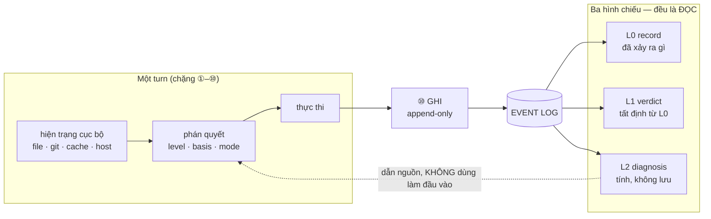
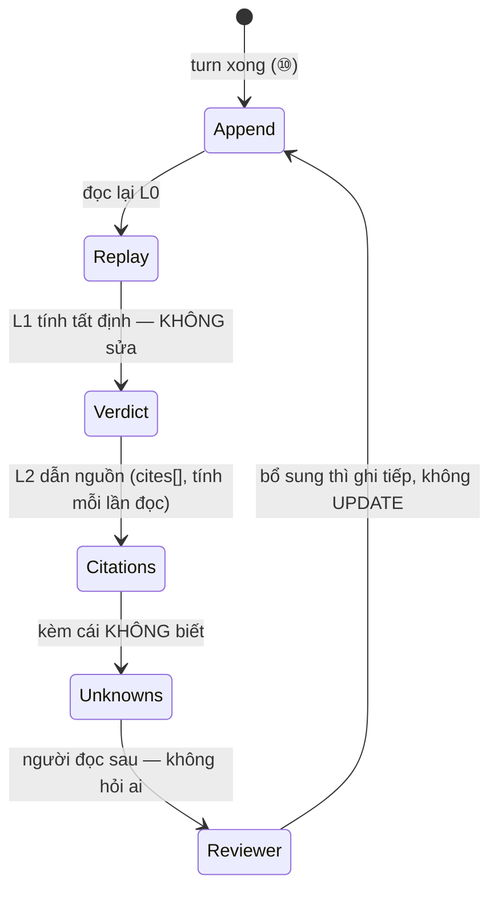
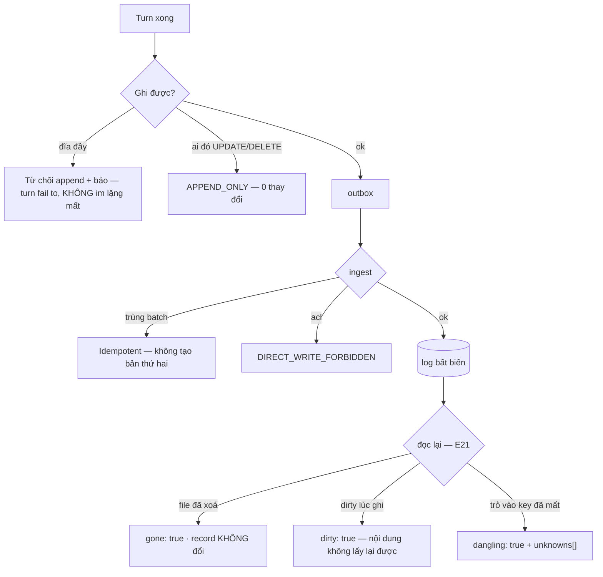

# BRD — Record là đầu ra: dựng lại điều hệ thống đã biết

> **Đây là tài liệu nghiệp vụ, không phải spec kỹ thuật.** Nó trả lời *vì sao* record **không phải log**, *cái gì* phải nằm
> trong một record để ba tháng sau một người **không có mặt** dựng lại được, và *vì sao* cái khó nhất là ghi lại **cái chưa
> biết**.

## 1. Bối cảnh

Ngày 20/10/2026, một agent thêm audit log cho `OrderService` trong `baplatform`. Turn đó mất **11 phút**, sinh ra **một** PR và
**một** record. Ba tháng sau, người ta mở lại và hỏi bốn câu **khác nhau** — và bốn câu này là toàn bộ lý do record tồn tại:

1. *"Turn đó đã quyết gì?"* — dễ nhất, và cũng ít giá trị nhất.
2. *"Nó dựa trên **cái gì**?"* — skill bản nào, file nào, luật nào, đoạn tài liệu nào.
3. *"Lúc đó nó **không** biết gì?"* — câu khó, và là câu **không ai ghi**.
4. *"Ai đã cho qua, khi đang thiếu những thứ ở câu 3?"* — câu duy nhất mà người vận hành thật sự cần lúc 2 giờ sáng.

Ba câu sau **không** trả lời được từ log. Log ghi *"đã gọi hàm `resolve`"*; câu 2 hỏi *"hàm đó đọc ra **bản số mấy**"*. Hệ
thống hay ghi loại dễ (câu 1) rồi gọi nó là "audit". Ba thứ làm bài toán này khó:

**Thứ nhất — record là đầu ra, không phải đầu vào.** `D-46`: phán quyết dùng **hiện trạng cục bộ** (file · git · cache khai
báo · năng lực host), và record **không bao giờ** là đầu vào của lần quyết sau.

**Thứ hai — "bằng chứng" là hai chữ, hai nghĩa.** Nghĩa 1 là *"bằng chứng cần có"* cho một requirement (đầu vào). Nghĩa 2 là
*"bản ghi đã append"* (đầu ra). Chỉ nghĩa 2 bất biến và tập trung.

**Thứ ba — cái đã biết thì dễ ghi, cái **chưa** biết thì không ai ghi.** Đây là chỗ hỏng thật: một record chỉ có phần đã biết
**trông như** toàn bộ sự thật.

### 1.1 Sơ đồ tổng quan



> **Đọc sơ đồ:** mũi tên duy nhất đi từ log **về** phán quyết là mũi tên **nét đứt** — và nó **bị cấm** (`D-46`). Record chỉ
> được **đọc** để trả lời "vì sao", không được **dùng** để trả lời "có đủ chưa".

## 2. Những người trong câu chuyện

| Ai | Vai trong hệ thống | Họ thật sự cần gì |
|---|---|---|
| **Khánh**, 29 tuổi, vận hành | `A-08` | 2 giờ sáng: dựng lại **lúc đó hệ thống biết gì**, không phải **nó đã quyết gì** |
| **Lan**, 41 tuổi, review | `A-01` | Ba tháng sau mở lại, thấy **đúng bản skill** đã chạy, và **ai** cho qua phần thiếu |
| **Đức**, 44 tuổi, kỹ sư trưởng | `A-01` | Một artifact hỏng: biết nó tạo trên bản shared nào — `UC-08` |
| **Agent** (Cursor/DSH) | `A-02` | Không phải nhớ gì: **runtime** ghi, agent không tự khai |

> **Điểm dễ bỏ sót:** Khánh **không** hỏi *"code làm gì"* — cô đọc code được. Cô hỏi *"lúc đó nó biết gì, và **không** biết
> gì"*. Câu thứ hai chỉ trả lời được nếu **phần chưa biết** được ghi lại **như phần đã biết**, không phải như một dòng cảnh báo
> ở cuối.

## 3. Chuyện xảy ra hôm nay (khi chưa có hệ thống)

**20/10, 14:02** — Agent làm turn `T-4471`. Log ghi: `resolve()`, `read(12 files)`, `write(src/audit.ts)`, `model_call(1)`.

**21/10** — PR merge. Test xanh.

**17/01/2027 (ba tháng sau)** — một truy vấn audit trả sai định dạng. Khánh mở log của `T-4471`: **14 dòng** về hàm đã gọi. Cô
**không** thấy skill nào đã chạy, bản nào, file nào đọc ở commit nào, và **cái gì chưa biết**.

**Điều đã xảy ra:** turn đó chạy trên `jira-flow@1.0` — **bản local** trong `baplatform`, không phải `shared@1.2`. Log **có**
dòng `read(skills/jira-flow.md)`; nó **không** có phiên bản, **không** có hash. Ba tháng sau file local đã bị xoá, nên ngay cả
đường dẫn đó cũng không mở được.

**Không ai sai.** Log làm đúng việc của log. Nhưng log ghi *"đã đọc file X"*, còn Khánh hỏi *"file X **lúc đó** là nội dung
nào"* — và câu đó cần **hash + commit**, không cần tên hàm. Đức gặp cùng chuyện từ phía khác: một artifact hỏng, và câu *"artifact
nào tạo trên bản 1.3"* phải trả lời bằng **hỏi từng người** — không ai nhớ, và người nhớ cũng **không kiểm được**.

## 4. Hệ thống phải làm gì

### 4.1 Record là **đầu ra** — và điều đó quyết định nó ghi gì

`D-46`: đầu vào của phán quyết là **hiện trạng cục bộ**; record là **bản ghi**, không bao giờ là đầu vào. Đây không phải chi
tiết kiến trúc — nó là **lý do** record phải ghi **nội dung**, không phải **kết luận**: nếu record là đầu vào thì *"lần trước
kết luận `sufficient`"* thành bằng chứng cho lần này, và **cũ** trở thành **bằng chứng** — lỗi duy nhất mà hệ thống **thưởng
cho việc không kiểm lại**.

Ngoại lệ duy nhất, và nó phải **được khai**: một **loại bản ghi** + **TTL**. Khi đó `basis = retrieved`, record ghi **id +
tuổi**. Hợp lệ: *"kết quả test trong 24h được tính"*. **Không** hợp lệ: *"turn trước kết luận sufficient"*.

### 4.2 Phép thử của một record tốt: người **không có mặt** dựng lại được

Đây là định nghĩa dùng được — và nó loại bỏ hầu hết record thật trên đời:

> Ba tháng sau, một người **không có mặt** trong turn đó đọc record và dựng lại được **hệ thống đã biết gì** — không cần hỏi
> ai, không cần mở log thô, không cần tính lại.

Chú ý vế **"đã biết gì"**, không phải **"đã quyết gì"**: quyết định là **hệ quả**, người đọc sau cần **tiền đề**. Một record
ghi *"`partial`, `ask`, người duyệt: Lan"* trả lời câu 1 và câu 4 nhưng **không** trả lời câu 2 và 3 — mà câu 2/3 mới là chỗ
chẩn đoán được sai.

### 4.3 Năm tầng, và tầng nào cũng **bắt buộc**

Record của một turn phải đủ để trả lời, **theo thứ tự**, năm tầng của chặng ①–⑩ (`09.evidence-plane` §2):

| Tầng | Ghi gì | Bỏ thì hỏng gì |
|---|---|---|
| **ai** | `actor{role, status: FULL·DECLARED·DEGRADED, tenant}` | không biết **ai** làm thì không được giả vờ |
| **vì sao đòi** | `requirements[]` + `source` từng cái | không biết **vì sao** nó bị đòi |
| **phủ tới đâu** | `blast{ids, completeness}` | blast thiếu ⇒ requirement thiếu ⇒ `sufficient` **sai hệ thống** |
| **đã tìm thế nào** | `exists` + `ExistenceClaim{scope, method, at, ttl}` | chứng minh **đã tìm**, thay vì **đoán** |
| **đã dùng cái gì** | `Resolved[]` + `FileUse{path, content_hash, git_commit, dirty}` + `elections` | không trả lời được *"dựa trên cái gì"* |

Tầng thứ năm là tầng đắt nhất, và là tầng duy nhất mà log **không** có. `FileUse` có **bốn** trường, không ba: `dirty` không
phải chi tiết phụ — nó là **giới hạn của bằng chứng**, và phải hiện trong chẩn đoán.

### 4.4 Cái **chưa biết** phải là một trường, không phải một câu văn

`unknowns[]` là trường dễ bị bỏ nhất và quan trọng nhất (`09.evidence-plane` §4; `API-21` bắt buộc nó **kể cả khi `[]`**). Phải
là **trường** vì *"vắng mặt"* và *"rỗng"* là **cùng một lời nói dối** (`BR-05`) — một chẩn đoán không nói mình không biết gì
sẽ bị đọc như **toàn bộ sự thật**.

Và mỗi mục không phải chỗ ghi chung chung: có **cái gì** chưa biết và **vì sao** (`cause` — `gone` · `dirty` · `not-visible` ·
`cache-empty` · `partial-blast`). Người đọc sau cần **vì sao**, vì đó là thứ quyết định họ có thể tìm lại được hay không.

### 4.5 Chỉ ghi thêm — và đổi bằng cách ghi tiếp

`BR-06`: không `UPDATE`, không xoá; trạng thái hiện tại = **replay** sự kiện. Một record sửa được thì **không chứng minh**
được gì — kể cả khi nó đúng, không ai kiểm được nó **đã từng** đúng. Ba thứ trông như "phải sửa" nhưng **không** được sửa:

| Trông như cần sửa | Cách đúng |
|---|---|
| File đã xoá (`FileUse` trỏ đi đâu?) | **không** thêm cờ vào `FileUse`; "file không còn" là **quan sát lúc đọc**, báo **cùng** hash + commit |
| Risk đổi trạng thái | **sự kiện** (`risk.accepted` …), trạng thái = replay |
| Chẩn đoán sai vì luật cũ | **tính lại** kèm `rule_version`, không ghi đè bản cũ |

### 4.6 Người **không** được ghi thẳng

Runtime ghi; người ghi qua `risk:event` (`API-11`), ghi thẳng ⇒ `DIRECT_WRITE_FORBIDDEN` (`AC-EV-01-05`). Không phải phân quyền
cho đẹp: nếu màn hình audit có đường ghi vào record thì **chính record** hết giá trị (`D-16`: *"a monitor that can mutate the
state it displays is a monitor whose audit log cannot be trusted"*).

## 5. Một ngày thật, có số

`baplatform` · turn `T-4471` · 2026-10-20 · 14:02. Đây là record thật của turn đó, đọc lại qua `API-21`:

```
turn_id     T-4471          at 2026-10-20T14:02:11Z
level       partial          basis verified        mode ask
guarantee   G-FULL

①  actor            A-02 · role=build · status=FULL · tenant=baplatform
②  requirements[3]  · "audit log có test đi kèm"   source=declared  min_basis=verified
                    · "14 symbol trong blast radius"  source=blast     min_basis=retrieved
                    · "cô lập tenant"                 source=bar       min_basis=verified
③  blast            14 symbol · completeness 0.87
⑤⑥ exists           present · absent · unknown — mỗi cái kèm claim{scope, method, at, ttl}
⑧  mode             ask ← escalation bước 3 (người: Lan)
⑩  Resolved[12]     jira-flow@1.0  from: project
                    test-ladder@1.2 from: shared
                    … 10 mục nữa
   files_used[7]    src/order/audit.ts   sha256:9a11…  c1a3f2  dirty=false
                    skills/jira-flow.md  sha256:44e0…  c1a3f2  dirty=true
   elections         graph → codegraph (external) · memory → host-native
   unknowns[2]
     · "nội dung skills/jira-flow.md chưa commit — không lấy lại được từ git"   cause: dirty
     · "blast mới phủ 14 symbol, completeness 0.87 — 2 symbol không có test"   cause: partial-blast
```

**Ba con số của turn này:**

| | |
|---|---|
| **12** | skill trong `Resolved[]` — trong đó **1** là `from: project` (bản tháng 9) |
| **7** | `FileUse`, trong đó **1** có `dirty: true` |
| **2** | mục `unknowns[]` — và **không** mục nào là *"không có gì"* |

**14:02:11** — record append: **một** sự kiện, không `UPDATE` nào sau đó.

**17/01/2027** — Khánh đọc lại. Dòng `dirty: true` trên `jira-flow.md` nói ngay: **nội dung turn đó đọc không lấy lại được
từ git**. Đó là **giới hạn của bằng chứng**, và nó phải hiện ra thì cô mới biết mình **không** được kết luận gì về nội dung
file. Cô cũng thấy `level: partial`, `mode: ask`, `unknowns[1]` nói **thiếu 2 symbol**, và escalation bước 3 có **một người**
(Lan). Câu 2, 3, 4 đều trả lời được — từ **một** record, không hỏi ai.

**Cùng ngày, từ phía khác** — Đức hỏi *"artifact trong PR này tạo trên bản shared nào"*. `Resolved[]` của cùng turn trả:
`test-ladder@1.2` · `jira-flow@1.0 from: project`. Anh thấy ngay **không** phải bản shared — nghĩa là một lần revert `shared`
**không** chạm artifact này.

### 5.1 Từ phán quyết đến "artifact này chạy trên bản nào"



**Không có đường tắt.** `Reviewer → Verdict` (sửa lại phán quyết) không tồn tại; muốn nói *"phán quyết sai"* thì append một sự
kiện, và L1 **tính lại** từ đó.

## 6. Ngoại lệ — và hệ thống làm gì

| Tình huống thật | Hệ thống xử lý |
|---|---|
| File `dirty: true` lúc chạy | Ghi `dirty: true` **và** nói rõ nội dung **không lấy lại được** (`AC-EV-01-03`) |
| File đã xoá sau đó | `FileUse` **không đổi** (4 trường); khi đọc **báo** "file không còn" cùng hash + commit (`AC-EV-01-07`) |
| `dirty` **và** đã xoá cùng lúc | Ca xấu nhất: **không lấy lại được từ đâu cả** — chẩn đoán phải nói đúng thế, không nói "có bằng chứng" |
| Ai đó sửa/xoá record | **từ chối**, `APPEND_ONLY` (`AC-EV-01-02`) |
| Cùng batch gửi 2 lần | idempotent `(project, turn_id, seq)` — gửi trùng **không** tạo bản thứ hai (`D-47` `OP-02`) |
| Người ghi thẳng vào evidence | **từ chối**, `DIRECT_WRITE_FORBIDDEN`; người ghi qua `risk:event` (`AC-EV-01-05`) |
| Project B truy vấn record project A | **không thấy** (`AC-EV-01-04`); `403` **cùng** câu với "không tồn tại" |
| Record lớn vượt giới hạn | `413 TURN_TOO_LARGE` — **không** trả một phần, vì cắt trang là cắt mất `seq_gaps` |
| `cites[].key` không còn trong payload | `dangling: true` + một mục `unknowns[]` — **không** từ chối lúc ghi, **không** bỏ dòng |

### 6.1 Sơ đồ nhánh lỗi



## 7. Điều ngoài phạm vi

| Không thuộc BRD này | Thuộc |
|---|---|
| Chọn skill/luật nào áp cho turn | `06.uc-06-which-rule-applies.md` |
| Nâng `shared` và đánh dấu artifact trên bản bị revert | `07.uc-07-promote-shared.md` · `08.uc-08-revert-broken.md` |
| Phán quyết đủ/thiếu là gì | `01.uc-01-is-it-enough.md` |
| Cảnh báo **dù không hỏi** | `13.uc-13-unprompted-warning.md` |
| Vòng đời risk đầy đủ (`accept` · `mitigate` · `remediate`) | `sdlc/06.analysis/02.user-stories/42.risk-lifecycle.md` |
| Truy vấn record qua API (`API-21`), phân trang, lưu trữ | `sdlc/07.technical/03.api/01.contracts.md` §E21 |
| Chọn nguồn năng lực khi host thiếu (`elections`) | `14.uc-14-capability-source.md` |

## 8. Câu chưa có trả lời trong release

| # | Câu hỏi | Mã |
|---|---|---|
| 1 | **`work` (tên việc) lấy từ đâu?** `evidence_turn.payload` **không** có trường này, mà `AC-UI-01-07` cần một cột tên việc | `OPEN-1` (của `01.contracts` §E-requirement · `13.requirement-source` §4.1) |
| 2 | **Ngày `due` của risk kết thúc ở đâu?** `API-11` nhận `"2026-11-08"` (ngày), `-08-05` nói UTC, nhưng **không nguồn nào** nói ngày Y kết thúc ở đâu | `6.6 OPEN-1` (của `06.open-register`) |
| 3 | **`content_hash` tính trên preimage nào** — byte file, `jsonb` đã chuẩn hoá, hay tập trường? `D-34` đòi hash cho **từng** `FileUse`, nhưng **không nguồn nào** nói hash trên cái gì | `8.7 OPEN-6` (của `06.open-register`) |

> **Ba câu KHÔNG đưa vào, vì cây đã trả lời:** *"risk đổi trạng thái thì sửa record thế nào"* (`09` §3: sự kiện, replay) ·
> *"`dirty` là trường hay tính"* (`09` §3.15: **trường**) · *"`gone` là trường hay tính"* (`09` §3.15: **tính lúc đọc**).
>
> **Và một câu KHÔNG đưa vào dù tài liệu cũ nêu:** *"`cite.target` đóng 4 hay 5"* — `09.evidence-plane` §4 đã chốt **5** (thêm
> `decision`), nên `Q-09` của `06.open-register` là **đã có đáp án** ở tầng kiến trúc; nó chỉ còn là việc của packet `8`.

## 9. Truy vết

| Yêu cầu | Điều khoản | Mục trong BRD |
|---|---|---|
| `REQ-EVID-01` — ghi nội dung đã dùng + quyết định + `mode` | `BR-11` · `D-34` | §4.3 · §5 |
| `REQ-EVID-02` — chỉ ghi thêm, trạng thái = replay | `BR-06` | §4.5 · §6 |
| `AC-EV-01-01` — `level`·`mode`·`basis`·`Resolved[]`·`FileUse` | `D-34` | §4.3 · §5 |
| `AC-EV-01-03` — `dirty: true` + nói rõ không lấy lại được | `D-34` | §4.3 · §5 · §6 |
| `AC-EV-01-05` — chỉ runtime ghi | `D-16` | §4.6 |
| `AC-EV-01-07` — `FileUse` trỏ file đã xoá | `D-34` | §6 · §6.1 |
| `BR-11` — mỗi turn ghi hash + commit + dirty | — | §4.3 · §5 |
| `BR-05` — `unknown` ≠ `absent` | `D-46` | §4.4 · §5 |
| `D-46` — evidence là bản ghi, không phải đầu vào | — | §1 · §4.1 |

| Use case | Mục |
|---|---|
| `UC-03` ghi lại vì sao một quyết định ra như vậy | §4.1 · §4.2 · §5 |
| `UC-08` biết artefact nào đã tạo trên bản bị rút | §4.3 (`Resolved[]`) · §5 (cuối) — bản đầy đủ ở `08.uc-08-revert-broken.md` |

## Revision rule

Sai khi: `BR-06` bị nới (record sửa được), hoặc `FileUse` mất một trong bốn trường, hoặc `unknowns[]` thành trường **không**
bắt buộc, hoặc record được mô tả là đầu vào của phán quyết (ngược `D-46`).
Nguồn kiểm: `grep -c 'FileUse' sdlc/07.technical/01.architecture/09.evidence-plane.md`
