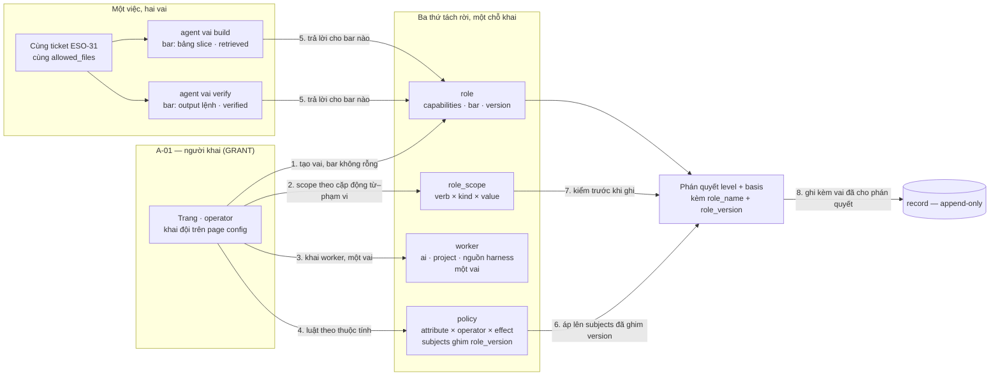
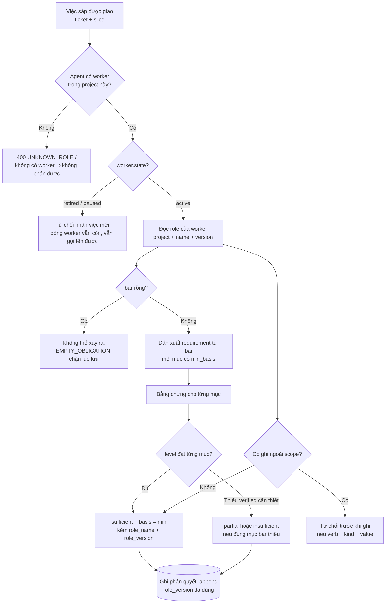
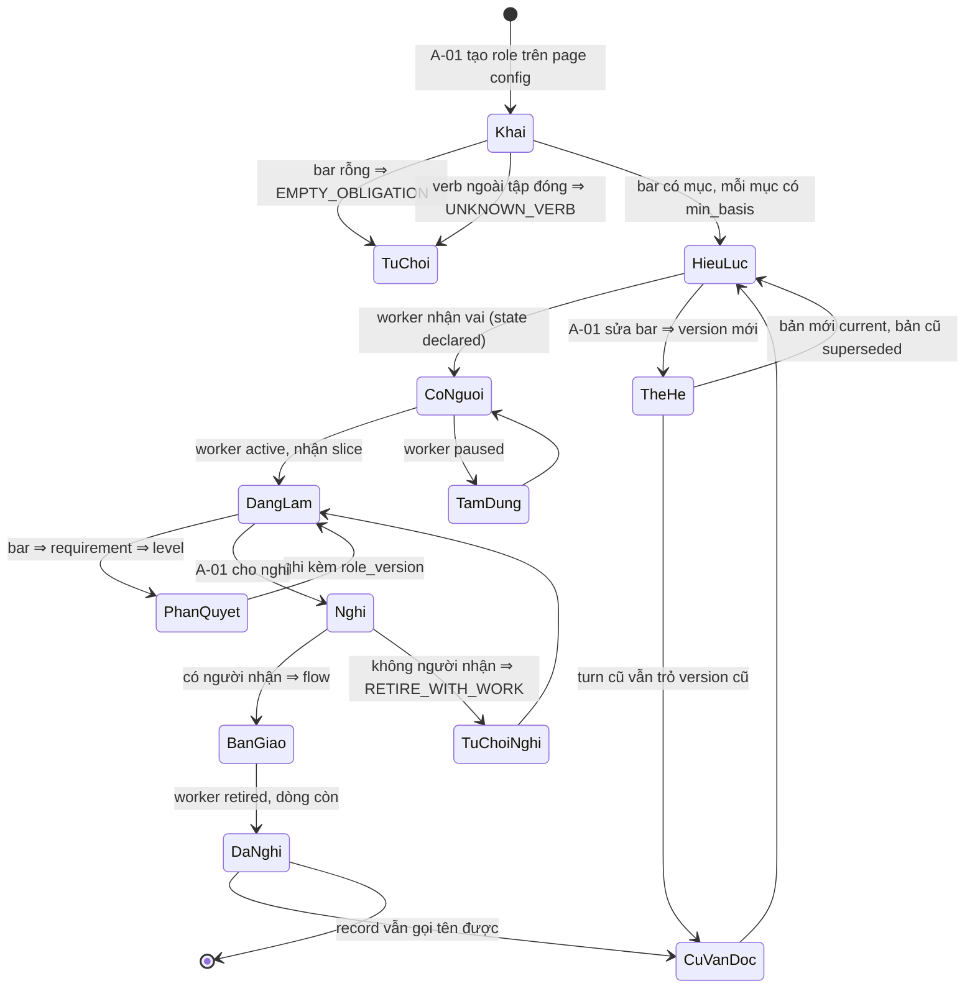
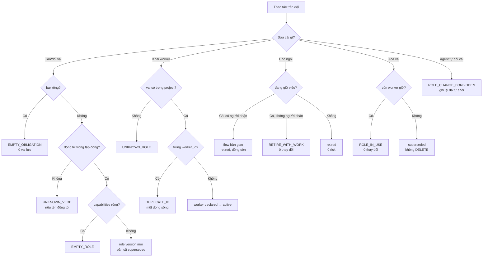

# BRD — Khai đội agent: ai, vai gì, quyền gì

> **Đây là tài liệu nghiệp vụ, không phải spec kỹ thuật.** Nó trả lời *vì sao* **vai**, **quyền** và **bar** là **ba** thứ khác
> bản chất mà người ta gộp làm một; *vì sao* một agent đã nghỉ vẫn phải **gọi tên được** trong bản ghi cũ; và *vì sao* khai
> đội là **ghi thêm**, không phải sửa file cấu hình. Hình dạng bảng `worker` · `role` · `role_scope` · `policy` nằm ở
> `sdlc/07.technical/02.data-design/02.schema.md` §3.1 — ở đây chỉ giải thích **vì sao hình dạng đó phải thế**.

## 1. Bối cảnh

UC-04 có điều kiện sau **tám chữ**: *"cùng một việc, agent khác vai ⇒ xử lý khác"* (`02.use-cases` §1). Câu đó không nói
"có nhiều agent". Nó nói một điều mạnh hơn nhiều: **vai phải đổi kết quả**, và đổi **theo cách viết ra được**.

Ba thứ bị gộp làm một trong gần như mọi hệ agent, và ở đây chúng phải tách:

| Thứ | Trả lời câu | Gắn với | Ví dụ |
|---|---|---|---|
| **vai** (`role`) | agent này **là** gì | `capabilities[]` | `build` · `verify` · `fixbug` |
| **quyền** (`role_scope`) | nó **được chạm** vào cái gì | `(verb, kind, value)` | `write × file × packages/**` |
| **bar** (`role.bar`) | nó phải **chứng minh** gì trước khi làm | `[{evidence_kind, min_basis}]` | `log lỗi` + `verified` |

Gộp ba thứ này vào một danh sách quyền là sai theo **một chiều rất cụ thể**: `bar` biến thành **tuỳ chọn**. Và `bar` là nguồn
requirement **thứ nhất** trong bốn nguồn của hàm sufficiency ([`07`](../../../07.technical/01.architecture/07.sufficiency.md) §1)
— bỏ nó thì `P4` không đóng được. `00.pain-point-trace` §2 P4 nói thẳng: *"`bar` thì chưa ai khai — nó là thuộc tính của role"*.
Nghĩa là **P4 phụ thuộc P6/IAM**; và P6 chính là file này.

Bốn điều làm "khai đội" thành câu hỏi sản phẩm, không phải một file cấu hình:

**Thứ nhất — vai mở, động từ đóng.** `D-48` chốt: **không có catalog đóng**; vai do người tạo, đặt tên bất kỳ; nhưng **động từ**
(`read` · `write` · `append` · `approve` · `configure` · `handoff`) là **bảng đóng**, vì *cơ chế không cưỡng chế được động từ nó
không có tên*. Bảy vai baplatform là **preset nội dung**, không phải cơ chế. Một danh mục cứng ở đây là fix cứng — và nó đã
được chọn sai hai lần (`05.iam-functions` §6 câu 1).

**Thứ hai — nghỉ không phải xoá.** `worker.state` có `declared · active · paused · retired` và `retired` **vẫn là một dòng**
(`02.schema` §3.1). Xoá dòng worker là làm đứt mọi record lịch sử có gọi tên nó.

**Thứ ba — cùng một tên vai ở hai project là hai vai.** `BR-12` nói project này không thấy dữ liệu project khác; và `role` khoá
`(project, name, version)`. Luận cứ cô lập đầy đủ đã có ở `05.uc-05-project-onboarding.md` §4.2–§4.5 — file này **kế thừa**
nguyên văn, không lặp lại; chỉ thêm đúng một hệ quả mới: **vai** cũng là dữ liệu project.

**Thứ tư — khai đội là append-only.** `role.version` + `status ∈ {current, superseded}`; sửa `bar` là **version mới**
(`API-8` trả `{name, version}`, *"append version, không `UPDATE`"*).

### 1.1 Sơ đồ tổng quan

> **Đọc sơ đồ:** có **hai** mũi tên vào `J` từ `R` — chúng không phải hai luật, mà là **hai bar khác nhau** đọc trên **cùng một
> role**. Đó chính là `AC-IAM-02-03`: cùng việc, hai vai ⇒ `level` khác, và khác ở **đúng** phần `bar` gây ra. Chú ý bước 7:
> `scope` được kiểm **trước khi ghi** (chặng ⑨ của [`08`](../../../07.technical/01.architecture/08.actor-domain-tenant.md) §1),
> còn `bar` được kiểm **khi phán quyết** (chặng ②④⑤⑥⑦) — hai chặng khác nhau, nên không thể là một trường.

## 2. Những người trong câu chuyện

| Ai | Tuổi | Mã vai | Họ **thật sự** cần gì |
|---|---:|---|---|
| **Trang** | 31 | `A-01` | Khai đội **một lần** cho một project, rồi không phải nghĩ tới nữa. Cô cần vai `fixbug` khắt khe hơn `build` **bằng đúng một dòng `bar`**, không phải bằng một quy trình viết tay trong prompt |
| **Hùng** | 34 | `A-01` | Thu hẹp đội khi hết việc mà **không** làm mất việc đang dở, và **không** làm chết những ticket sẽ mở lại sau sáu tháng |
| **Bảo** | 29 | `A-02` | Biết **vì sao** lượt của anh ra `partial` — do `bar` của vai `fixbug`, hay do thiếu bằng chứng thật. Anh không cần đọc bảng role |
| **Chi** | 27 | `A-03` | Được ghi **đúng** `eso/*/**` của slice, không hơn. Cô không cần biết `role_scope` là gì; cô cần câu từ chối nêu **động từ + phạm vi** bị vượt |
| **Khánh** | 38 | `A-08` | Sáu tháng sau, đọc một record và biết nó được phán bởi **vai nào, bản nào** — kể cả khi vai đó đã nghỉ và `bar` đã đổi ba lần |
| **Chủ dự án FinESO** | — | `A-07` | Vai `build` của `baplatform` **không** được xuất hiện trong một quyết định nào của `FinESO`. Hậu quả là **hợp đồng**, không phải tính năng |
| **Dũng** | 45 | `A-01` (supervisor) | Duyệt một GRANT — thêm worker, đổi `bar`, đổi `scope` — mà **không** phải tin vào agent đã đề nghị nó (`D-15`) |

> **Điểm dễ bỏ sót:** với Trang, "vai" là **cấu hình**. Với Khánh, "vai" là **chứng cứ**. Hai người này cần hai thứ khác nhau từ
> cùng một dòng dữ liệu, và mô hình chỉ phục vụ được cả hai nếu `role` có **version** và **không xoá được**. Nếu vai là một chuỗi
> trong một file, Trang vui và Khánh không bao giờ trả lời được câu của mình.

## 3. Chuyện xảy ra hôm nay (khi chưa có hệ thống)

Đội agent của `baplatform` được khai bằng một file `agents.yaml` trong repo, mỗi agent một khối `name` + `prompt` + `allowed_files`.
Không có `bar`. Không có version. Không có ai nghỉ.

**Thứ Ba 2026-10-13, 09:05.** Trang thêm agent `fixbug` bằng cách **chép** khối của `build` và đổi `name`. Cô đổi prompt: *"đọc log
lỗi trước khi sửa"*. Đó là một câu trong prompt — không phải một điều kiện, không ai kiểm.

**09:40.** Bảo giao `ESO-27` (một bug 500 ở `pack.mjs`) cho `fixbug`. Agent sửa được, mở PR. Trong PR không có log lỗi gốc, không có
output lệnh chạy lại. Bảo đọc PR, thấy diff hợp lý, merge.

**14:12.** Bảo giao `ESO-28` — cùng loại bug, cùng file — cho `build` vì `fixbug` đang bận. `build` cũng sửa, cũng merge. Hai ticket
**cùng một loại việc**, hai agent **khác vai**, và **kết quả giống hệt nhau**: cả hai đều thiếu log, cả hai đều được merge.

**Thứ Tư 10:30.** `ESO-27` tái phát. Không ai biết vì sao bản sửa trước không chặn được. Log lỗi gốc không có trong ticket — câu
*"đọc log lỗi trước khi sửa"* trong prompt **không** để lại dấu vết nào cho biết nó đã được làm hay chưa.

**Thứ Năm 16:20.** Hùng dọn đội, xoá agent `fixbug` khỏi `agents.yaml` vì "trùng với `build`". Từ hôm đó, mọi ticket có nhãn
`fixed-by: fixbug` trỏ vào **hư không**. Script thống kê của Khánh đếm số ticket theo agent, và `fixbug` biến mất khỏi báo cáo —
không phải vì nó không làm gì, mà vì **nó không còn tên**.

**Thứ Sáu.** Trang tạo vai `build` trong `FinESO` bằng cách chép từ `baplatform` — cùng tên, cùng `scope` `packages/**`. Ba tuần sau,
`FinESO` đổi cấu trúc thư mục sang `apps/`; `baplatform` vẫn `packages/`. Không ai đổi vai nào, vì "nó là cùng một vai mà". Một agent
`build` trên `FinESO` bị chặn ghi **11 lần** trong một buổi chiều, mỗi lần với cùng một lý do, và không ai hiểu vì sao "luật cũ" lại áp.

**Sáu lỗi, và không ai trong bốn người có lỗi:**

| Sự cố | Ai làm | Vì sao **không** phải lỗi của họ |
|---|---|---|
| Hai vai cho cùng một việc ra **cùng** kết quả | Trang | Cô đặt điều kiện vào `prompt` — chỗ duy nhất file cho phép. Không có trường `bar` nào để đặt |
| Ticket thiếu bằng chứng vẫn merge | Bảo | PR trông hợp lệ. Không có phán quyết nào nói *"vai này cần log"*, nên không có gì để đọc |
| Record cũ trỏ vào agent không còn | Hùng | "Xoá agent trùng" là việc dọn dẹp bình thường. Không ai nói dòng đó đang được **sáu** record trưng dụng |
| Vai `build` của hai project lẫn nhau | Trang | Cô chép vì *"cùng tên thì cùng nghĩa"* — đúng trong một repo, sai trong hai hợp đồng |
| Bị chặn 11 lần không ai thấy | Hệ | Không có chỗ nào để ghi *"vượt `scope` động từ `write` với `apps/**`"*. Nó chỉ nói **không** |
| Không ai biết điều kiện đã đổi | Khánh | Prompt không có version. Câu *"đọc log lỗi"* không có `min_basis` nào để so |

**Chi phí thật:** 2 ticket merge thiếu bằng chứng · 1 lần tái phát không chẩn được · 6 record trỏ agent không còn tên · 11 lần bị
chặn trong một buổi chiều · 1 buổi sáng của Bảo đọc diff để đoán · và **0** dòng nói *"vì sao cùng một việc, hai agent ra hai
kết quả"*.

## 4. Hệ thống phải làm gì

### 4.1 Vai ≠ quyền ≠ bar — ba thứ, ba bảng, vì chúng trả lời ba câu khác nhau

Cách trực giác là một danh sách `permissions: [...]`. Nó hỏng vì `bar` không phải một quyền: `bar` là **nghĩa vụ**, và nghĩa vụ
đặt trong danh sách quyền sẽ được đọc là "được phép có nó", tức **tuỳ chọn**.

| | `scope` | `bar` |
|---|---|---|
| Là | **quyền** — được làm gì, ở đâu | **nghĩa vụ** — phải chứng minh gì |
| Thiếu thì | vai **không làm được** | vai **không được coi là đủ** |
| Kiểm ở chặng | ③ đọc · ⑨ pre-write | ② dẫn xuất requirement · ④⑤⑥ bằng chứng · ⑦ ngưỡng |
| Nếu coi là quyền | — | `bar` thành tuỳ chọn ⇒ `P4` mất **một trong bốn nguồn** |

`02.schema` §3.1 để ba thứ ở **ba bảng** vì lý do này: `role` (vai + `bar` + `version`) · `role_scope` (cặp động từ × kind ×
value) · `worker` (ai, giữ **một** vai). `bar` nằm trên `role` vì nó **ở lại** khi `scope` đổi: `build` và `fixbug` có **cùng**
`scope`, khác `bar` — và chính đó là ca `AC-IAM-02-03` dùng để chứng minh `bar` **thực sự** đổi kết quả.

Một chi tiết không nhỏ: `role_scope.verb` có **`FK` tới `verb(name)`**. Đó là **toàn bộ** cơ chế chặn "động từ lạ" — không có `if`
nào trong code, và `AC-IAM-02-05` kiểm được bằng một ràng buộc khoá ngoại.

### 4.2 Bar rỗng là **không hợp lệ**, vì "không có nghĩa vụ" và "quên khai" trông giống nhau

Cách trực giác: `bar` là mảng, để trống thì không sao. Nhưng `bar` rỗng có **hai** nghĩa hoàn toàn khác nhau — *"vai này không phải
chứng minh gì"* và *"ai đó quên khai"* — và hệ **không phân biệt được**. Gộp hai nghĩa làm một là hạ `unknown` xuống `absent`
(`BR-05`) ở đúng chỗ nguy hiểm nhất: chỗ quyết định một agent có đủ tư cách hay không.

Nên `bar` rỗng ⇒ **từ chối khi lưu** (`EMPTY_OBLIGATION`, `AC-IAM-02-02`). Không có ngoại lệ cho vai agent. Chỉ `operator` không có
`bar` — vì người **quyết**, không phải máy **chứng minh**.

Và cái giá của rỗng là **có thật**: một vai `bar=[]` sẽ làm hàm sufficiency rơi vào nhánh `reqs` rỗng ⇒ `cannot-judge`, vĩnh viễn,
cho mọi việc. Không phải "đủ", mà là **không có mệnh đề nào để phán**.

### 4.3 Cùng tên vai ở hai project là **hai vai** — và đây không phải lặp lại §4.2 của UC-05

`BR-12` cấm project này thấy dữ liệu project khác. Luận cứ cô lập — RLS, `WITH CHECK`, `FORCE`, "thiếu setting ⇒ 0 dòng" — nằm
nguyên ở `05.uc-05-project-onboarding.md` §4.2; file này **kế thừa nó**, không phát biểu lại.

Phần UC-04 thêm vào là một **hệ quả riêng**: `role` khoá `(project, name, version)`, nên `build` của `baplatform` và `build` của
`FinESO` là **hai dòng khác nhau**, có thể có hai `bar` khác nhau, hai `scope` khác nhau. Chuyện §3 xảy ra vì Trang **chép**. Hệ
thống không chặn chép — nó chỉ **không** cho phép kết quả của bản chép này áp lên project kia.

| Cách trả lời câu "vai `build` là gì" | Hỏng ở đâu |
|---|---|
| Tra theo **tên** trên toàn instance | `build` của `FinESO` nhận `scope` của `baplatform` — đúng lỗi §3, và nó **trông** hợp lý vì tên khớp |
| Tra theo **project + tên**, rồi lấy version `current` | Đúng cho **khai báo hôm nay**, sai cho **record hôm qua** — `bar` đã đổi thì phán quyết cũ bị chấm lại |
| Tra theo **project + tên + version đã ghim** | ✅ `policy.subjects` ghim `{role_name, role_version}`; `worker` giữ `role_name`, và record giữ cặp đã dùng |

Dòng thứ hai là dòng dễ chọn nhất, và nó là **lỗi thời gian**, không phải lỗi quyền: cùng một turn, đọc hôm nay và mai ra hai phán
quyết — `BR-01` vỡ, và **không có gì** báo sai (`Q-08`, đã chốt cùng `02.schema` §3.1).

### 4.4 Nghỉ là **sự kiện**, không phải `DELETE` — vì record cũ gọi tên agent

Ba cách "bớt một worker", và chỉ cách thứ ba sống được:

| Cách | Hỏng ở đâu |
|---|---|
| `DELETE` dòng `worker` | Mọi record nêu `worker_id` đó **mất tên**. Không phải mất một thuộc tính — mất **khả năng trả lời "ai làm"** |
| Đặt cờ `active = false` | Một cột sửa tay, không có lịch sử; và `evidence_risk` `OPEN` của việc đang dở không có chỗ sinh ra |
| `state = retired`, dòng **vẫn còn** | ✅ `AC-IAM-01-02`; việc đang dở thành risk `OPEN` có `owner` + `review_by`, `API-7` trả `open_risks` |

Và câu phản biện phải nghe, vì nó hợp lý: *"cứ xoá, tên agent vẫn tra được từ audit log"*. Nó **không** đủ, theo ba lý do độc lập:

1. **Audit log là nơi tra cứu, không phải nơi định nghĩa.** Tra được *"lúc 14:12 có một dòng nói `fixbug`"* không cho biết **vai
   `fixbug` có `bar` gì** ở thời điểm đó. Log ghi sự kiện; `role` ghi **nghĩa vụ**. Thiếu vế thứ hai, câu *"phán quyết này có đúng
   không"* không trả lời được.
2. **Log không phải khoá ngoại.** `policy.subjects` trỏ `(role_name, role_version)`; `worker` giữ `role_name`. Nếu `role` bị xoá thì
   con trỏ vẫn tồn tại nhưng **không phân giải được** — đúng ca `DANGLING_POLICY` (`AC-IAM-02-07`) và `DANGLING_FLOW`
   (`AC-IAM-07-03`), và cả hai AC đều đòi **nêu ra**, không im lặng bỏ qua.
3. **Ai đọc log, và bằng gì?** `08` §1 xếp truy vấn theo chặng; audit là **đường thứ hai**, và mọi đường thứ hai đều có một ca nó
   chưa được viết. `A-08` đọc record, không đọc log — anh không có công cụ, không có schema, không có quyền.

Nên luật là: **`retired` không xoá** — cùng nguyên tắc `D-33` cho `shared` và `BR-06` cho record. Thứ người khác trông vào thì
không xoá; và worker **là** thứ người khác trông vào, vì `evidence_turn` và `evidence_risk` ghi tên nó.

Nghỉ khi **đang giữ việc** thì không phải lỗi, nhưng phải có đường: có người nhận ⇒ `flow` bàn giao + việc chuyển chủ
(`AC-IAM-07-01`); không người nhận ⇒ **từ chối** `RETIRE_WITH_WORK` (`AC-IAM-07-02`) — vì cho nghỉ rồi để việc treo là đúng thứ
`I-4` của P6 cấm.

### 4.5 Khai đội là **append-only**: đổi `bar` phải ra version mới

Cách trực giác: sửa dòng `role` tại chỗ, ai cần thì đọc lại. Nó làm **turn hôm qua bị chấm lại bằng luật hôm nay**, và đó là điều
`BR-01` cấm dưới tên khác: *cùng câu hỏi ⇒ cùng phán quyết*.

| Cách | Turn 2026-10-20 (`fixbug` @v2) đọc lại hôm nay |
|---|---|
| `UPDATE role SET bar = …` | Turn cũ giờ được chấm bằng `bar` mới ⇒ `level` **đổi**, record **không đổi** ⇒ record **nói dối** |
| `role` version mới, bản cũ `superseded` | Turn cũ trỏ `@v2`; đọc lại ra **đúng** `level` cũ; `@v3` chỉ áp cho turn sau |

Nên `API-8` trả `{name, version}` và **không** có `UPDATE`. `policy.subjects` ghim `role_version`, không giữ tên trần — nếu giữ tên trần
thì `role@7` đổi `bar` làm luật cho `build` **đổi kết quả** mà `policy` **không đổi một byte** (`Q-08`).

Và hệ quả cho "xoá vai": **không xoá được** khi còn worker giữ (`ROLE_IN_USE`, `AC-CFG-02-02`). Cách đúng là `superseded` — vai cũ
vẫn đọc được, không chọn được cho turn mới.

### 4.6 Agent **không** được đổi vai của chính nó — và bị từ chối phải được **ghi**

`AC-IAM-02-04` (`rbac`): worker role `build` thử đổi role ⇒ **từ chối**, và **ghi lại đã từ chối**, mã `ROLE_CHANGE_FORBIDDEN`.

Vì sao đây không phải chi tiết: `D-15` chia thay đổi đội thành **GRANT** (đổi quyền, bỏ một cổng) và **INSTRUCTION** (đổi câu chữ),
và **chỉ người** duyệt GRANT. Một agent tự đổi `bar` của mình là tự duyệt grant — đúng lỗ hổng `D-07` đóng. Và `API-9` (policy) không
có đường nào cho agent, **kể cả gián tiếp**, vì hành động đó chỉ role `operator` gọi được.

Vế thứ hai — **ghi lại đã từ chối** — là vế hay bị bỏ. Không có nó, một agent thử đổi vai 20 lần sẽ không để lại vết, và `P5`
(learning loop) mất đúng tín hiệu nó cần.

### 4.7 Bảy vai baplatform là **preset nội dung**, không phải danh mục — và vì sao điều đó đổi cách đọc "vai"

`D-48`: vai **mở**, động từ **đóng**. `role_preset` là bảng **không có `project`** (ngoại lệ có lý do: nó thuộc `pool`, đọc bởi mọi
project, **ghi** chỉ `operator`). `sdlc_profile.team` giữ `{presets[], roles[]}` — tức preset đã áp **thành** role của project đó.

Cách đọc sai: *"preset là nguồn sự thật của vai"*. Không. Preset là **bản mẫu**; sau khi áp, vai là **dữ liệu của project**, và mọi
lần sửa đều tạo `role.version` mới. Preset mới hơn **không đè** vai người đã sửa tay — `AC-CFG-02-01` đòi trả `skipped[]`, không im
lặng ghi đè. Đó là cùng nguyên tắc với `shared` override: **cái đã khai không bị nuốt**.

Preset mẫu (7 vai baplatform) — đọc cột `bar` là cột quyết định:

| Vai | capability | `scope` | `bar` |
|---|---|---|---|
| `scout` | scout | chỉ đọc | nguồn cite được · `retrieved` |
| `plan` | plan | viết bảng slice | danh sách AC trong scope · `retrieved` |
| `build` | be | `allowed_files` của slice | bảng slice · AC trong scope · lệnh verify · `retrieved` |
| `fixbug` | be, fix | **như `build`** | **log lỗi nguyên văn** · `verified` |
| `verify` | verify | chỉ đọc + chạy lệnh | **output lệnh** · `verified` |
| `audit` | review | chỉ đọc | **diff** · **rubric** · `verified` |
| `qc` | qc | `qc/**` | **scenario matrix** · **env** · `retrieved` |

`build` và `fixbug` **cùng `scope`, khác `bar`** — đây là toàn bộ dòng để đọc: khác biệt duy nhất là **bằng chứng phải có**, không
phải **nơi được ghi**. Và đó chính là ca §3 mất.

### 4.8 Sơ đồ quyết định: một phán quyết có được ký bởi vai nào

| Nút | Điều kiện | Nguồn |
|---|---|---|
| **Có worker trong project?** | `worker` khoá `(project, worker_id)`; role không có ⇒ `UNKNOWN_ROLE` | `02.schema` §3.1 · `AC-IAM-01-03` |
| **`worker.state`?** | `retired`/`paused` không nhận việc mới; dòng **không** bị xoá | `AC-IAM-01-02` · `D-33` |
| **`bar` rỗng?** | không xảy ra được: chặn **lúc lưu**, không lúc chạy | `AC-IAM-02-02` · `API-8` |
| **level đạt từng mục?** | hai vai khác `bar` ⇒ `level` khác, khác **đúng** phần `bar` | `AC-IAM-02-03` · `US-IAM-02` |
| **Ghi ngoài `scope`?** | kiểm ở chặng ⑨ **trước khi ghi**, không ở chặng phán quyết | `08` §1 · `AC-IAM-02-05` |
| **Ghi kèm `role_version`** | để turn cũ chấm lại ra đúng kết quả cũ | `Q-08` · `BR-01` |

> **Đọc sơ đồ:** nhánh `G → H` là một nhánh **không tồn tại được**, và nó có mặt để nói ra điều đó: nếu hệ cho phép lưu `bar` rỗng thì
> phán quyết rơi vào `cannot-judge` **vĩnh viễn**, và trông như "vai chưa đủ tư cách" thay vì "ai đó quên khai". Hai bước `F` và `N`
> là hai chặng **khác nhau** của cùng một role — `bar` khi phán quyết, `scope` trước khi ghi.

## 5. Một ngày thật, có số

**2026-10-22**, control plane của Hùng, project `baplatform`. Đội có **9** worker trên **7** vai; `build` có **3** worker (vì 3 slice
chạy song song), `fixbug` có **1**. `role` có **7** bản `current` và **12** bản `superseded` — vì `bar` của `fixbug` đã đổi **3** lần
trong hai tuần. Trong ngày: **48** turn, **11** ticket, **6** lần bị chặn.

| Mốc | Việc | Đo được gì |
|---|---|---|
| 08:30 | Trang đổi `bar` của `fixbug`: thêm `{evidence_kind: "log-nguyen-van", min_basis: "verified"}` | `role` `fixbug` `@v3`; `@v2` thành `superseded`; **12** turn của hôm trước vẫn trỏ `@v2` |
| 08:34 | Đọc lại `ESO-24` (làm hôm qua) | `level = partial`, **giống hệt** giá trị ghi lúc chạy; **0** turn bị chấm lại bằng `@v3` |
| 09:10 | Bảo giao `ESO-31` (bug 500) cho `fixbug` | `partial` — thiếu `log-nguyen-van`; nêu **đúng một** mục `bar` |
| 09:15 | Cùng `ESO-31` giao cho `build` (mô phỏng trên bản sao) | `insufficient` — `build` không có mục log trong `bar`, nên **không** sinh requirement đó; khác `fixbug` ở **đúng** phần `bar` |
| 10:02 | `fixbug` bổ sung log nguyên văn ⇒ chạy lại | `sufficient`, `basis = verified` |
| 11:20 | Chi thử ghi `apps/eso-core/**` | **Bị chặn**: `write × file × packages/**` — nêu **động từ + kind + value**, ghi lại lần chặn |
| 13:45 | Trang tạo vai `build` **trong `FinESO`** với `scope` `apps/**` | Đọc `build` của `baplatform` ⇒ **vẫn** `packages/**`; **0** dòng của A trong quyết định của B |
| 14:20 | `build` của `baplatform` phán cho một việc `FinESO` | **Từ chối** — không có worker trong project đó; `UNKNOWN_ROLE` là lý do, không phải "thiếu quyền" |
| 15:05 | 3 worker `build` còn lại sau một ngày | `API-7` cho nghỉ 1 worker **không** giữ việc ⇒ `retired`, **0** risk |
| 15:08 | Nghỉ worker `fixbug` đang giữ `ESO-33` | Bàn giao cho `build` ⇒ `flow` ghi; việc chuyển chủ; **1** dòng `worker` vẫn còn |
| 16:30 | Khánh đọc record của `ESO-24` sau 8 tiếng | Tên vai + `version` đọc được **không** qua audit log: phán quyết mang `fixbug @v2` |
| 17:00 | Script đếm số ticket theo vai | `fixbug` **có mặt** (1 worker `retired`, 14 ticket) — không biến mất khỏi báo cáo như §3 |

**Ba con số của §5, đọc cùng nhau:**

1. **12 — số turn trỏ `@v2` sau khi `bar` đổi.** Con số này phải **bằng** số turn của hôm trước, không phải 0. Nếu nó về 0 nghĩa là
   version đã bị ghi đè, và record hôm qua đang bị chấm bằng luật hôm nay.
2. **1 — số mục `bar` làm `fixbug` khác `build` trên cùng `ESO-31`.** Khác biệt giữa hai vai là **một dòng**, và nó đổi `level` từ
   `partial` sang `insufficient` — `AC-IAM-02-03` ở dạng đọc được.
3. **0 — số dòng `worker` bị xoá trong ngày, dù có 1 worker nghỉ.** Worker nghỉ vẫn còn tên; script đếm **vẫn** thấy nó. Đây là
   phép đo của *"nghỉ là sự kiện, không phải xoá"*.

**Điều bảng này không nói:** `bar` có **đúng** không. `fixbug @v3` thêm log là một quyết định của Trang, không phải một sự thật —
bảng chỉ cho thấy hệ **áp** nó đúng chỗ và **không** áp ngược về quá khứ.

### 5.1 Một vai đi qua vòng đời của nó

**Không có nhánh nào từ `HieuLuc` sang `DaNghi` mà bỏ `TheHe`.** Nếu bỏ, sửa `bar` là **ghi đè** — và mọi phán quyết cũ đọc lại
hôm nay ra một kết quả khác, đúng lỗi `BR-01` mà `Q-08` đã chốt.

### 5.2 Chi tiết một dòng trong bảng §5

| Thời điểm | Việc | Vai liên quan | `worker.state` | `bar` dùng | Kết quả | Ghi gì |
|---|---|---|---|---|---|---|
| 08:30 | Đổi `bar` `fixbug` | `fixbug @v2 → @v3` | 1 `active` | mới, **chưa** áp ngược | 12 turn cũ giữ `@v2` | `role` dòng mới, `@v2` `superseded` |
| 08:34 | Đọc lại `ESO-24` | `fixbug @v2` | — | `@v2` | `partial` (không đổi) | `role_version = 2` |
| 09:10 | Giao `ESO-31` cho `fixbug` | `fixbug @v3` | `active` | log + `verified` | `partial` | 1 mục `bar` thiếu |
| 09:15 | Cùng việc, vai `build` | `build @v7` | `active` | bảng slice + AC + verify | `insufficient` | khác ở đúng phần `bar` |
| 10:02 | `fixbug` bổ sung log | `fixbug @v3` | `active` | như trên | `sufficient`, `verified` | — |
| 11:20 | Ghi `apps/eso-core/**` | `build @v7` | `active` | không đổi | **chặn** | `write × file × packages/**` |
| 13:45 | Tạo `build` trong `FinESO` | `build`, project khác | — | `apps/**` | **0** rò sang A | `role` dòng của B |
| 14:20 | `build` A phán cho việc B | không có worker | — | — | **từ chối** | `UNKNOWN_ROLE` |
| 15:05 | Nghỉ 1 `build` không việc | `build @v7` | `active → retired` | — | **0** risk | `state` mới, dòng còn |
| 15:08 | Nghỉ `fixbug` đang giữ `ESO-33` | `fixbug @v3` | `active → retired` | — | `open_risks` có `owner` | `flow` bàn giao |
| 16:30 | Khánh đọc record `ESO-24` | `fixbug @v2` | `retired` | `@v2` | đọc được **không** qua audit | `role_version = 2` |

## 6. Ngoại lệ — và hệ thống làm gì

| Tình huống thật | Hệ thống xử lý |
|---|---|
| Lưu vai với `bar` rỗng | **Từ chối** `EMPTY_OBLIGATION`; 0 vai được lưu (`AC-IAM-02-02`) |
| Khai `scope` với động từ ngoài tập đóng | **Từ chối** `UNKNOWN_VERB` — cơ chế không cưỡng chế được động từ nó không biết (`AC-IAM-02-05`) |
| Vai agent **không** `capabilities` nào | **Từ chối** `EMPTY_ROLE` (`AC-IAM-02-06`) |
| Worker khai một vai **không có** trong project | **Từ chối** `UNKNOWN_ROLE`; 0 worker được tạo (`AC-IAM-01-03`) |
| Tạo worker **trùng `worker_id`** | `DUPLICATE_ID`; **một** dòng sống (`AC-IAM-01-05`) |
| Đội **0** worker | Danh sách rỗng; **không** lỗi (`AC-IAM-01-04`) |
| Cho `retired` khi đang giữ việc dở, chưa có người nhận | **Từ chối** `RETIRE_WITH_WORK` (`AC-IAM-07-02`) |
| Cho `retired` khi đã có người nhận | Ghi bàn giao; việc chuyển chủ; dòng `worker` **vẫn còn** (`AC-IAM-07-01`) |
| Nghỉ **hai lần** | `ALREADY_INACTIVE`; 0 thay đổi (`AC-IAM-07-04`) |
| `flow` còn trỏ worker đã nghỉ | Đọc flow **nêu** worker nghỉ; sửa **hoặc** `OPEN` — không im lặng bỏ (`AC-IAM-07-03`) |
| Xoá vai **đang có** worker | **Từ chối** `ROLE_IN_USE`; 0 thay đổi (`AC-CFG-02-02`) |
| Preset mới hơn đè vai người đã sửa tay | **Không** đè; trả `skipped[]` (`AC-CFG-02-01`) |
| Vai trỏ policy **đã xoá** | Nêu policy treo `DANGLING_POLICY`; **không** im lặng bỏ qua (`AC-IAM-02-07`) |
| Agent thử đổi vai của chính nó | **Từ chối** `ROLE_CHANGE_FORBIDDEN`; **ghi lại đã từ chối** (`AC-IAM-02-04`) |
| Cùng tên vai ở project khác | **Hai** dòng, hai `bar`; `build` của B **không** áp cho A (`BR-12`) |
| Agent của project A phán cho việc project B | **Từ chối**; `UNKNOWN_ROLE` — không có worker ở đó (§4.3) |
| Muốn **đổi project** của một worker tại chỗ | Không có đường: **nghỉ rồi khai mới** — cô lập là theo `(project, worker_id)` |

### 6.1 Sơ đồ nhánh lỗi

> **Đọc sơ đồ:** ba nhánh `D` · `F` · `H` đều là **từ chối khi lưu**, không phải khi chạy. Đó là quyết định thiết kế: một vai sai
> hình dạng được phát hiện **một lần** trên page config, thay vì **mỗi turn** trên đường thực thi. Nhánh `U` là nhánh duy nhất
> **không** có `DELETE` — và nó là nhánh nuôi `A-08`.

## 7. Điều ngoài phạm vi

| Không thuộc BRD này | Thuộc |
|---|---|
| Hỏi **đã đủ chưa** với một việc; nói **thiếu gì** | `01.uc-01-is-it-enough.md` · `02.uc-02-what-is-missing.md` |
| Ghi lại **vì sao** một quyết định ra như vậy | `03.uc-03-why-this-decision.md` |
| Đưa một project vào làm việc, cô lập giữa hai project | `05.uc-05-project-onboarding.md` |
| Hệ chọn **skill/luật nào áp** cho một việc | `06.uc-06-which-rule-applies.md` |
| Nâng một skill dùng chung cho mọi project | `07.uc-07-promote-shared.md` |
| Rút lại một skill đã nâng vì nó hỏng | `08.uc-08-revert-broken.md` |
| Hỏi **"vì sao bị chặn"** mà không cần đọc log thô | `09.uc-09-why-blocked.md` |
| Hệ đề xuất **tự sửa cách làm** sau khi sai | `10.uc-10-self-proposal.md` |
| Duyệt một ticket đã làm xong — `Done` là chữ của người | `11.uc-11-ticket-done.md` |
| Hiểu một project **gồm những gì** trước khi sửa | `12.uc-12-what-is-in-project.md` |
| Được cảnh báo **dù không ai hỏi** | `13.uc-13-unprompted-warning.md` |
| Chọn **nguồn năng lực** khi host thiếu | `14.uc-14-capability-source.md` |
| Hình dạng bảng `worker` · `role` · `role_scope` · `policy` · `verb` · `role_preset` | `sdlc/07.technical/02.data-design/02.schema.md` §3.1 |
| Mô hình quyền (tổ hợp · khoá · deny-overrides) | Stage 6 — **sau** khi AC chốt hành vi (`05.iam-functions` §5) |
| `allowed_files` của một slice — **không phải** quyền của role | `sdlc/07.technical/01.architecture/17.jira-slp-operating.md` §4 |
| **Xác thực người** (login · SSO) — ngoài sản phẩm | host/IdP |
| Ba trạng thái định danh FULL · DECLARED · DEGRADED, và chain | `sdlc/07.technical/01.architecture/08.actor-domain-tenant.md` §2 |
| Hợp đồng `API-7` … `API-11` và registry mã lỗi | `sdlc/07.technical/03.api/01.contracts.md` · `00.index.md` §4 |

## 8. Câu chưa có trả lời trong release

Đây là những chỗ tôi **không** tự trả lời, vì không nguồn nào nói. Mỗi dòng đã `grep` — nếu cây trả lời được thì nó **không** ở đây.

| # | Câu hỏi | Mã | Vì sao không nguồn nào trả lời |
|---|---|---|---|
| 1 | **Ba mã lỗi của đội chưa có trong registry.** `AC` đặt tên `ALREADY_INACTIVE` · `RETIRE_WITH_WORK` · `DANGLING_FLOW`; `00.index` §4 có `DUPLICATE_ID` (409) và `OUT_OF_SCOPE` (403) nhưng **không** ba mã này, và `API-7` chỉ liệt `UNKNOWN_ROLE` | `6.2` `OPEN-3` (của packet `30.worker-lifecycle`) | Registry §4 có luật *"mã mới **phải** vào bảng này **trước** khi dùng. Mã không có ở đây là **chưa tồn tại**"* — nên theo luật của chính cây, ba mã đó **chưa tồn tại** nhưng ba `AC` đã assert chúng |
| 2 | **`retired` hay `inactive`?** `AC-IAM-07-01` expected *"worker `inactive`"*; `AC-IAM-01-02` expected *"worker `retired`"*; `02.schema` và `API-7` dùng `retired`; `US-IAM-01` vẽ **4** trạng thái | `6.2` `OPEN-1` (cùng `Q-01` của `06.open-register`) | **Bốn** chỗ, **ba** cách gọi, không chỗ nào nói `inactive` **là** `retired`. Hai `AC` của cùng một sự kiện có hai giá trị kỳ vọng ⇒ test nào cũng qua được và một cái **luôn** đỏ. Đây là câu **chặn** §4.4 |
| 3 | **"Vai có tồn tại" nghĩa là gì khi tên chỉ còn `superseded`?** `AC-IAM-01-03` từ chối `UNKNOWN_ROLE` nếu vai không có; `API-7` nhận `role` **theo tên**, không có `version` | `6.2` `OPEN-4` | `role` có `version` + `status ∈ {current, superseded}`. Một vai cũ vẫn đang được worker khác giữ: từ chối (`UNKNOWN_ROLE`) hay hợp lệ? `US-IAM-02` Q3 nói **không kế thừa**, **không** nói cũ thì sao. Đây là ca §5 15:05–15:08 |
| 4 | **`worker` không có `FK` tới `role`; `state` không có `CHECK`** | `6.2` `OPEN-5` — nhưng **một nửa đã đóng**: `02.schema` §3.1 **có** `CONSTRAINT worker_state_closed CHECK` | Nửa `CHECK` đã có; nửa `FK` **vẫn** thiếu, nên `UNKNOWN_ROLE` chỉ là ràng buộc ở **hàm**, không ở DB. Nếu thêm `FK` thì nó trỏ `(project, name, version)` — và **version nào** là câu 3 ở trên |
| 5 | **`bar[].evidence_kind` là chuỗi mở hay đóng?** `AC-IAM-02-01` đòi *"mỗi mục `bar` có loại bằng chứng + `min_basis`"* nhưng **không** đặt tập giá trị; không có bảng `evidence_kind` | `6.3` `OPEN-5` (cùng `Q-01` của `06.open-register`) | Nếu mở, `AC-IAM-02-03` (*"khác ở **đúng** phần `bar` gây ra"*) phải so hai **chuỗi người gõ**: `diff` vs `diff-file` không so được. Và `P4` cần biết **loại** để biết đọc bằng chứng ở đâu (`07` §1) |
| 6 | **`scope` được cưỡng chế ở đâu trên đường turn?** `08` §1 đặt nó ở chặng ③ và ⑨, nhưng không tài liệu nào nói cơ chế nào đọc `role_scope` | `6.3` `OPEN-3` | `05.turn-execution` không nhắc `scope`; `07.sufficiency` §1 **không** liệt `scope` trong bốn nguồn; `BLOCKED_SCOPE` sinh từ `3.6` (theo slice), **không** từ vai. Nghĩa là `6.3` có thể lưu `scope` **đúng** mà **không ai dùng** — và có **hai** khái niệm "scope" cùng tên |
| 7 | **`AC-IAM-02-07`'s "vai trỏ policy **đã xoá**" không dựng được** — `policy` không có `status = deleted`, `API-9` **append version**, và `role` **không** có cột trỏ policy (chiều là `policy.subjects`) | `6.3` `OPEN-1` | Hoặc test phải bịa một trạng thái không tồn tại, hoặc `DANGLING_POLICY` nghĩa là chiều **ngược** (`policy.subjects` có tên vai không còn vai). §4.5 nói *"không xoá được vai đang có worker"* — nhưng vai **không** worker thì sao, không nguồn nào nói |
| 8 | **`next_role_version` chưa có hàm, và `scope ref` chưa có bảng.** `version` là `int`, `status` *"tính từ sự kiện"*; `US-IAM-02` Q3 đề xuất `scope: code-writer` dùng chung | `6.3` `OPEN-4` | Không có `UNIQUE … WHERE status='current'` ⇒ hai request đồng thời ra **cùng** version. Và "cùng `scope`" hôm nay là **chép** dòng ⇒ hai vai lệch nhau ngay khi một bên sửa, **vĩnh viễn** vì `BR-06` cấm sửa. Đây là ca §4.5 |
| 9 | **`UNKNOWN_VERB` trả kèm **tên** động từ ở đâu?** `DoD` đòi *"kèm tên"*, `API-8` chỉ ghi `400 UNKNOWN_VERB` và không nói trường nào mang tên | `6.3` `OPEN-2` | Cùng dòng với câu 1: ba mã `UNKNOWN_VERB` · `EMPTY_ROLE` · `DANGLING_POLICY` chỉ tồn tại **trong file AC**, chưa trong registry. §4.1 nói `FK` là *toàn bộ* cơ chế — nhưng `FK` nói *"không hợp lệ"*, **không** nói *"động từ nào"* |
| 10 | **Worker đang **giữ việc nào**?** `AC-IAM-01-02` cần biến việc dở thành risk `OPEN`, nhưng `worker` **không** có cột nối tới việc, và *"người nhận"* trong `6.6` **không** phải `worker_id` | `6.2` `OPEN-2` (cùng `Q-07`) | `open_risks` phải đọc `evidence_risk` **theo cách nào** khi không có cột nối. §4.4 nói *"việc đang dở thành risk"* — nhưng **cái gì** là việc đang dở, không nguồn nào định nghĩa |
| 11 | **`GRANT` cho đội được duyệt ở **đâu**?** `D-15` nói GRANT do **người** (supervisor+) duyệt, và `D-51` nói page config **xem ảnh hưởng trước khi lưu** — nhưng `API-12` `impact` chỉ có `consumers` · `overrides` · `artifacts` | `6.7` (cùng `OPEN-6` của `35.config-four-groups`) | Không có mã, `AC`, hay cột nào cho *"thay đổi này cần duyệt GRANT"*. `API-8`/`API-9` trả `403` cho **ai gọi**, không cho **cần duyệt**. Nghĩa là vế *"supervisor+"* của `D-15` chưa cài được |
| 12 | **Tạo vai **bằng tay** có vi phạm `D-51` "một đường ghi" không?** `D-51` nói *"cấu hình bằng sửa file tay — được phép như đường **thứ hai**"*, nhưng `role_preset` **(không có `project`)** do `operator` ghi, còn `role` là dữ liệu project | **chưa có mã** — `D-51` không nói preset áp xuống `role` **ghi ở đâu**; package `31.open-roles` không mở `OPEN` nào cho ca này | `sdlc_profile.team` giữ `{presets[], roles[]}`, và `API-8` ghi `role`. Nhưng nếu một người sửa tay file role trong repo, `config_event` **không** có sự kiện, và preview **không** chạy. Tôi **không** tự chọn: hoặc cấm, hoặc phải có một sự kiện cho đường đó — cả hai là quyết định |

> **Bốn câu đã tra và **không** để mở:** *"có catalog đóng không"* — chốt **không**, vai mở/động từ đóng (`D-48`).
> *"`bar` có cột riêng không"* — có, `role.bar jsonb` (`02.schema` §3.1). *"preset có thuộc project không"* — **không**
> (`role_preset` không có cột `project`, ngoại lệ có lý do). *"`policy.subjects` giữ tên hay version"* — **version** (`D-60`/`Q-08`,
> đã chốt trong `02.schema` §3.1).

## 9. Truy vết

| Yêu cầu (REQ) | Điều khoản | Mục trong BRD |
|---|---|---|
| `REQ-AGENT-01` — đội agent (vai · quyền · phạm vi file) được **khai báo**, không tự phát hiện; hai agent cùng việc khác vai ⇒ xử lý **khác** | `D-48` · `AC-IAM-01-01` · `AC-IAM-02-03` | §1 · §1.1 · §4.1 · §4.7 · §4.8 · §5 |
| `REQ-AGENT-02` — **không ai tự mở rộng quyền**: không agent nào đặt "xong", đổi luật, hay vượt phạm vi file | `AC-IAM-02-04` | §4.6 · §4.8 · §6 |
| `REQ-JUDGE-01` — phán quyết theo **từng** yêu cầu, mức + `basis` | `07` §2 · `07` §3 | §4.2 · §4.8 · §5 |
| `REQ-EVID-01` — bàn giao mang bằng chứng | `AC-IAM-04-01` | §4.4 · §5.1 |

| Luật (BR) | Điều khoản | Mục trong BRD |
|---|---|---|
| `BR-08` — chỉ `A-01` set `Done`/`Closed` (người quyết, máy không) | `D-15` · `D-07` | §2 · §4.6 · §4.7 · §7 |
| `BR-12` — **cô lập project**: project này không thấy dữ liệu project khác | `05` §4.2 (kế thừa) | §1 (thứ ba) · §4.3 · §5 · §6 |
| `BR-01` — cùng câu hỏi ⇒ cùng phán quyết | `Q-08` | §4.3 · §4.5 · §5.1 |
| `BR-05` — `unknown` ≠ `absent` | — | §4.2 · §4.4 · §6 |
| `BR-06` — record chỉ ghi thêm | — | §4.4 · §4.5 · §5.1 |
| `BR-10` — `pool` · `shared` append-only; revert dời con trỏ | `D-33` | §4.7 · §4.5 |

| Use case | Mục |
|---|---|
| `UC-04` khai đội agent — **file này** | §1 · §4 · §5 |
| `UC-05` đưa project vào (cô lập, kế thừa không lặp) | §1 · §4.3 · §7 |
| `UC-11` duyệt ticket đã xong — `Done` là quyền của người | §4.6 · §7 |
| `UC-09` vì sao bị chặn — đích của mọi lần `scope` từ chối | §3 · §6.1 · §7 |

| AC · SCN | Mục |
|---|---|
| `AC-IAM-01-01` … `-05` · `SCN-IAM-01` … `-03`, `-34`, `-35` | §4.4 · §4.8 · §5.2 · §6 |
| `AC-IAM-02-01` … `-07` · `SCN-IAM-04` … `-07b`, `-36`, `-37` | §4.1 · §4.2 · §4.6 · §4.8 · §6.1 |
| `AC-IAM-07-01` … `-05` · `SCN-IAM-25` … `-27` | §4.4 · §5.1 · §6.1 |
| `AC-CFG-02-01` · `AC-CFG-02-02` · `SCN-CFG-06` | §4.5 · §4.7 · §6 |

| Nguồn dữ liệu · hợp đồng | Mục |
|---|---|
| `worker` · `role` · `role_scope` · `policy` · `verb` · `role_preset` · `sdlc_profile.team` | §1.1 · §4.1 · §4.5 · §4.7 · §9 |
| `E7 POST /v1/workers` · `E8 POST /v1/roles` · `E9 POST /v1/policies` | §4.2 · §4.5 · §4.6 · §6.1 |
| `P6` multi-agent SLP — nỗi đau gốc | §1 · §3 · §5 |

## Revision rule

Sai khi: `D-48` bị đọc thành *"có một danh mục vai"* (nó nói **vai mở, động từ đóng**); hoặc `bar` bị coi là **quyền** và được
phép rỗng; hoặc `worker` bị `DELETE` (nghỉ là `state = retired`, không xoá — `D-33` · `AC-IAM-01-02`); hoặc `role` bị `UPDATE` tại
chỗ thay vì ra **version mới** (`API-8` trả `{name, version}`); hoặc `policy.subjects` giữ **tên trần** thay vì `{role_name,
role_version}` (`Q-08`, `BR-01` vỡ); hoặc `build` của hai project bị coi là **một** vai (`BR-12`); hoặc câu từ chối cho việc ngoài
`scope` **khác** cho việc ngoài project ⇒ sửa §4 và §6, và bảng §9.

Nguồn kiểm: `grep -n 'BR-08\|BR-12' sdlc/06.analysis/01.business-analysis/03.business-rules.md && grep -c 'retired' sdlc/07.technical/02.data-design/02.schema.md && grep -n 'EMPTY_OBLIGATION\|UNKNOWN_VERB\|ROLE_CHANGE_FORBIDDEN' sdlc/07.technical/03.api/01.contracts.md`
