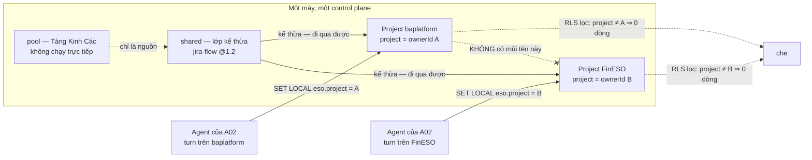
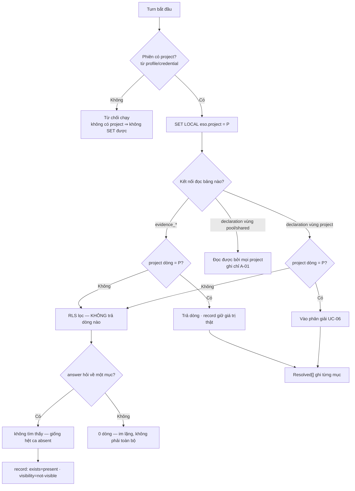
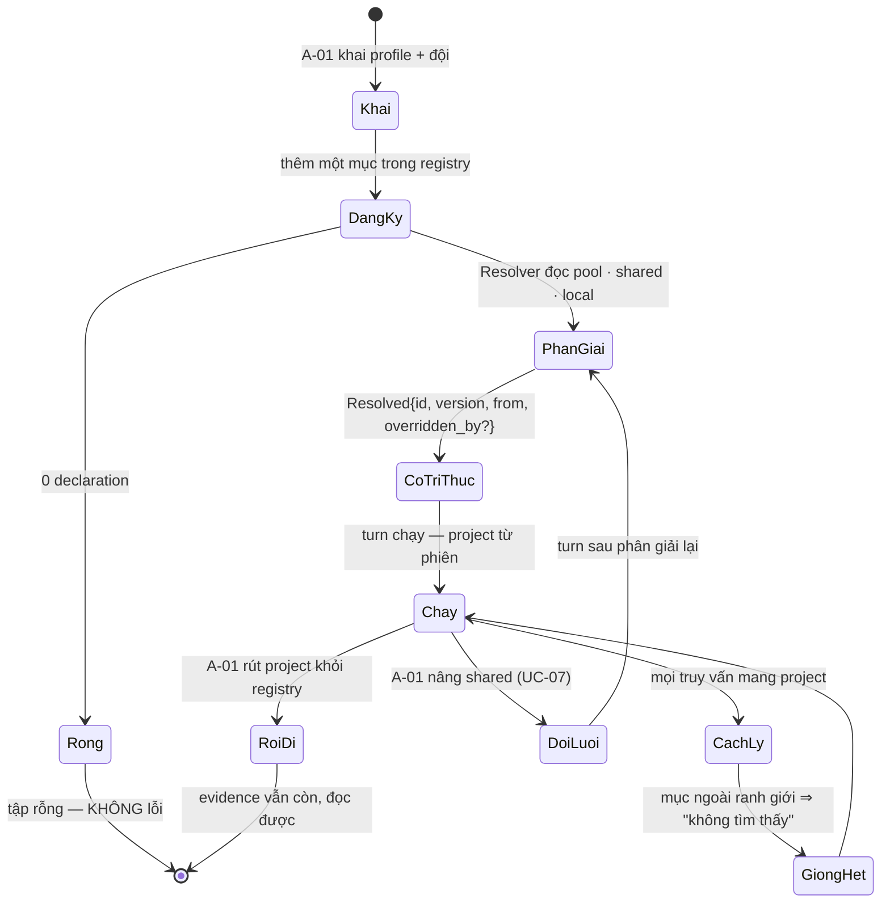
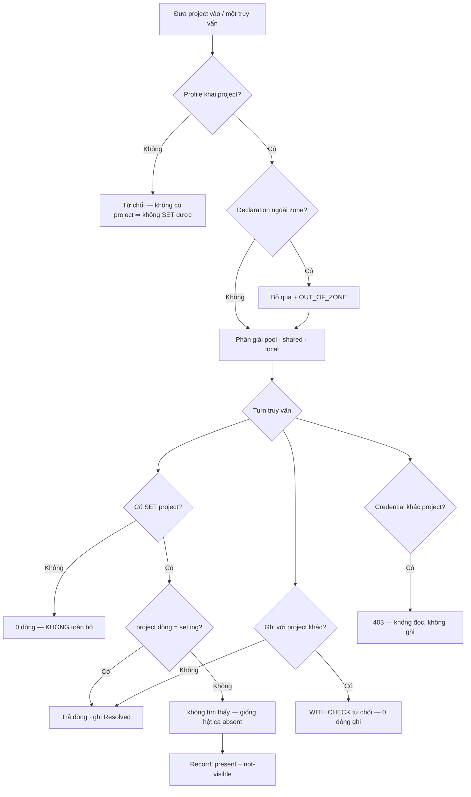

# BRD — Đưa một project vào làm việc: tri thức riêng, và hai project không thấy nhau

> **Đây là tài liệu nghiệp vụ, không phải spec kỹ thuật.** Nó trả lời *vì sao* thêm một dự án vào **một** instance không được làm dự án cũ đổi hành
> vi, và *vì sao* cô lập phải bị cưỡng chế ở **tầng dữ liệu** chứ không phải ở chỗ câu truy vấn được viết cẩn thận. Hợp đồng bảng, khoá, policy nằm ở
> `sdlc/07.technical/02.data-design/02.schema.md` §4.

## 1. Bối cảnh
Một máy. Một control plane. Hai dự án: `baplatform` (khách A) và `FinESO` (khách B) — cùng đội, cùng bộ luật chung, **tri thức riêng**.

Câu hỏi đầu tiên khi đưa dự án thứ hai vào không phải *"có chạy được không"* — mà là **"dự án thứ nhất có đổi hành vi không"**. Nếu có, mỗi lần nhận thêm khách là một lần làm rung mọi dự án cũ, và người ta sẽ chọn cách an toàn hơn: **mỗi dự án một máy** — thứ phá đúng `D-20` (evidence tập trung ở **một** control plane) và `D-21` (*chọn consumer* là **một phép lọc cưỡng chế**, không phải một deployment).

Và có một cái bẫy ngược lại, khó hơn: **cô lập làm quá tay thì mất kế thừa** (`D-30` · `D-31`). Chặn hết là `FinESO` không nhận được bộ kỹ năng dùng chung, và người ta sẽ "sửa" bằng cách chép tay — quay lại đúng vấn đề `shared` sinh ra để giải.

### 1.1 Sơ đồ tổng quan

> **Đọc sơ đồ:** mũi tên duy nhất đi **ra khỏi** `shared` tới **cả hai** project là kế thừa — nó **phải** chạy. Mũi tên giữa `P1` và `P2` **bị cắt**:
> đó là cô lập. Ranh giới đi qua **giữa hai project**, không đi qua `shared`. Và nhãn trên hai mũi tên vào `P1`/`P2`: `project` đến từ **phiên**,
> không từ cái agent gõ vào.

## 2. Những người trong câu chuyện

| Ai | Tuổi | Mã vai | Họ **thật sự** cần gì |
|---|---:|---|---|
| **Hùng** | 34 | `A-01` | Đưa dự án thứ hai vào **mà không phải đọc lại dự án thứ nhất**. Anh không cần "tính năng cô lập" — anh cần một buổi chiều không sự cố |
| **Trang** | 31 | `A-01` | Khai **đội agent**: ai, vai gì, quyền gì — và tin rằng **cùng một việc** ở hai vai cho hai kết quả khác nhau, cố ý |
| **Bảo** | 29 | `A-02` | Biết mình đang ở **project nào** — và biết mình **không tự khai** được điều đó: anh làm việc trong một repo, không trong một "tenant" |
| **Chủ dự án FinESO** | — | `A-07` | Dữ liệu của họ **không** sang dự án khác — hậu quả **hợp đồng**, không phải thuộc tính kỹ thuật |
| **Khánh** | 38 | `A-08` | Đọc lại artefact sau sáu tháng và biết nó thuộc project nào — **không** đoán theo đường dẫn trên đĩa |

> **Điểm dễ bỏ sót:** với Hùng, câu hỏi là *"dự án cũ có đổi không"*. Với chủ FinESO, câu hỏi là *"dự án này có thấy dự án kia không"*. **Cả hai**
> phải trả lời **không** — nếu chỉ một cái đúng, mô hình một instance vẫn hỏng, và hỏng ở nửa số ca, tức khó tìm hơn.

## 3. Chuyện xảy ra hôm nay (khi chưa có hệ thống)

**Thứ Hai, 2026-10-19, 10:40.** Hùng đưa `FinESO` vào cùng control plane đang chạy `baplatform`: tạo thư mục khai báo, chạy `provision.sh`, xem health
xanh. 14 turn đầu của `FinESO` chạy ổn.

**Thứ Ba, 09:15.** Trang thêm vào `shared` một luật của `baplatform`: *"mọi thay đổi schema phải có migration lùi"*. Đúng cho `baplatform` — nó có
migration. `FinESO` không có, nó đồng bộ file. Chiều hôm đó **11 trên 14** việc của `FinESO` thành `partial`.

**Thứ Tư, 11:02.** Bảo, đang làm trên `FinESO`, hỏi *"có luật kế hoạch migration không?"* Hệ trả **"không tìm thấy"**. Sự thật: có — nhưng thuộc
`baplatform`. Câu trả lời **đúng**, và đúng **vì may**: nếu hệ trả *"có, nhưng bạn không được xem"* thì ranh giới vừa tự khai rằng có một thứ ở đó.

**Thứ Năm, 16:30.** Ngược lại cái trước: script chẩn đoán của Khánh quét `evidence_turn` để đếm turn `cannot-judge` **hôm qua**, không đặt `project`
trước khi đọc. Nó trả **0 dòng** cho cả hai project. Khánh kết luận "hôm qua không ai bị kẹt" — **sai**: có 23 turn, 12 của `FinESO`.

**Ba lỗi, và không ai trong ba người có lỗi:**

| Lỗi | Ai làm | Vì sao **không** phải lỗi của họ |
|---|---|---|
| Luật của `baplatform` áp cho cả `FinESO` | Trang | Cô ấy đặt nó ở `shared` — đúng chỗ dành cho *"luật dùng chung"*. Cô không có cách nào biết nó không chung |
| Truy vấn chéo project **trả lời sai** | Khánh | Script của cô chạy đúng cú pháp; nó không đặt một biến mà **không tài liệu nào nói phải đặt** |
| Câu trả lời "không tìm thấy" **vô tình** đúng | Hệ | Nó không có hình dạng để nói "có nhưng ngoài quyền" — nên nó nói đúng sự thật mà không biết mình đang làm đúng |

**Chi phí thật:** 11 việc chạy lại · 1 buổi chiều của Hùng · 23 turn `cannot-judge` bị kết luận là **không tồn tại** · một quyết định không ai chép
ra: *"hay là mỗi dự án một máy"*.

## 4. Hệ thống phải làm gì

### 4.1 Đưa một project vào = khai **ba** thứ, không phải copy một thư mục

`UC-05`. Điều kiện sau của UC này là một câu kiểm được: *project có bộ tri thức **riêng**, không lẫn project khác*. Cách trực giác — *"copy thư mục
của `baplatform`, sửa vài file"* — hỏng theo ba cách, và cách thứ ba là cách chết người:

| Cách trực giác | Hỏng ở đâu |
|---|---|
| Copy cả thư mục | Bản copy **giữ nguyên** thứ không thuộc về nó: luật nội bộ của `baplatform`, ghi chú khách A — dự án mới thừa hưởng cả lịch sử dự án khác |
| Chép tay phần cần | Không ai biết "phần cần" gồm gì cho tới lần đầu nó thiếu — và lần đó là một turn `partial` |
| Dùng **chung** thư mục, lọc lúc đọc | Lọc sai **một chỗ** là hai dự án trộn — và mọi người viết code đều sẽ có một chỗ sai |

Nên "đưa vào" là **khai** ba thứ rời nhau — và chữ **khai** không phải trang trí: tri thức là **file trong git** (`D-23`), nên đưa dự án thứ ba vào là
**một commit**, không phải một buổi cài đặt. Ba thứ đó:

| Khai gì | Ghi ở đâu | Ai khai |
|---|---|---|
| **`project`** (`project = ownerId`, `D-22`) | `harness.profile.json` | `A-01` |
| **tập tri thức**: `uses` gì từ `pool`/`shared`, `overrides` gì bằng bản local | `harness.profile.json` | `A-01` |
| **Đội agent**: worker · role · `scope` · `bar[]` | page config của control plane (`D-51`) | `A-01` (Trang) |

### 4.2 Cô lập ở **tầng dữ liệu**, không phải "câu truy vấn được viết cẩn thận"

`BR-12`: *project này không thấy dữ liệu project khác*. Điều khoản trung tâm, và nó bị đọc sai rất tự nhiên: thành *"nhớ lọc theo project"*. Bốn cách
làm, và chỉ cách thứ tư đáp được chữ **cưỡng chế**:

| Cách làm | Vì sao **không** đủ |
|---|---|
| Lọc `WHERE project = ?` ở tầng ứng dụng | Đúng cho tới lần **quên**. Một endpoint mới, một script chẩn đoán, một lệnh CLI — mỗi chỗ là một lần phải nhớ. Đây **chính xác** là lỗi của Khánh ở §3 |
| "Chọn project" trong UI như một filter tuỳ chọn | Là **filter**, tức có đường không đi qua nó. `D-21` loại thẳng: *"phải cưỡng chế (không có consumer ⇒ không truy vấn được), không phải filter tuỳ chọn"* |
| Mỗi project một schema / một database | Tách **vật lý** trong khi `D-21` nói **một** DB, và join memory ↔ graph (`E-2`) thành xuyên database |
| **Row-level security trên `current_setting('eso.project')`, thiếu setting ⇒ 0 dòng** | ✅ Cơ chế **từ chối** thay vì **nhớ giúp** |

Hai chi tiết mà `02.schema` §4 gọi là chỗ dễ cấu hình sai nhất — cả hai **trông đúng** khi đọc lướt:

| Chi tiết | Thiếu nó thì |
|---|---|
| **`WITH CHECK`** bên cạnh `USING` | `USING` lọc **đọc**, `WITH CHECK` chặn **ghi**. Thiếu `WITH CHECK`, một `INSERT` với `project` khác setting vẫn **lọt** — rồi **vô hình** với chính người vừa ghi: **mất dữ liệu im lặng**, không phải lỗi quyền |
| **`FORCE ROW LEVEL SECURITY`** | Thiếu nó, **chủ bảng** (role migration) bỏ qua mọi policy — test RLS chạy dưới role đó sẽ **xanh giả**, và lỗi chỉ hiện khi có người dùng thật |

Và một dòng phản trực giác: **thiếu setting ⇒ rỗng, không phải toàn bộ.** Một hệ trả **toàn bộ** khi thiếu setting là hệ mà **một** đường đọc quên `SET` là rò tất cả: rỗng thì Khánh thấy "0 dòng", sai nhưng **vô hại**; toàn bộ là sai **không thể rút lại**. Đây đúng là chỗ dễ sai nhất — `current_setting('eso.project', true)` trả `NULL` khi thiếu, và mọi cách "xử lý cho tiện" cái `NULL` đó là một quyết định.

### 4.3 Khi hai project ở chung một instance, và một truy vấn **quên** vị từ

Câu người đọc lần đầu **phải** hỏi: *"quên thì sao?"* Dựng lại phiên của Khánh:

| Sự thật trong DB | Số dòng |
|---|---:|
| `evidence_turn` của `baplatform`, ngày 2026-10-21 | **31** |
| `evidence_turn` của `FinESO`, ngày 2026-10-21 | **19** |
| Câu trả lời đúng cho *"hôm qua có turn nào `cannot-judge`"* **trên `FinESO`** | **12** |
| Câu trả lời của truy vấn **quên** vị từ, nếu không có RLS | **50** — và **không** dòng nào bị đánh dấu là của người khác |
| Câu trả lời của cùng truy vấn **dưới** RLS, thiếu setting | **0** |

**Vì sao "quên ⇒ 0 dòng" là câu trả lời đúng** — không phải vì 0 là số đẹp, mà vì nó **không thể sai theo chiều nguy hiểm**:

| Nếu quên ⇒ | Hậu quả | Có phát hiện được không |
|---|---|---|
| **0 dòng** | Khánh kết luận sai *"không có turn nào kẹt"* — cùng loại lỗi cô đã mắc, nhưng không dữ liệu nào rời máy | ✅ **Có**: turn có thật, lần sau ai mở S1 thấy và bắt được |
| **toàn bộ** | 19 turn của `FinESO` hiện trong báo cáo của `baplatform`; chủ dự án B thấy số của mình trong tài liệu của A | ❌ **Không**: mọi thứ trông hợp lý, **không ai biết phải kiểm** |

Nên thứ tự ưu tiên là: **không rò > trả lời đúng > trả lời hữu ích**. Một hệ hạ dòng thứ ba để giữ dòng thứ nhất là một hệ đúng.

**Và có một ca thứ hai, khó hơn "quên":** truy vấn **có** vị từ, nhưng vị từ là của **project khác** — đúng chỗ `project` đến từ client (§4.5). Nó cú pháp đúng, chạy xanh, trả 19 turn của `FinESO`, và RLS không chặn vì *"project của người hỏi"* **là** `B`: người hỏi tự nhận mình là B. Đó là lý do §4.5 là một mục riêng.

### 4.4 Cô lập **không** được chặn kế thừa

Đây là đối trọng, và thiếu nó thì cô lập thành cắt rời. `D-31`: nâng `shared/jira-flow` lên 1.3 ⇒ **mọi project** dùng 1.3 ở turn tiếp theo. Nếu cô
lập chặn luôn `shared` thì `D-31` thành vô nghĩa. Nên ranh giới phải nói **chính xác**: cái gì **đi qua** được, cái gì **không**.

| Đi qua được | Không đi qua được |
|---|---|
| `pool` — nguồn chung, do `A-01` quản | tri thức **riêng** của project khác |
| `shared` — lớp kế thừa, do `A-01` quản · một mục `shared` nêu **tên** trong danh sách ảnh hưởng (UC-07) | `evidence_turn` · `evidence_item` · artefact · phán quyết của project khác |

**Chìa khoá:** thứ đi qua được là thứ **`A-01` khai**; project **không** có quyền ghi vào đường đi qua. Đó cũng là lý do `declaration` vùng
`pool`/`shared` không mang nghĩa "cô lập" mà mang nghĩa *"đọc bởi mọi project, ghi bởi `A-01`"* — RLS kiểu `project = ⋯` áp lên nó sẽ **ẩn `shared`
khỏi mọi người**: cô lập đúng cú pháp, sai kết quả.

### 4.5 `project` đến từ **phiên**, không bao giờ từ client

Đây không phải chi tiết bảo mật. Nó là **cùng một luật** với `BR-01` (cùng câu hỏi ⇒ cùng phán quyết), nhìn từ phía dữ liệu.

`02.schema` §4: *"`project` **không** đến từ client — `API-1` kiểm với credential"*. `D-21`: *"không có consumer ⇒ không truy vấn được"*.

Vì sao nghiêm: nếu `project` là trường trong body thì nó thành **tham số**, và mọi phép lọc ở §4.2 thành lọc theo tham số **người dùng gửi lên** — cô
lập vẫn "chạy" trong test viết đúng và **không** chạy trong thực tế. Ca xấu hơn: cùng một câu hỏi, hai client gửi hai `project` khác nhau ⇒ **hai phán
quyết**, đúng thứ `BR-01` cấm.

| `project` lấy từ | Hệ quả khi client gửi sai | Phát hiện được? |
|---|---|---|
| body của request | Trả dữ liệu của project **khác** — RLS không chặn, vì setting **đã** bị đặt bằng giá trị đó | ❌ với mắt thường |
| credential / phiên (`SET LOCAL eso.project`) | `API-1` trả **403** — project không khớp phạm vi của credential | ✅ ngay lần đầu |
| đường dẫn thư mục | Hai working copy cùng tên ⇒ gộp dữ liệu hai chủ | ❌ |

*"Từ phiên"* chưa nói phiên **khởi tạo ở đâu** — đọc `harness.profile.json` lúc provision hay đọc lại mỗi khi mở phiên. Hai cách cho hai hành vi khác
nhau khi profile đổi giữa hai turn; ghi ở §8 thay vì tự chọn.

### 4.6 Câu từ chối phải **giống hệt** câu "không có"

`BR-13`. Hai ca khác nhau, **một** câu trả lời:

| Ca | Câu trả lời đúng |
|---|---|
| Mục **không tồn tại thật** | *"không tìm thấy"* |
| Mục **thuộc project khác** | *"không tìm thấy"* — **giống hệt từng ký tự** |

Hai tầng, và chúng **không kéo theo nhau** (`D-45`): **record** giữ giá trị thật (`exists = present`, `visibility = not-visible`), **answer** thu về
cùng câu với `absent`. Record có thể đúng mà answer rò; answer có thể kín mà record nói dối. Test phải khẳng định **cả hai** — và `visibility`
**không** có cột (`D-47` `OP-05`), nó là **phép so** `project` của bản ghi × `project` của người hỏi, tính lúc đọc.

Không thể "cho tiện" bằng cách trả *"ngoài quyền"*: câu đó nói **có một thứ ở đó**. Bảo ở §3 không cần biết có luật migration; anh cần biết anh không
có luật nào.

### 4.7 Một luật ở `shared` phải **lọc được theo project**, không phải "chọn cho tất cả"

Chuyện §3 xảy ra vì một luật đúng cho một dự án được đặt ở `shared`. `D-30` cho câu trả lời: `shared` là **kế thừa**, và project muốn khác thì
**override** bằng bản local — override **phải hiện ra**. Nhưng override chỉ chữa được *"project này không muốn luật chung"*, không chữa được *"luật
chung chỉ đúng cho một số loại dự án"*. Cái thứ hai thuộc `applies_when` của chính luật (`REQ-KB-02`). Một luật không khai `applies_when` là một luật
áp **mọi nơi** — và đó là cách nó tới được `FinESO`. Chú ý rằng "không khai" không được phép **mặc định** là `always: true`: `03.declaration-format`
§4 liệt `applies_when` rỗng vào **điều không hợp lệ**, vì "áp mọi nơi" là một **quyết định**, phải viết ra.

### 4.8 Sơ đồ quyết định: một turn đọc được dòng nào

| Nút | Điều kiện | Nguồn |
|---|---|---|
| **Phiên có project?** | `project` từ credential/profile, **không** từ body | `02.schema` §4 · `D-21` |
| **RLS lọc** | `project = current_setting('eso.project')`; thiếu setting ⇒ 0 dòng | `02.schema` §4 |
| **vùng `pool`/`shared`** | đọc bởi mọi project, ghi chỉ `A-01` | `D-30` · `20.override-visible` §5 |
| **"không tìm thấy"** | cùng câu cho `absent` và `not-visible` | `BR-13` · `D-45` |
| **`Resolved[]`** | mỗi mục một hàng `evidence_item(kind='election')` | `D-58` · `02.schema` §2 |

> **Đọc sơ đồ:** có **hai** nhánh `H` — nhánh đầu là RLS, cô lập ở tầng dữ liệu, không một lời nào nói ra; nhánh sau đi qua `L`/`M` là `BR-13`, và nó **chỉ** áp khi có người *hỏi về một mục cụ thể*.

## 5. Một ngày thật, có số

**2026-10-22**, một control plane trên máy của Hùng, **3** project: `baplatform` (khách A) · `FinESO` (khách B) · `harness-eso` (nội bộ). Tổng **150**
turn trong ngày — 50 mỗi project. `shared` có **31** mục; `pool` có **140**.

| Mốc | Việc | Đo được gì |
|---|---|---|
| 08:12 | `provision.sh` cho `harness-eso` | **0** file của hai project kia bị đọc để dựng nó |
| 08:40 | Phân giải tập hiệu lực ba project | `baplatform` **49** (31 `shared` + 18 local) · `FinESO` **40** (31 + 9) · `harness-eso` **36** (31 + 5) |
| 09:00–17:00 | 150 turn chạy · **37** lần truy vấn chéo project | **43/43** trả *"không tìm thấy"*; **0** câu trả lời khác câu "không có"; **37** dòng giữ `exists = present`, và `visibility = not-visible` **tính lúc đọc** (§4.6, `D-47`) |
| 10:02 | Hai truy vấn **không** `SET project` | **2** lần; cả hai trả **0 dòng**; **0** lần trả toàn bộ |
| 14:20 | Luật *"migration lùi"* vào `shared`, `applies_when: {paths: ["docs/schema/**"]}` | Không khớp việc nào của `FinESO` — **0** turn `partial` |
| 14:25 | Cùng luật, `applies_when: {always: true}` (mô phỏng trên bản sao) | **11/14** việc của `FinESO` thành `partial` — đúng con số của §3 |
| 17:10 | 6 mục `baplatform` đè `shared` | **6/6** hiện `overridden_by`; **0** bị giấu |
| 17:30 | RLS test dưới role ứng dụng **và** role migration | **2/2** trả **0 dòng** — không "xanh giả", nhờ `FORCE` |

**Ba con số của §5, đọc cùng nhau:**

1. **0 — giao của ba tập local.** Không phải "ít", mà là **không**. Một số khác 0 ở đây nghĩa là một mục của chủ này đã sang chủ kia, và hậu quả là **hợp đồng**, không phải bug.
2. **2 lần truy vấn không `SET` project, cả hai trả 0 dòng.** Con số quan trọng là **0 dòng**, không phải **2 lần**; một lần trả toàn bộ chỉ xảy ra nếu policy viết sai một chữ.
3. **11 → 0 turn `partial` vì luật của project khác.** Phép đo của *"đưa dự án thứ hai vào không làm dự án thứ nhất đổi"* — và nó **đã từng là 11**, đúng cái §3 mô tả. Số 0 ở 14:20 **không** đến từ việc bỏ luật, mà từ việc luật **khai khi nào áp** (§4.7).

**Điều bảng này không nói:** kế thừa có **đúng** không — cả ba project nhận **31** mục `shared`, nên một mục sai làm cả ba cùng sai mà bảng vẫn xanh.

### 5.1 Một project đi qua vòng đời của nó

**Không có nhánh nào từ `DangKy` sang `Chay` mà bỏ `PhanGiai`.** Nếu bỏ, hệ chạy với *"cái gì có trên đĩa"* thay vì *"cái project đã khai"* — đúng lỗi
đã thấy ở host khác: *"project-scope leaks across unrelated cwds"* (`D-30`, Claude Code #53923).

### 5.2 Chi tiết một dòng trong bảng §5

| Thời điểm | `project` trong phiên | Bảng đọc | `SET`? | Dòng trả về | Câu trả lời |
|---|---|---|---:|---:|---|
| 08:12 | `harness-eso` | `declaration` vùng `shared` | có | **31** | kế thừa chạy |
| 08:40 | `baplatform` | `declaration` vùng `project` | có | **18** | của riêng A |
| 08:40 | `FinESO` | `declaration` vùng `project` | có | **9** | của riêng B — **0** dòng của A |
| 09:15 | `FinESO` | `evidence_turn` của `baplatform` | có | **0** | "không tìm thấy" |
| 10:02 | *(không)* | `evidence_turn` | **không** | **0** | 0 dòng — **không** phải 50 |
| 10:03 | *(không)* | `declaration` vùng `shared` | **không** | **0** | kín kể cả với `shared`: không phiên ⇒ không câu trả lời |
| 14:20 | `FinESO` | `declaration` `applies_when` | có | 31 xét, **0** khớp | đúng chỗ, sai phạm vi ⇒ không áp |
| 17:30 | `baplatform` (role migration) | `evidence_turn` | có | **0** | `FORCE` giữ luật cho cả chủ bảng |

## 6. Ngoại lệ — và hệ thống làm gì

| Tình huống thật | Hệ thống xử lý |
|---|---|
| Project mới, **0** declaration | Tập rỗng; **không** lỗi (`AC-KB-01-04`) |
| File declaration **ngoài** zone đã khai | **Bỏ qua** + nêu đường dẫn; `OUT_OF_ZONE` (`AC-KB-01-05`) |
| Hỏi một mục thuộc project khác | *"không tìm thấy"* — **giống hệt** mục không tồn tại (`AC-KB-01-02`) |
| Mục nằm trong `shared` | Thấy ở **mọi** project của tổ chức, `Resolved{from: shared}` (`AC-KB-01-03`) |
| Truy vấn **không** `SET` project | **0 dòng**, không phải toàn bộ (`02.schema` §4) |
| `INSERT` với `project` khác setting | `WITH CHECK` **từ chối**; không có dòng "vô hình" nào được tạo (§4.2) |
| Test RLS chạy dưới role migration | `FORCE` áp luật cho **cả chủ bảng** ⇒ test không xanh giả (§4.2) |
| Client gửi `project` trong body khác credential | `API-1` trả **403**; 0 dòng ghi (§4.5) |
| Worker khai one role **không có** · đội **0** worker · trùng `worker_id` | Từ chối `UNKNOWN_ROLE` / rỗng, không lỗi / `DUPLICATE_ID` (`AC-IAM-01-03`…`-05`) |
| Cho worker `retired` khi đang giữ việc dở · muốn **đổi project** tại chỗ | Việc dở → **risk `OPEN`** có `review_by` (`AC-IAM-01-02`); đổi project: **nghỉ rồi khai mới** |
| Đổi vai đang có worker giữ việc · preset đè vai người đã sửa tay | **Từ chối** xoá vai (`ROLE_IN_USE`) · **không** đè, trả `skipped[]` (`AC-CFG-02-01`) |
| Project **chưa tồn tại** và **ngoài quyền** · rút một project khỏi registry | Cùng mã lỗi, cùng câu ở **mọi** đường đọc (`BR-13`) · evidence **vẫn còn**, đọc được (`BR-06`) |

### 6.1 Sơ đồ nhánh lỗi

> **Đọc sơ đồ:** nhánh `I` **trông như** một lỗi, và không phải: đó là cơ chế từ chối. Nhánh `O` là nhánh mà
> một hệ thiếu `WITH CHECK` **không có** — thiếu nó thì dòng được ghi, rồi vô hình với chính người vừa ghi.

## 7. Điều ngoài phạm vi

| Không thuộc BRD này | Thuộc |
|---|---|
| Hệ **chọn skill/luật nào áp** trong tập đã cô lập — ba vùng, `overridden_by` | `06.uc-06-which-rule-applies.md` |
| Nâng một `shared` cho mọi project và danh sách ảnh hưởng · rút lại một `shared` đã nâng vì nó hỏng | `07.uc-07-promote-shared.md` · `08.uc-08-revert-broken.md` |
| Hỏi **đã đủ chưa** và nói **thiếu gì** · ghi lại **vì sao** một quyết định ra như vậy | `01.uc-01-is-it-enough.md` · `02.uc-02-what-is-missing.md` · `03.uc-03-why-this-decision.md` |
| Khai **đội agent** · hỏi **"vì sao bị chặn"** · đề xuất **tự sửa cách làm** · duyệt một ticket đã xong | `04.uc-04-agent-team.md` · `09.uc-09-why-blocked.md` · `10.uc-10-self-proposal.md` · `11.uc-11-ticket-done.md` |
| Hiểu một project **gồm những gì** trước khi sửa · cảnh báo **dù không ai hỏi** · chọn **nguồn năng lực** khi host thiếu | `12.uc-12-what-is-in-project.md` · `13.uc-13-unprompted-warning.md` · `14.uc-14-capability-source.md` |
| Policy RLS, `WITH CHECK`, `FORCE`, khoá bảng · đồng bộ file ↔ DB | `sdlc/07.technical/02.data-design/02.schema.md` §4 · `sdlc/07.technical/01.architecture/12.configuration-and-store.md` |

## 8. Câu chưa có trả lời trong release

Đây là những chỗ tôi **không** tự trả lời, vì không nguồn nào nói:

| # | Câu hỏi | Mã | Vì sao không nguồn nào trả lời |
|---|---|---|---|
| 1 | **`project` của một turn lấy từ profile lúc provision hay đọc lại mỗi phiên?** §4.5 nói *"từ phiên"*; `12 §1` nói năng lực host đàm phán **một lần lúc provision** | `NEW-OPEN-BRD-uc05-1` | `02.schema` §4 chỉ nói *"không đến từ client"* — **không** nói nó đến từ **đâu**. Hai cách cho hai hành vi khác nhau khi `harness.profile.json` đổi giữa hai turn: đổi field hay phải provision lại |
| 2 | **"Không tìm thấy" là `absent` hay một giá trị thứ tư `not-visible`** ở tầng **answer**? `BR-05` đã tách `unknown` khỏi `absent` | `NEW-OPEN-BRD-uc05-2` | `D-45` chốt câu trả lời **giống hệt** ca `absent` nhưng **không** nói nó **là** `absent`. Và `evidence_turn.level` đã đóng 5 giá trị (`Q-01` → `D-59`), **không** có `not-visible` — nên nếu cần giá trị thứ tư thì đó là đổi **từ vựng đã đóng**, tức một quyết định |
| 3 | **`A-01` nào được khai profile của project này** — và `Q-04` mặc định `operator` là `role_name='operator'` trong `worker` chứ **không** có bảng grant; mặc định đó **chưa** được duyệt | `NEW-OPEN-BRD-uc05-3` (trùng `Q-04` của `06.open-register`, *đề xuất* mặc định, đóng theo cụm) | `06.open-register` ghi `API-13` trả `403 CONFIG_FORBIDDEN` cho *"không phải operator"* và **không bảng nào** giữ grant, rồi **đề xuất** một mặc định — nhưng đề xuất **không phải** chốt. Nếu sai: hoặc **không ai** cấu hình được, hoặc **ai cũng** cấu hình được |
| 4 | **Project bị rút khỏi registry thì tri thức và evidence của nó đi đâu?** | `NEW-OPEN-BRD-uc05-4` | `BR-06` nói record không xoá, nên evidence ở lại — nhưng `declaration` của project vùng `project` **không** bất biến (`D-33`: vùng `project` **sửa được**). Rút dự án mà giữ evidence, xoá tri thức: cây không nói ai quyết, và **không** có `AC` nào cho ca này |
| 5 | **Danh sách ảnh hưởng (UC-07) nêu tên project khác — có vi phạm `BR-12` không?** | *(chưa có mã — `BR-12` không có dòng `D-nn` nguồn, ghi ở `19.declaration-resolved` `OPEN-2`)* | `21.promote-shared` §3 lập luận **không**: đó là `A-01` nhìn thứ **`A-01` sở hữu**, không phải project A đọc dữ liệu của B. Nhưng không nguồn nào **chốt** ranh giới đó, và nếu sai thì chính tài liệu này (§4.4) đang cho một đường rò hợp pháp |

> **Ba câu đã tra và **không** để mở:** *"ai tạo `project` id"* — chốt `project = ownerId` (`D-22`). *"`visibility` có phải cột"* — chốt **không**, tính lúc đọc (`D-47` `OP-05`). *"Có ghim phiên bản"* — **không có** trường `pin`; đứng yên bằng **override** (`D-31` · `12 §"Không có ghim"`).

## 9. Truy vết

| Yêu cầu | Điều khoản | Mục trong BRD |
|---|---|---|
| `REQ-KB-01` — tập tri thức riêng; cô lập là **cưỡng chế** | `BR-12` | §4.1 · §4.2 · §4.3 · §5 |
| `REQ-KB-02` — khai khi nào áp; chọn **kiểm được** · `REQ-KB-03` — nâng một lần cho tất cả; đè phải hiện | `D-19` · `D-30` · `D-31` | §4.4 · §4.7 |
| `BR-12` — cô lập project | `BR-12` | §4.2 · §4.3 · §4.4 · §5.2 · §6 |
| `BR-13` — `visibility` trực giao với `exists` | `BR-13` · `D-45` | §4.6 · §6 |
| `BR-06` — record chỉ ghi thêm | `BR-06` | §5.1 · §6 · §8 (câu 4) |
| `BR-05` — `unknown` ≠ `absent` · `BR-01` — cùng câu hỏi ⇒ cùng phán quyết | `BR-05` · `BR-01` | §4.5 · §8 (câu 2) |
| `D-20` · `D-21` · `D-22` — một control plane, một DB, partition theo project | `D-22` | §1 · §4.2 · §5 |
| `D-30` — ba vùng; `shared` là lớp kế thừa | `D-30` | §1.1 · §4.4 · §5.1 |
| `D-47` — `visibility` tính, **không** cột | `D-47` `OP-05` | §4.6 · §8 |

| Use case | Mục |
|---|---|
| `UC-05` đưa một project vào · `UC-04` khai đội agent | §4.1 · §4.2 · §5.1 · §6 |
| `UC-06` chọn skill/luật nào áp (dùng tập đã cô lập) · `UC-01` đã đủ chưa (nhận `project` từ phiên) | §4.5 · §4.7 · §4.8 · §7 |

| AC | Mục |
|---|---|
| `AC-KB-01-01`…`-05` · `AC-IAM-01-01`…`-05` · `AC-CFG-02-01`/`-02` | §4.2 · §4.4 · §4.6 · §5.2 · §6 |

## Revision rule

Sai khi: `BR-12` bị đọc thành *"lọc theo project ở tầng ứng dụng"* (nó nói **cô lập**, `REQ-KB-01` nói **cưỡng chế**); hoặc câu từ chối cho mục ngoài
ranh giới **khác** câu "không có" (`BR-13`); hoặc `project` nhận từ client ở bất kỳ đường đọc nào; hoặc `shared` bị cô lập chặn (`D-31` thành vô
nghĩa); hoặc policy RLS mất `WITH CHECK` / `FORCE` → sửa §4 và §9.

Nguồn kiểm: `grep -n 'BR-12\|BR-13' sdlc/06.analysis/01.business-analysis/03.business-rules.md && grep -c "WITH CHECK\|FORCE ROW LEVEL SECURITY" sdlc/07.technical/02.data-design/02.schema.md`
