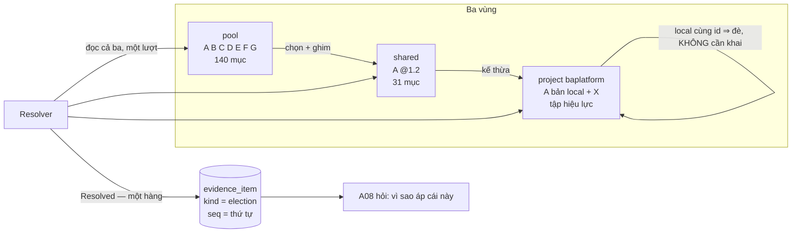
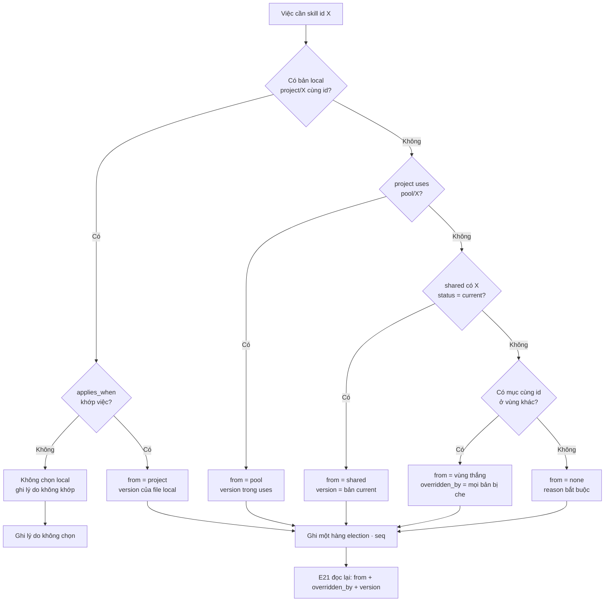
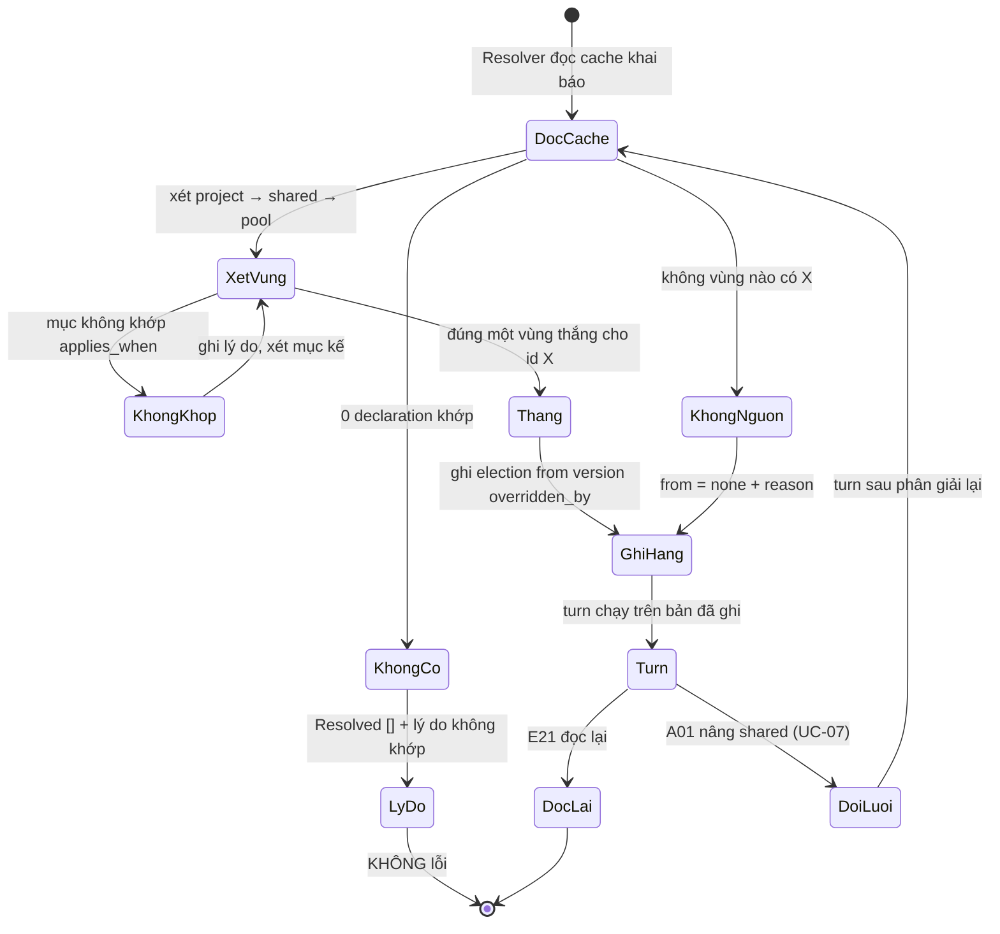
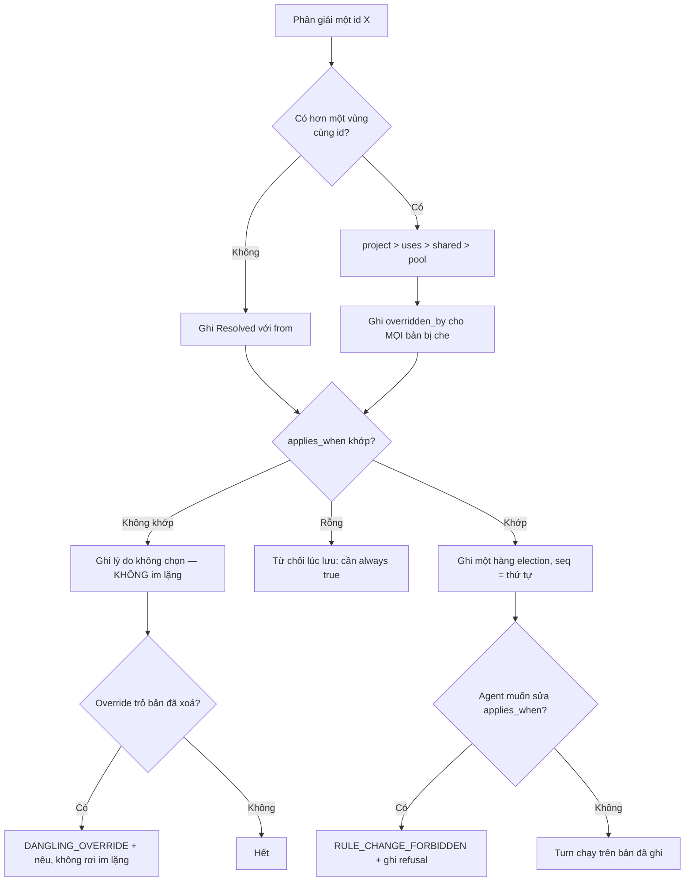

# BRD — Hệ chọn skill/luật nào áp: ba vùng, một người thắng

> **Đây là tài liệu nghiệp vụ, không phải spec kỹ thuật.** Nó trả lời *vì sao* một turn phải biết **chính xác** nó đang chạy trên luật nào, và *vì
> sao* câu trả lời cho câu hỏi đó không được phép là "một cái gì đó trong ba vùng". Định dạng `applies_when` nằm ở
> `sdlc/07.technical/02.data-design/03.declaration-format.md`; hàng `election` nằm ở `02.schema.md` §2.

## 1. Bối cảnh

Một turn cần một skill: *"làm sao mở một ticket Jira cho đúng"*. Trong hệ có **ba** phiên bản cùng trả lời câu đó:

| Ở đâu | Là gì | Ai đặt nó ở đó |
|---|---|---|
| `pool` | Tàng Kinh Các — **140** mục: thư viện đầy đủ, **không chạy trực tiếp** | cộng đồng, `A-01` |
| `shared` | **31** mục được chọn — lớp **kế thừa** cho mọi project của tổ chức | `A-01` |
| `project` | tập hiệu lực: phần kế thừa **+** 18 mục riêng của `baplatform` | `A-01`, chủ dự án |

Ba vùng không phải ba chỗ chứa — chúng là **ba câu trả lời khác nhau cho cùng một câu hỏi**, và câu hỏi thật là: *cái nào thắng?*

Điều làm câu hỏi khó không phải việc sắp thứ tự. Mà là ba thứ này:

**Thứ nhất — bản local của project thắng mà không ai khai nó thắng.** `project/skills/jira-flow.md` có một file; không dòng khai báo nào nói *"file này đè `shared/jira-flow`"*. Nó đè vì nó **ở đó**. Đây là thiết kế (`D-30`) và nó đúng — nhưng nghĩa là *"vì sao cái này thắng"* không suy được từ cấu hình, chỉ quan sát được từ **kết quả phân giải**.

**Thứ hai — người dùng không phân biệt được "shared" với "bản cũ của tôi".** Bảo mở một skill, thấy nội dung cũ. Đó là `shared@1.2` đang chạy, hay bản
local của `baplatform` từ tháng 8? Cùng nội dung, cùng số version trong file, và **hai câu trả lời khác nhau** cho câu *"ai nâng cái này"*.

**Thứ ba — không có "một người thắng" thì có hai.** Nếu một turn chạy trên `shared@1.2` và turn sau chạy trên 1.3 mà không cái nào nói ra, thì *"vì
sao hai kết quả khác nhau"* không có câu trả lời — và đó đúng là nỗi đau `P3`.

### 1.1 Sơ đồ tổng quan

> **Đọc sơ đồ:** `pool` chỉ có **một** mũi tên ra, và nó đi tới `shared` — `pool` không bao giờ tự áp lên project. Còn `PJ` có một mũi tên **quay về
> chính nó**: đó là override, và nó không cần ai khai. Mọi thứ đi ra ngoài qua **một** hàng `Resolved`, không qua ba.

## 2. Những người trong câu chuyện

| Ai | Tuổi | Mã vai | Họ **thật sự** cần gì |
|---|---:|---|---|
| **Bảo** | 29 | `A-02` | Biết turn **này** chạy trên bản nào — không phải "hệ có những bản nào". Anh giao việc, nên anh phải giải thích được việc đã giao |
| **Trang** | 31 | `A-01` | Thấy **override nào đang có hiệu lực** mà không phải so hai thư mục. Cô đặt bản local ba tháng trước và không nhớ |
| **Khánh** | 38 | `A-08` | Đọc một artefact sau sáu tháng và trả lời *"luật nào đã sinh ra nó"* — **và** *"luật nào đã bị loại, vì sao"* |
| **Ngân** | 44 | `A-04` | Chấm một turn mà không phải suy luận luật nào đã áp; tiêu chí chấm đọc được, không phải dựng lại |
| **Chủ dự án FinESO** | — | `A-07` | Không thấy **và không bị ảnh hưởng bởi** bản local của `baplatform` — kể cả khi hai bản **cùng id** |

> **Điểm dễ bỏ sót:** Khánh cần **cả hai vế** — luật nào áp, **và** vì sao luật kia không áp. Một hệ chỉ trả vế thứ nhất khiến cô tưởng rằng bản
> `shared` không tồn tại, hoặc tệ hơn, rằng nó đã bị xoá.

## 3. Chuyện xảy ra hôm nay (khi chưa có hệ thống)

**Thứ Sáu, 2026-10-16, 08:40.** Bảo giao một slice: *"mở ticket Jira cho đúng chuẩn của mình"*. Agent đọc `skills/jira-flow.md` và làm theo. Kết quả
đúng — nhưng thiếu một bước `A-01` yêu cầu ba tuần trước.

**08:55.** Bảo hỏi: *"em đang dùng bản jira-flow nào?"* Agent: *"`./skills/jira-flow.md`"*. Đúng câu trả lời về **đường dẫn**, sai câu trả lời về
**bản**: đường dẫn đó được đọc từ đâu, và ai đã đặt nó ở đó, không có trong câu trả lời.

**09:10.** Bảo mở file. Trong đó ghi `version: 1.2` ở frontmatter. Anh tưởng đó là `shared@1.2` và đi hỏi Trang *"sao chưa nâng lên 1.3"*. Trang ngạc
nhiên: cô đã nâng `shared` lên 1.3 từ thứ Tư.

**09:25.** Trang kiểm. `shared` **đang** ở 1.3. Nhưng `baplatform/skills/jira-flow.md` là một **bản local** chép tay từ tháng 8, vẫn mang `version:
1.2` **trong nội dung của nó**. Nó đè `shared` từ đó tới giờ, và **không ai** biết — vì override không cần khai.

**09:40.** Bảo hỏi lại: *"vậy turn sáng nay dùng 1.2 hay 1.3?"* Không ai trả lời được **từ dữ liệu**. Trả lời bằng cách mở ba thư mục và so tay thì câu trả lời đó không phải *cái đã chạy*, chỉ là *cái đang có trên đĩa lúc 09:40*.

**Chi phí thật:** 1 slice làm lại · 3 câu hỏi mất 35 phút · 1 tuần `baplatform` chạy 1.2 trong khi tổ chức tưởng nó ở 1.3 · và một điều không ai nói ra: *"hay là nên ghim, để biết chắc nó đang ở đâu"* — tức `D-31` bị gỡ, kế thừa thành chép tay.

**Điều đã xảy ra — không ai có lỗi:**

| Chuyện | Ai làm | Vì sao **không** phải lỗi của họ |
|---|---|---|
| Bản local đè `shared` mà không ai biết | Trang, tháng 8 | Đó là cơ chế **duy nhất** để một project không theo bản chung (`D-31` hệ quả 2). Nó đúng, và nó **im lặng** vì không có chỗ nào bắt nó phải nói |
| Tưởng `version: 1.2` trong file là `shared@1.2` | Bảo | Cùng một con số, hai nghĩa: một là **khai báo** trong nội dung, một là **sự thật** trong record. Chưa có gì để phân biệt |
| Nâng `shared` lên 1.3 tưởng mọi project theo | Trang | `D-31` nói đúng thế. Thứ cô không biết là **project nào đang đè** — danh sách đó có ở bước nâng (UC-07), không có ở chỗ đọc |

## 4. Hệ thống phải làm gì

### 4.1 Ba vùng, và **một** người thắng mỗi lần

`D-30` chốt ba vùng với ba vai **khác nhau**, và `03.declaration-format` §3 chốt thứ tự:

| Thứ tự | Nguồn | Ghi chú |
|---|---|---|
| 1 (thắng) | `project` **override** | bản local cùng `id` — **không** cần khai |
| 2 | `project` **use** | chọn trực tiếp từ `pool` (`uses: pool/skills/B`) |
| 3 | `shared` **inheritance** | nâng là nâng cho tất cả (`D-31`) |
| 4 | `pool` | chỉ là **nguồn**, không tự áp |

Cách trực giác — *"gộp cả ba, cái nào khớp `applies_when` thì lấy"* — hỏng vì ba lý do, và cả ba đều đã xảy ra ở một hệ khác:

| Cách trực giác | Hỏng ở đâu |
|---|---|
| **Hợp** cả ba vùng, ai khớp thì áp | Hai bản cùng `id` cùng áp ⇒ agent nhận **hai** chỉ dẫn mâu thuẫn, không gì nói cái nào thắng |
| **Giao** của các scope | Claude Code đã gặp đúng lỗi này: *"multi-scope installs silently load intersection"* (`D-30`). Im lặng lấy giao nghĩa là skill có ở `shared` **không** áp vì nó không có ở `project` |
| Thứ tự do **thứ tự file trên đĩa** | Cùng một tập, hai máy hai thứ tự ⇒ hai kết quả. `AC-KB-02-06` cấm: 10 000 declaration phải cho kết quả **tất định** |

### 4.2 Bản local thắng **mà không được khai** — và đó là chủ ý

Đây là chỗ dễ bị "sửa cho đúng" nhất, nên phải nói rõ vì sao nó đúng.

Một project muốn khác `shared` có **hai** cách: khai `overrides: {shared/skills/jira-flow: ./skills/jira-flow.md}`, hoặc **đơn giản là có file đó**.
Cây chấp nhận **cả hai**, và cách thứ hai là cách đã dẫn tới §3.

Vì sao không bắt buộc khai? Vì khai là lời hứa **giữ được sự thật**, mà việc có file thì **là** sự thật: người ta sửa skill bằng editor, không bằng cách cập nhật manifest. Bắt khai thêm nghĩa là hai chỗ phải khớp, và chỗ thứ hai sẽ trôi.

Nhưng cái giá phải trả là **có tên**, và nó là cả mục này: **override không khai thì phải hiện ra bằng cách khác** — qua `Resolved.from` và
`overridden_by`. Không có hai thứ đó thì "local thắng mà không khai" là một cơ chế im lặng, và im lặng là thứ `REQ-KB-02` cấm.

### 4.3 `Resolved.from` phải **luôn** nêu người thắng — không có ca "không rõ"

`02.schema` §2 chốt hình dạng: `{ id, version, from, overridden_by[], reason? }`, với `from` **đóng** trên `pool` · `shared` · `project`.

Vì sao `from` là **bắt buộc** chứ không phải "nice to have":

| Nếu thiếu `from` | Hệ quả |
|---|---|
| Không biết ai thắng | Câu *"vì sao turn này chạy 1.2"* phải dựng lại bằng cách mở ba thư mục — dựng lại là **kể chuyện**, không phải bằng chứng |
| Không phân biệt được trạng thái §3 | Bảo thấy nội dung cũ, không biết đó là `shared@1.2` hay bản local tháng 8 — hai câu hỏi khác nhau, cùng một biểu hiện |
| Không kiểm được `AC-KB-02-01` | AC đòi ghi `from` = `project` / `shared` / `pool`; không có `from` thì AC không có gì để so |

Và vì `from` nói **vùng**, nó cũng nói **ai có quyền sửa**: mục `from: shared` chỉ `A-01` sửa được; mục `from: project` thì chủ dự án. Một trường nói được cả *"cái gì đang chạy"* và *"ai chịu trách nhiệm"* là trường phải có.

Một chi tiết `02.schema` §2 ghim: **`reason` bắt buộc khi `from = 'none'`, cấm khi khác.** `none` là ca host không có nguồn nào (`UC-14`), và ở đó câu
trả lời không phải "không có skill" mà là *"không có skill **và đây là lý do**"*. `none` **không** nằm trong bảng thứ tự trên, và không được thêm vào:
nó không phải một vùng, nó là **vắng mặt của cả ba**.

### 4.4 `overridden_by` là **danh sách**, không phải cờ

Một override có thể che **cả** `shared` **và** `pool`: `project/skills/jira-flow.md` cùng lúc đè `shared@1.2` (bản kế thừa) và `pool@1.4` (bản thư
viện, nếu project từng `uses` nó). Nếu `overridden_by` là cờ `true`, câu *"nó che cái gì"* không trả lời được — chỉ trả lời được *"nó che"*.

| Hình dạng | Trả lời được | Không trả lời được |
|---|---|---|
| Cờ `overridden: true` | có override | **cái gì** bị đè, **bản nào** bị đè |
| Một chuỗi `"shared"` | đè vùng shared | **bản nào** của shared — và vùng đó là tên, không phải địa chỉ |
| **Danh sách** `["shared/skills/jira-flow.md@1.2"]` | mọi thứ trên | — |

`20.override-visible` §5.1 chốt thứ trỏ được tới nội dung: zone · path · version — vì "tên" không nói **bản nào** (`shared` đi tiếp thì tên trỏ vào
một thứ **đã đổi nghĩa**), còn "id" là id **của chính mục đang xét**, tức một vòng.

**Và `overridden_by` vắng mặt nghĩa là "không bị đè", không phải "chưa kiểm".** `20.override-visible` §5 viết đúng thế: *"`overridden_by` vắng = không
bị đè"*. Một mảng rỗng và một trường vắng là **hai** ca khác nhau; chọn "vắng" để khỏi phải phân biệt là đúng — nhưng chỉ đúng nếu có chỗ ghi lại **đã
xét**. Không có chỗ đó thì "không đè" và "không xét" trùng nhau, đúng thứ `BR-05` cấm.

### 4.5 Người dùng không phân biệt được "shared" với "bản cũ của tôi" — và hệ phải làm

§3 là một ca cụ thể của một vấn đề chung: **hai thứ trông giống hệt nhưng khác bản chất**.

| Câu hỏi | `shared@1.2` | Bản local `version: 1.2` |
|---|---|---|
| Ai sửa nó lần cuối? | `A-01`, trong `shared/`, có lịch sử publish | chủ dự án, trong repo, có `git log` riêng |
| Nâng `shared` lên 1.3 thì nó thành gì? | **1.3** ở turn sau | **vẫn 1.2** — nó đè |
| Ai khác bị ảnh hưởng nếu tôi sửa nó? | **mọi project** của tổ chức | **một** project |
| `Resolved.from` | `shared` | `project` |
| Có trong `overridden_by` của ai không? | **có thể** — nếu project nào đó cùng `id` | không |

Dòng thứ ba là dòng quyết định: hai bản **cùng nội dung, cùng số version**, và câu *"nếu tôi sửa nó thì ai đổi"* có hai đáp án khác nhau hoàn toàn. Không có `from` và `overridden_by` thì người dùng **không thể** phân biệt — sẽ sửa bản local, tưởng đang sửa bản chung.

### 4.6 **Tất định**: cùng input ⇒ cùng thứ tự, không phụ thuộc đĩa

`AC-KB-02-06`: **10 000** declaration, kết quả phải **tất định**, *"0 phụ thuộc thứ tự file"*.

Đây là yêu cầu chứ không phải chi tiết: `Resolved[]` là một **mảng**, và `02.schema` §2 chốt nó phải là **hàng** — mỗi phần tử một dòng
`evidence_item(kind='election')`, với `seq` **là** thứ tự (`D-58`). `jsonb` mất thứ tự, nên nếu Resolver trả một mảng không có khoá sắp xếp ổn định,
thì replay một turn sẽ cho một thứ tự **khác** — và `AC-EV-03-01` (*"`Resolved[]` khớp"*) không so được.

Cái bẫy không phải "sắp xếp cho đẹp" mà là **sắp theo cái gì**: theo đường dẫn thì hai máy cài hai thư mục khác nhau cho hai thứ tự khác nhau; theo thứ tự đọc thư mục thì phụ thuộc filesystem. Nên thứ tự phải đến từ **khoá** — đó chính là lý do `Resolved[]` là **hàng** với `seq`.

### 4.7 Một mục **không** khớp `applies_when` cũng phải trả lời được "vì sao không"

`AC-KB-02-02` và `AC-KB-02-05` là hai mức của cùng một yêu cầu:

| Ca | Phải trả lời |
|---|---|
| Mục **không** khớp `applies_when` | *"không chọn; **trả lời được vì sao không**"* |
| **0** declaration khớp | `Resolved: []` **+ lý do không khớp**, không lỗi |

Vì sao phần "vì sao không" không phải trang trí: nếu chỉ có danh sách cái **được** chọn, thì một mục vắng mặt có **hai** nghĩa — *"không khớp"* hoặc *"khớp nhưng bị đè"*. `BR-05` cấm gộp hai nghĩa đó, và ở đây chúng dẫn tới hai hành động khác nhau: sửa `applies_when`, hoặc gỡ override.

`AC-KB-02-04` thêm một vế: **agent sửa `applies_when`** bị **từ chối** + ghi (`RULE_CHANGE_FORBIDDEN`). Đổi điều kiện áp là đổi luật, và đổi luật là
quyền của `A-01` (`D-15`: GRANT, người duyệt).

### 4.8 Sơ đồ quyết định: mục nào thắng cho một việc

| Nút | Điều kiện | Nguồn |
|---|---|---|
| **Bản local cùng id?** | bản local **thắng mà không khai** | `D-30` · `03.declaration-format` §3 |
| **`applies_when` khớp?** | khai `paths` hoặc `always: true`; rỗng là **không hợp lệ** | `03.declaration-format` §4 |
| **`shared` có X?** | chỉ bản `status = current` được chọn | `D-33` · `02.schema` §2 |
| **`overridden_by`** | **danh sách** zone · path · version của mọi bản bị che | `20.override-visible` §5.1 |
| **`from = none`** | `reason` **bắt buộc**; khác `none` thì **cấm** | `02.schema` §2 |

> **Đọc sơ đồ:** nhánh `D` là nhánh dễ bị bỏ nhất: local **có** nhưng **không khớp**, nên nó không thắng — và câu trả lời đúng là *"không chọn **vì**
> không khớp"*, không phải *"không có"*. Nếu `D` rơi xuống `L`, ta có một lời nói dối loại `BR-05`.

## 5. Một ngày thật, có số

**2026-10-22**, project `baplatform`. `pool` **140** mục · `shared` **31** mục · `project` **18** mục local. **50** turn trong ngày.

| Mốc | Việc | Đo được |
|---|---|---|
| 08:00 | Provision, cache khai báo làm mới | **189** dòng `declaration` đọc (`D-24`: làm mới **khi provision**) |
| 08:40 | Phân giải cho 50 turn | **50** lượt; **128** mục trong `Resolved[]` (trung bình **2,6** mục/turn) |
| 08:40 | Trong 128 mục | **94** `from: shared` · **22** `from: project` · **12** `from: pool` · **0** `from: none` |
| 08:40 | Mục bị đè | **6** mục có `overridden_by` — **6/6** nêu đủ zone · path · version |
| 09:20 | Bảo hỏi *"turn 07:15 chạy jira-flow bản nào"* | **1** hàng `election`: `{id: jira-flow, version: 1.2, from: project, overridden_by: [shared/skills/jira-flow.md@1.3]}` |
| 09:21 | *"vì sao không phải 1.3"* | Trả lời **từ record**, không mở thư mục: `shared` **đang** 1.3, bị bản local che |
| 10:05 | Trang nâng `shared/jira-flow` 1.2 → 1.3 | Danh sách ảnh hưởng nêu **1** project đè; `baplatform` **không** đổi ở turn sau |
| 14:00 | `FinESO` hỏi cùng `jira-flow` | `from: shared` **1.3** — bản local của `baplatform` **không** tới được nó: **0** rò |
| 16:30 | Phân giải lại 50 turn với thứ tự file **đảo** | **50/50** cùng `seq` cho cùng mục — tất định (`AC-KB-02-06`) |
| 17:00 | 41 trong 189 mục không khớp việc nào của turn | **41** lý do không khớp ghi được; **0** ca bị bỏ im lặng |

**Ba con số của §5, đọc cùng nhau:**

1. **128 = 94 + 22 + 12.** Mỗi mục có **đúng một** `from`. Tổng khớp chính xác là bằng chứng không mục nào bị tính hai lần — đúng điều *"một người
   thắng"* nghĩa là.
2. **6 mục bị đè, và 6/6 nêu đủ địa chỉ.** Không phải "6 override tồn tại" mà là "6 override **giải thích được**". Con số thứ hai có giá trị; con
   số thứ nhất thì một hệ im lặng cũng đạt.
3. **0 rò từ `baplatform` sang `FinESO`, dù hai bản cùng id.** Đây là chỗ hai tài liệu gặp nhau: `BR-12` cô lập, `D-30` cho bản local thắng. Một hệ
   chỉ có một trong hai sẽ hoặc rò, hoặc mất override.

**Điều bảng này không nói:** nó **không** nói thứ tự nào **đúng về nghiệp vụ**. Nếu "luật của tổ chức phải luôn thắng bản địa phương" là chính sách
đúng, thì cả bảng vẫn xanh — bảng đo **cơ chế**, không đo **chính sách**.

### 5.1 Một turn đi qua phân giải

**Không có nhánh nào từ `XetVung` sang `Turn` mà bỏ `GhiHang`.** Nếu bỏ, turn chạy trên một bản mà không ai biết là bản nào — đúng §3, và nó trông y
hệt một hệ đúng cho tới lần đầu ai đó hỏi.

### 5.2 Chi tiết: một id, ba vùng, và ai thắng

| `id` | `pool` | `shared` | `project` local | Thắng | `overridden_by` |
|---|---|---|---|---|---|
| `jira-flow` | 1.4 | **1.3** | 1.2 (`version: 1.2` trong nội dung) | `project` 1.2 | `["shared/skills/jira-flow.md@1.3", "pool/skills/jira-flow.md@1.4"]` |
| `pr-review` | 2.0 | **2.1** | — | `shared` 2.1 | vắng — không bị đè |
| `migration-plan` | 1.1 | — | — | `pool` 1.1 (qua `uses`) | vắng |
| `eslint-gate` | 1.0 | **1.0** | 1.0 (giống hệt) | `project` 1.0 | `["shared/skills/eslint-gate.md@1.0"]` — đè dù nội dung **giống hệt** |
| `ast-grep` | 0.9 | — | — | `pool` 0.9 | vắng |
| `no-one-has-this` | — | — | — | `none` + `reason` | vắng |

> **Dòng `eslint-gate` đáng chú ý:** bản local **giống hệt** bản `shared`, và nó **vẫn** thắng **và vẫn** hiện `overridden_by`. Đây không phải trùng
> lặp cần dọn — đây là sự thật cần hiện: *"project này đang khoá một bản"*. Nếu ai đó nâng `shared` lên 1.1, project này **không** đổi, và câu trả lời
> phải có sẵn. Một hệ "thông minh" tự bỏ override khi nội dung giống nhau sẽ **phá** đúng tính chất đó.

## 6. Ngoại lệ — và hệ thống làm gì

| Tình huống thật | Hệ thống xử lý |
|---|---|
| **0** declaration khớp việc | `Resolved: []` + **lý do không khớp**; không lỗi (`AC-KB-02-05`) |
| Mục **không** khớp `applies_when` | Không chọn; **trả lời được vì sao không** (`AC-KB-02-02`) |
| Hai mục cùng `id` khác vùng | **Override thắng**; ghi `overridden_by` (`AC-KB-02-03`) |
| Hai mục cùng `id` **cùng** vùng | **Không xác định** — `03.declaration-format` §4 gọi đây là trạng thái **không hợp lệ**, không phải một cách chọn |
| **10 000** declaration | Kết quả **tất định**; cùng input ⇒ cùng thứ tự (`AC-KB-02-06`) |
| Agent sửa `applies_when` | **Từ chối** + ghi; `RULE_CHANGE_FORBIDDEN` (`AC-KB-02-04`) |
| `applies_when` rỗng · `paths` **và** `always: true` cùng lúc | **Từ chối** — "áp mọi nơi" phải viết `always: true`; `always` thắng thì `paths` thành trang trí (`03.declaration-format` §4) |
| Override trỏ declaration **đã bị xoá** | **Nêu** override treo; **không** im lặng rơi về `shared`; `DANGLING_OVERRIDE` (`AC-KB-04-06`) |
| Mục `shared` có `status = revoked` | **Đọc được**, **không chọn được** (`D-33`) |
| Bản local đổi nội dung mà **không** đổi `version` | **Từ chối** — evidence sẽ ghi sai bản (`03.declaration-format` §4) |
| Mục cùng `id` thuộc project khác | **Không thấy** (`BR-12`); override của nó không đè được mục của mình |
| Không vùng nào có `id` | `from = none` + **`reason` bắt buộc** (`02.schema` §2) |

### 6.1 Sơ đồ nhánh lỗi

> **Đọc sơ đồ:** nhánh `H` là nhánh **trả lời**, không phải nhánh **lỗi** — nó ở đây vì `BR-05`. Một hệ chỉ vẽ đường đi của ca thành công sẽ không bao
> giờ nói được *"vì sao cái này không áp"*, và đó là nửa câu hỏi của Khánh.

## 7. Điều ngoài phạm vi

| Không thuộc BRD này | Thuộc |
|---|---|
| **Đưa một project vào**, cô lập, `project` từ phiên | `05.uc-05-project-onboarding.md` |
| **Nâng** một `shared` cho tất cả, danh sách ảnh hưởng | `07.uc-07-promote-shared.md` |
| **Rút lại** một `shared` đã nâng vì nó hỏng | `08.uc-08-revert-broken.md` |
| Hỏi **đã đủ chưa**, nói **thiếu gì**, ghi **vì sao** | `01.uc-01-is-it-enough.md` · `02.uc-02-what-is-missing.md` · `03.uc-03-why-this-decision.md` |
| Khai **đội agent**, `scope` và `bar` | `04.uc-04-agent-team.md` |
| Hỏi **"vì sao bị chặn"** · đề xuất **tự sửa** · duyệt một ticket đã xong | `09.uc-09-why-blocked.md` · `10.uc-10-self-proposal.md` · `11.uc-11-ticket-done.md` |
| Hiểu project **gồm những gì** · cảnh báo **dù không hỏi** · chọn **nguồn năng lực** | `12.uc-12-what-is-in-project.md` · `13.uc-13-unprompted-warning.md` · `14.uc-14-capability-source.md` |
| Nội dung skill/rule viết gì; định dạng `applies_when` | người viết · `sdlc/07.technical/02.data-design/03.declaration-format.md` |
| Hàng `election` trong DB, `seq`, `API-21` | `sdlc/07.technical/02.data-design/02.schema.md` §2 · `sdlc/07.technical/03.api/01.contracts.md` |

## 8. Câu chưa có trả lời trong release

| # | Câu hỏi | Mã | Vì sao không nguồn nào trả lời |
|---|---|---|---|
| 1 | **`overridden_by` trỏ bằng `path` hay `path@version`?** `03.declaration-format` §3 ví dụ `"project/skills/jira-flow.md"` — **không** version | *(chưa có mã — `20.override-visible` `OPEN-3`)* | `20.override-visible` §5.1 tự nhận: *"slice này **không** đổi hình dạng đó (§4 must not change); nó nói rằng path một mình là **không đủ**"*. Cây **biết** nó không đủ và **chưa** chốt. Nếu chỉ `path`: bản bị đè nâng version thì `overridden_by` trỏ vào một thứ đã đổi nghĩa |
| 2 | **`overrides` khai ở đâu, hình dạng gì, ai đọc?** | *(chưa có mã — `20.override-visible` `OPEN-2`)* | §4.2 nói override **không cần khai** là hợp lệ; nhưng cây vẫn có `overrides` trong `harness.profile.json` (`03` §3.3), và **không** nguồn nào nói hai đường đó khác nhau ở đâu. Nếu khai `overrides: {A: ./x.md}` mà file `./x.md` **không** có, hệ làm gì — không nguồn nào nói |
| 3 | **Ai được thấy `overridden_by` của project khác?** Danh sách ảnh hưởng (UC-07) nêu tên nó | *(chưa có mã — `BR-12` không có dòng `D-nn` nguồn; `19.declaration-resolved` `OPEN-2`)* | Bảo đọc `Resolved` của `baplatform` — được. Còn `A-01` đọc `Resolved` của `FinESO` để biết nó đè gì? `BR-12` cô lập **dữ liệu project**; `Resolved` là kết quả phân giải **của một turn**. Cây chưa nói kết quả phân giải thuộc project hay thuộc tổ chức |
| 4 | **`Resolved[]` tính ở đâu khi control plane không sẵn?** Cache khai báo có thể **rỗng** | *(chưa có mã — `19.declaration-resolved` `OPEN-1`)* | `D-46` cho Resolver chạy **cục bộ** trên cache khai báo. Nhưng nếu cache rỗng thì Resolver nói *"chưa có khai báo nào"* hay *"chưa đồng bộ"*? Câu thứ nhất là `BR-05` sai một cách tự tin |
| 5 | **Lý do không-khớp ghi ở đâu, và có cần cho cả 41 mục không khớp mỗi turn?** | *(chưa có mã)* | §4.7 và `AC-KB-02-02` đòi *"trả lời được vì sao không"*, nhưng `02.schema` §2 chỉ đóng `kind` cho `election` — không có `kind` nào cho *"đã xét và không khớp"*. Ghi vào `payload` của `election` thì nó là mảng không thứ tự; làm hàng thì cần một `kind` mới, tức đổi **từ vựng đã đóng** |

> **Ba câu đã tra và **không** để mở:** *"có ghim phiên bản không"* — **không có** trường `pin`; đứng yên bằng **override** (`D-31` · `12 §"Không có ghim"`). *"`from` có giá trị `none` không"* — **có**, `reason` **bắt buộc** khi đó và **cấm** khi khác (`02.schema` §2). *"`Resolved[]` có phải mảng trong `payload` không"* — **không**, nó là **hàng** `evidence_item(kind='election')` với `seq`; `API-1` **giữ** `"elections": []` để không phá client (`D-58`).

## 9. Truy vết

| Yêu cầu | Điều khoản | Mục trong BRD |
|---|---|---|
| `REQ-KB-02` — tri thức khai **khi nào áp**; chọn **kiểm được** | `D-19` · `D-30` | §4.1 · §4.7 · §4.8 · §5 |
| `REQ-KB-01` — cô lập project, cưỡng chế | `BR-12` | §4.5 · §5 · §6 |
| `REQ-KB-03` — nâng một lần cho tất cả; đè phải hiện | `D-31` | §4.2 · §5.2 |
| `BR-12` — project này không thấy dữ liệu project khác | `BR-12` | §5 · §6 · §8 (câu 3) |
| `BR-05` — `unknown` ≠ `absent`; không suy "không đè" từ "không thấy" | `BR-05` | §4.4 · §4.7 · §6.1 · §8 (câu 4) |
| `BR-13` — `visibility` trực giao với `exists` | `BR-13` · `D-45` | §6 · §8 (câu 3) |
| `BR-06` — record chỉ ghi thêm; trạng thái = replay · `BR-11` — turn ghi **nội dung đã dùng** | `BR-06` · `BR-11` | §4.6 · §5.1 · §5.2 |
| `D-30` — ba vùng; `shared` là lớp kế thừa; lỗi "lấy giao" | `D-30` | §1 · §4.1 · §4.2 |
| `D-31` — nâng là nâng cho tất cả; opt-out bằng override, **không** ghim | `D-31` | §3 · §4.2 · §8 |
| `D-33` — `revoked` đọc được, không chọn được · `D-58` — `elections` là **hàng**, `seq` là thứ tự | `D-33` · `D-58` | §4.6 · §4.8 · §6 |
| `D-19` — skill file là SoT của nội dung **và** điều kiện áp · `D-15` — đổi luật là GRANT | `D-19` · `D-15` | §4.7 |

| Use case | Mục |
|---|---|
| `UC-06` chọn skill/luật nào áp cho việc này | §4.1 · §4.3 · §4.7 · §4.8 · §5.1 |
| `UC-05` đưa project vào (tập đã thấy) · `UC-07` nâng `shared` (nguồn của `DoiLuoi`) | §4.2 · §4.5 · §5 · §6 |

| AC | Mục |
|---|---|
| `AC-KB-02-01`…`-06` · `AC-EV-03-01` · `AC-KB-04-06` | §4.1 · §4.3 · §4.6 · §4.7 · §5.2 · §6 |

## Revision rule

Sai khi: thứ tự ba vùng đổi thành "hợp" hoặc "giao" (`D-30`); hoặc `Resolved.from` thành không bắt buộc, hoặc nhận giá trị ngoài `pool` · `shared` ·
`project` · `none`; hoặc `overridden_by` bị rút thành cờ `true`; hoặc bản local **phải** khai mới thắng (`D-31` hệ quả 2); hoặc `Resolved[]` được trả
về dưới dạng mảng trong `payload` thay vì hàng có `seq` (`D-58`) → sửa §4 và §9.

Nguồn kiểm: `grep -n 'D-30\|D-31' sdlc/03.inception/02.decision-log/00.index.md && grep -c "overridden_by" sdlc/07.technical/02.data-design/02.schema.md && grep -c "intersection" sdlc/03.inception/02.decision-log/00.index.md`
