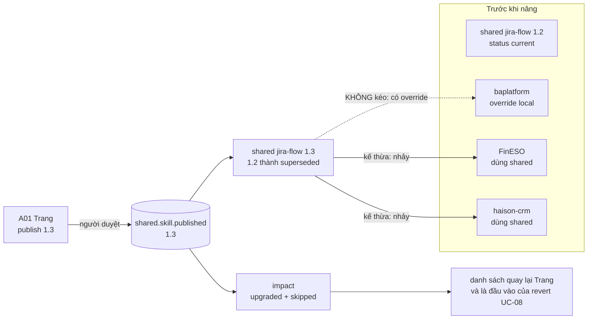
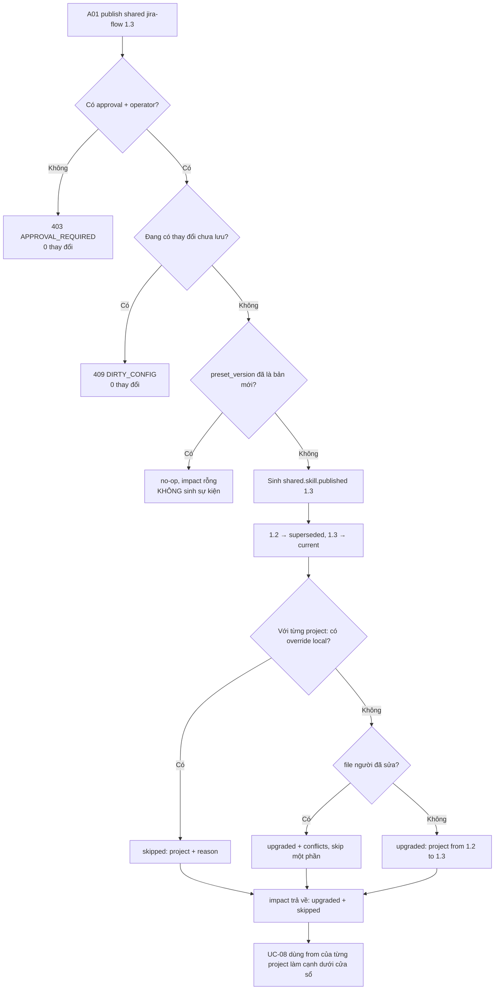
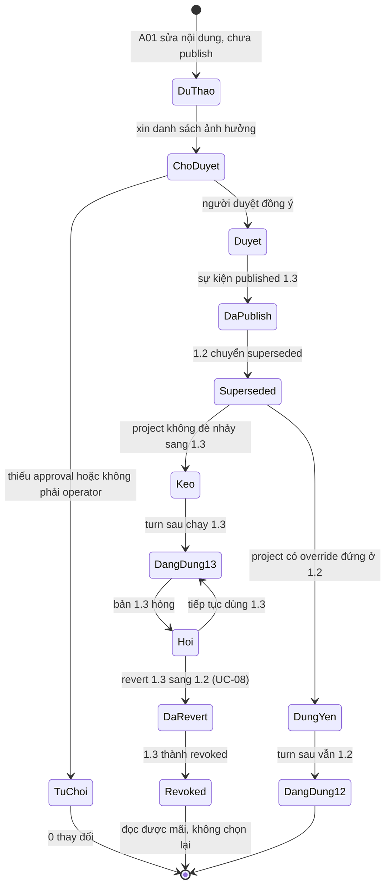
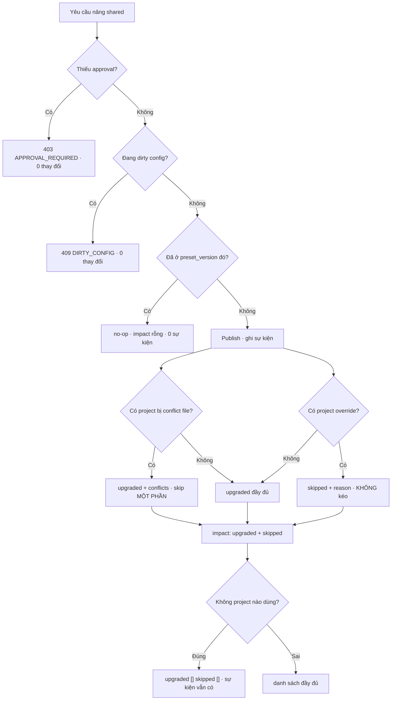

# BRD — Nâng một skill dùng chung: một thao tác, và cái giá phải nói ra

> **Đây là tài liệu nghiệp vụ, không phải spec kỹ thuật.** Nó trả lời *vì sao* nâng một mục `shared` phải kéo theo **mọi** project nhưng **không**
> được kéo project nào đã đè, và *vì sao* câu trả lời của lần nâng phải nêu **tên từng project đã nhảy từ bản nào sang bản nào**. Hợp đồng `API-17` nằm ở
> `sdlc/07.technical/03.api/01.contracts.md` §3.

## 1. Bối cảnh

Tổ chức có **31** mục trong `shared`. Trong đó `jira-flow` được **12** project dùng, `tenant-isolation` được **9**, và phần còn lại rải rác. Một buổi
sáng, ai đó sửa `jira-flow` — thêm một bước bắt buộc — và muốn đưa nó cho **cả tổ chức**.

Theo trực giác, đó là một lần lưu. Thực tế nó là **một thao tác diện rộng**, và ba câu hỏi đi kèm:

**Một — nâng là nâng cho tất cả, hay nâng từng project?** `D-31` chốt: cho **tất cả**. Nếu mỗi project phải tự nâng, thực tế là **không ai nâng**, và
`shared` chỉ còn là *"bản sao tại thời điểm provision"* — tức không phải kế thừa.

**Hai — không còn "ghim phiên bản" thì lấy gì chặn?** `D-31` bỏ `uses: pool/skills/A: 1.2` và biến version thành **sự thật được ghi** trong record,
không phải khai báo. Nên tấm khiên duy nhất còn lại là **override** — một project muốn đứng yên thì có bản local. Và vì thế override **phải hiện ra**.

**Ba — lần nâng đó ảnh hưởng ai, và khi nó hỏng thì lùi thế nào?** Ba thứ bảo vệ thay cho `pin`: **người duyệt** · **danh sách ảnh hưởng** · **revert
một hành động**. Câu hỏi của tài liệu này là hai cái sau.

Điều làm nó khó không phải "nâng" — mà là **nói ra** đã nâng cái gì cho ai: một lần nâng không nói được điều đó thì lần revert sau **không** tính
được, và toàn bộ mô hình thành một canh bạc tập thể.

### 1.1 Sơ đồ tổng quan



> **Đọc sơ đồ:** mũi tên đi tới `P2` và `P3` là **kế thừa**; mũi tên tới `P1` **bị cắt** và đi thành nét đứt, vì `P1` có override. Điểm mấu chốt:
> `IMP` — danh sách ảnh hưởng — đi ra **cùng chỗ** với sự kiện publish, không phải sau đó. Nó là một phần của lần nâng, không phải một báo cáo tuỳ
> chọn.

## 2. Những người trong câu chuyện

| Ai | Tuổi | Mã vai | Họ **thật sự** cần gì |
|---|---:|---|---|
| **Trang** | 31 | `A-01` | Nâng **một lần** và biết chắc **ai** vừa đổi hành vi — không phải quay lại từng repo xem cái nào đã theo |
| **Bảo** | 29 | `A-02` | Nâng đó **không** đẩy anh vào một bản anh chưa đọc. `baplatform` đã đè `jira-flow` vì bản mới không hợp với quy trình của khách A |
| **Khánh** | 38 | `A-08` | Khi một artefact sai, biết nó tạo **trước hay sau** lần nâng, và trên **bản nào** |
| **Ngân** | 44 | `A-04` | Duyệt một thay đổi diện rộng có **danh sách bị ảnh hưởng** đọc được, không phải một con số |
| **Chủ dự án FinESO** | — | `A-07` | Nếu bản 1.3 hỏng, biết **khi nào** dự án của mình nhận nó — và rằng nó được **lùi lại**, không bị bỏ mặc |

> **Điểm dễ bỏ sót:** với Bảo, yêu cầu là *"đừng kéo tôi"*. Với Trang, yêu cầu là *"nói cho tôi biết tôi vừa kéo ai"*. Hai yêu cầu này không mâu
> thuẫn, nhưng chúng đòi **hai** trường khác nhau trong câu trả lời — `applied` và `impact.upgraded`. Một hệ chỉ có `applied: true` trả lời được câu
> của Bảo và **không** trả lời được câu của Trang.

## 3. Chuyện xảy ra hôm nay (khi chưa có hệ thống)

**Thứ Hai, 2026-09-28, 09:30.** Trang sửa `jira-flow` cho `jira-flow` 1.3: thêm bước bắt buộc *"gắn epic trước khi tạo sub-task"*. Cô chép file vào
thư mục `shared` dùng chung trên một ổ mạng.

**09:35.** Cô viết vào kênh team: *"đã nâng jira-flow 1.3, mọi người pull nhé"*. Đây là **toàn bộ** danh sách ảnh hưởng.

**Thứ Ba – Thứ Năm.** Ba trong bốn project tự pull trong 3 ngày. `haison-portal` không ai pull vì project đó chỉ có một người làm part-time. Bốn
project chạy **hai** phiên bản khác nhau trong ba ngày, và không ai biết.

**Thứ Sáu, 14:00.** `baplatform` pull và nhận 1.3 — nhưng `baplatform` có một bản local đã sửa cho khách A từ tháng 6 (*"khách A không dùng epic"*).
Lần pull **ghi đè** bản local đó. Bản sửa của tháng 6 mất, và không ai để ý cho tới **ba tuần** sau.

**Chi phí thật:** 4 project × 2 bản trong 3 ngày · 1 bản sửa của khách A bị mất, khôi phục mất **1 ngày** · và một câu hỏi không trả lời được
*"artefact tháng 10 tạo trên 1.2 hay 1.3"* — vì câu trả lời nằm trong trí nhớ của 4 người.

**Điều đã xảy ra — không ai có lỗi:**

| Chuyện | Ai làm | Vì sao **không** phải lỗi của họ |
|---|---|---|
| Bản sửa local bị ghi đè | Bảo, khi pull | Anh **phải** pull để nhận bản mới; anh không có cách nào biết bản local của mình sẽ bị thay |
| `haison-portal` chậm 3 ngày | người part-time | Pull là **hành động của người dùng**; không có cách nào để một lần nâng *tới được* project mà không ai chạy lệnh |
| Không ai biết artifact nào tạo trên 1.2 | cả đội | Không có bản ghi "đã dùng bản nào". Trí nhớ tập thể là thứ duy nhất, và nó sai |
| Danh sách ảnh hưởng là một câu trên kênh chat | Trang | Cô không có bề mặt nào trả lời *"project nào dùng, project nào đè"* — nên cô viết cái cô biết |

## 4. Hệ thống phải làm gì

### 4.1 Nâng **một lần cho tất cả** — và vì sao "nâng từng project" là lựa chọn sai

`D-31` chốt: `shared/jira-flow` lên 1.3 ⇒ **mọi project** dùng 1.3 ở turn tiếp theo, **không** có bước "nâng riêng từng project".

Cách trực giác — *"để mỗi project tự pull khi thuận"* — chính là §3, và nó chết ở chỗ: một project có thể **không bao giờ** thuận. Nếu kế thừa phụ thuộc hành động của từng người thì "shared" là một **thư mục chép sẵn**, không phải một lớp cha.

Nhưng cái giá phải nói: thay đổi **lan ngay**, nên mọi thứ chặn được ở `pin` phải được chặn ở chỗ khác (`D-31` hệ quả 3):

| Vì không còn `pin` | Phải có thay | Ai chịu |
|---|---|---|
| Không chặn được phiên bản cho một project | **override** bằng bản local | chủ dự án (Bảo) |
| Không hoàn nguyên được bằng cách đổi số trong config | **revert một hành động** (`API-14`, `UC-08`) | `A-01` (Trang) |
| Không nhìn thấy phạm vi vì mỗi project tự chọn | **danh sách ảnh hưởng** hiện trước và sau | `A-01` + người duyệt (`D-15`) |

### 4.2 Override là van xả áp **duy nhất** — nên nó phải hiện ra, và phải đúng

`D-31` hệ quả 2: project nào không muốn theo thì **đè bằng bản local**, *"không bằng ghim"*. `12.configuration-and-store` §"Không có ghim" nói thẳng:
**không tồn tại** trường `pin`; nếu một tài liệu nói *"project pin v1"*, nó đang dùng từ **đã bị bỏ**.

Hệ quả cho tài liệu này, cụ thể:

| Nếu override không hiện | Chuyện gì xảy ra |
|---|---|
| Trang nâng 1.3 mà không thấy `baplatform` đang đè | Cô tưởng mọi project theo 1.3; thực ra một project vẫn ở bản cũ — và câu *"mọi project dùng 1.3"* thành **sai** |
| Ngược lại, không thấy ai bị ảnh hưởng | Cô không biết bản 1.2 đang phục vụ 8 project hay 1, nên không biết lần nâng này **nhỏ hay lớn** |

Hai chiều của cùng một con số, và **không** chiều nào suy được từ chiều kia: `upgraded` đếm người **đi theo**, `skipped` đếm người **đứng yên**. `API-17` mang cả hai, và `01.contracts` §3 ghi `skipped[]` là **bắt buộc**, kể cả khi rỗng.

### 4.3 Câu trả lời phải nói **project nào đã đi, và từ đâu tới đâu**

`API-17` trả `impact: { upgraded: [{project, from, to, conflicts[]}], skipped: [{project, reason}] }`. Ba trường trong `upgraded[]` không thay nhau được:

| Trường | Trả lời | Bỏ nó thì |
|---|---|---|
| `project` | **ai** đổi | không biết danh sách ảnh hưởng |
| `from` | **đi từ đâu** | revert **không tính được** — xem §4.4 |
| `to` | **đi tới đâu** | không phân biệt lần nâng một bước với lần nhảy hai bước |
| `conflicts[]` | file người đã sửa, **bị skip một phần** | không phân biệt "theo hết" với "theo một nửa" |

`from` là trường dễ bị coi là thừa nhất, vì `to` mới là cái người ta quan tâm. Nhưng nếu chỉ có `to`, câu *"project này đã nhảy từ đâu"* trả lời bằng cách tra **bản ghi của turn gần nhất** — không phải bản đang hiệu lực lúc nâng: một project không chạy turn nào trong ba tuần có turn gần nhất từ **trước** một lần nâng khác.

`01.contracts` §3 viết đúng vế này: *"`from`/`to` để biết **ai nhảy từ đâu** — thiếu nó thì revert không tính được"*.

### 4.4 Revert cần `from`, nên `upgraded[]` là **điều kiện** của `UC-08`, không phải báo cáo

Đây là lý do tài liệu này không thể gọn hơn. `API-14` (`POST /v1/config:revert`) lùi **một** bước, và `API-14` trả `{reverted_to, marked_artifacts[]}`. Để
dựng `marked_artifacts[]` cho một lần nâng `shared`, hệ phải trả lời: *artefact nào đã chạy trên 1.3?* — và câu trả lời bắt đầu từ **`upgraded[]`**:

```
upgraded[]  ──▶  project P đã ở 1.3 từ lúc nào (from 1.2)
                     │
                     ▼
             các turn của P trong [publish 1.3, revert 1.3]
                     │  VÀ skill_versions[jira-flow] = 1.3
                     ▼
             artefact sinh ra trong các turn đó   →  marked_artifacts[]
```

Không có `from` thì cửa sổ không có **cạnh dưới** cho từng project, và `D-32` (*"mọi turn trong `[publish, revert]` **và** đã dùng 1.3"*) không kiểm
được. Không có `from` thì cửa sổ không có **cạnh dưới** cho từng project, và `D-32` (*"mọi turn trong `[publish, revert]` **và** đã dùng 1.3"*) không kiểm được. Sự kiện publish 1.3 có một mốc duy nhất; nhưng "project P bắt đầu dùng 1.3 từ khi nào" chỉ có nghĩa **nếu** biết nó đã ở 1.2 trước đó và không đè.

Và đây cũng là chỗ `skipped[]` chứng minh giá trị của nó: project trong `skipped` **không** xuất hiện trong `upgraded`, nên nó **không** nằm trong cửa
sổ, nên artefact của nó **không** bị đánh dấu. Van xả áp hoạt động **hai chiều**: nó chặn ảnh hưởng lúc nâng, **và** nó chặn đánh dấu lúc revert.

### 4.5 `skipped` rỗng nghĩa là **mọi người đã theo**, không phải "chưa ai được xét"

`01.contracts` §3 ghi một dòng, và nó là câu quan trọng nhất của mục: *"**`skipped` rỗng nghĩa là "mọi project đều theo"** — không phải "chưa xét".
Phân biệt hai thứ đó là `BR-05`."*

Ba trạng thái, và hai trong ba trông giống nhau:

| `skipped` | `upgraded` | Nghĩa | Người đọc làm gì |
|---|---|---|---|
| `[]` | 12 project | **mọi** project đã theo — đã xét hết | không có gì cần xử lý |
| `[{P, "override"}]` | 11 | 1 project **cố ý** đứng yên | biết P không bị ảnh hưởng; P **không** bị đánh dấu khi revert |
| `[]` | `[]` | **không** project nào được xét — ví dụ `preset_version` đã là bản mới (`AC-KB-03-05`) | **không** được đọc là "mọi người đã theo" |

Dòng thứ ba là cái bẫy: `impact: []` ở ca **nâng lần hai cùng `preset_version`** (`AC-KB-03-05`: *"không làm gì; `impact: []`"*). Nếu `skipped` rỗng
được định nghĩa là "mọi project đã theo", thì `impact: []` và "12 project đã theo" là **hai** kết quả khác nhau **không phân biệt được** — đúng lỗi
`BR-05` trên một trường khác.

Cách phân biệt **không** nằm ở `skipped`: nó nằm ở chỗ lần nâng đó có **sinh sự kiện** hay không. Idempotent theo `preset_version` (`01.contracts` §2) nghĩa là lần thứ hai **không có** sự kiện `shared.skill.published`, nên không có `upgraded`/`skipped` nào để đọc.

### 4.6 Người duyệt, và vì sao "duyệt" không phải "chặn khi có người bị ảnh hưởng"

`D-31` hệ quả 3 đòi **duyệt bởi người** trước khi publish (`D-07`), `D-15` xếp thay đổi này vào lớp **GRANT** vì nó *"cho công việc bỏ qua một cổng"*
— ở đây, nó đổi luật cho 12 project cùng lúc. `API-17` trả `403 APPROVAL_REQUIRED` khi thiếu `approved` hoặc người gọi không phải `operator`.

Nhưng có một cái bẫy: phản xạ tự nhiên khi thấy *"12 project bị ảnh hưởng"* là **chặn**. `BR-07` cấm: **cảnh báo nêu ra không chặn việc**; chặn là việc của `mode`/duyệt. Ba thứ bảo vệ của `D-31` — **duyệt · danh sách · revert** — không cái nào là *"chặn khi có người dùng"*.

Cụ thể: một project đang có việc dở mà bị ảnh hưởng **không** làm lần nâng bị từ chối. Nó làm lần nâng **được ghi**, và người đọc sau biết việc dở đó đã chạy trên bản nào — vì `BR-11` bắt mỗi turn ghi `skill_versions` tường minh.

### 4.7 Nâng là **sự kiện**, không phải `UPDATE` — và `shared` không mất bản cũ

`BR-10`: `pool` · `shared` **append-only**; revert **dời con trỏ**, **không xoá bản**. `D-33` cho ba trạng thái, cả ba đọc được mãi:

| Trạng thái | Chọn được? | Nghĩa |
|---|---|---|
| `current` | ✅ | bản đang dùng cho turn mới |
| `superseded` | ❌ | đã có bản mới; giữ để đọc và truy nguyên |
| `revoked` | ❌ | đã bị revert; **đọc được**, **không bao giờ chọn lại** |

Đây là điều làm cả tài liệu này **khả thi**. Vế *"project đã đè vẫn ở 1.2"* chỉ có nghĩa nếu `1.2` **vẫn tồn tại để đọc**: nếu nâng là ghi đè tại chỗ thì project đã đè **không có gì để ở lại**, và `skipped` thành trạng thái không biểu diễn được.

Vì sao không xoá bản cũ: skill là **text**, git đã giữ lịch sử, giữ tất cả gần như miễn phí; xoá thì artefact đã tạo trên bản đó **mất đường dẫn tới nội dung của nó**.

### 4.8 Sơ đồ quyết định: một lần nâng có được phép, và nó kéo ai



| Nút | Điều kiện | Nguồn |
|---|---|---|
| **approval + operator?** | thiếu ⇒ `APPROVAL_REQUIRED` | `API-17` · `D-15` · `D-31` hệ quả 3 |
| **thay đổi chưa lưu?** | `DIRTY_CONFIG`, 0 thay đổi | `API-17` |
| **`preset_version` đã mới?** | no-op, **không** sinh sự kiện | `AC-KB-03-05` · `API-17` idempotent |
| **override local?** | ⇒ `skipped` với `reason` | `D-31` hệ quả 2 · `AC-KB-03-02` |
| **file người đã sửa?** | ⇒ `conflicts[]`, skip **một phần** | `API-17` §"`upgraded[].conflicts[]`" |

> **Đọc sơ đồ:** nhánh `G` là nhánh dễ đọc sai nhất: `impact` rỗng ở đó **không** có nghĩa "không ai bị ảnh hưởng", nó có nghĩa "không có gì để ảnh
> hưởng vì không có gì xảy ra". Đó là lý do §4.5 tách hai ca đó ra thay vì dùng chung một danh sách rỗng.

## 5. Một ngày thật, có số

**2026-10-22**, một control plane, **12** project dùng `shared`. Sáng đó `jira-flow` ở **1.2**, `shared` có **31** mục. Trong 12 project, **11** dùng
`shared` không đè, **1** (`baplatform`) có bản local cùng `id`.

| Mốc | Việc | Đo được |
|---|---|---|
| 09:00 | Xem danh sách ảnh hưởng trước khi publish | **12** project xét: **11** `upgraded` dự kiến, **1** `skipped` (`override`) |
| 09:05 | Trang publish 1.3, `approved: true` | **1** sự kiện `shared.skill.published`; `1.2` → `superseded`, `1.3` → `current` |
| 09:05 | `impact` trả về | `upgraded`: **11** project, mỗi cái `{from: 1.2, to: 1.3, conflicts: []}`; `skipped`: **1** (`baplatform`, `override`) |
| 09:10 | `baplatform` chạy turn đầu sau nâng | `Resolved{id: jira-flow, version: 1.2, from: project}` — **không** đổi; `skill_versions[jira-flow] = 1.2` |
| 09:11 | Một project khác chạy turn | `Resolved{… 1.3, from: shared}`; `skill_versions[jira-flow] = 1.3` |
| 11:40 | Kiểm: artefact của `baplatform` trong `[09:05, …]` có bị đánh dấu? | **0** — vì `skill_versions` của nó là 1.2, và nó không nằm trong `upgraded` |
| 14:30 | Một project hỏi *"nâng này đổi gì cho tôi"* | Đọc `impact.upgraded` của **đúng** sự kiện: `from` 1.2 → `to` 1.3, **1** dòng |
| 16:00 | Nâng lại cùng `preset_version` | **no-op**: `impact: []`, **0** sự kiện, **0** dòng `declaration` đổi |
| 17:20 | 13 turn còn lại trong ngày | **12** trên 1.3 · **1** trên 1.2 (`baplatform`) — khớp `upgraded`/`skipped` |

**Ba con số của §5, đọc cùng nhau:**

1. **11 + 1 = 12.** Tổng khớp là điều chứng minh **không project nào bị bỏ sót**. Một lần nâng báo `upgraded: 11` mà không có `skipped` là một lần
   nâng **mất** một project — và con số 11 vẫn đúng, nên nó không tự báo lỗi.
2. **0 artefact của `baplatform` bị đánh dấu — dù nó chạy 13 turn trong ngày có sự kiện.** Đây là van xả áp hoạt động **hai chiều** (§4.4). Nếu con
số này là 4 hay 9, thì mỗi lần nâng bản chung là mỗi lần đánh dấu hàng loạt artefact của project **đã cố ý không theo** — và không ai còn dùng
override nữa.
3. **`impact: []` ở 16:00, với `0` sự kiện.** Cùng hình dạng rỗng như một lần nâng hụt, **khác** nghĩa. Phân biệt được hai ca này là điều kiện để
   `skipped` không thành một trường vô nghĩa.

**Điều bảng này không nói:** nó **không** nói 1.3 có **đúng** không. Cả 11 project đã nhận một bản có thể sai, và bảng này vẫn xanh — vì nó đo **lan
truyền**, không đo **chất lượng**. Trục thứ hai đó thuộc `UC-10` (đề xuất sửa) và `UC-08` (rút lại).

### 5.1 Một lần nâng đi qua



**Không có nhánh nào từ `Duyet` sang `DaPublish` mà bỏ `ChoDuyet`.** Nếu bỏ, một thay đổi diện rộng đi qua cửa không có người — và `D-31` hệ quả 3 gọi
đó là đánh cược tập thể. Cũng không có nhánh nào từ `DungYen` sang `Keo`: override **không tự gỡ**.

### 5.2 Chi tiết: 12 project sau một lần nâng

| Project | Trước | Quan hệ với `shared` | Trong `impact` | Chạy 1.3 từ | Ghi chú |
|---|---|---|---|---|---|
| `baplatform` | 1.2 local | **override** | `skipped`, reason `override` | **không** | 13 turn trong ngày, `skill_versions` = 1.2 |
| `FinESO` | 1.2 | dùng `shared` | `upgraded` `{1.2 → 1.3}` | 09:05 | 4 turn sau nâng |
| `haison-crm` | 1.2 | dùng `shared` | `upgraded` | 09:05 | 2 turn |
| `haison-portal` | 1.2 | dùng `shared` | `upgraded` | 09:05 | 1 turn — không còn "chờ ai pull" |
| 8 project còn lại | 1.2 | dùng `shared` | `upgraded` | 09:05 | tổng 6 turn trong ngày |
| *(nâng lần hai, 16:00)* | 1.3 | — | `impact: []`, **0** sự kiện | — | no-op theo `preset_version` |

> **Dòng `baplatform` là dòng đáng đọc nhất.** Nó là dòng duy nhất có `skipped`, và nó là **lý do** `skipped[]` là mảng chứ không phải một con số đếm.
> Một con số `skipped: 1` không nói được *"project nào, vì sao"* — và `UC-08` cần đúng hai thứ đó.

## 6. Ngoại lệ — và hệ thống làm gì

| Tình huống thật | Hệ thống xử lý |
|---|---|
| Nâng khi chưa có người duyệt, hoặc người gọi không phải `operator` | **Từ chối**; `403 APPROVAL_REQUIRED`; 0 thay đổi (`AC-KB-03-03`) |
| Nâng khi đang có thay đổi chưa lưu | **Từ chối**; `409 DIRTY_CONFIG`; 0 thay đổi (`API-17`) |
| Nâng **hai lần** cùng `preset_version` · P có `overrides` | **no-op**, `impact: []`, **0** thay đổi (`AC-KB-03-05`) · P **không** đổi, vào `skipped`, hiện là **đã đè** (`AC-KB-03-02`) |
| Nâng trong lúc project đang đọc | Project thấy **một** bản nhất quán, không nửa cũ nửa mới (`AC-KB-03-06`) |
| File người đã sửa tay trong `shared` | `upgraded[].conflicts[]`; skip **một phần**, **không** ghi đè (`API-17`) |
| Không project nào dùng mục đó | `upgraded: []`, `skipped: []` — và **một sự kiện** publish vẫn sinh, vì bản đã thành `current` |
| Revert sau nâng (`UC-08`) · muốn quay lại 1.3 **sau** revert | `1.3` → `revoked`, `1.2` → `current`, **không** `DELETE` · quay lại: **không** — `revoked` đọc được, không chọn lại (`D-33`) |
| Bản 1.3 hỏng nhưng chưa ai revert | Không tự revert: *"tự động revert khi có lỗi"* đã bị loại — không ai quyết định được "lỗi" thay người (`D-31`) |
| Người hỏi *"ai đã nhận 1.3"* | Đọc `impact.upgraded` của **đúng** sự kiện — không suy từ trạng thái hiện tại |
| Ai đó nói *"project X pin v1.2"* | **Không tồn tại** trường `pin`; cái đang có là **override** (`12` §"Không có ghim") |

### 6.1 Sơ đồ nhánh lỗi



> **Đọc sơ đồ:** nhánh `G` và nhánh `P` đều cho `impact` rỗng, và **chúng khác nhau ở đúng một thứ**: `G` không có sự kiện, `P` có. Vẽ hai nhánh riêng
> là cách duy nhất để người đọc thấy sự khác biệt đó — gộp chúng thành một ô "rỗng" là tái tạo đúng lỗi `BR-05` ở tầng sơ đồ.

## 7. Điều ngoài phạm vi

| Không thuộc BRD này | Thuộc |
|---|---|
| **Chọn** skill/luật nào áp — ba vùng, thứ tự, `overridden_by` | `06.uc-06-which-rule-applies.md` |
| **Rút lại** một `shared` đã nâng vì nó hỏng; đánh dấu artefact | `08.uc-08-revert-broken.md` |
| **Đưa một project vào**, cô lập `project` từ phiên | `05.uc-05-project-onboarding.md` |
| Hỏi **đã đủ chưa**, nói **thiếu gì** · ghi **vì sao** | `01.uc-01-is-it-enough.md` · `02.uc-02-what-is-missing.md` · `03.uc-03-why-this-decision.md` |
| Khai **đội agent** · hỏi **"vì sao bị chặn"** · **đề xuất** tự sửa · duyệt ticket đã xong | `04.uc-04-agent-team.md` · `09.uc-09-why-blocked.md` · `10.uc-10-self-proposal.md` · `11.uc-11-ticket-done.md` |
| Hiểu project **gồm những gì** · cảnh báo **dù không hỏi** · chọn **nguồn năng lực** | `12.uc-12-what-is-in-project.md` · `13.uc-13-unprompted-warning.md` · `14.uc-14-capability-source.md` |
| Hình dạng `impact`, mã lỗi `API-17`, idempotent theo `preset_version` | `sdlc/07.technical/03.api/01.contracts.md` §3 |
| Ba trạng thái `declaration.status`, `current`/`superseded`/`revoked` | `sdlc/07.technical/02.data-design/02.schema.md` §2 · `D-33` |

## 8. Câu chưa có trả lời trong release

| # | Câu hỏi | Mã | Vì sao không nguồn nào trả lời |
|---|---|---|---|
| 1 | **`API-17` mang `project` trong body để làm gì,** khi nó *"sửa **mọi** project dùng cùng chuẩn"*? `project` là **phạm vi** hay **mẫu để suy chuẩn**? | *(chưa có mã — `21.promote-shared` `OPEN-3`)* | `API-17` không nói. Nếu là phạm vi thì `AC-KB-03-01` (*"**mọi** project"*) **sai**; nếu là mẫu thì `403`/`409` xét trên project nào khi hai project cùng chuẩn mà một cái `DIRTY_CONFIG` — chặn **toàn bộ** hay **một phần**? |
| 2 | **`impact` của `API-17` có cùng hình dạng với `impact` của `API-12` không?** `API-12` trả `{consumers, overrides, artifacts}`; `AC-KB-03-05` nói `impact: []` ở ca nâng lại | *(chưa có mã — `21.promote-shared` `OPEN-4`)* | Một là **object ba danh sách**, một là **mảng** — hai hình dạng cho cùng một chữ. `01.contracts` §3 chốt `API-17` là `{upgraded[], skipped[]}`, nhưng `AC-KB-03-05` vẫn viết `impact: []`. Nếu `API-17` trả mảng ở ca no-op thì `AC-KB-03-04` không kiểm được qua API |
| 3 | **"Pin" là gì — một trường, một khai báo, một file khoá, hay không tồn tại?** | *(chưa có mã — `21.promote-shared` `OPEN-1`, **chặn `READY`**)* | Bốn nguồn loại trừ pin (`D-29` gạch · `D-31` · `03` §3.3 · `US-KB-03` §Ngoài phạm vi) và **một** nguồn dùng chữ đó (dictionary §`5.3` `DoD`). Nếu có trường pin thật thì tài liệu này thiếu một tầng; nếu không, `DoD` phải đọc là *"đã đè"* |
| 4 | **`impact.artifacts[]` chi tiết tới đâu trước khi thành rò dữ liệu project khác?** | *(chưa có mã — `21.promote-shared` `OPEN-5`)* | `D-32` muốn *"`accept`/`mitigate`/`remediate` **từng artefact**"*, tức **ai đó** phải thấy danh sách; `BR-12` nói project không thấy project khác. Cây chưa nói ai thấy gì — khuynh hướng: chủ project thấy artefact **của mình**, `A-01` chỉ thấy **số đếm** |
| 5 | **`SCN` nào dựng **hai** project trong **một** lần nâng?** | *(chưa có mã — `21.promote-shared` `OPEN-2`)* | `SCN-KB-08` và `SCN-KB-09` là **hai** fixture **rời**. *"Nâng không kéo"* và *"nâng không tới"* là **hai** tính chất khác nhau; một cài đặt *"nâng tới mọi project kể cả đã đè"* **qua** `-08` và **đỏ** ở `-09`, nhưng *"nâng không tới ai"* **cũng qua** `-09` |

> **Ba câu đã tra và **không** để mở:** *"nâng hai lần thì có sự kiện thứ hai không"* — **không**, idempotent theo `preset_version` (`01.contracts` §2). *"bản cũ có bị xoá không"* — **không**, `1.2` thành `superseded` và **đọc được** (`D-33`). *"ai duyệt"* — `operator`, qua `approved` của `API-17` (`D-15` lớp GRANT).

## 9. Truy vết

| Yêu cầu | Điều khoản | Mục trong BRD |
|---|---|---|
| `REQ-KB-03` — nâng **một lần cho tất cả**; project muốn khác thì **đè**, và việc đè **phải hiện ra** | `D-31` | §4.1 · §4.2 · §4.5 · §5 |
| `BR-10` — `pool` · `shared` **append-only**; revert **dời con trỏ**, không xoá bản | `BR-10` | §4.7 · §5.1 · §6 |
| `BR-06` — record chỉ ghi thêm; nâng và revert là **sự kiện** | `BR-06` | §4.7 · §5.1 |
| `BR-11` — turn ghi **nội dung đã dùng** (`skill_versions`) · `BR-07` — cảnh báo **không chặn** việc | `BR-11` · `BR-07` | §4.4 · §4.6 · §5 · §6 |
| `BR-05` — `unknown` ≠ `absent`; `skipped` rỗng ≠ chưa xét | `BR-05` | §4.5 · §6.1 · §8 |
| `BR-12` — cô lập project | `BR-12` | §8 (câu 4) |
| `D-31` — nâng cho tất cả; version là **sự thật được ghi**; opt-out bằng override | `D-31` | §1 · §4.1 · §4.2 · §6 |
| `D-32` — revert là sự kiện, đánh dấu quá khứ · `D-33` — ba trạng thái, `revoked` không chọn lại | `D-32` · `D-33` | §4.4 · §4.7 · §5.1 · §6 |
| `D-15` — thay đổi diện rộng là **GRANT** · `D-07` — promotion do người duyệt | `D-15` · `D-07` | §4.6 · §4.8 |

| Use case | Mục |
|---|---|
| `UC-07` nâng một skill dùng chung | §4.1 · §4.2 · §4.3 · §4.8 · §5.1 |
| `UC-08` rút lại một skill đã nâng (dùng `from` của §4.3) | §4.4 · §5.2 |
| `UC-06` chọn skill/luật nào áp (bản `current` sau nâng) · `UC-05` đưa project vào (override là van xả áp) | §4.2 · §4.7 |

| AC | Mục |
|---|---|
| `AC-KB-03-01`…`-06` | §4.1 · §4.5 · §4.8 · §5.2 · §6 |
| `AC-SDLC-01-05` | §4.6 · §5 |

## Revision rule

Sai khi: nâng đổi từ *"cho tất cả"* thành *"cho từng project"* (`D-31`); hoặc `impact.upgraded[]` mất `from` (revert không tính được); hoặc
`skipped[]` bị coi là tuỳ chọn — nó **bắt buộc, kể cả rỗng** (`API-17`); hoặc `skipped` rỗng đọc thành *"chưa xét"* (`BR-05`); hoặc `shared` cho
`UPDATE`/`DELETE` thay vì thêm bản mới (`BR-10` · `D-33`); hoặc có trường `pin` xuất hiện → sửa §4 và §9.

Nguồn kiểm: `grep -n 'D-31\|D-33' sdlc/03.inception/02.decision-log/00.index.md && grep -c "skipped" sdlc/07.technical/03.api/01.contracts.md && grep -c "superseded\|revoked" sdlc/07.technical/02.data-design/02.schema.md`
