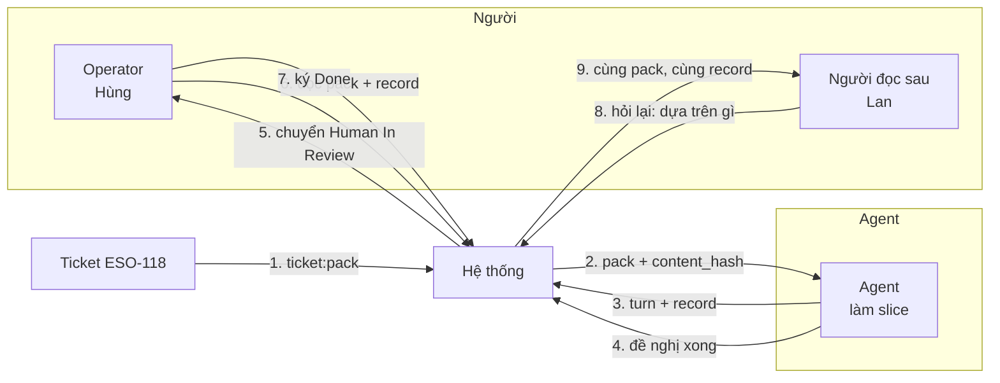
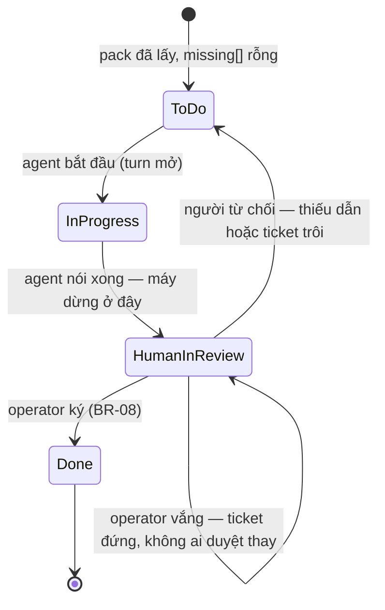
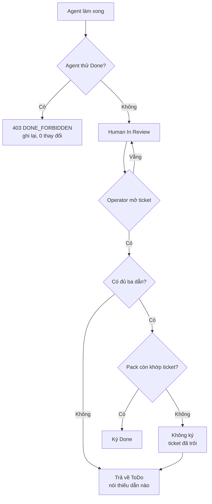

# BRD — Từ một việc đã làm đến một ticket nói được nó dựa trên gì

> **Đây là tài liệu nghiệp vụ, không phải spec kỹ thuật.** Nó trả lời *vì sao* chữ "xong" phải do **một người** nói, và *vì sao*
> một ticket đóng lại cũng phải mang **đủ dấu vết để người khác từ chối nó** — kể cả khi mọi thứ trông đã hoàn hảo.

## 1. Bối cảnh

Một ticket `ESO-118` chuyển sang `Done` lúc 16:40 thứ Sáu. Bốn tuần sau, khi tìm hiểu một lỗi báo cáo, người ta mở lại nó và thấy: mô tả
đầy đủ, 6 AC, test xanh, PR liên kết. Nhưng **không** dòng nào nói ticket đó **dựa trên cái gì**: turn nào đã làm, record nào đã cho
phép, pack lúc 09:12 hôm đó nói gì.

Đó là hai thất bại khác nhau, và tài liệu này nói về cả hai:

**Thứ nhất — `Done` là một từ của con người, không phải của máy.** Test xanh là một **sự kiện trong máy**. `Done` là một **phán
đoán của người** rằng công việc đã đủ theo nghĩa nghiệp vụ — không phải theo nghĩa "lệnh chạy hết không lỗi". Hai thứ đó trùng nhau
thường xuyên vừa đủ để người ta tưởng chúng là một. `BR-08` cấm đúng cái tưởng đó: chỉ **A-01** đặt `Done`/`Closed`.

**Thứ hai — một ticket "trông đầy đủ" mà dẫn không tới đâu là kiểu sai tệ nhất.** Nó không trống; nó **có đủ mọi ô**. Vì thế
không ai kiểm lại. Khi cần từ chối nó (bốn tuần sau, lúc 2 giờ sáng), người ta không có gì để từ chối **trên** — chỉ có cảm giác.

Hai thứ này nối với nhau bằng một câu: **`Done` không phải là thứ hệ thống tự đóng; nó là thứ một người ký, và chữ ký chỉ có nghĩa
nếu bên dưới nó là dấu vết kiểm được.**

### 1.1 Sơ đồ tổng quan

> **Đọc sơ đồ:** bước 4 là chỗ **máy muốn nói "xong"**. Bước 7 là chỗ **người** nói. Tất cả phần còn lại của tài liệu tồn tại để
> bước 4 **không** trở thành bước 7, và để bước 8 trả lời được **mà không cần hỏi Hùng**.

## 2. Những người trong câu chuyện

| Ai | Vai trong hệ thống | Họ thật sự cần gì |
|---|---|---|
| **Hùng**, 34 tuổi, operator | `A-01` | Một chỗ để **ký** — và để biết mình đang ký cái gì, không phải ký "đã xong" |
| **Agent** (Cursor/DSH) | `A-02` | Một đường **hợp lệ** để nói "tôi làm xong rồi" mà **không** tự tuyên bố `Done` |
| **Lan**, 41 tuổi, review | `A-08` | Bốn tuần sau mở ticket và **thấy dấu vết**, không phải thấy kết luận |
| **Khánh**, 29 tuổi, vận hành | `A-08` | Lúc 2 giờ sáng: biết việc này được **cho phép bởi ai, dựa trên cái gì** |

> **Điểm dễ bỏ sót:** Hùng **không** mở ticket để xem agent làm gì — anh mở để trả lời *"tôi có dám ký không"*. Câu đó chỉ trả lời
> được nếu ticket **dẫn ngược** tới thứ đã cho phép việc này chạy: **turn nào**, **record nào**, **pack nào**. Ba câu hỏi, và cả
> ba đều có chỗ trong hệ — không câu nào cần agent tự thuật lại.

## 3. Chuyện xảy ra hôm nay (khi chưa có hệ thống)

**Thứ Sáu, 09:10** — Agent nhận `ESO-118` từ Jira, đọc mô tả, làm. Nó dừng khi test xanh.

**11:40** — Agent comment *"đã xong, 6/6 AC"* và **không** chuyển trạng thái, vì không có quyền. Hùng thấy comment lúc 16:30, đọc PR,
thấy ổn, bấm `Done`.

**16:40** — Ticket đóng.

**Bốn tuần sau** — Một báo cáo sai số. Lan mở `ESO-118`. Trong đó có: mô tả ticket (lúc 09:00 hôm đó), PR (lúc 11:30), comment
*"đã xong"*. **Không** có: turn nào đã chạy, pack nào đã cấp việc, phán quyết nào đã cho phép bắt đầu.

**Điều đã xảy ra:** mô tả ticket **đã đổi** hai ngày sau khi làm xong — một AC được nới. Ticket bây giờ **trông đúng**. Nó không
sai, nó **trôi**. Và không có cách nào biết nó trôi, vì pack lúc 09:12 không được lưu ở đâu cả.

**Không ai sai.** Hùng ký trên thứ anh thấy lúc 16:30. Agent làm đúng việc được giao. Cái thiếu là **ba câu dẫn**: turn nào, record
nào, pack nào. Ba câu đó là thứ duy nhất khiến ticket **có thể bị từ chối**.

## 4. Hệ thống phải làm gì

### 4.1 `Done` không phải là chữ của máy — và đó là một luật, không phải một quy ước

`BR-08`: chỉ **A-01** đặt `Done`/`Closed`. Không phải "agent nên tránh"; nó là **từ chối**, và hệ trả `DONE_FORBIDDEN` (403) khi
agent thử.

Vì sao cần một luật cứng chứ không chỉ một dòng hướng dẫn: `Done` là chỗ **kết thúc** của mọi thứ khác. Không ai đọc lại ticket đã
`Done`. Nó là ô **cuối** trong một quy trình, và vì thế nó là chỗ duy nhất mà **một lời nói dối không bị phát hiện**. Test xanh tự
đóng một ticket = "xong" mất nghĩa, và đó là câu trong bảng `BR-08`.

Điều quan trọng hơn: agent **có** một đường hợp lệ để nói xong. Nó chuyển sang `Human In Review` và gắn nhãn. `D-38` nói rõ: `Human
In Review` **không phải bước hình thức** — nó là điểm mà máy **không được** đi tiếp. Agent dừng ở đó, và dừng **đúng** là hành vi
kỳ vọng, không phải thiếu năng lực.

`D-38` còn chốt một hệ quả khó nghe: operator vắng ⇒ ticket **DỪNG** ở `Human In Review`. Không có người duyệt thay. SLP có thể
đứng nhiều ngày, và đó là trạng thái **đúng** — việc đang chờ người quyết thì nên chờ, thay vì trôi tiếp.

### 4.2 Một ticket phải dẫn tới **ba** thứ, không phải một

Đây là chỗ `BR-04` đi vào ticket dưới dạng `E18`. `BR-04` nói: **mọi requirement phải nêu nguồn** (`bar` · `work` · `blast` ·
`declared`) — requirement không nguồn là requirement bịa. Áp vào ticket, nó thành một câu hẹp hơn nhưng cùng hình dạng: **mỗi thứ
ticket dựa vào phải trỏ được về chỗ sinh ra nó**.

| Ticket phải dẫn | Trỏ tới đâu | Trả lời câu |
|---|---|---|
| **Turn** | `GET /v1/turns/:id` (`E21`) | Ai làm, lúc nào, phán quyết gì |
| **Record** | `evidence_turn` + `evidence_item` của turn đó | Vì sao được phép bắt đầu |
| **Pack** | `ticket_pack` với `content_hash` (`E18`) | Ticket **lúc đó** nói gì |

Ba cột này không thay nhau. Turn trả lời *"đã làm"*. Record trả lời *"được phép"*. Pack trả lời *"được giao việc gì"*. Một ticket
chỉ có PR là một ticket **không dẫn gì** — PR là đầu ra, không phải cái đã cho phép nó ra.

### 4.3 Pack phải nói **lúc đó**, không phải **bây giờ**

`US-TICKET-04` là story **đầu tiên** coi A-08 là actor cho ticket, và lý do rất cụ thể: `US-TICKET-01` lấy pack **bây giờ**. Nhưng
ticket đổi theo thời gian, nên *"bây giờ"* không trả lời được *"lúc đó"*.

`ticket_pack` vì thế là **append-only**, khoá theo `(project, source, ticket_key, fetched_at)`. Ticket đổi ⇒ **pack mới**; pack cũ
vẫn là **sự thật** của lần đọc trước. Và `content_hash` là thứ khiến "pack bị sửa" **phát hiện được** (`PACK_TAMPERED`).

Không có `content_hash` thì `AC-ARCH-01`/evidence không trả lời được *"pack lúc đó nói gì"* — và đó là toàn bộ câu hỏi của Lan.

### 4.4 Thiếu thì nói thiếu — `missing[]` là một phần của câu trả lời

Ticket thiếu `verify` không phải lỗi; nó là **trạng thái bình thường**, và `E18` trả **200** kèm `missing[]` (`TICKET_INCOMPLETE`).
Trả 400 mới là sai: người ta sẽ bỏ qua lỗi rồi **tự ghép** phần thiếu — và phần tự ghép đó là thứ không ai kiểm được.

Ticket **rỗng** phải liệt kê **đủ cả bốn** (`ac` · `scope` · `verify` · `forbidden`), không dừng ở mục đầu. `missing[]` khai rỗng
mà pack không đủ ⇒ `PACK_INCONSISTENT`, từ chối phát pack. Và `missing[]` không được suy đoán: `INVENTED_FIELD`.

Nói cách khác: `missing[]` là **danh sách người phải hỏi ai**. Một ticket thiếu mà nói được thiếu gì thì vẫn ký được — có điều ký
với biết mình đang ký cái gì.

### 4.5 Chỉ **một** người ký, và người đó ký **trên dấu vết**

`D-38` chốt: `S-Gate 3` — sign-off `Human In Review` → `Done` — là **operator**. Cùng lúc, `Q-09` (`D-59`) thêm `decision` vào
`cite.target`: ticket phải dẫn được **ai đã quyết**, không chỉ *"nguồn nói gì"*. Hai điều đó ghép lại thành một câu:

> Một cái `Done` hợp lệ là một chữ ký **của người**, đặt lên **pack đã dẫn**, thay cho **record đã dẫn**, do **một turn** đã dẫn.

Sai một mắt trong bốn mắt đó, ticket vẫn có thể `Done` — nhưng nó **không từ chối được** nữa. Và một ticket không từ chối được là
một ticket mà `Done` chỉ còn là lịch sự.

## 5. Một ngày thật, có số

Repo `baplatform`, ticket `BAP-5821` — *"nới hạn `due` của risk accept sang 00:00 UTC ngày kế tiếp"*.

**09:07** — Hùng gọi `E18`. Pack trả về **7** AC, `missing: []`, `content_hash: 9a3f…`. Hệ ghi **một** dòng `ticket_pack`.

**09:31** — Hùng giao. Turn chạy. Record ghi `level: sufficient`, `basis: verified`, đòi hỏi nguồn `work` · `blast`.

**11:52** — Agent chuyển `Human In Review`. `DONE_FORBIDDEN` **không** xảy ra — vì agent không thử; nếu thử, nó đã nhận 403.

**15:20** — Một người khác (**Trang**, PO) sửa mô tả ticket: AC-7 bị bỏ (*"đổi ngày thôi, không cần đổi test cũ"*). Ticket **bây
giờ** có **6** AC.

**16:05** — Hùng mở ticket. Anh thấy 6 AC, 6 test, **6** dòng dẫn. Nhưng dòng dẫn pack ghi `content_hash: 9a3f…` và **7** AC.

Hùng thấy đúng thứ anh cần: **ticket đã trôi**, và **không** phải agent trôi. Anh **không** ký. Anh chuyển lại `needs-dor` với một
câu: *"AC-7 bị bỏ lúc 15:20, sau khi làm xong. Pack lúc 09:07 có 7."*

**16:40, hôm sau** — Trang xác nhận AC-7 phải giữ. Hùng ký `Done`. Pack dẫn là pack **09:07**, không phải pack mới. Hai bản ghi
pack, hai `content_hash`.

**Bốn tuần sau** — Lan mở `BAP-5821`, thấy **hai** pack và biết **cái nào** đã sinh ra việc. Không phải hỏi ai.

### 5.1 Đường đi của một cái `Done`

**Không có đường tắt.** `InProgress → Done` không tồn tại, kể cả khi mọi test xanh. Và vòng `HumanInReview → HumanInReview` ở giữa
là **trạng thái đúng**, không phải sự cố (`D-38`).

## 6. Ngoại lệ — và hệ thống làm gì

| Tình huống thật | Hệ thống xử lý |
|---|---|
| Agent thử đặt `Done` | `403 DONE_FORBIDDEN`, **ghi lại**; 0 thay đổi (`BR-08`) |
| Ticket thiếu `verify` | `200` + `missing: ["verify"]`; pack dùng được phần còn lại |
| Ticket **rỗng**, 0 trường | `missing[]` liệt kê **đủ 4**; không dừng ở mục đầu |
| `missing[]` rỗng nhưng pack không đủ | **Từ chối** phát pack — `PACK_INCONSISTENT` |
| Không có tool ticket (Jira/Notion) | `source: "none"` **được ghi**; việc đến từ file **local** — `none` không phải lỗi |
| Hai lần gọi `E18` trong **một** turn | **Một** bản ghi; lần hai trả bản ghi **đã có** |
| Ticket đổi sau khi pack | Pack **cũ vẫn còn**; pack mới là bản ghi **riêng**, không ghi đè |
| Pack bị sửa sau khi dùng | Phát hiện bằng hash — `409 PACK_TAMPERED` |
| Turn **không** dùng pack nào | Truy vấn theo turn trả **rỗng**; **không** bịa pack cho turn đó |
| Operator vắng nhiều ngày | Ticket **đứng** ở `Human In Review`; **không** có người duyệt thay (`D-38`) |

### 6.1 Sơ đồ nhánh lỗi

## 7. Điều ngoài phạm vi

| Không thuộc BRD này | Thuộc |
|---|---|
| Chọn **skill/luật nào áp** cho việc trong ticket | `02.p02-knowledge-resolution.md` |
| Ghi lại **vì sao** một phán quyết ra như vậy, đọc lại | `03.p03-evidence-record.md` |
| Nâng/rút một skill dùng chung mà ticket đã dùng | `04.p04-shared-upgrade-revert.md` |
| Hỏi *"vì sao tôi bị chặn"* và nhận câu trả lời | `09.p09-blocked-not-readable.md` |
| Hệ đề xuất sửa **cách làm của chính nó** sau khi sai | `10.p10-self-improvement.md` |
| Quyết định *"đủ chưa"* trước khi **bắt đầu** | `01.p01-ticket-to-verdict.md` |
| Hình dạng ticket 15 mục, quartet TDD, đồ thị link | `sdlc/07.technical/01.architecture/16.jira-ticket-contract.md` · `17.jira-slp-operating.md` |
| Ca kiểm thử | `sdlc/06.analysis/03.acceptance-criteria/22.ticket-us-01-integration.md` |

## 8. Câu chưa có trả lời trong release

| # | Câu hỏi | Mã |
|---|---|---|
| 1 | **`content_hash` tính trên preimage nào** — byte file, `jsonb` đã chuẩn hoá, hay **tập** trường? `PACK_TAMPERED` cần hash, và **không** nguồn nào nói hash trên cái gì. Sai ⇒ **báo động giả** mỗi lần format đổi, và báo động giả tệ hơn không có | `Q-10` (`OPEN`) |
| 2 | **`claim` có phải chỗ dẫn "một quyết định" không?** Ticket cần dẫn **ai đã quyết**; `claim` là *"nguồn nói gì"* — **sai loại**. Đã chốt cách đóng (`decision` vào `target`), nhưng `5` giá trị đóng chưa được ghi vào `02.schema` | `Q-09` (chốt ở `D-59`, chưa cưỡng chế) |
| 3 | **Provenance *bắt buộc* hay *có khi có*?** `AC-TICKET-04-04` nói turn không dùng pack ⇒ trả **rỗng**, không bịa. Vậy một cái `Done` **không** có dòng dẫn pack vẫn hợp lệ? Chưa nguồn nào nói `Done` **cần** dẫn | `OPEN-DEL-01` — `grep -rn 'Done.*bắt buộc.*pack' sdlc/` = 0 |
| 4 | **`validation` có phải target thứ sáu của `cite`?** `US-TICKET-01` đòi pack có **verify command**; `E18` trả `verify` dạng chuỗi, không phải `cite`. Đã đóng ở `D-58` phạm vi `cite.target = 5`; một tài liệu khác ghi `target` *"mở"* ⇒ cùng tên, hai sổ | `OPEN-DEL-02` — cảnh báo lệch trong `02.roundtrip` §3.1 |
| 5 | **Ai đóng ticket khi operator vắng nhiều ngày?** `D-38` nói **không ai**. Nhưng chưa có AC nào kiểm điều đó, nên trên thực tế nó phụ thuộc người trực. `OPEN-DEL-03` là chỗ chưa kiểm, **không** phải chỗ chưa quyết | `OPEN-DEL-03` |

## 9. Truy vết

| Yêu cầu | Điều khoản | Mục trong BRD |
|---|---|---|
| `REQ-AGENT-01` — ticket mang việc đủ để làm, không phải đi tìm | `BR-04` | §4.2 · §4.4 |
| `REQ-AGENT-02` — không ai tự mở rộng quyền | `BR-08` · `D-38` | §4.1 · §5.1 · §6 |
| `REQ-EVID-01` — turn ghi nội dung đã dùng | `D-46` · `Q-09` | §4.2 · §4.5 |
| `BR-08` — `Done` là quyền của A-01 | — | §4.1 · §5.1 |
| `BR-04` — requirement phải nêu nguồn | — | §4.2 · §4.4 |

| Use case | Mục |
|---|---|
| `UC-11` duyệt một ticket đã làm xong | §3 · §4.1 · §4.5 · §5 · §5.1 |

| AC | Mục |
|---|---|
| `AC-TICKET-01-04` (`DONE_FORBIDDEN`) | §4.1 · §6 |
| `AC-TICKET-02-04` (ticket rỗng ⇒ đủ 4) | §4.4 · §6 |
| `AC-TICKET-04-01` … `-05` (provenance) | §4.2 · §4.3 · §5 |

## Revision rule

Sai khi: `BR-08` không còn là "chỉ A-01", hoặc `D-38` bỏ câu *"ticket **DỪNG** ở `Human In Review`"*, hoặc `ticket_pack` mất khoá
`(project, source, ticket_key, fetched_at)` / mất `content_hash`, hoặc `01.contracts` §E18 đổi `missing[]` từ **200** sang lỗi.
Nguồn kiểm: `grep -c 'ticket_pack' sdlc/07.technical/02.data-design/02.schema.md` và `grep -n 'DONE_FORBIDDEN' sdlc/07.technical/03.api/00.index.md`.
