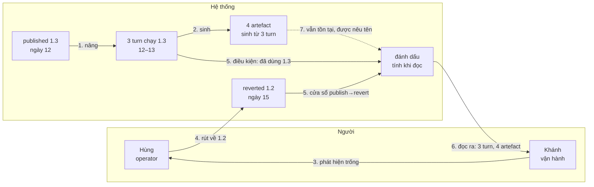
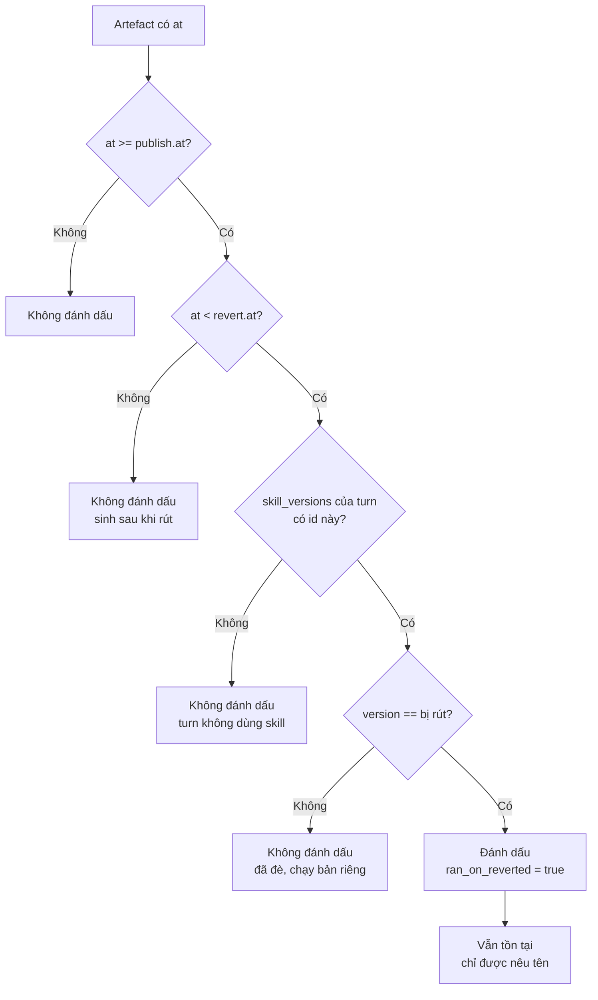
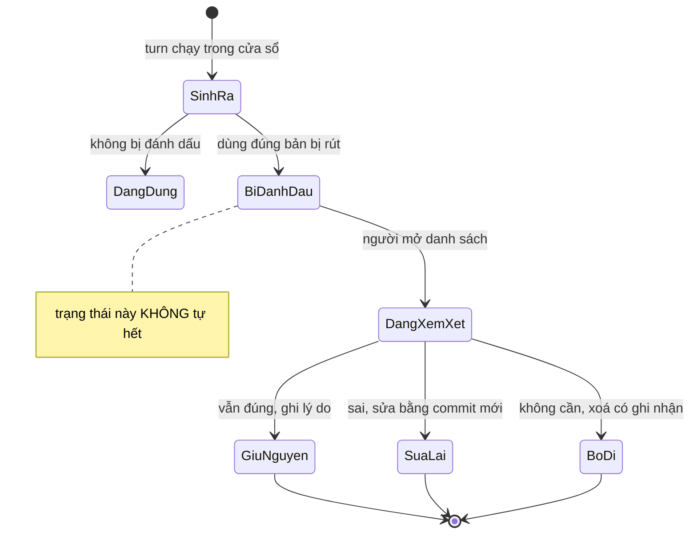
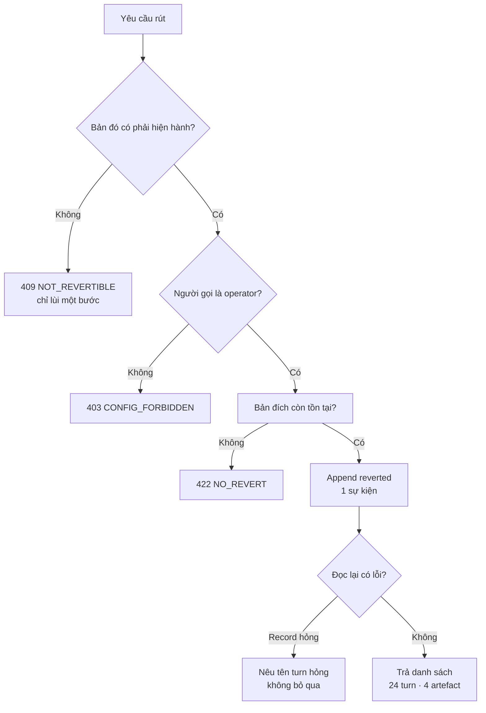

# BRD — Rút lại một skill đã nâng: biết cái gì đã xây trên bản hỏng

> **Đây là tài liệu nghiệp vụ, không phải spec kỹ thuật.** Nó trả lời *vì sao* một lần rút lại không phải là "undo", và *vì sao* câu hỏi
> thật sự không phải *"bản nào đang chạy"* mà là *"cái gì đã được xây trên bản sai"*. Hợp đồng endpoint và bảng nằm ở
> `sdlc/07.technical/03.api/01.contracts.md` và `sdlc/07.technical/02.data-design/02.schema.md`.

## 1. Bối cảnh

Ngày 12 tháng 10, ai đó nâng `shared/skills/tenant-isolation` từ `1.2` lên `1.3`. Bản `1.3` thêm một luật mới: *"mọi truy vấn danh sách phải lọc theo
`project` **trước** khi sắp xếp"*.

Nghe hợp lý. Nhưng luật đó đúng với bảng có cột `project`, và **sai** với bảng `role_preset` — bảng này **không có** cột `project`, và bộ lọc không tồn
tại thì truy vấn trả **rỗng**. Không lỗi. Không cảnh báo. Chỉ là **không có gì**.

Ba turn chạy trên `1.3` trong ngày 12 và 13. Ba turn đó tạo ra **bốn artefact**: một migration, hai test, một file cấu hình.

Ngày 14, có người thấy danh sách role trống. Ngày 15, người ta tìm ra nguyên nhân. Ngày 15, 16:40, người ta rút `1.3` về `1.2`.

**Và đó là chỗ mọi thứ dừng lại.** Hệ thống quay về `1.2`. Turn sau chạy đúng. Nhưng **bốn artefact kia** vẫn nằm đó, vẫn được đọc, vẫn được coi là
nền — và chúng được xây trên một luật mà **không ai còn tin nữa**.

Ba thứ làm câu chuyện này khó:

**Thứ nhất — rút lại không xoá được quá khứ.** Người ta đã đọc bản `1.3`, đã viết code theo nó, đã merge. Quay mũi tên thời gian là chuyện không
làm được. Chỉ có thể **nêu ra** cái đã xảy ra.

**Thứ hai — câu hỏi đúng không phải "bản nào".** Nó là *"cái gì đã dùng bản sai"*. Một turn chạy trong cửa sổ nhưng **đã đè** skill đó thì **không**
bị ảnh hưởng — nó chạy bản riêng của nó. Đếm theo cửa sổ thời gian là đếm **sai**.

**Thứ ba — dấu phải là quan sát, không phải cột.** Nếu ghi `ran_on_reverted = true` vào một cột, thì đó là `UPDATE` trên record bất biến, và lần đọc
sau sẽ không còn tính lại được khi có thêm sự kiện.

### 1.1 Sơ đồ tổng quan



> **Đọc sơ đồ:** mũi tên **5** có **hai** đầu vào — cửa sổ thời gian **và** điều kiện đã dùng. Thiếu đầu thứ hai thì mọi artefact trong cửa sổ đều bị
> đánh dấu, kể cả của project đã đè. Và mũi tên **7** đứt nét vì artefact **không bị xoá** — nó chỉ được **nêu tên**.

## 2. Những người trong câu chuyện

| Ai | Tuổi | Vai | Họ thật sự cần gì |
|---|---|---|---|
| **Hùng** | 34 | `A-01` operator | Rút được bản hỏng **nhanh**, và biết mình đã làm hỏng bao nhiêu — để nói với người khác một con số, không phải một lời xin lỗi |
| **Khánh** | 29 | `A-08` vận hành | Danh sách **artefact cụ thể** cần xem lại. Không phải "hãy kiểm tra mọi thứ" |
| **Duy** | 31 | lập trình viên `haison-portal` | Biết code của mình có nằm trong danh sách không — anh ấy đã **đè** skill đó từ tháng 9 |
| **Đức** | 33 | `A-04` chủ dữ liệu | Record không bị sửa. Cái đã ghi thì còn nguyên, kể cả khi nó ghi điều bất tiện |

> **Điểm dễ bỏ sót:** Duy là người **quan trọng nhất** trong bảng này, vì anh ấy **không** bị ảnh hưởng. Nếu hệ thống đánh dấu cả artefact của Duy,
> anh ấy sẽ mất **hai ngày** kiểm tra những thứ không liên quan — và lần sau anh ấy sẽ **bỏ qua** cảnh báo. Một dấu sai **tệ hơn** không có dấu.

## 3. Chuyện xảy ra hôm nay (khi chưa có hệ thống)

**Ngày 12, 10:20** — Hùng nâng `tenant-isolation` lên `1.3`. Anh đọc changelog, thấy hợp lý. Anh bấm nâng.

**Ngày 12, 14:02** — Turn `ESO-4471` chạy. Nó dùng `1.3`, sinh một migration.

**Ngày 12, 16:30** — Turn `ESO-4488` chạy. Hai test.

**Ngày 13, 09:15** — Turn `ESO-4501` chạy. Một file cấu hình.

**Ngày 14, 08:40** — Khánh mở màn hình role. Trống. Cô ấy nghĩ mình bấm nhầm. Cô ấy thử lại. Vẫn trống. Cô ấy mở log.

**Ngày 14, 11:00** — Khánh dành **2 giờ 40 phút** grep log để tìm xem cái gì đổi. Log ghi *"đã gọi hàm resolve"*, không ghi *"luật nào đã áp"*.

**Ngày 15, 09:30** — Ai đó nhớ ra tuần trước có nâng skill. Cả nhóm mất **thêm 4 giờ** đọc changelog `1.3` để tìm dòng sai.

**Ngày 15, 16:40** — Hùng rút về `1.2`. Hệ thống chạy đúng trở lại. Anh ấy ghi vào Slack: *"đã fix"*.

**Ngày 22** — Một test viết ngày 12 fail trên CI. Người sửa mất **3 giờ** vì test đó giả định một hành vi mà `1.2` **không** có. Không ai nhớ test đó
được sinh trong cửa sổ.

**Điều đã xảy ra:** việc rút lại **thành công** và **không đủ**. Nó sửa **tương lai** (turn sau chạy `1.2`) và **không** nói gì về **quá khứ** (bốn
artefact). Không ai sai — hệ thống chỉ **chưa có khái niệm** về *"cái gì đã xây trên bản hỏng"*.

## 4. Hệ thống phải làm gì

### 4.1 Rút lại là một **sự kiện**, không phải một lần sửa

`D-32` luật 1. Hệ thống ghi `shared.skill.reverted { id, version: 1.3, to: 1.2, by, at, reason, impact }` — **append**, không `UPDATE` bản `1.3`.

Vì sao không sửa: nếu sửa, thì câu hỏi *"ngày 13 bản nào đang chạy"* trả lời bằng **trạng thái hiện tại**, không bằng **sự thật lúc đó**. Và mọi turn đã
ghi `version: 1.3` trong evidence sẽ trỏ vào một hàng **không còn nói 1.3**.

Hệ quả kiểm được: bản `1.3` vẫn đọc được sau khi rút, ở trạng thái `superseded`. `git show` của một file sinh ngày 12 vẫn cho ra nội dung nó đã dùng.

### 4.2 Cửa sổ có **hai** biên, và biên nào cũng phải chọn

`D-32` luật 2. Cửa sổ là `[publish, revert)` — **đóng** ở dưới, **mở** ở trên.

| Artefact sinh lúc | `at == publish.at` | `at == revert.at` | `at` ở giữa |
|---|---|---|---|
| Nằm trong cửa sổ? | **Có** | **Không** | Có |
| Vì sao | nó **đã** chạy bản mới — bỏ nó là mất artefact **đầu tiên** bị ảnh hưởng | `D-33` làm `revoked` **không bao giờ** được chọn lại ⇒ turn đó đọc `1.2` | — |

Dùng **một** quy ước cho cả hai biên thì **thừa** ở trên: mọi artefact tạo đúng lúc rút bị đánh dấu oan. Đó là kiểu **tràn cờ** mà `D-32` luật 4 cảnh
báo.

### 4.3 Cửa sổ **chưa đủ** — phải thêm "đã dùng"

Đây là chỗ dễ sai nhất, và nó sai **im lặng**.

Một turn chạy trong cửa sổ nhưng project đã **đè** skill đó thì chạy bản **riêng**, không phải `1.3`. Đánh dấu nó là **sai**: người ta sẽ đi kiểm tra
code không liên quan.

| Cách đếm | Số turn bị đánh dấu | Đúng? |
|---|---|---|
| Chỉ theo cửa sổ thời gian | **31** | ❌ gồm 7 turn của project đã đè |
| Cửa sổ **và** `skill_versions[id] == 1.3` | **24** | ✅ |

Bảy cái chênh lệch là **bảy ngày công** của người không liên quan. Và tệ hơn: sau hai lần như thế, không ai đọc cảnh báo nữa.

### 4.4 Dấu là **quan sát**, không phải cột

`D-32` luật 2: *"đánh dấu là **tính**, không **lưu**"*. Hệ thống **không** có cột `ran_on_reverted_skill`.

Vì sao: dấu phụ thuộc **hai** thứ — record và danh sách sự kiện revert. Danh sách đó **tăng** theo thời gian (có thể revert `1.3` hai lần nếu nó được
nâng lại). Một cột lưu sẵn sẽ **không** cập nhật khi sự kiện mới xuất hiện, và sẽ phải `UPDATE` — tức là sửa record để nói về quá khứ.

| | Cột lưu sẵn | Tính khi đọc |
|---|---|---|
| Thêm sự kiện revert mới | phải `UPDATE` **mọi** artefact liên quan | tự động đúng |
| Record bất biến | **vỡ** | giữ |
| Đọc lại sau 6 tháng | có thể lệch | vẫn đúng |

### 4.5 Artefact **vẫn tồn tại** — chỉ được nêu tên

`D-33`. Rút lại **không** xoá artefact, **không** revert code, **không** đóng PR.

Vì sao: xoá là **quyết định thay người**. Có artefact vẫn đúng dù sinh từ luật sai — ví dụ migration thêm cột `project` vào một bảng **có** cột đó. Người
phải xem và quyết.

Hệ thống làm đúng **ba** việc: **nêu tên** artefact, **nêu** lý do, và **để nguyên** nó.

### 4.6 Người không được ghi thẳng vào record

`BR-06`. Không ai — kể cả operator — được `UPDATE` hay `DELETE` trên `evidence_*`. Rút lại là **append** một sự kiện `config_event`, và việc đánh dấu
là **hệ quả** của sự kiện đó.

Kiểm được: app role là `NOSUPERUSER NOBYPASSRLS`, `REVOKE UPDATE, DELETE` trên bảng, và một test chạy dưới **app role** cố `UPDATE` — phải **fail**.

### 4.7 Sơ đồ quyết định: artefact này có bị đánh dấu không



> **Bốn nhánh "không"** — mỗi nhánh là một lý do **khác nhau** để không đánh dấu. Gộp chúng thành một `false` là mất thông tin: người đọc cần biết
> artefact của mình **thoát** vì lý do gì.

## 5. Một ngày thật, có số

Project `baplatform`, skill `shared/skills/tenant-isolation`.

**Ngày 12, 10:20** — `published 1.3`.

**12–13** — **31** turn chạy. Trong đó **24** turn dùng `1.3`; **7** turn thuộc project `haison-portal` đã đè từ tháng 9 và chạy bản riêng.

| Turn | Project | `skill_versions[id]` | Artefact sinh | Bị đánh dấu? |
|---|---|---|---|---|
| `ESO-4471` | `baplatform` | `1.3` | 1 migration | **có** |
| `ESO-4488` | `baplatform` | `1.3` | 2 test | **có** |
| `ESO-4501` | `baplatform` | `1.3` | 1 config | **có** |
| `ESO-4512` | `haison-portal` | `1.2` (đè) | 1 service | **không** — đã đè |
| … | … | … | … | … |
| `ESO-4533` | `baplatform` | `1.3` | 0 | **có** (turn, không artefact) |

**15, 16:40** — `reverted 1.3 → 1.2`.

**15, 16:41** — Đọc lại: **24** turn bị đánh dấu · **4** artefact · **1** turn không sinh artefact nào.

### 5.1 Trạng thái một artefact đi qua



> **`note right of`**: một dấu **không tự biến mất** khi thời gian trôi. Nó chỉ hết khi có người **xem và quyết**. Đó là lý do nó phải hiện trong danh
> sách, không phải trong log.

### 5.2 Chi tiết bốn artefact bị đánh dấu

| Artefact | Loại | Sinh bởi | Còn đúng? | Hành động |
|---|---|---|---|---|
| `migrations/0042_tenant.sql` | migration | `ESO-4471` | **có** — bảng đích có `project` | giữ, ghi lý do |
| `tests/isolation.spec.ts` | test | `ESO-4488` | **không** — giả định lọc trước sort | sửa |
| `tests/role-preset.spec.ts` | test | `ESO-4488` | **không** — chạy trên bảng không có `project` | sửa |
| `config/preset.json` | config | `ESO-4501` | **có** | giữ |

## 6. Ngoại lệ — và hệ thống làm gì

| Tình huống thật | Hệ thống xử lý |
|---|---|
| Rút `1.3` hai lần (nâng lại rồi rút lại) | **hai** sự kiện, **hai** cửa sổ, dấu là hợp của cả hai |
| Artefact sinh đúng lúc `publish.at` | **đánh dấu** (biên dưới đóng) |
| Artefact sinh đúng lúc `revert.at` | **không** đánh dấu (biên trên mở) |
| Project đã đè skill | **không** đánh dấu — nó chạy bản khác |
| Turn chạy trong cửa sổ nhưng **không** dùng skill | **không** đánh dấu |
| Rút về bản **không tồn tại** | `409 NOT_REVERTIBLE` — không lùi được bước đó |
| Rút khi bản đó **không** phải bản mới nhất | `409 NOT_REVERTIBLE` — chỉ lùi **một** bước |
| Người sửa `evidence_*` để xoá dấu | **không thể** — `REVOKE` + trigger, test chạy dưới app role |
| File đã bị xoá khỏi repo sau khi sinh | **vẫn nêu tên**; nội dung lấy lại qua `git show <commit>:<path>` |
| File đã xoá **và** chưa commit (`dirty`) | nêu tên + **nói rõ không lấy lại được** |
| Artefact của project khác | không thấy, không đếm (`BR-12`) |
| Không có artefact nào trong cửa sổ | danh sách **rỗng**, và nói rõ *"0 artefact"* — **không** im lặng |

### 6.1 Sơ đồ nhánh lỗi



## 7. Điều ngoài phạm vi

| Không thuộc BRD này | Thuộc |
|---|---|
| Nâng một skill dùng chung (chiều ngược lại) | [`07.uc-07-promote-shared.md`](07.uc-07-promote-shared.md) |
| Chọn skill nào áp cho một việc | [`06.uc-06-which-rule-applies.md`](06.uc-06-which-rule-applies.md) |
| Ghi lại vì sao một quyết định ra như vậy | [`03.uc-03-why-this-decision.md`](03.uc-03-why-this-decision.md) |
| Hệ đề xuất tự sửa sau khi sai | [`10.uc-10-self-proposal.md`](10.uc-10-self-proposal.md) |
| Duyệt ticket đã xong | [`11.uc-11-ticket-done.md`](11.uc-11-ticket-done.md) |
| Hợp đồng `E14 config:revert` | `sdlc/07.technical/03.api/01.contracts.md` |
| Bảng `config_event` | `sdlc/07.technical/02.data-design/02.schema.md` |
| Ai có quyền rút | `sdlc/07.technical/01.architecture/08.actor-domain-tenant.md` |
| Ca kiểm thử | `sdlc/06.analysis/03.acceptance-criteria/` (`AC-EV-02-*`) |

## 8. Câu chưa có trả lời trong release

| # | Câu hỏi | Mã | Vì sao cây không trả lời |
|---|---|---|---|
| 1 | **Cạnh dưới của cửa sổ** — `publish` lấy `at` của lần save **đầu tiên** sinh ra bản bị rút? | `11.revert-marking` `OPEN-1` | cây chỉ viết **tên** `[publish, revert]`, không nói so trên trường nào |
| 2 | **Tên khoá version trong evidence** — `D-31` nói *"nằm trong evidence"*, `01.entities` chưa chốt khoá | `11.revert-marking` `OPEN-2` | schema đã thêm `skill_versions` (`D-58`) nhưng `payload` **cũ** có thể không có nó ⇒ artefact cũ **không** đánh dấu được |
| 3 | **Đường đọc cờ** — `DoD` đòi *"`3.4` đọc được cờ"*, nhưng `API-14` chỉ **trả** `marked_artifacts[]` lúc rút | `11.revert-marking` `OPEN-3` | đã có `API-21` (`D-58`), nhưng `API-21` trả **một turn**, không trả **danh sách artefact bị đánh dấu** |
| 4 | **Artefact là gì** — không có bảng `artefact` trong `01.entities` (20 entity, không có) | `7.6` `OPEN-1` | `/artefacts/:id` chưa có trong `API-4`; artefact hiện chỉ là **đường dẫn trong `FileUse`** |
| 5 | **`reopened`** — `11.revert-marking` §4 nói *"đóng sai thì sửa bằng `reopened`"* | đã đóng bởi `D-59` | `evidence_risk.event` giờ có `reopened`; nhưng **`config_event`** thì **chưa** — hai bảng, hai từ vựng |

## 9. Truy vết

| Yêu cầu | Điều khoản | Mục trong BRD |
|---|---|---|
| `REQ-KB-02` — rút lại có dấu vết | `D-32` | §4.1 · §4.2 · §4.3 |
| `REQ-EVID-01` — record bất biến | `BR-06` | §4.4 · §4.6 |
| `REQ-KB-03` — bản cũ vẫn đọc được | `D-33` | §4.1 · §4.5 |
| `BR-12` — cô lập project | — | §6 (artefact project khác) |

| Use case | Mục |
|---|---|
| `UC-08` rút lại skill đã nâng | §4.1–§4.7 · §5 |
| `UC-03` ghi lại vì sao | §4.1 (sự kiện), §8 |
| `UC-07` nâng shared | §4.2 (biên dưới là `publish` của lần nâng) |

## Revision rule

Sai khi: `D-32` đổi số luật, hoặc quy ước biên trong §4.2 khác `sdlc/07.technical/01.architecture/09.evidence-plane.md` §3.2, hoặc `skill_versions` không còn là khoá tường minh trong `payload`.

Nguồn kiểm:
```bash
grep -c 'ran_on_reverted_skill' sdlc/03.inception/02.decision-log/00.index.md   # phải > 0
grep -c 'skill_versions' sdlc/07.technical/02.data-design/02.schema.md          # phải > 0
```
