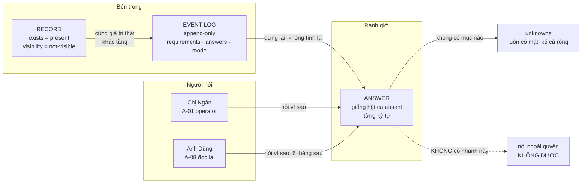
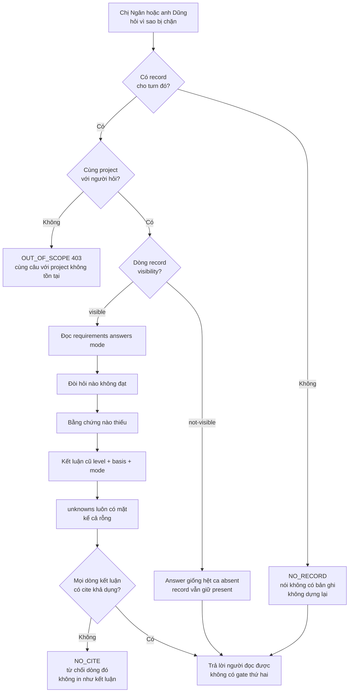
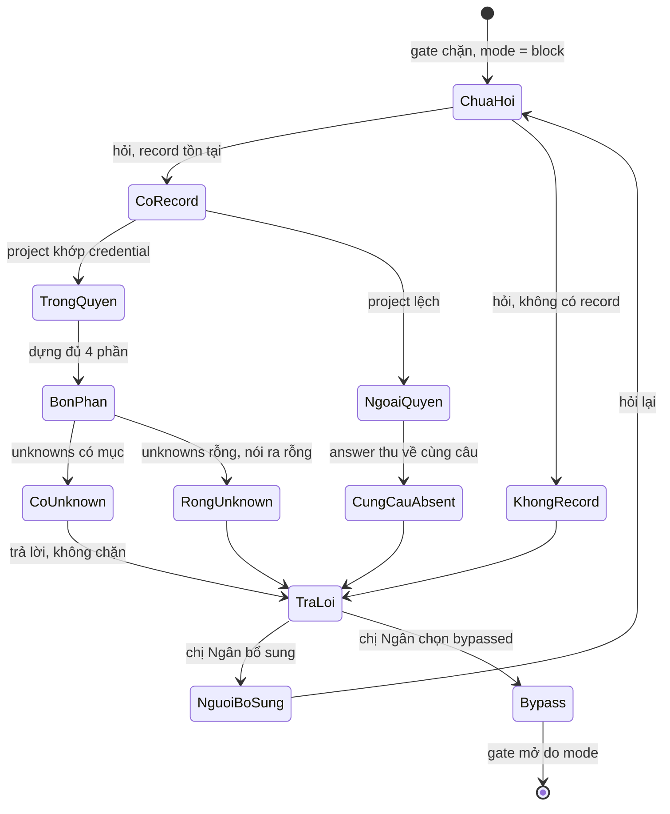
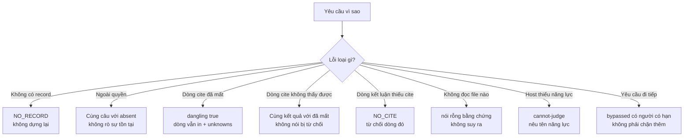

# BRD — Vì sao bị chặn: một câu người đọc được, không phải một dòng log

> **Đây là tài liệu nghiệp vụ, không phải spec kỹ thuật.** Nó trả lời *vì sao* câu "vì sao bị chặn" phải là **một câu người đọc được**, và *vì sao* câu đó **phải giống hệt** câu "không có" — kể cả khi hai chuyện hoàn toàn khác nhau. Shape kỹ thuật của hàm nằm ở `07.technical/01.architecture/09.evidence-plane.md` §4 và BIP `4.4`.

## 1. Bối cảnh

Một turn vừa bị chặn. Người ngồi trước màn hình hỏi một câu, bằng tiếng Việt, không bằng mã lỗi:

> *"Vì sao tôi bị chặn?"*

Câu hỏi đó **không** phải câu hỏi kỹ thuật. Nó là câu của người vừa bị **dừng lại** và cần biết **làm gì tiếp**. Hệ hiện có ba thứ na ná câu trả lời — và cả ba đều **trông giống** câu trả lời:

| Thứ đang có | Vì sao nó không phải câu trả lời |
|---|---|
| Dòng log `mode=block reason=absent` | nói **hệ đã làm gì**, không nói **thiếu cái gì** |
| Bảng `evidence_turn` có `level` + `basis` | nói **kết luận**, không nói **đòi hỏi nào** đã không đạt |
| Một `unknowns[]` rỗng | **không nói gì** — và im lặng đọc thành "đã biết hết" |

Và câu hỏi này có **hai người hỏi**. `A-01` (operator) hỏi ngay tại turn. `A-08` (người đọc lại sau sáu tháng) hỏi **cùng câu đó** trên **cùng record**. Nếu hai người nhận hai câu trả lời khác nhau thì đó không phải hai góc nhìn — đó là **hai hệ** (`BR-01`).

Nhưng cái làm câu hỏi này khó không phải người hỏi. Nó khó vì **một câu trả lời có hai tầng**: tầng **record** (bên trong, phải nói thật) và tầng **answer** (ra ngoài ranh giới, không được rò). Và vì giữa hai tầng đó có một câu không bao giờ được viết ra:

> *"Có, nhưng anh không được xem."*

### 1.1 Sơ đồ tổng quan



> **Đọc sơ đồ:** mũi tên duy nhất từ record ra ngoài đi qua **answer**, và answer **không** phân biệt `not-visible` với `absent`. Đường đứt nét là đường **bị cấm vẽ**: nói *"ngoài quyền"* là biến câu từ chối thành **một kênh dò** (xem §4.2). Chú ý `unknowns` được vẽ bằng mũi tên riêng vì nó **luôn** tồn tại — kể cả khi rỗng.

## 2. Những người trong câu chuyện

| Ai | Vai trong hệ thống | Họ thật sự cần gì |
|---|---|---|
| **Chị Ngân**, 38 tuổi, operator | `A-01` | Biết **làm gì tiếp** trong vòng 30 giây; không muốn đọc log, không muốn đoán. Cần **một câu** nêu thiếu cái gì và **hỏi ai** |
| **Anh Dũng**, 29 tuổi, người đọc lại sau 6 tháng | `A-08` | Biết **vì sao** turn ngày 12 tháng 3 bị chặn — không có ai để hỏi, và turn đó đã trôi khỏi trí nhớ của cả đội |
| **Agent Cursor** trên máy chị Ngân | `A-02` | Biết nó bị chặn vì **thiếu gì** để hoặc đi bổ sung, hoặc nói *"không biết"* — chứ không **đoán** rồi đi tiếp |
| **Bé Hân**, 26 tuổi, kế toán dự án khách `FinESO` | `A-07` (chủ dữ liệu) | Dữ liệu của dự án họ **không** lộ sang người hỏi của dự án khác — **kể cả** qua chuyện "có hay không có một bản ghi" |
| **Chị Trang**, 41 tuổi, vận hành | `A-08` | Tin được câu trả lời mà **không** phải đối chiếu DB; và thấy rõ **phần chưa biết** thay vì đọc một báo cáo trông đầy đủ |

> **Điểm dễ bỏ sót:** với chị Ngân, yêu cầu là **nhanh và cụ thể**. Với anh Dũng, yêu cầu là **trung thực và đọc lại được**. Hai yêu cầu này **không** xung đột — nhưng chúng cắt nhau đúng ở một chỗ: cùng một output, khác người hỏi, **cùng câu** (`BR-01`). Nếu ta tối ưu cho chị Ngân bằng cách thêm *"anh không có quyền xem"* thì câu đó **vẫn** hiện cho anh Dũng sáu tháng sau — và cả hai cùng đọc một câu nói về **quyền của người khác**.

## 3. Chuyện xảy ra hôm nay (khi chưa có hệ thống)

**14:02, thứ Ba** — Chị Ngân chạy agent trên `baplatform`. Agent dừng giữa chừng, in ra:

```text
gate: blocked
reason: insufficient
```

Chị đọc ba lần. `insufficient` là **cái gì** thiếu? Thiếu file? Thiếu test? Thiếu người khai? Chị mở terminal thứ hai, `grep` log, ra **bốn trăm hai mươi dòng** `evidence_item`. Trong đó có một dòng `level=insufficient`, **hai** dòng `basis=retrieved`, và **không** dòng nào có chữ "vì sao".

**14:19** — Chị nhắn Slack cho người viết hệ. Không ai trả lời: người đó đang họp.

**14:41** — Chị đoán. Chị thêm một file vào repo — một file **không** liên quan đến đòi hỏi nào. Gate mở. Chị đi tiếp, và **không ai biết** rằng nó mở vì lý do sai.

**Ngày 12 tháng 3** — Anh Dũng audit lại turn ngày hôm đó. Anh đọc cùng dòng log đó. Anh hỏi chị Ngân. Chị Ngân không nhớ. Anh hỏi người viết hệ. Người đó đã chuyển sang `FinESO`. Anh kết luận: *"không xác định được"*.

**Ngày 19 tháng 3** — Anh Dũng audit một turn khác, của dự án `FinESO`. Turn bị chặn. Anh hỏi *"vì sao"* và nhận câu: **"ngoài quyền của anh"**. Anh chuyển câu đó cho chị Trang. Chị Trang chuyển cho chủ dự án `FinESO`. Chủ dự án hỏi: *"Ngoài quyền nghĩa là sao? Có dữ liệu gì của tôi bị đọc không?"* — và không ai trả lời được, vì câu *"ngoài quyền"* **vừa nói** rằng có một bản ghi, **vừa không nói** bản ghi đó là gì.

**Chi phí thật của tháng đó:** 39 phút của chị Ngân cho một câu hỏi bốn chữ · 1 lần gate mở bằng một file không liên quan · 1 turn không audit được · 1 lần rò sự tồn tại qua câu từ chối · và một câu hỏi mà **không ai** trong bốn người trả lời được.

> **Không ai có lỗi trong chuyện này.** Chị Ngân đoán vì hệ im lặng. Người viết hệ chọn `insufficient` làm mã vì **nó đúng** — chỉ không **đọc được**. Anh Dũng kết luận "không xác định được" vì **quả thật** không xác định được. Và câu *"ngoài quyền"* có vẻ **lịch sự**, đúng nghi thức từ chối — nó chỉ sai ở một chỗ không ai thấy: nó cho người ngoài biết **có gì để từ chối**.

## 4. Hệ thống phải làm gì

UC-09 có điều kiện sau ngắn gọn: *"trả lời được **không cần đọc log thô**"* ([`02.use-cases`](../02.use-cases.md) §2). Câu đó nghe như một yêu cầu về giao diện. Nó không phải. Nó là một yêu cầu về **nội dung**: bốn phần, và phần thứ tư là phần không ai muốn viết.

### 4.1 Bốn phần, và phần thứ tư là phần khó

`AC-SUF-04-01` liệt **bốn** phần một câu trả lời phải có: **đòi hỏi nào không đạt** · **bằng chứng nào thiếu** · **kết luận cũ** · **`unknowns[]`**.

Ba phần đầu người hỏi **muốn** nghe. Phần thứ tư người hỏi **không** muốn nghe — và đó chính là lý do nó phải **luôn** có mặt.

Cách làm hiển nhiên: nêu ba phần đầu, và chỉ thêm `unknowns[]` **khi có** mục. Cách đó sai, và nó sai **yên lặng**: một câu trả lời không có `unknowns[]` **trông như** câu trả lời đã biết hết. Người đọc không phân biệt được *"không có gì chưa biết"* với *"không ai ghi phần chưa biết"* — vì **cả hai** đều là một khoảng trắng.

Nên luật là: `unknowns` **luôn** hiện, **kể cả khi rỗng** — và rỗng phải được **nói ra** (`AC-UI-02-09`). `DoD` của BIP `4.4` viết đúng hệ quả: *"unknowns **luôn** hiện"*. Và vắng mặt với rỗng là **cùng một lời nói dối** — đúng cách `09` §7 phép thử 6 nói.

### 4.2 Vì sao *"không có trong phạm vi"* và *"không tồn tại"* phải là **cùng một câu**

Đây là chỗ cần một chút kiên nhẫn, vì luật nghe như nó cấm nói thật.

Hai chuyện khác nhau **rất** rõ với người bên trong:

| Chuyện | Sự thật bên trong | Câu trả lời tự nhiên |
|---|---|---|
| Bản ghi **không tồn tại** | `exists = absent` | *"Không có bằng chứng nào như vậy."* |
| Bản ghi **tồn tại, ngoài quyền người hỏi** | `exists = present` · `visibility = not-visible` | *"Anh không có quyền xem cái đó."* |

Cách đọc hiển nhiên: *"hai chuyện khác nhau thì hai câu khác nhau; đó là nói thật."* Và nếu chỉ có **một** người hỏi, một lúc, thì đúng là thế.

Nhưng có **nhiều** người hỏi, **nhiều** lúc, có thể **thử**. Và một câu trả lời **phân biệt được** hai ca là một **câu trả lời cho phép đếm**. Nó không cần nội dung; chỉ cần **phân biệt**:

| Lần thử | Câu hỏi | Câu trả lời "nói thật" | Người hỏi học được gì |
|---|---|---|---|
| 1 | *"có bản ghi cho turn `8f2c…` không?"* | *"Anh không có quyền xem."* | **có** — một bản ghi tồn tại |
| 2 | *"có bản ghi cho turn `91aa…` không?"* | *"Không có bằng chứng nào như vậy."* | **không** — không có bản ghi ở đó |
| 3 | *"có bản ghi cho turn `c4e1…` không?"* | *"Anh không có quyền xem."* | **có** |

Ba lần hỏi, và người hỏi **đã vẽ được bản đồ** của thứ họ không có quyền đọc. Không lấy một byte nào. Chỉ dùng **sự khác nhau** của hai câu. Đó là kênh **liệt kê** (`enumeration channel`) — và nó không cần lỗi trong code, chỉ cần hai chuỗi khác nhau ở đúng chỗ.

Nên `BR-13` không nói *"đừng nói dối"* hay *"hãy nói thật"*. Nó tách **hai trục** và đặt **hai tầng**:

| Tầng | `not-visible` thì ghi gì | Vì sao |
|---|---|---|
| **Record** (bên trong, chỉ `A-08` và auditor đọc) | `exists = present` · `visibility = not-visible` | record **không được nói dối**; nếu ghi `absent` thì người đọc lại sau bị lừa **bởi chính hệ** (`BR-05`) |
| **Answer** (ra ngoài ranh giới) | **giống hệt** ca `absent` — cùng câu, cùng dạng | câu từ chối **không** tiết lộ rằng có cái gì để từ chối |

### 4.3 Vì sao *không* được ghi `absent` cho tiện

Cách sửa nhanh nhất là bỏ hẳn trục thứ hai: ngoài quyền thì ghi `absent` luôn, một câu, một mã, xong.

Cách đó **cũng** đóng được kênh liệt kê — và **phá** thứ khác: `A-08` đọc record sáu tháng sau, thấy `absent`, và kết luận *"ngày 12 tháng 3 không có bằng chứng nào"*. Đó là **sai**, và sai theo kiểu tệ nhất: câu trả lời trông **chắc chắn**, nên **không ai kiểm lại**. `BR-05` gọi đúng tên lỗi này: hạ `unknown` xuống `absent` thì hệ **sai một cách tự tin**.

Nên hai tầng là **bắt buộc**, không phải trang trí. Không có tầng record thì mất sự thật. Không có tầng answer thì mất ranh giới.

### 4.4 Kênh liệt kê không chỉ có hai câu — nó có **thời gian**

Có một kênh thứ hai dễ bỏ hơn, và nó không nằm trong chuỗi nào: **thời gian trả lời**.

Nếu ca `absent` trả trong 12ms (không tìm thấy gì, không đọc gì) còn ca `not-visible` trả trong 190ms (đọc record rồi mới lọc), thì **đo thời gian** cũng đếm được. Không cần đọc câu. Chỉ cần một đồng hồ.

Đây là lý do BIP `6.9` đặt yêu cầu ở dạng **mạnh**: *"gọi **hai** lần cùng tham số ⇒ **cùng byte** trả về"* — và cưỡng chế ở **tầng dữ liệu** (thiếu `SET LOCAL eso.project` ⇒ **rỗng**, không phải **toàn bộ**). Với UC-09, hệ quả cụ thể:

| Không được | Vì sao |
|---|---|
| trả *"không có bản ghi"* **trước** khi kiểm quyền | câu trả lời đúng, **thời điểm** sai — và thời điểm là một kênh |
| trả *"không có bản ghi"* **sau** khi kiểm quyền, nhưng **không** đi hết đường đọc | thời gian khác ca `absent` thật ⇒ vẫn đo được |
| lọc ở **tầng output** (`if (row.project !== asking) skip`) | dòng đã **đọc** rồi, và độ trễ của phép đọc lọt ra ngoài |

Đúng là: **cùng một đường đọc**, một predicate, kết quả rỗng, cùng hình dạng trả về.

### 4.5 Cảnh báo thì nêu, không chặn — `BR-07`

`BR-07` là luật thứ hai của file này, và nó là luật **dễ vi phạm nhất bằng thiện ý**: *"nêu cảnh báo **không chặn** việc; chặn là việc của `mode`"*.

Chuyện hay xảy ra: người viết thấy một phán quyết `insufficient` và nghĩ — *"nếu tôi biết nó thiếu, tại sao tôi để nó chạy?"* Thêm một `throw` là gate có thêm một lớp bảo vệ. Nhưng gate thứ hai đó **không** đi qua `mode`, **không** có người nhận trách nhiệm, và **không** có hạn. Nó biến cảnh báo thành **một cổng thứ hai** — và cổng thứ hai thì **không ai đóng được**, vì nó không có tên.

UC-09 là bề mặt chứng minh `BR-07` chạy đúng: nếu câu trả lời *"vì sao bị chặn"* **xuất hiện** đúng lúc bị chặn, thì chặn là **quyết định của `mode`** — và câu trả lời chỉ **giải thích** quyết định đó. Nếu câu trả lời **tự** sinh ra một lần chặn nữa, hệ có **hai** chỗ chặn.

Muốn đi tiếp khi phán quyết dưới `sufficient`? Đường duy nhất là `bypassed` — **có người**, **có lý do**, **có hạn** (`API-22`, `BR-03`). Không phải bằng một `throw` ở tầng trả lời.

### 4.6 `unknown` khác `absent`, và câu trả lời phải giữ khác biệt đó **ở tầng record**

Ba giá trị `exists`, ba nghĩa, không phải ba mức:

| Giá trị | Nghĩa | Nói ra là |
|---|---|---|
| `present` | có | "có" |
| `absent` | đã tìm **đủ**, và **không có** | "tôi chắc chắn là không có" |
| `unknown` | **chưa** tìm đủ, hoặc không có cách tìm | "tôi không biết" |

`AC-SUF-04-04` là ca nguy hiểm nhất ở đây: **turn không đọc file nào, `evidence[]` rỗng**. Cách làm hiển nhiên là trả *"không có bằng chứng"*. Nhưng "không có bằng chứng" nghe như `absent`, trong khi sự thật là **rỗng**: turn này **không đọc gì**. Nên câu đúng là *"không có bằng chứng"* **kèm** một mục `unknowns[]` nói lý do — và **không** suy ra bằng chứng.

### 4.7 Câu trả lời phải **dựng lại** từ record, không **tính lại**

Một cách làm khác cũng tự nhiên: khi có người hỏi "vì sao", chạy lại phán quyết bằng luật **hôm nay**, rồi giải thích kết quả đó.

Cách đó sai một cách tinh vi. Nó trả lời đúng câu *"nếu luật hôm nay áp lên turn đó"* — nhưng người hỏi hỏi *"vì sao **hôm đó** bị chặn"*. Hai câu khác nhau. Và nếu luật đã đổi, câu trả lời giải thích một lần chặn **chưa từng xảy ra**. `D-46` ghim điều này ở tầng kiến trúc: phán quyết dùng **hiện trạng cục bộ**, record là **đầu ra**, không bao giờ là **đầu vào**; `cites[]` **trình bày cái đã quyết**, không **quyết lại**.

Hệ quả lên UC-09: hàm dựng câu trả lời **không** import bộ phán quyết, **không** đọc `declaration` hôm nay, **không** đọc graph. Nó chỉ đọc record. Nếu record **thiếu** thì nói *"không có bản ghi"* (`AC-SUF-04-03`, mã `NO_RECORD`) — chứ **không** dựng lại.

### 4.8 Sơ đồ quyết định: hệ trả lời câu "vì sao" như thế nào



| Nút | Điều kiện | Nguồn |
|---|---|---|
| **Có record?** | `evidence_turn` tồn tại cho `(project, turn_id)` | `AC-SUF-04-03` · `NO_RECORD` |
| **Cùng project?** | `project` của người hỏi **từ credential**, không từ tham số | `BR-12` · `BR-13` · `01.contracts` §4 luật 1 |
| **`visibility`?** | `not-visible` ⇒ answer thu về **cùng câu** với `absent` | `BR-13` · `D-45` · BIP `6.9` |
| **`unknowns`** | **luôn** có khoá, kể cả `[]` | `AC-SUF-04-01` · `DoD` BIP `4.4` |
| **`cite` khả dụng?** | mỗi dòng kết luận **phải** có `cite`; không có ⇒ **từ chối dòng đó** | `09` §4 · `09` §7 phép thử 5 |

## 5. Một ngày thật, có số

Chị Ngân làm việc trên `baplatform`, turn `8f2c…`, sáng **27 tháng 10**. Turn đó có **14** đòi hỏi dẫn xuất được. Trong đó **11** đạt và **3** không đạt.

| Mốc | Việc | Đòi hỏi không đạt | Câu trả lời có `unknowns` | Gate mở lại? |
|---|---|---:|---:|---|
| 14:02 | Agent dừng. Gate bị chặn (`mode = block`) | 3 | — | chưa |
| 14:03 | Chị Ngân hỏi *"vì sao?"* | 3 | **2** | chưa |
| 14:07 | Chị bổ sung tài liệu cho đòi hỏi #2 | 2 | 2 | chưa |
| 14:09 | Hỏi lại; còn #2 và #9 | 2 | **1** | chưa |
| 14:11 | Hỏi lại; #9 không tra được trên host này | 1 | **1** | chưa |
| 14:16 | Chị chọn `bypassed`, ghi lý do + hạn `2026-11-10` | 1 | 1 | **có** — do `mode`, không do câu trả lời |

**Ngày 27 tháng 10, 14:03 — câu trả lời thật:**

> **Bạn bị chặn vì 3 đòi hỏi chưa đạt.**
> **(1)** `BR-04` — mọi requirement phải nêu nguồn. Requirement `min_basis` **thiếu `source`**. Có thể có trong `03.business-rules.md` §1.
> **(2)** Yêu cầu *"có test chạy xanh cho đường ghi"*. Bằng chứng cần: kết quả `bun test`. **Chưa đọc được** — chưa có lần chạy nào trong 24h qua.
> **(3)** blast radius cho `eso-ticket` — graph phủ **62%**, dưới ngưỡng ⇒ `unknown`, **không** phải "không có neighbour".
> **Chưa biết:** `docgraph` không có trên host này, nên tôi **không tra được** xem có tài liệu nào nói về #1 — mục này là `unknown`, không phải `absent`.

Đây là **bốn phần** của `AC-SUF-04-01`, và phần thứ tư có **hai** mục. Chị Ngân không cần đọc log nào. 39 phút của §3 thành **4 phút**.

### 5.1 Sơ đồ trạng thái một câu hỏi "vì sao" đi qua



| Trạng thái | Ai đưa vào | Dữ liệu phải có |
|---|---|---|
| `ChuaHoi` | hệ (gate chặn) | `mode = block` đã ghi |
| `CoRecord` | hệ | `evidence_turn` tồn tại |
| `KhongRecord` | hệ | `NO_RECORD` — **không** dựng lại |
| `TrongQuyen` | hệ | `project` khớp credential |
| `NgoaiQuyen` | hệ | `visibility = not-visible`, record giữ `present` |
| `CungCauAbsent` | hệ | văn bản **giống từng ký tự** ca `absent` |
| `BonPhan` | hệ | 4 phần của `AC-SUF-04-01` |
| `RongUnknown` | hệ | khoá `unknowns` **có mặt**, giá trị `[]`, **nói ra** |
| `TraLoi` | hệ | mọi dòng kết luận có `cite` khả dụng |
| `Bypass` | **A-01** | `by` · `reason` · `expires_at` (`API-22`) |

> **Ba chỗ còn treo, đã ghi nhận:**
> **(1)** `NO_CITE` là **tên do packet `4.4` đặt**, không có trong registry mã lỗi — cùng `NO_RECORD`, thứ chỉ xuất hiện trong `AC-SUF-04-03`. Hai mã này **chưa tồn tại** ở tầng hợp đồng (`4.4` `OPEN-4`).
> **(2)** `unknowns[]` **được ghi ở đâu** — `evidence_turn.payload` hay `evidence_item(kind='judgement').payload` — chưa nguồn nào khai; `4.4` **giả định** vế thứ hai (`4.4` `OPEN-5`, đã ✅ ở tầng packet nhưng chưa có dòng schema).
> **(3)** `cite` vào `key` của **policy**: không tầng nào chứng minh được *"policy đó có **hiệu lực** lúc turn đó"*, vì record không lưu snapshot policy (`4.4` `OPEN-6`). Sơ đồ trên vẽ `J` là *"kết luận cũ"*, **không** vẽ một nút *"policy đã áp"* — vì nút đó chưa trả lời được.

### 5.2 Bảng số của ngày 27 tháng 10

| Mốc | Đòi hỏi đạt | Đòi hỏi không đạt | `unknowns` | Phút trôi | Ai hành động |
|---|---:|---:|---:|---:|---|
| 14:02 | 11 | 3 | 2 | 0 | hệ (chặn) |
| 14:03 | 11 | 3 | 2 | 1 | chị Ngân (hỏi) |
| 14:07 | 12 | 2 | 2 | 5 | chị Ngân (bổ sung #1) |
| 14:09 | 12 | 2 | 1 | 7 | chị Ngân (hỏi lại) |
| 14:11 | **13** | **1** | **1** | 9 | chị Ngân (#2 đã có test) |
| 14:16 | 13 | 1 | 1 | 14 | chị Ngân (`bypassed`) |
| 14:16 | 13 | 1 | 1 | **14** | **gate mở — do `mode`** |

**Ba con số để nhớ:** **3** đòi hỏi không đạt nêu **tên** · **2** mục `unknown` nói ra (không bị lược) · **14** phút — thay cho **39** phút grep log · và **0** lần câu trả lời tự chặn (gate mở bằng `bypassed`, không bằng `throw`).

## 6. Ngoại lệ — và hệ thống làm gì

| Tình huống thật | Hệ thống xử lý |
|---|---|
| Turn **không có record** (chưa từng ghi, hoặc ingest mất lô) | `NO_RECORD`; nói **"không có bản ghi"**; **không** dựng lại phán quyết (`AC-SUF-04-03`) |
| Turn **không đọc file nào**, `evidence[]` rỗng | Nêu *"không có bằng chứng"* + `unknowns[]` nói **rỗng**; **không** suy ra bằng chứng (`AC-SUF-04-04`) |
| Record trỏ tới file **đã bị xoá** | Nêu file đó **không còn**; mục là `unknown`, **không** `absent`; `git show <commit>:<path>` vẫn lấy lại được (`AC-SUF-04-05`) |
| Record trỏ tới **dòng không được thấy** | `cite` **vẫn in**, `dangling: true` + **một** mục `unknowns[]`; **không** nói *"bị từ chối"* — câu đó tự tiết lộ dòng đó **có thật** (`BR-13`, BIP `8.7` `I-5`) |
| Project **lệch credential** | `403 OUT_OF_SCOPE`; **cùng** câu với *"project không tồn tại"* |
| Một dòng kết luận **không có `cite`** khả dụng | **Từ chối dòng đó**, không in nó như kết luận (`NO_CITE`) |
| `unknowns` **rỗng** | Khoá **có mặt**, in ra *"không có gì chưa biết"*; **không** bỏ khoá (`AC-UI-02-09`) |
| Người hỏi **yêu cầu đi tiếp** khi dưới `sufficient` | **Không** bị chặn bởi câu trả lời; đường duy nhất là `bypassed` — người + lý do + hạn (`BR-07`, `API-22`) |
| Luật đã **đổi** sau turn | Câu trả lời vẫn theo **record cũ**; **không** tính lại bằng luật hôm nay (`D-46`) |
| Hỏi lặp **50 lần** với `turn_id` ngẫu nhiên | 50 câu **giống hệt** ca `absent` (nếu ngoài quyền) ⇒ **không** đếm được gì; thời gian trả về **không** phân biệt |

### 6.1 Sơ đồ nhánh lỗi



## 7. Điều ngoài phạm vi

| Không thuộc BRD này | Thuộc |
|---|---|
| Phán quyết `level`/`basis` được tính thế nào cho **mỗi** đòi hỏi | `01.uc-01-is-it-enough.md` |
| Danh sách thiếu **đóng**, có **cái gì** + **ở đâu** | `02.uc-02-what-is-missing.md` |
| **Ghi** evidence lúc turn chạy (không phải trả lời câu hỏi) | `03.uc-03-why-this-decision.md` |
| Cảnh báo **dù không ai hỏi**; mỗi (việc, đòi hỏi) một lần | `13.uc-13-unprompted-warning.md` |
| Đường `bypassed` — người, lý do, hạn của `API-22` | `01.uc-01-is-it-enough.md` |
| `unknown` ≠ `absent` ở tầng **phán quyết** (không ở tầng answer) | `01.uc-01-is-it-enough.md` |
| Hình dạng API của `API-3` / `API-21`, và ai được đọc `project` nào | `07.technical/03.api/01.contracts.md` |
| Khuôn một mục chẩn đoán: `conclusion` · `cites[]` · `action` · `confidence` | `07.technical/01.architecture/09.evidence-plane.md` §4 |
| Dựng `cites[]` ở tầng **hàm**, và mã `NO_CITE`/`NO_RECORD` | BIP `sdlc/09.wbs/01.packets/01.bip/16.why-cites.md` |
| Cô lập `project` ở **mọi** endpoint (không riêng câu "vì sao") | BIP `sdlc/09.wbs/01.packets/01.bip/37.visibility-rule.md` |
| Cô lập tri thức giữa hai project | `05.uc-05-project-onboarding.md` |
| Ai có quyền hỏi trên project nào | `05.iam-functions.md` |
| Nguồn năng lực khi host thiếu công cụ tra cứu | `14.uc-14-capability-source.md` |

## 8. Câu chưa có trả lời trong release

Đây là những chỗ tôi **không** tự trả lời, vì không nguồn nào nói:

| # | Câu hỏi | Mã |
|---|---|---|
| 1 | `NO_CITE` và `NO_RECORD` **có trong registry lỗi không**? `AC-SUF-04-03` dùng `NO_RECORD`, `4.4` **đề xuất** `NO_CITE` — cả hai chưa có dòng nào trong `07.technical/03.api/00.index.md` §4 | `4.4` `OPEN-4` |
| 2 | `unknowns[]` **được ghi ở đâu** để đọc "nguyên": `evidence_turn.payload` hay `evidence_item(kind='judgement').payload`? `4.4` đã ✅ giả định vế thứ hai, nhưng **chưa có dòng schema** | `4.4` `OPEN-5` (đóng ở tầng packet, chưa ở tầng dữ liệu) |
| 3 | `cite` vào **`key` của policy** có **tầng nào** chứng minh *"policy đó đã áp lúc turn đó"*? Record chỉ có `rule_version` cấp turn, không có snapshot policy | `4.4` `OPEN-6` — *"lỗ thật của cây"* |
| 4 | Bất biến *"`unknowns` **luôn** hiện, kể cả rỗng"* thuộc `AC` nào **ở tầng hàm**? `AC-UI-02-09` kiểm nó ở tầng hiển thị, **sau** chỗ nó có thể bị phá | `4.4` `OPEN-3` (đóng bằng test ngoài `X3`) |
| 5 | `API-3` có trả `cites[]` không? `01.contracts` §3 `API-3` chỉ nói *"kèm `unknowns[]`"*; `09` §4 đặt `cites[]` trong khuôn chẩn đoán; `DoD` `4.4` đòi nó. Đường vào thật có thể là `API-4` projection | `4.4` `OPEN-1` |
| 6 | `project` của người hỏi **lấy từ đâu** khi gọi `API-3` (`GET` có `?project=…`)? `D-47` nói phải mang `project` của người hỏi; FIP luật 6 nói `project` **từ session**, không từ client — hai câu chưa gặp nhau cho một `GET` | `4.4` `OPEN-2` |
| 7 | **Câu trả lời** có phải là một **bản ghi** không? `AC-SUF-04-01` postcondition nói *"câu trả lời + `unknowns[]` **được ghi**"*, nhưng record chỉ-ghi-thêm không có chỗ cho "lần hỏi thứ ba của chị Ngân" | `NEW-OPEN-BRD-uc09-1` — không packet nào hỏi câu này |
| 8 | Nếu `visibility = not-visible` mà người hỏi **có** quyền `A-04` auditor: câu trả lời vẫn thu về `absent`, hay auditor có tầng đọc thứ hai? `D-45` không chia theo vai audit | `NEW-OPEN-BRD-uc09-2` — `BR-13` nói "cùng câu", không nói "cùng câu **cho mọi vai**" |
| 9 | `API-3` có **trả lời được** cho `A-08` không, khi chính `A-08` không có trong danh mục actor v1 (*"chưa là actor trong v1"*)? Câu trả lời cho người đọc lại sau là yêu cầu của `REQ-JUDGE-04`, nhưng người đó **chưa có quyền nào được khai** | `NEW-OPEN-BRD-uc09-3` (`01.actors` §2) |

## 9. Truy vết

| Yêu cầu (REQ) | Điều khoản | Mục trong BRD |
|---|---|---|
| `REQ-JUDGE-01` | Phán quyết **theo từng yêu cầu**, có `level` **và** `basis` | §4.1 · §5.1 |
| `REQ-JUDGE-04` | Giải thích lại được về sau từ record: đã đòi gì · có bằng chứng nào · kết luận gì · **cái gì chưa biết** | §4.1 · §4.7 · §5 |
| `REQ-KB-01` | Tri thức **không** ngầm chia sẻ; cô lập là **cưỡng chế** | §4.2 · §4.4 · §6 |
| `BR-13` | `visibility` trực giao với `exists`; record giữ **giá trị thật** + `not-visible`; answer **thu về cùng câu** với `absent` | §1.1 · §4.2 · §4.3 · §5.1 · §6.1 |
| `BR-07` | Nêu cảnh báo **không chặn**; chặn là việc của `mode` | §4.5 · §5 · §6 |
| `BR-05` | `unknown` ≠ `absent`; không tìm thấy **không** phải không tồn tại | §4.3 · §4.6 · §6 |
| `BR-12` | Cô lập project: project này không thấy dữ liệu project khác | §4.2 · §4.4 |
| `BR-01` | Cùng câu hỏi ⇒ cùng phán quyết, bất kể ai hỏi | §2 · §6 |
| `BR-03` | `cannot-judge` **không bao giờ** tự thành `permitted`; phải `bypassed` + người + hạn | §4.5 · §5.1 |
| `BR-06` | Record **chỉ ghi thêm**; sửa bằng cách ghi tiếp | §4.7 · §6.1 |
| `UC-09` | Hỏi *"vì sao bị chặn"*; điều kiện sau: trả lời được **không cần đọc log thô** | §1 · §4.1 · §5 |
| `UC-02` | Hệ nói *"chưa đủ"* và nói **thiếu gì** | §4.1 · §7 |
| `UC-13` | Được cảnh báo **dù không hỏi** — và cảnh báo **không** chặn | §4.5 · §7 |
| `D-45` | Cô lập sinh **chiều thứ hai**, không phải giá trị thứ tư của `exists` | §4.2 · §4.3 |
| `D-46` | Phán quyết dùng **hiện trạng cục bộ**; record là **đầu ra**, không phải đầu vào | §4.7 · §6 |
| `AC-SUF-04-01` | Trả đòi hỏi không đạt · bằng chứng thiếu · kết luận cũ · `unknowns[]` | §4.1 · §5 |
| `AC-SUF-04-02` | ≥1 mục `unknown` ⇒ mục đó **hiện ra** | §4.1 · §5.1 |
| `AC-SUF-04-03` | Không có record ⇒ nói **"không có bản ghi"**, không sinh phán quyết mới | §4.7 · §6.1 |
| `AC-SUF-04-04` | Không đọc file nào ⇒ nêu *"không có bằng chứng"* + `unknowns[]` | §4.6 · §6 |
| `AC-SUF-04-05` | File đã xoá ⇒ nêu **không còn**; là `unknown`, **không** `absent` | §6 · §6.1 |
| `API-22` | `bypassed` cần `by` · `expires_at` · `reason`, ghi bằng **append** | §4.5 · §5.1 |
| `P4` | Biết **đã đủ chưa** — nỗi đau gốc của file này | §1 · §3 |

## Revision rule

Sai khi: `BR-13` không còn nói *"answer thu về **cùng câu** với `absent`"*, hoặc `AC-SUF-04-01` đổi số phần của câu trả lời, hoặc `D-45` bị thay bằng *"thêm giá trị thứ tư vào `exists`"*, hoặc `API-3`/`API-21` đổi hợp đồng về `cites[]`/`unknowns[]` → cập nhật §4–§6 và bảng §9.
Nguồn kiểm: `grep -n 'BR-13\|BR-07' sdlc/06.analysis/01.business-analysis/03.business-rules.md`
