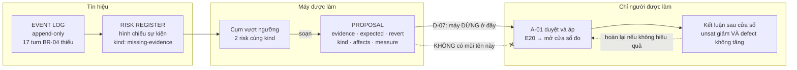
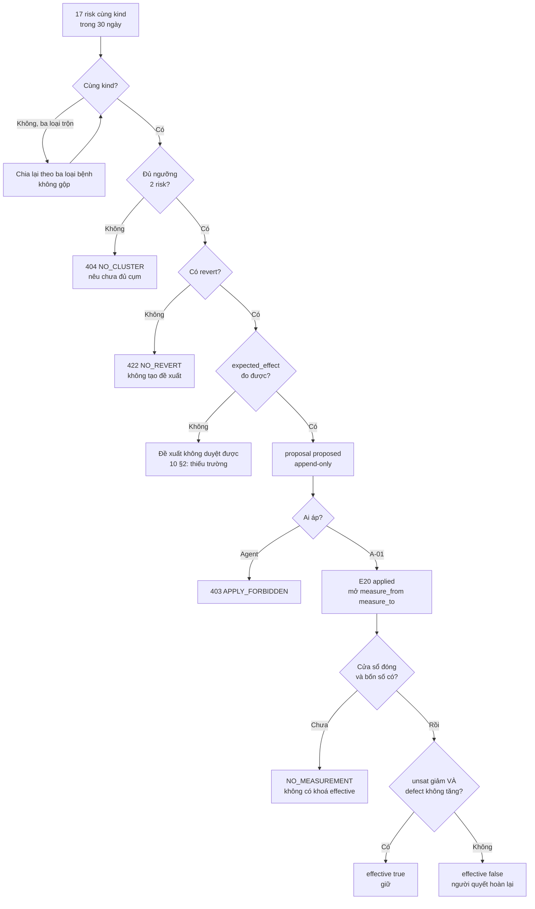
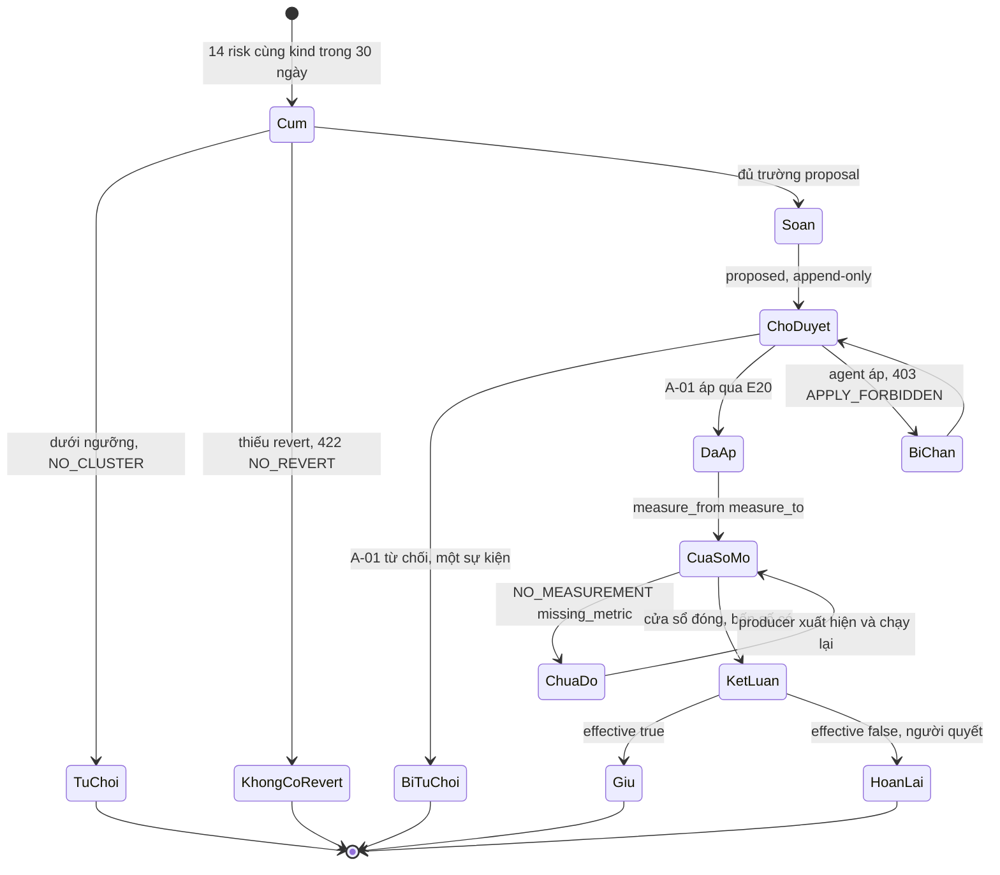
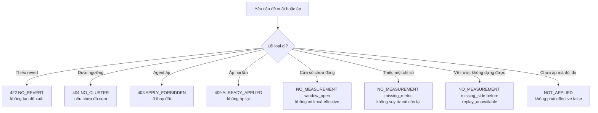

# BRD — Hệ đề xuất tự sửa cách làm: một đề xuất, không phải một thay đổi

> **Đây là tài liệu nghiệp vụ, không phải spec kỹ thuật.** Nó trả lời *vì sao* hệ được **soạn** đề xuất đổi cách làm của chính nó mà **không** được **áp** đề xuất đó — và *vì sao* một thay đổi tự áp là thay đổi **không đo được**, kể cả khi nó đúng. Vòng 7 bước nằm ở `07.technical/01.architecture/10.learning-loop.md`.

## 1. Bối cảnh

Hệ đã chạy đủ lâu để có **mẫu lặp**. Trong 30 ngày, **cùng một đòi hỏi** `BR-04` (mọi requirement phải nêu nguồn) không đạt ở **17 turn** của `baplatform`. Không phải 17 lần xui. Là **17 lần** hệ đòi một thứ mà catalogue **không có dạng nào** để thoả.

Đây đúng là chỗ một hệ "tự hoàn thiện" phải hành động. `P5` nói nó phải làm được điều đó — *"tự nâng cấp kỹ năng"*. Và cách làm hiển nhiên nhất là: hệ **thấy** mẫu, hệ **sửa** cách làm, hệ **chạy tiếp**. Một vòng kín, không cần ai.

Nhưng `D-07` chặn đúng bước cuối, và câu của operator gốc rất gọn: *"phải có người duyệt, phải là supervisor hoặc higher level, là human, không phải là AI"*. Câu hỏi của file này là: **tại sao** — chứ không phải "vì operator dặn thế".

Vì có **hai** lý do, và lý do thứ hai không ai nói ra:

| Lý do | Ai nói |
|---|---|
| **Trách nhiệm**: tri thức dùng chung cho **mọi dự án sau**; không ai chịu trách nhiệm thì khi nó sai, không có chỗ nào để sửa | `D-07` §"Vì sao không phải AI duyệt AI" |
| **Đo được**: hệ **không thể** tự đánh giá thay đổi của chính nó. Bên đo và bên sửa là **một** ⇒ mọi kết luận đều là tự khen | *file này, §4.5* |

Lý do thứ hai khó hơn, vì nó không phải về **quyền**. Nó về **thước đo**.

### 1.1 Sơ đồ tổng quan



> **Đọc sơ đồ:** mũi tên đặc chạy từ `PR` sang `AP` là **người đọc đề xuất và quyết**. Mũi tên bị **cắt** giữa `PR` và `AP` là vế thứ hai của `D-07`: máy **soạn** được, máy **áp** thì không. Và đường đứt nét từ `CO` về `AP` là `revert` — thứ làm cho "được phép thử" thành đúng.

## 2. Những người trong câu chuyện

| Ai | Vai trong hệ thống | Họ thật sự cần gì |
|---|---|---|
| **Anh Khoa**, 34 tuổi, operator (supervisor) | `A-01` | Duyệt một đề xuất trong **5 phút**, không phải trong một buổi chiều: cần `evidence[]` đếm được, `expected_effect` **đo được**, và `revert` **chạy được** |
| **Chị Loan**, 41 tuổi, operator dự án `FinESO` | `A-01` | Biết ngay đề xuất này **ai chịu ảnh hưởng**: `affects[]` phải nêu role · consumer · catalogue entry — nếu không, chị là người bị đổi luật mà không được hỏi |
| **Agent lead** trên `baplatform` | `A-02` | Được **nói** *"tôi thấy 17 turn cùng thiếu"* — và **không** được **sửa** luật để đỡ bị chặn lần sau |
| **Chị Hà**, 37 tuổi, evidence owner (`A-04`) | `A-04` | Một producer thật cho `defect_rate`; không có nó thì **không** kết luận nào tồn tại |
| **Anh Dũng**, 29 tuổi, người đọc lại sau | `A-08` | Đọc *"đề xuất #12 được áp ngày 27/10 vì 17 turn, và kết luận ngày 26/11 là gì"* — từ record, không từ trí nhớ ai |
| **Chủ dự án `FinESO`** | `A-07` | Không bị đổi cách làm bởi đề xuất sinh ra từ mẫu của dự án **khác** |

> **Điểm dễ bỏ sót:** với anh Khoa, đề xuất phải **thuyết phục được người bận**. Với chị Loan, đề xuất phải **không bí mật đổi luật của chị**. Hai yêu cầu này cắt nhau ở `affects[]` — trường mà `10.learning-loop` §2 đòi và `proposal` **chưa có cột** (`5.6` `OPEN-1`).

## 3. Chuyện xảy ra hôm nay (khi chưa có hệ thống)

**Ngày 3 tháng 9** — Agent trên `baplatform` bị chặn lần thứ nhất: requirement `BR-04` thiếu `source`. Chị Ngân đọc log, thêm `source` bằng tay vào file của dự án. Gate mở.

**Ngày 6, 11, 14, 19, 23 tháng 9** — Bốn lần nữa, cùng đòi hỏi, cùng cách chữa. Mỗi lần chị Ngân thêm một dòng bằng tay. Không ai đếm.

**Ngày 2 tháng 10** — Một người khác trên đội sửa `bar` của role `be` cho **dễ thở hơn**: hạ `min_basis` từ `verified` xuống `retrieved`. Từ hôm đó, các turn `BR-04` **đạt nhiều hơn**. Trên bảng theo dõi, tình hình "tốt lên".

**Ngày 9 tháng 10** — Số turn `level = sufficient` tăng **31%**. Số lỗi hậu kiểm tăng từ **4** lên **11** trên cùng cửa sổ. Không ai nối hai con số này: bảng `sufficient` nằm một chỗ, danh sách lỗi hậu kiểm nằm một chỗ khác, và **không** có chỉ số nào tên là *"hệ có đang nói dối không"*.

**Ngày 20 tháng 10** — Anh Khoa hỏi: *"tháng 9 vừa rồi sửa gì cho `BR-04`?"* Không ai biết. Có **5** lần chị Ngân sửa tay (không ghi ở đâu); có **1** lần hạ chuẩn (ghi trong một PR, message `tweak bar`); và **cả hai** đều làm con số "tốt lên". Một cái là học. Một cái là hạ chuẩn. **Không phân biệt được từ bảng.**

**Chi phí thật của tháng đó:** 5 lần sửa tay không ghi · 1 lần hạ chuẩn đội lốt cải tiến · 17 turn cùng một bệnh · +31% `sufficient` và +175% lỗi hậu kiểm, **không ai đối chiếu** · và một câu hỏi mà **không ai** trả lời được.

> **Không ai có lỗi trong chuyện này.** Chị Ngân chữa tay vì hệ **không** đề xuất gì cả. Người hạ `bar` làm đúng theo cách hiểu của mình: `partial` nhiều thì hạ `min_basis` là **sửa luật**, và luật đúng phải nhẹ hơn — tài liệu **không** nói *"hạ `bar` là hạ chuẩn"* ở chỗ người ta đọc. Và cả hai đều **trông** như cải tiến, vì chỉ có **một** con số được xem.

## 4. Hệ thống phải làm gì

UC-10 có điều kiện sau: *"đề xuất có **bằng chứng** và **cách lùi**"* (`02.use-cases` §1). Nghe gọn. Nhưng "bằng chứng" và "cách lùi" là hai thứ **không** tự nhiên cho một hệ thích hành động — và phần khó nhất thì không có trong câu điều kiện sau, vì nó là **một chữ "không"**.

### 4.1 Một cụm, không phải một turn

Cách làm hiển nhiên: thấy một turn `insufficient` ⇒ đề xuất. Cách đó biến mọi **lần xui** thành một **thay đổi luật**.

Một turn `insufficient` có thể vì 40 lý do không liên quan: file chưa commit, test vừa xoá, người dùng đang sửa dở. Đề xuất từ **một** turn là **nhiễu**, và nhiễu thì mất tác dụng — cùng lý do `BR-07` nói về cảnh báo: nêu mọi lúc thì người ta bỏ qua cả cái đúng.

`AC-LEARN-01-05` nói ngưỡng là **2** risk cùng `kind`. Và ngưỡng đó là **dữ liệu**, không phải hằng — `BR-09` cấm hard-code, vì đổi ngưỡng thành đổi code nghĩa là không ai đổi được ngưỡng.

### 4.2 Ba loại bệnh, và gộp chúng là lỗi nghiêm trọng

Tín hiệu đến từ log, nhưng chúng **không cùng loại** (`10.learning-loop` §1):

| Loại | Dấu hiệu | Sửa ở đâu |
|---|---|---|
| **① thiếu dạng** | cùng một requirement `absent` lặp lại; "không dạng nào khớp" | thêm/sửa entry **L0** (`D-08`) |
| **② nghĩa vụ sai** | một role luôn `partial` trên requirement mà role đó **không nên** có | sửa `bar`/`scope` — **không** thêm tri thức |
| **③ mô hình thiếu** | `cannot-judge` lặp ở cùng vùng | cải thiện **mô hình kiến trúc** |

Gộp ba loại là một lỗi và nó **có tên**: nếu `cannot-judge` bị xử như "thiếu skill", hệ sẽ **thêm tri thức cho một lỗ hổng mô hình** — và lỗ hổng vẫn còn, chỉ thêm rác. Đây chính là §3: người hạ `bar` đã làm một phép **②** (sửa nghĩa vụ) cho một vấn đề **①** (thiếu dạng). Kết quả là hệ **nói dối tự tin hơn**.

### 4.3 Đề xuất thiếu `revert` thì **không được tạo**

`10.learning-loop` §2 nói thẳng: *"thử mà không lùi được thì không phải thử, là đánh cược"*. Nên `API-19` trả **422 `NO_REVERT`** — và ràng buộc nằm ở **schema** (`revert NOT NULL`), không chỉ ở API.

Vì sao `422` chứ không phải `400`: dữ liệu **hợp lệ**, nhưng **không đủ điều kiện** để là một đề xuất — nó sẽ tạo ra thứ không lùi được. Mã lỗi ở đây **nói về điều kiện**, không nói về hình dạng request.

Và `revert` không phải một dòng lịch sự. Nó phải **chạy được**: một đề xuất nói *"hoàn lại bằng cách revert commit"* khi thay đổi nằm ở **catalogue dữ liệu** (không phải git) là một `revert` **trông** có mà **không** có. Đó là lý do `revert` là trường **hay bị bỏ nhất** và cũng là trường **làm cho "được phép thử" thành đúng**.

### 4.4 Người áp, không phải máy — và "không có chế độ auto"

`D-07` ghim bước ④: **chỉ** người, supervisor trở lên. Ba hệ quả cụ thể:

- Audit phải ghi **ai** duyệt, **khi nào**, **vì sao** — không chỉ "đã duyệt".
- **Không** có chế độ *"auto-approve khi confidence cao"*. Khác `Q-6`/JEV — ở đó máy được quyết trong band cao; ở đây **không**, vì đối tượng là tri thức dùng chung cho **mọi dự án sau**.
- Agent áp ⇒ `403 APPLY_FORBIDDEN` (`AC-LEARN-01-03`, `API-20`).

Và `D-07` nói thêm điều làm luật này **không** hình thức: bước ⑥ (đo lại) **không thay thế** được bước ④ — vì đo lại phát hiện sai **sau khi** đã lan.

### 4.5 Vì sao một thay đổi **tự áp** là thay đổi **không đo được**

Đây là lập luận chính của file, và nó không dựa vào quyền.

Một thay đổi được coi là **hiệu quả** khi, trong một cửa sổ đã khai:

```text
unsat_rate(R) giảm   VÀ   defect_rate(turn sufficient) KHÔNG tăng
```

Vế thứ hai không được bỏ — `10.learning-loop` §3 nói rõ vì sao: một dạng mới có thể **giảm** `unsat_rate` bằng cách làm `sufficient` **dễ đạt hơn**. Đó là §3: hạ `bar` làm `unsat` giảm, và lỗi hậu kiểm tăng từ 4 lên 11.

Bây giờ giả sử hệ **tự áp**. Có ba thứ **hỏng cùng lúc**, và mỗi thứ đủ để kết luận vô nghĩa:

| Hỏng | Cụ thể |
|---|---|
| **Bên đo = bên sửa** | Chính hệ chọn `R` nào để đo, chọn `effective` khi nào. Không có bên nào **được lợi** từ việc nói *"thay đổi của tôi không hiệu quả"* — nên nó **không** nói |
| **Ngưỡng do bên sửa đặt** | `δ` cho *"giảm"* chưa có (`5.9` `OPEN-5`); nếu có, ai đặt? Nếu hệ đặt, hệ chọn ngưỡng vừa đủ để qua |
| **Không có điểm dừng** | Vòng tự duyệt **không có điểm dừng**: mỗi thay đổi tự đánh giá là tốt, nên lần sau lại tự thay đổi. `D-07`: *"một vòng tự duyệt là vòng không có điểm dừng"* |

Và câu quan trọng nhất: **bạn không phân biệt được cải tiến với trôi**. Trôi (`drift`) là thay đổi **không ai quyết**; cải tiến là thay đổi **có người chịu trách nhiệm**. Cả hai ra **cùng** một bảng số. Từ bảng đó, chúng **không phân biệt được** — và đó **không phải** vì bảng dở. Vì thứ phân biệt chúng **không nằm trong số**: nó nằm ở **ai đã quyết**.

Nên `D-07` không phải một giới hạn đặt lên để cho an toàn. Nó là **điều kiện** để câu "hiệu quả" có nghĩa. Bỏ nó, hệ vẫn **đo** được số — nhưng số **không** đại diện cho câu hỏi nào nữa.

### 4.6 Trạng thái thật hôm nay: `defect_rate` **không có producer**, `5.9` là `BLOCKED`

Lập luận §4.5 đúng, nhưng phải nói thêm một sự thật khó chịu: **hôm nay cái thước thứ hai chưa tồn tại**.

| Vế | Cần gì | Có chưa |
|---|---|---|
| **trước** | `3.4` `replay` chạy được | ❌ mới có packet |
| **`defect_rate`** | một producer | ❌ **không ai sinh** trong `sdlc/07.technical/` — `grep` chỉ thấy **dùng**, không **tính** |
| **sau** | cửa sổ đo (`measure_from`/`measure_to` từ `API-20`) | ✅ |

`5.9` (`27.measure-effect.md`) vì thế là **`BLOCKED`** — và `Q-06` chốt lý do: *"không chờ quyết định, chờ **code**"* (`D-59`). Đây là `OPEN-4` của packet đó: `AC-LEARN-04-04` (thiếu chỉ số ⇒ từ chối) sẽ **luôn** đúng nếu `defect_rate` **không** tồn tại ⇒ **mọi** kết luận là `NO_MEASUREMENT`, và `-01`/`-02`/`-05` **không bao giờ** chạy được. Đó là *"đúng nhưng vô dụng"*.

Hệ quả lên UC-10, và nó phải được nói ra chứ không để người đọc tự phát hiện:

> Một đề xuất được soạn **đủ trường** hôm nay vẫn **chưa** kết luận được hiệu quả. Nó có thể được **áp** — nhưng *"hiệu quả"* chỉ đến khi cửa sổ đóng **và** cả bốn số có. Trước đó, câu trả lời đúng là `NO_MEASUREMENT`, **không** phải *"có vẻ tốt"*.

Và `NO_MEASUREMENT` **không** phải `effective: false`: dùng `false` cho *"không đo được"* thì hệ sẽ **lùi** một thay đổi **chưa từng được đo** — `BR-05` §3 gọi đó là lối tự nhiên nhất và sai nhất.

### 4.7 Record chỉ ghi thêm — đề xuất cũ **không** bị sửa khi bị từ chối

`BR-06` bắt một chi tiết dễ làm sai: một đề xuất bị anh Khoa **từ chối** không phải một dòng bị **sửa** thành `rejected`. Nó là **một sự kiện** thêm vào (`5.7`), và đề xuất vẫn là một sự thật của lúc nó được soạn.

Vì sao quan trọng: nếu `proposal` bị `UPDATE` để ghi trạng thái, thì *"đề xuất #12 lúc soạn nói gì"* **mất** — và `evidence_set_hash` (khoá idempotency) trỏ tới một nội dung **có thể đã đổi**. Bài học `2.1` `OPEN-2`: hai bản của một sự thật **sẽ** lệch.

### 4.8 Sơ đồ quyết định: một cụm có thành đề xuất không



| Nút | Điều kiện | Nguồn |
|---|---|---|
| **Cùng kind?** | `form` · `obligation` · `model` — **không** gộp ba loại bệnh | `10` §1 · `5.6` `OPEN-4` |
| **Đủ ngưỡng?** | ≥ **2** risk cùng `kind`; ngưỡng là **dữ liệu** | `AC-LEARN-01-05` · `BR-09` |
| **Có `revert`?** | thiếu ⇒ `422 NO_REVERT`; ràng buộc ở **schema** | `API-19` · `AC-LEARN-01-02` |
| **`expected_effect` đo được?** | thiếu khuôn kiểm ⇒ đề xuất **không duyệt được** | `10` §2 · `5.6` `OPEN-1` |
| **Ai áp?** | chỉ `operator`; agent ⇒ `403` | `D-07` · `AC-LEARN-01-03` |
| **Bốn số có?** | thiếu **một** ô ⇒ `NO_MEASUREMENT`, **không** khoá `effective` | `5.9` `I-1` · §4.6 |
| **Hiệu quả?** | `unsat` ↓ **VÀ** `defect` **không** ↑ (gồm bằng) | `10` §3 · `AC-LEARN-04-05` |

## 5. Một ngày thật, có số

Ngày **27 tháng 10**, trên `baplatform`. Cửa sổ 30 ngày (từ 27/9 đến 26/10) có **17** turn mà đòi hỏi `BR-04` không đạt, trên **124** turn cần nó ⇒ `unsat_rate(BR-04)` = **0,137**.

| Mốc | Việc | Risk cùng kind | Đề xuất | Trạng thái `5.9` |
|---|---|---:|---:|---|
| 27/10 08:00 | Đếm cụm 30 ngày | **17** | 0 | `BLOCKED` |
| 27/10 08:04 | Chia theo ba loại bệnh | 17 → **14 · 2 · 1** | 0 | `BLOCKED` |
| 27/10 08:09 | Soạn đề xuất cho cụm 14 (loại ①) | 14 | **1** (`#12`) | `BLOCKED` |
| 27/10 08:09 | Cụm 2 (loại ②): dưới ngưỡng? | 2 | **0** — đúng ngưỡng, tạo được | `BLOCKED` |
| 27/10 08:09 | Cụm 1 (loại ③): từ chối | 1 | 0 (`NO_CLUSTER`) | `BLOCKED` |
| 27/10 09:12 | Anh Khoa duyệt `#12` ⇒ `API-20` | 14 | 1 | **cửa sổ mở** |
| 26/11 | Cửa sổ 30 ngày đóng | 14 | 1 | **`NO_MEASUREMENT{missing_metric}`** |

**Đề xuất `#12` — nguyên văn những gì anh Khoa đọc:**

> **kind**: ① thiếu dạng (catalogue).
> **claim**: thêm một dạng "requirement mang `source` dạng khai báo" với điều kiện `applies_when: bar nói min_basis`.
> **evidence**: **14** turn · `BR-04` · trong **30 ngày** (27/9–26/10) · turn id `8f2c…`, `91aa…`, `c4e1…` và 11 turn khác.
> **expected**: `unsat_rate(BR-04)` từ **0,137** xuống **dưới 0,05**; `defect_rate` **không tăng**.
> **affects**: role `be` · consumer `baplatform` · entry L0 `request-source-declared`.
> **revert**: rút entry khỏi L0 bằng một sự kiện `retired`, con trỏ dời về `@1.2`; **không** xoá bản (BR-10).
> **measure**: cửa sổ **30 ngày** từ `2026-10-27` đến `2026-11-25`.

Anh Khoa đọc trong **4 phút**. Câu hỏi duy nhất anh phải hỏi là *"`affects` có `FinESO` không"* — và câu trả lời **đã** có trong đề xuất: **không**.

### 5.1 Sơ đồ trạng thái một đề xuất đi qua



| Trạng thái | Ai đưa vào | Dữ liệu phải có |
|---|---|---|
| `Cum` | hệ | ≥2 risk cùng `kind`, ngưỡng là **dữ liệu** |
| `TuChoi` | hệ | `404 NO_CLUSTER` — nêu *chưa đủ cụm* |
| `KhongCoRevert` | hệ | `422 NO_REVERT` — `revert NOT NULL` ở schema |
| `Soan` | hệ | `evidence[]` · `expected_effect` · `revert` (`10` §2) |
| `ChoDuyet` | hệ | `proposal` là **append-only** (`BR-06`) |
| `DaAp` | **A-01** | `API-20` trả `applied` + `measure_from`/`measure_to` |
| `BiChan` | hệ | agent áp ⇒ `403 APPLY_FORBIDDEN` (`D-07`) |
| `CuaSoMo` | hệ | cửa sổ **mở**; **chưa** được tuyên bố hiệu quả |
| `ChuaDo` | hệ | `NO_MEASUREMENT` — **không có khoá** `effective` |
| `KetLuan` | hệ | **cả bốn** số, cửa sổ đã đóng |
| `HoanLai` | **A-01** | `revert` chạy được; vết của lần áp **vẫn còn** |

> **Ba chỗ còn treo, đã ghi nhận:**
> **(1)** `kind` · `affects[]` · khuôn `expected_effect` — `10` §2 đòi **ba** trường, và `proposal` **không có cột nào** trong ba; `API-19` cũng chỉ nhận `risk_kind` ⇒ một đề xuất "đầy đủ" **không tồn tại ở dạng kiểm được** (`5.6` `OPEN-1`).
> **(2)** `evidence_set_hash` — khoá idempotency `API-19` tự khai — **không có cột** trên `proposal`; ba lần gọi cùng cụm là 1 hay 3 dòng, chưa ai chốt (`5.6` `OPEN-2`).
> **(3)** `defect_rate` **không có producer**; `5.9` là **`BLOCKED`** và `ChuaDo` là nhánh **duy nhất** chạy được hôm nay (`5.9` `OPEN-1` · `OPEN-4`, `Q-06` → `D-59`).

### 5.2 Bảng số của ngày 27 tháng 10 và cửa sổ 30 ngày

| Mốc | `unsat_rate(BR-04)` | `defect_rate` | Có kết luận? | Ghi chú |
|---|---:|---:|---|---|
| 27/9 – 26/10 (trước) | **0,137** (17/124) | **không có** | — | `defect_rate` **không ai sinh** |
| 27/10 09:12 | 0,137 | **không có** | không | `API-20` chỉ **mở** cửa sổ |
| 10/11 | 0,061 | **không có** | **không** | cửa sổ còn mở ⇒ `NO_MEASUREMENT` |
| 26/11 (đóng) | 0,041 | **không có** | **không** | thiếu một số ⇒ `NO_MEASUREMENT` |
| Giả sử có producer 26/11 | 0,041 | **0,004** | **có** | `unsat` ↓ **và** `defect` không ↑ ⇒ `effective: true` |
| Kịch bản §3 (hạ `bar`) | 0,020 | **0,021** | **có** | `unsat` ↓ **nhưng** `defect` ↑ ⇒ `effective: false` |

**Ba con số để nhớ:** **14** turn cùng một bệnh (không phải 17 — ba loại bệnh **không** gộp) · **2** ngưỡng cụm, là **dữ liệu** · **0** kết luận hiệu quả có thể đưa ra **hôm nay**, vì `defect_rate` **chưa có producer** — và nói ra điều đó tốt hơn đưa ra một kết luận trông chắc chắn.

## 6. Ngoại lệ — và hệ thống làm gì

| Tình huống thật | Hệ thống xử lý |
|---|---|
| Đề xuất **thiếu `revert`** | `422 NO_REVERT`; **0** đề xuất được tạo; ràng buộc ở **schema** (`revert NOT NULL`) |
| Cụm **dưới ngưỡng** (1 risk) | `404`; nói **"chưa đủ cụm"**; **không** bịa risk thứ hai (`AC-LEARN-01-05`) |
| **Agent** cố áp đề xuất | `403 APPLY_FORBIDDEN`; **0** thay đổi; ghi lại **đã bị từ chối** |
| Hai lần `API-19` cùng một cụm | **Chưa chốt** là 1 hay 3 dòng (`5.6` `OPEN-2`) — **không** tự chọn |
| `cannot-judge` lặp lại | **Không** đề xuất skill; đó là **③ mô hình thiếu** (`10` §1) |
| `partial` lặp lại trên một role | Đề xuất **② nghĩa vụ sai** (sửa `bar`/`scope`), **không** thêm tri thức |
| Người muốn **hạ `bar`** để hết `partial` | Phải đi qua ② **với bằng chứng**; *"hạ chuẩn"* không phải học (`10` §5) |
| Cửa sổ đo **còn mở** | `NO_MEASUREMENT{window_open}`; **không có khoá** `effective` |
| Thiếu **một** trong bốn số | `NO_MEASUREMENT{missing_metric}`; **không** suy từ cái còn lại; **không** trả `effective: false` |
| `defect_rate` **không có producer** | Nói **đúng thế** — `NO_MEASUREMENT`, **không** *"có vẻ tốt"*; `5.9` là `BLOCKED` |
| Đề xuất **bị từ chối** | Một **sự kiện** thêm, **không** `UPDATE` đề xuất (`BR-06`) |
| `revert` sau khi áp | Dời con trỏ, **không** xoá bản; vết lần áp **vẫn còn** (`BR-10`) |
| Đề xuất sinh từ `baplatform` | **Không** tự áp lên `FinESO`; `affects[]` phải nêu, và chưa có cột (`5.6` `OPEN-1`) |

### 6.1 Sơ đồ nhánh lỗi



## 7. Điều ngoài phạm vi

| Không thuộc BRD này | Thuộc |
|---|---|
| Ghi lại **vì sao** một quyết định ra như vậy (đầu vào của vòng học) | `03.uc-03-why-this-decision.md` |
| **Duyệt / từ chối** một đề xuất cụ thể: ai duyệt, ghi gì | `09.uc-09-why-blocked.md` **không** phải; thuộc `5.7` và `US-LEARN-02` |
| Nâng một skill dùng chung: mọi project theo bản mới | `07.uc-07-promote-shared.md` |
| **Rút lại** một skill đã nâng vì nó hỏng | `08.uc-08-revert-broken.md` |
| Chọn skill/luật nào **áp** cho việc này, và giải thích được | `06.uc-06-which-rule-applies.md` |
| **Cách đo** `unsat_rate` / `defect_rate` | `A-04` · `#4 Evidence` · `5.9` `OPEN-4` |
| Cửa sổ đo, `measure_from`/`measure_to`, biên `now >= upper` | BIP `sdlc/09.wbs/01.packets/01.bip/27.measure-effect.md` §4.1 |
| Ba loại bệnh và vòng 7 bước | `07.technical/01.architecture/10.learning-loop.md` §1 · §4 |
| Hình dạng `API-19`/`API-20`, mã `422` vs `400` | `07.technical/03.api/01.contracts.md` §E19 · §E20 |
| Ngưỡng cụm là **dữ liệu** ở đâu | `BR-09` · `5.6` §3 |
| Cô lập đề xuất giữa hai project | `05.uc-05-project-onboarding.md` |
| Ticket "xong" và dẫn nguồn của nó | `11.uc-11-ticket-done.md` |
| Nguồn năng lực khi host thiếu công cụ đo | `14.uc-14-capability-source.md` |

## 8. Câu chưa có trả lời trong release

Đây là những chỗ tôi **không** tự trả lời, vì không nguồn nào nói:

| # | Câu hỏi | Mã |
|---|---|---|
| 1 | **Ba trường `10` §2 đòi** (`kind` · `affects[]` · khuôn `expected_effect`) **không nơi nào giữ được** — một đề xuất "đầy đủ" **không tồn tại ở dạng kiểm được**. Thêm ba cột, hay tuyên bố chúng là văn xuôi? | `5.6` `OPEN-1` |
| 2 | `evidence_set_hash` là **khoá idempotency** của `API-19` nhưng **không có cột** trên `proposal`. Ba lần gọi cùng cụm ⇒ 3 dòng hay 1? | `5.6` `OPEN-2` |
| 3 | **`defect_rate` chưa có producer.** `10` §3 cho công thức, `US-LEARN-04` đẩy cách đo sang `#4 Evidence`, và evidence **chưa có chỉ số đó**. Vậy `5.9` **đọc** nó từ đâu? | `5.9` `OPEN-4` · `5.9` §9 `BLOCKED` · `Q-06` → `D-59` |
| 4 | **Vế "trước"** chỉ dựng được bằng `3.4` (`replay`), và `3.4` **chưa chạy**. `5.9` **ship** với nhánh `replay_unavailable`, hay **chờ**? | `5.9` `OPEN-1` |
| 5 | **`δ` cho *"`unsat_rate` giảm"***: `AC` nói dấu `<`, **không** ngưỡng. Một cửa sổ ngắn ⇒ **một** turn là đủ "giảm". `δ` là dữ liệu hay không có `δ`? | `5.9` `OPEN-5` |
| 6 | `risk_kind` ↔ `kind` của `10` §1: `missing-evidence` là **loại thiếu**, `form`/`obligation`/`model` là **bệnh**. Ánh xạ nào đúng, và có **bắt buộc** ánh xạ không? | `5.6` `OPEN-4` |
| 7 | **Không endpoint nào để đọc một đề xuất**: `API-4` có `turns`·`risks`·`graph`·`audit` — **không** `proposals`. Anh Khoa duyệt `#12` bằng đường nào? | `5.9` `OPEN-2` · `5.7` `OPEN-2` |
| 8 | Kết luận sau cửa sổ là **phép tính hay sự kiện**? Nếu là phép tính, khi record mọc thêm thì **cùng** cửa sổ cho **kết luận khác** — người duyệt có cần **đóng băng** kết luận? | `5.9` `OPEN-3` |
| 9 | `affects[]` là **phép tính** (phân giải hôm nay: ai **đang dùng** skill X@v) hay **cột lưu** (chụp lúc đề xuất)? Evidence là *"turn đã dùng gì"*, `affects` là *"ai sẽ chịu ảnh hưởng"* — khác mục đích | `5.6` `OPEN-3` |
| 10 | Đề xuất sinh trên `baplatform` có được **phạm vi** chỉ `baplatform`, hay mặc định là L0 (mọi project)? `10` §5 nói *"tri thức dùng chung cho mọi dự án sau"* — nhưng `affects` lại có `consumer`. Hai câu chưa gặp nhau | `NEW-OPEN-BRD-uc10-1` |

## 9. Truy vết

| Yêu cầu (REQ) | Điều khoản | Mục trong BRD |
|---|---|---|
| `REQ-LEARN-01` | Cùng một loại thiếu **lặp lại** ⇒ **đề xuất**; mang **bằng chứng** (id risk), **hiệu quả kỳ vọng**, **cách lùi** | §4.1 · §4.3 · §5 |
| `REQ-LEARN-02` | Đề xuất **chỉ người áp**; chỉ coi là hiệu quả khi `unsat_rate` ↓ **và** `defect_rate` không ↑ | §4.4 · §4.5 · §4.6 |
| `D-07` | Promotion phải do **người** duyệt; **không** AI nào được duyệt; **không** auto-approve | §1.1 · §4.4 · §4.5 · §6.1 |
| `BR-06` | Record **chỉ ghi thêm**; sửa bằng cách ghi tiếp, không `UPDATE` | §4.7 · §5.1 · §6 |
| `BR-09` | **Ngưỡng là dữ liệu**, không nằm trong code | §4.1 · §5.2 · §6 |
| `BR-10` | `pool` · `shared` **append-only**; revert **dời con trỏ**, không xoá bản | §5 · §6 |
| `BR-05` | `unknown` ≠ `absent`; *"không đo được"* **không** phải *"không hiệu quả"* | §4.6 · §6.1 |
| `BR-01` | Cùng câu hỏi ⇒ cùng phán quyết | §4.6 |
| `UC-10` | Hệ **đề xuất** tự sửa cách làm sau khi sai; đề xuất có **bằng chứng** và **cách lùi** | §1 · §4.3 · §5 |
| `UC-03` | Ghi lại **vì sao** một quyết định ra như vậy — điều kiện **tiền đề** của UC-10 | §7 |
| `UC-08` | Rút lại một skill đã nâng vì nó hỏng | §7 |
| `AC-LEARN-01-01` | Đề xuất có `evidence[]` · `expected_effect` · `revert` | §4.3 · §4.8 · §5 |
| `AC-LEARN-01-02` | Thiếu `revert` ⇒ **từ chối**, `NO_REVERT`, 0 đề xuất | §4.3 · §6.1 |
| `AC-LEARN-01-03` | Agent áp ⇒ **từ chối**; chỉ A-01 áp; `APPLY_FORBIDDEN` | §4.4 · §6.1 |
| `AC-LEARN-01-04` | Hiệu quả chỉ khi hai chỉ số; thiếu cửa sổ ⇒ **chưa kết luận** | §4.5 · §4.6 · §5.1 |
| `AC-LEARN-01-05` | 0 risk cùng `kind` ⇒ **từ chối**, nêu *"chưa đủ cụm"* | §4.1 · §6 |
| `AC-LEARN-04-04` | Thiếu **một** chỉ số ⇒ `NO_MEASUREMENT`, **không** suy | §4.6 · §6.1 |
| `AC-LEARN-04-05` | `defect_rate` **không tăng** — **gồm bằng** | §4.5 · §5.2 |
| `API-19` | `422 NO_REVERT` — đề xuất không lùi được thì không được tạo | §4.3 · §6.1 |
| `API-20` | `403 APPLY_FORBIDDEN` · `measure_from`/`measure_to` **bắt buộc** | §4.4 · §4.6 · §5.1 |
| `P5` | Harness **tự nâng cấp** kỹ năng — nỗi đau gốc của file này | §1 · §3 |
| `5.9` | `BLOCKED` — không chờ quyết định, chờ **code** | §4.6 · §5.1 · §8 |

## Revision rule

Sai khi: `D-07` không còn là *"chỉ người áp"*, hoặc `API-19` **thôi** trả `422 NO_REVERT`, hoặc `10` §3 **bỏ** vế `defect_rate`, hoặc `defect_rate` **có** producer (khi đó §4.6 và `5.9` phải đổi trạng thái khỏi `BLOCKED`), hoặc `BR-06` bị thay bằng *"cập nhật trạng thái đề xuất"* → cập nhật §4–§6 và bảng §9.
Nguồn kiểm: `grep -n 'D-07' sdlc/03.inception/02.decision-log/00.index.md`
