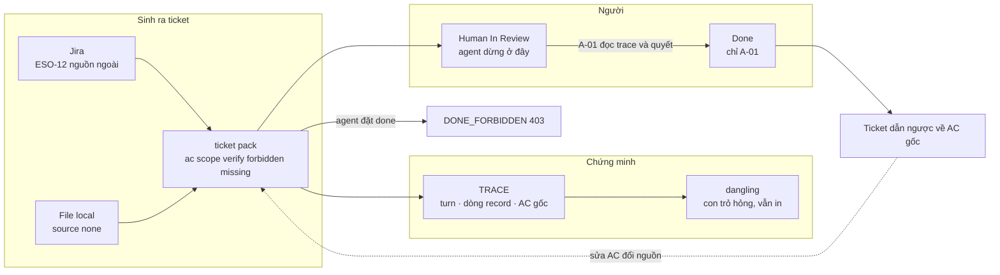
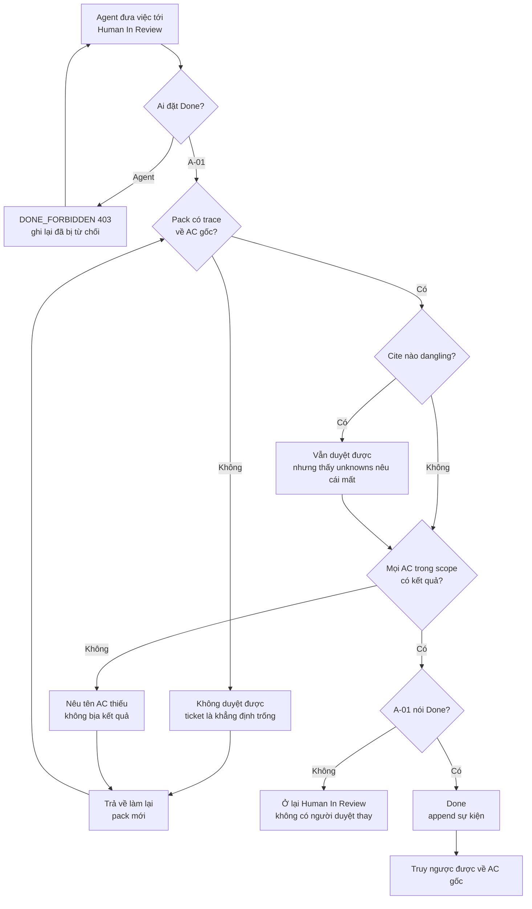
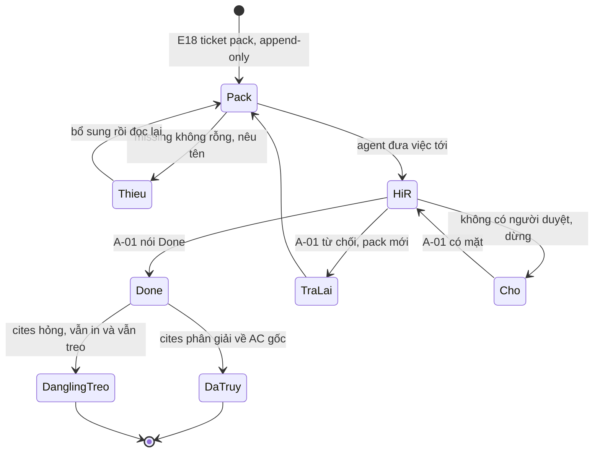
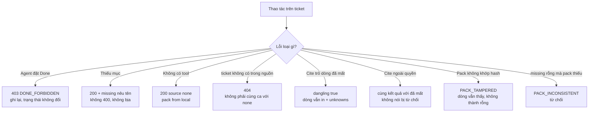

# BRD — Duyệt một ticket đã làm xong: `Done` là chữ của người, và ticket phải dẫn nguồn

> **Đây là tài liệu nghiệp vụ, không phải spec kỹ thuật.** Nó trả lời *vì sao* `Done` **không** phải một trạng thái hệ tự đặt được — và *vì sao* một ticket **không dẫn nguồn nào** tệ hơn một ticket **rỗng**. Hình dạng `API-18` và `ticket_pack` nằm ở `07.technical/03.api/01.contracts.md` §E18.

## 1. Bối cảnh

Một ticket đã đi hết bốn nhịp: unit đỏ, impl xanh, coverage đủ, QC chạy. Test xanh. Việc bây giờ là **đóng** nó.

Và đây là chỗ dễ sai nhất trong cả quy trình — không phải vì khó, mà vì **quá dễ**. Có một chỗ nói `Done`, nó là một trường, và test đã xanh. Ai cũng muốn bấm.

`BR-08` chặn: *"Chỉ **A-01** set `Done`/`Closed`"*. Ai đọc lần đầu cũng hiểu đây là một luật **phân quyền** — agent không có quyền, người có quyền. Đúng, nhưng đó mới là **nửa** câu. Nửa còn lại nằm ở `D-38`, và nó khó hơn: `Human In Review` **không phải bước hình thức** — nó là điểm mà máy **không được** đi tiếp. Nếu không có người nhận, ticket **dừng**. Không có người duyệt thay.

Nhưng ở đây có một cái bẫy ngược lại, và nó là chủ đề của file này. Người duyệt **cần** thứ gì đó để duyệt. Và nếu ticket mang một danh sách **trông đầy đủ** — AC có mã, file có đường dẫn, verify có lệnh — thì người duyệt **duyệt**. Kể cả khi **không một dòng nào** trong đó trỏ về nơi nó sinh ra.

Đó là câu của §3: một ticket **không dẫn nguồn** tệ hơn một ticket **rỗng**. Ticket rỗng nói *"tôi chưa có gì"*. Ticket đầy đủ mà không dẫn nguồn nói *"tôi có đủ"* — và không ai kiểm.

### 1.1 Sơ đồ tổng quan



> **Đọc sơ đồ:** mũi tên `PK → DN` **không vẽ** — vì agent không đi qua đó được; nó bị chặn ở `X`. Mọi đường tới `Done` đều đi **qua** `HR`, và ở `HR` chỉ có **một** người đọc. Đường đứt nét `RB → PK` là vòng ngược: ticket dẫn về `AC` gốc, và khi `AC` gốc đổi thì pack cũ **vẫn là sự thật của lần đọc trước** (`BR-06`).

## 2. Những người trong câu chuyện

| Ai | Vai trong hệ thống | Họ thật sự cần gì |
|---|---|---|
| **Anh Khoa**, 34 tuổi, operator / supervisor | `A-01` | Duyệt **12** ticket trước khi tan làm. Cần đọc **trace** trong 40 giây mỗi ticket — không phải mở `sdlc/` ra để tìm |
| **Agent lead** trên `baplatform` | `A-02` | Được đặt ticket ở **`Human In Review`** và **không** xa hơn; và biết rằng việc đó **không** phải "xong" |
| **Agent peer** (dev, QC) | `A-03` | Một pack **tự đủ** — nhưng nếu thiếu thì thấy **tên** của cái thiếu, không phải một câu *"ticket không hợp lệ"* |
| **Anh Hùng**, 45 tuổi, TDM baplatform | `A-01` (vai khác) | Thấy ticket "xong" nào **có** trace và ticket nào **không** — vì trách nhiệm cuối là của anh, không của agent |
| **Anh Dũng**, 29 tuổi, người đọc lại sau | `A-08` | Truy từ một dòng đã merge **ngược** về `AC` gốc và turn đã quyết — không cần hỏi ai |
| **Chị Hà**, 37 tuổi, evidence owner | `A-04` | `content_hash` giữ được *"pack lúc đó nói gì"*, kể cả khi ticket đã đổi |

> **Điểm dễ bỏ sót:** với anh Khoa, yêu cầu là **nhanh**. Với anh Dũng, yêu cầu là **truy ngược được**. Hai yêu cầu này **không** xung đột — chúng cắt nhau ở đúng một trường: **`cites[]`**. Một ticket có `cites[]` vừa nhanh hơn để duyệt (không phải đi tìm), vừa truy được về sau (địa chỉ, không phải văn xuôi).

## 3. Chuyện xảy ra hôm nay (khi chưa có hệ thống)

**Ngày 5 tháng 10, 16:40** — Agent trên `baplatform` làm xong `ESO-12`. Nó mở ticket, đổi trạng thái sang `Done`, gắn label `agent-factory-pass`. Comment: *"All AC green, 12 files changed, coverage 87%."*

**16:42** — Anh Khoa mở bảng ticket. `ESO-12` đã ở `Done`. Anh lướt, không mở. Anh còn 11 ticket nữa.

**Ngày 12 tháng 10** — QC chạy đêm phát hiện: `ESO-12` **không** làm đủ. Ba dòng trong bảng AC **không** có kết quả. Ticket đang ở `Done`, và anh Khoa đã báo chủ dự án `FinESO` rằng việc đó xong.

**Ngày 12, 18:00** — Anh Khoa mở lại ticket để tìm dấu vết. Bảng AC **có** — nhưng nó được viết trong comment, **không** có dòng `Trace:` nào. Không AC nào trỏ về `sdlc/`. Không file nào có `path:line` kèm ngày. Comment `"All AC green"` là **một khẳng định**, không phải một địa chỉ.

**Ngày 13** — Anh Dũng được hỏi. Anh đọc comment. Anh nói: *"Nó nói AC green. Tôi không biết AC nào — chúng không có trong ticket."* Một ticket ở `Done` mà **không** truy được về đòi hỏi nào.

**Ngày 20** — Có một ticket khác, `ESO-19`, **rỗng** hoàn toàn: agent không làm gì, sự việc viết một dòng. Anh Khoa **thấy ngay** nó rỗng và **không** duyệt. Ticket đó hôm sau được làm lại, đúng.

**Chi phí thật của tháng đó:** 1 ticket `Done` mà chưa xong · 1 lần báo cáo sai cho chủ dự án · 1 buổi chiều dựng lại dấu vết · 1 ticket rỗng bị chặn **đúng** · và **0** dòng nào nói *"ticket này đóng dựa trên cái gì"*.

> **Không ai có lỗi trong chuyện này.** Agent làm đúng pipeline mà tài liệu cho phép — và ở bản đang chạy, **không** có luật nào cấm nó đặt `Done`. Anh Khoa không mở ticket vì nó **trông đã xong**: có comment, có số, có label. Và chính cái comment *"All AC green"* là **thứ đúng nhất trong ticket** — nó thành thật, nó cụ thể, nó đọc được. Nó chỉ **không dẫn** tới đâu cả.

## 4. Hệ thống phải làm gì

UC-11 có điều kiện sau 5 chữ: *"`Done` chỉ khi **người** nói Done"* (`02.use-cases` §1). Đó là vế thứ nhất. Vế thứ hai không có trong câu đó, và nó là vế quyết định: **người nói Done dựa trên cái gì**.

### 4.1 `Done` là quyền của **người**, và chặn phải ở **đường ghi**, không ở **người gọi**

Cách làm hiển nhiên: kiểm quyền ở tầng UI — ẩn nút `Done` với agent. Đó là một **lời mời**, không phải một cổng: agent gọi API trực tiếp là qua.

`BR-08` nên cưỡng chế ở **điểm ghi ticket**, không ở người gọi: *"Gộp ở **hành động**, không ở **người gọi**"* (BIP `12.scope-refusal` §3). Nghĩa là `op = ticket:done` ⇒ `DENY` khi actor ≠ `A-01`, **kể cả** khi mọi thứ khác hợp lệ. Mã: `DONE_FORBIDDEN` (403).

Và một chi tiết dễ bỏ: **bị từ chối phải được ghi lại**, không im lặng (`AC-AGENT-01-02`: *"ghi lại **đã bị từ chối**, không im lặng"*). Nếu không, một agent cố đặt `Done` 20 lần trước khi ai phát hiện sẽ **không** để lại vết — và đó là tín hiệu cho `P5`.

### 4.2 `Human In Review` là **điểm dừng**, không phải bước chờ

Ở baplatform, agent đưa ticket tới `Human In Review` và **cấm** đi tiếp sang `Done`/`Closed` (`16` §7). ESO giữ nguyên nhịp đó và thêm một hệ quả: **operator vắng ⇒ ticket dừng** (`D-38`).

Vì sao không có *"người duyệt thay"*: người đó không có bối cảnh, không chịu trách nhiệm, và không phải người đã yêu cầu. Và nếu có người duyệt thay được thì `Human In Review` **thôi là cổng** — nó thành bước chờ, và một bước chờ thì có thể bỏ qua khi gấp.

Điều này va với thứ baplatform đang làm tốt: *"Human review by PO/TDM does **not** block the agent from starting the **next** ticket"*. `16` §8 ghi thẳng là ESO **ngược** dòng đó. Không phải vì ESO thích chậm — mà vì ticket dừng ở `HiR` nghĩa là **ticket đó** chưa xong; agent đi tiếp ticket khác là chuyện khác, và nó **không** được làm `Done` thay.

### 4.3 Ticket phải **dẫn nguồn** — vì người duyệt không đi tìm

Đây là câu của §3, viết thành luật. `US-TICKET-04` và BIP `8.7` đòi một ticket đã tạo mang **địa chỉ** của thứ đã biện minh cho nó: **turn** nào, **dòng record** nào, **AC** nào — và địa chỉ đó **phân giải lại được**.

Không có nó, ticket chỉ là một **khẳng định**. Có nó, ticket là một khẳng định **truy vấn ngược được** — và đó là toàn bộ khác biệt giữa `ESO-12` và một ticket duyệt được.

Hình dạng `cite` đã được chốt (`16.why-cites` §4.1) và **không** được dựng hình thứ hai:

```text
{ target, where: { project, turn_id, seq }, key, kind, eid? }
```

`where` là **định danh hàng** — **trước**; `key` là khoá trong `payload` — **sau**. **Không** `claim: "câu văn"`. Dẫn bằng **id**, không bằng văn xuôi; đó là điều làm cho `DoD` *"kiểm bằng id, không bằng text"* chạy được.

### 4.4 Vì sao ticket **không dẫn gì** tệ hơn ticket **rỗng**

| | Ticket rỗng | Ticket đầy đủ mà không dẫn nguồn |
|---|---|---|
| Người duyệt thấy gì | khoảng trắng | AC có mã, file có `path`, verify có lệnh, coverage 87% |
| Người duyệt làm gì | **hỏi lại** | **duyệt** |
| Sau khi merge, truy ngược | không cần — chưa có gì | **không truy được** — vì không có địa chỉ |
| Hỏng ở đâu | hỏng **lúc duyệt**, ai cũng thấy | hỏng **sáu tháng sau**, và lúc đó **không còn ai để hỏi** |

Cái làm ticket rỗng an toàn là nó **không đòi được tin**. Cái làm ticket đầy đủ nguy hiểm là nó **trông như đã được kiểm** — trong khi thứ duy nhất được kiểm là **nó tự nói nó xong**.

Hệ quả lên thiết kế: một pack **thiếu** phải **nêu tên** phần thiếu (`missing[]` không rỗng) và **không** bịa phần đó (`AC-TICKET-01-02`). Trả `200` kèm `missing[]`, **không** trả `400` — vì người nhận lỗi sẽ **bỏ pack** và tự ghép bằng tay, tức là làm đúng cái ta vừa cấm.

### 4.5 `unknown` không được hoá thành `absent`, kể cả khi tiện

Một trường hợp thật, và nó gần như luôn bị xử sai: **không có Jira**. `API-18` trả `200` với `source: "none"` và `pack.from = "local"`; `none` **được ghi**, không bị coi là lỗi (`AC-TICKET-01-03`). Còn *"ticket không có trong nguồn"* là `404` — **khác** hẳn.

Vì sao phải phân biệt: *"không có ticket trong Jira"* là `absent` — đã tìm, không có. *"Không có Jira"* là `unknown` **về nguồn**, và việc **vẫn đến từ file local**. Gộp hai ca thành một câu *"không tìm thấy ticket"* là hạ `unknown` xuống `absent` (`BR-05`) — và người dùng sẽ đi tạo Jira cho một ticket mà lẽ ra chỉ cần một file.

Ca thứ ba: **parent đã bị xoá** ⇒ nói **parent mất**, **không** nói *"không có parent"* (`AC-TICKET-02-05`).

### 4.6 Trace hỏng thì **hiện ra**, không bị bỏ

`cites[]` có thể không phân giải được — vì ba lý do khác nhau: **dòng bị xoá** · **`seq` nhảy** (ingest mất lô) · **ngoài quyền**. Cách xử tự nhiên là **bỏ dòng đó đi** cho danh sách sạch. Cách đó sai, và sai theo hai chiều:

| Cách xử | Hỏng ở đâu |
|---|---|
| **Bỏ dòng** | danh sách ngắn hơn thực tế ⇒ ticket có vẻ **không** dựa trên gì — `BR-05` đảo chiều |
| **Đổi `cite` thành `null`** | *"ticket này không có nguồn"* thay cho *"nguồn bị mất"* |
| Đúng | dòng **vẫn in**, `dangling: true`, **một** mục `unknowns[]` nêu **cái gì** đã mất |

Và ba nguyên nhân phải ra **cùng** kết quả: nếu một trong ba nói *"bị từ chối"*, ticket tự tiết lộ rằng dòng đó **có thật** và chỉ **khuất tầm nhìn** của người này — `BR-13` cấm đúng điều đó. `dangling` là **quan sát lúc đọc**, **không** phải cột: lưu nó là `UPDATE` trên record bất biến (`BR-06`).

### 4.7 Pack cũ **không** bị sửa; pack khớp hash của chính nó

`BR-06` cưỡng chế ở `ticket_pack`: append-only, khoá `(project, source, ticket_key, fetched_at)`. Ticket đổi ⇒ **pack mới**; pack cũ **vẫn là sự thật** của lần đọc trước (`AC-TICKET-04-03`). Và `content_hash` khoá **nội dung pack lúc đó** — nên *"turn này chạy trên pack nào"* trả lời được **sau khi** ticket đã đổi.

Hệ quả thứ hai của `BR-06` ít ai nghĩ tới: nó là **điều kiện** để `cite` có nghĩa. Một `cite` là con trỏ vào **một dòng** `(project, turn_id, seq)`. Nếu dòng đó `UPDATE` được, con trỏ trỏ đúng hôm nay có thể trỏ **sai** ngày mai — và người đọc **không** phân biệt được *"con trỏ sai"* với *"ticket sai"*.

### 4.8 Sơ đồ quyết định: một ticket có được duyệt không



| Nút | Điều kiện | Nguồn |
|---|---|---|
| **Ai đặt `Done`?** | actor ≠ `A-01` ⇒ `DONE_FORBIDDEN`, trạng thái **không** đổi | `BR-08` · `AC-AGENT-01-02` |
| **Pack có trace?** | mỗi giá trị trong pack trace được về nguồn | `BR-04` · BIP `8.5` §6.4 |
| **Cite `dangling`?** | vẫn in, `dangling: true` + **một** mục `unknowns[]` | `BR-05` · BIP `8.7` `I-5` |
| **Mọi AC có kết quả?** | thiếu ⇒ **nêu tên**, không `invalid`, không bịa | `AC-TICKET-01-02` · `16` §10.8 |
| **A-01 nói `Done`?** | không ⇒ dừng ở `HiR`; **không** có người duyệt thay | `D-38` · `16` §7 |

## 5. Một ngày thật, có số

Chiều **27 tháng 10**, anh Khoa duyệt **12** ticket trên `baplatform`. Anh có **50** phút trước khi họp. Trong 12 ticket: **9** đầy đủ có trace, **2** thiếu trace, **1** có trace nhưng **3** `cite` hỏng.

| Mốc | Việc | Ticket `HiR` | Duyệt | Từ chối | `DONE_FORBIDDEN` |
|---|---|---:|---:|---:|---:|
| 16:00 | Mở bảng | **12** | 0 | 0 | 0 |
| 16:04 | `ESO-12`: có trace, 8/8 AC có kết quả | 12 | **1** | 0 | 0 |
| 16:31 | `ESO-19`: **không** trace ⇒ trả lại | 11 | 1 | **1** | 0 |
| 16:38 | `ESO-23`: 3 `cite` hỏng, `unknowns` nêu 3 mục | 11 | **2** | 1 | 0 |
| 16:44 | Agent thử đặt `ESO-25` sang `Done` | 11 | 2 | 1 | **1** |
| 16:50 | Hết giờ; 9 ticket còn ở `HiR` | **9** | 2 | 1 | 1 |

**Ticket `ESO-23` — phần trace anh Khoa đọc, nguyên văn:**

> **Trace:** `US-AGENT-01` · `AC-AGENT-01-01…05` · `22.ticket-us-01-integration.md`
> **cite 1**: `(baplatform, 8f2c…, seq 2)` · `kind: judgement` · `key: level` ⇒ `partial` — **phân giải được**
> **cite 2**: `(baplatform, 8f2c…, seq 7)` · `kind: file_use` · `key: src/pack.mjs` ⇒ **dangling** — dòng đã mất
> **cite 3**: `(baplatform, 91aa…, seq 3)` · `kind: claim` · `key: min_basis` ⇒ **dangling** — `seq` nhảy
> **unknowns**: **2** mục — *"con trỏ tới seq 7 không phân giải được"* · *"con trỏ tới seq 3 không phân giải được"*

Anh Khoa duyệt. Nhưng anh duyệt **thấy** hai mục `unknowns`, chứ không duyệt một ticket trông sạch. Đó là toàn bộ khác biệt giữa hai dòng **cùng** một nút bấm.

### 5.1 Sơ đồ trạng thái một ticket đi qua



| Trạng thái | Ai đưa vào | Dữ liệu phải có |
|---|---|---|
| `Pack` | hệ | `content_hash` · `pack` jsonb · append-only |
| `Thieu` | hệ | `missing[]` **không rỗng**, **nêu tên**; **không** bịa (`AC-TICKET-01-02`) |
| `HiR` | **A-02** | nhãn `qc-agent-pass` · comment; **không** phải `Done` |
| `Cho` | hệ | không có `A-01`; **không** có người duyệt thay (`D-38`) |
| `Done` | **A-01** | `DONE_FORBIDDEN` cho mọi actor khác |
| `TraLai` | **A-01** | pack **mới**, pack cũ **vẫn còn** (`BR-06`) |
| `DaTruy` | hệ | mọi `cite` phân giải được; `unknowns` **có mặt** |
| `DanglingTreo` | hệ | `dangling: true` + **một** mục `unknowns[]` mỗi cite hỏng |

> **Ba chỗ còn treo, đã ghi nhận:**
> **(1)** `PACK_TAMPERED` có trong `AC-TICKET-04-02` nhưng **không** có trong registry `07.technical/03.api/00.index.md` §4, và **không** dòng `API-18` nào trả nó — luật ở registry là *"mã không có ở đây là **chưa tồn tại**"* (`8.7` `OPEN-3`).
> **(2)** `API-18` **không** mang `turn_id`, và `API-21` **không** được `01.contracts` khai `cites[]` ⇒ *"truy vấn theo turn"* chỉ đạt ở **lệnh cục bộ**, không ở bề mặt (`8.7` `OPEN-2`).
> **(3)** Tập **15 mục** bắt buộc của `jira-canonical-template` chưa đóng: `16` §4 nêu tên + thứ tự, nhưng **không** nói mục nào thiếu là **lỗi**; bản gốc **không ở repo này** ⇒ `DoD` hứa 15 mục trong khi AC chỉ khai **bốn** tên (`8.5` `OPEN-1`).

### 5.2 Bảng số của chiều 27 tháng 10

| Mốc | Ticket `HiR` | Đã duyệt | Đã từ chối | `DONE_FORBIDDEN` | Cite hỏng | Phút/ticket |
|---|---:|---:|---:|---:|---:|---:|
| 16:00 | 12 | 0 | 0 | 0 | 0 | — |
| 16:04 | 12 | 1 | 0 | 0 | 0 | 4 |
| 16:31 | 11 | 1 | 1 | 0 | 0 | 27 (trả lại mất thời gian) |
| 16:38 | 11 | 2 | 1 | 0 | **3** | 7 |
| 16:44 | 11 | 2 | 1 | **1** | 3 | 6 |
| 16:50 | **9** | 2 | 1 | 1 | 3 | — |

**Ba con số để nhớ:** **12** ticket, **2** duyệt, **1** từ chối vì **không trace** · **3** `cite` hỏng vẫn **hiện** thay vì bị bỏ · **1** lần `DONE_FORBIDDEN` **được ghi** — và **0** lần có người duyệt thay.

## 6. Ngoại lệ — và hệ thống làm gì

| Tình huống thật | Hệ thống xử lý |
|---|---|
| Agent đặt ticket "xong" | `403 DONE_FORBIDDEN`; trạng thái **không** đổi; ghi lại **đã bị từ chối** |
| Không có `A-01` nhận | Dừng ở `HiR`; **không** có người duyệt thay; có thể đứng **nhiều ngày** và đó là trạng thái **đúng** (`D-38`) |
| Ticket **thiếu** mục | `200` + `missing[]` **không rỗng**, **nêu tên**; **không** bịa; **không** `400` |
| Không có Jira/Notion | `200` với `source: "none"` và `pack.from: "local"`; `none` **được ghi** |
| Ticket không có trong nguồn nhưng nguồn có | `404` — đây là `absent`, **khác** ca `none` |
| Parent ticket đã bị xoá | Nói **parent mất**; **không** nói *"không có parent"* (`AC-TICKET-02-05`) |
| `cite` trỏ dòng đã xoá | Dòng **vẫn in**, `dangling: true`, **một** mục `unknowns[]`; **không** sửa `pack` |
| `cite` trỏ dòng **ngoài quyền** | **Cùng** kết quả với *"đã mất"*; **không** nói *"bị từ chối"* (`BR-13`) |
| `missing[]` rỗng nhưng pack **không** đủ | **Từ chối** — `PACK_INCONSISTENT` (`AC-TICKET-02-03`) |
| Ticket đổi **sau khi** pack đã ghi | **Pack mới**; pack cũ vẫn là sự thật của lần đọc trước (`BR-06`) |
| Pack đã ghi bị sửa trực tiếp | `PACK_TAMPERED`; dòng **vẫn nhìn thấy được**, **không** thành rỗng (`AC-TICKET-04-02`) |
| AC gốc đã đổi trong repo | Pack cũ **không** tự đổi; `content_hash` vẫn là của lần đọc trước |
| Agent đổi luật để hợp thức hoá việc đã làm | **Cấm** — đổi luật là quyền của `A-01` (`D-07`, `D-15`) |
| Ticket "xong" mà chưa ai QC | Ở `HiR` cho tới khi `A-01` sign-off (`D-38`) |

### 6.1 Sơ đồ nhánh lỗi



## 7. Điều ngoài phạm vi

| Không thuộc BRD này | Thuộc |
|---|---|
| Khai báo **đội agent**: ai, vai gì, quyền gì | `04.uc-04-agent-team.md` |
| Hỏi **đã đủ chưa**, và hệ nói *"chưa đủ"* + thiếu gì | `01.uc-01-is-it-enough.md` |
| Ghi lại **vì sao** một quyết định ra như vậy | `03.uc-03-why-this-decision.md` |
| Hệ **đề xuất** tự sửa cách làm | `10.uc-10-self-proposal.md` |
| Đọc lại **tại sao** một turn bị chặn | `09.uc-09-why-blocked.md` |
| Đưa project vào, cô lập giữa hai project | `05.uc-05-project-onboarding.md` |
| Nâng / rút một skill dùng chung | `07.uc-07-promote-shared.md` · `08.uc-08-revert-broken.md` |
| Chọn nguồn năng lực khi host thiếu tool | `14.uc-14-capability-source.md` |
| Từ chối ghi ngoài `allowed_files` (`BLOCKED_SCOPE`) | BIP `sdlc/09.wbs/01.packets/01.bip/12.scope-refusal.md` |
| Hợp đồng vào của pack: `missing[]`, `source: none` | `07.technical/03.api/01.contracts.md` §E18 · BIP `43.ticket-in.md` |
| Dẫn nguồn ngược, `dangling`, `content_hash` preimage | BIP `45.ticket-traceback.md` |
| Mười lăm mục ticket và `Gaps to Ready` | `07.technical/01.architecture/16.jira-ticket-contract.md` §4 · §10 |
| S-Gate 1/2/3 và ai duyệt bước nào | `07.technical/01.architecture/17.jira-slp-operating.md` §6 |
| Nhãn `qc-agent-pass`, cách chạy gate QC | `17` §10.1 · `16` §10 |

## 8. Câu chưa có trả lời trong release

Đây là những chỗ tôi **không** tự trả lời, vì không nguồn nào nói:

| # | Câu hỏi | Mã |
|---|---|---|
| 1 | `PACK_TAMPERED` là **mã lỗi hay tên nhánh**? Có trong `AC-TICKET-04-02`, **không** trong registry, và **không** dòng `API-18` nào trả nó; `DANGLING_ARTEFACT` đã có nhưng **sinh từ `API-21`** | `8.7` `OPEN-3` |
| 2 | `AC-TICKET-04-01/02/04` đòi *"truy vấn theo turn"*, nhưng `API-18` **không** mang `turn_id` và `API-21` **không** được khai `cites[]`. **Hai đường không gặp nhau** — cửa vào nào? | `8.7` `OPEN-2` |
| 3 | Tập **15 mục** có đóng không, và mục nào **bắt buộc**? `16` §4 nêu tên + thứ tự nhưng **không** nói mục nào thiếu là lỗi; `16` §10.9 lại cho `Sources` trống nếu ghi `N/A — lý do` | `8.5` `OPEN-1` |
| 4 | **Ai sở hữu** *"không có việc được tạo"* khi pack thiếu? `I-3` nói ticket thiếu ⇒ **không** work item, nhưng *"tạo việc"* là bước của `plan-runtime`, **không** thuộc `API-18` | `8.5` `OPEN-2` |
| 5 | Bất biến *"`cite` hỏng ⇒ `dangling` + `unknowns`, dòng **không** bị bỏ"* thuộc `AC` nào? Không `AC-TICKET-04-*` nào lấy ca cite trỏ dòng **đã mất**; `X3` không nhìn thấy nó | `8.7` `OPEN-5` |
| 6 | `content_hash` tính trên **preimage** nào: `pack` jsonb **chuẩn hoá** (khoá sắp xếp) hay **byte thô**? Băm trên `jsonb` thô ⇒ thứ tự khoá không ổn định ⇒ `PACK_TAMPERED` báo **giả** | `8.7` `OPEN-6` |
| 7 | **Có `kind` nào cho *"quyết định"***? `8.7` §4.1 dùng `claim` (*"khẳng định của **nguồn**"*) làm đích thứ tư, nhưng *"quyết định"* trong ticket có thể **không phải** khẳng định của nguồn | `8.7` `OPEN-4` |
| 8 | `DoD` nói *"sửa `AC` ⇒ ticket đánh dấu lệch"* — **cơ chế nào**? `AC-TICKET-04-02` là `PACK_TAMPERED` (hash của **chính nó**), không phải *"file `AC.md` đổi"* | `8.7` `OPEN-1` |
| 9 | `trace` cho `verify` và `forbidden[]` — `BR-04` áp vào **cả pack**, nhưng không `AC` nào sở hữu *"`verify`/`forbidden[]` trace được"*; `AC-TICKET-02-02` chỉ nói `ac` | `8.5` `OPEN-3` |
| 10 | Một ticket ở `HiR` **bao lâu** thì bị coi là *"chờ quá"*? `D-38` nói đứng nhiều ngày là trạng thái **đúng**, nhưng không nói có ngưỡng nào — và nếu có, nó phải là **dữ liệu** (`BR-09`) | `NEW-OPEN-BRD-uc11-1` |
| 11 | `Done` trên **Jira** hay `Done` trong ESO — hai trạng thái hay một? `16` §7 nói agent **cấm** đổi `Done`/`Closed` trên Jira; `BR-08` nói A-01 set `Done`/`Closed`. ESO có phản chiếu trạng thái Jira không thì không nguồn nào khai | `NEW-OPEN-BRD-uc11-2` |

## 9. Truy vết

| Yêu cầu (REQ) | Điều khoản | Mục trong BRD |
|---|---|---|
| `REQ-AGENT-01` | Đội agent (vai · quyền · phạm vi file) được **khai báo**; hai agent cùng việc khác vai ⇒ xử lý **khác** | §4.1 · §5.1 |
| `REQ-AGENT-02` | **Không ai tự mở rộng quyền**: không agent nào được đặt "xong" | §4.1 · §4.2 · §6 |
| `BR-08` | Chỉ **A-01** set `Done`/`Closed` | §1 · §4.1 · §4.8 · §6.1 |
| `BR-04` | Mọi requirement **phải nêu nguồn** — áp vào **cả pack** | §4.3 · §4.4 · §4.8 |
| `BR-05` | `unknown` ≠ `absent`; không tìm thấy **không** phải không tồn tại | §4.5 · §4.6 · §6 |
| `BR-06` | Record **chỉ ghi thêm**; sửa bằng cách ghi tiếp | §4.6 · §4.7 · §5.1 |
| `BR-13` | `visibility` trực giao với `exists`; ba ca hỏng ra **cùng** kết quả | §4.6 · §6.1 |
| `BR-09` | **Ngưỡng là dữ liệu**, không nằm trong code | §6 · §8 |
| `UC-11` | Duyệt một ticket đã làm xong; `Done` chỉ khi **người** nói Done | §1 · §4.1 · §5 |
| `UC-04` | Khai báo **đội agent**: ai, vai gì, quyền gì | §7 |
| `UC-09` | Hỏi *"vì sao bị chặn"* — câu trả lời thay cho log thô | §7 |
| `D-38` | Supervisor là operator; `Human In Review` là **cổng thật**; operator vắng ⇒ **dừng** | §1 · §4.2 · §5.1 · §6 |
| `D-07` | Promotion phải do **người** duyệt; không AI nào được duyệt | §4.2 · §6 |
| `D-15` | `GRANT` vs `INSTRUCTION`: đổi luật là quyền của người | §6 |
| `AC-TICKET-01-02` | Thiếu mục ⇒ pack trả **200** kèm `missing[]`, **nêu tên** | §4.4 · §4.8 · §6.1 |
| `AC-TICKET-01-03` | Không tool ⇒ `source: "none"`, `pack.from: "local"` | §4.5 · §6.1 |
| `AC-TICKET-01-04` | Agent đặt ticket "xong" ⇒ **từ chối** + ghi | §4.1 · §6.1 |
| `AC-TICKET-02-03` | `missing[]` **rỗng** mà pack **không đủ** ⇒ **từ chối** | §6 |
| `AC-TICKET-04-02` | Pack không khớp `content_hash` ⇒ `PACK_TAMPERED`; dòng **vẫn thấy** | §4.7 · §6.1 · §8 |
| `AC-TICKET-04-03` | Ticket đổi ⇒ pack mới; pack cũ **vẫn còn** | §4.7 · §5.1 |
| `AC-AGENT-01-02` | Agent đặt việc sang "xong" ⇒ từ chối; ghi lại **đã bị từ chối** | §4.1 · §6.1 |
| `API-18` | `200` + `missing[]` · `200 source: none` · `404` · `403` | §4.4 · §4.5 · §6.1 |
| `P6` | Multi-agent SLP — nỗi đau gốc của file này | §1 · §3 |

## Revision rule

Sai khi: `BR-08` không còn nói *"chỉ `A-01` set `Done`"*, hoặc `D-38` cho phép *"người duyệt thay"*, hoặc `API-18` **thôi** trả `missing[]` trong `200`, hoặc `cite` được đổi sang hình dạng thứ hai (`claim: "câu văn"`), hoặc `ticket_pack` **thôi** append-only → cập nhật §4–§6 và bảng §9.
Nguồn kiểm: `grep -n 'BR-08\|BR-04' sdlc/06.analysis/01.business-analysis/03.business-rules.md`
