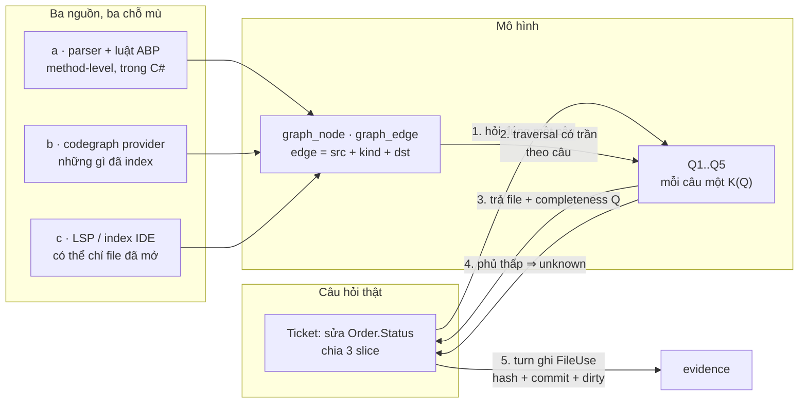
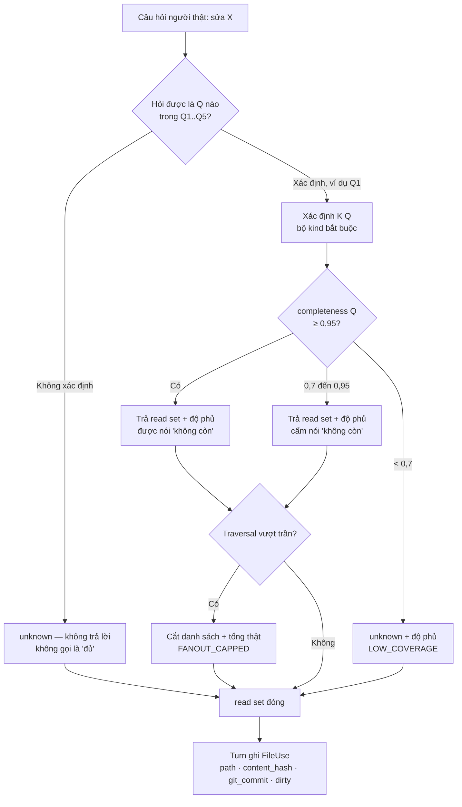
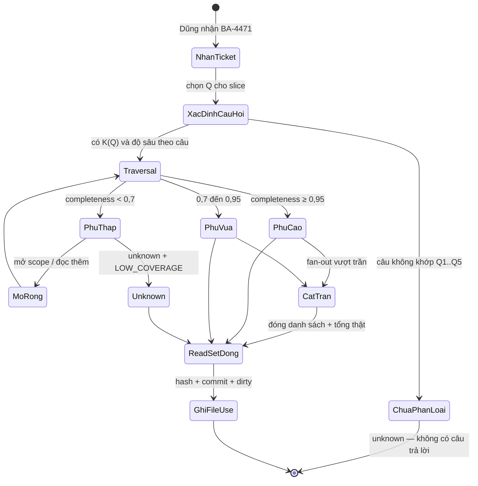
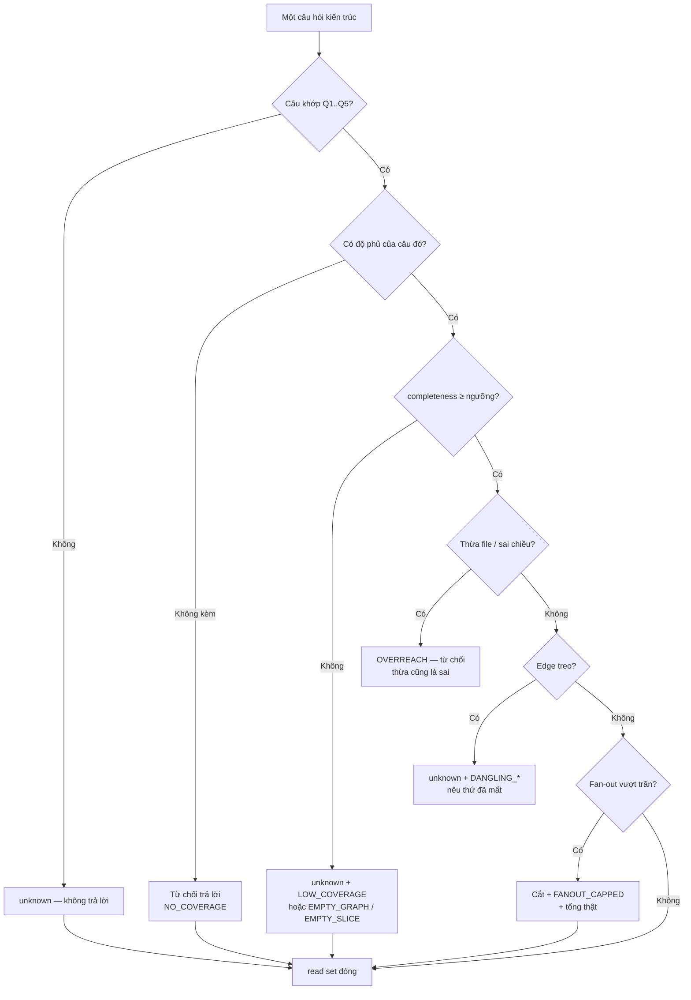

# BRD — Hiểu một project gồm những gì: biết phải đọc file nào, trước khi sửa

> **Đây là tài liệu nghiệp vụ, không phải spec kỹ thuật.** Nó trả lời *vì sao* một agent phải biết **đọc file nào** trước khi
> sửa, *vì sao* "đọc cả repo" không phải câu trả lời, và *vì sao* một mô hình symbol đã cũ **tệ hơn** không có mô hình nào.
> Năm câu hỏi, truy vấn và công thức độ phủ nằm ở `sdlc/07.technical/01.architecture/18.graph-queries.md`; schema
> `graph_node`/`graph_edge` ở `sdlc/07.technical/02.data-design/02.schema.md` §3.

## 1. Bối cảnh

Một ticket sửa trường `Status` của đơn hàng. Câu hỏi đầu tiên không phải *"sửa thế nào"* mà là **"phải đọc file nào"** —
agent chưa đọc file nào thì mọi dòng nó viết là đoán. Và đây là chỗ P2 đứng.

**P2 là nỗi đau yếu nhất trong cả cây.** `sdlc/06.analysis/00.pain-point-trace.md` §1 ghi P2 ở mức 🔴: 2 `REQ`
(`REQ-ARCH-01` · `REQ-ARCH-02`), **1** UC (chính UC-12), **0** US, **0** AC — và cùng chỗ đó P1 cũng bị gọi là "yếu nhất" vì
*"có REQ, không có UC riêng"*. P2 vẫn **chưa** lấp xong: cái thiếu không phải tài liệu mà là **một phép đo độ phủ theo từng
câu hỏi** chưa ai chạy trên project thật.

**Thứ nhất — repo không phải một danh sách file.** Baplatform có hơn 2.000 tệp `.cs`; sửa một trường chạm khoảng 5 file. Đọc
cả repo để tìm 5 file là trả giá bằng cả repo — mà *"đọc 5 file"* chỉ đúng khi biết **năm file đó là năm file nào** và biết
**cái gì đã bị bỏ sót**. **Thứ hai — "biết repo" không phải "biết repo này lúc này".** Mô hình symbol dựng hôm qua trả lời
hôm nay vẫn trôi chảy, đúng ngữ pháp, và **sai** — người đọc không thấy lỗi vì câu trả lời không có gì để nghi ngờ.

**Thứ ba — độ phủ là độ phủ *của một câu hỏi*, không phải của repo.** `completeness: 0,92` cho cả repo nghe rất tốt, trong khi
câu hỏi ĐANG hỏi (`Q5` — slice có chạm tenant không) có thể phủ **0,41**, vì tenant trong ABP thường xử lý ngầm.

### 1.1 Sơ đồ tổng quan

> **Đọc sơ đồ:** mũi tên **1** đi tới **một** câu trong `Q1…Q5`, không tới "cả mô hình". **3** và **4** đi cùng về chỗ câu
> hỏi: câu trả lời có file **và** độ phủ của chính nó, hoặc là `unknown`. **5** đi **ra** vào evidence, và không mũi tên nào
> đi ngược (`D-46`: evidence là đầu ra, không bao giờ là đầu vào). Ba nguồn `a/b/c` **không thay nhau** (`D-25`).

## 2. Những người trong câu chuyện

| Ai | Vai trong hệ thống | Họ thật sự cần gì |
|---|---|---|
| **Dũng**, 33 tuổi, lead agent | `A-02` | Một tập file **đóng** để giao cho peer, có trần độ sâu, có độ phủ của chính câu hỏi |
| **Ngọc**, 27 tuổi, peer agent (dev) | `A-03` | Một pack **tự đủ**: đọc tập file được giao là đủ sửa, không đi tìm thêm và không đoán |
| **Hải**, 41 tuổi, operator | `A-01` | Biết turn nào đọc thừa (tốn token), turn nào đọc thiếu (sửa sai) — hai lỗi trả tiền khác nhau |
| **Trang**, 30 tuổi, người đọc sau | `A-08` | Biết câu trả lời hôm đó phủ bao nhiêu, để không đọc lại một kết luận `0,92` như thể nó phủ tất cả |
| **Host + provider** | `A-05` · `A-06` | Khai **mình đo được gì** (`SourceClaim`) thay vì để hệ đoán |

> **Điểm dễ bỏ sót:** với Dũng câu hỏi là *"đọc file nào"*, với Trang là *"lúc đó đã nhìn được bao nhiêu"*. Một hệ chỉ
> trả lời câu thứ nhất sẽ **trông** đúng lần đầu và **không kiểm lại được** lần sau — đúng lỗi `BR-05` sinh ra để chặn.

## 3. Chuyện xảy ra hôm nay (khi chưa có hệ thống)

**Thứ Hai, 09:12.** Dũng nhận ticket `BA-4471`: *"`Order.Status` chuyển từ `int` sang `enum`, mọi nơi đọc `Status` phải
theo kiểu mới"*. Repo `baplatform`: **2.014** tệp `.cs`, **11** module ABP.

**09:15.** Grep `Status`: **187** kết quả trong **64** tệp — không phân biệt được `Order.Status` với `Status` của entity
khác. **09:40.** Grep `Order.Status`, còn **41** kết quả — khoảng 62.000 token nếu đọc hết, hơn ngân sách cả turn. Nó chọn **9**
tệp "có vẻ liên quan" theo tên thư mục: bước **không ai ghi lại**, và 9 trên 41 không để lại dấu vết nào.

**11:20.** Sửa xong 9 tệp, test xanh, **không ai có lý do nghi ngờ** — Dũng làm đúng quy trình đang có, Ngọc chưa được giao
gì, Hải không có công cụ nào để biết 32 tệp kia tồn tại.

**Thứ Ba, 14:05.** Báo cáo tháng của kế toán ra số **khác** tháng trước: một `ViewModel` trong `Reporting` đọc `Status` qua
`IObjectMapper` — không có chuỗi `"Order.Status"` trong file, chỉ có `MapTo<OrderDto>`. Nó nằm trong **32** tệp Dũng không đọc.

**Thứ Ba, 16:30.** Truy nguyên mất **4 giờ** của hai người, và grep không giúp gì — quan hệ `Order → OrderDto → ViewModel`
là **ánh xạ cấu hình**, không phải chuỗi.

**Thứ Tư.** Hải hỏi: *"lần sau làm sao biết còn file nào chưa đọc?"* Câu trả lời thật là **không biết** — khác **"không còn"**.
Sự khác biệt đó chưa có chỗ nào ghi.

**Chi phí thật của ticket đó:** 62.000 token đọc để không đọc · **9/41** tệp chọn bằng cảm giác · **32** tệp chưa từng được
nhìn · 1 báo cáo sai ra ngoài · **4 giờ** truy nguyên · **0** chỗ nào ghi độ phủ của lần đó. Không ai trong bốn người làm
sai: quy trình hiện có **không có** bước nào trả lời *"còn file nào chưa đọc"*, và đó là thứ tài liệu này đòi.

## 4. Hệ thống phải làm gì

### 4.1 Một biểu đồ symbol **không** phải một danh sách file

Liệt kê file trong repo cho agent tự đọc thất bại vì **nó không trả lời câu hỏi nào**: danh sách nói *"có 2.014 thứ"*, câu
hỏi là *"5 thứ nào trong 2.014 thứ đó"*. Càng đầy đủ càng vô dụng — nó là repo, không phải câu trả lời.

Mô hình phải là **quan hệ có loại**: `class · method · entity · dto` + edge `references` / `maps_to`, và danh tính một edge
là **(src, kind, dst)** chứ không phải `(src, dst)` — hai node có thể có nhiều quan hệ (A gọi B **và** A inject B), gộp lại
là mất ngữ nghĩa blast (`D-25`).

Điều này giải thích lỗi §3: `Order → OrderDto` là edge `maps_to` và **không chứa chuỗi nào để grep**. Danh sách file không có
edge thì không có `maps_to`, và `ViewModel` kia vĩnh viễn vô hình.

### 4.2 Ba nguồn **không thay nhau**, và "bỏ phiếu" là cách sai

`D-25` chốt: parser + luật ABP, codegraph provider, và LSP/index của IDE — **cả ba**, vì mỗi nguồn phủ một phần khác và mù
một chỗ khác. (a) cho method-level call · DI inject · attribute · quy ước ABP, nhưng không thấy runtime và **sai một cách tự tin** nếu quy
ước hiểu sai. (b) cho những gì nó đã index, và **không biết mình mù chỗ nào**. (c) cho symbol do ngôn ngữ đảm bảo, nhưng có
thể chỉ index file đã mở và có thể **cũ**.

Cách sai phổ biến là **bỏ phiếu đa số** hoặc **chọn nguồn tốt nhất** — cả hai xoá mất tín hiệu quan trọng nhất: *hai nguồn
cãi nhau* là **thông tin**, không phải nhiễu. `D-57` chốt: xung đột là **cờ trên edge** (`conflict` + ≥2 `source_claim`),
**không** trừ vào `completeness` — độ phủ và độ tin của một edge là hai chẩn đoán, hai hành động khác nhau.

Và mỗi nguồn phải **khai** "tôi phủ được gì": `SourceClaim { source, languages, entity_kinds, freshness, coverage_note }`.
Không có claim này thì `completeness` không đo được, và `absent` thành lời đoán.

### 4.3 Độ phủ **theo câu hỏi**, không phải một con số cho repo

`REQ-ARCH-01` nói độ phủ đo **theo từng câu hỏi**. Năm câu đó, và ngưỡng kỳ vọng:

| # | Câu hỏi | Node/edge cần | Mức phủ kỳ vọng |
|---|---|---|---|
| **Q1** | sửa X thì **phải đọc file nào** | `class`·`method`·`entity`·`dto` + `references` | **cao** (0,95+) |
| **Q2** | đổi cột bảng thì **cái gì gãy** | `table` ← `entity` ← `dto` ← `app_service` | trung bình-cao |
| **Q3** | module nào **phụ thuộc vòng** | `module` + `depends_on` | **cao** (0,95+) |
| **Q4** | endpoint cần **permission gì**, grant ở đâu | `endpoint`·`permission` + `requires`/`defines` | **thấp** |
| **Q5** | slice có chạm **ranh giới tenant** không | `entity`·`app_service` + dấu `tenant` | **thấp nhất** |

Công thức (`19` §3): `coverage(kind) = Σ(kind) đã đọc được / Σ(kind) tồn tại theo manifest`, và
`completeness(Q) = min { coverage(kind) : kind ∈ K(Q) }`.

**Vì sao `min` chứ không trung bình:** Q2 cần cả `table` lẫn `entity`; nếu `entity` phủ 30% thì câu trả lời **sai** dù `table`
phủ 100%, còn trung bình sẽ **che** đúng chỗ mù. Vì vậy `completeness` **không thể** là một cột nhập tay trên repo — đó là lý
do `sdlc/06.analysis/00.pain-point-trace.md` §2 gọi `18.graph-queries.md` là tài liệu **chặn** của P2.

### 4.4 "Độ phủ của một câu hỏi" ≠ "độ phủ của một repo"

Trả lời repo: *"mô hình phủ 0,92 — đáng tin"* — người đọc không biết mình mù chỗ nào. Trả lời câu hỏi: *"`Q5` phủ 0,41 —
không được nói 'không chạm'"* — người đọc biết chính xác mắt nào yếu. Không ai hỏi *"repo này phủ bao nhiêu"*; người ta hỏi
*"sửa X thì đọc file nào"*, nên đơn vị đo phải bằng đơn vị hỏi. `19` §4 đặt luật này thành điều kiện: *"một `completeness`
chung là **sai**"*, vì ba câu đầu cao và hai câu sau thấp — gộp lại là nói dối cả hai phía.

Và ngưỡng là **dữ liệu**, không phải hằng số trong code (`D-11`, `BR-09`): `floor` do product đặt, `threshold` trong
`[floor, 1]` do consumer đặt, `completeness` là **sự thật đo được**. Ba số, không một — hạ ngưỡng là **gói hứa** mạnh hơn
trên bằng chứng yếu hơn và phải mang dấu `threshold_source: lowered`.

### 4.5 Mô hình **cũ** tệ hơn **không có mô hình**

Không có mô hình: agent grep, biết mình đang đoán, mọi kết luận đều yếu nhưng **trông** yếu. Có mô hình cũ: agent nhận danh
sách 5 file **trả lời như thật**, không có dấu hiệu nào để nghi ngờ, đủ tự tin để không ai kiểm lại — định nghĩa của lỗi tệ
nhất hệ này (`BR-05`: *"sai một cách tự tin — lỗi duy nhất mà không ai phát hiện"*). Vì vậy độ **mới** là **thẩm quyền của
câu trả lời**, không phải chi tiết vận hành. Ba mức từ `19` §5: ≥ 0,95 ⇒ `absent` **đáng tin**; 0,7–0,95 ⇒ `absent` **yếu**,
phải nêu độ phủ; < 0,7 ⇒ **`unknown`**, không được nói "không có".

### 4.6 Task là **theo câu hỏi**, không phải theo repo

Lập mô hình repo là một lần đắt, chạy **ngoài** đường turn (`D-22`, `REQ-ARCH-02`). **Sử dụng** mô hình thì khác hẳn: mỗi
câu hỏi chỉ đi **đúng** tập `K(Q)` với **đúng** độ sâu của câu đó.

`19` §2 chốt: *"không câu nào được traversal không trần — độ sâu là hằng số theo câu, không phải tham số người dùng"*. Q1 đi
1–2 tầng từ symbol (*"quá sâu là thừa file, không phải thiếu"*); Q2 đi **ngược** chiều phụ thuộc (table → entity → dto →
service); Q3 dùng SCC, *"không cần độ sâu"*.

### 4.7 Đọc rộng có trần, và nói ra khi bị cắt

`AC-ARCH-02-05` đặt ca thật: fan-out độ sâu 2 = **500 file**. Danh sách phải **bị chặn trần**, nói rõ đã chặn, và kèm **tổng
thật** — mã `FANOUT_CAPPED`.

Vì sao không im lặng cắt? Một danh sách bị cắt trông **giống hệt** một danh sách đầy đủ: Ngọc nhận 20 file, đọc hết 20, tin
là xong — trong khi 480 file nữa chưa ai nhìn. Trần chấp nhận được; trần **giấu** là nói dối. Cùng lý do, read set **rỗng** là
câu trả lời hợp lệ (`AC-ARCH-02-04`) và vẫn kèm độ phủ — rỗng vì "không có" khác rỗng vì "chưa tìm".

### 4.8 Sơ đồ quyết định: hỏi "phải đọc file nào" thì được trả lời gì

| Nút | Điều kiện | Nguồn |
|---|---|---|
| **Hỏi được là Q nào?** | câu hỏi phải khớp đúng một `Q1…Q5`; không khớp ⇒ `unknown` | `19` §1 |
| **`K(Q)`** | bộ node/edge kinds mà câu đó **cần** — không phải cả graph | `19` §2 |
| **Ngưỡng 0,95 / 0,7** | ngưỡng là **dữ liệu**, có `floor` do product đặt | `D-11` · `19` §5 |
| **Trần fan-out** | danh sách bị chặn **và** nói rõ + tổng thật | `AC-ARCH-02-05` |
| **Ghi `FileUse`** | `path` · `content_hash` · `git_commit` · `dirty` | `D-34` · `BR-11` |

## 5. Một ngày thật, có số

Ngày **2026-10-22**, project `baplatform`, **2.014** tệp `.cs`, **11** module. Dũng chia `BA-4471` thành **3** slice. Graph đã
**ấm** (dựng 18/10, chạy lại 05:40 cùng ngày).

| Mốc | Việc | Câu hỏi | File trả về | `completeness` | Ghi chú |
|---|---|---|---:|---:|---|
| 09:14 | Hỏi Q1 slice 1 | Q1 | **7** | 0,96 | `absent` đáng tin |
| 09:16 | Hỏi Q2 slice 1 · Q1 slice 2 | Q2 · Q1 | **11** · **4** | 0,88 · 0,93 | 4 entity chưa map · `absent` **yếu** |
| 09:21 | Hỏi Q1 slice 3 (rồi mở scope 09:24) | Q1 | **31 → 44** | **0,62 → 0,91** | **`unknown`**, rồi mở `Reporting` (+13 file) |
| 09:26 | Hỏi Q3 (vòng) · Q5 (tenant) | Q3 · Q5 | **2 SCC** | 0,97 · **0,41** | 2 vòng thật · **cấm** nói "không chạm" |
| 09:31 | Đóng read set | — | **62** | — | 7 + 11 + 44, khử trùng lặp ⇒ **44** thật |
| 09:35 | Giao Ngọc, ghi `FileUse` | — | 46 | — | 44 file giao + 2 cấu hình · 15:50 Ngọc xong, **9/9** đúng, **0** ngoài trần |

**Ba con số của §5, đọc cùng nhau:**

1. **62 → 44.** Ba read set cộng 62, khử trùng lặp còn 44. **44** là câu trả lời, **2.014** là repo; grep trả 187 dòng và
   không ra 44 — vì `maps_to` không phải chuỗi.
2. **0,62 → 0,91 sau khi mở scope.** Câu trả lời **đổi** khi scope đổi, cả hai lần đúng ở ngưỡng của nó. Lần đầu `unknown`
   không phải thất bại — mô hình chỉ thấy 62% nên nói *"chưa thấy đủ"*. Trả "31 file, xong" mới là lỗi.
3. **0,41 ở Q5, trong ngày có 0,96 ở Q1 — cách nhau 0,55.** Một `completeness` chung (giả sử 0,82) nói dối cả hai phía: Q1
   trông **kém**, Q5 trông **tốt** hơn thực tế. Đó là lý do `min` theo từng câu là **điều kiện đúng/sai**.

### 5.1 Một câu hỏi đi qua

> **Đọc sơ đồ:** không có cạnh nào từ `PhuThap` **thẳng** sang `ReadSetDong` mà bỏ `MoRong` hoặc `Unknown`. Nếu có cạnh
> đó, câu trả lời phủ 0,62 sẽ đi ra như một danh sách đóng — và đó chính là lỗi §3. `CatTran` đứng **trước**
> `ReadSetDong` có chủ đích: trần phải được ghi **trong** câu trả lời, không phải sửa sau.

### 5.2 Bảng chi tiết từng slice

| Slice | Symbol gốc | Q | File bắt buộc | Entity còn thiếu | Fan-out | Bị cắt? | `completeness` | Kết luận |
|---|---|---|---|---:|---:|---|---:|---|
| `S-01` · `S-02` đổi kiểu, DTO | `Order.Status` · `OrderDto` | Q1 | 7 · 4 | 0 | 11 | không | 0,96 · 0,93 | đáng tin · yếu |
| `S-01` bảng `Orders` | `Orders` | Q2 | 11 | 4 | 11 | không | 0,88 | `absent` yếu |
| `S-03` sửa báo cáo · sau mở scope | `OrderReportVm` | Q1 | 31 → **44** | 6 → 2 | 44 | không | 0,62 → 0,91 | `unknown` → `absent` yếu |
| `S-03` kiểm vòng · tenant | `Reporting` · `OrderReportVm` | Q3 · Q5 | 2 SCC | — | 2 | không | 0,97 · **0,41** | 2 vòng thật · `unknown` |
| `ALL` ca 500 file (`API-3`) | — | Q1 | **20** | — | **500** | **có** | — | `FANOUT_CAPPED` + tổng thật |

> **Điều bảng này không nói:** nó **không** nói mô hình **đúng**. Q1 phủ 0,96 là *"đã đọc được 96% những gì manifest khai"*,
> không phải *"96% quan hệ là đúng"*. Quy ước ABP mã hoá sai thì `coverage` vẫn 1,00 và câu trả lời vẫn sai (`D-25`) — và
> `15` §2 tự ghi rằng các quy ước đó **viết từ hiểu biết về ABP, không từ đọc repo**, nên phải xác minh trước khi tin.

## 6. Ngoại lệ — và hệ thống làm gì

| Tình huống thật | Hệ thống xử lý |
|---|---|
| Repo **rỗng** (0 node · `API-1`) hoặc **100.000** node (`API-3`) | `coverage` **vẫn tính**, không bỏ qua; rỗng ⇒ `unknown` + `node_count = 0`; `EMPTY_GRAPH` (`AC-ARCH-01-05`, `-06`) |
| Symbol có **0** tham chiếu | Read set **rỗng**, **không** lỗi; vẫn nêu độ phủ của quan hệ `references` (`AC-ARCH-02-04`) |
| Fan-out độ sâu 2 = **500** file | Danh sách **bị chặn trần** + **nói rõ đã chặn** + tổng thật; `FANOUT_CAPPED` (`AC-ARCH-02-05`) |
| Câu trả lời **không** kèm độ phủ | **Từ chối** trả lời; `NO_COVERAGE` — 0 câu trả lời trần (`AC-ARCH-02-03`) |
| `completeness(Q1)` = 0,6 | **`unknown`** + độ phủ; 0 kết luận `absent`; `LOW_COVERAGE` (`AC-ARCH-02-02`) |
| Entity phủ **30%** (Q2) | **`unknown`**; **không** "không gãy gì" (`AC-ARCH-03-02`) |
| Câu trả lời liệt kê file **không** dùng bảng đó | **Từ chối** — thừa cũng là sai; `OVERREACH`; bảng **không ai đọc** ⇒ rỗng, không `OVERREACH` (`AC-ARCH-03-03`, `-04`) |
| Entity trỏ bảng **đã xoá** | Nhánh đó **`unknown`** + nêu bảng mất; `DANGLING_TABLE` (`AC-ARCH-03-05`) |
| Graph **0** cạnh `depends_on` | Nói **"không có vòng"** kèm độ phủ; **không** im lặng (`AC-ARCH-04-04`) |
| Cạnh `depends_on` trỏ module **đã xoá** | Bỏ cạnh treo **và nêu**; không báo vòng giả; `DANGLING_MODULE` (`AC-ARCH-04-05`) |
| Permission khai **động** / endpoint **không khai** permission | **`unknown`** + lý do; **không** kết luận "public"; `DYNAMIC_UNKNOWN` · `PERM_UNDECLARED` (`AC-ARCH-05-02`, `-04`) |
| Grant record **đã xoá** | Nêu **grant treo**; không nói "có grant"; `DANGLING_GRANT` (`AC-ARCH-05-05`) |
| Tenant xử lý **ngầm** | **`unknown`**; **không** "không chạm"; `LOW_COVERAGE` (`AC-ARCH-06-02`) |
| Phủ **đúng** 0,7 · slice **0 bảng** | 0,7 **trả lời được** — chỉ **< 0,7** mới `unknown` (`AC-ARCH-06-04`); 0 bảng ⇒ `unknown` + `EMPTY_SLICE` (`-05`) |

### 6.1 Sơ đồ nhánh lỗi

> **Đọc sơ đồ:** ba nhánh `C`, `E`, `I` **không** dẫn tới một read set — chúng là ba loại từ chối khác nhau, và ba mã
> khác nhau: `C` là *"câu hỏi chưa thành câu"*, `E` là *"câu trả lời thiếu thẩm quyền"*, `I` là *"câu trả lời thừa"*. Gộp
> lại thì hệ báo `NO_COVERAGE` ở chỗ câu hỏi chưa rõ, và người sửa đi tìm độ phủ thay vì viết lại câu hỏi.

## 7. Điều ngoài phạm vi

| Không thuộc BRD này | Thuộc |
|---|---|
| Phán quyết **đã đủ chưa** cho một việc (`mode` hành động) · danh sách **thiếu gì** | `01.uc-01-is-it-enough.md` · `02.uc-02-what-is-missing.md` |
| Ghi lại **vì sao** một quyết định ra như vậy | `03.uc-03-why-this-decision.md` |
| Khai **đội agent**: ai, vai gì, quyền gì | `04.uc-04-agent-team.md` |
| Đưa một project vào và cô lập tri thức của nó | `05.uc-05-project-onboarding.md` |
| Chọn **skill/luật nào áp** cho việc này | `06.uc-06-which-rule-applies.md` |
| Nâng / rút lại một skill dùng chung | `07.uc-07-promote-shared.md` · `08.uc-08-revert-broken.md` |
| Trả lời **"vì sao bị chặn"** | `09.uc-09-why-blocked.md` |
| Hệ đề xuất tự sửa cách làm | `10.uc-10-self-proposal.md` |
| Duyệt một ticket đã làm xong | `11.uc-11-ticket-done.md` |
| Cảnh báo khi thiếu mà **không ai hỏi** | `13.uc-13-unprompted-warning.md` |
| Chọn **nguồn năng lực** khi host thiếu | `14.uc-14-capability-source.md` |
| Schema `graph_node`/`graph_edge` | `sdlc/07.technical/02.data-design/02.schema.md` §3 |
| Quy ước ABP mã hoá thế nào · thí nghiệm 5 ticket | `sdlc/07.technical/01.architecture/15.code-graph-baplatform.md` §2 · §7 |

## 8. Câu chưa có trả lời trong release

| # | Câu hỏi | Mã | Vì sao không nguồn nào trả lời |
|---|---|---|---|
| 1 | **Mô hình cũ hơn HEAD thì `completeness` hạ bao nhiêu?** `19` §5 có ba mức theo độ phủ, không mức nào cho *"graph dựng 4 ngày trước"* | chưa có mã — chưa vào register nào | `D-34` xử lý độ mới ở tầng **file đã đọc** (`content_hash`), không ở tầng **mô hình**; `19` §4 nói `completeness` là `min` trên `K(Q)`, và `coverage(kind)` lấy *"từ manifest (nguồn b)"* nhưng **không nói manifest đó ai giữ mới** — nguồn (b) lại mù chỗ *"không biết mình mù chỗ nào"*, tức tự chấm điểm mình |
| 2 | **`K(Q)` có phải danh sách đóng?** Ai được **thêm** kind? | chưa có mã | `D-11` nói ngưỡng là dữ liệu nhưng **chưa quyết định nào** nói `K(Q)` thuộc ai. Thêm kind ⇒ `min` trên tập lớn hơn ⇒ **tự hạ** `completeness`, không ai kiểm |
| 3 | **Đã có bảng `threshold` theo từng câu chưa, hay mới có luật đặt nó?** | chưa có mã | `grep -n 'threshold' sdlc/07.technical/01.architecture/18.graph-queries.md` **không ra dòng nào** — giá trị chưa được đặt ở đâu, chỉ có luật `threshold ∈ [floor, 1]` (`D-11`) |
| 4 | **Trần thật của release là bao nhiêu node?** `AC-ARCH-01-06` đặt ca **100.000** node | chưa có mã | `15` §7 là **thí nghiệm 5 ticket — chưa chạy**; ca đó là **kiểm thử**, không phải cam kết. p95 của `REQ-ARCH-02` **chưa có số** |
| 5 | **Cắt ở đâu là "thừa" (`OVERREACH`)?** Ai định nghĩa *"file có dùng bảng đó"* | chưa có mã | `19` §2 cho chiều `table → entity → dto → app_service`, không định nghĩa *"dùng"* — trực tiếp, qua một tầng mapping, hay qua reflection. `MapTo<…>` chưa xác minh trên repo thật (`15` §2) |
| 6 | **`FileUse` cho file **đã đọc** hay **trong read set**?** `BR-11` nói *"nội dung đã dùng"* | *(chưa có mã)* | `D-34` đặt trường cho *"từng file đã dùng"*; §5 có 44 file giao nhưng **46** `FileUse`. *"Đọc mà không dùng có tính là đã dùng"* không nguồn nào trả lời, mà nó đổi **ý nghĩa của chi phí** |

> **Đã tra và **không** để mở:** *"gộp `completeness` cho cả repo?"* — **không** (`19` §4, `AC-ARCH-01-01`); *"xung đột trừ vào
> `completeness`?"* — **không** (`D-57`).

## 9. Truy vết

| Yêu cầu (REQ) | Điều khoản | Mục trong BRD |
|---|---|---|
| `REQ-ARCH-01` — mô hình monolith tới method, microservices tới service; độ phủ **theo từng câu hỏi**; `unknown` ≠ `absent` | `19` §1–§3 | §4.1 · §4.3 · §4.4 · §5 |
| `REQ-ARCH-02` — trả lời trong thời gian dùng được khi graph ấm; câu nặng **off-path** | `D-22` | §4.6 |

| Business rule | Mục trong BRD |
|---|---|
| `BR-11` — mỗi turn ghi **nội dung đã dùng** (hash + commit + dirty) | §4.8 · §5 · §6 |
| `BR-09` — ngưỡng là **dữ liệu**, không nằm trong code | §4.4 · §4.8 |
| `BR-05` — `unknown` ≠ `absent`; không tìm thấy **không** phải không tồn tại | §4.5 · §6 |

| Use case | Mục trong BRD |
|---|---|
| `UC-12` — hiểu một project gồm những gì trước khi sửa | §1 · §4.1 · §4.6 · §5 · §7 |

| Quyết định | Mục trong BRD |
|---|---|
| `D-11` — `floor` · `threshold` · `completeness`, ba con số | §4.4 · §4.8 |
| `D-25` — ba nguồn, hợp nhất theo provenance, **không** bỏ phiếu | §4.2 · §5.2 |
| `D-34` — evidence ghi **hash + git rev**, không snapshot | §4.8 · §6 |
| `D-57` — xung đột là **cờ của edge**, không phải điểm trừ `completeness` | §4.2 · §8 |

| AC | Mục trong BRD |
|---|---|
| `AC-ARCH-01-01…06` · `AC-ARCH-02-01…05` | §4.3 · §4.4 · §4.7 · §5 · §6 |
| `AC-ARCH-03-01…05` · `AC-ARCH-04-01…05` · `AC-ARCH-05-01…05` · `AC-ARCH-06-01…05` | §4.4 · §4.6 · §6 |

## Revision rule

Sai khi: `REQ-ARCH-01` bị đọc thành *"index toàn bộ code"* thay vì *"5 câu hỏi, mỗi câu một độ phủ"*; `completeness` bị
gộp thành **một số cho repo** (nó là `min` trên `K(Q)` **của từng câu**); phủ thấp bị hạ thành `absent` (`BR-05`); `D-57`
bị đảo — xung đột trừ vào `completeness`; `D-25` bị đọc thành *"chọn nguồn tốt nhất"*; danh sách bị cắt **mà không nêu
trần**; hoặc `FileUse` bị đổi về chỉ có `path` (`D-34`).
Nguồn kiểm: `grep -c '| \*\*Q[1-5]\*\*' sdlc/07.technical/01.architecture/18.graph-queries.md` phải ra `5`
