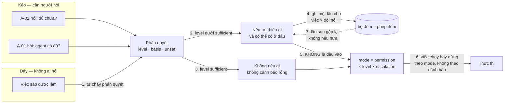
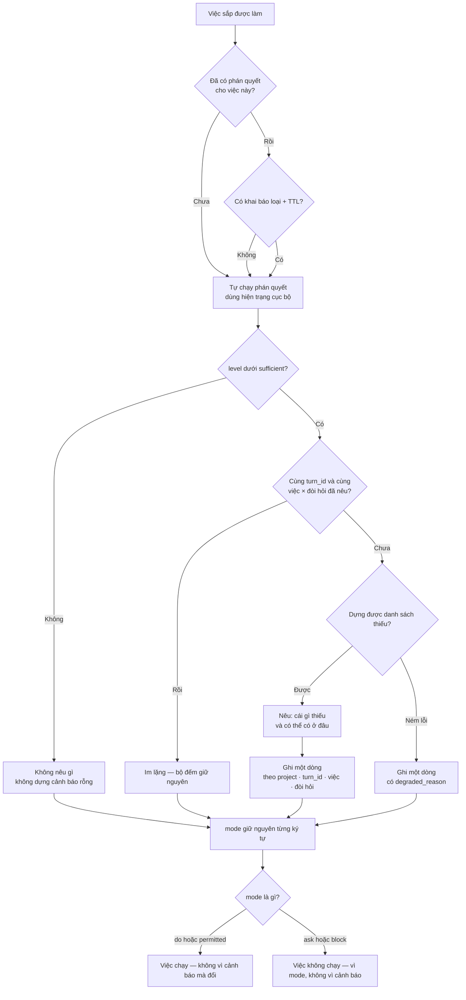
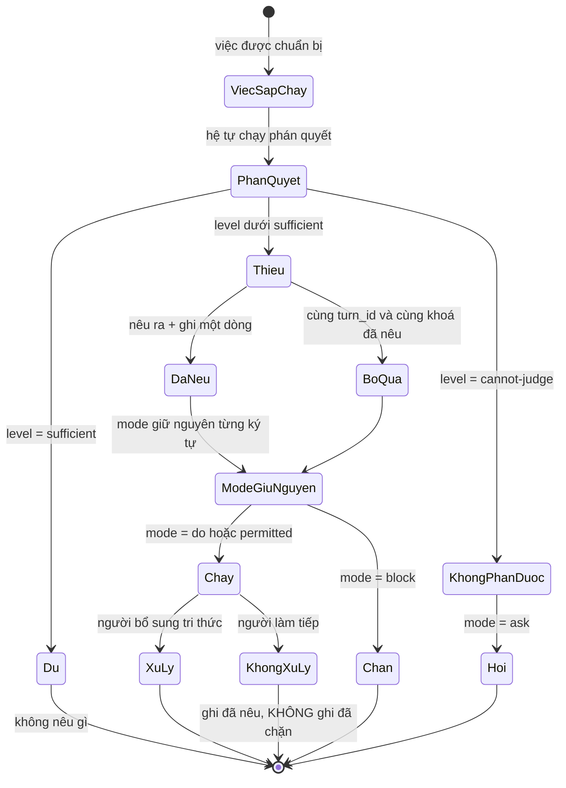
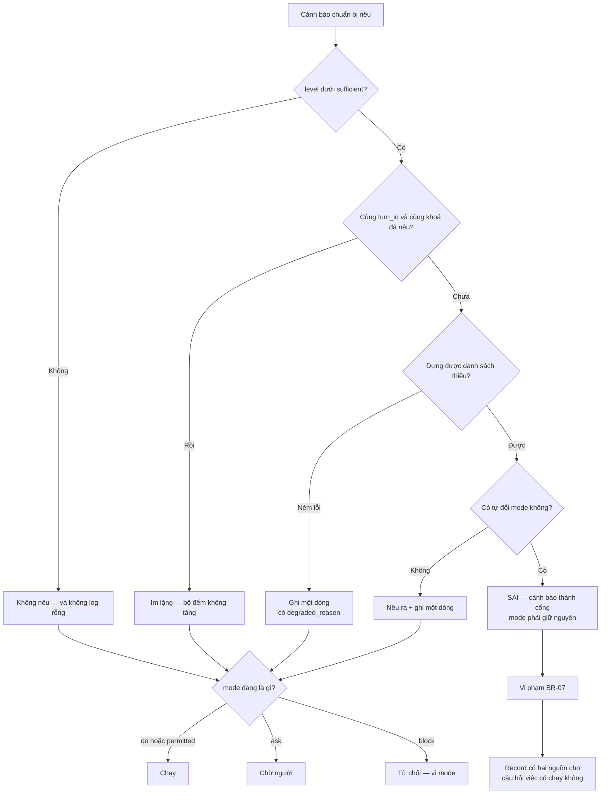

# BRD — Được cảnh báo dù không hỏi: nêu ra, và tuyệt đối không chặn

> **Đây là tài liệu nghiệp vụ, không phải spec kỹ thuật.** Nó trả lời *vì sao* một cảnh báo phải tự xuất hiện khi **không ai
> hỏi**, *vì sao* nó **không được** có quyền dừng việc (`BR-07` — chặn là việc của `mode`), và *vì sao* số cảnh báo **giảm**
> là dấu hiệu thành công. Ba luật chống nhiễu nằm ở `sdlc/06.analysis/01.business-analysis/02.use-cases.md` §2; bảng
> level → mode đầy đủ nằm ở `sdlc/07.technical/01.architecture/05.turn-execution.md` §5.2; hình dạng bản ghi và bảy bất biến
> nằm ở `sdlc/09.wbs/01.packets/01.bip/17.warn-unprompted.md` §4–§6.

## 1. Bối cảnh

**09:12, thứ Sáu.** Mai giao cho agent một việc: *"thêm `--dry-run` cho `harnessctl fix docs`"*. Chín phút sau nó báo xong. Việc đó **thiếu** một thứ: `fix consumer` (`packages/harness-cli/src/fix-consumer-cmd.mjs`) **đã** có `--dry-run`, và hai lệnh
dùng **cùng một** hàm provision. Thêm cờ cho lệnh này mà không ai nói lệnh kia vẫn chạy mặc định là *ghi thật* — và bản vá
đó rồi được `deploy.sh` gọi trên x79 lúc 04:00 mỗi đêm.

**Không ai hỏi** câu *"việc này có thiếu gì không?"* trong chín phút đó. Agent không hỏi vì nó tin nó đã biết đủ. Mai không hỏi
vì việc trông nhỏ. Hệ thống **có** câu trả lời — nhưng **không ai gọi nó**, nên câu trả lời nằm im. Đây là điều tệ hơn *"hệ
chưa biết"*: **hệ biết mà không nói**.

Ba thứ làm "cảnh báo" thành một chữ khó. **Thứ nhất — không ai hỏi thì hệ phải biết *khi nào* tự nói.** Nêu mọi lúc là nhiễu;
nêu khi có người hỏi là quay lại kéo. Chỉ còn một thời điểm đúng: **việc sắp được làm**. **Thứ hai — cảnh báo rất dễ trở
thành cổng.** Thêm "nhưng phải xác nhận" là biến nó thành `block` thứ hai, và từ đó `mode` không còn là nơi duy nhất quyết
định việc có chạy hay không (`BR-07` cấm đúng điều này). **Thứ ba — thành công của cảnh báo trông giống thất bại.** Đo bằng
*số cảnh báo* thì hệ tốt nhất là hệ **không cảnh báo gì** — tức hệ im lặng. Đo đúng phải tách **phủ** (không bỏ sót) khỏi
**lặp** (không spam).

### 1.1 Sơ đồ tổng quan



> **Đọc sơ đồ:** hai đường vào (kéo ở trái, đẩy ở phải) hội tụ ở **cùng một** `J` — `BR-01`/`D-44`. Mũi tên **5** là mũi tên quan
> trọng nhất và nó **không tồn tại**: không có cạnh nào từ cảnh báo tới `mode`. Việc chạy hay dừng do `mode` quyết (mũi tên
> **6**); mũi tên **7** (nét đứt) là bộ nhớ chống lặp.

## 2. Những người trong câu chuyện

| Ai | Vai trong hệ thống | Họ thật sự cần gì |
|---|---|---|
| **Mai**, 37 tuổi, operator | `A-01` | Biết **trước** khi việc xong rằng có chỗ chưa xét — không phải phát hiện lúc job 04:00 trượt |
| **Vũ**, 31 tuổi, lead agent | `A-02` | Một câu nói **khi nó không hỏi**, kèm **thiếu gì cụ thể** — nhất là khi nó tin mình không thiếu |
| **Thịnh**, 44 tuổi, review | `A-01` | Thấy cảnh báo **từng hiện ra** và **đã xử lý hay không** — không phải một dòng "đã cảnh báo" |
| **Khánh**, 29 tuổi, vận hành | `A-08` | Lúc 2 giờ sáng: phân biệt *"hệ không thấy gì"* với *"hệ thấy, nói ra, và không ai đọc"* |

> **Điểm dễ bỏ sót:** cảnh báo **không thuộc về agent**. Vũ không hỏi nên Vũ không biết mình thiếu — chỉ nêu khi agent hỏi thì
> UC này **vô dụng** (`02.use-cases.md` §2). Người nhận lợi ích là Mai và Khánh. Khánh cần câu trả lời thứ hai để **không đổ
> lỗi cho người**: chưa từng hiện ra là lỗi hệ thống; hiện ra mà bị bỏ qua là quyết định của con người — và hệ **không** có
> quyền biến quyết định đó thành chặn.

## 3. Chuyện xảy ra hôm nay (khi chưa có hệ thống)

**Thứ Năm, 16:40.** Vũ làm việc *"đổi `tenant` thành `tenant_id`"*. Nó grep, thấy **11** chỗ, sửa 11 chỗ, test xanh, báo xong.

**Thứ Sáu, 04:00.** Job đêm chạy một script khác — script của consumer, **không** nằm trong 11 chỗ — vẫn đọc `tenant`. Nó nhận
`undefined` và ghi **toàn bộ** đơn về tenant rỗng: **2.812** đơn. **09:00**, Khánh mở dashboard thấy số đơn của một tenant khách
bằng 0. Cô hỏi. Không ai biết.

**Điều đã xảy ra:** chỗ thứ 12 **không** bị sửa, và **không ai** thấy nó trong 11 chỗ. Vũ đã đọc đúng, sửa đúng, và **không có
gì nhắc nó rằng còn một chỗ nữa**. Không phải lỗi của nó: nó không có lý do để **tự hỏi** — và người giao việc không có lý do
để biết phải hỏi giúp nó.

**Và điều thứ hai, tệ hơn:** tuần trước cùng hệ đó **có** nói *"11 chỗ, không chỗ nào có test"* — nhưng như **một câu trả lời
cho người đã hỏi**. Khi **không ai hỏi**, hệ **im**.
**Chi phí thật:** 2.812 đơn sai · 1 đêm job chạy không ai canh · 1 buổi sáng truy nguyên · **0** dấu vết cho biết tuần trước hệ
đã *có* thông tin và đã không nói. Không ai làm sai: Vũ không biết, hệ không được yêu cầu nói, Mai không biết phải hỏi khi nào.

## 4. Hệ thống phải làm gì

### 4.1 Nêu ra khi **không ai hỏi** — nếu không thì UC này không tồn tại

Cách hiển nhiên: mở rộng UC-01 để trả lời tốt hơn khi được hỏi. Cách đó **không** chữa ca §3 — ở §3 không ai hỏi. Kéo tốt đến
đâu cũng vô dụng với người không biết phải kéo. `D-44` viết rất rõ: *"cả hai vẫn là kéo. Lỗ thật là đẩy"*. Hệ phải tự chạy phán quyết cho **một việc sắp được làm**, kể cả khi
không ai gọi nó. `REQ-JUDGE-03` đặt đúng ba điều kiện: nêu khi việc sắp chạy, kể cả khi không ai hỏi; mỗi (việc, yêu cầu) nêu
**một lần**; và **không chặn**.

Và cái làm nó "không cần được hỏi" là **cấu trúc**, không phải thiện chí: chặng ⑦ (level · basis) **luôn** chạy cho mọi turn và
chặng ⑩ **luôn** ghi. Vì vậy cảnh báo phải được tính **bên trong** phán quyết, không ở một call-site có thể quên gọi —
*"có thể bỏ qua"* nghĩa là *"sẽ có lúc bị bỏ qua"*.

### 4.2 Nêu **một lần** — và "lần" đếm theo cái gì

Cách sai trông rất hợp lý: mỗi turn nêu một lần, vì mỗi turn là một lần chạy. Kết quả: cùng một nỗi thiếu gặp lại ở 9 turn liên
tiếp ⇒ **9** cảnh báo; người đọc tới cái thứ ba thì bắt đầu bỏ qua, và từ đó **mọi** cảnh báo đều bị bỏ qua. Đó không phải
nhắc — đó là spam, và spam làm mất tác dụng của chính nó (`D-44`: *"nhiễu làm mất tác dụng của cảnh báo thật"*).

`AC-SUF-03-02` chốt chống lặp. Câu hỏi tiếp theo — *"lần" đếm theo cái gì?* — có hai câu trả lời **khác nhau**, và chúng không
được gộp:

| Phạm vi | Trạng thái | Nguồn |
|---|---|---|
| **Cùng `turn_id`** (ca E6: hai lần trong một lượt) | **chốt**: khoá tự nhiên `(project, turn_id, việc, đòi hỏi)`; lần hai **không** sinh dòng mới ⇒ đếm = **1** | `AC-SUF-03-04` · `17.warn-unprompted` §5.3 |
| **Khác `turn_id`** (việc chạy lại, có thể khác phiên) | **mở**: cần một khái niệm *"phạm vi"* mà cây **chưa** có — `turn` · phiên · task | `OPEN-2` của `17.warn-unprompted` · §8 câu 2 |

`AC-SUF-03-02` **có** một phạm vi; nếu ai đó tự chọn "mỗi phiên một lần" thì cảnh báo lặp ở mỗi phiên và luật *"một lần"* thành vô nghĩa. Tài liệu này **không** tự
chọn phạm vi rộng hơn — nó chỉ khẳng định ca hẹp nhất kiểm được ngay.

### 4.3 Cảnh báo **không chặn** — `BR-07` nói chặn là việc của `mode`

`BR-07`: *"Nêu cảnh báo không chặn việc; chặn là việc của `mode`"* — vi phạm thì *"cảnh báo thành cổng thứ hai"*.

Một thiết kế rất tự nhiên: *"nếu tri thức chưa đủ thì hỏi người ta có muốn tiếp tục không"*. Nghe như tôn trọng người dùng, mà
là **cổng thứ hai** — loại cổng tệ nhất vì nằm **ngoài** `mode`, nơi `permission × level × escalation` đã tính, có ghi, có đọc
lại được.

Ba lý do, xếp từ nhẹ đến nặng:

| Lý do | Cái hỏng nếu phá |
|---|---|
| **Hai cổng thì không cổng nào có tên** | Người vận hành hỏi *"vì sao bị chặn?"* (`09.uc-09-why-blocked.md`) — phải kể **hai** đường, và `mode` không còn là biên lai duy nhất |
| **Cảnh báo sai sẽ chặn việc đúng** | §6: hệ nêu nhầm ⇒ một lỗi *hiển thị* thành lỗi *từ chối dịch vụ* |
| **Quyền quyết là của người** (`D-07`) | Hệ nêu **sự thật**; người quyết **làm tiếp hay không** |

Cách kiểm luật này **không** phải *"việc vẫn chạy"* — `block` của `mode` cũng làm turn không chạy, nên một lần chạy không phân
biệt được *"không chặn"* với *"chặn nhưng cổng đang mở"*. `I-1` của `17.warn-unprompted` §6 nói đúng cách: chạy **cùng một fixture hai lần**,
cảnh báo bật và tắt ⇒ `mode` phải **giống hệt từng ký tự**.

### 4.4 Cảnh báo là **sự thật của turn**, không phải một cờ

Mỗi lần nêu phải ghi **một dòng** `evidence_item(kind='proactive_warning')` — **một dòng cho một lượt nêu**, không cho mỗi mục
thiếu. Ba cách sai, mỗi cách hỏng một chỗ:

| Cách sai | Hỏng ở đâu |
|---|---|
| `notified: boolean` trên `evidence_turn` | Là **trạng thái đổi được** nằm trên record **không sửa được** (`BR-06`) |
| Một `boolean` cho **cả turn** | = **một** cảnh báo, dù có năm mục thiếu — và §5 đếm theo **mục** |
| Bảng riêng `warned` | Phải join để trả lời *"turn này đã nêu gì"* — **đường ghi thứ hai** vào cùng một sự thật |

> **Trạng thái trong release:** `evidence_item` §2 của `02.schema` có **7** giá trị `kind` **đóng** (`judgement` · `file_use` ·
> `election` · `claim` · `refusal` · `write_checked` · `authz`) — **chưa có** `proactive_warning`. Thêm nó là **mở rộng** tập
> `CHECK` (thay đổi **hợp đồng** `API-1`), và nó **chưa** xảy ra (§8 câu 6).

### 4.5 Im lặng phải **có nghĩa** — bất biến chống cổng ẩn

Một turn **không** có dòng cảnh báo ⇒ **hoặc** `level = sufficient`, **hoặc** `unsat` đã rỗng, **hoặc** cảnh báo bị tắt **có khai**.
**Không có ca thứ tư** *"im lặng vì lỗi"*: nếu dựng danh sách thiếu hỏng, turn **vẫn** mang một dòng có `degraded_reason`.

Đây là chỗ hệ tự bảo vệ khỏi chính nó: một cổng ẩn **không** để lại dấu — khi nó chặn, người ta thấy *"turn dừng"*, không thấy
*"cảnh báo đã chặn"*. Nếu lỗi trong đường cảnh báo **trông giống** *"không có gì để nói"*, mọi lỗi ở đó đều vô hình — và vô
hình là định nghĩa của cổng thứ hai.

### 4.6 Cảnh báo khác `ask` và khác `block` ở đúng ba điểm

| | Cảnh báo | `ask` | `block` |
|---|---|---|---|
| Ai quyết việc chạy hay không | `mode` đã có | hệ (chờ người) | hệ (từ chối) |
| Việc có chạy không | **Không thay đổi** | Không, cho tới khi người trả lời | Không |
| Ghi vào đâu | dòng `proactive_warning` + record của turn | câu hỏi cụt trong record | lý do + gap |

Dòng **1** là dòng quyết định: cảnh báo **không đổi** câu trả lời cho *"việc này có chạy không"*. Nếu nó đổi được, nó là `ask`
trá hình. Và cảnh báo **đứng trước hành động kể cả khi `mode = block` hay `ask`** — một turn bị chặn **cũng** phải nói **thiếu
gì**, không chỉ nói "bị chặn". Nếu không, `09.uc-09-why-blocked.md` chỉ còn câu *"bị chặn"* mà không có lý do.

### 4.7 Số cảnh báo **giảm** là thành công — khi và chỉ khi tách được hai phía

Nếu đo hệ bằng *số cảnh báo đã nêu*, hệ tốt nhất là hệ **không nêu gì** — nghĩa là hệ im lặng. Đo đúng phải tách:

| Phía | Câu hỏi | Số tốt | Đo bằng |
|---|---|---|---|
| **Phủ** | turn lẽ ra phải nêu, đã nêu bao nhiêu? | **cao** — không bỏ sót | `COUNT(turn có dòng)` / `COUNT(turn lẽ ra phải có)` |
| **Lặp** | một `(việc, đòi hỏi)` bị nêu mấy lần? | **đúng 1** | `COUNT` trên cùng khoá tự nhiên |
| **Đúng** | cảnh báo có **đáng** nêu (không dương tính giả)? | **0** ở fixture đủ | hợp đồng §7.1 của `17.warn-unprompted` |


Ba lý do hợp lệ để con số giảm, mỗi cái có số đo: cùng khoá gặp lại nên không nêu lần hai **và** tri thức đã bổ sung ⇒
`unsat_rate(R)` giảm; cảnh báo bị bỏ qua nên bị gỡ khỏi tập đòi hỏi **sau khi** `defect_rate` không tăng; hoặc việc **đủ ngay từ
đầu** nhiều lên ⇒ tỉ lệ turn `sufficient` tăng.

**Cái bẫy phải gọi tên:** con số này **giảm được bằng cách nói dối**. Hạ `floor`/`threshold` (`D-11`, `BR-09`) làm `sufficient`
dễ đạt hơn ⇒ cảnh báo ít đi, `unsat_rate` đẹp lên, trong khi hệ **nhìn ít hơn**. Vì vậy §4.7 **chỉ có nghĩa** khi đọc cùng
`defect_rate`: một thay đổi chỉ "hiệu quả" khi `unsat_rate` **giảm** **và** `defect_rate` **không tăng**.

### 4.8 Sơ đồ quyết định: nêu hay không nêu



| Nút | Điều kiện | Nguồn |
|---|---|---|
| **Đã có phán quyết?** | dùng lại **chỉ khi** khai báo loại + TTL; *"lần trước kiểm rồi"* **không** phải `basis` | `D-46` |
| **`level` dưới `sufficient`?** | năm mức đóng: `insufficient` · `partial` · `sufficient` · `cannot-judge` · `unsurfaced` | `REQ-JUDGE-01` · `02.schema` |
| **Đã nêu chưa?** | khoá tự nhiên `(project, turn_id, việc, đòi hỏi)`; phạm vi rộng hơn đang mở | `AC-SUF-03-04` · `OPEN-2` |
| **Dựng danh sách thiếu** | danh sách **đóng**: mỗi mục **cái gì** + **có thể có ở đâu** | `REQ-JUDGE-02` · UC-02 |
| **`mode`** | cảnh báo **không** là đầu vào của `mode` | `BR-07` · `I-1` |

## 5. Một ngày thật, có số

Một phiên trên repo `baplatform`, **50 turn** trong ngày (11:14 – 18:02). Cùng repo này đã có hệ cảnh báo. Host là máy **không có**
MCP: `docgraph` · `codegraph` không có trong toolset, chỉ có file tools + shell — đúng điều kiện sinh ra UC-13.

| Cửa sổ | Turn | Cảnh báo **nêu ra** | Được **xử lý** | Tỉ lệ | `unsat_rate` | `defect_rate` |
|---|---:|---:|---:|---:|---:|---:|
| Tuần 1 (bản đầu) | 50 | **34** | **9** | 26% | 0,61 | 0,12 |
| Tuần 5 | 50 | **21** | **12** | 57% | 0,38 | 0,12 |
| Tuần 11 | 50 | **12** | **9** | 75% | 0,19 | **0,12** |

**Đọc theo cách sai thường gặp:** *"tuần 11 hệ yếu hơn — chỉ phát hiện 12 chỗ so với 34"*. Không. Cả ba tuần đều có **cùng một
đường** cảnh báo trên **cùng một loại việc**; số nêu ra giảm vì **cái được nêu đã được sửa**, không phải vì mắt hệ kém đi. Đọc
đúng: số cảnh báo đi **xuống** là **thành công**, miễn `unsat_rate` giảm **và** `defect_rate` không tăng — và ở đây nó giữ
nguyên **0,12**, vế thứ hai chặn cách "cải tiến" bằng hạ ngưỡng.

Đếm theo nỗi thiếu thật, không theo turn:

| `gap_id` | Turn gặp | Lẽ ra nêu | Đã nêu | Vì sao không nêu thêm |
|---|---:|---:|---:|---|
| `GAP-CLI-CONVENTION` | 9 | 1 | **1** | nêu ở turn đầu, 8 turn sau im |
| `GAP-TENANT-INVARIANT` | 6 | 1 | **1** | nêu lần gặp thứ hai |
| `GAP-CONFIG-SHAPE` · `GAP-REPORT-LABEL` · `GAP-I18N-KEY` | 5 · 4 · 3 | 1 | **1** | nêu một lần mỗi cái |
| `GAP-LEGACY-PATH` | **2** | **1** | **0** | **bỏ sót** — cảnh báo cuối tuần 11 là cái thứ 12 |

**Ba con số của §5, đọc cùng nhau:**

1. **12 cảnh báo cho 6 nỗi thiếu thật.** Nếu đếm theo turn thì phải là **29** — gấp **2,4** lần — và 17 cái dư thừa đó chính là
   thứ dạy người ta bỏ qua cảnh báo. Con số **12** không phải "ít cảnh báo"; nó là **không lặp**.
2. **9/12 cảnh báo có hành động theo (75%).** Đây mới là con số nói cảnh báo **có tác dụng**. Nó **không** là 12/12, và không
   nên là: cảnh báo không chặn nên không thể **luôn** được hành động theo — 3 cái bị bỏ qua là quyết định của người, có ghi.
3. **`34 → 21 → 12` với `defect_rate` phẳng 0,12.** Đây là lý lẽ của §4.7 trong ba số: nếu tuần 11 có `defect_rate` 0,19 thay vì
   0,12 thì con số 12 là **mua** sự im lặng, không phải kiếm được tri thức — và cả bảng mất nghĩa.

**Ca cụ thể trong tuần 11 — cảnh báo thứ 4, 14:38:**

```text
level: partial          basis: verified      mode: do
việc: thêm --dry-run cho fix docs
thiếu 1:
  · blast — 1 đường gọi cùng hàm provision: packages/harness-cli/src/fix-consumer-cmd.mjs
    (đã có --dry-run; thiếu ở đó thì lệnh kia ghi thật lúc deploy.sh chạy đêm)
```

Mai đọc dòng đó, sửa **cả** `fix-consumer-cmd`, việc chạy với `mode: do` **không đổi**. Hình dạng đúng: nó nói **một chỗ cụ
thể**, và **không** lấy quyền quyết của Mai.

### 5.1 Một cảnh báo đi qua



> **Đọc sơ đồ:** không cạnh nào từ `DaNeu` về `PhanQuyet`, và không cạnh nào từ `DaNeu` sang `Chan`. Cạnh thứ nhất là vòng lặp
> *"nêu ⇒ nghiêm trọng hơn ⇒ chặn"* — trông như **học hỏi**, nhưng là cổng tự mọc. Cạnh thứ hai làm `Chan` có hai nguyên nhân
> trong cùng một trạng thái, và `09.uc-09-why-blocked.md` phải đoán. `Hoi` đứng riêng vì `cannot-judge` tự thành `ask` (`BR-03`).

### 5.2 Bảng chi tiết: các turn đại diện trong cửa sổ tuần 11 (trích; tổng ở §5 lấy từ cả 50 turn)

| Turn | Việc | `level` | Nêu? | Cùng khoá đã nêu? | Xử lý? | Giây trước khi thực thi |
|---|---|---|---|---|---|---|
| `T-07` | thêm cờ `--dry-run` | `partial` | **có** | `GAP-CLI-CONVENTION` (mới) | **có** | 4 |
| `T-11` | thêm endpoint export CSV | `partial` | **có** | `GAP-REPORT-LABEL` (mới) | có | 6 |
| `T-14` | thêm khoá i18n | `partial` | **có** | `GAP-I18N-KEY` (mới) | **không** | 3 |
| `T-16` | đổi shape config | `partial` | **có** | `GAP-CONFIG-SHAPE` (mới) | có | 5 |
| `T-19` · `T-20` | sửa bảng tenant (2 lần) | `partial` | lần 1 **không**, lần 2 **có** | `GAP-TENANT-INVARIANT` | có | 4 |
| `T-23` | đường dẫn legacy | `partial` | **có** | `GAP-LEGACY-PATH` (mới) | **không** | 7 |
| `T-04` | sửa 1 dòng CSS | `sufficient` | không | — | — | — |
| `T-22` | 1 dòng README | `partial` | **có** | `GAP-I18N-KEY` (lần 2) | không | 3 |

> **Điều bảng này không nói:** nó **không** nói cảnh báo nào **đúng**. Nhiều turn có `level: partial` vì gate không đọc được tài
> liệu (host không có MCP), **không** vì tri thức thiếu. Cảnh báo đúng, nhưng **lý do** là hạ tầng — sửa hạ tầng mới làm con
> số giảm **đúng cách**. Đọc bảng này như *"có 6 nỗi thiếu tri thức"* thì ta đi viết tài liệu thay vì cài công cụ, và `D-46`
> nói evidence **không phải** đầu vào, nên tài liệu mới không tự đóng gap.

## 6. Ngoại lệ — và hệ thống làm gì

| Tình huống thật | Hệ thống xử lý |
|---|---|
| Việc sắp chạy, `level < sufficient` | **Nêu ra** + danh sách thiếu; phán quyết được ghi (`AC-SUF-03-01`) |
| Đã nêu cho `(việc, đòi hỏi)` đó | **Không** nêu lại; đếm = **1** (`AC-SUF-03-02`) |
| `level < sufficient` mà việc vẫn chạy | Việc **vẫn chạy**; `mode` **không** đổi; ghi *đã nêu*, không ghi *đã chặn* (`AC-SUF-03-03`) |
| Cùng `(việc, đòi hỏi)` đến **hai lần trong một lượt** (`API-6`) | **Một** dòng; `COUNT(*) = 1` (`AC-SUF-03-04`) |
| **0** đòi hỏi dưới `sufficient` (`API-1`) | **Không** nêu; **không** dựng cảnh báo rỗng; `stderr` rỗng (`AC-SUF-03-05`) |
| `level = partial` nhưng việc **không** sắp chạy (mới bàn) · dựng danh sách thiếu **ném lỗi** | Không nêu ở ca đầu — nêu ở đó là dạy người ta bỏ qua. Ca sau: turn **vẫn** mang một dòng có `degraded_reason`, không im lặng (`I-3`) |
| Đòi hỏi có `exists = unknown` | Cảnh báo **chép** `unknown`; **không** hạ thành `absent` (`BR-05`, `I-6`) |
| Host thiếu công cụ, danh sách thiếu **không đầy** · cảnh báo bị tắt ở cấu hình | Chép đúng; năng lực thiếu đã ghi ở đường năng lực (`14.uc-14-capability-source.md`). Mặc định **luôn bật**; đường tắt nếu có phải **có khai** — khoá này **chưa có** (`OPEN-1`) |
| Người đọc cảnh báo và vẫn làm | Được. Ghi *"đã nêu"*, **không** ghi *"đã chặn"* — việc **vẫn** chạy |
| Agent tự nâng `mode` sau khi đọc cảnh báo · record bị sửa sau khi ghi | Lỗi hệ thống — `mode` tính **trước**, cảnh báo chạy **sau** (`I-1`) · bất khả thi: `evidence_item` chỉ `INSERT` (`BR-06`, `I-7`) |
| Host `DEGRADED` nhưng mọi `min_basis` đạt ở mức `DEGRADED` đã khai | **0** cảnh báo; hạ `retrieved → unknown` ở khâu cảnh báo là **cảnh báo sai ở đúng ca quan trọng nhất** (`17.warn-unprompted` §7.1 a3) |
| So sánh `basis` dùng `>` thay `≥` | Loé **mọi** turn có ngưỡng đúng bằng — dương tính giả toàn cục (`17.warn-unprompted` §7.1 a1) |

### 6.1 Sơ đồ nhánh lỗi



> **Đọc sơ đồ:** nhánh `H → I` là nhánh **sai**, có mặt để thấy đường hỏng: cảnh báo đi qua đó làm `L` đúng — record có **hai**
> nguồn cho cùng một câu hỏi, và `09.uc-09-why-blocked.md` không còn phân biệt *"bị chặn vì thiếu tri thức"* với *"bị chặn vì
> một cảnh báo ở chỗ khác"*. Nhánh `G` không được dẫn tới `C`: lỗi không được im lặng.

## 7. Điều ngoài phạm vi

| Không thuộc BRD này | Thuộc |
|---|---|
| Phán quyết **đã đủ chưa** (`mode` hành động) · danh sách **thiếu gì** | `01.uc-01-is-it-enough.md` · `02.uc-02-what-is-missing.md` |
| Ghi lại **vì sao** một quyết định ra như vậy | `03.uc-03-why-this-decision.md` |
| Khai **đội agent** · đưa một project vào và cô lập tri thức | `04.uc-04-agent-team.md` · `05.uc-05-project-onboarding.md` |
| Chọn **skill/luật nào áp** (và ngưỡng là dữ liệu) | `06.uc-06-which-rule-applies.md` |
| Nâng / rút lại một skill dùng chung | `07.uc-07-promote-shared.md` · `08.uc-08-revert-broken.md` |
| Trả lời **"vì sao bị chặn"** (bề mặt `unknowns[]`) | `09.uc-09-why-blocked.md` |
| Hệ đề xuất tự sửa cách làm | `10.uc-10-self-proposal.md` |
| Duyệt một ticket đã làm xong | `11.uc-11-ticket-done.md` |
| Hiểu project gồm những gì, biết phải đọc file nào | `12.uc-12-what-is-in-project.md` |
| Chọn **nguồn năng lực** khi host thiếu | `14.uc-14-capability-source.md` |
| Bảng level → mode đầy đủ · cách đo `unsat_rate` / `defect_rate` | `sdlc/07.technical/01.architecture/05.turn-execution.md` §5.2 · `10.learning-loop.md` §3 |
| Hình dạng `payload` của dòng cảnh báo, bảy bất biến, test plan | `sdlc/09.wbs/01.packets/01.bip/17.warn-unprompted.md` §5–§7 |

## 8. Câu chưa có trả lời trong release

Ba câu đầu **đã có mã** (`OPEN-1…3` của `17.warn-unprompted` §8). Ba câu sau **chưa** — ghi ở đây vì chúng là câu hỏi thật của §4–§5, và theo
`sdlc/02.governance/01.standard/01.gates.md` §4, một `OPEN` không nằm trong register thì **không tồn tại**.

| # | Câu hỏi | Mã | Vì sao không nguồn nào trả lời |
|---|---|---|---|
| 1 | **Có bề mặt tắt cảnh báo không?** `12.configuration-and-store` nói cấu hình sửa được ở lớp 1–2, nhưng **không** tài liệu nào liệt *"bật/tắt cảnh báo chủ động"* như một khoá | `OPEN-1` của `17.warn-unprompted` | `grep` cả `sdlc/` **không** có khoá này. Mặc định **luôn bật** là chốt; cái mở là **nếu** consumer cần tắt, đường tắt đó **không** đi qua cấu hình ⇒ thành cờ trong code — và nếu tắt được thì UC-13 thành *"trừ khi ai đó tắt"*, mà người ta **sẽ** tắt |
| 2 | **Phạm vi của "lần hai"** là `turn_id` · phiên · task? Và `payload.ref` trỏ tới dòng nào? | `OPEN-2` của `17.warn-unprompted` | Ca hẹp nhất (`turn_id`) chốt được ngay (§4.2), nhưng **khác** `turn_id` cần một khái niệm *"phạm vi"* mà cây **chưa có**. Hình dạng `payload` cũng do packet tự đề và **chưa** duyệt (`02.schema` chưa khai hình dạng theo `kind`) |
| 3 | **Test dương tính giả (§7.1) thuộc `AC` nào, `SCN` nào?** | `OPEN-3` của `17.warn-unprompted` | `AC-SUF-03-05` chỉ phủ `unsat` **rỗng**; ca *"có đòi hỏi, tất cả đạt ngưỡng"* thì **không** `AC` nào giữ ⇒ cổng coverage 1:1 `AC↔SCN` **không** bắt được. Và `0/338` `SCN` đã chạy (`04.quality-control/00.index.md`) |
| 4 | **Đo được "đã xử lý hay không" không?** §5 đếm được vì việc chạy lại và khoá biến mất — nhưng đó là **suy ra**, không phải trường được ghi | *(chưa có mã)* | `grep -rn "đã xem" sdlc/` chỉ ra chỗ **cấm** đánh dấu "đã xem" (`50.ui-us-01-s1` · `54.ui-us-05-s5`). Một trường *"cảnh báo này đã xử lý"* **không nên** tồn tại — nó là cờ sửa được trên record, phá `BR-06` |
| 5 | **Nêu trên `stderr` có phải là hợp đồng không?** `I-2` của `17.warn-unprompted` nói *"và có dòng trên `stderr`"*, nhưng không `AC` nào kiểm chuỗi đó | *(chưa có mã)* | `AC-SUF-03-01` đòi *"nêu ra kèm danh sách thiếu"* — không nói **ở đâu**. Nếu host không có `stderr` theo nghĩa đó (DSH trả về theo lượt), câu đó **không thực thi được** và `I-2` phải phát biểu lại theo năng lực host (`14.uc-14-capability-source.md`) |
| 6 | **`proactive_warning` chưa nằm trong tập `kind` đóng của `evidence_item`.** §2 của `02.schema` liệt **7** giá trị, và nó **không** có trong đó | *(chưa có mã)* | `17.warn-unprompted` §5.1 viết *"thêm `'proactive_warning'` là **một** giá trị có tên vào `CHECK (kind IN (…))`"* — nhưng `02.schema` **chưa** có nó. Đây là thay đổi **hợp đồng** (`API-1` khai tập `kind`), nên nó phải đi qua một quyết định, không phải qua một packet tự thêm |

> **Đã tra và **không** để mở:** *"cảnh báo có được chặn không"* — **không** (`BR-07`; `I-1` kiểm `mode` không đổi). *"có nêu
> lặp mỗi turn không"* — **không** cho cùng `turn_id` (`AC-SUF-03-04`, `I-5`). *"cảnh báo có tính lại `exists` không"* —
> **không**, nó **chép** (`I-6`, `BR-05`).

## 9. Truy vết

| Yêu cầu (REQ) | Điều khoản | Mục trong BRD |
|---|---|---|
| `REQ-JUDGE-03` — nêu khi việc sắp được làm, kể cả khi không ai hỏi; một lần cho mỗi (việc, yêu cầu); **không chặn** | `BR-07` | §4.1 · §4.2 · §4.3 · §5 |
| `REQ-JUDGE-01` — năm mức, kèm `basis` · `REQ-JUDGE-02` — danh sách **đóng** cái còn thiếu | `BR-01` | §4.8 · §5 · §5.2 |
| `REQ-JUDGE-04` — mọi phán quyết giải thích lại được, gồm `unknowns[]` | — | §4.6 · §7 |
| `REQ-HOST-02` — host thiếu ⇒ **nói ra** và **hạ mức bảo đảm** | — | §6 · §8 (câu 5) |

| Business rule | Mục trong BRD |
|---|---|
| `BR-07` — nêu cảnh báo **không chặn** việc; chặn là việc của `mode` | §1 · §4.3 · §4.6 · §5.1 · §6 · §6.1 |
| `BR-01` — cùng câu hỏi ⇒ cùng phán quyết, bất kể ai hỏi | §1.1 · §6.1 |
| `BR-03` — `cannot-judge` **không bao giờ** tự thành `permitted` | §5.1 · §6 |
| `BR-05` — `unknown` ≠ `absent` | §4.4 · §6 |
| `BR-06` — record chỉ ghi thêm | §4.4 · §6 · §8 (câu 4) |
| `BR-09` — ngưỡng là **dữ liệu** | §4.7 |

| Use case | Mục trong BRD |
|---|---|
| `UC-13` — được cảnh báo dù không hỏi | §1 · §4.1 · §4.2 · §5 |
| `UC-01` — kéo: có người hỏi | §1 · §1.1 · §7 |
| `UC-02` — nêu **thiếu gì** (dùng lại khi đẩy) | §4.8 · §7 |
| `UC-09` — trả lời *"vì sao bị chặn"* (phải có **một** câu trả lời) | §4.3 · §4.6 · §6.1 |

| Quyết định | Mục trong BRD |
|---|---|
| `D-07` — quyết định là của người · `D-09` — thực thi dưới rủi ro | §4.3 · §4.7 · §6 |
| `D-11` — ngưỡng ba con số, có sàn | §4.7 |
| `D-44` — hai người hỏi, một phán quyết; phán quyết chạy **cả khi không ai hỏi** | §1 · §1.1 · §4.1 · §4.2 |
| `D-46` — phán quyết dùng **hiện trạng cục bộ**; evidence là bản ghi | §4.8 · §5 |

| AC | Mục trong BRD |
|---|---|
| `AC-SUF-03-01` · `-02` · `-03` · `-04` · `-05` | §4.2 · §4.3 · §4.4 · §5.2 · §6 |
| `SCN-SUF-12…14` · `SCN-SUF-30` · `SCN-SUF-31` (đều `planned`) | §7 · §8 (câu 3) |

## Revision rule

Sai khi: cảnh báo **đổi được** `mode` hoặc làm việc dừng (`BR-07`); `mode` được tính **sau** cảnh báo; phạm vi "một lần" bị
đọc rộng hơn `(project, turn_id, việc, đòi hỏi)` khi `OPEN-2` còn mở; cảnh báo nêu khi `level = sufficient` hoặc dựng cảnh báo
rỗng; số cảnh báo giảm bị đọc là **thành công** mà không kiểm `unsat_rate` **và** `defect_rate`; hoặc `D-46` bị đảo — *"lần
trước đã sufficient"* dùng làm `basis` mà không có khai báo loại + TTL.
Nguồn kiểm: `grep -c 'AC-SUF-03-0' sdlc/06.analysis/03.acceptance-criteria/13.suf-us-03-proactive.md` phải ra `5`
