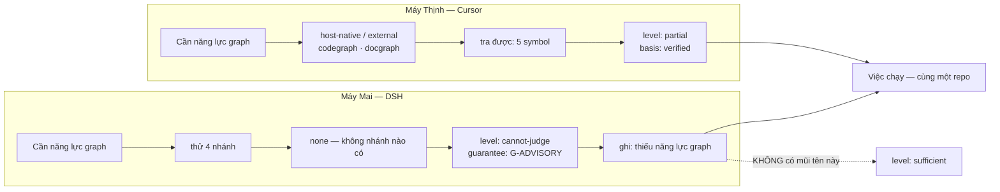
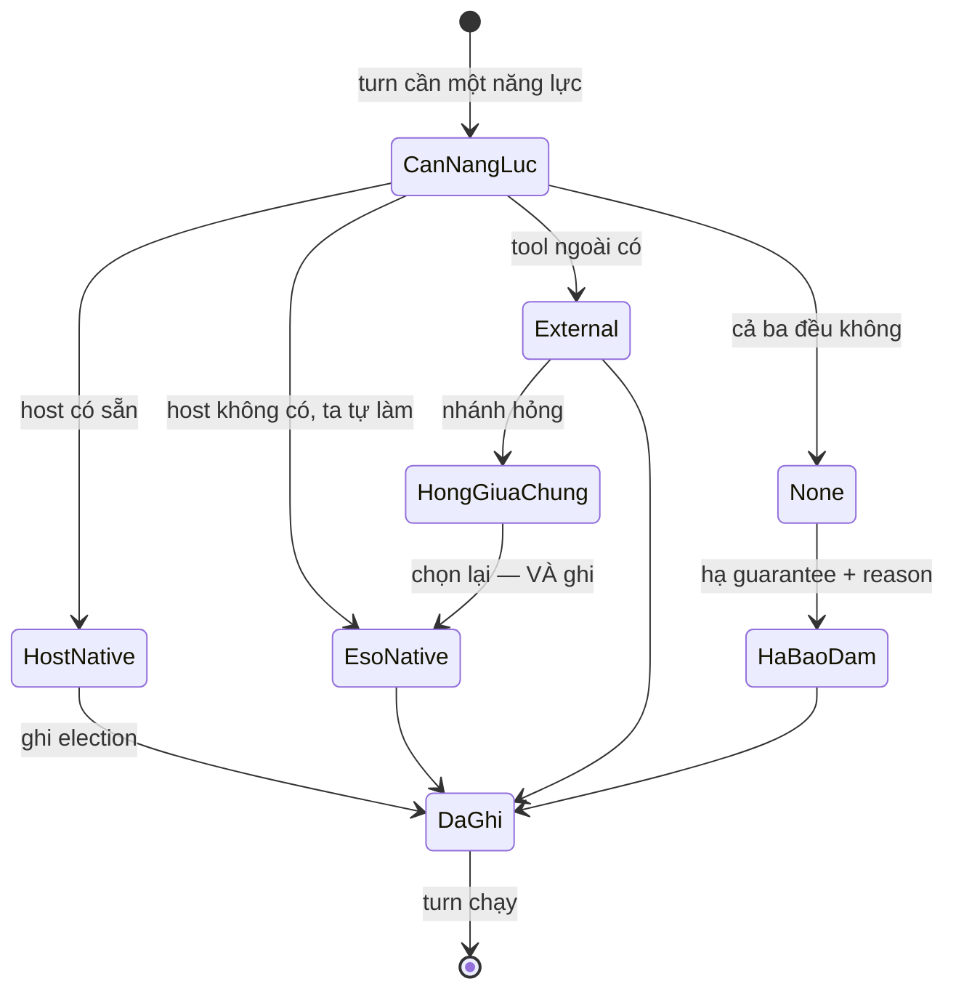
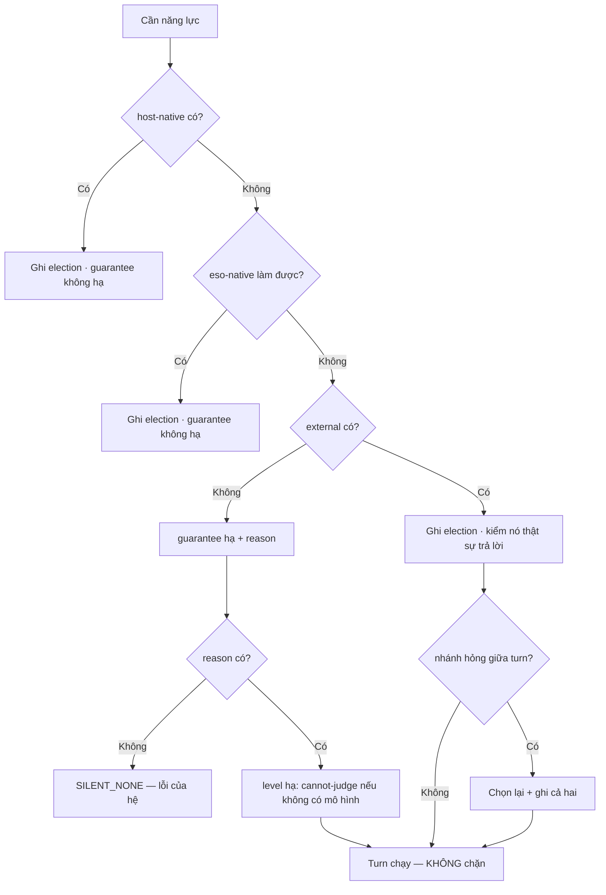

# BRD — Khi host thiếu công cụ: nói ra và hạ bảo đảm, không im lặng bỏ qua

> **Đây là tài liệu nghiệp vụ, không phải spec kỹ thuật.** Nó trả lời *vì sao* một lượt chạy "sạch" mà **không kiểm gì** là kết cục
> tệ nhất hệ này có thể sinh ra — tệ hơn cả một lượt chạy hỏng.

## 1. Bối cảnh

Cùng một repo, cùng một việc, hai máy. Trên máy của Thịnh (Cursor) agent tra được graph, đọc được luật, và kết luận `partial` —
thiếu **đúng hai** symbol. Trên máy của Mai (DSH) agent **không có** công cụ nào để tra: không MCP, `.docgraph/` có trên đĩa nhưng
**không có lệnh nào đọc nó**, `.cursor/rules/` **không được nạp**.

Kết quả trên máy Mai: `sufficient`. Không lỗi. Không cảnh báo. Agent làm, và việc **đúng như nó nghĩ**.

Điều vừa xảy ra **không phải** một lượt chạy yếu. Một lượt chạy yếu thì biết mình yếu. Đây là một lượt chạy **trông mạnh** — và
`sufficient` ở đó là một khẳng định **không có nguồn** (`BR-02`): hệ nói *"đủ"* trong khi nó **chưa xét gì**.

Vì vậy tài liệu này không nói về *"làm sao có nhiều công cụ hơn"*. Nó nói về một luật hẹp hơn và khó hơn: **khi thiếu, phải nói
thiếu — và phải hạ mức bảo đảm xuống đúng mức host đỡ được.**

### 1.1 Sơ đồ tổng quan



> **Đọc sơ đồ:** cùng một việc, hai máy, **hai** phán quyết — và đó là **đúng**. Điều sai là mũi tên nét đứt: `none` ⇒ `sufficient`.
> Một phán quyết `sufficient` đi ra từ một máy chưa xét gì là câu trả lời **trông chắc chắn nhất** và **sai nhất** trong cả hệ.

## 2. Những người trong câu chuyện

| Ai | Vai trong hệ thống | Họ thật sự cần gì |
|---|---|---|
| **Thịnh**, 44 tuổi, lead agent | `A-02` | Biết lượt chạy này **đã xét tới đâu** trên máy này — để so hai lượt chạy khác nhau mà không phải đoán |
| **Mai**, 37 tuổi, operator | `A-01` | Một mức bảo đảm **trung thực** để quyết: giao việc trên DSH, hay mở Cursor cho việc này |
| **Khánh**, 29 tuổi, vận hành | `A-08` | Ba tháng sau: *"vì sao turn này yếu hơn turn kia"* — trả lời được từ record, không cần mở log của host |
| **Host** (Cursor · DSH) | — | Không phải người, nhưng là **bên thứ ba** trong mọi câu trả lời: nó quyết định hệ làm được gì (`D-03`) |

> **Điểm dễ bỏ sót:** Mai **không** cần "DSH mạnh bằng Cursor". Cô cần biết **chỗ nào DSH yếu** để không giao việc cần graph cho
> DSH. Một mức bảo đảm trung thực **dùng được**; một lời hứa đều nhau thì không.

## 3. Chuyện xảy ra hôm nay (khi chưa có hệ thống)

Trong chính phiên làm việc này, `AGENTS.md` yêu cầu một quy trình: `memory_smart_search` → `docgraph --q` → `codegraph_explore`.
**Không công cụ nào trong số đó tồn tại** trên DSH.

Cơ chế thật đã chạy là: `grep` → `read` → `edit` → `bun test`. Một quy trình **yếu hơn**, và nó sinh đúng **ba** khẳng định sai trong
một phiên (`sdlc/04.landscape/03.working-environment.md` §3):

| Điều đã nói | Điều thật |
|---|---|
| graph cỡ "10⁴ node" | **10⁵–10⁶** — hai đến ba bậc lớn hơn (`D-22` bản sửa) |
| "eso đã đọc role" | Nó **không** đọc — suy từ tên hằng số |
| Hỏi "một kho hay hai" | Câu đó **đã** được định nghĩa ở `14` §5 |

Điều đáng chú ý: cả ba lần, **không ai** biết là mình đang thiếu công cụ. Không có chỗ nào ghi *"phiên này chạy không có
`codegraph`"* — nên câu trả lời trông giống hệt một phiên có đủ công cụ, chỉ khác là **đúng ít hơn**.

## 4. Hệ thống phải làm gì

### 4.1 Cần một năng lực ⇒ thử **bốn nhánh, theo thứ tự cố định**

`UC-14` · `REQ-HOST-03`.

```text
host-native ──▶ eso-native ──▶ external ──▶ none
```

| Nhánh | Nghĩa | Ví dụ thật |
|---|---|---|
| `host-native` | host đã có | session memory · skill catalog (skill) của DSH |
| `eso-native` | ta tự làm | tự đọc file thay vì gọi provider |
| `external` | tool ngoài | `codegraph` · `docgraph` CLI trên Cursor |
| **`none`** | **không có gì** | và đó là trạng thái **hợp lệ**, phải nói ra |

Thứ tự là **hợp đồng**, không phải gợi ý: kiểm đúng thứ tự, dừng ở nhánh **đầu tiên có** (`AC-HOST-01-04`). Nếu không cố định, hai
máy có cùng công cụ có thể chọn hai nhánh khác nhau cho cùng một việc, và phán quyết khác nhau **mà không ai đổi gì**.

### 4.2 Không nhánh nào bị chọn mà **không ghi**

`AC-HOST-01-01` · `AC-HOST-01-03`. Mỗi lần chọn ghi `elections{kind, provider, reason}` — hình dạng này **đã** có trong schema
(`elections` là **hàng** `evidence_item(kind='election')`, `D-58`), và `reason` **bắt buộc khi `from='none'`**.

Nhánh đang dùng hỏng giữa chừng ⇒ chọn lại **và ghi**; đổi ngầm bị từ chối (`SILENT_SWITCH`, `AC-HOST-03-02`). Vì sao nghiêm: một
lần đổi ngầm làm `mode` của turn đổi **mà `mode` không đổi** — biên lai sai, và `UC-09` (*"vì sao bị chặn"*) trả lời sai.

### 4.3 `none` là **sự thật**, không phải lỗi — và nó phải có **lý do**

`REQ-HOST-02` · `AC-HOST-02-01…-03`. Ba mệnh đề, không rời nhau:

| Mệnh đề | Nếu thiếu |
|---|---|
| `none` ⇒ **việc vẫn chạy** | Người dùng phải chọn giữa *"dừng"* và *"giả vờ có"* — và họ sẽ chọn giả vờ |
| `none` ⇒ **mức bảo đảm hạ**, lý do hiện **cùng** phán quyết | Hạ mà không nói thì turn yếu **trông** như turn mạnh |
| `none` ⇒ **phải có lý do** | `SILENT_NONE` — lỗi của chính hệ, không phải của host |

Vì sao lý do **không được** để trống: đó là **toàn bộ** thông tin còn lại. Khi `none`, hệ không biết gì cả — thứ duy nhất nó vẫn
biết là *"tôi cần graph và tôi không có graph"*. Bỏ lý do đi thì dòng đó thành *"không có"* trần trụi, tức là **im lặng viết dài**.

### 4.4 Ba mức bảo đảm — và cái gì **mất** ở mỗi mức

`sdlc/07.technical/01.architecture/11.host-capability.md` §2.

| Mức | Host đỡ được | Cái **mất** |
|---|---|---|
| **`G-FULL`** | danh tính + chặn (model và ghi) + bơm + runtime | — (đủ 5 `level`, đủ 5 `mode`) |
| **`G-SCOPE`** | chặn được, **không** có danh tính | `sufficient` **không phát biểu được** ⇒ hạ thành `partial`; scope lấy từ SLICE đã khai (yếu hơn: task có thể khai sai) |
| **`G-ADVISORY`** | chỉ đọc và khuyên | **không** có `block`; mọi thứ đi qua `permitted` + risk; gate thành **cảm biến**, không phải **cổng** |

**Ba, không phải hai.** `G-SCOPE` tồn tại vì có một ca thật và phổ biến: chặn được nhưng **không xác minh được ai đang làm**. Gộp
nó vào `G-FULL` là hứa một thứ không có; gộp vào `G-ADVISORY` là bỏ luôn khả năng chặn đang **có thật**.

**Và mức là của `turn`, không phải của host.** Trên DSH, một turn chỉ đọc file + chạy `bun test` ra `G-SCOPE`; turn cần blast
radius ra `G-ADVISORY`, vì `codegraph` không có. Hai turn, một máy, hai mức — và nếu adapter trả cùng một mức cho mọi turn trên
DSH thì `guarantee` thành **hằng số trang trí**, không còn là tín hiệu (`40.dsh-host` §7.3).

### 4.5 `sufficient` mà **thiếu `basis`** là khẳng định không nguồn — `BR-02`

> Không kết luận `sufficient` khi thiếu `basis`.

Luật này quan trọng nhất **đúng ở đây**, vì `none` là hoàn cảnh sinh ra `sufficient` không nguồn dễ nhất: không tra được gì ⇒
không tìm thấy gap ⇒ *"không có gap"* ⇒ `sufficient`. Chuỗi suy luận đó **hợp lệ về cú pháp** và **sai về nghĩa**. `BR-02` cắt nó
ở mệnh đề cuối: muốn nói `sufficient` thì phải nêu `basis ∈ {retrieved, verified, inferred}` (`REQ-JUDGE-01`), và `inferred` **không**
đỡ được một `sufficient` khi năng lực cần dùng đang là `none`.

Mức hạ xuống phải là **câu trả lời thật**: `cannot-judge` + nêu thiếu năng lực gì (`BR-05`: `unknown` ≠ `absent`). Không phải
`insufficient` — vì `insufficient` là một **khẳng định** (*"thiếu, và đây là chỗ thiếu"*), trong khi ở đây hệ **không biết chỗ nào**.

### 4.6 Ngưỡng là **dữ liệu**, không nằm trong code — `BR-09`

Bảng năng lực (`11` §3) và ngưỡng độ đầy đủ (`D-11`) là **dữ liệu**. Không được có `if (host === 'dsh') ⇒ no mcp`; thêm một host
mới phải là **thêm một dòng dữ liệu**, không phải sửa code.

Vì sao điều này thuộc BRD chứ không thuộc kỹ thuật: một ngưỡng nằm trong code nghĩa là **đổi ngưỡng = đổi code = phát hành**. Và
người duy nhất có quyền đổi ngưỡng là A-01, ở page config (`D-51`), **không** phải người viết code ở lần deploy sau. Ngưỡng trong
code biến một quyết định nghiệp vụ thành một việc kỹ thuật — và lần sau không ai biết ai đã đổi nó.

`D-11` nói `floor` **do product đặt** (không sửa được), `threshold` **do consumer đặt** trong `[floor, 1]`. Cả hai là **giá trị**, không
phải hằng số; và mọi claim `absent` phải ghi kèm `completeness · threshold · floor` — nếu không, hai project chênh ngưỡng sẽ
**trông như bất đồng về sự thật**.

## 5. Một ngày thật, có số

Repo `baplatform`, **50 turn** trên máy có đủ năng lực (Cursor) và **50 turn** cùng loại việc trên máy **thiếu** `codegraph`
(DSH), trong cùng một ngày 2026-10-21.

| | Cursor (`G-FULL`) | DSH (`G-ADVISORY` / `G-SCOPE`) |
|---|---|---|
| Turn | 50 | 50 |
| Turn có `level = sufficient` | 31 | **44** ← *nhiều hơn*, và đó là **xấu** |
| Turn ghi ít nhất một `election` | 50 | 50 (không nhánh nào bị chọn ngầm) |
| Election `from='none'` | 0 | **19** |
| Election `none` **có** `reason` | — | 19/19 (`SILENT_NONE` = 0) |
| `guarantee = G-FULL` | 50 | **0** |
| `guarantee = G-SCOPE` | 0 | 31 |
| `guarantee = G-ADVISORY` | 0 | 19 |
| Việc phải làm lại vì blast radius sai | 2 | **7** |

**Ba con số của §5, đọc cùng nhau:**

1. **`sufficient` trên DSH là 44/50, trên Cursor là 31/50.** Con số **cao hơn** đến từ một hệ **xét ít hơn** — không phải từ một
   đội giỏi hơn. Đây là lý do `sufficient` **không bao giờ** được đọc một mình: nó phải đọc cùng `guarantee`.
2. **19 election `none`, 19 có lý do.** Con số quan trọng không phải 19 — mà là **19/19**. Một `none` không lý do là một dòng
   `SILENT_NONE`, và theo `AC-HOST-02-03` mệnh đề đúng là *"**0** phán quyết im lặng"*.
3. **7 việc làm lại so với 2.** Đây là **giá** của DSH, đo được, và nó **nói thật**: DSH giao việc được, nhưng blast radius thì
   không. Mai dùng số này để chọn máy cho từng loại việc — không phải để cấm DSH.

**Điều tôi không được làm với bảng này:** cộng ba dòng `guarantee` lại thành *"DSH đạt 31 + 19 = 50 turn chạy được"*. `G-SCOPE` và
`G-ADVISORY` **không** so sánh được như hai mẫu của một thứ; chúng nói hai thứ khác nhau về **chặn** và về **xét**.

### 5.1 Bốn nhánh đi qua



**Không có cạnh nào từ `None` về `CanNangLuc` mà không ghi.** Và không có cạnh từ `None` về một trạng thái "chạy như bình thường":
`HaBaoDam` **luôn** nằm giữa. Nếu ai đó gộp nó — *"đằng nào cũng chạy, hạ mức làm gì"* — thì lượt chạy trên DSH thành không phân biệt
được với lượt chạy trên Cursor, và §5 mất toàn bộ ý nghĩa.

## 6. Ngoại lệ — và hệ thống làm gì

| Tình huống thật | Hệ thống xử lý |
|---|---|
| DSH: `.docgraph/` có trên đĩa, **không** có lệnh đọc | `none` + lý do *"có index, không có công cụ truy vấn"* — **không** `absent` |
| DSH: `.cursor/rules/*.mdc` **không** được nạp | năng lực "luật theo file của host" = `none`; luật phải đi đường khác hoặc được nêu là không áp |
| Ghim thủ công một nguồn mà host **không** có | Từ chối `PIN_UNAVAILABLE`; **không** rơi xuống nhánh khác (`AC-HOST-04-03`) |
| Ghim một nguồn **có** trên host nhưng `OUT` cho năng lực đó | Từ chối; **không** coi là có (`AC-HOST-04-04`) |
| Nhánh `external` hỏng giữa turn | Chọn nhánh kế **và ghi cả hai**; đọc lại thấy **cả** nhánh đã thử và nhánh đang dùng (`AC-HOST-03-01`) |
| Một turn cần **nhiều** năng lực, tất cả đều `none` | **Mỗi** năng lực một mục `none` riêng kèm lý do; **không** gộp (`AC-HOST-02-04`) |
| Một nhánh được chọn **hai lần** cho cùng `kind` trong một turn | **Một** bản ghi cho mỗi `kind` (`AC-HOST-02-05`) |
| Phát lại record sau khi provider đã bị gỡ | Nhận ra **nguồn đã mất**; không coi là đang dùng, không bịa provider (`AC-HOST-03-05`) |
| Cấu hình năng lực của project A | **Không** áp cho project B (`AC-HOST-01-05`, `OUT_OF_SCOPE`) |
| Không có election nào cho một năng lực | `OUT` + lý do; **không** bịa `host-native` (`AC-HOST-05-02`) |
| Máy trông có đủ công cụ nhưng probe chưa đo | Trần là `G-SCOPE` cho tới khi đo — `identity` của DSH **chưa xác minh** (§8, câu 4) |

### 6.1 Sơ đồ nhánh lỗi



> **Đọc sơ đồ:** nhánh `SILENT_NONE` là nhánh duy nhất hệ **tự** sinh lỗi, và nó có thể bị bắt bằng một phép kiểm duy nhất: *"có
> `none` mà không có `reason` không"*. Đây là phép kiểm rẻ nhất bảo vệ điều đắt nhất — vì một `none` không lý do **trông** giống
> một năng lực đã có.

## 7. Điều ngoài phạm vi

| Không thuộc BRD này | Thuộc |
|---|---|
| Tính `level`/`basis` từ bằng chứng đã có | `01.uc-01-is-it-enough.md` §4.1 |
| Cảnh báo khi thiếu **mà không ai hỏi** | `13.uc-13-unprompted-warning.md` |
| Ghi lại nhánh đã chọn để đọc lại sau N tháng | `03.uc-03-why-this-decision.md` |
| Chọn **skill/luật nào áp** khi đã có nguồn | `06.uc-06-which-rule-applies.md` |
| Đo năng lực host (probe) và bảng năng lực | `sdlc/07.technical/01.architecture/11.host-capability.md` §3 · `sdlc/04.landscape/03.working-environment.md` |
| Cài đặt host / thêm MCP cho một IDE | ngoài sản phẩm |
| Ai có quyền ghim nguồn | `sdlc/07.technical/01.architecture/08.actor-domain-tenant.md` |
| Ca kiểm thử | `sdlc/06.analysis/03.acceptance-criteria/20.host-us-01-election.md` · `27.host-us-02-none.md` |

## 8. Câu chưa có trả lời trong release

| # | Câu hỏi | Mã | Vì sao là câu mở **thật** |
|---|---|---|---|
| 1 | **`guarantee` được ghi ở đâu?** `11` §2 **bắt buộc** mỗi turn ghi mức bảo đảm; `evidence_turn` **không có** cột `guarantee`, `API-1` `payload` **không** khai khoá, `elections{kind, provider, reason}` **không** có trường đó | `OPEN-4` của `40.dsh-host` (trùng `OPEN-1` của `38.host-audit`) | Đã đọc `11` §1–§6, `02.schema` §2, `01.contracts` §3 — **0** chỗ định nghĩa nơi ghi. `grep -rn "guarantee" sdlc/` ra 14 dòng, tất cả là **dùng**. §5 của tài liệu này dựng trên một trường **chưa có nhà** — và đó là lý do §5 phải ghi rõ ba số đọc từ **đâu** |
| 2 | **"Đúng ba mức" gắn vào đâu — từng năng lực, hay cả bảng?** `DoD` §8.1 nói *"mỗi năng lực có đúng ba mức"*; `11` §2 viết ba mức như ba **tầng của một thang** gắn vào **tập** năng lực | `OPEN-1` của `39.host-contract-out` | Hai cách đọc cho hai **kiểu dữ liệu** khác nhau: một mức cho cả turn, hay bản đồ `năng lực → mức`. `27.host-us-02-none` §1 (*"mỗi năng lực một mục `none` riêng"*) nghiêng cách hai, `11` §2 nghiêng cách một — **cây tự cãi**, và tôi không tự chọn |
| 3 | **Ba bảng năng lực trong cây không cùng một tập.** `AGENTS.md` (năng lực agent) · `11` §1 (7 năng lực) · `06.host.spec` (7 năng lực khác — `file read/write` · `command execution` · `session memory` · `skills` · `pre-step hook` · `graph` · `search`) | `OPEN-2` của `40.dsh-host` | DSH **có** `subagent` và `workflow` — **không** bảng nào liệt chúng ⇒ một turn dùng chúng **không** ghi `election`, tức phép kiểm "không nhánh nào chọn ngầm" **mù** đúng ở chỗ DSH mạnh. §6 dòng *"mỗi năng lực một mục `none`"* phụ thuộc câu này |
| 4 | **`identity` của DSH — `chưa xác minh`.** `11` §3 ghi *"payload có `agent`, shape chưa xác minh"* | `OPEN-3` của `40.dsh-host` | Trần `guarantee` của DSH phụ thuộc trực tiếp: không `identity` ⇒ không `G-FULL`. Nếu shape hoá ra **có** role thì trần có thể là `G-FULL`, và mọi con số `G-SCOPE` ở §5 là **hạ quá tay** |
| 5 | **Ngưỡng `floor` cho `sufficient` là bao nhiêu?** `D-11` nói là **dữ liệu**, **không** nói giá trị mặc định | `OPEN-SUF-02` (đã ghi ở `01.uc-01-is-it-enough.md` §8) | `BR-09` nói ngưỡng là dữ liệu — nhưng **không** nguồn nào cho giá trị. Với `G-ADVISORY` câu này nặng hơn: khi không tra được gì, `completeness` là **bao nhiêu**, và `sufficient` có bị **cấm** phát biểu bất kể ngưỡng? |
| 6 | **Hai phép kiểm không-`AC` của slice host có thành gate scenario không?** (vắng mặt được ghi · trần `guarantee`) | `OPEN-5` của `40.dsh-host` | `07.host-scenario-matrix` có **27/27** `SCN` đều gắn một `AC`; không `SCN` nào giữ *"trần `guarantee`"*. Nếu không thành gate, bất biến *"DSH không bao giờ `G-FULL`"* sống **chỉ trong tài liệu** — đúng thứ `03.bip-fip` §0 gọi là *"a plan inside a document"* |

> **Một câu tôi đã tự trả lời, và ghi ra để không ai hỏi lại:** *"`none` có phải là lỗi cần xử lý không?"* — **Không.** `AC-HOST-02-01`
> nói `none` ⇒ việc **vẫn chạy**; `REQ-HOST-02` nói lỗi là **im lặng**, không phải **thiếu**. Nên câu *"làm sao tránh `none`"*
> không phải câu mở, và nếu ai đó biến nó thành mục tiêu thì hệ sẽ **giấu** `none` thay vì nói ra.

## 9. Truy vết

| Yêu cầu | Điều khoản | Mục trong BRD |
|---|---|---|
| `REQ-HOST-02` — thiếu thì nói ra + hạ bảo đảm | `BR-02` · `BR-05` | §4.3 · §4.4 · §4.5 · §6 |
| `REQ-HOST-03` — thứ tự bốn nhánh, nhánh đã chọn được ghi | `BR-07` (không chặn) · `D-58` | §4.1 · §4.2 · §5.1 |
| `REQ-HOST-01` — host là thứ **có sẵn**, eso gắn vào | `D-03` | §1 · §3 |
| `REQ-JUDGE-01` — `level` + `basis` từng yêu cầu | `BR-02` | §4.5 |
| `BR-02` — không `sufficient` khi thiếu `basis` | `BR-02` | §1 · §4.5 |
| `BR-05` — `unknown` ≠ `absent` | `BR-05` | §4.5 · §6 |
| `BR-09` — ngưỡng là **dữ liệu** | `BR-09` | §4.6 |
| `D-11` — `floor` / `threshold` / `completeness` | `BR-09` | §4.6 · §8 (câu 5) |
| `D-51` — page config là bề mặt thiết lập | `BR-09` | §4.6 |

| Use case | Mục |
|---|---|
| `UC-14` chọn nguồn năng lực | §4.1 · §4.2 · §5.1 |
| `UC-14.1a` nhánh hỏng giữa chừng | §4.2 · §6 · §6.1 |
| `UC-01` đã đủ chưa (nhận `cannot-judge`) | §4.5 |
| `UC-09` vì sao bị chặn | §4.2 |

| AC | Mục |
|---|---|
| `AC-HOST-01-01` · `-03` · `-04` · `-05` | §4.1 · §4.2 · §6 |
| `AC-HOST-02-01…-05` | §4.3 · §5 · §6 · §6.1 |
| `AC-HOST-03-01…-05` | §4.2 · §6 |
| `AC-HOST-04-03` · `-04` | §6 |
| `AC-HOST-05-01` · `-02` | §4.2 · §6 · §8 (câu 2–3) |

## Revision rule

Sai khi: `BR-02` bị đọc thành *"có `basis` là đủ"* (nó nói **không `sufficient` khi thiếu**, không nói **có là đủ**); hoặc ba mức bảo
đảm đổi tên/số (`11` §2 — ba, không phải bốn); hoặc `none` được định nghĩa lại là lỗi; hoặc thứ tự `host-native → eso-native →
external → none` đổi (nó là hợp đồng của `REQ-HOST-03`).
Nguồn kiểm: `grep -c 'G-ADVISORY' sdlc/07.technical/01.architecture/11.host-capability.md` và `grep -n 'BR-02\|BR-09' sdlc/06.analysis/01.business-analysis/03.business-rules.md`
