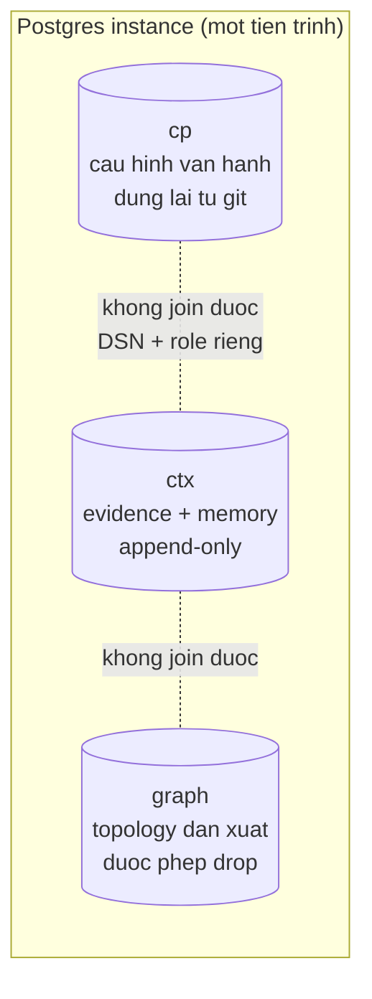
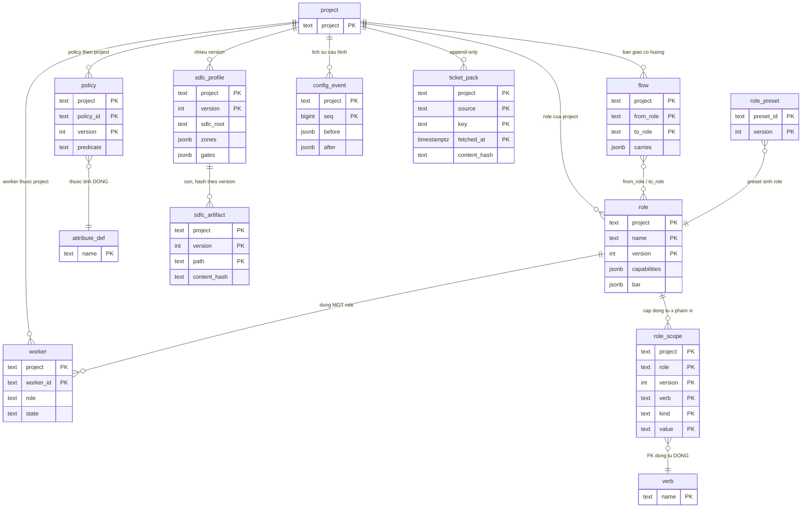
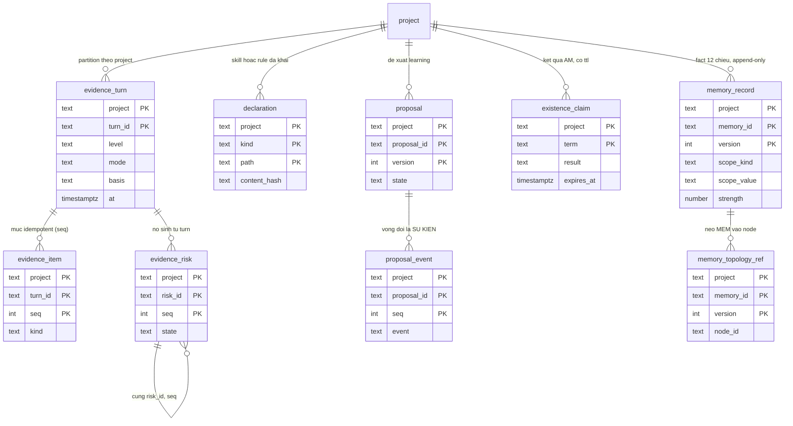
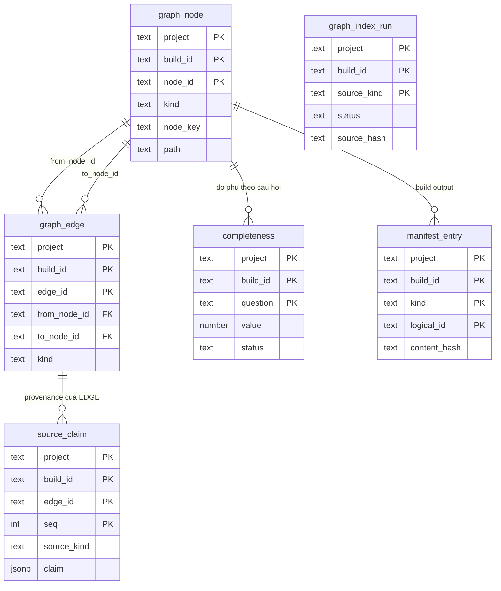

# 01a — ERD: hình của mô hình dữ liệu

> **Hình, không phải nguồn.** Entity ở [`01.entities.md`](01.entities.md); DDL, khoá, RLS, index ở
> [`02.schema.md`](02.schema.md) và [`26.graph-schema.md`](26.graph-schema.md). File này vẽ **lại** hai file đó —
> nếu hình khác chữ, cái sai là hình.
>
> Trước file này repo **không có ERD nào cho data-design ESO**; hai ERD sẵn có nằm ở `docs/` và mô tả **harness observe**
> (một SQLite/project), không phải mô hình ba database dưới đây.

## 1. Ba database trong **một** instance — `D-73`



| database | Số bảng | Bảng | Dựng lại được? |
|---|---:|---|---|
| **`cp`** | 13 | `project` · `role` · `role_scope` · `verb` · `attribute_def` · `policy` · `flow` · `worker` · `role_preset` · `sdlc_profile` · `sdlc_artifact` · `config_event` · `ticket_pack` | ✅ từ **git** (`D-23`) |
| **`ctx`** | 9 | `evidence_turn` · `evidence_item` · `evidence_risk` · `declaration` · `proposal` · `proposal_event` · `existence_claim` · `memory_record` · `memory_topology_ref` | ❌ backup hằng ngày |
| **`graph`** | 6 | `graph_node` · `graph_edge` · `source_claim` · `completeness` · `manifest_entry` · `graph_index_run` | ✅ extract lại |

**Tổng 28 bảng** — con số này là của `01.document-status.md` và `X24` canh; câu đếm trong `00.index` / `02.schema` §2 đang ghi 27
là **văn xuôi chưa cập nhật** sau khi thêm `graph_index_run`.

## 2. `cp` — cấu hình vận hành (13 bảng)



`verb` và `attribute_def` **không thuộc project** (vocab đóng); `role_preset` thuộc `pool` (nội dung), không thuộc project —
lý do `scope` là bảng riêng: cần **FK** để chặn động từ lạ bằng **cơ chế**, không bằng `if` trong code.

## 3. `ctx` — cái đã xảy ra / đã biết (9 bảng)



`isLatest` của memory **không phải cột** — tính từ `max(version)`. `hit` / `weak` / `miss` cũng không phải bảng: chúng tính
từ `strength` + `updated_at`.

## 4. `graph` — topology dẫn xuất (6 bảng)



`source_claim` **cố ý không FK** tới `graph_edge`: `graph` được phép drop/rebuild theo `build_id`, FK `RESTRICT` sẽ chặn rebuild
— bù lại bằng `REVOKE UPDATE, DELETE` **và** trigger append-only.

## 5. Ba tham chiếu **xuyên database** — không phải FK

```text
memory_topology_ref.node_id  ┄┄▶  graph_node.node_id      (mềm: D-73, hai database)
evidence_item.kind=authz     ┄┄▶  policy (cp)             (quyết định uỷ quyền LÀ evidence)
declaration (ctx)            ┄┄▶  file trong git          (DB là bản vận hành, git là bản bền)
```

Postgres **không join được** hai database khác nhau: mọi mũi tên `┄▶` ở trên là **tra qua API**, không phải FK. Đây là cái
giá phải trả của `D-73`; bù lại backup/role/DSN tách được theo vòng đời dữ liệu.

## 6. Hai thứ **không** có hình vì không phải bảng

| Không phải bảng | Thực ra là |
|---|---|
| `visibility` | phép so `project` bản ghi × `project` người hỏi, tính lúc truy vấn (`D-47`) |
| `verdict` / `diagnosis` | tính lại từ `evidence_turn` + `evidence_item` theo `rule_version` (`BR-06`, `D-46`) |

## 7. Họ bảng **chưa có hình** — và vì sao

`artifact v2` (`F-19`…`F-23`: `kind` · `owner` · `template` · ledger + `kt_state` · approval event) **chưa có file và chưa có
bảng**. Hệ quả hiện tại: `eso/knowledge/**` chạy như **library thuần** trên object `project` — chưa có đường persist. Điều kiện
mở họ này vẫn như `02.schema.md` §4: có chức năng đang build cần nó, và câu hỏi truy vấn viết được thành SQL.

## Luật sửa

File này **sai** khi:

1. hình khác `01.entities.md` §3 hoặc khác DDL trong `02.schema.md` / `26.graph-schema.md`;
2. số bảng trong §1 khác register `01.document-status.md` (`X24` bắt);
3. một quan hệ **xuyên database** bị vẽ thành FK (join được) — điều đó chỉ đúng khi `D-73` bị thay;
4. có bảng mới mà hình không có, hoặc hình có bảng không tồn tại.
